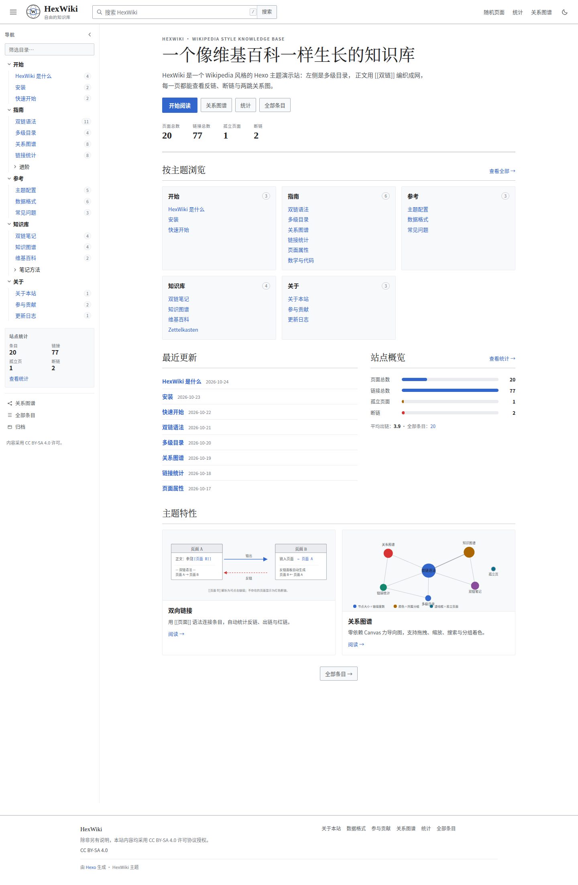

# HexWiki

**一个把 Hexo 变成「维基百科式知识库」的主题**：左侧多级目录、`[[双链]]` 引用、反链/断链统计，
以及类似 Obsidian 的关系图谱。零前端依赖、纯静态输出。

本仓库 = **可直接运行的 demo 站点** + **主题本体**（`themes/hexowiki/`）。

<p align="center">
  
  
</p>

---

## 特性

- **维基百科视觉**：Vector 2022 浅色基准、衬线标题、信息框、文内目录、分类框、页脚许可说明、深色模式。
- **左侧多级目录**：`navigation: 指南/进阶` 驱动任意层级；折叠、筛选、`localStorage` 记忆、
  当前条目高亮、祖先自动展开、反链数徽标、侧栏站点统计。
- **双链语法**：`[[页面]]`、`[[页面|显示文字]]`、`[[页面#章节]]`、`[[#本文锚点]]`；
  别名解析（`aliases`）、大小写/全角归一化、代码块内不解析、未解析目标渲染为**红链**并计入断链。
- **反链统计**：每页自动统计链入 / 链出 / 断链，反链带**上下文摘要**；断链给出「你可能想找」候选。
- **关系图谱**：全站力导向图（Canvas，零依赖）+ 条目页 2 跳局部图；拖拽、滚轮缩放、平移、
  hover 提示、点击跳转、按分组着色、搜索高亮、未创建节点空心虚线。
- **标签**：`/tags/` 标签云 + 实时筛选，标签页按标签聚合条目（`/tags/<标签>/`）。
- **统计与索引**：`/stats/`（孤立条目、断链、被引用排行、分组/标签分布）、`/wiki/all/`（按首字索引）。
- **搜索**：构建期生成 `/wiki-search.json`，顶栏即输即搜，键盘导航。
- **代码与数学**：代码高亮 + 一键复制；KaTeX 本地渲染 `$...$` / `$$...$$` / `\(...\)` / `\[...\]`，按页面内容自动加载。
- **工程化**：纯函数内核 + 18 个单元测试；构建期解析，无运行时后端；响应式（<1000px 抽屉）。

## 快速开始

```bash
# 本仓库即 demo 站点
npm install
npm run build      # hexo generate
npm run server     # http://localhost:4000
npm test           # node --test themes/hexowiki/test/*.test.js
```

把主题装到自己的站点：

```bash
cp -r themes/hexowiki your-site/themes/hexowiki
cd your-site
npm install hexo-renderer-ejs hexo-renderer-marked
```

站点 `_config.yml`：

```yaml
theme: hexowiki
permalink: wiki/:name/
pretty_urls:
  trailing_index: false
  trailing_html: false
```

主题配置（`themes/hexowiki/_config.yml`）带完整注释：站标、导航分组顺序、功能开关、图谱参数、
信息框/页脚许可、首页文案。详见 [`themes/hexowiki/README.md`](themes/hexowiki/README.md)。

## 写一条 wiki

```markdown
---
title: 双链语法
date: 2026-10-20 10:00:00
updated: 2026-10-24 18:00:00
summary: 用双方括号在条目之间建立引用。
navigation: 指南          # 侧栏父级路径，可多级：指南/进阶
nav_title: 双链语法
nav_order: 20
aliases: [Wiki链接]        # 双链解析别名
tags: [语法]
infobox:
  fields:
    - { label: 类型, value: 引用语法 }
---

双链写作 `[[目标标题]]`，可写 `[[目标|显示文字]]` 或 `[[目标#章节]]`。
指向不存在的页面会变成红链，例如 [[尚未撰写的条目]]。
```

## 页面改名自动改链

`title` 或文件名变化后，自动把 `source/` 下所有 `[[旧名字]]` 改写成新名字（保留 `|显示文字`、`#章节`，跳过代码块）：

```bash
npm run links:sync     # 扫描并修复一次
npm run links:watch    # 常驻监视（默认每 2 秒）
```

首次运行只记录状态（`.link-sync-state.json`，已 gitignore），不会改文件；文件重命名优先按 title 配对，其次按内容哈希配对。

## 生成的路由

| 路由 | 说明 |
| --- | --- |
| `/graph/` | 全站关系图谱 |
| `/stats/` | 链接统计面板 |
| `/wiki/all/` | 全部条目索引 |
| `/tags/` | 标签云与全部标签（筛选） |
| `/tags/<标签>/` | 该标签下的条目列表 |
| `/wiki-graph.json` | 图谱数据（含未创建节点） |
| `/wiki-search.json` | 搜索索引 |
| `/wiki-stats.json` | 统计快照 |

## 目录结构

```
.
├── _config.yml                  # demo 站点配置（permalink / 生成器排序等）
├── source/_posts/               # 20 篇 demo 条目（双链、信息框、多级目录、断链、孤立页）
├── docs/
│   ├── CONTRACT.md              # 实现契约（数据形状 / helper / DOM / 验收标准）
│   └── screenshots/             # 验收截图
└── themes/hexowiki/
    ├── layout/                  # EJS：layout/index/post/page + 9 类页面 + 16 个 partial
    ├── source/                  # 原生 CSS / JS（app.js, graph.js）/ SVG
    ├── lib/                     # 纯函数内核（wiki-text / wiki-graph，可脱离 Hexo 单测）
    ├── scripts/wikilinks.js     # Hexo 生命周期接入 + helper + generator
    ├── test/                    # node --test 单元测试
    ├── languages/               # zh-CN / default
    └── _config.yml              # 主题配置
```

## 实现要点

- `before_generate`（priority 1）在 Hexo 渲染正文前扫描全部 posts/pages，统一构建：页面注册表、
  双链解析、反链/出链/断链、侧栏树、局部图、统计、搜索索引。默认把正文缓存置空以强制重渲染，
  保证链接指向始终与当前页面集合一致（`wiki.re_render: false` 可关闭）。
- `after_post_render` 在 HTML 文本节点内替换 `[[...]]`，跳过 `pre/code/script/style/textarea/a`
  与标签属性，输出 `wikilink` / `wikilink--missing` 锚点。
- 模板只依赖 helper（`wiki_nav()` / `wiki_page()` / `wiki_in()` / `wiki_local_graph()` …），
  数据形状见 [`docs/CONTRACT.md`](docs/CONTRACT.md)。
- 图谱与搜索数据全部构建期生成，前端零依赖。

## 验收

- `npm run build`：0 error（77 个文件）。
- `npm test`：18 项单元测试全绿。
- 结构校验：路由 / JSON 一致性 / 图谱度数 / 内链可达（64 个目标）/ 条目页结构，全部通过。
- 浏览器验收（Chrome DevTools Protocol）：
  - 桌面 1440、移动 390（mobile emulation）、深色模式：`scrollWidth == clientWidth`，0 console error，0 失败请求；
  - 交互 9 项全部通过：搜索建议/跳转、红链拦截 + 提示、深色切换与持久化、侧栏筛选、
    移动端抽屉、全站图谱渲染/搜索高亮、局部图数据与画布。

## 如何测试

### 1. 浏览器点测（最快，约 3 分钟）

先 `npm run server`，打开 <http://localhost:4000>，按下面清单逐项核对（括号内为 demo 数据的预期值）：

| 操作 | 预期 |
| --- | --- |
| 打开首页 `/` | 左侧 5 个分组（开始/指南/参考/知识库/关于）可折叠；统计为 **20 页面 / 77 链接 / 1 孤立 / 2 断链**；「按主题浏览」「最近更新」有内容 |
| 点侧栏「指南 → 双链语法」 | 当前项高亮 + 左侧蓝条，祖先分组自动展开；文章顶部显示 **链入 11 · 链出 6 · 断链 0** |
| 滚动到「链入页面」 | 11 条来源页，每条带上下文摘要；「出链页面」6 条 |
| 点正文里的蓝色双链 | 跳到目标条目；浏览器后退可回来 |
| 打开 `/wiki/faq/` | 正文里 **2 个红链**（`双链筆記`、`未来计划`）；点击红链**不跳转**，底部弹「条目尚未创建」；「断链」面板给出「你可能想找」 |
| 打开 `/wiki/bidirectional-linking/` | 右侧**信息框**（类型/核心机制/相关）；标题下别名提示；点出链里的「双链语法 § 基本语法」应跳到对应章节 |
| 打开 `/wiki/orphan-demo/` | 链入 0；打开 `/stats/` 的「孤立页面列表」能看到「孤立页面示例」 |
| 打开 `/graph/` | 节点可拖动、滚轮缩放、拖空白平移；搜索「双链」高亮 3 个节点；点节点跳转；2 个**空心虚线红圈**代表未创建页面 |
| 打开 `/stats/` | 页面 20 / 链接 77 / 孤立 1 / 无出链 0 / 断链 2；被链入 Top1 是「双链语法 11」 |
| 打开 `/wiki/all/` | 按 H / Z / 汉 等首字分组，共 20 条 |
| 顶栏搜索框输入「双链」 | 下拉出现 8 条建议；点第一条进入「双链笔记」；按 `/` 可聚焦搜索 |
| 点右上角月亮/太阳 | 切深色模式，刷新后保持 |
| 把窗口拖窄到 < 1000px | 左侧目录变成汉堡抽屉；正文无横向滚动条（390px 下应完全贴合） |

### 2. 命令行自动化

```bash
npm install
npm run build       # 0 error
npm test            # 18 项双链内核单元测试
npm run verify      # 静态产物校验：路由/JSON 一致性/图谱度数/内链可达/页面结构

npm run server      # 另开一个终端保持运行
npm run verify:ui   # 9 项真实浏览器交互测试（需要 Chrome/Chromium，可用 CHROME_BIN 指定）
```

`verify:ui` 会检查：搜索建议与跳转、红链拦截提示、深色切换与持久化、侧栏筛选、移动端抽屉、
全站图谱渲染与搜索高亮、局部图数据。可用 `WIKI_URL=http://127.0.0.1:4100` 指向其他端口。

> `npm run verify` 里的「20 篇 / 2 条断链 / 孤立页示例」是按本仓库 demo 内容断言的；
> 你增删内容后按需调整 `tools/verify-site.js` 中的期望值，或只把它当回归参考。

### 3. 验证「写入即生效」

```bash
# 新建一个条目
cat > source/_posts/test-page.md <<'EOF'
---
title: 测试页
date: 2026-10-25 12:00:00
navigation: 关于
nav_order: 99
---
这里链接 [[双链语法]]，还有一个 [[尚未存在]]。
EOF
npm run build
```

然后检查：`/wiki/test-page/` 出现、侧栏「关于」新增「测试页」、`/wiki/wikilinks/` 的链入从 11 变 12、
`/stats/` 断链从 2 变 3、`/graph/` 多一个节点。验证完删除该文件再 build 即可恢复。

## 已知限制与建议

- 双链在**构建期**解析；条目改名后重新 `hexo generate` 即可（默认已强制重渲染）。
- 数据量 > 2000 条目时建议 `wiki.re_render: false` 并接受缓存内容，或拆分站点。
- 章节锚点取 marked 生成的 heading id；标题含复杂行内格式时，建议在 `[[页面#章节]]` 中使用纯文本标题。
- 红链点击不跳转，由前端提示「条目尚未创建」。
- 侧栏为独立滚动容器；分组较多时统计卡需向下滚动查看。

## License

MIT
