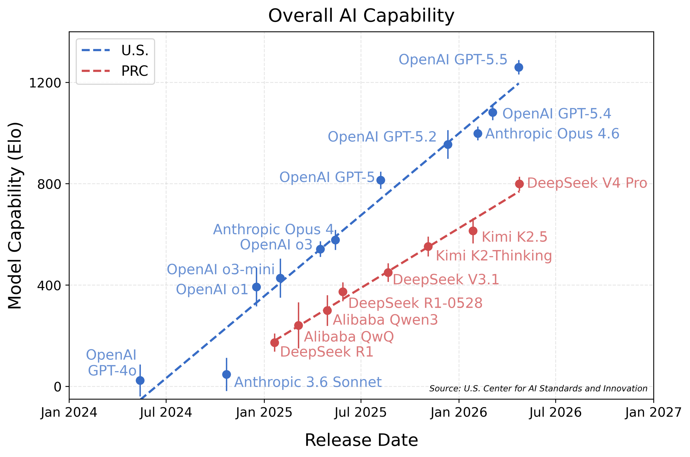
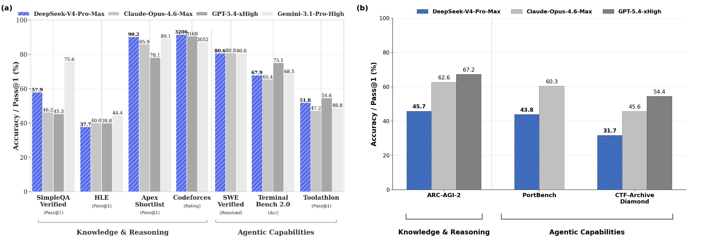
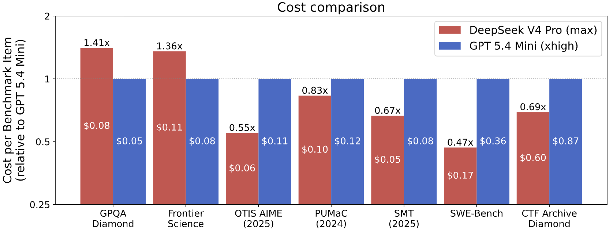

# CAISI 对 DeepSeek V4 Pro 的评估

2026年4月，美国国家标准与技术研究院（NIST）下属的 AI 标准与创新中心（CAISI）对开源权重 AI 模型 DeepSeek V4 Pro 进行了独立评估。CAISI 的评估表明，DeepSeek V4 的能力落后美国前沿约 **8 个月**。

*图1：美国和中国最强大的公开模型在各领域基准测试中的综合能力对比。y 轴每增加 200 分，解决特定任务的概率增加 3 倍。模型能力通过基于项目反应理论（IRT）的方法拟合。*

## 关键发现

1. **DeepSeek V4 是迄今为止 CAISI 评估过的最强中国 AI 模型**。CAISI 的评估涵盖网络安全、软件工程、自然科学、抽象推理和数学五个领域。

2. **DeepSeek 的自评成绩高于 CAISI 独立评估成绩**。根据 DeepSeek 自己的数据，V4 大约与两个月前发布的 Opus 4.6 和 GPT-5.4 能力相当。但 CAISI 的评估（包含非公开基准测试）表明，DeepSeek V4 的表现更接近 8 个月前发布的 GPT-5。

3. **DeepSeek V4 性价比更优**。与能力相近的美国参考模型（GPT-5.4 mini）相比，DeepSeek V4 在 7 项基准测试中的 5 项上更具成本效益。在这 7 项测试中，DeepSeek V4 的成本从便宜 53% 到贵 41% 不等。

## 能力测试结果

*图2：各能力基准测试的模型表现（越高越好）。加粗高亮为该基准的最佳表现者。*

### 详细分数

| 领域 | 基准测试 | GPT-5.5 | GPT-5.4 mini | Opus 4.6 | DeepSeek V4 Pro |
|------|---------|---------|-------------|----------|----------------|
| 网络安全 | CTF-Archive-Diamond | 71% | 32% | 46% | 32% |
| 软件工程 | SWE-Bench Verified | 81% | 73% | 79% | 74% |
| 软件工程 | PortBench | 78% | 41% | 60% | 44% |
| 自然科学 | FrontierScience | 79% | 74% | 72% | 74% |
| 自然科学 | GPQA-Diamond | 96% | 87% | 91% | 90% |
| 抽象推理 | ARC-AGI-2 半私有 | 79% | – | 63% | 46% |
| 数学 | OTIS-AIME-2025 | 100% | 90% | 92% | 97% |
| 数学 | PUMaC 2024 | 96% | 93% | 95% | 96% |
| 数学 | SMT 2025 | 99% | 92% | 94% | 96% |

**IRT 估计 Elo 分数**：
- GPT-5.5: 1260 ± 28
- Opus 4.6: 999 ± 27
- **DeepSeek V4 Pro: 800 ± 28**
- GPT-5.4 mini: 749 ± 46

### 各领域分析

**数学：DeepSeek 最强的领域**
- AIME 2025 得分 97%，仅低于 GPT-5.5 的满分
- PUMaC 和 SMT 成绩与美国前沿差距很小
- 这可能与 DeepSeek 的训练数据构成和强化学习策略有关

**网络安全：差距最大的领域**
- CTF-Archive-Diamond 仅 32%，与 GPT-5.5 的 71% 差距巨大
- 这项测试基于 285 道高难度 CTF 挑战题
- 可能反映了训练数据中网络安全实践内容的不足

**抽象推理：明显落后**
- ARC-AGI-2 半私有数据集仅 46%，GPT-5.5 为 79%
- 该基准测试来自 ARC Prize Foundation，测试纯抽象推理能力
- 暗示模型在泛化推理方面仍有提升空间

**软件工程：中等水平**
- SWE-Bench Verified 74%（GPT-5.5 为 81%）
- CAISI 自建的 PortBench 44%（GPT-5.5 为 78%）
- PortBench 测试将 CLI 工具移植到不同编程语言的能力，是 held-out 基准

**自然科学：接近前沿**
- GPQA-Diamond 90%，接近 Opus 4.6 的 91%
- FrontierScience 74%，与 GPT-5.4 mini 持平

## 基准测试说明

本次评估使用了以下基准测试：

- **ARC-AGI-2 Semi-Private**：来自 ARC Prize Foundation 的非公开数据集，测试抽象推理能力。"半私有"意味着这些题目可能已暴露给有限的第三方
- **CTF-Archive-Diamond**：CAISI 开发的基准，基于亚利桑那州立大学 pwn.challenge 网络安全平台的 285 道高难度 CTF 挑战
- **PortBench**：CAISI 开发的非公开评估，测试 AI 模型将 CLI 工具移植到不同编程语言的能力（给定一种语言的参考实现）
- **FrontierScience**：OpenAI 开发的基准，通过国际科学奥林匹克竞赛题目和物理学、化学、生物学博士级开放性问题评估专家级科学推理能力

## 能力滞后评估方法

CAISI 使用基于项目反应理论（IRT）的方法来确定各模型的综合能力水平。IRT 最初用于心理测量测试（如一组学生完成考试题目，结果用于确定学生的相对能力和试题难度）。CAISI 将类似技术应用于综合能力测量：将 AI 模型视为学生，将各基准测试任务视为考试题目。

具体使用 1PL IRT 变体：
- 每个模型 *i* 有一个潜在能力水平 θᵢ
- 每道题 *j* 有一个潜在难度 δⱼ
- 能力为 θᵢ 的模型尝试难度为 δⱼ 的题目时，成功概率为 pᵢⱼ = σ(θᵢ - δⱼ)

拟合时，每个领域内的基准权重相同，五个评估领域权重相同。如图1所示，美国能力前沿通常领先中国前沿约 8 个月。

## DeepSeek 自评与 CAISI 评估对比

DeepSeek 的技术报告表明 DeepSeek V4 在一系列基准测试中与美国前沿模型具有竞争力。然而，CAISI 在 DeepSeek 报告未收录的基准测试上评估这些模型时，发现在一些推理和 Agent 评估上表现更差，如 ARC-AGI-2 半私有数据集、held-out 软件工程评估 PortBench，以及网络安全基准 CTF-Archive-Diamond。

值得注意的是，CAISI **预先承诺**了其整体基准测试套件，即没有根据结果选择基准测试。

## 成本对比

*图4：两模型都正确解决的基准测试任务的端到端成本。高于 1.0 表示 DeepSeek V4 比 GPT-5.4 mini 更贵。*

价格参考：
- **DeepSeek V4 Pro**：输入 $1.74/M tokens（缓存 $0.0145/M），输出 $3.48/M
- **GPT-5.4 mini**：输入 $0.75/M tokens（缓存 $0.075/M），输出 $4.50/M

DeepSeek V4 在 7 项基准中的 5 项比 GPT-5.4 mini 更便宜。PortBench 因连续评分机制被排除，ARC-AGI-2 因 GPT-5.4 mini 评估运行的技术问题被排除。

## 模型推理配置

CAISI 使用云端 H200 和 B200 GPU 服务 DeepSeek V4，并使用开发者推荐的设置（上下文长度、max_tokens、temperature、top_p、保留内部推理、系统提示和最大思考时间）。为排除推理或配置错误，CAISI 在 GPQA-Diamond 上复现了开发者自报的基准测试结果。

Agent 评估使用 Inspect 的内置 ReAct agent。token 预算设置为：PortBench 和 CTF-Archive-Diamond 100万加权 token，SWE-Bench Verified 50万加权 token。

---

*原始来源：[NIST - CAISI Evaluation of DeepSeek V4 Pro](https://www.nist.gov/news-events/news/2026/05/caisi-evaluation-deepseek-v4-pro)*
