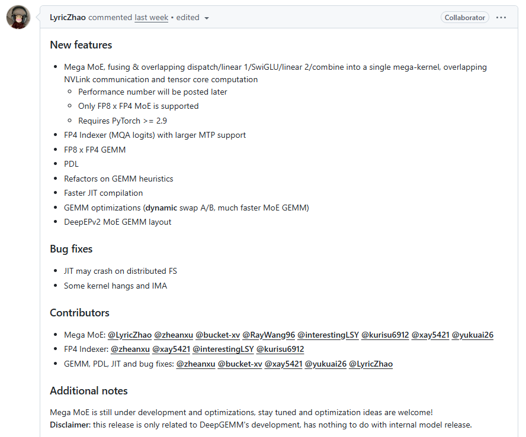

关键词：**Mega MoE**、***FP4 Indexer***、动态 Swap A/B、PDL（Programmatic Dependent Launch）、JIT 编译优化

从 GEMM 库到统一 LLM 计算原语平台。DeepGEMM 自 2025 年初发布以来，一直是 DeepSeek 团队面向 NVIDIA GPU（SM90/SM100）的高性能 Tensor Core 内核库。

然而，本次 PR #304 标志着 DeepGEMM 从一个"干净高效的 GEMM 库"向"现代大语言模型统一计算原语平台"的质变——README 的自我定位**已从 "a library designed for clean and efficient GEMMs" 更新为 *"a unified, high-performance tensor core kernel library that brings together the key computation primitives of modern large language models"。***
- 
**[Public release 26/04] Introducing Mega MoE, FP4 Indexer and other features/fixes**

- 
Mega MoE is still under development and optimizations, stay tuned and optimization ideas are welcome!

- 
Disclaimer: this release is only related to DeepGEMM's development, has nothing to do with internal model release.

- 
https://github.com/deepseek-ai/DeepGEMM/pull/304

- 
3000 字，阅读 15 分钟，播客 15 分钟

相关推荐
- 
[解锁 GPU GEMM 极致性能！PyTorch 集成 CuteDSL 后端，覆盖 BF16/FP8/FP4](https://mp.weixin.qq.com/s?__biz=MjM5NDczOTA4NQ==&mid=2447900155&idx=1&sn=a315649b04e8288899a6eac08ca47107&scene=21#wechat_redirect)

- 
[如何用 Triton 写出比 SGLang 更快的 MoE Align Block Size](https://mp.weixin.qq.com/s?__biz=MjM5NDczOTA4NQ==&mid=2447898267&idx=1&sn=2d75868ac5869554fb246e9d6f82e1b8&scene=21#wechat_redirect)

- 
[微秒级决策，近最优性能！AMD 提出 tritonBLAS：告别耗时参数搜索，用“数学”算出最快矩阵乘法](https://mp.weixin.qq.com/s?__biz=MjM5NDczOTA4NQ==&mid=2447896258&idx=1&sn=fcd4a9bd2843b8eac7ebd0f84092336a&scene=21#wechat_redirect)

这次发布由 9 位贡献者协作完成，涉及 109 个文件、12000+ 行新增代码，核心变化可归纳为三大方向：**Mega MoE 融合 kernel**、**FP4 Indexer（MQA logits）**，以及**全面的 GEMM 启发式重构与工程优化**。本文将逐一解析。

## unsetunset本文目录unsetunset
- 
一、Mega MoE：通信与计算深度重叠的"超级内核"

- 
1.1 问题本质：MoE 推理的 NVLink 通信瓶颈

- 
1.2 解决方案：五阶段融合 + 通信/计算重叠

- 
1.3 Buffer 布局设计

- 
二、FP4 Indexer：低精度 MQA Logits 计算

- 
2.1 问题背景

- 
2.2 关键实现

- 
三、动态 Swap A/B：MoE GEMM 的关键性能优化

- 
3.1 问题：SM100 上 MoE 场景的 Multicast 失效

- 
3.2 解决方案：在 SM100 上交换 A/B 操作数

- 
四、全面的启发式重构

- 
4.1 从硬编码到结构化配置

- 
4.2 SM90 引入 L1/L2 带宽建模

- 
五、其他重要改进

- 
5.1 PDL（Programmatic Dependent Launch）

- 
5.2 JIT 编译加速与分布式文件系统修复

- 
5.3 FP8 × FP4 GEMM

- 
5.4 C++20 标准升级

- 
总结

交流加群请在 NeuralTalk 公众号后台回复：加群

## unsetunset一、Mega MoE：通信与计算深度重叠的"超级内核"unsetunset

### 1.1 问题本质：MoE 推理的 NVLink 通信瓶颈

在 Expert Parallelism（EP）模式下，MoE 层的执行包含五个串行步骤：**dispatch → linear1 (FP8×FP4) → SwiGLU → linear2 (FP8×FP4) → combine**。

其中 dispatch 和 combine 涉及跨节点 NVLink 通信，传统做法是将通信与计算分为独立 kernel 串行执行，NVLink 带宽利用率低，SM 在等待通信时空转。

### 1.2 解决方案：五阶段融合 + 通信/计算重叠

Mega MoE 的核心创新是将上述五步**融合进单个 mega-kernel**，在 kernel 内部实现 NVLink 通信与 Tensor Core 计算的流水线重叠。这一设计依赖以下关键技术：

#### 关键技术 1：对称内存（Symmetric Memory）架构

在 csrc/apis/mega.hpp 中可以看到，Mega MoE 使用 PyTorch >= 2.9 提供的对称内存分配，所有 rank 共享同一地址空间的 buffer。SymBuffer 结构（见 deep_gemm/include/deep_gemm/layout/sym_buffer.cuh）通过 offset 映射实现跨 rank 指针翻译：

// deep_gemm/include/deep_gemm/layout/sym_buffer.cuh
template <uint32_t kNumRanks = kNumMaxRanks>
struct SymBuffer {
    int64_t base;
    int64_t offsets[kNumMaxRanks];
    uint32_t rank_idx;

    template <typename ptr_t>
    CUTLASS_DEVICE ptr_t map(const ptr_t& ptr, const uint32_t& dst_rank_idx) const {
        int64_t mapped_ptr = offsets[dst_rank_idx] + reinterpret_cast<int64_t>(ptr);
        return *reinterpret_cast<ptr_t*>(&mapped_ptr);
    }
};

这让 GPU 线程可以直接通过地址偏移读写远端节点内存，无需经过 host 端协调。

#### 关键技术 2：三阶段线程分工

从 csrc/jit_kernels/heuristics/mega_moe.hpp 中可以看到，Mega MoE kernel 内部将线程划分为三个角色：
- 
**Dispatch 线程组（128 threads）**：负责 NVLink 通信，执行跨 rank 的 token 分发与收集

- 
**Non-epilogue 线程组（128 threads）**：驱动 TMA 加载和 UMMA（Tensor Core）计算主循环

- 
**Epilogue 线程组（256 threads）**：执行 SwiGLU 激活、FP8 量化与 TMA 输出写回

const int num_dispatch_threads = 128;
const int num_non_epilogue_threads = 128;
const int num_epilogue_threads = 256;

#### 关键技术 3：Wave 级专家调度

为了平衡负载，Mega MoE 引入 num_experts_per_wave 的概念——**每个"wave"处理一批专家，通过启发式计算（考虑不均衡因子 kImbalanceFactor = 2）选择合适的 wave 大小，确保所有 SM 都有足够的 block 可执行：**

// csrc/jit_kernels/heuristics/mega_moe.hpp#L83-L110
static int get_num_experts_per_wave_for_mega_moe(...) {
    constexpr int kImbalanceFactor = 2;
    // ...
    int num_experts_per_wave = num_l1_blocks_per_expert > 0
        ? ceil_div(kImbalanceFactor * num_sms, num_l1_blocks_per_expert) : 1;
    // Round up to nearest divisor of num_experts_per_rank
    while (num_experts_per_wave < max_num_experts_per_wave
           and num_experts_per_rank % num_experts_per_wave != 0)
        ++ num_experts_per_wave;
    return num_experts_per_wave;
}

#### 关键技术 4：NVLink Barrier 实现

在 deep_gemm/include/deep_gemm/comm/barrier.cuh 中，实现了完整的 NVLink 跨 rank 同步原语，包括 grid 内同步和基于 ptx::red_add_rel_sys 的跨节点原子信号通知，并设有 30 秒超时检测：

// deep_gemm/include/deep_gemm/comm/barrier.cuh
template <uint32_t kNumRanks, uint32_t kNumSMs, ...>
CUTLASS_DEVICE void nvlink_barrier(...) {
    // Grid sync before NVLink signaling
    grid_sync<kNumSMs, kGridSyncIndex>(workspace, sm_idx, thread_idx, sync_scope);

    if (sm_idx == 0) {
        // Send signals to remote ranks
        if (thread_idx < kNumRanks)
            ptx::red_add_rel_sys(sym_buffer.map(signal_ptr, thread_idx), ...);
        // Wait arrival with 30s timeout
        // ...
    }
    // Grid sync after NVLink completion
    grid_sync<kNumSMs, kGridSyncIndex>(workspace, sm_idx, thread_idx, sync_scope);
}

### 1.3 Buffer 布局设计

csrc/apis/mega.hpp 中的 get_symm_buffer_size_for_mega_moe 精心设计了对称内存中各区域的排列：**Workspace → Input(x, x_sf, topk_idx, topk_weights) → L1 pool(acts, sf, weights) → L2 pool(acts, sf) → Combine buffer(BF16)。**所有 buffer 在地址空间中连续排列，SF buffer 按照 UTCCP 128 元素粒度对齐。

## unsetunset二、FP4 Indexer：低精度 MQA Logits 计算unsetunset

### 2.1 问题背景

DeepSeek v3.2 的 lightning indexer 使用 weighted ReLU MQA logits 进行评分计算。此前仅支持 FP8 精度，本次发布新增了 **FP4 精度支持**（仅 SM100/Blackwell），并扩展了更大的 MTP（Multi-Token Prediction）支持。

### 2.2 关键实现

从 csrc/apis/attention.hpp 可以看到，新的 fp8_fp4_mqa_logits 和 fp8_fp4_paged_mqa_logits API 统一了 FP8 和 FP4 两种路径。FP4 路径的核心区别在于：
- 
Q 和 KV 使用 kPackedFP4 数据类型（两个 FP4 值打包在一个字节中）

- 
Scale factor 使用 torch::kInt32（UE8M0 编码）

- 
head_dim 固定为 128，确保 64B swizzle 对齐

- 
TMA descriptor 使用 fp4_unpacked_smem = false，即 CU_TENSOR_MAP_DATA_TYPE_16U4_ALIGN8B

static torch::Tensor fp8_fp4_mqa_logits(
    const std::tuple<torch::Tensor, std::optional<torch::Tensor>>& q,
    const std::tuple<torch::Tensor, torch::Tensor>& kv, ...) {
    const auto [q_fp, q_sf] = q;
    const bool is_fp4 = q_sf.has_value();
    // FP4 path: head_dim *= 2 (packed), scalar type = kPackedFP4
    // FP8 path: scalar type = kFloat8_e4m3fn
}

同时保留了旧的 fp8_mqa_logits API 作为兼容包装，内部调用新接口并传入 std::nullopt 作为 SF。

## unsetunset三、动态 Swap A/B：MoE GEMM 的关键性能优化unsetunset

### 3.1 问题：SM100 上 MoE 场景的 Multicast 失效

在 MoE 的 m-grouped contiguous GEMM 中，矩阵 A（activation）是按 token 连续存储的，而矩阵 B（weight）按 expert 分组。SM100 上 TMA multicast 只能在 cluster 内广播，但 A 的 M 维度（token 数）通常较小且不规则，导致 multicast on A 不可行。

### 3.2 解决方案：在 SM100 上交换 A/B 操作数

本次重构在 GemmConfig 中引入了 Layout::swap_ab 字段。当 swap_ab = 1 时，实际计算变为 B^T @ A^T，这样原来的 N 维度（weight 的 hidden size，通常较大且规则）变成了 UMMA 的 M 维度，可以做 cluster multicast。

// Always enable swap A/B for m-grouped GEMMs
if (desc.gemm_type == GemmType::MGroupedContiguous || ...) {
    const bool swap_ab = true;
    const auto block_n = 128;
    const auto block_m = heuristics_runtime->get_mk_alignment_for_contiguous_layout();
    const auto cluster_n = ceil_div(desc.n, block_n) % 2 == 0
                           and desc.num_sms % 2 == 0 ? 2 : 1;
    // ...
}

在 SM100 的候选枚举中，swap_ab 和非 swap_ab 两个方向均被考虑（for (int swap_ab = 0; swap_ab < 2; ++swap_ab)），由统一的比较器选择最优配置。这对 MoE 场景的提速尤为显著。

## unsetunset四、全面的启发式重构unsetunset

### 4.1 从硬编码到结构化配置

整个启发式系统被彻底重构。旧代码中 GemmConfig 是一个"大杂烩"结构体，新代码将其拆分为四层：

// csrc/jit_kernels/heuristics/config.hpp#L134-L140
struct GemmConfig {
    Layout layout;              // block_m/n/k, swap_ab, cluster_m/n
    StorageConfig storage_config;  // load/store block sizes, swizzle modes
    PipelineConfig pipeline_config; // num_stages, smem_size
    LaunchConfig launch_config;    // num_sms, num_threads
};

### 4.2 SM90 引入 L1/L2 带宽建模

SM90 的配置选择从"波数最小化"升级为基于 **L1/L2 带宽建模的 cycle 估计**：

// csrc/jit_kernels/heuristics/sm90.hpp#L159-L176
const int l2_bandwidth_per_cycle = std::min(64. * desc.num_sms, 8e6 / 1.3e3);
const int l1_bandwidth_per_cycle = 128 * desc.num_sms;
// ...
int64_t num_l2_cycles = (num_bytes_l2_ab + num_bytes_l1_l2_cd) * num_blocks / l2_bandwidth_per_cycle;
int64_t num_l1_cycles = (num_bytes_l1_ab + num_bytes_l1_tc + ...) * num_blocks / l1_bandwidth_per_cycle;
float wave_efficiency = static_cast<float>(num_blocks) / (num_waves * desc.num_sms);
int64_t num_cycles = std::max(num_l1_cycles, num_l2_cycles) / wave_efficiency;

这使得 SM90 在小矩阵场景下能更准确地选择 block size 和 multicast 策略。

## unsetunset五、其他重要改进unsetunset

### 5.1 PDL（Programmatic Dependent Launch）

新增 set_pdl / get_pdl API，在 kernel launch 时设置 cudaLaunchAttributeProgrammaticStreamSerialization，允许 CUDA 运行时在前一个 kernel 尚未完全结束时就启动下一个，减少 kernel 间的空泡：

// csrc/jit/handle.hpp#L92-L98
if (enable_pdl) {
    auto& attr = attrs[config.numAttrs ++];
    attr.id = cudaLaunchAttributeProgrammaticStreamSerialization;
    attr.val.programmaticStreamSerializationAllowed = 1;
}

### 5.2 JIT 编译加速与分布式文件系统修复
- 
**增量哈希**：新增 IncludeParser（csrc/jit/include_parser.hpp），只对 #include <deep_gemm/*> 依赖树做递归哈希，替代原来对所有头文件内容的全量哈希，大幅减少缓存 key 计算开销。

- 
**原子目录重命名**：编译产物先写入临时目录，最后通过 std::filesystem::rename 原子替换，彻底解决分布式文件系统（如 NFS/Lustre）上多进程竞争导致的 JIT 缓存损坏问题。同时在写入后调用 fsync 确保数据持久化。

- 
**损坏检测**：加载 CUBIN 时通过 cuLibraryGetKernelCount 验证 kernel 数量必须为 1，否则提示用户清除缓存目录。

### 5.3 FP8 × FP4 GEMM

新增 sm100_fp8_fp4_gemm_1d1d.hpp，支持 A 为 FP8、B 为 FP4（或反之）的混合精度 GEMM，这是 Mega MoE 的基础运算单元。

### 5.4 C++20 标准升级

项目从 C++17 升级至 **C++20**（CMakeLists.txt 中 CMAKE_CXX_STANDARD 20），以支持 std::variant、designated initializers 等现代特性。

## unsetunset总结unsetunset

PR #304 是 DeepGEMM 迄今为止最大的一次公开发布。其核心价值在于：
- 
**Mega MoE 是业界首个将 EP dispatch/linear1/SwiGLU/linear2/combine 五步融合为单一 kernel 的开源实现**，通过对称内存 + 三角色线程分工 + NVLink barrier 实现了通信与计算的深度重叠。

- 
**动态 Swap A/B** 解决了 SM100 上 MoE GEMM multicast 受限的痛点，是一个看似简单却效果显著的工程优化。

- 
**启发式系统的结构化重构**为后续支持更多硬件架构和更精细的自动调优奠定了基础。

- 
**JIT 编译的分布式文件系统修复**解决了大规模训练/推理集群中的实际部署痛点。

正如 PR 描述中所说："Mega MoE is still under development and optimizations, stay tuned"——这只是开始。

性能数据将在后续公布，而 DeepEP V2（提供 ElasticBuffer）也即将随之发布，届时 Mega MoE 的完整多进程测试才能跑通。这次发布展现了 DeepSeek 团队在 GPU 微架构级优化上的深厚功底，也为开源社区提供了学习现代 LLM 推理内核设计的宝贵资源。

相关推荐
- 
[解锁 GPU GEMM 极致性能！PyTorch 集成 CuteDSL 后端，覆盖 BF16/FP8/FP4](https://mp.weixin.qq.com/s?__biz=MjM5NDczOTA4NQ==&mid=2447900155&idx=1&sn=a315649b04e8288899a6eac08ca47107&scene=21#wechat_redirect)

- 
[如何用 Triton 写出比 SGLang 更快的 MoE Align Block Size](https://mp.weixin.qq.com/s?__biz=MjM5NDczOTA4NQ==&mid=2447898267&idx=1&sn=2d75868ac5869554fb246e9d6f82e1b8&scene=21#wechat_redirect)

- 
[微秒级决策，近最优性能！AMD 提出 tritonBLAS：告别耗时参数搜索，用“数学”算出最快矩阵乘法](https://mp.weixin.qq.com/s?__biz=MjM5NDczOTA4NQ==&mid=2447896258&idx=1&sn=fcd4a9bd2843b8eac7ebd0f84092336a&scene=21#wechat_redirect)

交流加群请在 NeuralTalk 公众号后台回复：加群