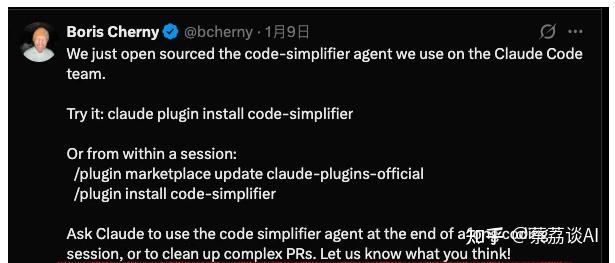

Code Simplifier：Claude Code团队自用的代码清理工具，开源了

AI 写代码快，但代码质量参差不齐是个老问题。Claude Code 创始人之前分享过一个实战技巧：每次 AI 生成代码后，都会用 code-simplifier 插件把代码梳理一遍，让它更干净、更规范，避免代码越堆越乱。这个习惯能大幅降低后续维护成本，很多开发者都想试试。

前几天，Anthropic 正式开源了这个团队内部一直在用的工具。

它能帮你把那些看起来有点乱、有点复杂的代码变得更清晰、更好懂。如果你也常常为代码的“可读性”和“维护性”发愁，那这个插件你可得好好了解一下。

### 一、Code Simplifier 是什么？

简单来说，Code Simplifier 是一个专门为 Claude Code 设计的插件。它的主要任务就是优化你的代码，让它更符合规范，更容易理解。

这个插件的核心理念是“宁丑勿巧”，意思就是，代码可以稍微长一点，但一定要直白、好懂。它能帮你解决 AI 生成代码中常见的嵌套过深、命名随意、职责不清等问题，让你的代码质量更上一层楼。

### 二、怎么安装？

安装 Code Simplifier 非常简单，有两种方式可以选择：

第一种是全局安装。你只需要在终端里输入 claude plugin install code-simplifier，然后回车，插件就会自动安装好。

第二种是会话内安装。如果你正在使用 Claude Code，可以直接在里面输入 /plugin install code-simplifier 来安装。如果你想更新插件，可以输入 /plugin marketplace update claude-plugins-official。

### 三、怎么使用？

安装好插件后，使用起来也很方便。当你配置好之后，Code Simplifier 会自动运行。

当你在 Claude Code 中修改并保存代码时，它会检测到变化，然后启动 Code Simplifier Agent 进行分析和优化，最后把优化后的代码返回给你。

你也可以手动调用它，比如在对话中输入“用 code-simplifier 插件优化这段代码”，或者直接输入简写 cc，它就会帮你处理。

### 四、核心设计原则

看了官方的提示词文档（在 ~/.claude/plugins/.../code-simplifier/agents/code-simplifier.md），发现它的设计思路很实用：

Code Simplifier 在优化代码时，会遵循几条重要的原则。首先，它会保持功能不变，只改变代码的实现方式，不影响代码的实际功能。其次，它会遵循项目标准，比如读取你项目里的 CLAUDE.md 文件，按照你定义的规范来优化代码。它还强调清晰比简洁更重要，不会为了追求代码行数少而牺牲可读性，比如会把复杂的三元运算符拆开。同时，它会保持平衡，避免过度简化导致代码失去原有的清晰度。最后，它会聚焦范围，默认只优化你最近修改的代码，这样可以降低大范围修改带来的风险。

### 五、几点使用建议

用了一段时间，有几个点需要注意：

### 5.1 工具不理解业务逻辑

code-simplifier 只看代码结构，不懂业务。所以优化后的代码，还是要 review 一遍，特别是涉及异常处理、边界条件、性能敏感的部分。

### 5.2 配置文件很重要

如果有团队规范或个人习惯，要写到项目根目录的 CLAUDE.md 里。不然它会按默认规范来，可能跟你的习惯不一致。

### 5.3 不是所有代码都需要优化

有些代码本身就很清晰，或者是性能关键路径，就不要瞎折腾了。工具是辅助的，不是强制的。

### 5.4 大型重构要小心

如果想一次性重构整个项目，建议分批来。先重构一个模块，测试通过后再继续。一口气改完很容易出问题。

### 六、核心价值在哪

这个工具最大的价值是降低 AI 编程的维护成本。

AI 生成的代码往往功能没问题，但风格混乱、冗余重复。code-simplifier 能快速把这些'AI 痕迹'清理掉，让代码看起来像人写的，方便后续迭代。

另一个好处是节省 token。优化后的代码通常能减少 20-30% 的 token，对大项目来说，同样的上下文预算能塞进更多代码，或者分析代码时省不少钱。

总的来说，Code Simplifier 是一个非常实用的工具，能帮助我们写出更规范、更易懂的代码。
