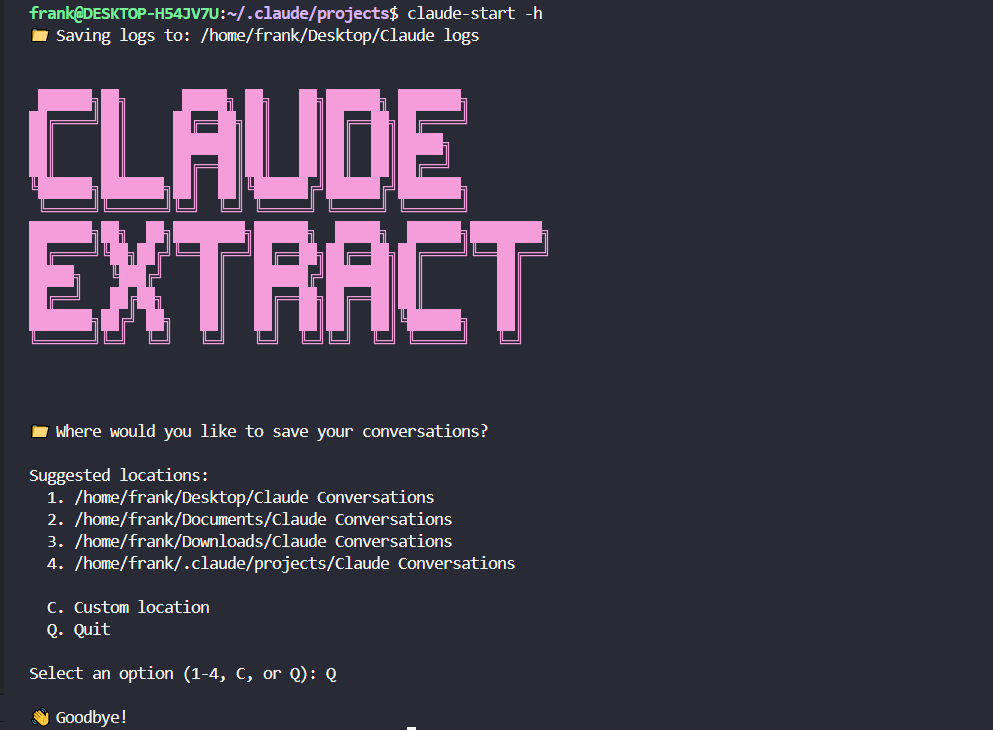

如何从 Claude Code 的内部存储中提取干净的对话日志？

#### 推荐使用 Claude Conversation Extractor

Claude Code没有内置的导出功能，但有一个专门的第三方工具 claude-extract [https://github.com/ZeroSumQuant/claude-conversation-extractor](https://link.zhihu.com/?target=https%3A//github.com/ZeroSumQuant/claude-conversation-extractor)可以提取对话历史：

**安装方法：**

`# 推荐使用pipx install claude-conversation-extractor --force安装 
pipx install claude-conversation-extractor --force 

pipx list 
    - claude-extract 
    - claude-start`

#### 踩坑点：

- 项目文档完全落后 **运行 claude-logs 报错**，甚至Claude 输出也沿用错误文档，这个例子警示我们**幻觉消除**在大规模智能体自动化协同编程中尤为重要。
- pipx install claude-conversation-extractor 会有符号链接问题

- pipx install claude-conversation-extractor

- claude-extract (symlink missing or pointing to unexpected location)
- claude-start (symlink missing or pointing to unexpected location) 

- **对话日志输出不全** 待下一个版本更新，或者我fork 一个分支 自己开发 :)**Q: 如果能够选择导出详细的记录会很有帮助——包括完整的 MCP/工具响应、任何已执行的终端命令的输出等等。基本上就是你在“Ctrl+R”详细记录中看到的所有内容。截至 1.1.0 版本，我还没有找到导出详细记录的方法，不过考虑到这些数据也存储在 Claude 内部使用的 *.jsonl 文件中，应该可以导出。
A: 我很快就会发布第三个版本，而且会解决很多问题。完整版的文字记录绝对值得一看，我会看看能为第三个版本做些什么。如果你还有什么想看的，尽管告诉我。 

#### claude-extract 工具指导手册

claude-extract 是一个命令行工具，旨在帮助用户轻松地将与 Claude 的对话记录从原始格式提取并转换为干净、易于阅读的 Markdown 文件。这对于存档、分享或分析您的对话非常有用。
本手册将详细介绍如何安装、配置和使用此工具。

- *1. 核心功能***
- **列出对话**: 查看最近的对话列表，以便选择要提取的会话。
- **精确提取**: 根据编号提取一个或多个特定的对话。
- **批量提取**: 一次性提取所有对话或最近的 N 个对话。
- **自定义输出**: 指定将 Markdown 文件保存到哪个目录。
- **交互模式**: 提供一个用户友好的界面来选择和提取对话。***2. 命令选项详解*****以下是 claude-extract 的所有命令行选项及其功能说明。
基本操作**
- -h, --help

- **功能**: 显示帮助信息，其中包含所有可用命令和选项的简要说明。
- **示例**: claude-extract --help**列出可用对话**

- --list

- **功能**: 列出所有可供提取的对话会话，并为每个会话分配一个编号。这是开始使用的第一步，可以帮助您识别想要提取的会话。
- **示例**: claude-extract --list

- --limit LIMIT

- **功能**: 与 --list 配合使用，限制列表显示的会话数量。
- **示例**: claude-extract --list --limit 10 (仅列出最近的 10 个会话)**提取对话****有多种方式可以提取对话：

- --extract EXTRACT

- 功能**: 根据 --list 命令显示的编号，提取一个或多个特定的会话。多个编号之间用逗号分隔。
- **示例 1**: claude-extract --extract 1 (提取列表中的第 1 个会话)
- **示例 2**: claude-extract --extract 1,3,5 (提取第 1、3、5 号会话)

- --recent RECENT

- **功能**: 提取最近的 N 个会话。
- **示例**: claude-extract --recent 5 (提取最近的 5 个会话)

- --all (或 --logs)

- **功能**: 提取所有已保存的会话。
- **示例**: claude-extract --all**指定输出**

- --output OUTPUT

- **功能**: 指定提取出的 Markdown 文件的存放目录。如果未指定，则默认保存在当前工作目录。
- **示例**: claude-extract --recent 3 --output ~/claude-backups (将最近 3 个会话提取到 ~/claude-backups 目录)**交互模式**

- --interactive, -i, --start, -s

- **功能**: 启动一个交互式用户界面。在此界面中，您可以用更直观的方式查看、选择和提取会话，无需手动输入编号。
- **示例**: claude-extract --interactive

- --export EXPORT

- **功能**: 用于交互模式的导出功能，通常设置为 'logs'。
- **示例**: claude-extract --interactive --export 'logs'

#### *3. 实用场景示例*

**场景一：查找并提取昨天的某个重要对话**

- 首先，列出最近的对话，找到你想要的那一个。

- claude-extract --list

- 假设您从列表中看到昨天的对话是第 3 号，现在提取它。

- claude-extract --extract 3
**场景二：备份本周所有对话到指定文件夹**

- 假设您本周有大约 10 个对话，您想全部备份。
- 使用 --recent 和 --output 命令将它们全部保存到名为 claude-weekly-backup 的文件夹中。

- claude-extract --recent 10 --output ./claude-weekly-backup
**场景三：首次使用，想通过图形界面轻松上手**

- 如果您不习惯命令行，或者想要更直观的操作，可以直接启动交互模式。

- claude-extract -i

- 之后，屏幕上会显示一个菜单，您可以根据提示进行选择和导出。**场景四：完整备份所有历史记录**
- 如果您想一次性将所有对话存档。

- claude-extract --all --output /path/to/full-archive

#### claude-start

交互式运行如下：

