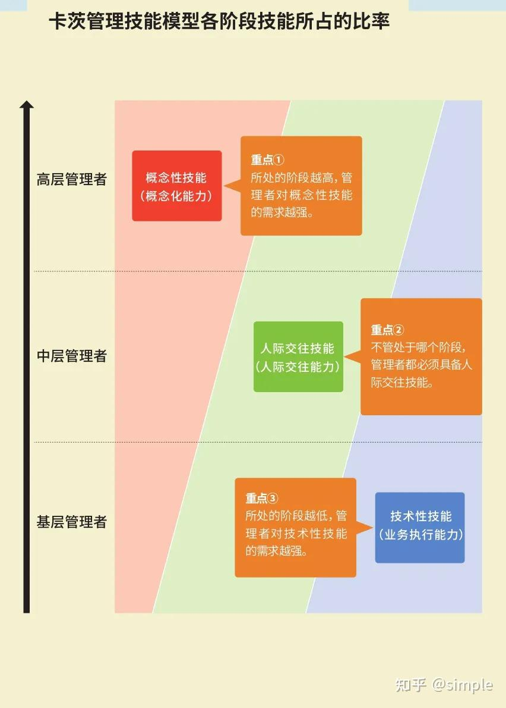
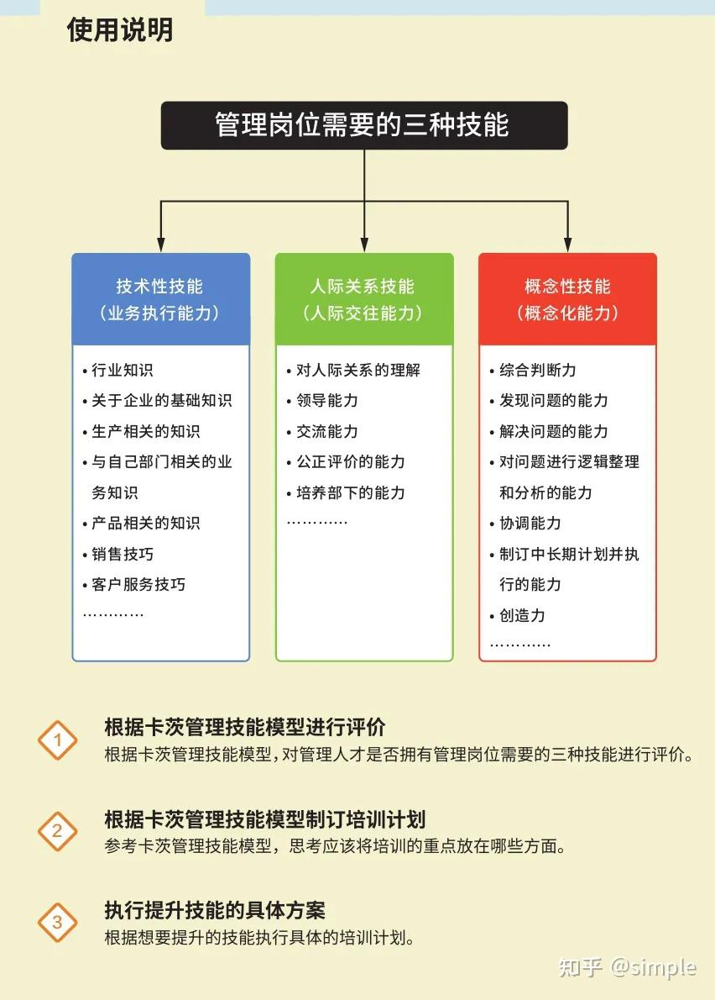

**本文（首发自公众号：[对研发leader、总监、GM的能力模型拆解](https://link.zhihu.com/?target=https%3A//mp.weixin.qq.com/s/5AxGspCVDLSHod32cdDWHw)）内容是由我通过回顾自己管理幅度的变化，工作内容的变化，尝试理解总结得来，肯定存在片面性，用于自己复盘，仅供参考21年我作为一个team leader，当时自信团队带的不错，但我却找不到成就感，我发觉带好一个team很简单，我已经无法从日常的工作中找到更多的困难或者新鲜感，这让我对管理工作感到无聊。

那个时候我除了需要搞定自己的本职工作外，还要搞定总监布置的作业，甚至GM有些想解决的问题也会丢给我去搞，这让我一时之间很困惑，leader、总监、GM的工作职责到底应该是什么，这个岗位的人，又到底需要什么样的能力模型呢？

这个问题困扰了我两年，直到23年年底，随着我的工作职责扩大，我才找到了能说服我自己的答案。

### 一、管理经历回顾

> 不涉及具体的管理方法，只回顾工作职责的变化，继而总结工作能力的差异。

### leader

以前做员工的时候，只要搞定自己负责的那摊事儿，不要捅娄子就好了，但当上leader以后发现，再也不能像以前那样随心所欲了，你要面对的工作内容不再是听话的代码，而是有着不同诉求的同事，带着不同目的找你的合作方，和对你有着更多要求的老板。

> 分享几个让我记忆最深刻的小故事来说明这一切

- 有个不是很复杂的需求，我分给了一个年轻的小伙子，并讲解了下大概应该如何去实现，最后review代码时发现很多问题，但原定的发布时间也快到了。
- 现网出了个大事故，负责的开发焦头烂额，而我也对这个项目的细节了解的不够深。
- A是一位团队中的老员工，在我任命前就是团队某个业务线的骨干，我有天突然意识到，好像每次我找他问问题要东西，他都会丢给他那条业务线的其他员工去处理。
- 产品投诉需求排不上，视觉投诉前端还原度不够，测试投诉bug单不认真填，PM投诉延期和不及时变更状态。
- 有位挺有潜力的同事反馈最近没有成长，想离职去其他公司看看。
这些小故事的背后，都体现着leader与员工的工作内容的差异，我不能像以前一样只要管好自己，让自己完成工作即可，我需要转变驱动大家更好的完成工作。所以leader需要的能力模型，不再是单纯的理解需求、做好架构、写好代码，增加了许多没有标准答案的工作内容：与人沟通、绩效激励、发现识别并解决问题。

leader是一个团队的灵魂，需要把团队拧成一股绳，围绕着leader身边，让团队更有战斗力，能高效高质量的完成诸多工作。想做好这一切，说难也难，难的是既要学会背后的底层逻辑，又要理解人性，还要能灵活应用，说简单其实也简单，因为团队很小，程序员又普遍比较善良单纯，只要诚以待人，以身作则，充分发挥自己擅长的**，多花时间去试错，一定能做好的。

### 总监

从20年开始带团队，两年来我从管理一个组到同时管理四个组，经历了业务扩大和空降，我发现team leader这个岗位对我已经没有任何的挑战了，我也从一开始的团队中最忙的人变成了团队中看起来最闲的人，很多事能做到有没有我的参与结果都一样可靠，我突然就觉得很无聊，也是这段时间里让我开始困惑，总监和leader到底有什么区别，为什么别人是总监而我是leader？我到底欠缺了什么呢？

这里要感谢我的前领导杰哥，22年中他突然把我叫到办公室去，给了我新的职责：我被任命为总监，负责管理整个中心。正是这个机会，才让我能够去经历，去理解，去思考。

工作中，我很快就发现总监对比leader最大的区别：总监由于管理幅度的扩大，没办法做到像以前那样事无巨细，必须通过leader来协助管理整个团队，因此很多信息只能通过leader反馈。这一现象在很多工作方面都会带来新的挑战：

- 绝大多数工作汇报都是leader给我讲的，我如何才能知道哪些是他在背后的努力，哪些是出色的员工的工作产出？我该如何准确的识别和评判一个leader的工作是否符合预期?
- 绩效评判时，A说他的team都很棒需要更多的优秀绩效，B说他的team也很棒不能拿低绩效，我该怎么客观公正的评判呢？
- 我有些团队内部的工作需要人手做，我知道以前有个组员的能力很匹配，我能不能跨过他的leader，直接跑去给他分配工作呢？
- 我自己带团队时，大家一起吃饭，一起处理事故，一起冲刺进度，信任感很高，很多话可以很容易的去聊，而成为总监后，如何跟一个不认识的同事去做好沟通？
- A团队出过一次的问题，如何让其他团队不要出类似的问题？
这些问题的调查与分析，比leader时面对的问题要复杂的多，因此需要具备的能力也更多，做事也需要更有章法：

- 需要想办法在中心内建立起一套行为准则，以确保信息的传达更透明，沟通方式更简单直接（文化，原则）
- 确保任何一层有人离开都不会掉链子，团队内要有火种，团队间要能拉通，要有一套可靠的发现、培养人才的机智。
- 将共性问题统一、有节奏的解决（全局意识，举一反三）
- 能正确理解、拆解上级组织目标，结合团队的实际情况形成团队目标和行动方针，有效传达到下级并推动执行以达成目标；而不是简单分配上级交待的任务（理解战略，上传下达，统筹协调）
- 能听取多方意见，客观地从不同角度收集决策所需信息，不摇摆、不预设倾向，具备独立思考的能力，能结合已有的信息和自身的思考形成符合组织目标和团队价值的决策（深入调查、合理分析、有效解决）

### GM

> 接下来的经历就变得更加离奇了，我花了半年时间让中心内的leader们成为了彼此可以托付后背的战友，我分析出了每个人的优缺点，并持续想办法培养他们提高，我理清了团队的债务、流程和方向，我觉得再给我一年这个中心一定会脱胎换骨。23年初有位资深总监离职，我临时被安排顶上他负责的交易中心，万幸半年内没掉链子，且中心内有位非常靠谱有能力的大哥具备总监能力，我为他铺好路就果断撒手，准备继续踏踏实实的做好自己的一亩三分地时，23年7月，杰哥再次对我扩大了授权...这次他玩的更大，让我直接放开手管理一个部门。

这一次，我是真的抓瞎了，直到我真的负责一个部门，我才知道以前杰哥要面临多大的压力，我发现了GM与总监的第一个区别：GM的前面没人了（前司没有CTO），没有人会为GM的决策兜底了（做的不好会直接面临被老板批评，承担最坏可能被撸掉的结果），也没有人会再教导你如何做事了（老板用你是让你来解决问题的）。

紧接着我看到了GM与总监的第二个区别：总监大部分还是在处理研发相关的工作，GM层反倒研发相关的工作会变得更少，更多的是业务，是目标，是组织，是制度。

- 公司的这么多业务，这么多需求，哪些该投更多的资源先做，哪些可以放一放。
- 部门这么大，如何设计组织架构，才能让每个团队更聚焦，更有牵引。
- 薪酬、年终奖、RSU要怎么设计，才能鼓励能者多劳，才能留住优秀人才。
- 部门这么大，内部的效率是否存在问题，如何发现并解决真正的问题。
GM需要放大总监时期做的事情，并能够有信得过的总监帮助cover不同的一摊事，这样才能腾出手来，做好更多方向性的思考与引导。

- 需要具备足够强的抗压素质，不要惧怕未知，不要被打倒，勇往直前。
- 要有空杯心态：需要足够包容、开放，不能刚愎自用。
- 需要提高学习能力，快速理解未知的事物，要能够建立模型思维，通过抽象再具象的方式去认知背后的逻辑。
- 要具备系统思考的能力，要能看到问题的全貌，要能找到真正的杠杆解。
- 决策需要有依据，需要对数据敏感，能带入更多视角去看到不同的问题，要敢于取舍。
- 方向性思考的东西，需要足够了解业界动向，而引导前进方向，需要深入了解内部现况，需要对比出两者之间的差别，找出合理的牵引方向，推进执行。
- 风险及成本管控，要学会做生意。
- 要学着更有效的沟通，能跟老板和同僚建立好良好的工作关系。

### 二、能力模型总结

> leader、总监、GM的工作职责到底应该是什么，这个岗位的人，又到底需要什么样的能力模型呢？

其实在我管理一个部门前，我就看到过这样一个模型（卡茨管理技能模型：图片来自《麦肯锡思考工具》），那时我对此还不能完全理解，直到我有幸完整的经历了这一切，我才意识到这个模型的含金量。回顾完我的工作内容，关于我的疑问，我自己的答案就是这个模型，不确定这些是否能给到其他朋友们参考。

### 三、推荐书单

管理所需的技能是可以通过学习和练习而掌握，我也尝试着整理了一份书单，我工作中遇到的所有问题，几乎都能从这些书里找到答案，希望这些书也能给到朋友们帮助。

https://weread.qq.com/misc/booklist/11640_7lxcNFLHw

- 卓有成效的管理者：入门，用于理解管理的本质
- 高效能人士的七个习惯：先做好自己，才有可能带好别人
- 知行，技术人的管理之路：带程序员团队的方法书
- 原则：借鉴前辈的做人、做事原则，用于在团队内达成共识，引导氛围
- 不拘一格：学习优秀的企业文化是如何炼成的
- 认知觉醒：学习如何让自己和团队一起持续成长
- 清单革命：团队内需要有简单可行的SOP，没有SOP是万万不行的，但是万事都扯SOP也是不对的，要理解流程是用来提升下限的
- 贝佐斯如何开会：开会要有效率，要有结论
- 沃顿商学院最受欢迎的思维课：要在团队中营造一个互惠的氛围，要做个利他者，要寻找利他者同事
- 哈佛商学院最受欢迎的领导课：持续反思自己，思考全局，做好掌舵人，一将无能累死三军
- 高绩效教练：如何辅导下属提升
- 你的灯亮着吗：工作就是解决问题，要学会找到问题是什么
- 所有问题七步解决：问题解决的参考案例
- 麦肯锡思考工具：常用的方法论，也要学会建立自己的方法论，对问题要试着抽象再具象
- 系统之美：要理解问题不是表面那么简单，要系统化的思考问题
- 系统思考：系统思考的具体实践案例
- 毛选：优先读实践论、矛盾论、社会各阶层分析、反对本本主义，最终要读完全部四卷

嗯，我没有去看向上沟通、影响力、权力这类书，因为我不喜欢，我也不想成为那样的人，但不可否认，那些书也是真的有用的，但我就是不喜，成为自己真正想成为的人，才是我最终的追求，共勉。
