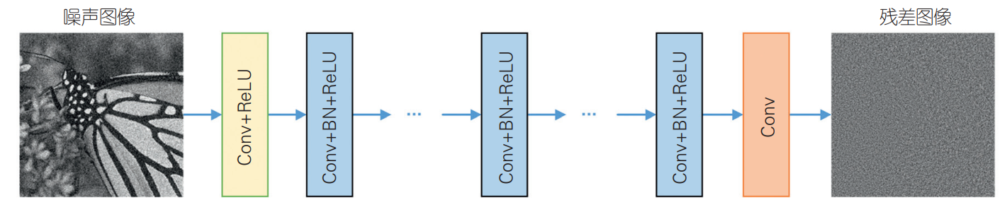
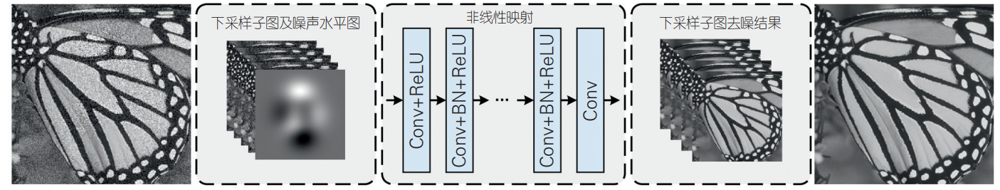
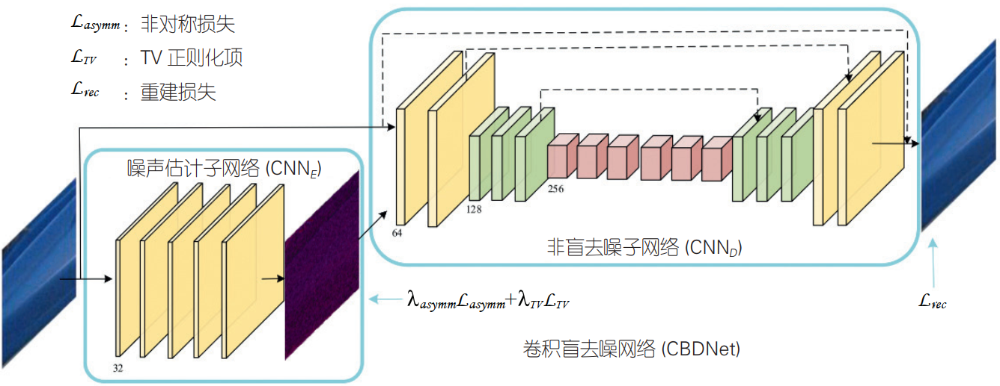

**主要内容来自于CCCF 2019年第11期**

数字图像在数字化和传输过程中， 常常受到成像设备与外部环境噪声干扰等影响， 引入了不同类型的复杂噪声。 图像的去噪任务要求在尽可能去除图像中噪声的同时， 还应保持原有图像的边缘、 纹理等细节结构信息。对于普遍存在的图像模糊问题， 如何有效估计模糊过程、 处理噪声和估计误差等， 将对恢复高质量、清晰的图像至关重要。

**Kai Zhang, Wangmeng Zuo, Yunjin Chen, Deyu Meng, and Lei Zhang. Beyond a gaussian denoiser: Residual learning of deep cnn for image denoising.* IEEE TIP *2017.**著名的 DnCNN 提出使用卷积通过端到端的残差学习， 从函数回归角度用卷积神经网络将噪声从噪声图像中分离出来， 取得了显著优于其他方法的去噪结果。

深度去噪网络(DnCNN)结构示意图此后，一系列基于网络结构的改进工作被相继提出。REDNet (Residual Encoder-Decoder Network) 采用基于对称跳跃链接的深度卷积编码 - 解码框架， 使得在反向过程中， 信息可直接从顶层传递到底层 ；MemNet (Memory Network)进一步提出了一种长期记忆模型用于图像去噪 ； MWCNN (Multi-level Wavelet CNN) 则提出了一种多级小波 CNN 框架，通过将离散小波变换与卷积网络结合， 有利于恢复图像细节。上述方法通常需要针对不同噪声水平单独训练模型， 不仅缺乏灵活性， 更无法应用于退化过程更加复杂的真实噪声图像。 

**Kai Zhang, Wangmeng Zuo, and Lei Zhang. FFDNet: Toward a fast and flexible solution for CNN-based image denoising. *IEEE TIP *2018.**FFDNet (Fast and Flexible Denoising Network) 将噪声图作为网络输入，是一种快速、灵活的去噪模型，可以同时处理不同的噪声水平及空间相关噪声。

快速灵活去噪网络（FFDNet）结构示意图**Shi Guo, Zifei Yan, Kai Zhang, Wangmeng Zuo, and Lei Zhang. Toward convolutional blind denoising of real photographs. *CVPR* 2019.**在非盲去噪任务中， 需要人为设定噪声水平。然而， 实际相机成像过程中引入的噪声， 通常是与通道和空间相关的。 针对真实相机噪声图像的盲去噪任务仍然需要深入研究。卷积盲去噪网络 (CBDNet) 是一个结合噪声估计和非盲去噪模型的盲去噪方法。通过依赖信号依赖噪声和相机图像信号处理对噪声的影响， 将合成噪声与真实噪声图像一起用于网络训练，能够在真实噪声图像上实现良好的去噪效果和泛化能力。

卷积盲去噪网络（CBDNet）网络结构示意图在图像去噪等任务中， 卷积神经网络取得了巨大成功。 然而现有的模型大部分基于噪声 - 清晰图像对进行监督学习， 而在一些特定的应用中，如 CT、 MRI 等， 由于清晰图像匮乏且获取困难，基于无监督学习的方法展现出了广泛的应用前景。但现有基于无监督学习的卷积神经网络去噪方法仍处于尝试阶段， 在训练速度和复原性能方面还有待提升。 因此， 针对真实噪声图像， 探索自监督和无监督学习方法具有重要的意义。
