** 本文主要为阅读ICCV 2023 一篇Tutorial的笔记： 
原文连接：ICCV 2023 Tutorial: Understanding the In-Camera Rendering Pipeline and the role of AI/Deep Learning (yorku.ca) 

### 1. 人的色彩感受

- 三种视锥细胞(Cones)分别对红绿蓝三种不同波段的光有着比较强的敏感性，也就是我们说的三原色(RGB)。
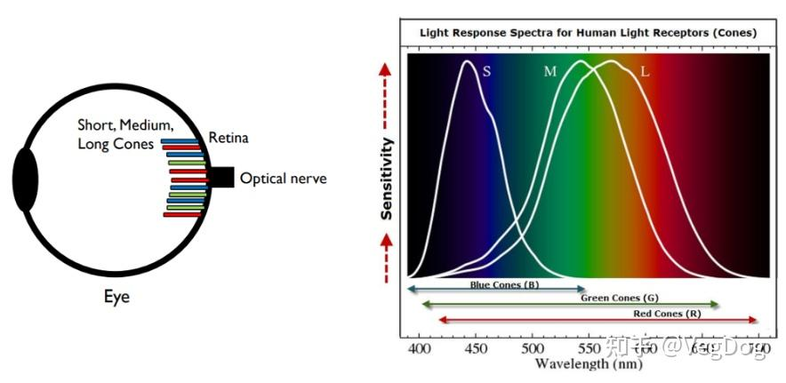

- 视杆细胞（Rods）则主要去感知光线的强弱，主要主导暗光环境的视觉，没有色觉。
不同生物的视觉差异应该和眼球中感光细胞的种类和分布有很大的关系，比如一些鸡、鸟类动物由于视杆细胞细胞较少，所以会出现夜晚视力较差的情况。

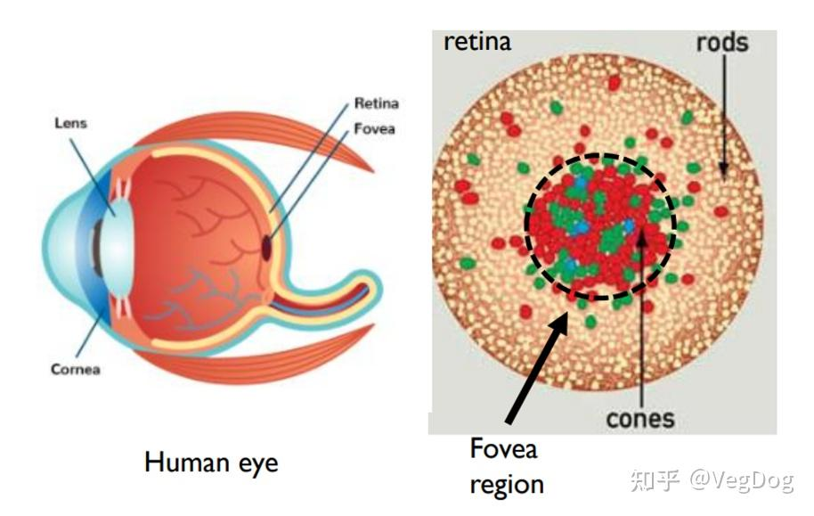

### 2. 光谱能量分布SPD（Spectral power distribution）

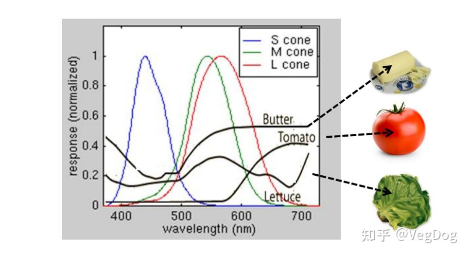

统计不同波段的辐射能量强度绘制出来，即光谱能量分布(SPD)。

所以人类的眼睛其实只捕捉到了物体光辐射的一部分信息，很大一部分波段的信息是无法感受到的**。

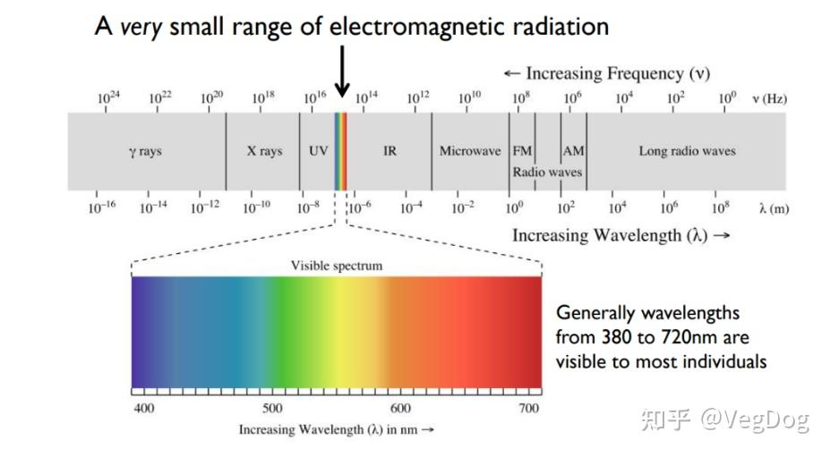

所以就会有红外相机、以及医学上的紫外线增强之类的技术去捕获人类无法感知到但是对于实际应用有价值的其他波段的光的信息。**我认为计算成像技术一个很大的优势也是一个很有意思的点，即通过光学与算法的协同设计去跳出人类生理的局限性，捕获一些很重要但是人眼却无法获取的信息或者实现人眼无法实现的功能。**

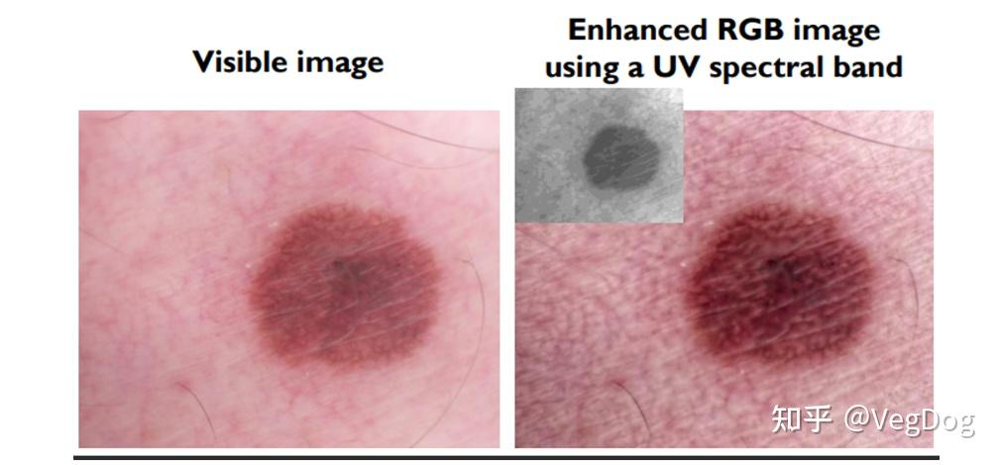

也就很容易理解，其实辐射光谱和RGB不是一一对应的，不同的辐射光谱可能对应同一个RGB值，因为RGB只表示了一部分的辐射光谱的信息。

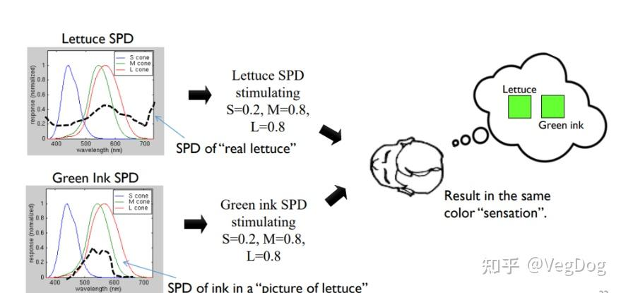

### 3. 辐射测量（Radiometry）与光度（photometry）、色度（colorimetry）

- 辐射测量通常使用SPD去描述，侧重于去研究描述实际的物理光谱强度分布
- 但是光度学和色度学更侧重于结合人类的特点去研究人类是如何去感知到亮度（光度学）和色彩（色度学）
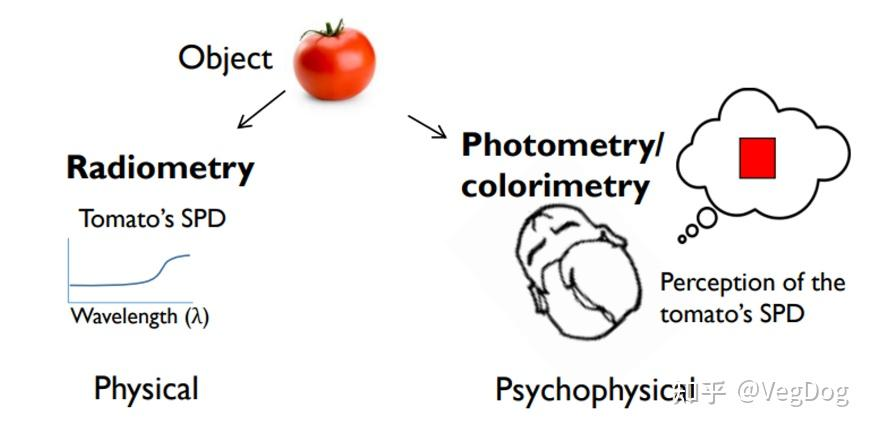

#### 光度(Photometry)**：**

下图曲线表达了达到同样的人感知到的一个参考强度，不同波段所需要的实际辐射强度是不同的，绿色波段所需要的实际辐射强度更低，也就是说人眼对于绿色其实是更敏感的。

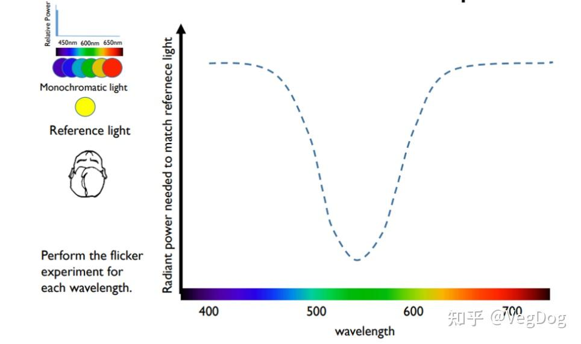

把这个曲线倒过来，就表达了人眼对于不同波段的光线的敏感程度的不同，即视见函数/光度函数。（Luminosity Function）

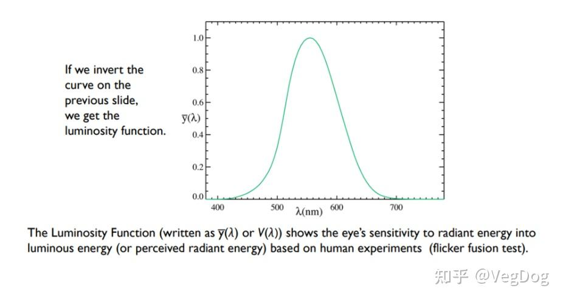

#### 色度(Colorimetry)

#### **三原色理论**

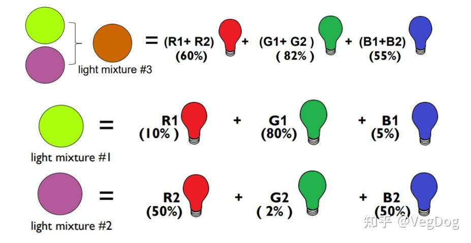

即绝大多数颜色可以通过RGB三种基础颜色去混合调制，而且这种调制是可以进行线性叠加的。

- **CIE 的RGB颜色系数匹配:**** (具体视野略，可看原文，总体思路就是通过添加固定系数去达到目目标波段光的颜色，而这里之所以出现了负系数，是因为有的颜色无法使用三原色合成，所以需要在这种颜色的基础上去添加三原色达到三原色能达到的某种颜色，那这个逆过程就视为添加了负系数)
- 

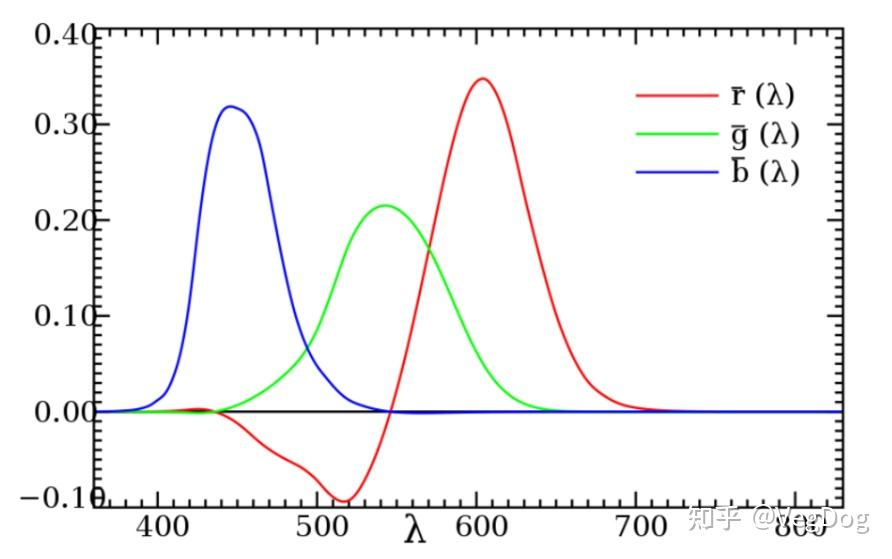

 即按照系数去混合RGB就可以达到目标波段光的颜色。
 后面CIE委员会在RGB系数曲线的基础上改进，通过这个转换公式得到了XYZ系数曲线：

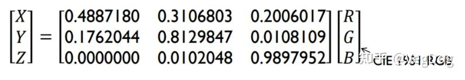

 这样做的好处：
 

- 系数不再有负数
- 白光(flat SPD)刚好是XYZ各的平均混合
- Y（G）刚好对应了视见函数（luminosity function）

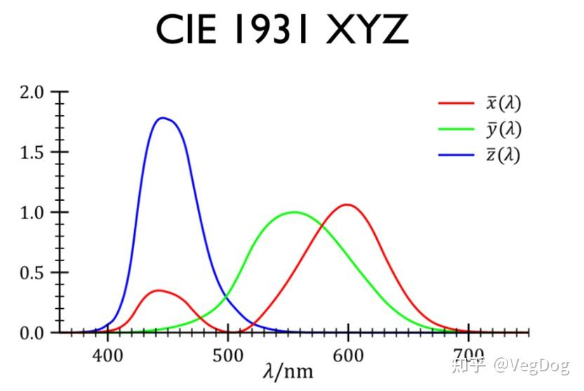

- 色度图（chromaticity diagram）：**** 对XYZ进行归一化（X+Y+Z=1）,然后只标出x，y值（z=1-x-y也可以直接算出），就可以得到更加直观的色度图，也是经常在显示器宣传上可以看到的这个图-。-
 这一套体系不针于某个特定设备，可以被计算匹配后使用到各种电子设备上，所以非常通用。
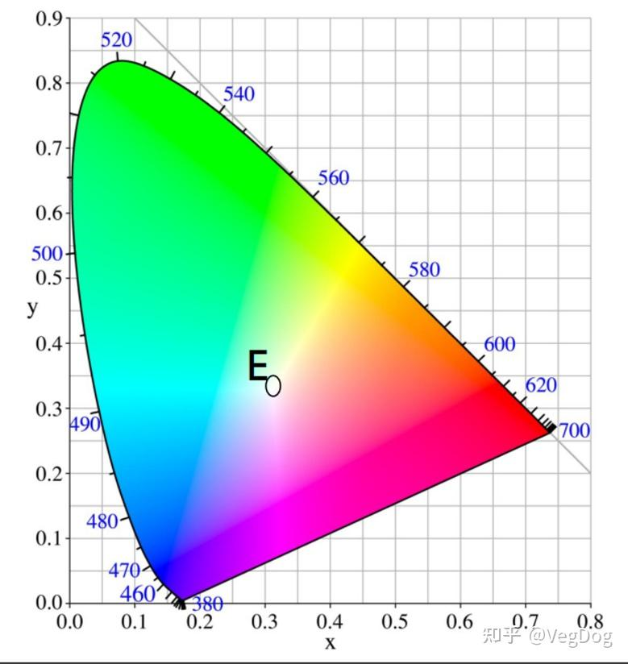

### 4. 色彩恒常性（Color constancy）

大多数情况下，自然界的物体不发光，而是去反射环境的光，这就导致其实在不同光照条件下其实他们反射的SPD是不一样的,例如文章里面的例子，在不同光照条件下西红柿反射SPD是有很大差别的，但是人看来颜色没有太大的差比，这是人独有颜色补偿机制，这种现象也叫做色彩恒常性。

这个现象其实和相机的白平衡相关，我们人类其实有很强的“自动白平衡”能力，但是机器是没有的需要通过算法去进行白平衡，这就导致很多情况下如果白平衡做的不是很好，拍出的相片的色温和实际观察到的有差距。

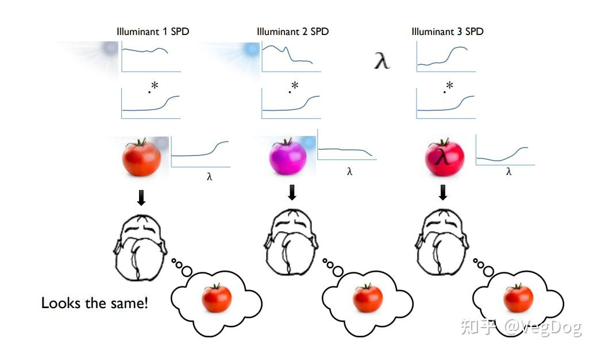

所以，晴天、阴天（不同环境光照）时，白纸实际反射SPD是不一样的，但是人类去纠正了这个差异让我们感觉纸都是白色的**，也正是因为我们人为的调整适应了不同的SPD将其视为白色（或者说我们适应了环境光），将图像直接打印到白纸上是不会产生太大问题的。

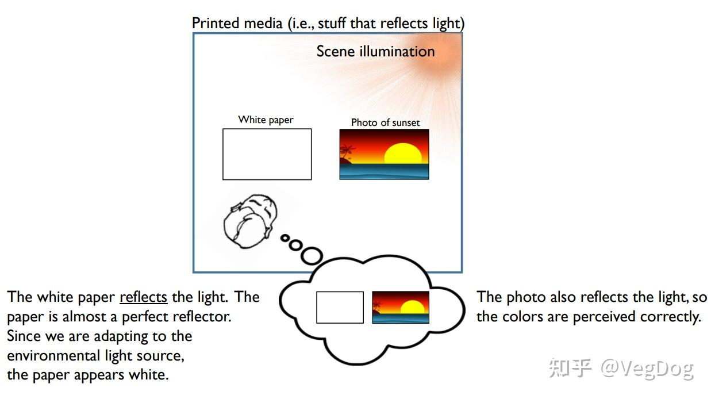

**但是自发光介质情况就完全不同（如屏幕）,屏幕发射的白光的SPD是固定的，不会随着环境光变化而变化，那么如果在所有光照环境下屏幕依然发射同样的SPD作为白色，就会和人类的感知产生差异**，**所以屏幕其实也需要主动去根据环境光照进行调整**，去选择不同光线下人眼认为的”白色“对应的SPD，才能让人产生正确的颜色感知，这个也就是白平衡所做的事情。

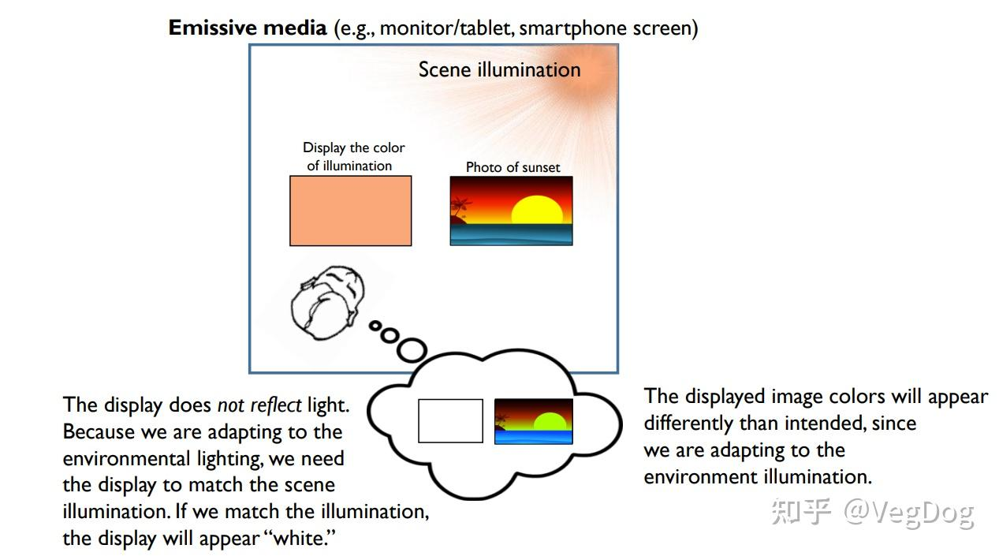

- 这一点对于图像编解码具有很重要的作用

#### 色温（CCT）

绝对黑体加以不同温度所产生不同的颜色。这里其实和我们了解的冷暖色是相反的，冷色的色温反而是比较高的

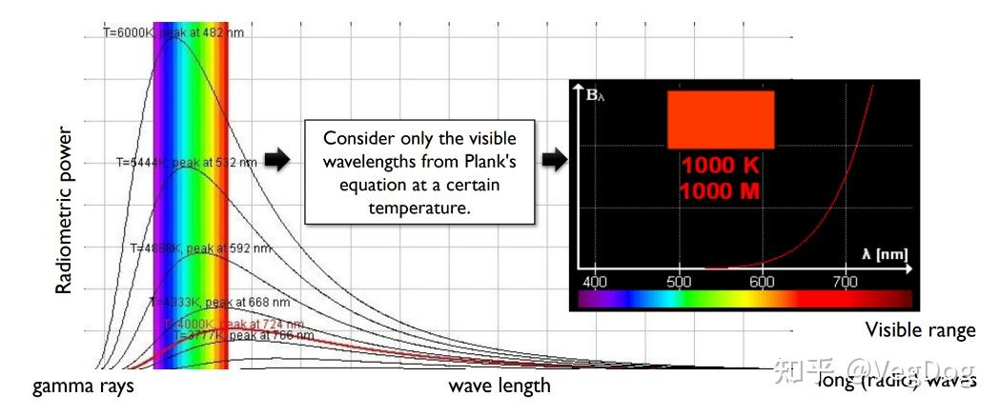

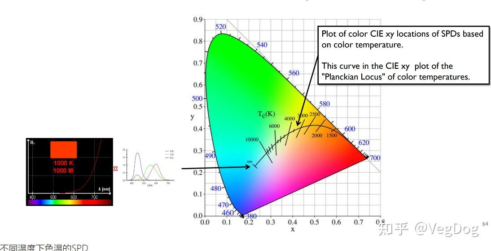

不同温度下色温的SPD
### 5. 颜色模型与色彩空间

#### sRGB

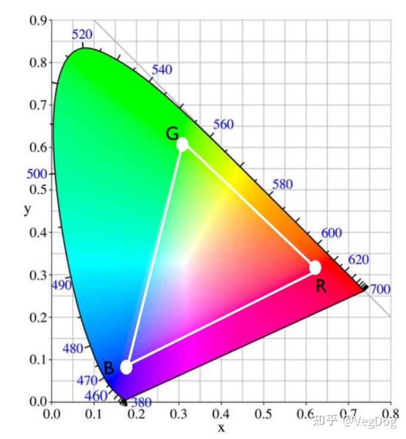

即standard RGB,96年HP和微软定义了标准的RGB对应的CIE xyz，这个标准称为sRGB。

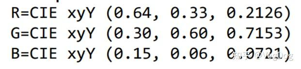

- 同时白平衡点设置为D65，注意这一点比较重要，因为其假定了光照环境（6500K），只有在对应的环境光下，显示的才是最标准的
CIE xyz也可以与RGB互相转换，转换的过程中假定的白平衡点会影响转换矩阵

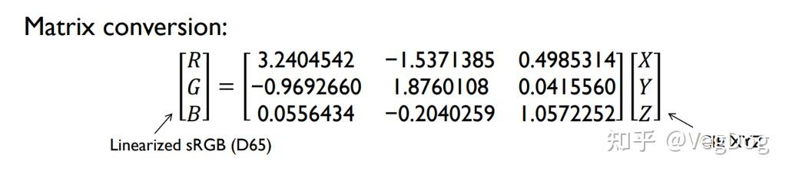

#### gamma编码与人眼光强感知曲线

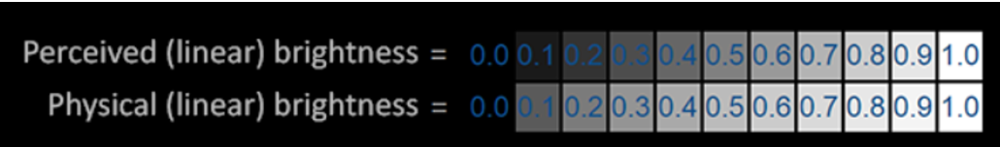

人眼对于暗光的敏感程度高于强光，其规律如下：

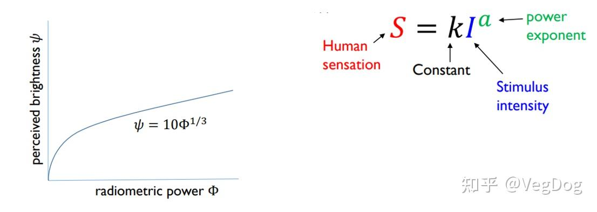

故图像编码过程中要给暗光部分更多的比特位记录更多的信息，强光可以少一点。

- 还有个概念叫做gamma修正，和这里的不是一个东西，要区分。

#### 麦克亚当椭圆（MacAdam ellipses）

主要是针对色差的实验，当色差落到某点的椭圆内（1阶），人类是几乎分不出差别的。还有对应的其他阶对应的椭圆图，一般来说超出3阶后与中心的色差是人能够察觉到的色差。

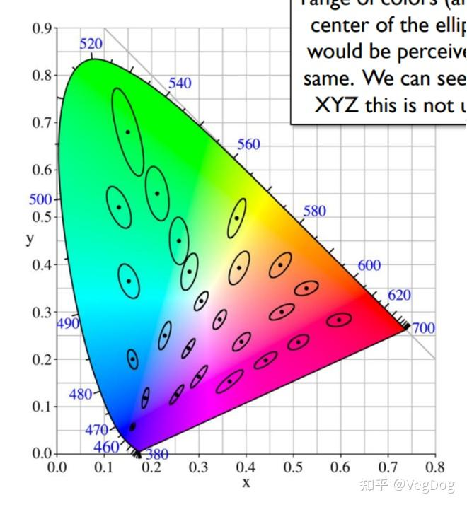

#### CIE Lab色彩空间

除了sRGB还有很多的其他色彩空间

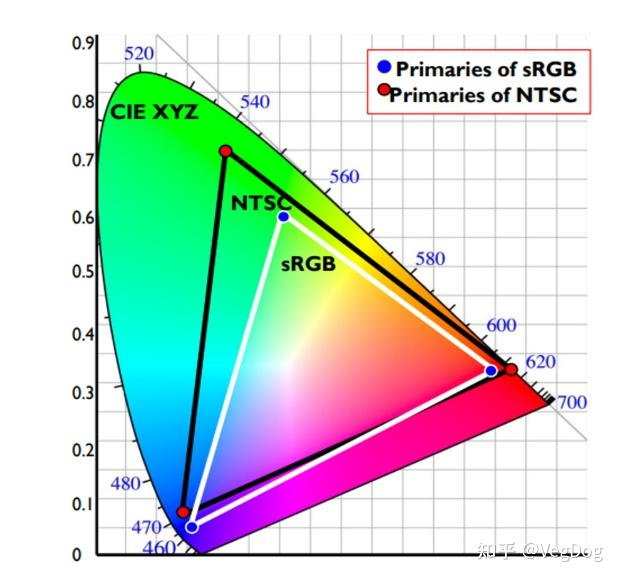

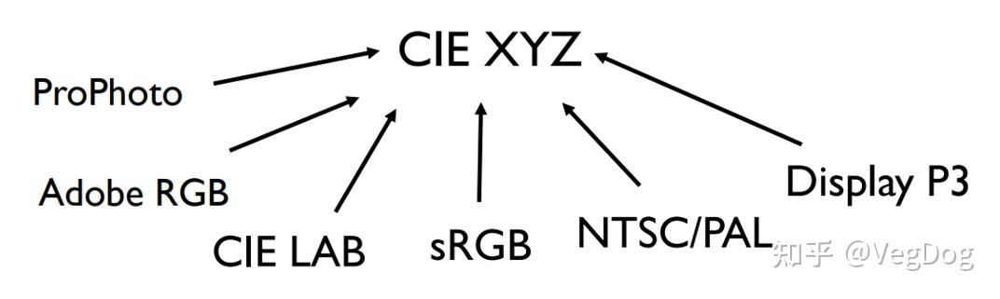

只详细介绍了LAB，其结合了前面的MacAdam ellipses和人眼光强感知曲线变换而来。是针对人眼特点设计的色彩模式。

- L*代表了可感知亮度（0-100）
- a*代表绿色到红色的分量（-128~127）
- b*代表蓝色到黄色的分量（-128~127）

#### 其他色彩空间

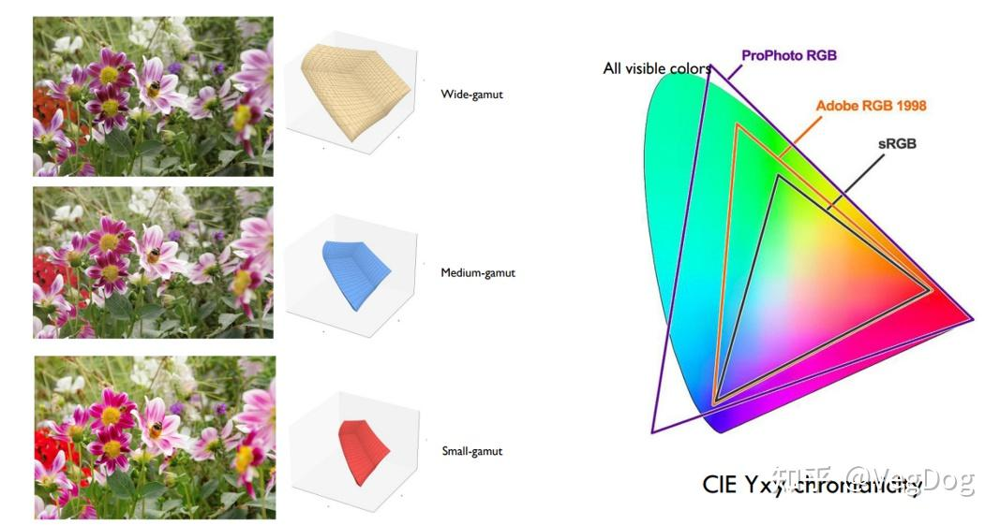

- Adobe RGB：色域中等色彩空间，主要用于照片编辑，记录约50%色彩（sRGB只能记录约30%）
- Display P3:主要是苹果使用，也是中等色域的色彩空间，记录约50%色彩
- ProPhoto (ROMM):柯达发明的，用于编码更广的色域，能够记录约90%表面色彩
这里有个违背直觉的地方就是色域更广的色彩空间，其颜色反而看起来没有那么鲜艳，一般来说需要经过专业的软件处理才可以进行恢复（类似索尼的Slog以及其他品牌的类似的格式，拍出来灰蒙蒙的，需要后期处理才可以恢复出来颜色)

### 6. 色域、色差、色深

经常研究显示器的应该常看到

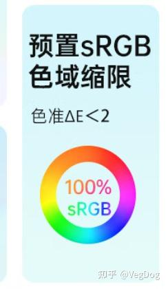

- 色域：即能涵盖的色彩范围，像这里的100%sRGB这里就是指可以覆盖显示100%的sRGB色差空间
- 色差：显示的颜色与规定的标准RGB的差异大小，
- 色深：编码一个像素颜色所用的比特位的大小，一般常见有8位、10位，位数越多，可以记录的色彩越丰富，显示器过渡也就越平滑，色彩更细腻。

### 相关文章、参考文章：

一位大佬对于原文文章的整理，写的很详细：[华年ss​的回答](https://www.zhihu.com/question/614056414/answer/3275012302)

Gamma矫正相关：

补充：Gamma校正

原Slides

其余部分：

Part2: [相机图像信号处理流程（ISP） - 知乎 (zhihu.com)](https://zhuanlan.zhihu.com/p/669484515)

Part3：[基于AI的ISP（图像信号处理）相关研究 - 知乎 (zhihu.com)](https://zhuanlan.zhihu.com/p/669664082)
