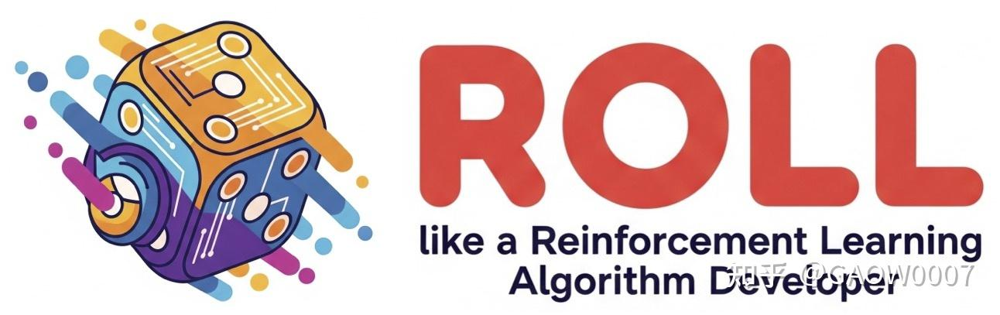
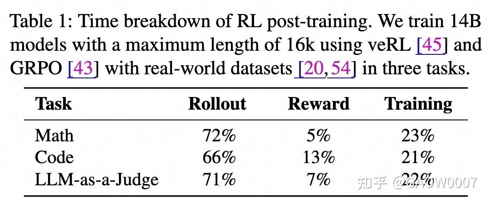
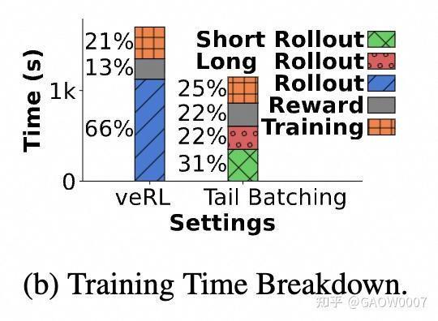
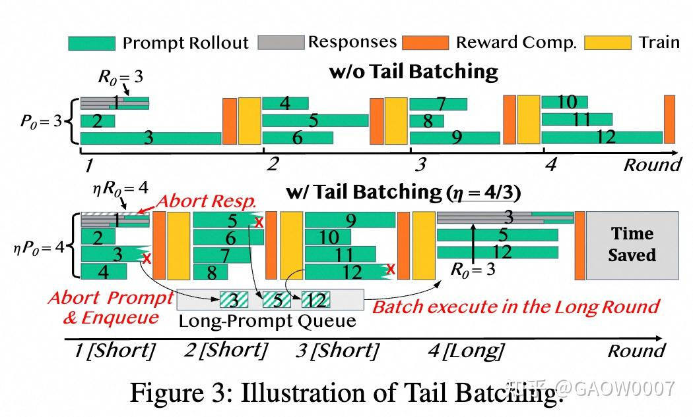

2025 年初我正式入坑 RL infra，并有幸加入阿里的 ROLL 团队。过去一年里，我参与了一系列 RL infra 的系统研究与工程工作。ROLL 团队一个很鲜明的特点是算法与系统结合非常紧密——从 system 侧的协作体验来看，很多需求对齐、问题定位和方案落地都非常**丝滑**。这里想借写知乎回顾，整理自己入坑 RL infra 一年来的研究经历（主要围绕 [rollpacker](https://link.zhihu.com/?target=https%3A//arxiv.org/pdf/2509.21009)以及阿里的相关技术报告 [ROLL](https://link.zhihu.com/?target=https%3A//arxiv.org/abs/2506.06122), [ROLL-Flash](https://link.zhihu.com/?target=https%3A//arxiv.org/pdf/2510.11345), [Let it Flow](https://link.zhihu.com/?target=https%3A//arxiv.org/abs/2512.24873)），也从实习的视角分享一些在 ROLL 团队做 infra 研究与开发的体验与思考。

### 初次尝试 [2025.02-2025.04]

虽然加入的是阿里的 ROLL 团队，但我最早尝试优化的是 veRL。过程中做了 veRL + vLLM 的整合，在 vLLM 上实现了一些类似 SGLang server-based 的能力，用来支持 rollout 过程中的 request migration、rollout 侧 GPU scaling down 以及 training 侧 GPU scale up（功能上有点像 RLHFuse）。  同时我也在阅读 ROLL 的源代码，在和 [@AI极客熊](//www.zhihu.com/people/90dd4cabea7849c5fac10f3f5d370f53)

 讨论过程中，发现 ROLL 本身的机制设计就允许用户比较灵活地管理不同 rollout worker 的执行周期，于是很快把重心转向了 ROLL。这套能力与我们 [rollpacker](https://link.zhihu.com/?target=https%3A//arxiv.org/pdf/2509.21009) 里 stream trainer 的功能非常接近。  这类功能之所以能很快做出一个鲁棒、能稳定跑的原型，主要得益于 ROLL 早期在 rollout scheduler 上做了比较合理且足够灵活的设计。

> 从 infra 视角看，RL framework 在早期阶段优先复用成熟的 LLM serving engine（如 vLLM/SGLang）所提供的接口，会是更稳妥、风险更可控的选择。ROLL 之所以把 rollout scheduler 设计得如此灵活，主要是因为算法团队在 rollout sampling 策略上持续迭代、频繁改动，这些需求反馈到 infra 侧就要求调度层具备足够的可配置性与可扩展性。从这个意义上说，这也是一种很典型、但形式更“隐性”的 algorithm-system co-design。

#### Rollout 优化失败的经验 [2025.02-2025.06]

rollout是RL 训练重头戏，其中rollout时间占比很高，这几乎已经是RL 优化的共识了，想要加速RL 训练，自然要优化rollout。

其实rollout优化我们早期经历了一些失败，以下两个也有不少同行已经做成功了，我在这里分享一下当初失败的原因和为什么放弃这些继续优化这个方向的理由，也给有类似想法的小伙伴们一些启发。

- Length Prediction 
我最早尝试过用 LLM 的 KV cache 特征来做长度预测，离线评估的 MSE 能做到 20% 以下。为了进一步提升精度，当时也花了不少时间在调参和训练上。 但真正部署到线上跑 rollout 时发现效果并不稳定，核心问题在于 rollout 阶段往往被长尾样本 bound 住：rollout batch size 是 1024，即使长度预测准确率有 90%，也意味着仍有大约 100 条样本长度会预测错；只要其中有一条落在长尾，整个 batch 的收益基本就被抹平了。后来复盘时觉得，如果一开始就假设“即便有一个 90% 准确率的 length predictor，也很难绕过长尾瓶颈”，可能能更快跳过这个坑，节省不少时间。 最近看到一些工作在这条路线做出了比较稳定的结果，想想当时如果再坚持一下或许也能跑通；但最终我们的结论是这套方案在工程收益上不够确定，所以选择了放弃。
- Speculative Decoding 
最早考虑用 SD 做优化，是因为观察到 rollout 过程中会出现大量重复 token，于是想先用 ngram 做一些投机/复用类的加速。 但这条路线后来也和 length prediction 一样被放弃：rollout 的端到端耗时往往被 long-tail 样本决定，只要 ngram 对长尾 rollout 没有稳定收益，整体的时间就很难降下来。尤其当我们把 rollout 的 temperature 设为 1.0 时，ngram 带来的收益变得很不确定，强依赖 data distribution 和 response length 分布，有时有效、有时几乎没收益，难以作为稳定可控的线上优化手段。 因此我们最终放弃了优化 ngram 方案，转而采用更偏工程确定性的 MTP 方向来做加速，没有在 ngram/SD 这条路线上继续做更深入的 research。
> 研究过程中经常会遇到这种情况：一个方向优化了很长时间，最后却被证明基本无效，成了食之无味、弃之可惜的“鸡肋”。这时到底该果断止损，还是继续深挖？当时我选择放弃，主要是因为我相信 RL 的优化空间很大，机会成本也高；如果一直死磕某一个想法，很可能得不偿失。当然，换到别的问题场景，权衡因素不同，我的选择路径也未必一样，感激那时的我很幸运地被RL infra选择了。

### 柳岸花明 -- TailBatching的诞生 [2025.06-2025.09]

- redundant sampling/speculative execution 
redundant sampling ROLL的最早release的版本就暴露了类似的接口，主要是在agentic training过程中使用，用在早期environment cluster 不稳定掉线的时候可以实现一定程度的fault tolerance避免整个rollout hang住，我们也尝试了一下redundant sampling，很不幸也是遇到 和length predictor 和 SD相同的问题，在某些iter中，redundant sampling 并没有带来rollout 过程中最大长度的减少，很不稳定。
- Workload Characterization 
(1) 在优化 redundant sampling 的过程中，我观察到一个很有意思的现象：不同 iteration 之间，生成长度分布的 p75 / p90 不仅明显更短，而且非常稳定。当时我就隐约觉得，这种特性一定能派上用场。
(2) 在做 redundant sampling 的过程，有些任务的 reward worker 耗时特别长，主要是因为出现了不少 timeout。随着 redundant sampling 把 rollout 时间压下去之后，reward 计算的耗时上升为新的瓶颈——说明端到端优化不能只盯着 rollout，本质上 reward 侧也有不少可挖的空间，这个就诞生了后来的rollpacker 里面的 reward scheduler 。

- Tail Batching 

- 当时和合作者讨论，既然同步训练的时候 redundant sampling 那么不确定，不如做异步训练，过程中提出好几种异步的训练方案，算法那里都没有很强的意愿采纳，这里感谢 [@王小惟 Weixun](//www.zhihu.com/people/a3e651b09fee0457626b8861eff72fb1)

 的鞭策，让我们不断反思改进自己的思路，一直在on-policy的道路优化。
- 其实这段时间还没有完全放弃SD，不过主力研究SD地合作者已经被搞得筋疲力尽了，某一天讨论的精疲力尽的时候想到既然每个prompt 的用redundant sampling不一定产生效果，不如在prompt 层面也采用redundant sampling，并且为了不让prompt 被丢弃，采用了tail batching的策略，也算是起死回生吧，个人觉得tail batching 在让RollPacker 被NSDI 26接受起了至关重要的作用，至此 RollPacker 工作终于成型。

> 回头看，当时最初几个月对于length prediction 和 SD 的优化投入似乎有些“打水漂”，放弃这些方案也确实可惜,尤其现在看到不少团队已经把这些方向跑通并做出了稳定收益。 但是当做完rollpacker,回望这段经历带来的需要汲取的教训更为重要：
(1) 做优化前先想清楚技术的适用边界与场景。很多方法并不是“做不成”，而是对数据分布、长度分布/长尾形态等前提条件高度敏感,换一个更匹配的 workload 设置，可能就能让方案起死回生。 
(2) 不要执着于某个优化技术本身，而要围绕目标 workload 做特性分析。与其不断堆复杂技巧，不如先把瓶颈与决定因素分析清楚；"好的分析 + 更简单、可控的工程手段”，反而能带来更确定、更大的性能收益。
以上给所有经历类似痛苦的伙伴们共勉。

#### 结语

2025 年我们感受到，RL 的系统优化很大程度上仍是在复用、甚至有点“吃”过去几年 LLM serving 优化积累下来的工程红利：谁把工程链路打通得更快、把现成能力拼得更好，谁就更容易先拿到一波收益。

但 2026 很可能会是 agentic RL 加速发展的一年：训练门槛更高、实验与部署更复杂，系统侧也会涌现出更多全新的问题与挑战，这也给我们带来了做出更 RL-specific 系统优化的机会，也给大家带来更多的机会。后续我也会分享 ROLL team 在 agentic RL方向的一些优化工作，也欢迎大家在评论区交流2026年RL infra还有什么有意思的发展方向，一起丝滑地进步。

最后也打个广告：ROLL team 持续招人中，实习和正式岗位都有，算法和系统方向都欢迎来聊。
