### 引言

**1.  博主在阅读Agent方向的论文时，做了些笔记，加工后形成了这篇文章。
2.  学术论文最核心的idea通常用一两段话就可以概括。
3.  这也是论文简读的意义所在。
4.  对每篇论文，本文从motivation + design + conclusions三个角度介绍。
5.  本文不是一篇综述性质的文章。
6.  错误在所难免，欢迎大家指正、交流。
7.  本文选28篇论文的原因以及其它参考材料，见文末说明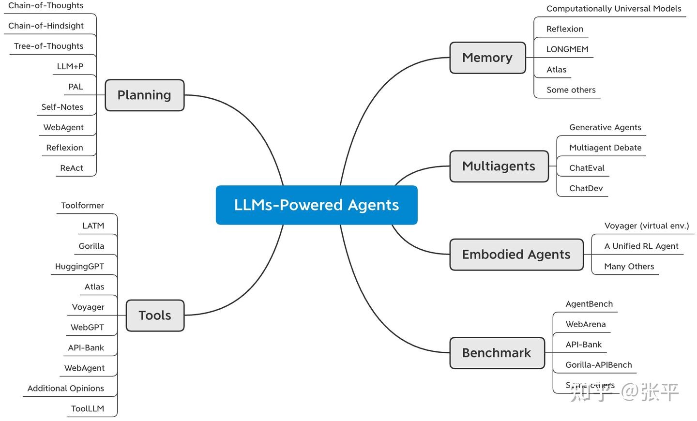

本文解读的28项工作：一个朴素分类
### Planning

#### CoT, 2023, Jason Wei et al., Google Research.**

Wei, Jason, et al. “Chain-of-thought prompting elicits reasoning in large language models.” *Advances in Neural Information Processing Systems* 35 (2022): 24824-24837.

推理能力是人类智能最重要的特征之一。CoT提出一种**思维链**（Chain-of-Thought）技术，在prompting阶段将任务分解成一系列**中间推理步骤**，显著提高了LLMs解决复杂推理任务的能力。这种CoT prompting建立在两个idea之上，一是将复杂算数推理分解成一系列导向最终答案的**逻辑子步骤**对于解决算数问题是十分有益的；二是LLMs本身具有强大的**in-context小样本学习能力**。实验结果表明，仅通过8个CoT提示样本，540B的PaLM模型在GSM8K测试集上就超越了微调版的GPT-3，取得SOTA。

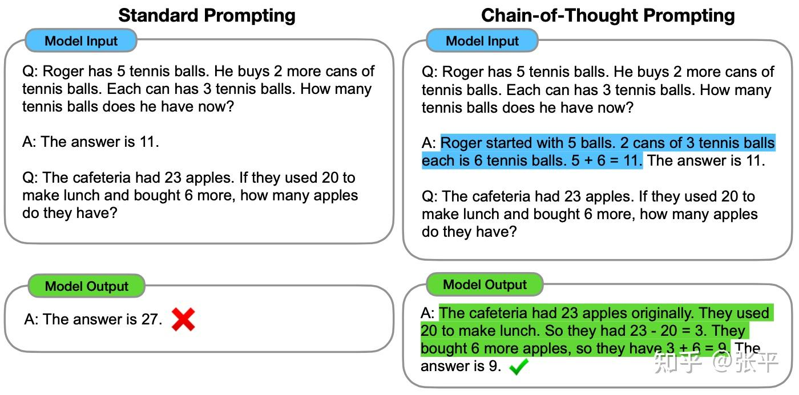

CoT prompting示意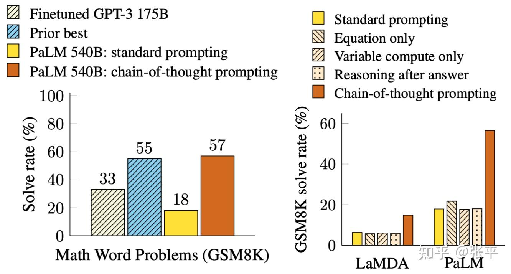

引入CoT后的LAMDA和PaLM 540B
#### **ToT, 2023, Shunyu Yao et al., Princeton & Google DeepMind.**

Yao, Shunyu, et al. "Tree of thoughts: Deliberate problem solving with large language models." *arXiv preprint arXiv:2305.10601* (2023).

LLMs 的token-level、left-to-right的决策过程，使得其在那些需要广泛探索、战略前瞻的任务中显得力不从心。本文在Chain-of-Thoughts（CoT，思维链）工作的基础上，提出Tree-of-Thoughts（ToT， 思维树）。在每一步，**ToT考虑多种推理路径，并对不同的路径选择进行自评估**，以决定下一步行动的具体选择，同时在必要的时候进行**提前计算并回溯**，以进行更加**全局化**的决策。这些改进使得LLMs智能体可以执行更加深思熟虑的决策。实现表明，ToT在Game of 24、Creative Writing、Mini Crosswords等任务中性能表现突出。

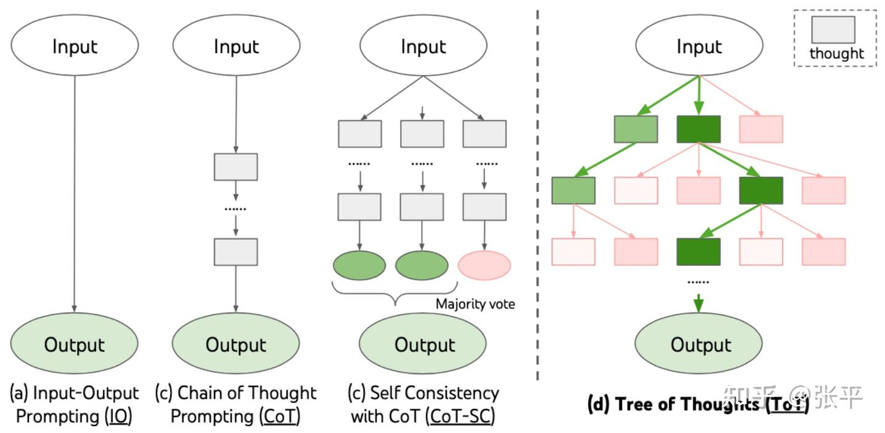

ToT的推理过程示意（右）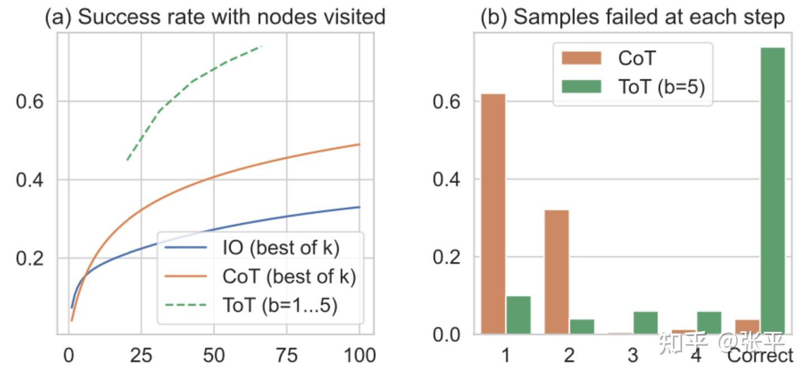

ToT在Game of 24上成功率可以达到74%（vs. CoT=4%）
#### **Chain of Hindsight, 2023, Hao Liu et al., UC Berkeley.**

Liu, Hao, Carmelo Sferrazza, and Pieter Abbeel. “Chain of hindsight aligns language models with feedback.” *arXiv preprint arXiv:2302.02676* 3 (2023).

将LLMs与人类偏好和社会价值对齐（alignment）是非常重要的。现有对齐方法主要分两大类，一类依赖于人工注释和挑选，**数据利用率低**，应用难度大；另一类基于强化学习，但难以获得完美的奖励函数，且**优化困难**。Chain of Hindsight的核心思路是**将feedback转化为语言句子，对LLMs进行fine-tune**, 从而充分利用大模型的语言理解能力，在summary和dialogue任务上得到了明显提升。

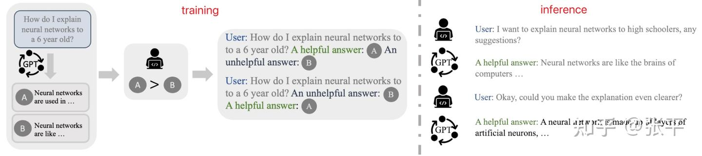

Chain of Hindsight训练、推理示意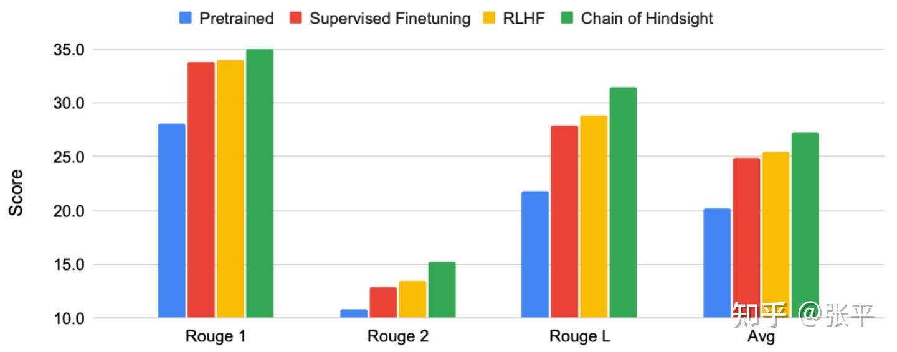

Summarization 任务上的评估结果
#### **LLM+P, 2023, Bo Liu et al., University of Texas Austin.**

Liu, Bo, et al. “LLM+P: Empowering large language models with optimal planning proficiency.” *arXiv preprint arXiv:2304.11477* (2023).

**让专业的人做专业的事**。LLM在解决长期规划类任务方面，能力依然较弱。LLM+P通过**引入传统规划技术**作为外部规划器来增强LLMs解决规划任务的成功率。

具体地，LLM+P采用规划领域定义语言（Planning Domain Definition Language, PDDL），将问题描述和PDDL示例作为prompts输入给LLMs，让LLMs生成对应的问题文件（problem file）, 该文件的内容为当前需要求解的问题的problem PDDL，然后将problem file和由人类专家提供的domain file作为输入，提供给经典规划求解器Planner，**由Planner快速生成解决当前问题的PDDL Plan**，再将该PDDL Plan提供给LLMs，生成最终用自然语言描述的规划方案。

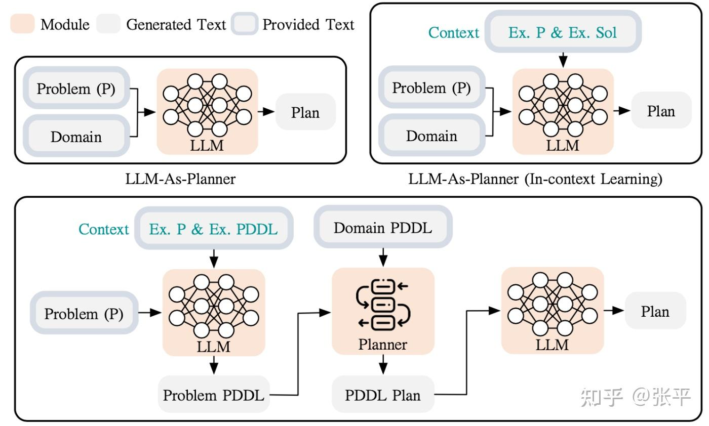

LLM+P原理示意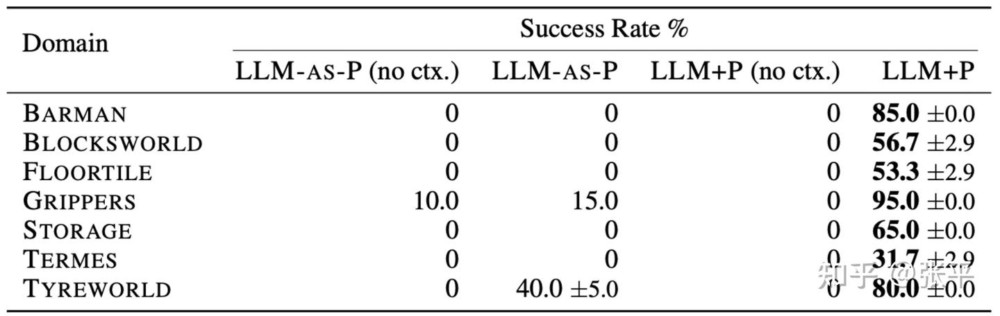

LLM+P在大多数任务上给出了最优解
#### **PAL, 2023, Luyu Gao et al., CMU**

Gao, L., Madaan, A., Zhou, S., Alon, U., Liu, P., Yang, Y., ... & Neubig, G. (2023, July). Pal: Program-aided language models. In *International Conference on Machine Learning* (pp. 10764-10799). PMLR.

CoT方法存在的一个问题是，即使LLMs分解得到的中间推理步骤是正确的，依然有可能得到错误的最终答案。为解决该问题，本文作者提出PAL，一种程序辅助式Prompting方法。PAL的核心思路是将CoT得到的中间推理步骤**从自然语言描述改写为程序描述**，例如，用Python代码逐步记录推理步骤，最后直接通过**运行Python程序**来求解最终答案。直观上，PAL将得出最终答案的最后一步从LLMs卸载（off-load）到了程序运行时（如Python解释器）去完成，将这最后一步从一个概率性过程转成一个确定性过程，从而确保：当LLMs的中间推理步骤正确时，得到的最终答案则一定正确。

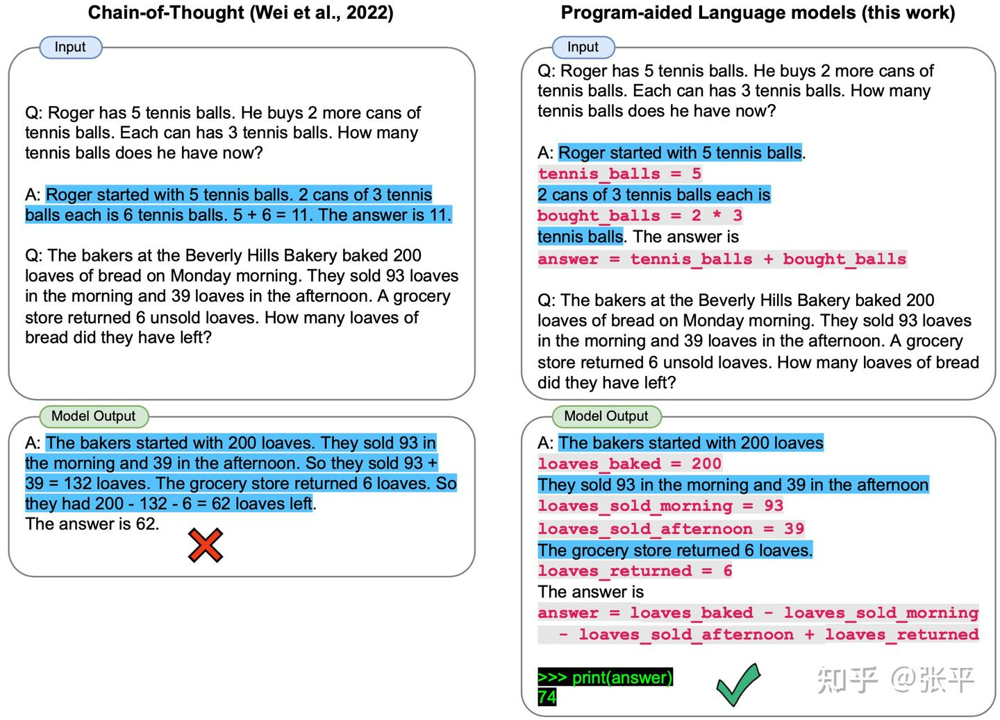

CoT Prompting 和 PAL Prompting 的一个对比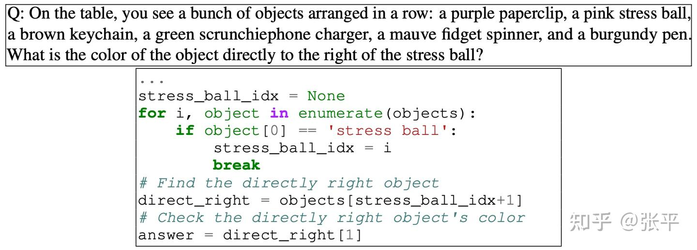

PAL Prompting 的一个示例实验结果显示，PAL在数学类（如算术）、符号和算法推理类任务中效果改善明显。

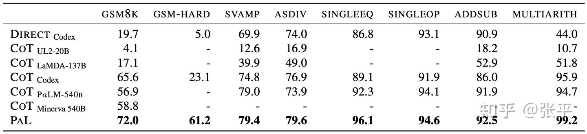

PAL在数学推理类任务上表现优于CoT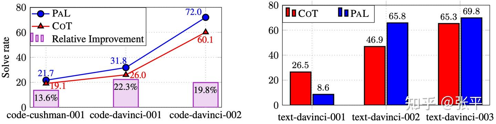

采用不同基础大模型下，PAL 和 CoT 在 GSM8K 数据集上的对比
#### **Reflexion, 2023, Noah Shinn et al., Northeastern University.**

Shinn, Noah, et al. "Reflexion: Language agents with verbal reinforcement learning." *arXiv preprint arXiv:2303.11366*(2023).

现有的通过参数更新来提升模型能力的方法通常成本较高且效率较低（e.g., 全量微调，full fine-tunning）。本文提出Reflexion，一种基于**语言反馈**（linguistic feedback）的智能体增强技术。Reflexion智能体通过口语化的方式对任务反馈信号进行回应，并将**内省式文本**（reflective text）维护在一个任务场景的记忆缓冲区中，以便在随后的尝试中引导智能体产生更好的决策。

具体地，在解决任务的过程中，一个LLM智能体作为Actor负责与环境交互，交互所产生的observation或reward，一方面用于形成外部反馈信号，另一方面被作为短期记忆直接用于改善Actor，同时该短期记忆通过另一个作为Evaluator的LLM智能体进行评估，以生成内部反馈信号。最终，外部反馈信号和内部反馈信号被同时提供给负责内省的智能体，以产生**内省文本作为长期记忆的experiences**，用于进一步强化Actor智能体。

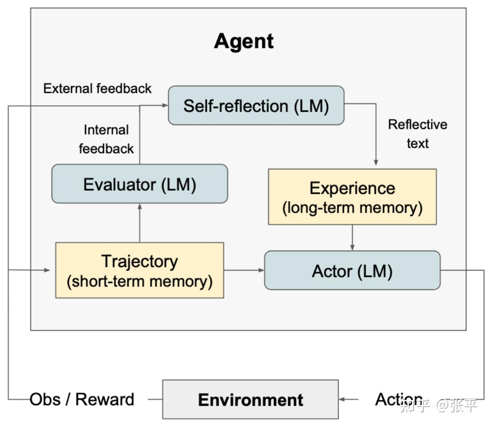

Diagram of Reflexion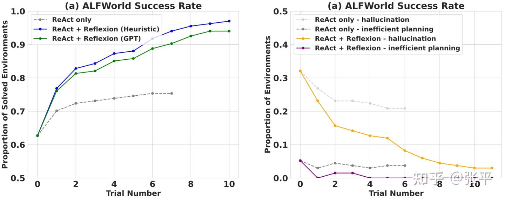

Reflexion(Heuristic) + ReAct表现最好
#### **ReAct, 2023, Shunyu Yao et al., Princeton.**

Yao, Shunyu, et al. "React: Synergizing reasoning and acting in language models." *arXiv preprint arXiv:2210.03629* (2022).

ReAct将推理和行动结合起来应用到LLMs上。其中，推理产生的traces帮助模型归纳、跟踪、更新行动计划，并辅助模型进行异常处理；行动则通过与知识库、维基百科API、环境等外部信息源交互来收集信息。**推理与行动交错进行**，不仅改善了模型的幻觉（hallucination）和错误传播（error propagation）问题，同时使得LLMs解决问题的**过程本身（trajectories）更加接近人类表现**，即更具有可解释性，从而生成的结果也更加可信。

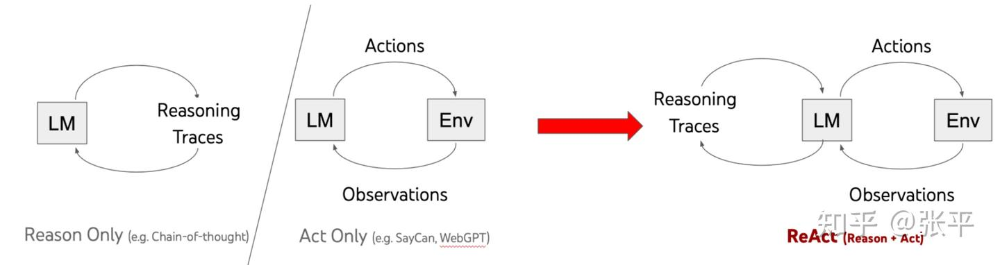

ReAct对以往Reason Only和Act Only的方法进行结合，https://react-lm.github.io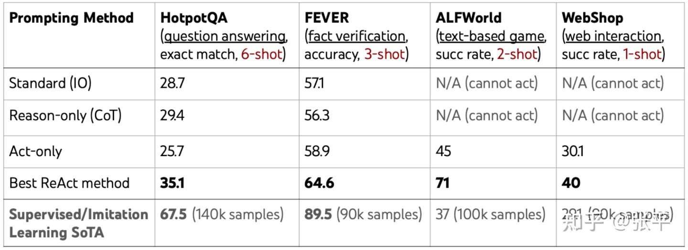

ReAct在包括HotpotQA等在内的四类任务上取得SOTA, https://react-lm.github.io
#### **Self-Notes, 2023, Jack lanchantin et al., Meta AI.**

Lanchantin, Jack, et al. "Learning to Reason and Memorize with Self-Notes." *arXiv preprint arXiv:2305.00833* (2023).

人类在学习时通常喜欢做笔记，例如，当我们做数学题时，我们可以通过打草稿、做笔记来辅助解决问题。本文将**“及时做笔记”**的思路引入LLMs，来提高LLMs的记忆能力和多步推理能力。Transformers作为一个前馈模型，不具备可以用于状态跟踪的记忆能力（这种能力在其它循环模型如LSTM等中是标配），因此很难处理高度非线性的任务。

本文作者提出一种叫做Self-Notes的方法，LLMs在回答问题时，随时可以跳出输入context的token，生成代表中间推理步骤的token，这些中间token与邻近的context联系更加紧密，从而代表一种更有效的**显式思考**。这种on-the-fly的推理，可以看作是Scratchpad方法 ([Nye et al., 2021](https://link.zhihu.com/?target=https%3A//arxiv.org/abs/2112.00114)) 的**内联**模式，有效扩展了LLMs的记忆能力和多步骤推理能力。从另一个角度看，Self-Notes避免让LLMs在读完所有上下文后进行“一次性的大部头”推理，而是像人类阅读一样，**“边读边思考”，**从而降低模型回答问题的难度。Self-Notes支持监督式、半监督式、无监督式三种训练方式。

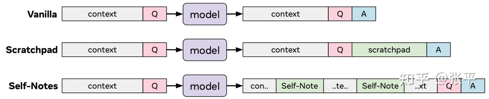

Self-Notes vs. Scratchpad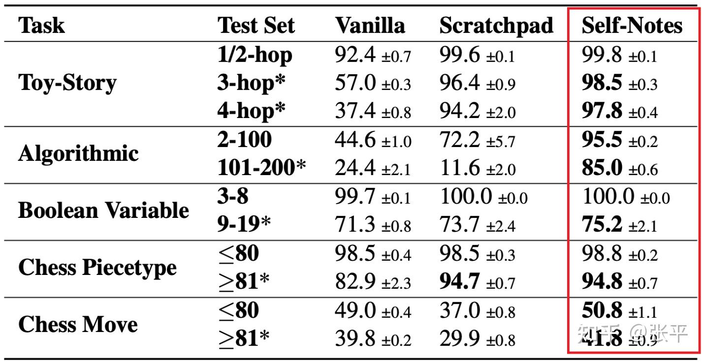

Self-Notes在五类任务集上取得SOTA且部分任务上提升效果十分显著Self-Notes本质上将LLMs的token预测过程进行了分解、分步的优化。一个显著的问题是，增加了训练和推理的计算消耗，尤其是推理期间的消耗，对于回答问题本来就慢的LLMs（e.g.,相比于Google搜索的响应速度），是个不容忽视的新增代价。

### **Memory**

#### **Computationally Universal Models, 2023, Dale Schuurmans, Google Brain.**

Schuurmans, Dale. "Memory augmented large language models are computationally universal." *arXiv preprint arXiv:2301.04589* (2023).

这是一项较为理论的研究工作。作者通过模拟的方式表明，用一个外部可读写内存（R/W memory）增强后, 基于transformer模型的LLM是计算通用的（computationally universal）；即增强后的大模型（理论上）可以**模拟任何算法**。在本文中，作者将一个Flan-U-PaLM 540B模型，用一个外部R/W内存增强后，可以完全**模拟通用图灵机U15,2**，且该过程不需要对LLM进行参数微调，只需采用一个存储指令计算机（stored instruction computer，用于外部存储读写）对LLM循环prompt即可。这个研究与Neural Turning Machine（NTM）有相似结论，可参考NTM论文和Reddit 讨论，DeepMind在2016年也做过类似的研究。

#### **LONGMEM, 2023, Weizhi Wang et al., UCSB & Microsoft Research.**

Wang, Weizhi, et al. "Augmenting Language Models with Long-Term Memory." *arXiv preprint arXiv:2306.07174* (2023).

LLMs只能处理固定长度的输入，无法利用更加丰富的过往记忆。本文设计了一个新型的解耦架构LONGMEM，**将模型的记忆（memory）与知识（knowledge）进行解耦，**以支持更加长期（理论上支持无限长）的记忆。在LONGMEM中，LLMs作为基石模型，对知识进行编码，而一个新增的基于残差架构的边车网络SideNet（side-network），则作为独立的记忆检索器（retrieval module）。**SideNet** **是可训练的**，因而对不同时期的记忆具有自适应能力。

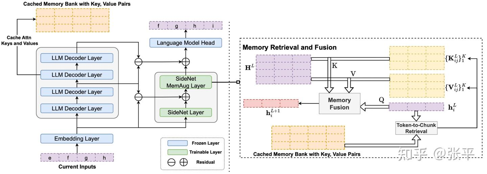

LONGMEM架构在记忆构建过程中，长文本序列被分割成固定长度的片段，并采用attention键值对的方式存储到记忆池（memory bank）中。记忆读取时，SideNet首先利用当前输入的attention key, 从记忆池中检索出对应的长期记忆，然后该长期记忆通过联合注意力机制（joint-attention mechanism）与SideNet的隐状态进行混合，得到最终的预测结果（token probability）。

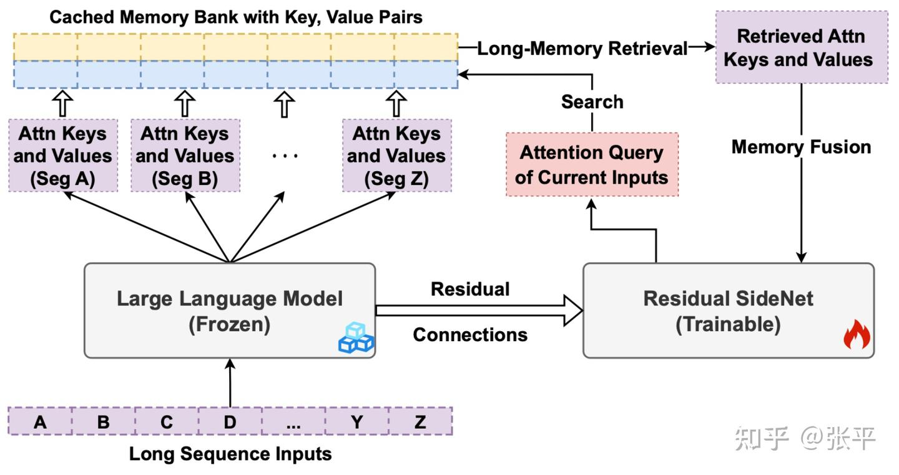

LONGMEM中长期记忆的构建与读取传统 LLMs 因输入序列长度限制，prompt 中能够提供的示例个数是比较有限的，**LONGMEM** **将上下文长度扩充到了65K**，可以支持非常丰富的 prompt 示例。例如，可以将几千个 demonstration examples 缓存在LONGMEM的记忆中，显著增强 in-context learning 的效果。

#### **Atlas, 2022, Gautier Izacard et al., Meta AI & UCL.**

Izacard, Gautier, et al. "Few-shot learning with retrieval augmented language models." *arXiv preprint arXiv:2208.03299* (2022).

LLMs超大的参数量存储了海量知识（in-parameter memorization），使其具有优异的任务泛化能力，如小样本学习能力（Few-Shot）。从以往的研究中可以看到，检索增强型模型在知识密集类任务中表现也非常突出，只不过我们尚不清楚它们是否和LLMs一样具备优异的Few-Shot能力，本文的研究对该问题给出了**肯定回答**。作者提出一种检索增强型语言模型Atlas, 用更少的参数，实现了相比LLMs同水平甚至略优异的Few-Shot能力。例如，Atlas在Natural Question任务上，仅用64个训练样本，就达到了42%的准确率，这比一个540B的PaLM模型高出3%，但**参数量比后者小了50倍**。不过，Reddit上对这项工作的讨论褒贬不一。

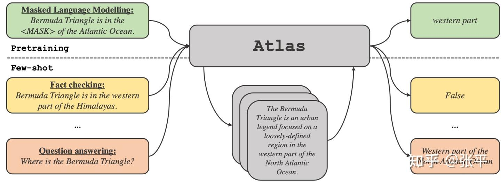

Atlas: Retrieval Augmented Language Model (RAG LM)根据scaling law, 更大的模型、更多的数据，通常可以带来更好的模型泛化能力。本文的研究进一步表明，scaling law描述的结果是一种充分非必要条件。除了增大模型参数量、增加训练样本量，还可以通过其它途径来提高模型的Few-Shot能力，如Atlas所采用的检索增强技术。本质上，Atlas将模型的memorization从generalization中解耦出来，将memorization的问题**外包给一个retriever**，并对解耦后的model和retriever进行联合训练，显著减少了为达到和LLMs相同泛化能力所需要的模型参数量。检索增强的引入，将一部分复杂度从model本身转移到了retriever。不过，Atlas的这种设计带来了adaptability, interpretability 和efficiency等多个优势。这里有两个有趣的问题，待进一步研究，1). 当memorization被剥离后，语言模型学到的具体是什么？2). 现有很多关于memory-augmented的研究，本质上是否等价于进一步增大了LLMs的参数量，即通过一个更高效的方式（知识的直接存储）获得了有效知识，只不过这种获得如果是通过传统的in-parameter memorization实现，则需要付出更大的成本。

### **Tools**

#### **Toolformer, 2023, Timo Schick et al., Meta AI Research.**

Schick, Timo, et al. "Toolformer: Language models can teach themselves to use tools." *arXiv preprint arXiv:2302.04761*(2023).

Toolformer 是一个基于**自监督学习方式**，在API calls的数据集上进行微调得到的大模型。用于微调的API calls数据通过采样并过滤一个更大的API calls数据集而来，过滤原则是，模型在调用对应API 之后，有助于**提高对下一个token的预测**。这样训练得到的Toolformer在做任务时，知道该调用哪个API，何时调用，传递什么样的调用参数，以及如何将调用结果应用到后续的token预测中，从而提高其解决问题的能力。

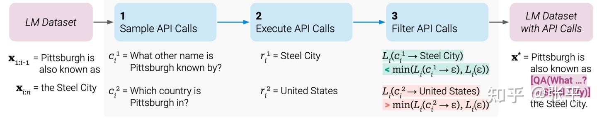

Toolformer的几个关键步骤：采样、执行、过滤API Calls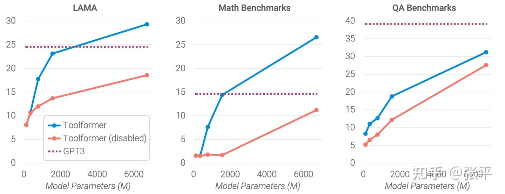

在三个benchmark数据集上的性能对比
#### **WebGPT, 2022, Reiichiro Nakano et al., OpenAI.**

Nakano, Reiichiro, et al. "Webgpt: Browser-assisted question-answering with human feedback." *arXiv preprint arXiv:2112.09332* (2021).

长文本开放问答（long-form question-answering, LFQA）是NLP领域一个充满挑战的高价值任务。本文首先构建了一个**基于文本的网络浏览环境**，然后在该环境中对GPT-3模型进行LFQA任务微调。模型在回答问题的过程中，可以进行网络检索和浏览。同时，这类基于检索-浏览的问答任务也可以人工完成，因此，模型可以通过模仿学习（imitation learning）获得人类反馈，以优化自身答案的质量。为方便人工对模型答案的事实准确性（factual accuracy）进行评估，WebGPT要求智能体附上相应参考文献，以支持其答案。

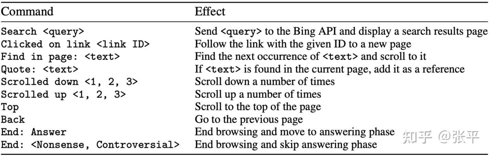

WebGPT定义的Agent在网上冲浪时可以执行的命令/可采取的动作在 Explain-me-Like-I’m-Five 数据集上的训练结果表明，在作者所尝试的几组不同技术组合中，结合行为克隆（behavior cloning）和对奖励函数进行拒绝采样（rejection sampling）的方案，可以得到最佳模型。

#### **LLMs as Tool Makers, 2023, Tianle Cai et al., DeepMind & Princeton.**

Cai, Tianle, et al. “Large language models as tool makers.” *arXiv preprint arXiv:2305.17126* (2023).

现有研究已表明，通过调用外部工具，能够显著增强LLMs解决问题的能力。为避免对外部工具可用性（availability）的依赖，本文提出一种**让LLMs自己制造工具，并使用或复用**该工具的闭环框架（closed-loop framework）。其中，工具制造者和使用者可以是同一个LLM，也可以是不同LLM。这里，工具特指基于Python实现的工具函数。**和“使用”相比，“制造”通常是个更加复杂的过程**，因此，本研究将工具制造和工具使用进行分离设计，具有成本效率更高的优势。比如，在解决任务时，我们可以让能力更强但资源消耗也更大、成本更高的GPT-4模型负责工具制造；而用推理速度更快、成本更低的GPT-3.5模型来使用工具，以**提高整体的成本效率**（cost efficiency）。

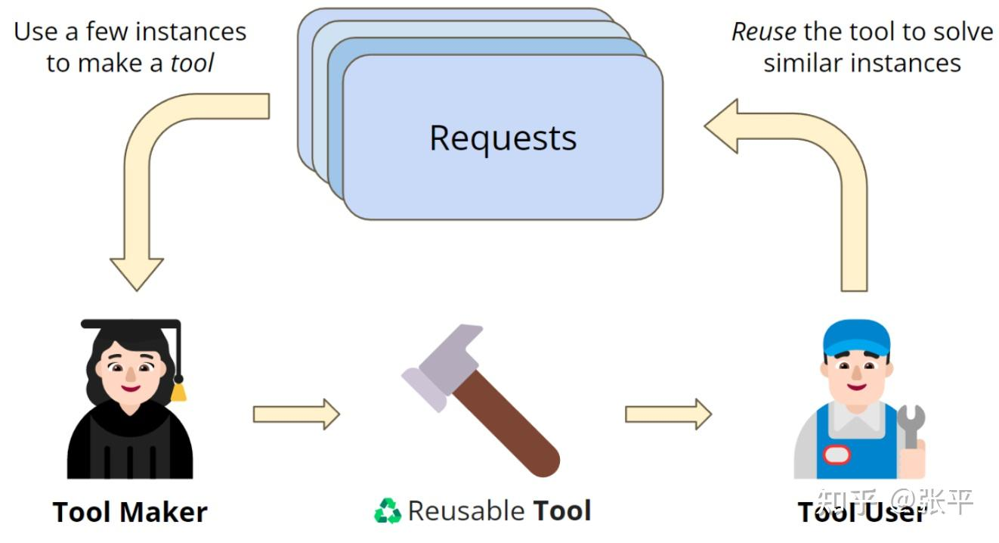

LATM （LLMs-as-Tool-Makers）的闭环设计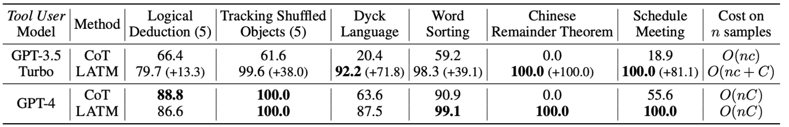

LATM和CoT的比较
#### **Gorilla, 2023, Shishir G. Patil et al., UC Berkeley & Microsoft Research.**

Patil, Shishir G., et al. "Gorilla: Large language model connected with massive apis." *arXiv preprint arXiv:2305.15334*(2023).

LLMs调用外部API工具存在诸多困难。例如，因模型产生幻觉而误用API，“制造”出本不存在的API；很难为正确的API生成准确的调用入参；以及，现实世界的API可能会发生更新，如频繁的文档更新等。

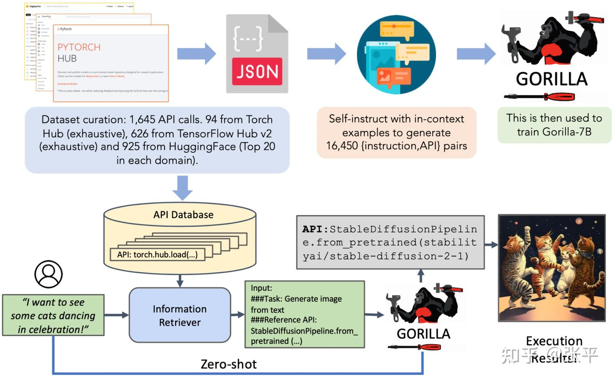

Gorilla的训练和推理过程示意本文提出Gorilla，一个在LLaMA-7B基础上，采用self-instruct方式，用API指令-文档数据微调，并与文档检索器（document retriever）结合得到的LLMs Agent及其Pipeline。与document retriever的结合，使得Gorilla无需进行retraining就能跟踪API的更新，提高Pipeline效率的同时提高了模型在测试时的可靠性和可用性。在retriever中，**每个API被看做一个独立的文档**，推理阶段，先用用户的query检索与之最相关的API，然后将top-1的API与用户的prompt合并，对LLMs进行调用。

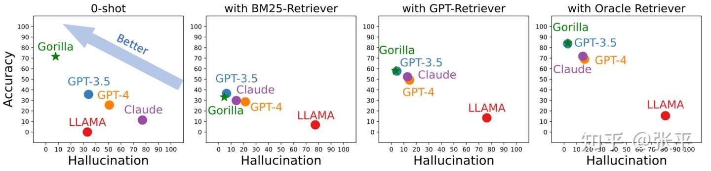

从“幻觉”和准确率两个维度的比较结果实验表明，Gorilla在API调用指令生成方面的性能（幻觉和准确率）超越了GPT-4。同时，作者公开了APIBench，一个较全面的API数据集，包含了来自HuggingFace, TorchHub, TensorHub的几乎所有API。

#### **HuggingGPT, 2023, Yongliang Shen et al., Zhejiang University, MSRA.**

Shen, Yongliang, et al. "Hugginggpt: Solving ai tasks with chatgpt and its friends in huggingface." *arXiv preprint arXiv:2303.17580* (2023).

由于LLMs在语言理解、生成、交互等方面能力突出，本文将其作为中心控制器，以协同现有的各类AI模型作为子任务执行器。这些子模型发挥各自特长，共同解决复杂的AI任务。其中，**自然语言可以看做调度不同模型的通用接口**（generic interface）。具体地，作者采用ChatGPT作为控制器，负责任务规划与分解、模型选择、以及各模型响应结果的整合，而各AI模型直接选自Hugging Face，负责子任务的具体执行。例如，当所需求解的任务是多模态性质时，HuggingGPT会分别调用对应的领域模型进行执行，包括Vision、Speech、Audio等。

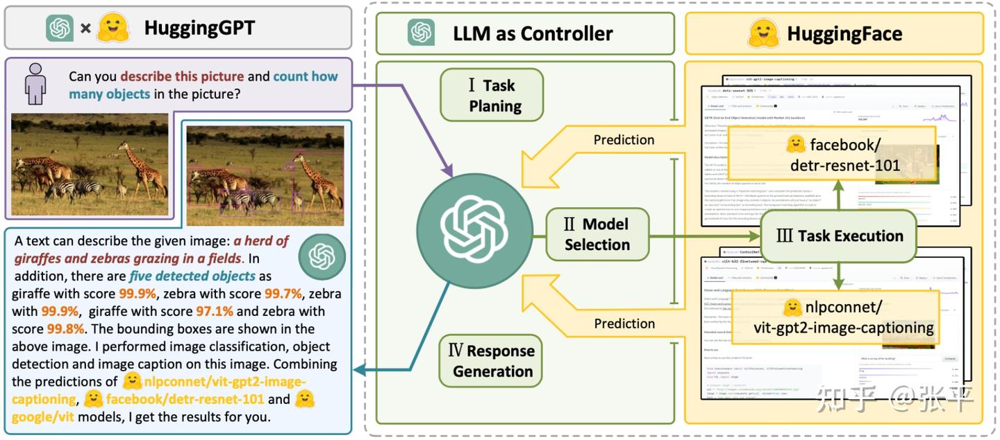

HuggingGPT示意：多个专用模型协同解决一个多模态类型的任务
#### **WebAgent, 2023, Izzeddin Gur et al., Google DeepMind.**

Gur, Izzeddin, et al. "A real-world webagent with planning, long context understanding, and program synthesis." *arXiv preprint arXiv:2307.12856* (2023).

对于Agent操作网页的问题，现有研究主要采用模拟网站，操作通常是预定义好的，且HTML数据也经过简化。而现实中的网络环境通常是动态、开放的，即**没有预定义好的操作**，且HTML数据冗长杂乱。因此，Agent在模拟网站上的表现很难在现实网络上延续。

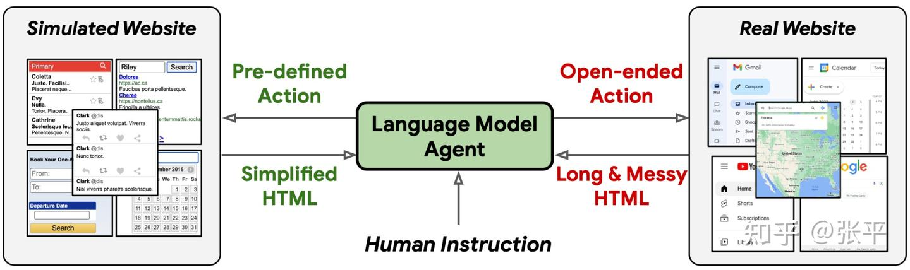

模拟网页 vs. 真实网络环境本文提出WebAgent，一个将**领域专用模型和通用模型组合**起来的智能体，用于在真实网络环境中执行任务。其中，专用模型HTML-T5负责将HTML长文档总结成任务相关的小文本片段，并进行复杂指令（人类用户给定的目标）分解和任务规划；通用模型采用Flan-U-PaLM 540B，其利用HTML-T5生成的子指令、文本片段以及少许prompt作为输入，生成用于网页最终操作的Python代码。

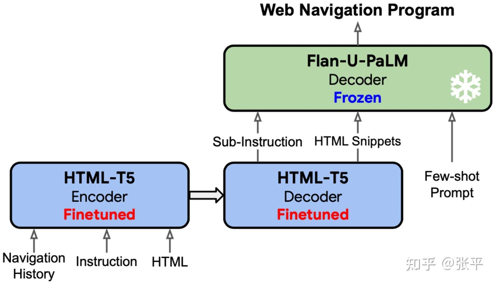

WebAgent结合了通用模型Flan-U-PaLM和专用模型HTML-T5作者的研究表明 1. 将任务规划和HTML文档总结耦合到领域专用模型中（即HTML领域大模型, e.g., HTML-T5），对于提高任务成功率具有关键作用；2. 在完成基于HTML类数据的任务方面，HTML-T5目前具有SOTA表现。3. WebAgent 带来了额外的计算开销，泛化困难，且在真实网络环境中评估效果的成本较高等问题，需进一步解决。

#### **ToolLLM, 2023, Yujia Qin et al., Tsinghua, ModelBest, Renmin University.**

Qin, Yujia, et al. "ToolLLM: Facilitating large language models to master 16000+ real-world apis." *arXiv preprint arXiv:2307.16789* (2023).

为增强LLMs调用外部APIs解决复杂任务的能力，本文提出ToolLLM，一个通用的工具使用（tool-use）框架，包括数据集构建、模型训练和模型评估。作者从RapidAPI Hub采集了**16000+真实的RESTful API**, 并通过prompt ChatGPT来产生多样化的使用这些API工具的指令，覆盖单工具和多工具任务场景。对每个任务指令，作者进一步prompt ChatGPT来产生有效的解路径（solution path）。其中，一条path对应一条API调用链。为加速解路径的搜索过程，本文同时提出一种新型的深度优先搜索树（depth-first search-based decision tree，DFSDT）算法，该算法使得LLMs可以对多种推理trace进行评估，从而扩展搜索空间。

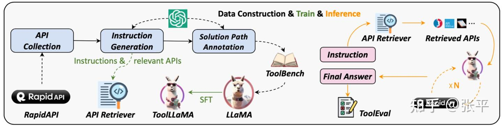

ToolLLM框架：构建ToolBench并训练ToolLLaMA和API Retriever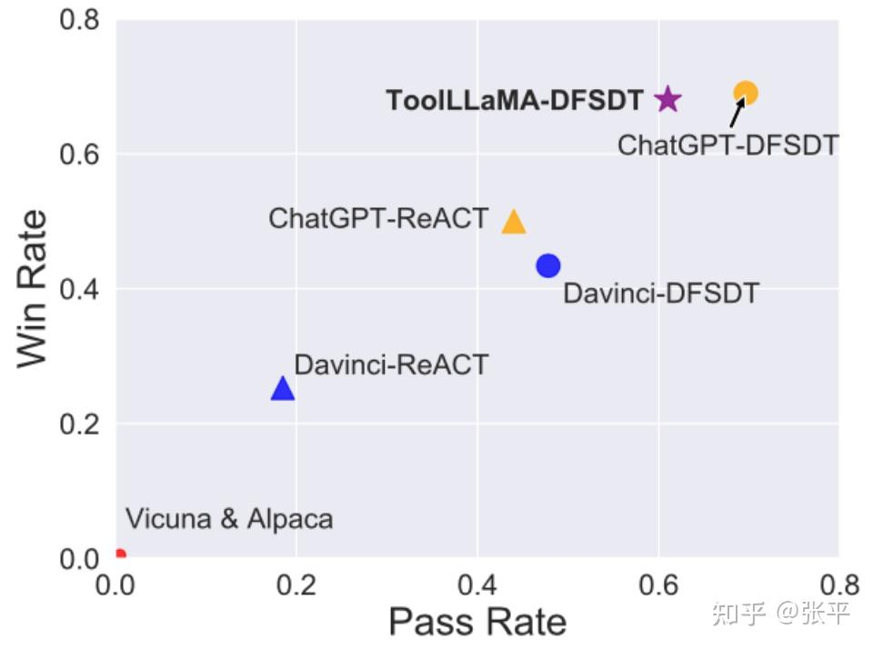

在工具使用能力评估中与ReAct方法的比较
#### **Additional Opinions, 2023, Hui Yang et al., Amazon.**

Yang, H., Yue, S., & He, Y. (2023). Auto-GPT for Online Decision Making: Benchmarks and Additional Opinions. arXiv preprint arXiv:2306.02224.

本文的主要贡献是提出了一种叫做Additional Opinions的算法，将监督式学习器（或模仿学习器）放进Auto-GPT的工作流，作为一种**轻量级的监督式信号引入机制**，在改善Agent表现的基础上，避免了对LLMs进行微调的开销。核心思路是将较小的外部专家模型与Agent的内部大模型协同起来解决问题。具体地，作者采用一个模仿学习器作为外部模型，在AutoGPT的每一轮迭代中，先从模仿学习器**采样top K**个观点，输入给AutoGPT agent，作为参考；本质是一种prompt增强技术。这里的专家模型，除模仿学习器外，也可以采用其它模型，如规则器（Rule）或LLMs。在WebShop和ALFWorld上的实验结果表明，Additional Opinions有一定的效果。

Additional Opinions算法通过引入监督信号，显著改善Agent表现的结果，和RLHF在对齐问题上的效果非常相似：LLMs或Agents并没有在超大规模的数据集上跑监督式学习，仅引入了一小部分监督信号，就显著改善模型效果。LLM -> LM + RLHF -> AutoGPT + Additional Opinions, 该条链上，监督信号的引入方式和其效果改善的理论解释，是个值得关注的问题。

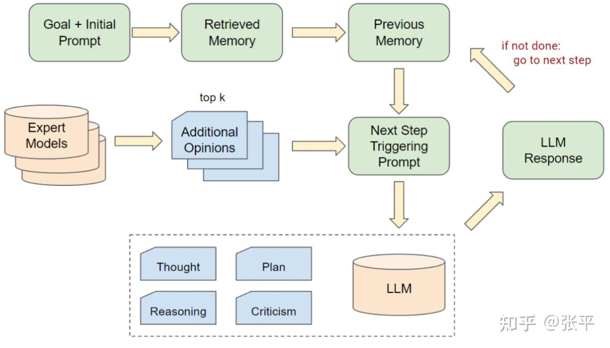

AutoGPT + Additional Opinions的一步迭代过程示意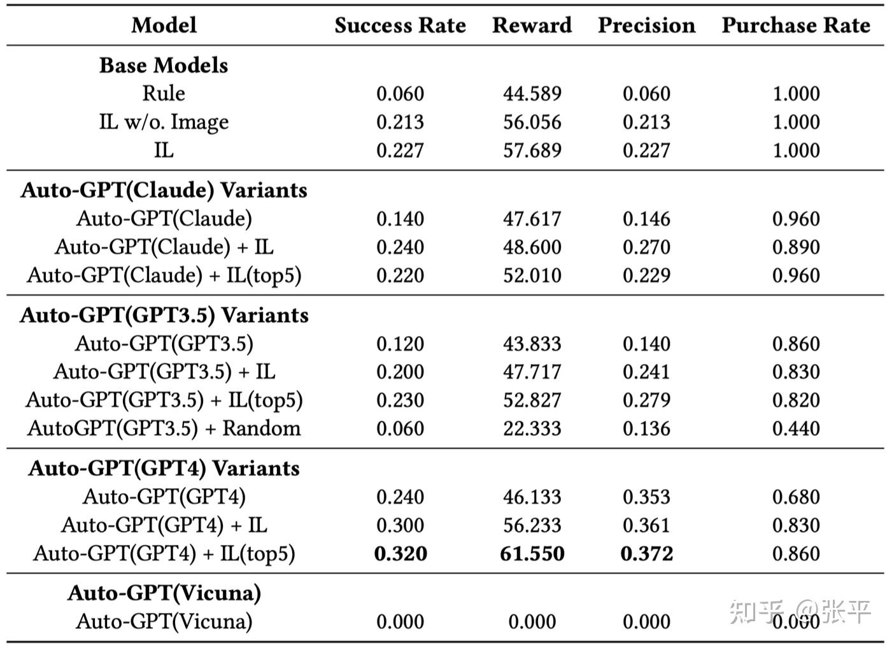

在WebShop上的性能比较
### **Multiagents**

#### **Generative Agents, 2023, Joon Sung Park et al., Stanford.**

Park, Joon Sung, et al. “Generative agents: Interactive simulacra of human behavior.” *arXiv preprint arXiv:2304.03442* (2023).

如果搭建一个由LLMs驱动的智能体所构成的可互动的虚拟社会，且这个小世界可以反映出可信的人类行为，类似于游戏《模拟人生》，会怎么样？Generative Agents搭建了一个包含25个智能体的沙箱环境（sandbox），这些智能体具有不同的角色，如画家、作家，且会自发组织起来，**模拟人类社会的多种活动**。为实现这些目标，Generative Agents 提出了包含**Observation，Planning，Reflection**三个模块的智能体框架。在这些智能体规划他们的日常、分享新闻、建立关系、组织群体活动的过程中，人类用户可以观察并实施干预。

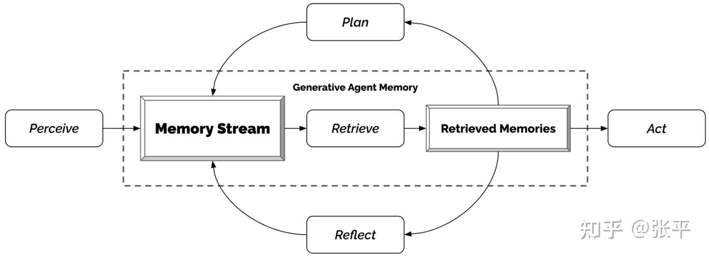

Generative Agents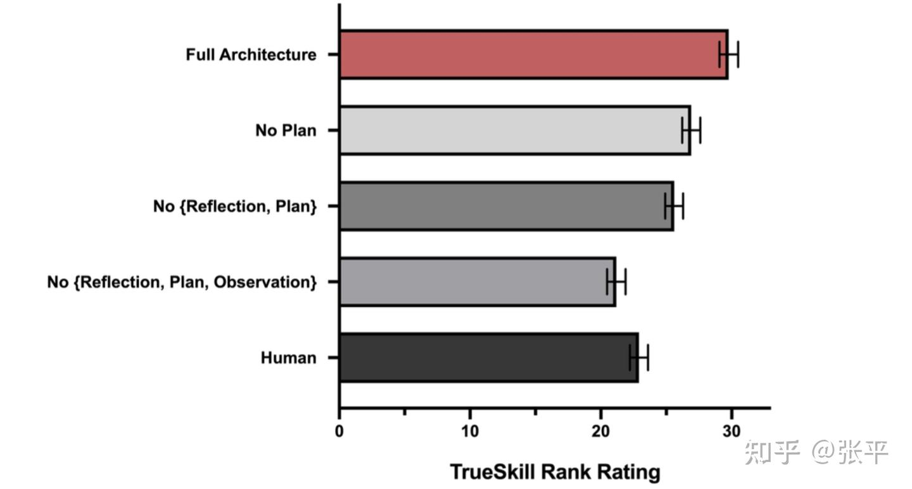

对Observation，Planning，Reflection三个模块的消融分析
#### **Multiagent Debate, 2023, Yilun Du et al., MIT & Google Brain.**

Du, Yilun, et al. "Improving Factuality and Reasoning in Language Models through Multiagent Debate." *arXiv preprint arXiv:2305.14325* (2023).

将多个LLMs Agent协同起来，通过辩论的方式回答问题是一个朴素的想法。例如，Marvin Minsky 早在1986年出版的The Society of Mind (非常好的一本书，强烈推荐) 中就对该思想有详细的探索。为提高模型所给答案的事实性和推理能力，本文提出一种多智能体框架。在该框架中，多个智能体（对应LLMs的多个instances）首先对同一问题分别进行响应，然后展开多轮辩论，最后达成一个共识，作为问题的最终答案。该多体辩论框架可以在不同任务上使用一致的prompt流程，具备通用性；且支持长、短两类辩论模式，具备一定的灵活性。实验表明，多体辩论模式能够显著提高LLMs在数学类和策略推理类任务上的准确率；同时，生成文本的事实性也得到了增强，“幻觉”问题得到了改善。

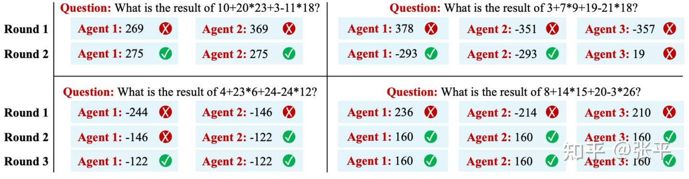

Multiagent Debate解决数学问题的一个示例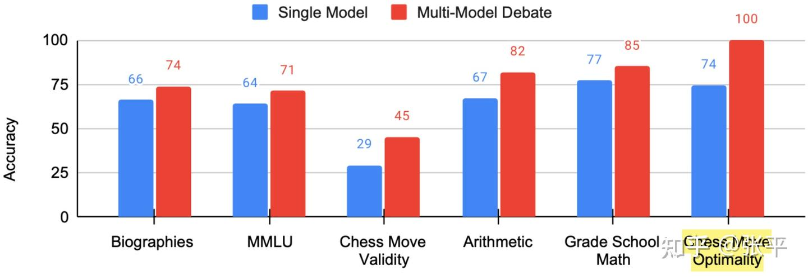

Multiagent Debate提高推理性能并改善事实准确性
#### **ChatEval, 2023, Chi-Min Chan et al., Tsinghua, HKUST, & PKU.**

Chan, Chi-Min, et al. "ChatEval: Towards Better LLM-based Evaluators through Multi-Agent Debate." *arXiv preprint arXiv:2308.07201* (2023).

ChatEval是多体辩论的改进版。主要改进有两点。一，为不同智能体**赋予角色**，从而能够充分利用LLMs的差异化技能和专业知识（这类知识包含在LLMs的参数中，通过role specification进行激活）；二，提出**三种通信策略**（如何维护不同智能体之间的chat history），分别是One-by-One, Simultaneous-Talk, Simultaneous-Talk-with-Summarizer，为适用于不同的任务类型提供了更加灵活、类人的多体辩论方案，从而增强多体框架解决任务的可靠性。

多体辩论让模型之间进行头脑风暴，相互对比、矫正，有一定的人类行为学基础。以人类做研究的过程为例，**对于某个事实，当我们可供参考的资料来源有多个且多方一致时，会增强我们对该事实的信心**；反之，若多方存在不一致，则会驱动我们进一步调研，避免盲目接受错误的信息，这是多体辩论有一定效果的一种可靠基础。但多体辩论的成本较高，至少在当前调用LLMs成本居高不下的情况下，引入多体框架解决问题，要考虑所带来的improvements和所增加的cost之间的平衡。将多体框架应用于解决特定问题，如改善LLMs的训练数据，也是另一种应用思路。另外，ChatEval的结果表明，Role Specification对于充分发挥LLMs的技能/知识是非常关键的步骤。Role Specification和领域专用大模型之间，有一定的潜在替代的可能性。

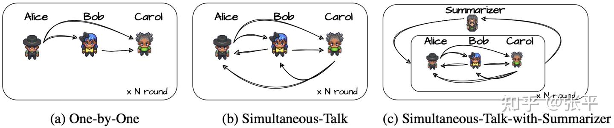

ChatEval提出的三种Agent之间的通信模式
#### **ChatDev, 2023, Chen Qian et al., Tsinghua & BUPT.**

Qian, C., Cong, X., Yang, C., Chen, W., Su, Y., Xu, J., ... & Sun, M. (2023). Communicative agents for software development. arXiv preprint arXiv:2307.07924.

LLMs惊人的语言运用和编码能力，必深刻变革软件工程。畅想未来，软件开发团队由一系列LLMs智能体构成，而人类主要负责提出需求。本文提出ChatDev, 一个基于瀑布模型（waterfall model）的、由聊天驱动的软件开发平台。

根据瀑布模型，ChatDev将软件开发过程分为四个阶段，分别是设计、编码、测试和文档化。每个阶段由一个team负责，每个team则由多个agents组成， 每个agent被**赋予角色**。 例如，CEO、CTO、CPO等负责 Designing；CTO、Designer、Programmer等负责Coding；Reviewer、Tester、Programmer等负责Testing；CEO、CTO、CPO、Programmer等负责Documenting。 与上述软件开发四个阶段相对应，ChatDev构建了Chat Chain, 用于将每个阶段的任务**分解成原子任务**。ChatDev通过角色特化（Role Specialization）保证每个角色在任务中正确、高效地发挥指派给自己的功能。

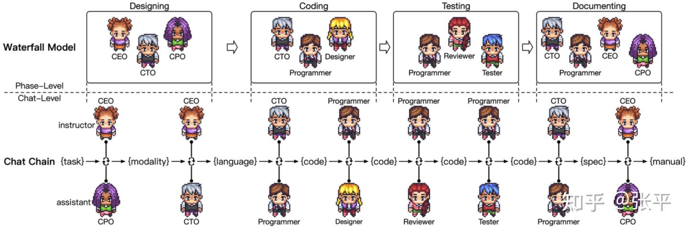

Architecture of CHATDEV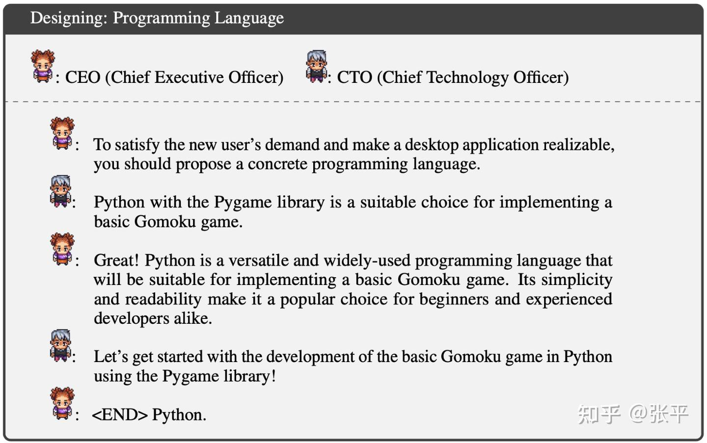

示例：CEO和CTO讨论该选择哪个编程语言进行开发
### **Embodied Agents**

#### **Voyager, 2023, Guanzhi Wang et al., NVIDIA & Caltech.**

Wang, Guanzhi, et al. "Voyager: An open-ended embodied agent with large language models." *arXiv preprint arXiv:2305.16291* (2023).

VOYAGER是首个由LLM驱动的具备终身学习能力的（虚拟）**具身智能体**（embodied lifelong learning agent），在Minecraft游戏中探索世界、获取多样化技能、并在没有人类干预的情况下获得创造性发现。

VOYAGER主要包含三个模块，1. **自动化课程**（automatic curriculum），通过prompt GPT-4生成一系列由易到难的任务（稳定的任务流），让智能体在Minecraft世界中实现最大化探索；2. 一个持续增长的、由可执行源代码构成的**技能库**（skill library），用于存储和检索智能体过往积累的复杂技能。每份源码用键值对的方式存储于向量数据库，键为源码功能描述的embedding，值为源码本身。3. 一个**迭代式prompt机制**，结合了环境反馈、代码执行错误、智能体自验证结果等信息，用于技能库中的源码调优。

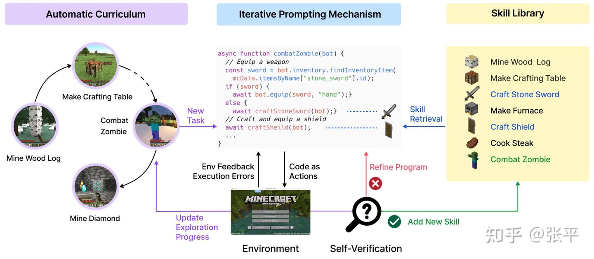

VOYAGER的三个主要模块VOYAGER与GPT-4等LLMs通过黑箱模式进行交互，因此无需对LLMs进行参数微调。上述设计使VOYAGER具备终身学习能力，其技能可以随时间进行扩展，不同技能也可以进行组合，同时具有**较强的可解释性**。游戏结果显示，与ReAct, Reflexion, Auto-GPT等相比，VOYAGER获得了3.3倍多的物品，2.3倍长的探索距离，以及15.3倍快的科技树解锁速度。同时，VOYAGER还可以将学到的技能应用到新的Minecraft游戏世界中。

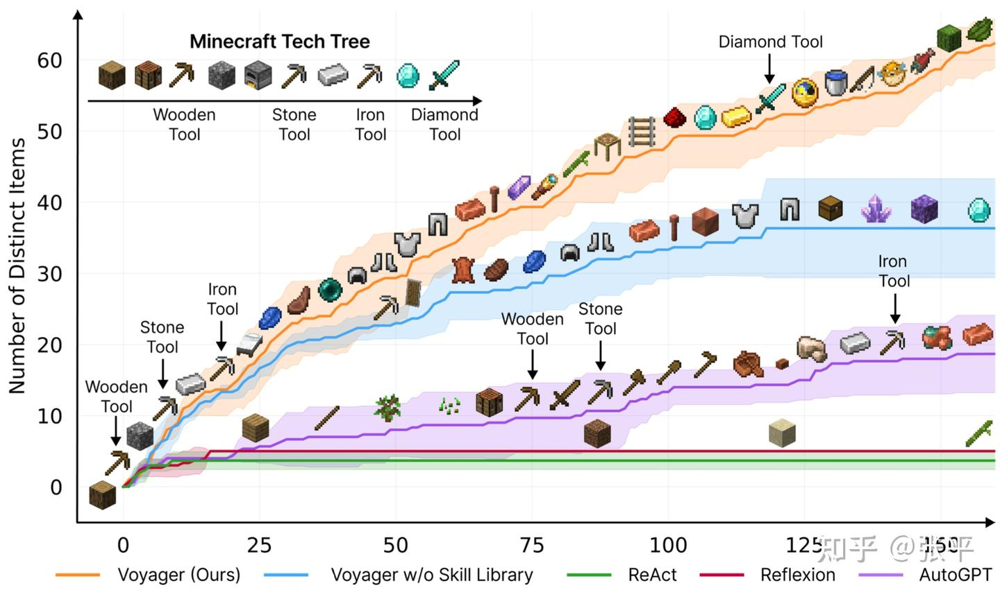

Minecraft: VOYAGER vs. (ReAct/Reflexion/Auto-GPT)
#### **A Unified RL Agent, 2023, Norman Di Palo et al., ICL & Google DeepMind.**

Di Palo, Norman, et al. "Towards a unified agent with foundation models." *Workshop on Reincarnating Reinforcement Learning at ICLR 2023*. 2023.

LLMs和VLM（vision language models, e.g., CLIP）等模型从网络中学习了大量语言、图片数据，从而能够理解人类意图，并表现出推理等能力特征。我们能否将LLMs和VLM应用到传统RL研究中，建立一个**统一的Agent框架**？基于该思路，本文作者提出一种用于RL机器人Agent的新框架。

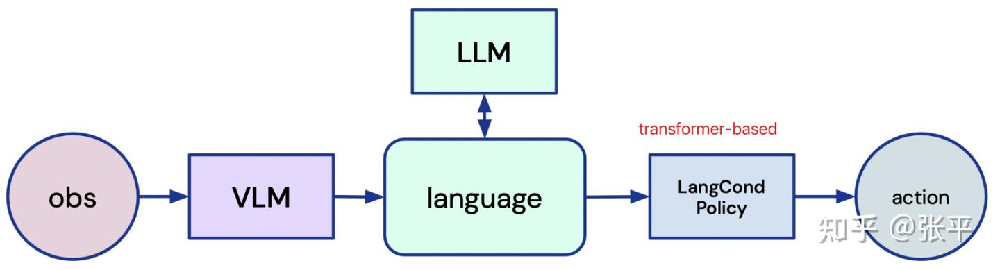

A unified agent with foundation models (e.g., VLM, LLM)在该框架中，对于给定的机器人任务，VLM模型首先将观察数据（e.g., 关于环境的视觉数据）映射为文本形式的自然语言，该文本语言和对任务的描述一起被用于prompt LLMs, 由LLMs输出完成任务所需要达成的子目标集合。最后，该子目标集合被用于训练一个基于Transformer模型的policy（i.e., language conditioned policy, LangCond Policy），最终由该policy生成robotic action。

实验表明，通过将LLMs和VLM嵌入到传统RL框架，Agent在**探索效率、经验数据复用、技能调度、模仿学习**等方面均得到了显著提升，而这些棘手问题在以前均需要分别进行设计和单独处理。**

### Benchmark**

#### **API-Bank, 2023, Minghao Li et al., Alibaba DAMO Academy & PKU.**

Li, Minghao, et al. "Api-bank: A benchmark for tool-augmented llms." *arXiv preprint arXiv:2304.08244* (2023).

为了评估、对比LLMs使用工具的能力，本文提出API-Bank，作为对智能体在API调用类任务上的基准测试。API-Bank**模拟了53个现实世界常用的工具**，如账户管理、信息检索、娱乐、旅行。作者提出一个关于LLMs如何使用这些工具的**完整工作流**，该工作流包括LLMs决定是否要调用某个API、调用哪个API、执行调用、评估调用的正确性。API-Bank还包括264个对话案例，共涉及568次API调用。这些对话按照困难程度，被划分为Level-1、Level-2、Level-3，以实现对LLMs智能体调用API完成任务的能力进行**不同层次上的评估**。

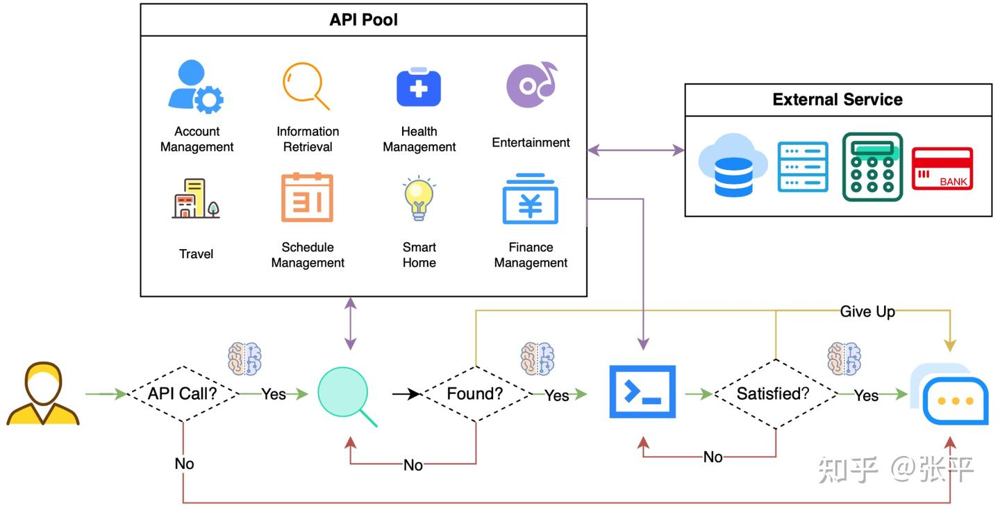

一个LLMs使用API工具的工作流：Tool-Augmented LLMs
#### **WebArena, 2023, Shuyan Zhou et al., CMU.**

Zhou, Shuyan, et al*. "Webarena: A realistic w*eb environment for building autonomous agents." arXiv preprint arXiv:2307.13854 (2023).

现有用于智能体API调用能力的基准测试平台，大都受限于模拟实验的简单性或测试结果无法复现等问题。本文构建了一个**真实Web环境**WebArena，用于评估智能体的API工具使用能力。WebArena包括四类真实网络环境，分别是电子商务、社交论坛、协同软件开发平台和内容管理平台，高度真实，功能完备，且**调用结果可复现**。同时，环境中提供了几类小工具，如地图、用户手册、英文维基百科。这些设定鼓励智能体形成像人类用户一样解决问题的过程。受到人类用户使用互联网的行为和特点启发，WebArena构建了一个包含多样化和长期性任务的基准测试集。

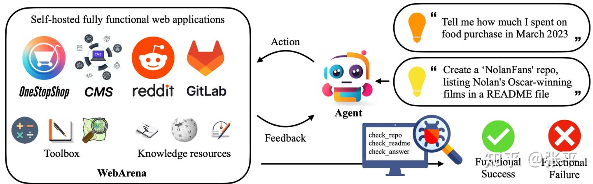

Design of WebArena实验结果表明，完成WebArena基准测试集中的任务，对于LLMs智能体而言极具挑战，如基于最先进的GPT-4的智能体，其**端到端的任务成功率只有10.59%**。如何让智能体在开放网络环境中可靠、鲁棒地执行任务，仍然是亟待研究的问题。

#### **AgentBench, 2023, Xiao Liu et al., Tsinghua.**

Liu, Xiao, et al. "AgentBench: Evaluating LLMs as Agents." *arXiv preprint arXiv:2308.03688*(2023).

作为智能体的大脑，不同大语言模型（LLMs）的表现如何？AgentBench提供了一套基准测试，**首批测试了25个LLMs**，包括GPT-4、Claude等闭源商用模型，和Vicuna、Dolly等开源模型。AgentBench当前有**8种测试环境**，分别是操作系统、数据库、知识图谱、电子卡牌游戏、智力谜题游戏、家务、网购、网页浏览。

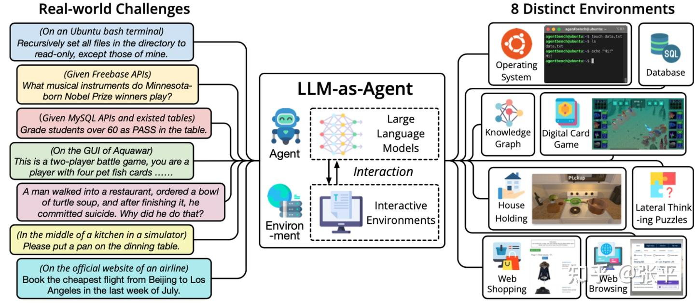

Design of AgentBench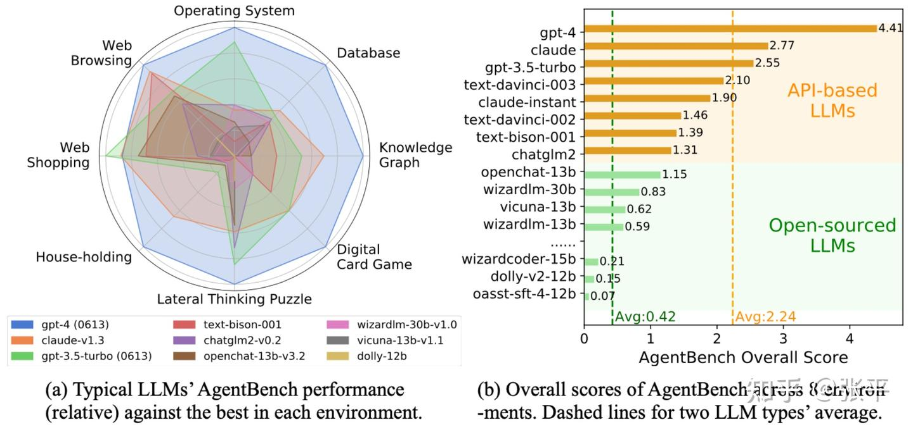

LLMs on AgentBench
### **参考文献说明**

1.  Agent相关的研究已超过200篇（2023-10-01），博主参考MetaAI的综述性论文*Augmented Language Models: a Survey*，从planning、tools、memory、multiagents、benchmark等维度各选了几篇代表性论文，共27篇。主要想法是，对Agent研究形成一个全局性的认识，又能了解到每个细分方向主要在关注什么问题。

2.  Agent及相关方向综述论文：

a)  Mialon, G., Dessì, R., Lomeli, M., Nalmpantis, C., Pasunuru, R., Raileanu, R., ... & Scialom, T. (2023). Augmented language models: a survey. *arXiv preprint arXiv:2302.07842*.

Notes: 这篇来自MetaAI和庞培法布拉大学，论文主要从LMs的augmentation角度组织、讨论现有的研究工作，提出了ALMs（Augmented Language Models）的概念，以区别于PLMs（Pre-trained Language Models） 和LLMs（Large Language Models）。文章深入浅出，观点丰富。文末借 Agent 给 Yann LeCun 近期的研究（观点？）JEA 打了一波广告。

b)  Wang, L., Ma, C., Feng, X., Zhang, Z., Yang, H., Zhang, J., ... & Wen, J. R. (2023). A survey on large language model based autonomous agents. *arXiv preprint arXiv:2308.11432*. 

Notes: 这篇来自人大高瓴人工智能学院，时效性很强，涵盖了Agent方向大部分研究工作，内容很详细，非常好的学习材料。

c)  Huang, J., & Chang, K. C. C. (2022). Towards reasoning in large language models: A survey. *arXiv preprint arXiv:2212.10403*.

Qiao, S., Ou, Y., Zhang, N., Chen, X., Yao, Y., Deng, S., ... & Chen, H. (2022). Reasoning with language model prompting: A survey. *arXiv preprint arXiv:2212.09597*. 

Notes: 这两篇综述聚焦LLMs推理能力方面的研究，主要和本文Planning部分提到的论文相关。

d)  Xi, Z., Chen, W., Guo, X., He, W., Ding, Y., Hong, B., ... & Gui, T. (2023). The rise and potential of large language model based agents: A survey. *arXiv preprint arXiv:2309.07864. *

Notes: 这篇来自复旦和米哈游团队，涵盖了670多篇参考文献，涉及到的概念和技术范围更广，兼顾科普和科研性质。

e)  Zhao, W. X., Zhou, K., Li, J., Tang, T., Wang, X., Hou, Y., ... & Wen, J. R. (2023). A survey of large language models. *arXiv preprint arXiv:2303.18223*. 

Notes: 这篇是关于LLMs本身的survey，也出自人大高瓴团队，对于大模型初学者来说非常友好，对于资深研究人员也是很有用的参考文献。内容几乎涵盖了LLMs的所有方面，且详略得当。其中Agent相关的内容主要见第6章。

3.  其它材料：

a)  LLM Powered Autonomous Agents, Lilian Weng (OpenAI) 的blog，非常值得一读。

b)  Awesome AI Agents, 一个agent相关的开源项目列表，如Auto-GPT、BabyAGI等。

c)  Agents are the next AI killer app after ChatGPT, Hacker News上关于Agent的一些讨论。

d)  Language Agents in the Digital World: Opportunities and Risks, Princeton NLP组的blog, 作者Shunyu Yao (ReAct, ToT, WebShop等工作的作者)，主要讨论了web类环境下语言agent的机会和挑战。
