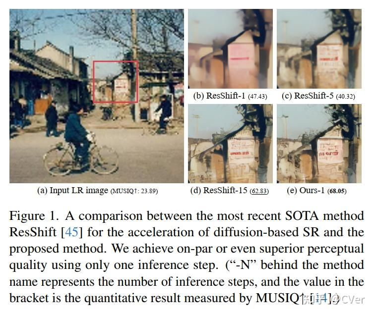
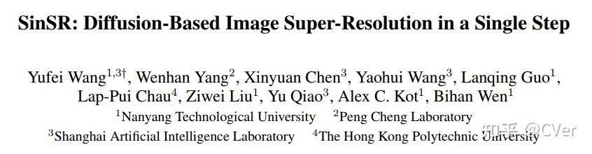
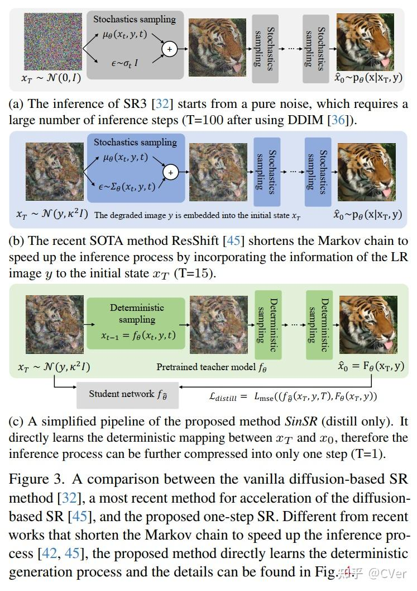
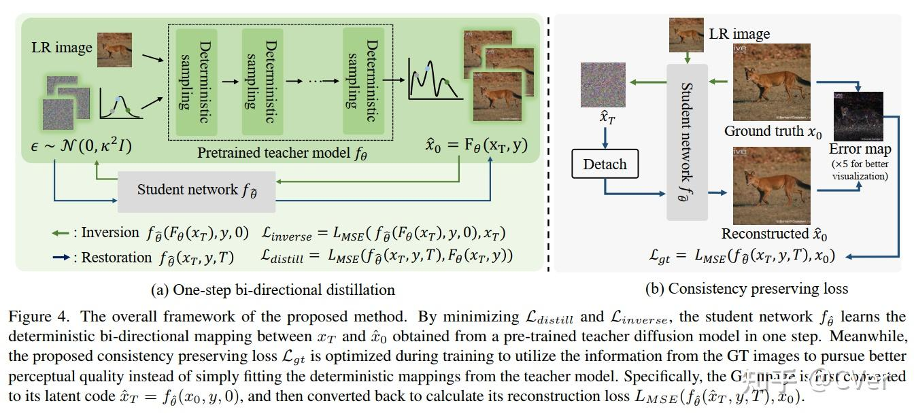
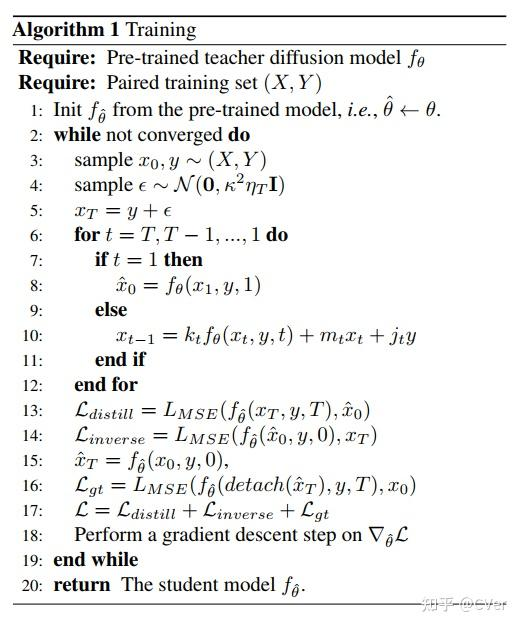
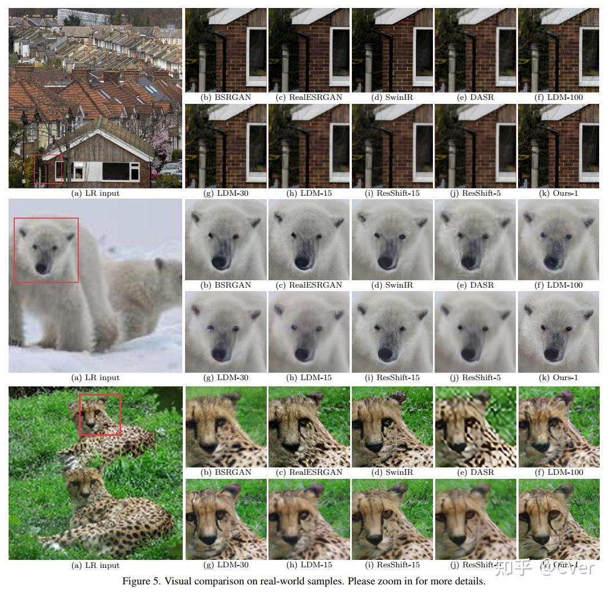
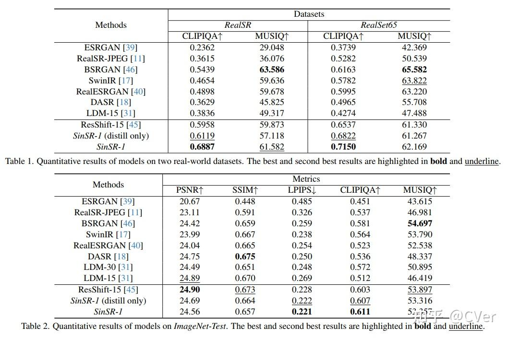

SinSR 与之前的 SOTA 方法和教师模型相比，本方法只需一个采样步骤即可实现可比甚至更优越的性能，从而实现高达 10 倍的推理加速！代码即将开源！

**点击关注** @CVer官方知乎账号**，可以第一时间看到最优质、最前沿的CV、AI、医疗影像工作~**

### SinSR

**SinSR: Diffusion-Based Image Super-Resolution in a Single Step**

单位：南洋理工, 鹏城实验室, 上海AI Lab, 香港理工大学

代码：[https://github.com/wyf0912/SinSR](https://link.zhihu.com/?target=https%3A//github.com/wyf0912/SinSR)

论文：[https://arxiv.org/abs/2311.14760](https://link.zhihu.com/?target=https%3A//arxiv.org/abs/2311.14760)

CVPR 2024 论文和开源项目合集请戳—>[https://github.com/amusi/CVPR2024-Papers-with-Code](https://link.zhihu.com/?target=https%3A//github.com/amusi/CVPR2024-Papers-with-Code)

虽然基于扩散模型的超分辨率（SR）方法表现出有希望的结果，但其实际应用受到大量所需推理步骤的阻碍。 最近的方法利用初始状态下的退化图像，从而缩短马尔可夫链。 然而，这些解决方案要么依赖于降解过程的精确表述，要么仍然需要相对较长的生成路径（例如 15 次迭代）。

为了提高推理速度，我们提出了一种简单而有效的方法来实现单步 SR 生成，称为 SinSR。 具体来说，我们首先从最新的最先进 (SOTA) 方法中推导出确定性采样过程，以加速基于扩散的 SR。 这允许在训练期间以减少且可接受数量的推理步骤获得输入随机噪声和生成的高分辨率图像之间的映射。

我们证明，这种确定性映射可以被蒸馏成一种学生模型，该模型仅在一个推理步骤内执行 SR。 此外，我们提出了一种新颖的保持一致性的损失，以在蒸馏过程中同时利用真实图像，确保学生模型的性能不仅仅受到教师模型的特征流形的限制，从而进一步提高性能。

#### 实验结果

对合成数据集和真实数据集进行的大量实验表明，与之前的 SOTA 方法和教师模型相比，所提出的方法只需一个采样步骤即可实现可比甚至更优越的性能，从而实现高达 10 倍的推理加速。

更多研究细节，可参考原论文。

**现在点击关注**@CVer官方知乎账号**，可以第一时间看到最优质、最前沿的CV、AI工作~**涨点神器、LLM、AIGC(图像/视频/3D生成)、多模态、医学影像、分类、检测、分割、跟踪、扩散、CNN、Transformer、NeRF、3DGS、low-level、自动驾驶、ReID、遥感等方向通通拿下！

**CVPR 2024 论文和开源项目合集请戳—>**

