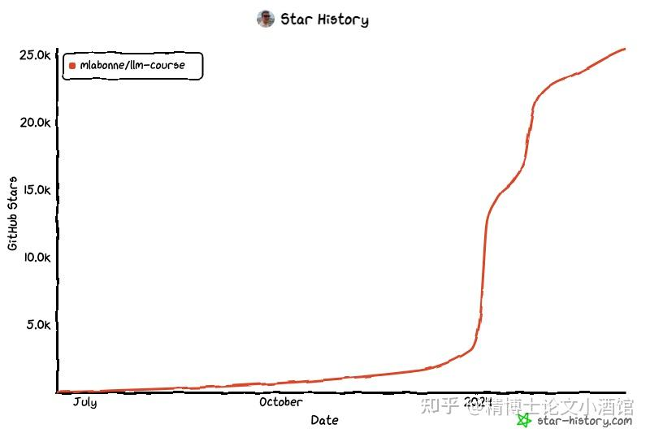
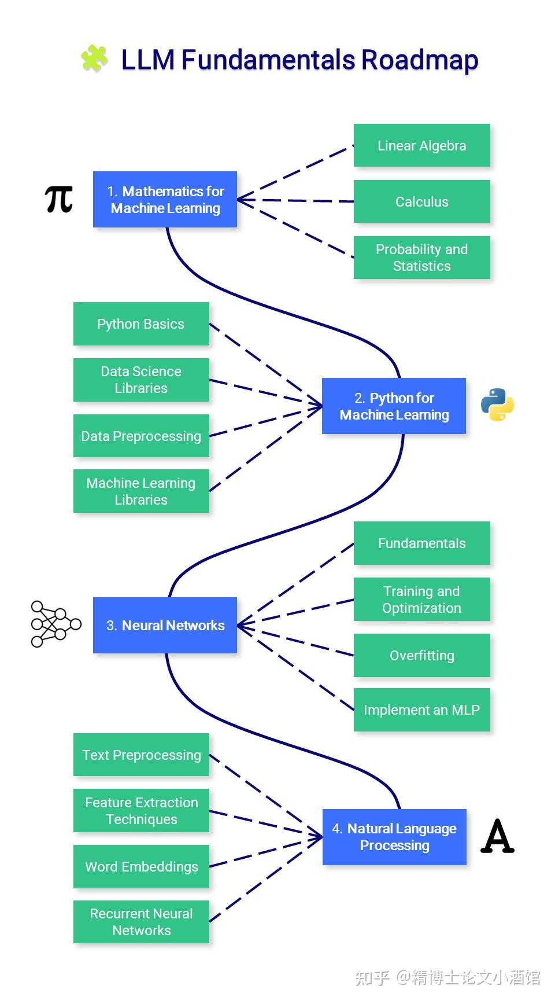
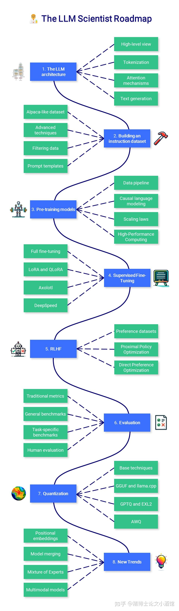
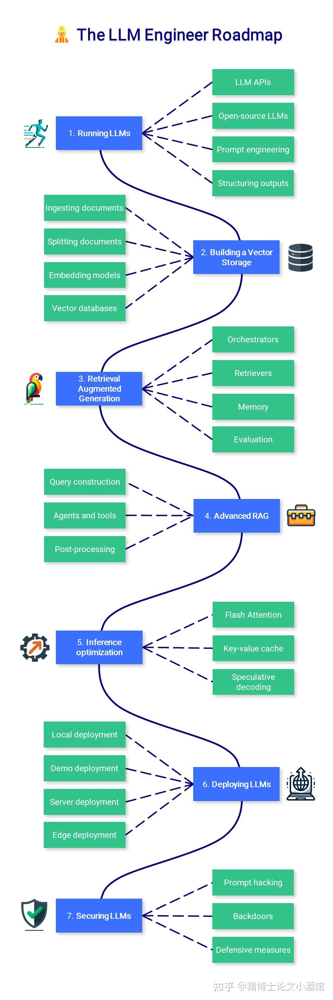

`文章题目： ️ Large Language Model Course
文章作者：Maxime Labonne
Git链接：https://github.com/mlabonne/llm-course
huggingface：https://huggingface.co/mlabonne
作者博客：https://mlabonne.github.io/blog/`

欢迎大家关注微信公众号：**精博士论文小酒馆**

### **先用一张图片说明这篇blog多火热！**

 本篇大型语言模型（LLM）课程分为三个部分：

  **LLM基础**：涵盖了数学、Python和神经网络的基本知识。 

 ‍ ** LLM科学家**：专注于使用最新技术构建尽可能优秀的LLM。

   **LLM工程师**：专注于创建基于LLM的应用并部署它们。

### 0.    一些有用的Notebook

与大型语言模型相关的笔记本和文章列表

工具：

-  [LLM AutoEval](https://link.zhihu.com/?target=https%3A//github.com/mlabonne/llm-autoeval)：使用RunPod自动评估大语言模型（LLMs），colab
-   LazyMergekit：轻松使用MergeKit一键合并模型，colab
- ⚡ AutoGGUF：一键将大语言模型（LLMs）量化为GGUF格式，colab
-   Model Family Tree：可视化被合并模型的家族树，colab
Fine-tuning：

- 使用 Colab 对Llama2 进行 fine-tuning：文章，colab
- 使用Axolotl对 LLMs 进行 fine-tuning：文章，colab
- 使用DPO对 Mistral-7b 进行 fine-tuning：文章，colab
Quantization

- 使用 8-bit 量化优化大语言模型：文章，colab
- 使用 GPTQ 进行 4-bit 量化：文章，colab
- 使用GGUF 和 llama.cpp 进行量化：文章，colab
- ExLlamaV2：LLMs运行最快的库，文章，colab
其它

- 大语言模型 LLMs 中的解码策略 :文章，colab
- GPT-2 的损失函数值可视化：[文章](https://link.zhihu.com/?target=https%3A//arxiv.org/abs/1712.09913)，colab
- 使用知识图谱提升 chatGPT：文章，colab
- 使用 mergekit 合并 LLMs：文章，colab

### 1.    LLM 基础

#### 1.1 机器学习 ML 的数学基础

在学习机器学习之前，了解这些算法背后的基本数学概念非常重要。

**线性代数**：这对于理解许多算法至关重要，尤其是那些用于深度学习的算法。关键概念包括向量、矩阵、行列式、特征值和特征向量、向量空间以及线性变换。

**微积分**：许多机器学习算法涉及连续函数的优化，这需要理解导数、积分、极限和级数。多变量微积分和梯度概念也很重要。 

**概率与统计**：这些对于理解模型如何从数据中学习并进行预测至关重要。关键概念包括概率论、随机变量、概率分布、期望、方差、协方差、相关性、假设检验、置信区间、最大似然估计和贝叶斯推断。

   **资源**：

3Blue1Brown - 线性代数的本质：一系列视频，为这些概念提供了几何直觉。

StatQuest with Josh Starmer - 统计学基础：为许多统计概念提供了简单明了的解释。

AP统计直觉 by Ms Aerin：一系列Medium文章，提供了每个概率分布背后的直觉。 

沉浸式线性代数：另一种线性代数的视觉解释。

Khan Academy - 线性代数：非常适合初学者，以非常直观的方式解释概念。 

Khan Academy - 微积分：一个互动课程，涵盖了微积分的所有基础知识。

Khan Academy - 概率与统计：以易于理解的格式呈现材料。

#### 1.2 ML 中的 Python

Python 是一种功能强大且灵活的编程语言，由于其可读性、一致性以及数据科学库的强大生态系统，特别适合用于机器学习。

**Python 基础**：Python 编程需要对基本语法、数据类型、错误处理和面向对象编程有良好的理解。 

**数据科学库**：包括熟悉用于数值运算的 NumPy，用于数据操作和分析的 Pandas，以及用于数据可视化的 Matplotlib 和 Seaborn。

**数据预处理**：这涉及特征缩放和归一化、处理缺失数据、异常值检测、分类数据编码以及将数据分割为训练集、验证集和测试集。 

**机器学习库**：熟练掌握 Scikit-learn 库至关重要，该库提供了广泛的监督和无监督学习算法。了解如何实现线性回归、逻辑回归、决策树、随机森林、k-最近邻（K-NN）和 K-均值聚类等算法很重要。降维技术如 PCA 和 t-SNE 对于可视化高维数据也非常有帮助。

**   资源：**

Real Python：一个全面的资源，提供初学者和高级 Python 概念的文章和教程。

freeCodeCamp - 学习 Python：一个长视频，全面介绍 Python 的所有核心概念。 

Python 数据科学手册：一本免费的数字书籍，是学习 pandas、NumPy、Matplotlib 和 Seaborn 的极佳资源。

freeCodeCamp - 机器学习入门：为初学者提供不同机器学习算法的实用介绍。 

Udacity - 机器学习简介：免费课程，涵盖 PCA 和其他几个机器学习概念。

#### 1.3 神经网络

神经网络是许多机器学习模型的基本组成部分，特别是在深度学习领域。为了有效地利用它们，全面理解它们的设计和机制是必不可少的。

**基础知识**：包括理解神经网络的结构，如层、权重、偏置和激活函数（sigmoid、tanh、ReLU等）。

**训练和优化**：熟悉反向传播和不同类型的损失函数，如均方误差（MSE）和交叉熵。理解各种优化算法，如梯度下降、随机梯度下降、RMSprop 和 Adam。 

**过拟合**：理解过拟合的概念（模型在训练数据上表现良好，但在未见数据上表现不佳），并学习各种正则化技术（dropout、L1/L2 正则化、早停、数据增强）以防止过拟合。 

**实现多层感知器（MLP）**：使用 PyTorch 构建一个 MLP，也称为全连接网络。 

 ** 资源**：

3Blue1Brown - 神经网络是什么？：这个视频直观地解释了神经网络及其内部工作原理。 

freeCodeCamp - 深度学习速成课程：这个视频高效地介绍了深度学习中所有最重要的概念。 

Fast.ai - 实用深度学习：为有编码经验且想要学习深度学习的人设计的免费课程。 

Patrick Loeber - PyTorch 教程：一系列视频，为完全初学者学习 PyTorch。

#### 1.4 自然语言处理（NLP）

NLP 是人工智能的一个迷人分支，它弥合了人类语言和机器理解之间的差距。从简单的文本处理到理解语言的细微差别，NLP 在许多应用中扮演着至关重要的角色，比如翻译、情感分析、聊天机器人等。

**文本预处理**：学习各种文本预处理步骤，如分词（将文本分割成单词或句子）、词干提取（将单词还原到基本形式）、词形还原（类似于词干提取但考虑上下文）、停用词移除等。

**特征提取技术**：熟悉将文本数据转换为机器学习算法可以理解的格式的技术。关键方法包括词袋模型（BoW）、词频-逆文档频率（TF-IDF）和n-gram。

**词嵌入**：词嵌入是一种单词表示类型，允许意义相似的单词具有相似的表示。关键方法包括Word2Vec、GloVe和FastText。

**循环神经网络（RNNs）**：理解RNNs的工作原理，这是一种专为处理序列数据设计的神经网络。探索LSTM和GRU，这两种RNN变体能够学习长期依赖关系。

**  资源**：

RealPython - 使用spaCy进行Python中的NLP：关于Python中spaCy库进行NLP任务的详尽指南。

Kaggle - NLP指南：一些笔记本和资源，用于实践解释Python中的NLP。

Jay Alammar - Word2Vec图解：理解著名的Word2Vec架构的好参考。

Jake Tae - 从头开始的PyTorch RNN：在PyTorch中实现RNN、LSTM和GRU模型的实用且简单的方法。

colah的博客 - 理解LSTM网络：关于LSTM网络的更具理论性的文章。

### 2.  ‍  LLM Scientist

本节注于学习如何使用最新技术构建最佳的大型语言模型（LLMs）。

#### 2.1 LLM 架构

虽然不需要深入了解Transformer架构，但了解其输入（token）和输出（logits）是很重要的。标准的注意力机制是另一个关键组成部分，需要掌握，因为后续会介绍其改进版本。

**高层次视角**：重新审视编码器-解码器Transformer架构，更具体地说是解码器GPT架构，在LLM中都有使用。 

**分词**：理解如何将原始文本转换为模型可以理解的格式，这涉及到将文本分割成token（通常是单词或子词）。

**注意力机制**：掌握注意力机制背后的理论，包括self-attention 和 scaled dot-product attention，这允许模型在生成输出时关注输入的不同部分。 

**文本生成**：了解模型可以生成输出序列的不同方式。常见策略包括贪婪解码、束搜索、Top-k采样和核采样。 

**  资料：**

图解Transformer - by Jay Alammar：对Transformer模型进行了视觉和直观的解释。 

图解GPT-2 - by Jay Alammar：比前一篇文章更重要，专注于GPT架构，它与Llama的架构非常相似。

LLM可视化- by Brendan Bycroft：对LLM内部发生的事情进行了令人难以置信的3D可视化。 

nanoGPT - by Andrej Karpathy：一个长达2小时的YouTube视频，从头开始重新实现GPT（面向程序员）。

注意力？注意！ - Lilian Weng：以更正式的方式介绍了注意力的需求。 

LLM中的解码策略：提供代码和不同解码策略的视觉介绍，以生成文本。  

#### 2.2 构建指令数据集

虽然从维基百科和其他网站找到原始数据很容易，但在野外收集指令和答案的配对却很困难。与传统机器学习一样，数据集的质量将直接影响模型的质量，这就是为什么它可能是微调过程中最重要的组成部分。

**类**Alpaca**的数据集**：使用OpenAI API（GPT）从头开始生成合成数据。您可以指定种子和系统提示，以创建多样化的数据集。

**高级技术**：学习如何使用[Evol-Instruct](https://link.zhihu.com/?target=https%3A//arxiv.org/abs/2304.12244)改进现有数据集，以及[Orca ](https://link.zhihu.com/?target=https%3A//arxiv.org/abs/2306.02707)和 [phi-1](https://link.zhihu.com/?target=https%3A//arxiv.org/abs/2306.11644)论文中生成高质量的合成数据。

**数据过滤**：涉及正则表达式的传统技术，去除近似重复项，专注于具有高token数量的答案等。

**提示模板**：格式化指令和答案没有真正的标准方式，这就是为什么了解不同的聊天模板，如ChatML、Alpaca等，是很重要的。

**  资料**：

为指令微调准备数据集 - by Thomas Capelle：探索Alpaca和Alpaca-GPT4数据集以及如何格式化它们。

生成临床指令数据集 - by Solano Todeschini：教程，介绍如何使用GPT-4创建合成指令数据集。

GPT 3.5用于新闻分类- by Kshitiz Sahay：使用GPT 3.5创建指令数据集，以微调Llama 2进行新闻分类。

创建LLM的微调数据集：包含几种过滤数据集并上传结果的技术的笔记本。

[聊天模板](https://link.zhihu.com/?target=https%3A//huggingface.co/blog/chat-templates) - by Matthew Carrigan：Hugging Face关于提示模板的页面。

#### 2.3 预训练模型

预训练是一个非常漫长且成本高昂的过程，这就是为什么这不是本课程的重点。了解预训练期间发生的事情有一定的理解水平是好的，但不需要实践经验。

**数据管道**：预训练需要巨大的数据集（例如，Llama 2是在2万亿个token上训练的），这些数据集需要被过滤、分词，并与预定义的词汇表整合。

**因果语言建模**：了解因果语言建模和掩蔽语言建模之间的区别，以及在这种情况下使用的损失函数。为了高效的预训练，了解更多关于[Megatron-L](https://link.zhihu.com/?target=https%3A//github.com/NVIDIA/Megatron-LM)、r[gpt-neox](https://link.zhihu.com/?target=https%3A//github.com/EleutherAI/gpt-neox)的信息。

**Scaling laws**：描述了基于模型大小、数据集大小和用于训练的计算量预期的模型性能。

**高性能计算**：这不在讨论范围内，但如果计划从头开始创建自己的LLM（硬件、分布式工作负载等），更多关于HPC的知识是基础。

**  参考资料**：

[LLMDataHub](https://link.zhihu.com/?target=https%3A//github.com/Zjh-819/LLMDataHub) - by Junhao Zhao：预训练、微调和RLHF策划的数据集列表。

[从头开始训练因果语言模型](https://link.zhihu.com/?target=https%3A//huggingface.co/learn/nlp-course/chapter%3Ffw%3Dpt)：使用transformers库从头开始预训练GPT-2模型。

[TinyLlama](https://link.zhihu.com/?target=https%3A//github.com/jzhang38/TinyLlama) - Zhang等：查看这个项目，以了解从头开始训练Llama模型的过程。

[因果语言建模](https://link.zhihu.com/?target=https%3A//huggingface.co/docs/transformers/tasks/language_modeling)：解释因果语言建模和掩蔽语言建模之间的区别，以及如何快速微调DistilGPT-2模型。

Chinchilla's wild implications - by nostalgebraist：讨论规模法则，并解释它们对一般LLM的意义。

BLOOM - by BigScience：描述BLOOM模型是如何构建，包含了许多关于工程部分和遇到问题的有用信息。

[OPT-175日志](https://link.zhihu.com/?target=https%3A//github.com/facebookresearch/metaseq/blob/main/projects/OPT/chronicles/OPT175B_Logbook.pdf) - by Meta：研究日志显示了什么出了问题，什么做得对。如果您计划预训练一个非常大的语言模型（在这种情况下，是175B参数），这会很有用。

LLM 360：一个开源LLM框架，包含训练和数据准备代码、数据、指标和模型。

#### 2.4 监督式微调

预训练模型仅在下一个token预测任务上进行训练，这就是为什么它们不是有用的助手。SFT（监督式微调）允许您调整它们以响应指令。此外，它允许您在任何数据上微调您的模型（私有的、GPT-4未见过的等），并且无需支付像OpenAI这样的API费用。

**全微调**：全微调指的是训练模型中的所有参数。这不是一种高效的技术，但它可以产生稍微更好的结果。

[LoRA](https://link.zhihu.com/?target=https%3A//arxiv.org/abs/2106.09685)：一种基于低秩适配器的参数高效技术（PEFT）。我们不是训练所有参数，而是只训练这些适配器。

[QLoRA](https://link.zhihu.com/?target=https%3A//arxiv.org/abs/2305.14314)：另一种基于LoRA的PEFT，它还将模型的权重量化为4位，并引入分页优化器来管理内存峰值。结合Unsloth，可以在免费的Colab笔记本上高效运行。

[Axolotl](https://link.zhihu.com/?target=https%3A//github.com/OpenAccess-AI-Collective/axolotl)：一个用户友好且强大的微调工具，被许多最先进的开源模型使用。

DeepSpeed：在多GPU和多节点设置中高效预训练和微调LLM（在Axolotl中实现）。

**  资料：**

新手LLM训练指南 - by Alpin：概述了在微调LLM时需要考虑的主要概念和参数。

LoRA洞察- by Sebastian Raschka：关于LoRA的实际见解以及如何选择最佳参数。

微调您自己的Llama 2模型：动手教程，介绍如何使用Hugging Face库微调Llama 2模型。

填充大型语言模型- by Benjamin Marie：为因果LLM填充训练示例的最佳实践

LLM微调初学者指南：介绍如何使用Axolotl微调CodeLlama模型。

#### 2.5 RLHF（基于人类反馈的强化学习）

在监督式微调之后，RLHF 是一个用于使大型语言模型（LLM）的答案与人类期望对齐的步骤。这个想法是从人类（或人工）反馈中学习偏好，这可以用来减少偏见、审查模型或使它们以更有用的方式行动。它比SFT更复杂，通常被视为可选的。

**偏好数据集**：这些数据集通常包含几个答案，并附有某种排名，这使得它们比指令数据集更难制作。 

**近端策略优化（**[Proximal Policy Optimization](https://link.zhihu.com/?target=https%3A//arxiv.org/abs/1707.06347)）：该算法利用一个奖励模型来预测给定文本是否被人类高度排名。然后使用这个预测来优化SFT模型，基于KL散度的惩罚。

**直接偏好优化（**[Direct Preference Optimization](https://link.zhihu.com/?target=https%3A//arxiv.org/abs/2305.18290)，DPO）：DPO 通过将其重新定义为分类问题来简化过程。它使用参考模型而不是奖励模型（无需训练），并且只需要一个超参数，使其更稳定、更高效。 

**  资料：**

使用RLHF训练LLM简介 - by Ayush Thakur：解释为什么RLHF有助于减少LLM中的偏见并提高性能。 

[图解RLHF](https://link.zhihu.com/?target=https%3A//huggingface.co/blog/rlhf) - Hugging Face：介绍使用奖励模型训练和强化学习的RLHF。 

[StackLLaMA](https://link.zhihu.com/?target=https%3A//huggingface.co/blog/stackllama) - Hugging Face：使用transformers库高效地使用RLHF对齐LLaMA模型。 

LLM训练：RLHF及其替代方案 - Sebastian Rashcka：概述RLHF过程及其替代方案，如RLAIF。

[使用DPO微调Mistral-7b](https://link.zhihu.com/?target=https%3A//huggingface.co/blog/dpo-trl)：使用DPO微调Mistral-7b模型，并复现NeuralHermes-2.5。

#### 2.6 评估

评估大型语言模型（LLMs）是流程中被低估的部分，它既耗时又只有适度的可靠性。您的下游任务应该决定您想要评估的内容，但请始终记住古德哈特定律：“当一个度量成为目标时，它就不再是一个好的度量。”

**传统指标**：像困惑度（perplexity）和BLEU分数这样的指标并不像以前那样受欢迎，因为它们在大多数情况下都有缺陷。尽管如此，理解它们以及它们何时可以应用仍然很重要。

**通用基准**：基于语言模型评估工具（[Language Model Evaluation Harness](https://link.zhihu.com/?target=https%3A//github.com/EleutherAI/lm-evaluation-harness)），[Open LLM排行榜](https://link.zhihu.com/?target=https%3A//huggingface.co/spaces/HuggingFaceH4/open_llm_leaderboard)是通用LLM（如ChatGPT）的主要基准。还有其他流行的基准，如[BigBench](https://link.zhihu.com/?target=https%3A//github.com/google/BIG-bench)、[MT-Bench](https://link.zhihu.com/?target=https%3A//arxiv.org/abs/2306.05685)等。

**任务特定基准**：像摘要、翻译和问答这样的任务有专门的基准、指标，甚至还有子领域（如医学、金融等），例如PubMedQA用于生物医学问答。

**人类评估**：最可靠的评估是用户接受率或人类进行的比较。如果您想知道一个模型的表现如何，最简单但也最确定的方法是自己使用它。

**  资料**：

[固定长度模型的困惑度](https://link.zhihu.com/?target=https%3A//huggingface.co/docs/transformers/perplexity) - Hugging Face：介绍困惑度并提供使用transformers库实现它的代码。

BLEU at your own risk：介绍BLEU分数及其许多问题，并提供示例。

[LLM评估调查](https://link.zhihu.com/?target=https%3A//arxiv.org/abs/2307.03109) - Chang等：关于评估什么、在哪里评估以及如何评估的全面论文。

[聊天机器人竞技场排行榜](https://link.zhihu.com/?target=https%3A//huggingface.co/spaces/lmsys/chatbot-arena-leaderboard)- lmsys：基于人类比较的通用LLM的Elo等级。

#### 2.7 量化

量化是使用较低精度转换模型的权重（和激活）的过程。例如，使用16位存储的权重可以转换为4位表示。这种技术变得越来越重要，以减少与大型语言模型（LLMs）相关的计算和内存成本。

**基础技术**：了解不同的精度级别（FP32、FP16、INT8等）以及如何使用absmax和零点技术进行朴素量化。

**GGUF和llama.cpp**：最初设计用于在CPU上运行，[llama.cpp](https://link.zhihu.com/?target=https%3A//github.com/ggerganov/llama.cpp)和GGUF格式已成为在消费级硬件上运行LLMs最受欢迎的工具。

**GPTQ和EXL2**：[GPTQ](https://link.zhihu.com/?target=https%3A//arxiv.org/abs/2210.17323)，更具体地说，[EXL2](https://link.zhihu.com/?target=https%3A//github.com/turboderp/exllamav2)格式提供了惊人的速度，但只能在GPU上运行。模型量化也需要很长时间。

**AWQ**：这种新格式比GPTQ更准确（更低的困惑度），但使用更多的VRAM，并且不一定更快。

**  资料**：

量化简介：量化、absmax和零点量化的概述，以及带有代码的LLM.int8()。

使用llama.cpp量化Llama模型：教程，介绍如何使用llama.cpp和GGUF格式量化Llama 2模型。

使用GPTQ进行4位LLM量化：教程，介绍如何使用AutoGPTQ算法量化LLM。

ExLlamaV2：运行LLM最快的库：指南，介绍如何使用EXL2格式量化Mistral模型，并使用ExLlamaV2库运行它。

FriendliAI的理解激活感知权重量化：AWQ技术的概述及其好处。

#### 2.8 新趋势

**位置嵌入**：了解LLMs如何编码位置，特别是相对位置编码方案，如[RoPE](https://link.zhihu.com/?target=https%3A//arxiv.org/abs/2104.09864)。实现[YaRN](https://link.zhihu.com/?target=https%3A//arxiv.org/abs/2309.00071)（将注意力矩阵乘以温度因子）或[ALiBi](https://link.zhihu.com/?target=https%3A//arxiv.org/abs/2108.12409)（基于token距离的注意力惩罚），以扩展上下文长度。

**模型合并**：合并训练好的模型已成为无需任何微调即可创建高性能模型的流行方式。流行的[mergekit](https://link.zhihu.com/?target=https%3A//github.com/cg123/mergekit)库实现了最受欢迎的合并方法，如SLERP、[DARE](https://link.zhihu.com/?target=https%3A//arxiv.org/abs/2311.03099)和[TIES](https://link.zhihu.com/?target=https%3A//arxiv.org/abs/2311.03099)。

**专家混合（Mixture of Experts）**：[Mixtral](https://link.zhihu.com/?target=https%3A//arxiv.org/abs/2401.04088)因其出色的性能重新流行了MoE架构。同时，开源社区通过合并像[Phixtral](https://link.zhihu.com/?target=https%3A//huggingface.co/mlabonne/phixtral-2x2_8)这样的模型，出现了一种类型的frankenMoE，这是一种更便宜且性能优越的选择。

**多模态模型**：这些模型（如CLIP,Stable Diffusion, 或LLaVA）处理多种类型的输入（文本、图像、音频等），并使用统一的嵌入空间，这解锁了像文本到图像这样的强大应用。

**  资料：**

扩展RoPE - EleutherAI：总结了不同位置编码技术的文章。

理解YaRN- Rajat Chawla：介绍YaRN。

使用mergekit合并LLMs：关于使用mergekit进行模型合并的教程。

[专家混合解释](https://link.zhihu.com/?target=https%3A//huggingface.co/blog/moe)- Hugging Face：关于MoEs及其工作原理的详尽指南。

大型多模态模型 --** Chip Huyen：多模态系统的概述以及该领域最近的历史。**

### 3.   LLM 工程师

本节专注于学习如何构建可以在生产环境中使用的由大型语言模型（LLM）驱动的应用程序，重点是增强模型并部署它们。

#### 3.1 运行 LLMs

由于硬件要求高，运行大型语言模型（LLMs）可能会很困难。根据您的用例，您可能只想通过API（如GPT-4）使用模型，或者在本地运行它。在任何情况下，额外的提示和指导技术都可以改善并约束您的应用程序的输出。

**LLM API**：API是部署LLMs的便捷方式。这个领域分为私有LLMs（OpenAI、Google、Anthropic、Cohere等）和开源LLMs（OpenRouter、[Hugging Face](https://link.zhihu.com/?target=https%3A//huggingface.co/inference-api)、Together AII等）。

**开源LLMs**：[Hugging Face Hub](https://link.zhihu.com/?target=https%3A//huggingface.co/models)是寻找LLMs的好地方。您可以直接在[Hugging Face Spaces](https://link.zhihu.com/?target=https%3A//huggingface.co/spaces)中运行它们中的一些，或者在像LM Studio这样的应用程序中下载并在本地运行，或者通过[llama.cpp](https://link.zhihu.com/?target=https%3A//github.com/ggerganov/llama.cpp)或Ollama的CLI运行。

**提示工程**：常见技术包括零次提示、少次提示、思维链和ReAct。它们在更大的模型上效果更好，但可以适应更小的模型。

**结构化输出**：许多任务需要结构化的输出，如严格的模板或JSON格式。可以使用LMQL、[Outlines](https://link.zhihu.com/?target=https%3A//github.com/outlines-dev/outlines)、[Guidance](https://link.zhihu.com/?target=https%3A//github.com/guidance-ai/guidance)等库来指导生成并尊重给定的结构。

**  资料**：

使用LM Studio在本地运行LLM - Nisha Arya：关于如何使用LM Studio的简短指南。

提示工程指南 - DAIR.AI：详尽的提示技术列表及示例。

Outlines - 快速开始：由Outlines启用的引导生成技术列表。

LMQL - 概述：介绍LMQL语言。

#### 3.2 构建向量存储

创建向量存储是构建检索增强生成（RAG）管道的第一步。文档被加载、分割，相关的部分被用来生成向量表示（嵌入），这些嵌入被存储起来，以便在推理过程中将来使用。

**摄取文档**：文档加载器是方便的包装器，可以处理许多格式：PDF、JSON、HTML、Markdown等。它们还可以直接从某些数据库和API（GitHub、Reddit、Google Drive等）检索数据。

**分割文档**：文本分割器将文档分解成更小的、语义上有意义的块。与其在n个字符后分割文本，通常更好地按标题或递归分割，并附加一些额外的元数据。

**嵌入模型**：嵌入模型将文本转换为向量表示。它允许对语言有更深入、更细致的理解，这对于执行语义搜索至关重要。

**向量数据库**：向量数据库（如Chroma、Pinecone、,Milvus、FAISS、[Annoy](https://link.zhihu.com/?target=https%3A//github.com/spotify/annoy)等）被设计用来存储嵌入向量。它们能够高效地检索与基于向量相似性的查询“最相似”的数据。

**  资料：**

LangChain - 文本分割器：LangChain中实现的不同文本分割器列表。

Sentence Transformers库：流行的嵌入模型库。

[MTEB排行榜](https://link.zhihu.com/?target=https%3A//huggingface.co/spaces/mteb/leaderboard)：嵌入模型的排行榜。

前5大向量数据库- Moez Ali：比较最佳和最受欢迎的向量数据库。

#### 3.3 检索增强生成（RAG）

通过RAG，LLMs从数据库中检索上下文文档以提高其答案的准确性。RAG是在不进行任何微调的情况下增强模型知识的流行方式。

**协调器**：协调器（如LangChain、LlamaIndex、[FastRAG](https://link.zhihu.com/?target=https%3A//github.com/IntelLabs/fastRAG)等）是连接您的LLMs与工具、数据库、记忆等并增强其能力的流行框架。

**检索器**：用户指令并未针对检索进行优化。可以应用不同的技术（例如，多查询检索器、[HyDE](https://link.zhihu.com/?target=https%3A//arxiv.org/abs/2212.10496)等）来重述/扩展它们并提高性能。

**记忆**：为了记住之前的指令和答案，LLMs和像ChatGPT这样的聊天机器人将这些历史添加到它们的上下文窗口中。这个缓冲区可以通过摘要（例如，使用较小的LLM）、向量存储+RAG等进行改进。

**评估**：我们需要评估文档检索（上下文精确度和召回率）和生成阶段（忠实度和答案相关性）。这可以通过工具[Ragas](https://link.zhihu.com/?target=https%3A//github.com/explodinggradients/ragas/tree/main)和[DeepEval](https://link.zhihu.com/?target=https%3A//github.com/confident-ai/deepeval)简化。

**  资料：**

Llamaindex - 高级概念：构建RAG管道时需要了解的主要概念。

Pinecone - 检索增强：检索增强过程的概述。

LangChain - 使用RAG的问答：构建典型RAG管道的逐步教程。

LangChain - 记忆类型：不同类型记忆的列表及其相关用途。

RAG管道 - 指标：评估RAG管道使用的主要指标概述。

#### 3.4 高级RAG

现实世界中的应用可能需要复杂的管道，包括SQL或图形数据库，以及自动选择相关的工具和API。这些高级技术可以改进基线解决方案并提供额外的功能。

**查询构建**：存储在传统数据库中的结构化数据需要特定的查询语言，如SQL、Cypher、元数据等。我们可以直接将用户指令翻译成查询，以访问数据。

**代理和工具**：代理通过自动选择最相关的工具来增强LLMs以提供答案。这些工具可以像使用Google或Wikipedia一样简单，也可以像Python解释器或Jira一样复杂。

**后处理**：处理输入到LLM的最终步骤。它通过重新排名、[RAG-fusion](https://link.zhihu.com/?target=https%3A//github.com/Raudaschl/rag-fusion)和分类增强检索到的文档的相关性和多样性。

**  资料：**

LangChain - 查询构建：关于不同类型的查询构建的博客文章。

LangChain - SQ**L**：教程，介绍如何使用LLMs与SQL数据库交互，涉及文本到SQL和可选的SQL代理。

Pinecone - LLM代理：介绍具有不同类型代理和工具的介绍。

LLM驱动的自治代理- Lilian Weng：关于LLM代理的更理论性文章。

LangChain - OpenAI的RAG：概述OpenAI采用的RAG策略，包括后处理。

#### 3.5 推理优化

文本生成是一个成本高昂的过程，需要昂贵的硬件。除了量化之外，还提出了各种技术来最大化吞吐量并降低推理成本。

**Flash Attention**：优化注意力机制，将其复杂度从二次方降低到线性，加快训练和推理的速度。

**键值缓存**：理解键值缓存以及在多查询注意力（MQA）和[分组查询注意力](https://link.zhihu.com/?target=https%3A//arxiv.org/abs/2305.13245)（GQA）中引入的改进。

**推测性解码**：使用小型模型生成草稿，然后由更大的模型进行审查，以加快文本生成速度。

**  资料：**

[GPU推理](https://link.zhihu.com/?target=https%3A//huggingface.co/docs/transformers/main/en/perf_infer_gpu_one) - Hugging Face：解释如何在GPU上优化推理。

LLM推理 - Databricks：如何在生产中优化LLM推理的最佳实践。

[优化LLM速度和内存](https://link.zhihu.com/?target=https%3A//huggingface.co/docs/transformers/main/en/llm_tutorial_optimization)- Hugging Face：优化速度和内存三种主要技术，即量化、Flash Attention和架构创新。

[辅助生成 - Hugging Face](https://link.zhihu.com/?target=https%3A//huggingface.co/blog/assisted-generation)：HF的推测性解码版本，这是一篇有趣的博客文章，介绍了它的工作原理，并提供了实现它的代码。

#### 3.6 部署LLMs

大规模部署LLMs是一项工程壮举，可能需要多个GPU集群。在其他情况下，演示和本地应用程序可以通过更低的复杂度实现。

**本地部署**：隐私是开源LLMs相对于私有LLMs的一个重要优势。本地LLM服务器（LM Studio、Ollama、[oobabooga ](https://link.zhihu.com/?target=https%3A//github.com/oobabooga/text-generation-webui)、[kobold.cpp](https://link.zhihu.com/?target=https%3A//github.com/LostRuins/koboldcpp)等）利用这一优势为本地应用程序提供动力。

**演示部署**：像Gradi和Streamlit这样的框架有助于原型应用程序的开发和演示的共享。您还可以轻松地将它们在线托管，例如使用[Hugging Face Spaces](https://link.zhihu.com/?target=https%3A//huggingface.co/spaces)。

**服务器部署**：大规模部署LLMs需要云（也见SkyPilot）或本地基础设施，并且通常利用优化的文本生成框架，如[TGI](https://link.zhihu.com/?target=https%3A//github.com/huggingface/text-generation-inference)、[vLLM](https://link.zhihu.com/?target=https%3A//github.com/vllm-project/vllm/tree/main)等。

**边缘部署**：在受限环境中，像[MLC LLM](https://link.zhihu.com/?target=https%3A//github.com/mlc-ai/mlc-llm)和[mnn-llm](https://link.zhihu.com/?target=https%3A//github.com/wangzhaode/mnn-llm/blob/master/README_en.md)这样的高性能框架可以将LLM部署在Web浏览器、Android和iOS上。

**  资料：**

Streamlit - 构建基本LLM应用程序：使用Streamlit制作基本的类似ChatGPT应用程序的教程。

[HF LLM推理容器](https://link.zhihu.com/?target=https%3A//huggingface.co/blog/sagemaker-huggingface-llm)：使用Hugging Face的推理容器在Amazon SageMaker上部署LLMs。

Philipp Schmid的博客：关于使用Amazon SageMaker部署LLMs的高质量文章集合。

优化延迟** - Hamel Husain**：在吞吐量和延迟方面比较TGI、vLLM、CTranslate2和mlc。

#### 3.7  LLMs安全

除了与软件相关的传统安全问题外，LLMs由于它们的训练和提示方式具有独特的弱点。

**提示黑客攻击**：与提示工程相关的不同技术，包括提示注入（额外的指令以劫持模型的答案）、数据/提示泄露（检索其原始数据/提示）和越狱（精心设计的提示以绕过安全特性）。

**后门**：攻击向量可以针对训练数据本身，通过污染训练数据（例如，使用虚假信息）或创建后门（在推理期间改变模型行为的秘密触发器）。

**防御措施**：保护您的LLM应用程序的最佳方法是对它们进行这些漏洞的测试（例如，使用红队和像[garak](https://link.zhihu.com/?target=https%3A//github.com/leondz/garak/)这样的检查），并在生产中观察它们（使用像[langfuse](https://link.zhihu.com/?target=https%3A//github.com/langfuse/langfuse)这样的框架）。

**  资料：**

OWASP LLM Top 10 - HEGO Wiki：LLM应用程序中看到的10个最关键漏洞列表。

[提示注入入门](https://link.zhihu.com/?target=https%3A//github.com/jthack/PIPE) - Joseph Thacker：专为工程师设计的关于提示注入的简短指南。

LLM安全 - @llm_sec：与LLM安全相关的资源的广泛列表。

红队LLMs - Microsoft：如何使用LLMs进行红队操作的指南。

### 本文原始链接

[GitHub - mlabonne/llm-course: Course to get into Large Language Models (LLMs) with roadmaps and Colab notebooks.](https://link.zhihu.com/?target=https%3A//github.com/mlabonne/llm-course%3Ftab%3Dreadme-ov-file)

**

欢迎大家关注微信公众号：精博士论文小酒馆**

http://weixin.qq.com/r/mp/gRKPl77EKuNVrfr090eT (二维码自动识别)
