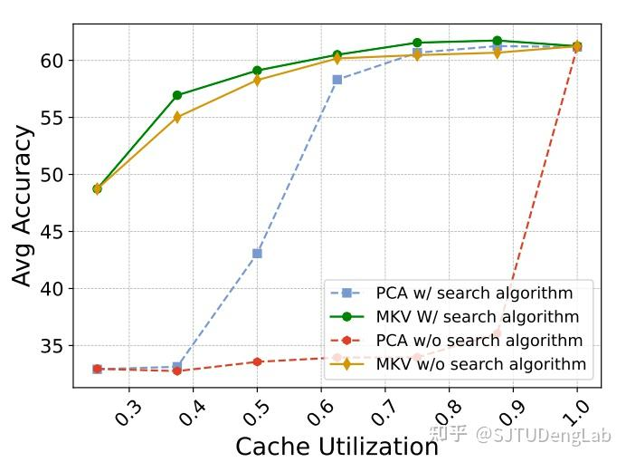
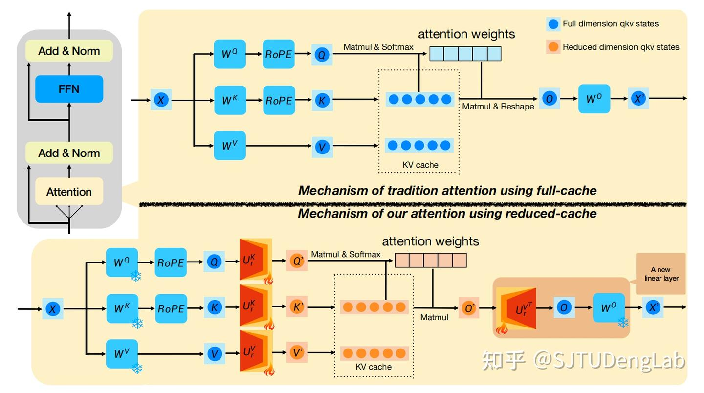
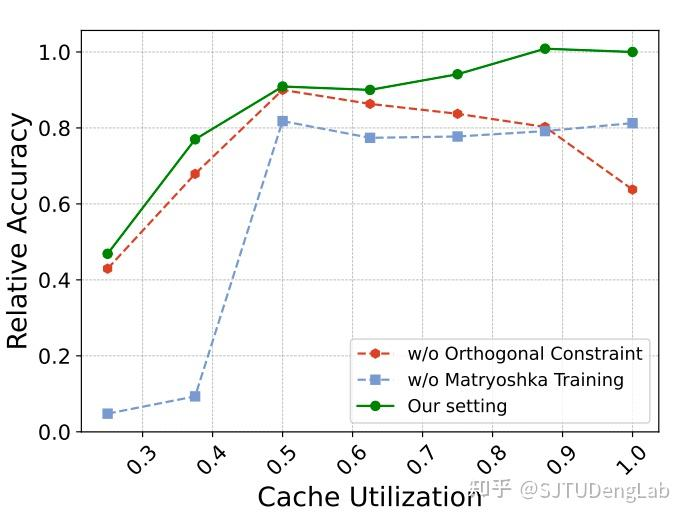
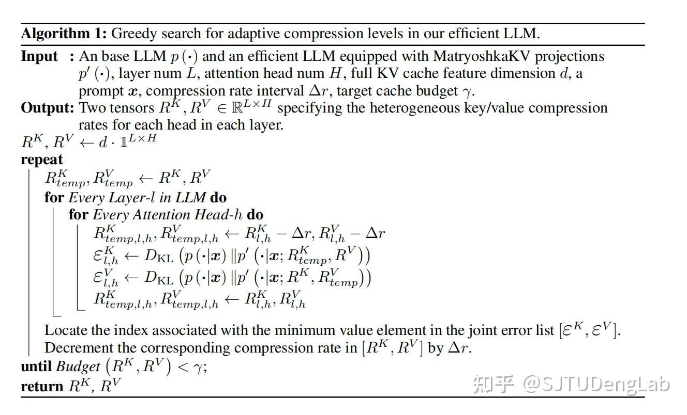
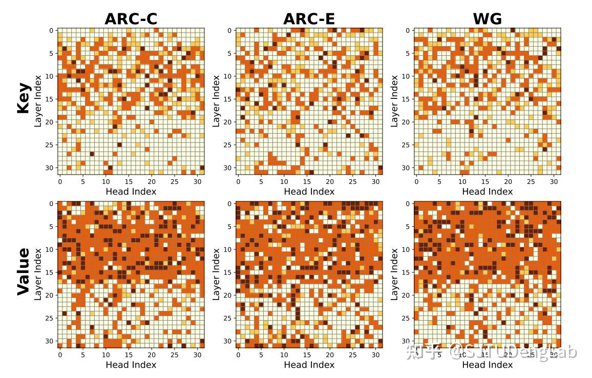
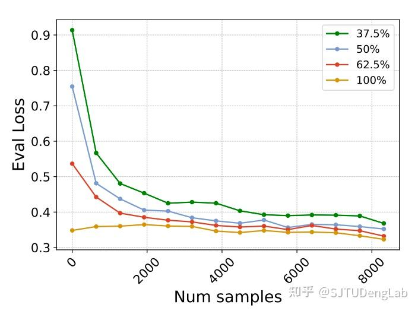
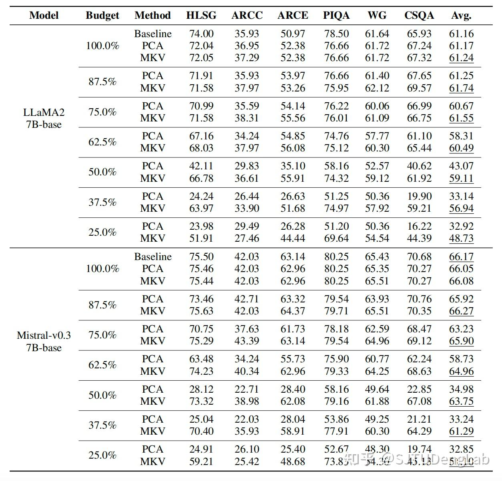
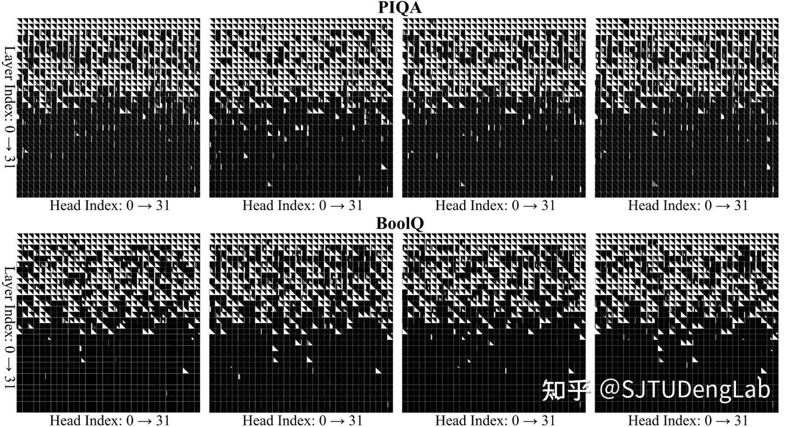
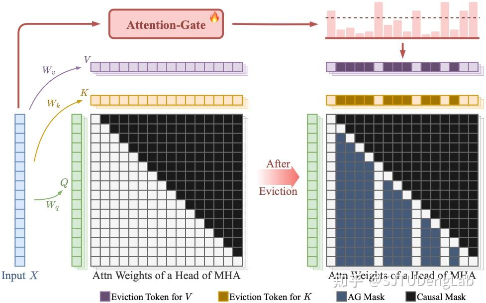
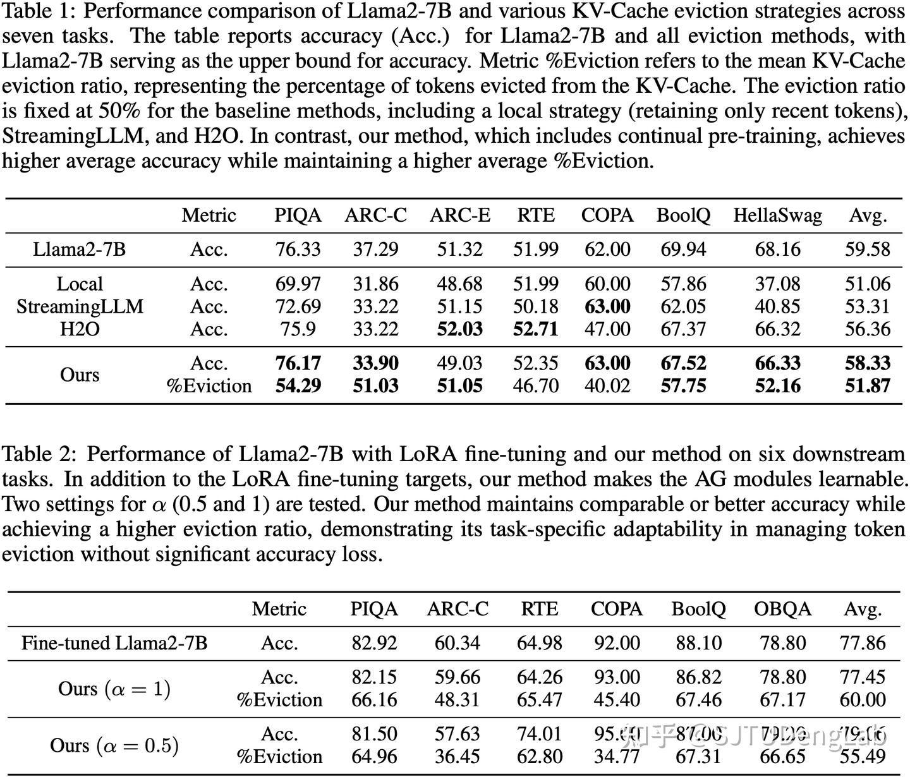

语言模型的推理一般会使用KV-Cache技术，用于存储self-attention机制里面的上下文（包括提示词以及已经生成的标记）所对应的key和value状态。key和value的缓存各是一个形状为（模型层数，注意力头数，序列长度， 特征维度）的张量。

然而，模型和数据规模的持续增长使得 KV-Cache 逐渐成为 LLMs 在存储和内存传输方面的瓶颈。针对这一问题，我们近期开展了两个研究工作，在不同角度进行 KV-Cache 的优化压缩。

### MatryoshkaKV：使用可塑正交投影矩阵进行特征维度压缩

现有研究在 KV-Cache 压缩方面主要集中在缓存张量的前三个维度（模型层数、注意力头数和序列长度），而对**特征维度压缩**的探索相对不足。因此，我们尝试利用低秩投影矩阵将缓存特征转换到低维空间来实现压缩。

- **初步尝试：直接对key或value cache进行PCA（主成分分析），得到一系列正交基，把** **key或value** **投影到低维子空间**
但是，仅仅采用 PCA 会忽略 self-attention里 key 和 value 的耦合及其中的非线性，因此非全局最优。在对特征维度压缩较多的情况下，模型的性能会下降的很多（下图红色、蓝色虚线）。

- **我们提出：采用知识蒸馏直接微调正交矩阵**

我们将低秩投影设置为可训练的，同时保持其正交性。基于蒸馏损失，迫使带低秩投影的模型逼近原模型。

之所以要保持正交，是为了确保在语言模型加上这个投影后，在不进行压缩的情况下能够保持原本的性能（i.e., UU^T = I）。如果去除正交限制，无KV-Cache压缩时的性能会下降（下图红色虚线）。

**注意：PCA 所得到的正交矩阵具有主次结构，具体表现为随着保留的正交基数量的增多，模型原本的性能被保留得越多**。然而，我们在实践中发现，如果以一个**固定的压缩比率**进行训练，会使得低秩投影丢失这种良好的性能（下图蓝色虚线）。

- **使用套娃训练策略，并贪婪搜索最佳压缩率**
我们从 Matryoshka Represenation Learning[[1]](#ref_1) 中得到启发，设计了 **MatryoshkaKV stategy**。

训练时采用动态的压缩比例，从预定义的整数集合中（如 {4,8,16,...} ）中随机采样 r，基于投影矩阵的前 r 列进行前向传播进行训练。

这样做，会在正交投影矩阵的列间引入一个主次关系。同时，在推理时，我们能够为不同 layer 的不同 head 的投影矩阵搜索不同压缩率，从而更好地适应不同层和头的需求。例如采用如下贪婪算法：

通过该算法，可以得到各数据集上面的最优压缩率（颜色越浅，压缩率越大）如下：

- **结果**
我们在训练的时候监测了不同压缩率下的 eval loss，可以看到套娃训练策略能够很好的同时优化所有压缩率下的模型输出。

在 LLaMA2 和 Mistral-v0.3（使用了 GQA）上**持续预训练，**仅仅使用 **37.5% cache** 的情况下，我们能够维持 93% 左右模型的性能：

同时我们还在一些下游任务上监督微调，如在 GSM8K 上，**不到 50% cache** 的使用率下可以维持 90% 以上的数学能力。

### Attention-Gate：实现灵活的 KV-Cache 淘汰机制

上图是采用 Attention-Gate 的模型在 2 个下游任务上各选了 4 个不同样本所得到的 KV-Cache Eviction（或 Attention Mask）的情况，可以看到**不同任务、样本、模型的层、注意力头上的情况不同**，而且越深的层往往会遮盖越多的 KV-Cache。

新增的 Attention-Gate（AG）放在多头注意力之前，接受整个上下文作为输入，即可得到对当前层不同注意力头的 KV-Cache Evition 方案以及其对应的 Attention Mask 方案。AG 的关键优势在于它基于全局信息制定淘汰策略，而不仅仅依赖局部信息。

AG 能够轻松地插入到预训练好的 LLM 中，通过高效的持续预训练（CPT）或监督微调（SFT）即可使用。在 CPT 中，我们使用 5000 条数据让 AG 学习，结果可以丢掉超过一半的 KV-Cache 且同时维持约 98% 的性能。而在针对下游任务的 SFT 中，在丢掉超过一半的 KV-Cache 的情况下，我们的性能甚至可以超过传统 LoRA 方法。

MatryoshkaKV 和 Attention-Gate 分别从压缩和淘汰两个角度对 KV-Cache 技术进行了创新优化。MatryoshkaKV 有效地压缩了特征维度，而 Attention-Gate 提供了灵活高效的缓存淘汰机制，两者都能在保持高性能的同时提高内存利用效率。

更多细节可以参考我们的论文以及初步代码 ⬇️

### 参考

- [^](#ref_1_0)Kusupati, Aditya, et al. "Matryoshka representation learning." Advances in Neural Information Processing Systems 35 (2022): 30233-30249.
