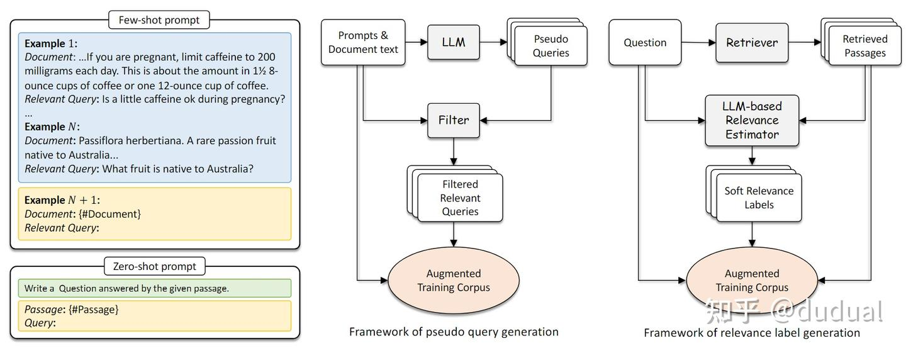

来源论文地址：[2308.07107.pdf (arxiv.org)](https://link.zhihu.com/?target=https%3A//arxiv.org/pdf/2308.07107.pdf)

信息检索在网页搜索，推荐和问答系统中都有重要的作用。检索的目的是在确定用户的查询问题和要检索的内容之间的相关性。ChatGPT 和 GPT-4 为代表的大型语言模型 (LLM) 的出现彻底改变了自然语言处理，它们具有出色的语言理解、生成、泛化和推理能力。因此，最近的研究试图利用llm来改进信息检索系统。基于此，该论文对query rewriters, retrievers, rerankers, and readers等关键方面都进行了调研。

首先介绍四个部分的作用分别是什么？

- **查询重写**。用户的问题通常是开放的，存在歧义和模糊。为了提高用户查询意图的准确性，通常会对用户的问题进行重写，生成一个新的高质量的查询。例如进行指代消解、噪声去除、补全、意图拆分等等。
- **检索器**。检索器通常是指粗召模型。采用BM25或句向量模型。
- **重排器**。重排器是指精排模型。对粗召的结果进行重新排序。
- **阅读器**。阅读器就是根据用户问题和检索结果生成相应的响应。
了解到每个部分的作用之后，来看看LLM是如何在其中发挥作用的。

#### 查询重写

查询重写在检索中起着至关重要的作用。检索过程的整体有效性高度依赖于查询重写结果的质量。在查询重写中使用大型语言模型 (LLM) 有几个优点：

- 更好的语义理解。LLM 对语言语义有深刻的理解，使它们能够更有效地捕获查询的含义和上下文。
- 更广泛的知识。LLM 拥有广泛的知识，能够在其参数中存储知识，有了这些知识通常可以改写的更好。
- 更好的上下文理解能力。在多轮对话中，LLM能够在用户和系统之间的多轮对话的背景下更好地理解用户的搜索意图。
虽然LLM本身具有丰富的内部知识库，但当缺乏领域知识的时候也会出现幻觉。可以将基于传统查询改写的检索结果和基于LLM的查询改写的检索结果进行后融合来提升效果。也可以在LLM的Prompt中加入相关文档，这比较考验LLM的长上下文能力。当然也可以在特定领域进行微调来提升改写效果。

目前，缺乏一些直接的指标来评估改写的质量，通常都是看下游检索效果如何。

#### 检索器

检索模型具有一些挑战。例如用户查询通常很短且模棱两可，文档通常包含冗长的内容和大量噪声，人工标注的相关性集合既耗时又昂贵。基于 BERT的现有模型架构表现出固有的局限性，从而限制了检索器的性能潜力。当前，利用LLM来改进检索器的方法可以分为两类，一个是利用LLM生成数据，另一个是利用LLM来增强检索架构。

#### LLM生成检索数据

LLM进行查询的重写其实就是改善检索数据的一种方式。当然，还有一个工作是对冗余的文档进行细化来改善检索数据的质量。

当前，除了改善，LLM也可以用来生成检索数据。包含生成问题和生成相关性标签。如下图所示

LLM检索数据生成框架生成查询的方法，将文档送给LLM, 生成相应的查询问题。然后对查询问题进行过滤，留下高相关性的查询进行训练。生成相关性标签方法是将问题和相关性较高的一些文档送给LLM来生成相关性的标签，用作后续训练。类似与数据的精标。

#### LLM增强检索架构

主要分为基于编码器的检索器和生成式的检索器。

- **基于编码器的检索器**
其实就是采用BERT类模型作为检索器。双塔结构进行对比学习训练。目前一些改进的方法是在进行任务的感知，就是在问题前面加入一些任务相关的指令。指令可以是任务的意图、域等等。例如“检索回答这个问题的维基百科文本。{问题}”

- **生成式检索器**
生成式检索器摆脱了传统的检索+排名的范式。直接让LLM生成与查询相关的文档ID。这个也比较考验LLM的上下文能力。

重排器的优化跟检索器一样。从数据和模型架构两方面去优化。而阅读器，直接换成LLM就可以了。

总结：

综述论文挺长的，看完收获没多大。
