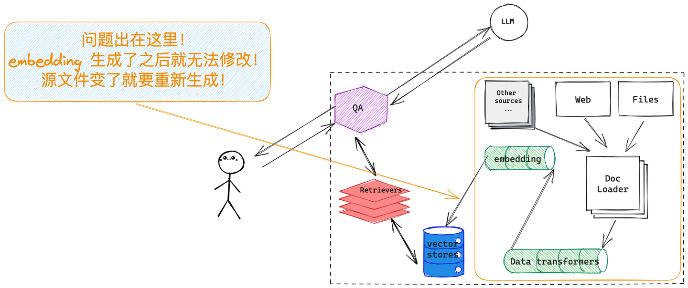
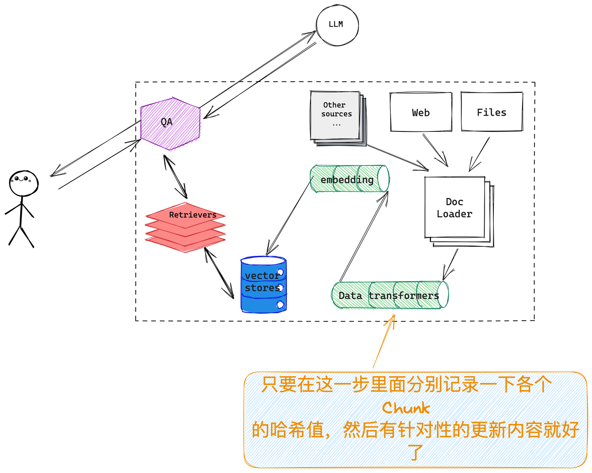
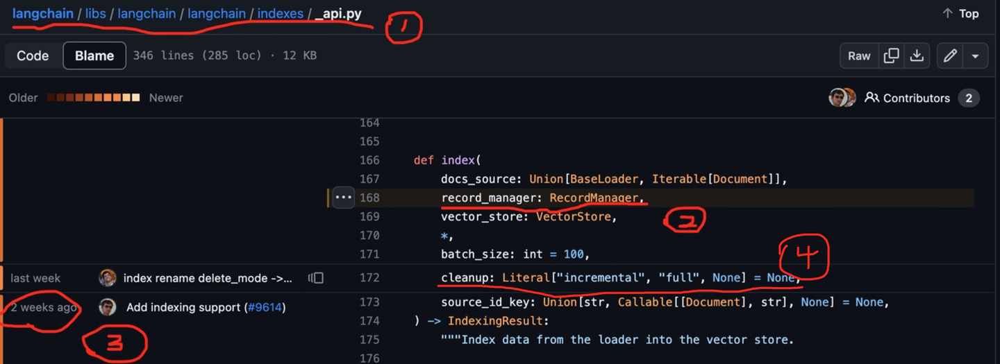
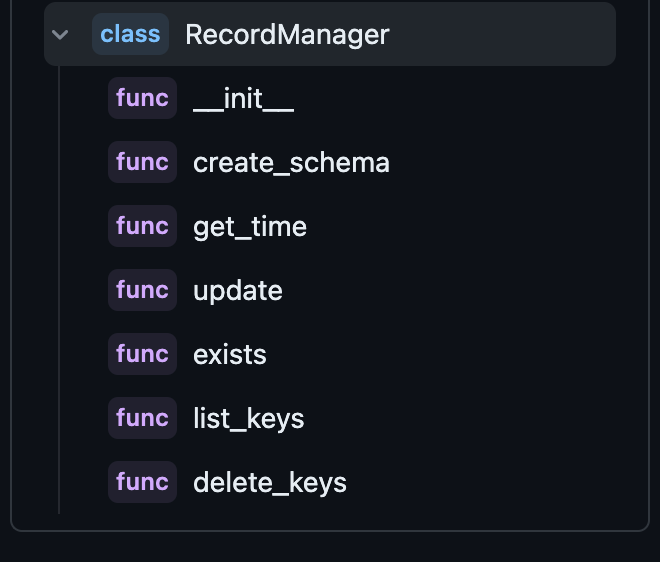
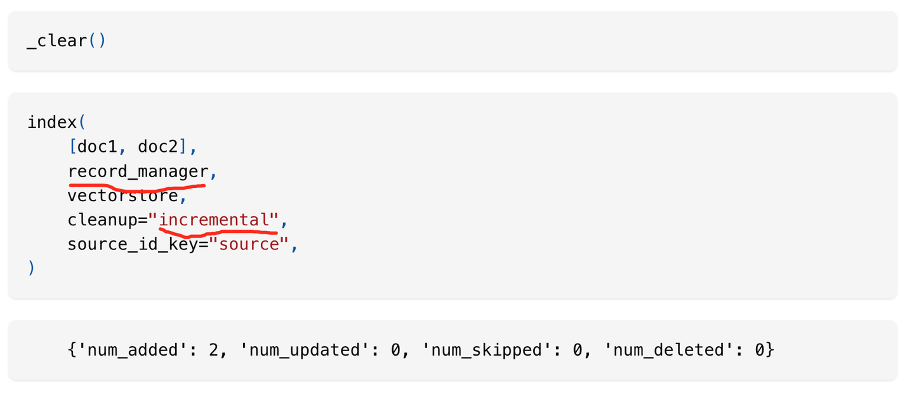
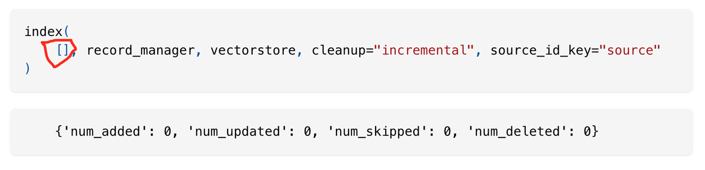

图一：embedding  类似于搜索引擎的索引，没有  update，只有  insert 或者 delete
#### 互联网排名第一的文档格式是什么？当然是  html！那排名第二的呢？ PDF！

做为大模型落地的两大方向之一，RAG 有个很大的坑等着我们，设想一下，需要定时更新一匹 PDF 文件到  RAG chatbot  里面去，总量不算多也不算少大约  15,000～ 的样子，开发环境里面根本没考虑过重新  re-index、re-embedding  的事，事到临头要更新了才想起来要重新做  embedding  不仅耗时更要耗钱，结果老板不出所料的不批预算，批我解气...

怎么破？

LangChain 提出的方案如下图所示，暂且称它为「增量更新」模式，在 data-transform 这一步、embedding  之前针对每一个 document  做一次  hash，记录下来  hash 值，每次源数据更新了只需要在这一步里面比对一下，更新的  document  对应的  embedding  删掉，生成新的插入到原有向量数据库中就好，类似的方法  Elasticsearch 早就在搜索场景种应用，当然如果你向量存储的部分直接选用的就是  Elasticsearch  那就更省事了。

图二：关键在于，在 embedding 之前记录一下 document 的哈希值详细看一下  LangChain  是怎么帮忙开发人员化解这个问题的，首先如上图所示，我们需要一个对象来记录、管理文档  documents  的哈希值，其次需要所选用的「vector store」支持针对特定的 documents  删除旧数据，写入新数据，LangChain 里面提供了一个的「RecordManager」对象来实现哈希值管理；针对数据预处理部分，扩展了原有的「index」对象，给它加了一个可以接受「RecordManager」的参数，这样在整个数据预处理部分（data-transforming）就把这个问题解了。

去  github  上看下具体的实现逻辑：

- 标 1 是 index 所在的位置，可以看到跟之前的版本没有变化；
- 标 2  和标 4 的位置分别添加了「RecordManager」参数和「cleanup」参数，前者说明白了，后者「cleanup」定义了三种如何自动删除 embedding 的策略（有三种情况，None/“incremental”/“full”，我个人首选 ** incremental **，详情可以参看这里： Indexing |  ️  Langchain）
- 标 3  部分通过  blame  可以看到之前我们用来做检索的  index 对象在大约两个周前（***说明大模型应用领域真的是日新月异，秒新时异！比如想用这个  feature 你就必须更新到当前这个版本上来！***）由社区添加了「record_manager」参数，这个「record_manager」是一个抽象类，只是定义了以下几个方法，而具体的你想把哈希值保存在什么容器里（比如  sqlite、pg、mysql  等），如果社区里面已经有对应的实现了就直接用，没有的照葫芦画瓢实现一个就好：

图三： RecordManager 是一个抽象类，把需要的几个功能先定义出来看一下具体的使用方法，大都是来自 Indexing |  ️  Langchain的代码，大略记录一下，详细可以去对应的地方  copy ：

`# index 部分导入没有变化
from langchain.indexes import index

# 但要选一个「RecordManager」用来保存文档更新信息：
from langchain.indexes import SQLRecordManager`

这里 _clear() 函数会把所有已有内容清空， index  带上  record_manager 之后会把新加入的 docs  在  embedding  之前都一一登记造册，记录在案：

图四：来自官方文档的 incremental 模式需要注意的是，如果在相同  source 上重新执行  index  操作的话，如果输入的文档列表为空，**incremental ** 模式会直接忽略该操作，过程如下：

图五：来自官方文档的  incremental  模式但如果指定 cleanup = "full", 上面的语句执行完之后，***会 清 空 所 有 ***当前  vector store  的内容，不要问咋知道的。
