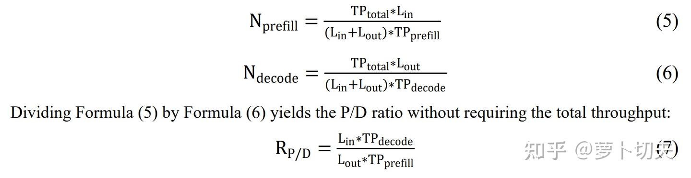
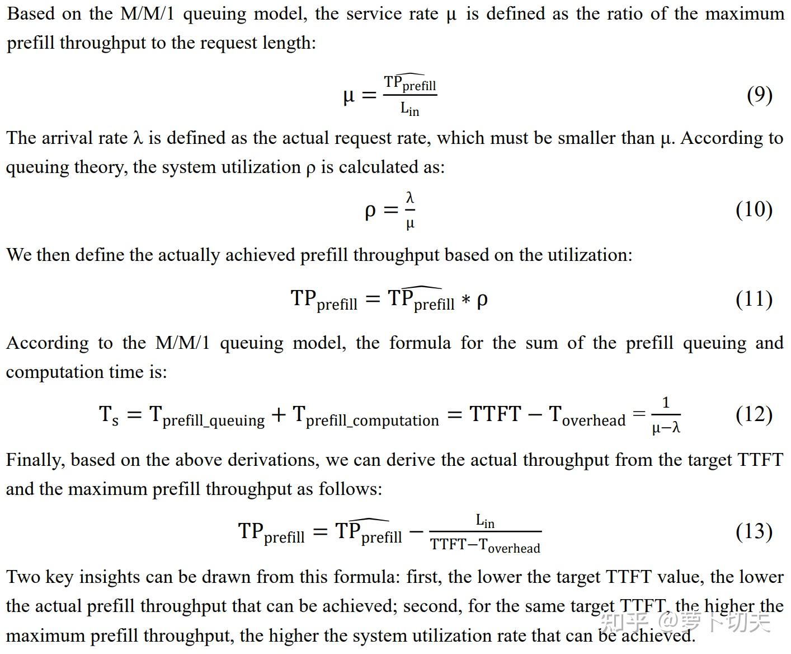

### Introduction

PD分离当前是大语言模型非常广泛使用的推理优化技术，可以独立对P/D进行部署优化, 独立优化TTFT和TPOT SLO指标。而传统的非PD分离部署，难以对P/D采用独立的优化策略，同时prefill通常优先处理导致TPOT较差。

但是对于PD分离部署，一个关键的问题是难以确定在满足用户throughput和SLO需求，以及请求输入输出长度特点条件下的P/D各自的资源使用量。当前业界还没有准确可靠的方法能够在这个需求场景下准确预测P/D的资源数量。

我们这篇论文

SLO-Aware Compute Resource Allocation for Prefill-Decode Disaggregated LLM Inference

提出了系统性的、非常优雅并且非常准确可靠的P/D资源计算方法，具体分为3个部分。

论文临时链接：

[https://github.com/llc-kc/SLO-Aware-Compute-Resource-Provisioning-for-PD-Disaggregated-LLM-Inference](https://link.zhihu.com/?target=https%3A//github.com/llc-kc/SLO-Aware-Compute-Resource-Provisioning-for-PD-Disaggregated-LLM-Inference)

arXiv: [https://arxiv.org/abs/2603.04716](https://link.zhihu.com/?target=https%3A//arxiv.org/abs/2603.04716)

### 一 P/D资源量计算理论

我们提出P/D资源使用量和比例与用户需求的throughput，请求输入输出长度，以及P/D各自部署的throughput的关系：

其中，TPtotal是用户总的throughput需求，Lin和Lout是请求输入输出长度，这些都是用户需求已知量。这里面未知的变量主要是P/D各自的throughput值TPprefill和TPdecode。

### 二 prefill throughput计算方法

我们创新地基于M/M/1排队论建模prefill过程，得出了TTFT，实际达成的prefill throughput和极限prefill throughput这三者的关系：

也就是说，我们只要得到极限的prefill throughput和Toverhead，就可以根据TTFT预测实际达成的prefill throughput，实际的prefill request rate，系统利用率等等一系列结果。

这里的Toverhead是P/D之间的kv cache传输时间，请求从用户终端到GPU服务器的往返时间等因素。因为基于SGLang推理引擎的PD分离TTFT不仅包括prefill的排队时间和计算时间，还包含kv cache从P到D的传输时间。另外值得注意的是，基于基于SGLang推理引擎的PD分离，Decode的内存和计算资源不足的话，还有decode prealloc queue和waiting queue时间也会影响TTFT。

那么这个极限prefill throughput怎么得到呢，非常简单，只需要通过输入为实际输入(可以加一些长短波动)，输出为1的请求大并发评测，打满prefill节点推理避免空闲就可以从引擎日志打印或者benchmark工具得到。

这里面没有考虑prefix cache前缀缓存的情况。如果prefill计算时间只与没有命中prefix cache的长度成正比，只需要简单的把上面公式中input length改成没有命中prefix cache的输入长度即可。

### 三 decode throughput获取方法

decode throughput当前没有一个理论性的计算方法，也几乎不太可能像prefill阶段那样能够测出一个极限吞吐(达到极限吞吐的decode batch远远超过机器内存的支持能力)。我们通过实验发现decode throughput和TOPT都与decode batch成正相关关系，也就是decode batch越大，获得的decode throughput越大，但是TPOT也越大。因此我们通过实际评测的方法得到单个D实例decode TOPT随着decode batch的变化关系，然后得到满足用户需求TOPT的decode batch，这两者相除就是实际达成的decode throughput。

### 总结

我们系统性的解决了P/D分离中满足用户throughput和SLO需求的P/D配比和具体资源量的计算方法。论文中通过了一个实际样例证明了这个方法的准确性。在我们实际生产环境中，这个方法经受住了大量实际场景的考验，被证明是非常准确和可靠的。

欢迎大家阅读原文和反馈意见。
