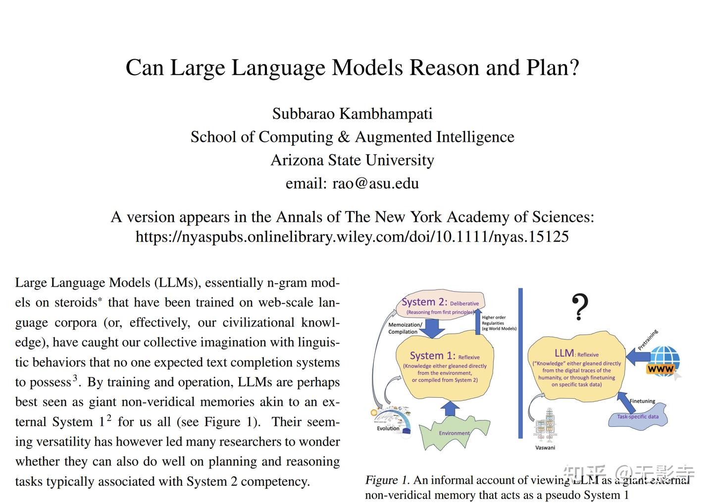
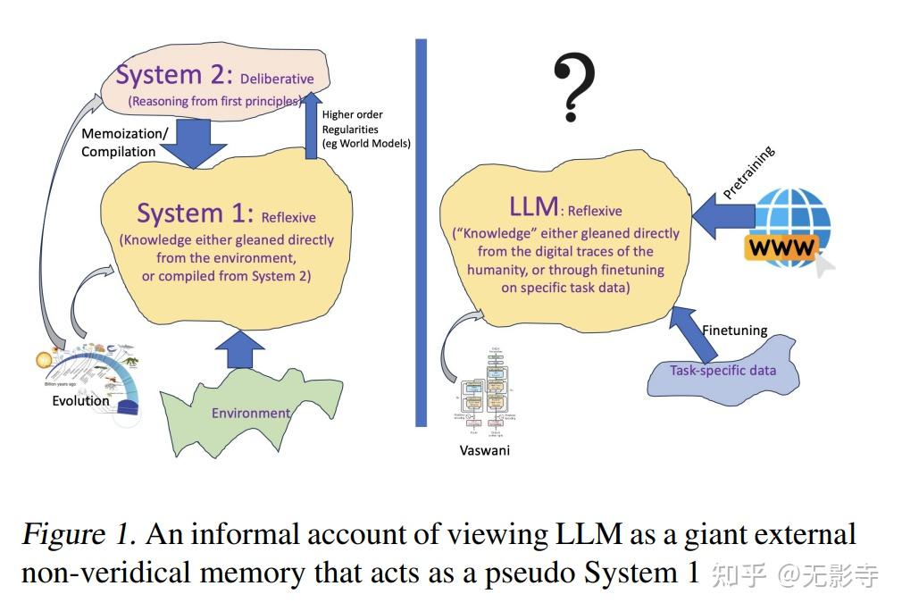
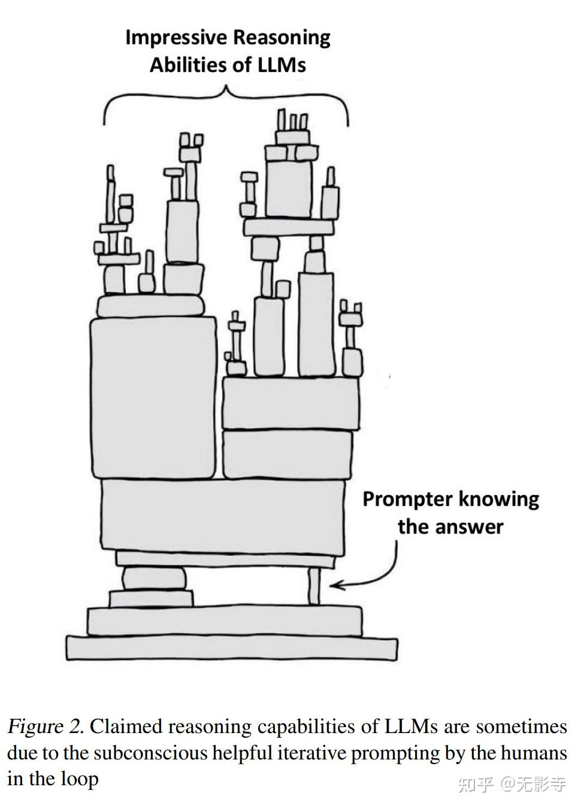
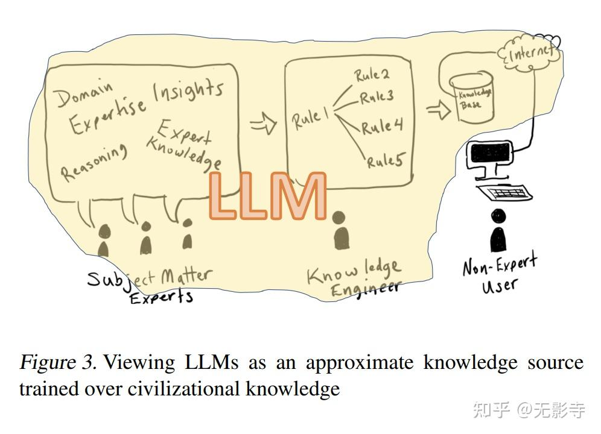

#### 一、结论写在前面

这篇文章探讨了关于大模型（LLMs）是否具有推理和规划能力的辩论。这些能力对于解锁LLMs在机器人和自主代理等领域的复杂应用至关重要。这份立场文件讨论了LLMs的推理和规划能力的主题。

以下是作者结论的摘要：“总的来说，我阅读、验证和进行的一切工作都没有给我任何充分的理由相信LLMs能够进行正常理解下的推理/规划。相反，它们在进行Web规模的训练后所做的是一种通用近似检索，正如我所主张的，有时会被误认为是推理能力。”

在这篇文章中，LLMs有时被称为“增强检索”，因此将其称为通用近似检索的形式是有趣的。我们应该进行更多的理论分析和严格的评估，以更好地了解LLMs是否“真正”具有推理和规划的可能性。

#### 二、论文的简单介绍

**论文认为**大模型(LLM)本质上是经过强化训练的n-gram模型，它们经过训练能够在网络规模的语料库(或者说是我们文明的知识)上表现出语言行为，这种行为远远超出了我们对文本补全系统的预期。通过训练和运行，LLM可能最好被看作是一种巨大的非真实记忆，就像是我们所有人的一个外部"系统1"(见图1)。它们表面上的通用性引发了许多研究人员对它们在规划和推理任务上的表现的疑问，这些任务通常与"系统2"能力相关联。

LLM的训练和使用方式似乎无法暗示它们可以进行任何原则性推理。LLM擅长的是一种通用近似检索形式。与精确索引和检索数据的数据库不同，作为n-gram模型的LLM能够基于单词概率重建对提示的完成--论文将其称为近似检索过程。这意味着LLM甚至无法保证记住完整的答案，这正是它们那种动态构建"新颖"提示完成的吸引力所在的另一面。LLM的优点("创造力")和缺点("捏造")在于，n-gram模型自然会混合匹配，并且就像我们一样几乎无法严格记忆。这确实是它们吸引力的基础所在。

那么，这些堆叠了的n-gram模型真的能够进行规划和推理吗?大多数关于推理能力的主张仍然有些依据片面证据。

论文的结果与关于LLM规划能力的片面证据主张相反，论文重复对GPT3.5和GPT4的测试。初步结果显示，从GPT3到GPT3.5再到GPT4，生成规划的准确性有所提高，其中GPT4在积木世界中达到30%的经验准确率(尽管在其他领域仍然较低)。然后，这种适度改进是由于改进了近似检索能力，还是GPT4实际上正在做/搜索规划。

论文感兴趣的不是LLM是否能够通过从记忆和模式发现中给出正确的推理任务答案来伪造推理，而是它们是否实际上能够进行原则性推理。判断一个系统(或者就此而言，一个人)是在记忆还是从头解决一个问题是具有挑战性的，特别是当系统(或人)在越来越大的"题库"上接受训练时。这是大多数教师和面试官都非常清楚的一个挑战。想想那个臭名昭著的"为什么井盖是圆形的?"面试问题。虽然它可能确实在第一次被问到时给面试官提供了对候选人分析推理能力的洞见，但现在它极有可能只是确认候选人是否接受过面试题库的训练!

考虑到LLM不受人类的一些正常限制，如过有个人生活，因此没有时间或意愿长期专注于测试/面试准备，它们可以支持对网络规模语料库的近似检索。对于规划任务，检查这一点的一种方式是通过混淆规划问题中动作和对象的名称来降低近似检索的有效性。当论文对测试领域这样做时，GPT4的实证性能急剧下降，尽管所有标准现成的AI规划器对这种混淆都没有任何困难。

也许他们不能直接自主地进行规划，但是通过一点点暗示就可以做到吗?大致有两种流行的暗示技术。第一种叫做"微调"，相当直接：取一个通用的LLM，并在规划问题(即实例及其解决方案)上进行微调，希望它们后续能做出更好的猜测(见图1左侧)。虽然我们自己有限的实验没有显示通过微调有任何显著改进，但有可能通过更多的微调数据和努力，LLM猜测的质量可能会得到提高。但所有这种微调所做的只是将规划任务转换为基于记忆的近似检索(类似于从"系统2"到"系统1"的记忆/编译;见图1)。它并不能证明LLM能够进行规划。

提高规划(和推理)性能的第二种方式是用提示/建议来反馈LLM，指导它如何改进初始的规划猜测。这里的关键问题是(a)这种反馈提示是手动还是自动的，(b)是谁在证实最终答案的正确性，(c)提示是否注入了额外的问题知识，或者只是简单地敦促LLM重新尝试。

最好的方法是让外部的基于模型的计划验证器来做反馈提示，并证实最终解决方案的正确性。通常情况下，这种LLM-Modulo框架可以通过生成-测试-评论框架有效利用LLM惊人的想法生成能力与可靠的外部验证器，并提供保证。

事实上，LLM通常擅长提取规划知识，这一点确实可以得到有效利用。正如我们在最近的工作中所论证的，只要循环中的人类(和任何专门的评论者)验证和完善模型，并将它们交给基于模型的求解器，LLM就可以成为世界/领域动态和用户偏好的丰富的近似模型来源。以这种方式使用LLM的优势在于，人类只需在提取和完善动态/偏好模型时参与，而实际的规划工作之后就可以留给有正确性保证的可靠框架。这种框架与过去的基于知识的人工智能系统有着惊人的相似之处，LLM实际上是在取代"知识工程师"的角色(图3)。

鉴于人工智能领域由于教条式地远离那些接受来自人类专家的领域知识的方法而发生了相当夸张的转变，这一点我在"波兰尼的报复和人工智能与默会知识的新浪漫"一文中曾表示遗憾，利用LLM作为知识源头的这种新趋势可被视为一种报复波兰尼报复的形式(通过将显式知识重新引入人工智能系统，即使只是从LLM中获得的)。事实上，只要我们愿意放宽对知识正确性的要求，LLM就可以轻松获取特定问题的知识。与老式的知识工程方法相比，LLM提供了这种能力，而不会让人觉得我们是在给任何特定的人添麻烦(相反，我们只是利用人类互相告知的一切!)。因此，对于推理任务来说，百万美元的问题变成了："如果有一个健忘的万事通随时准备提供任何知识，你会如何进行规划?"LLM-Modulo框架就是解决这一挑战的原则性方法。

总之，论文所阅读、验证或完成的工作，没有任何令人信服的理由让我相信LLM能够进行通常所说的推理/规划。相反，凭借网络规模的训练，它们所做的是一种普遍的近似检索形式，正如我所论证的，这有时会被误认为是推理能力。LLM确实擅长为任何任务(包括涉及推理的任务)生成想法，正如我所指出的，这可以在LLM-Modulo框架中得到有效利用来支持推理/规划。换句话说，LLM已经具备了足够惊人的近似检索能力可以得到有效利用，因此我们没有必要归于它们那些有问题的推理/规划能力。

论文标题：Can Large Language Models Reason and Plan?

论文链接：https：//[http://arxiv.org/pdf/2403.04121.pdf](https://link.zhihu.com/?target=http%3A//arxiv.org/pdf/2403.04121.pdf)
