**

本文将介绍Transformer架构和GPT-4、LLaMA等语言大模型中使用的自注意力机制。自注意力和相关机制是LLM的核心组件，使用LLM时，了解这些机制十分有必要。

本文还提供了使用Python和PyTorch从零开始编码自注意力机制的详细指南，并演示其工作方式，帮助初学者和经验丰富的从业者深入理解它在LLM中的作用。

本文作者是机器学习和人工智能研究员Sebastian Raschka，目前担任Lightning AI的首席AI教育研究员，他正在编写书籍《从零开始构建语言大模型》。（以下内容由OneFlow编译发布，转载请联系授权。原文：https://magazine.sebastianraschka.com/p/understanding-and-coding-self-attention)

来源 | Ahead of AI**

**OneFlow编译**

**翻译｜杨婷、宛子琳**

**

### 1. 自注意力机制简介**

**

自最初的Transformer论文“Attention Is All You Need”发表以来，自注意力（self-attention）成为了许多SOTA深度学习模型的基石，特别是在自然语言处理（NLP）领域。目前，自注意力机制的应用十分广泛，因此理解其工作原理至关重要。

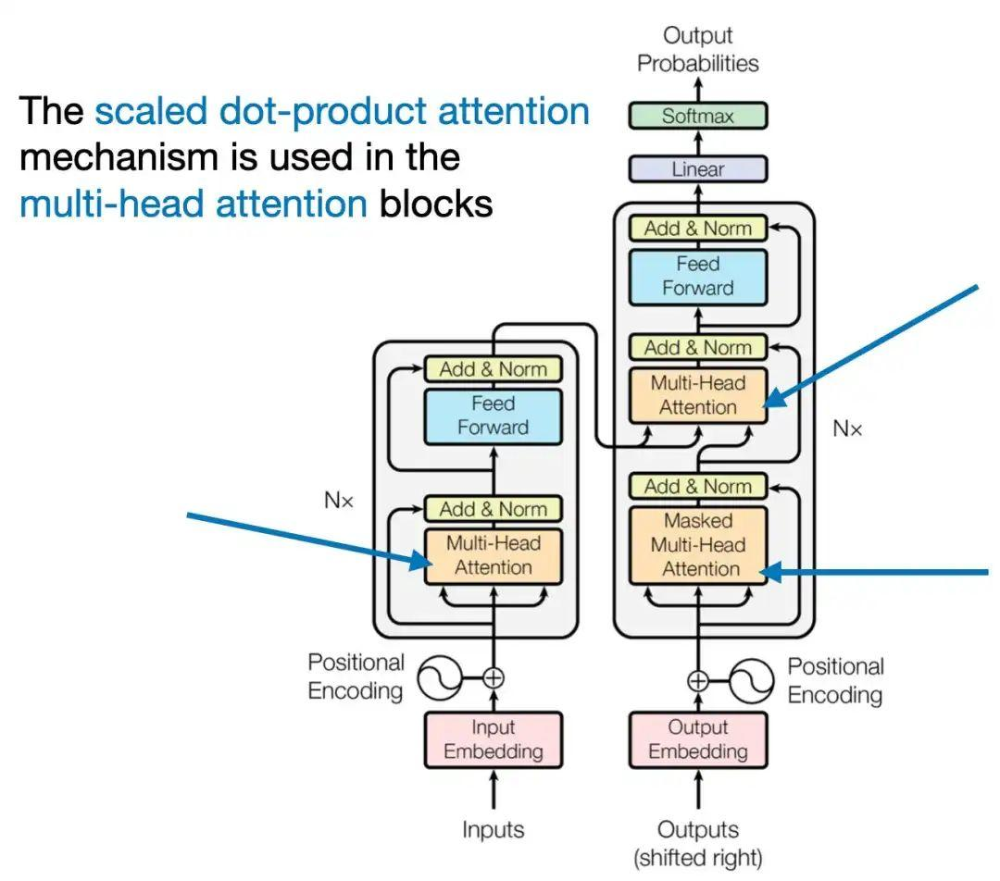

原始Transformer架构，来自https://arxiv.org/abs/1706.03762深度学习中的“注意力”概念源于改进循环神经网络（RNN）使其能够处理较长序列或句子，例如，将句子从一种语言翻译成另一种语言。我们通常不会选择逐字翻译，因为这种方式忽略了每种语言特有的复杂语法结构和惯用表达，会导致翻译不准确或无意义。

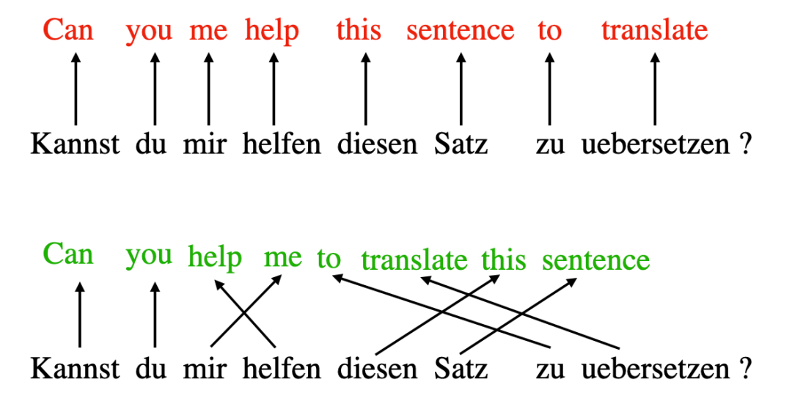

错误的逐字翻译（上）与正确的翻译（下）为克服上述问题，引入了注意力机制，允许模型在每个时间步都能够访问所有序列元素。注意力机制的关键在于选择性地确定在特定上下文中哪些词语是最重要的。2017年，Transformer架构引入了独立的自注意力机制，它彻底消除了对循环神经网络（RNN）等传统结构的依赖。

（简洁起见，我将简要讨论背景动机部分，将文章重点放在自注意力机制的技术细节上，以便可以专注于代码实现。）

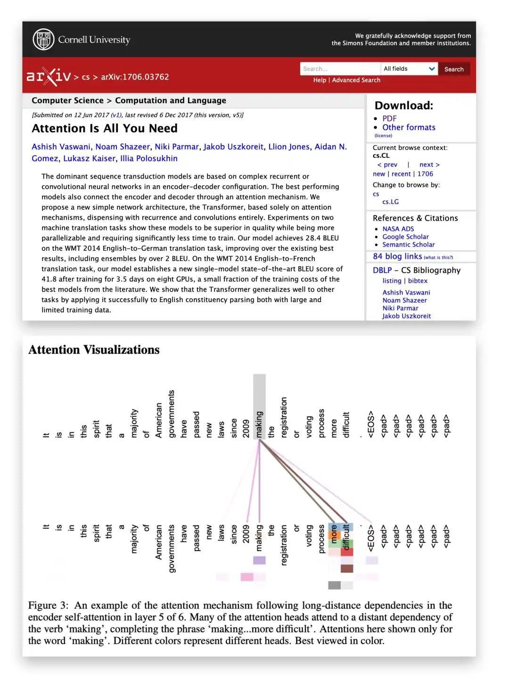

“Attention is All You Need”论文 (https://arxiv.org/abs/1706.03762) 的可视化图，展示了单词“making”在输入序列中通过注意力权重对其他单词的依赖或关注程度（颜色浓度与注意力权重值成正比）。我们可以将自注意力视为一种机制，通过包含输入上下文的信息来增强输入embedding（嵌入）的信息内容。换句话说，自注意力机制使模型能够衡量输入序列中不同元素的重要性，并动态调整它们对输出的影响。对于语言处理任务而言，自注意力机制的重要性尤为突出。因为在自然语言中，一个词的含义可能会随句子或文档的上下文而发生变化。

请注意，自注意力机制有很多变体，但人们主要关注提高自注意力机制的效率。然而，大多数论文仍然采用了Attention Is All You Need论文引入的最初的可缩放点积注意力机制（original scaled-dot product attention mechanism），因为对于大多数公司而言，在训练大规模Transformer时，自注意力机制很少成为计算瓶颈。

因此，本文的重点是最初的可缩放点积注意力机制（（scaled dot-product attention，称为自注意力机制），因为它仍是目前最流行、使用范围最广的注意力机制。然而，如果你对其他类型的注意力机制感兴趣，可以参考一些研究综述和最新论文，如《*2020 Efficient Transformers: A Survey*》、《*2023 A Survey on Efficient Training of Transformers*》以及最近的《*FlashAttention*》和《*FlashAttention-v2*》论文。

### 2 嵌入一个输入句子**

**

在介绍自注意力机制之前，先考虑一个输入句子："Life is short, eat dessert first"。我们希望将其通过自注意力机制处理。类似于其他处理文本的建模方法（例如循环神经网络或卷积神经网络），首先我们需要创建一个句子嵌入（sentence embedding）。

为简单起见，这里我们的词典dc仅限于输入句子中出现的单词。在实际应用中，我们通常会考虑训练数据集中的所有单词（词汇量大小通常在3万到5万之间）。

输入:

`sentence = 'Life is short, eat dessert first'
​
dc = {s:i for i,s 
      in enumerate(sorted(sentence.replace(',', '').split()))}
​
print(dc)`

输出:

`{'Life': 0, 'dessert': 1, 'eat': 2, 'first': 3, 'is': 4, 'short': 5}`

接下来，我们使用该字典为每个单词分配一个整数索引：

输入：

`import torch
​
sentence_int = torch.tensor(
    [dc[s] for s in sentence.replace(',', '').split()]
)
print(sentence_int)`

输出：

`tensor([0, 4, 5, 2, 1, 3])`

现在，使用输入句子的整数向量表示，我们可以使用嵌入层将输入编码成实向量嵌入（real-vector embedding）。在这里，我们将使用一个微小的3维嵌入，以便每个输入单词都被表示为一个3维向量。

需要注意的是，嵌入大小通常在数百到数千个维度之间，如LLaMA 2使用的嵌入大小为4096。在这里使用3维嵌入纯粹是为了举例说明，这样我们就能够检查单个向量，而无需用数字填满整个页面。

该句子由6个单词组成，将产生6×3维嵌入：

输入：

`vocab_size = 50_000
​
torch.manual_seed(123)
embed = torch.nn.Embedding(vocab_size, 3)
embedded_sentence = embed(sentence_int).detach()
​
print(embedded_sentence)
print(embedded_sentence.shape)`

输出：

`tensor([[ 0.3374, -0.1778, -0.3035],
        [ 0.1794,  1.8951,  0.4954],
        [ 0.2692, -0.0770, -1.0205],
        [-0.2196, -0.3792,  0.7671],
        [-0.5880,  0.3486,  0.6603],
        [-1.1925,  0.6984, -1.4097]])
torch.Size([6, 3])`

### 3 定义权重矩阵**

**

接下来，我们将讨论一种广泛使用的自注意力机制，即缩放点积注意力机制，这是Transformer架构的重要组成部分。

自注意力机制利用三个权重矩阵（*Wq、Wk和Wv*），在训练过程中作为模型参数进行调整。这些矩阵用于分别将输入投影到序列的查询（query）、键（key）和值（value）组件中。

相应的查询、键和值序列是通过权重矩阵W和嵌入输入x之间的矩阵乘法获得的：

- 查询序列（Query sequence）：*q(i) = x(i)Wq*，其中*q(i)*表示查询序列的第i个元素。
- 键序列（Key sequence）：*k(i) = x(i)Wk*，其中*k(i)*表示键序列的第i个元素。
- 值序列（Value sequence）：*v(i) = x(i)Wv*，其中*v(i)*表示值序列的第i个元素。

索引i指的是输入序列中的词元索引位置，该序列的长度为T。

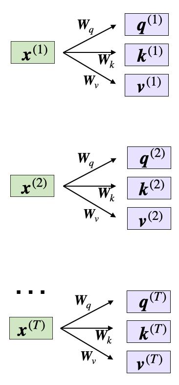

通过输入x和权重W计算查询、键和值向量。

这里，*q(i)*和*k(i)*都是*dk*维向量。投影矩阵*Wq*和*Wk*的维度为*d×dk*，而*Wv*的维度为*d×dv*。

（值得注意的是，*d*代表每个词向量*x*的大小。）

由于我们正在计算查询和键向量之间的点积，这两个向量必须包含相同数量的元素（*dq = dk*）。在许多语言大模型中，我们通常会使用相同大小的值向量，以确保*dq = dk = dv*。然而，决定上下文向量大小的值向量*v(i)*中的元素数量可以是任意的。

因此，在接下来的代码演示中，我们选择设置*dq=dk=2*，将*dv*设置为4，初始化投影矩阵如下：

输入：

`torch.manual_seed(123)
​
d = embedded_sentence.shape[1]
​
d_q, d_k, d_v = 2, 2, 4
​
W_query = torch.nn.Parameter(torch.rand(d, d_q))
W_key = torch.nn.Parameter(torch.rand(d, d_k))
W_value = torch.nn.Parameter(torch.rand(d, d_v))`

（与之前的词嵌入向量类似，维度*dq、dk、dv*通常要大得多，但

为了更直观地进行说明，我们在这里使用了较小的数字。）

### 4 计算未归一化的注意力权重**

**

现在，我们来计算第二个输入元素的注意力向量，其中第二个输入元素充当查询：

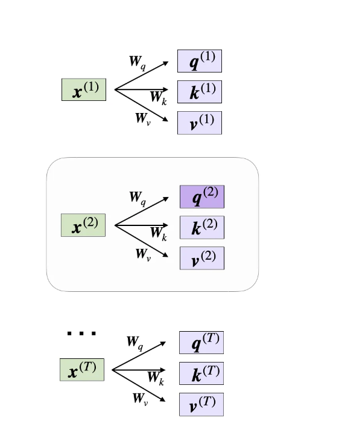

接下来我们重点关注第二个输入x(2)

在代码中，如下所示：

输入：

`x_2 = embedded_sentence[1]
query_2 = x_2 @ W_query
key_2 = x_2 @ W_key
value_2 = x_2 @ W_value
​
print(query_2.shape)
print(key_2.shape)
print(value_2.shape)`

输出：

`torch.Size([2])
torch.Size([2])
torch.Size([4])`

然后，我们可以将这个过程泛化到计算所有输入的剩余键和值元素，因为在下一步计算未归一化的注意力权重时，我们会需要它们：

输入：

`keys = embedded_sentence @ W_key
values = embedded_sentence @ W_value
​
print("keys.shape:", keys.shape)
print("values.shape:", values.shape)`

输出：

`keys.shape: torch.Size([6, 2])
values.shape: torch.Size([6, 4])`

现在我们已经计算得到了所有必要的键和值，可以继续下一步，计算未归一化的注意力权重ω（omega），如下图所示：

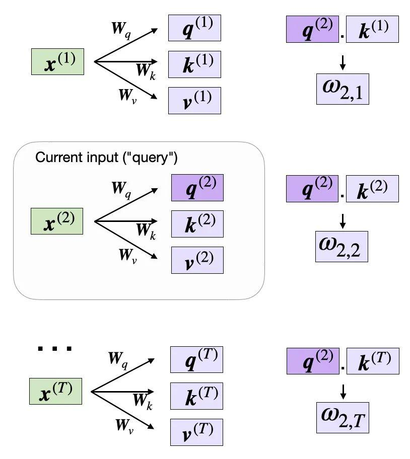

计算未归一化的注意力权重ω(omega)如上图所示，我们将ωi,j计算为查询序列和键序列之间的点积，即*ωi*,*j=q(i)k(j)*。

例如，我们可以计算查询和第5个输入元素（对应索引位置4）的未归一化注意力权重，如下所示：

输入：

`omega_24 = query_2.dot(keys[4])
print(omega_24)`

（请注意，ω是希腊字母“omega”的符号，因此上面的代码变量也使用了相同的名称。）

输出：

`tensor(1.2903)`

由于稍后我们会需要这些未归一化的注意力权重*ω*来计算实际的注意力权重，因此我们需要按照前面图示的方式计算所有输入词元的*ω*数值：

输入：

`omega_2 = query_2 @ keys.T
print(omega_2)`

输出：

`tensor([-0.6004,  3.4707, -1.5023,  0.4991,  1.2903, -1.3374])`

### 5 计算注意力权重****

自注意力机制的下一步操作是通过应用softmax函数，将未归一化的注意力权重*ω*归一化，得到标准化的注意力权重*α*（alpha）。此外，在通过softmax函数进行归一化之前，还需要使用1/√{*dk*}来对ω进行缩放，具体如下所示：

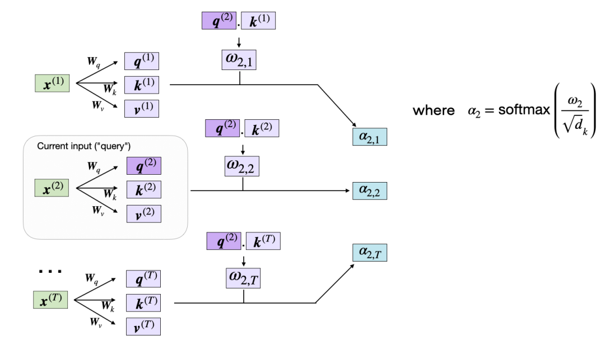

计算归一化注意力权重α

通过*dk*的缩放可确保权重向量的欧几里德长度大致相同。这有助于防止注意力权重过小或过大，否则可能导致数值不稳定，甚至会影响模型在训练过程中的收敛能力。

在代码中，我们可以按照如下方式计算注意力权重：

输入：

`import torch.nn.functional as F
​
attention_weights_2 = F.softmax(omega_2 / d_k**0.5, dim=0)
print(attention_weights_2)`

输出：

`tensor([0.0386, 0.6870, 0.0204, 0.0840, 0.1470, 0.0229])`

自注意力机制的最后一步是计算上下文向量z(2)，它是原始查询输入x(2)的注意力加权（attention-weighted）版，通过注意力权重将所有其他输入元素作为其上下文：

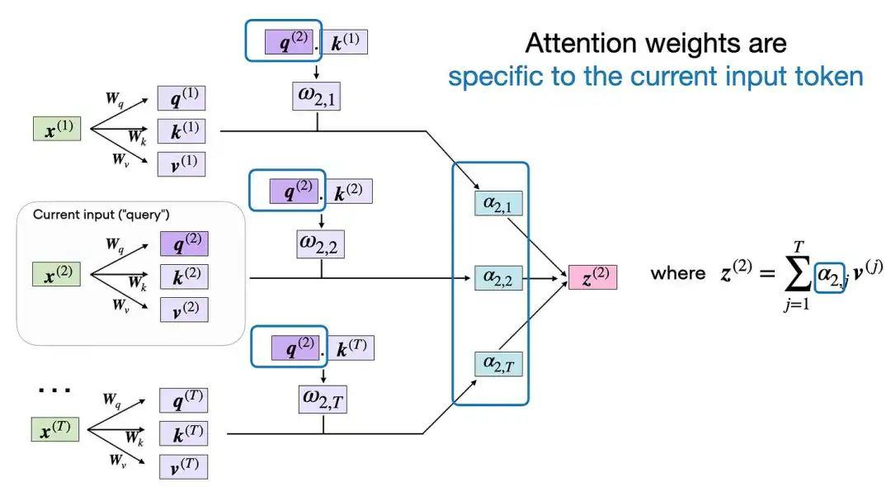

注意力权重特定于某个输入元素。在这里，我们选择输入元素x(2)。在代码中，如下所示：

输入：

`context_vector_2 = attention_weights_2 @ values
​
print(context_vector_2.shape)
print(context_vector_2)`

输出：

`​torch.Size([4])
tensor([0.5313, 1.3607, 0.7891, 1.3110])`

请注意，此输出向量的维度*(dv=4)*比原始输入向量的维度*(d=3)*高，因为我们之前指定了*dv>d*；然而，这里指定的嵌入大小*dv*是任意的。

### 6 自注意力机制**

**

为总结前面章节中自注意力机制的代码实现，我们可以将前面的代码总结在一个简洁的SelfAttention类中：

输入：

`import torch.nn as nn
​
class SelfAttention(nn.Module):
​
    def __init__(self, d_in, d_out_kq, d_out_v):
        super().__init__()
        self.d_out_kq = d_out_kq
        self.W_query = nn.Parameter(torch.rand(d_in, d_out_kq))
        self.W_key   = nn.Parameter(torch.rand(d_in, d_out_kq))
        self.W_value = nn.Parameter(torch.rand(d_in, d_out_v))
​
    def forward(self, x):
        keys = x @ self.W_key
        queries = x @ self.W_query
        values = x @ self.W_value
        
        attn_scores = queries @ keys.T  # unnormalized attention weights    
        attn_weights = torch.softmax(
            attn_scores / self.d_out_kq**0.5, dim=-1
        )
        
        context_vec = attn_weights @ values
        return context_vec`

根据PyTorch的惯例，上文的SelfAttention类初始化了 `__init__` 方法中的自注意力参数，并通过前向传播计算了所有输入的注意力权重和上下文向量。下面是这个类的使用示例：

输入：

`torch.manual_seed(123)
​
# reduce d_out_v from 4 to 1, because we have 4 heads
d_in, d_out_kq, d_out_v = 3, 2, 4
​
sa = SelfAttention(d_in, d_out_kq, d_out_v)
print(sa(embedded_sentence))`

输出：

`tensor([[-0.1564,  0.1028, -0.0763, -0.0764],
        [ 0.5313,  1.3607,  0.7891,  1.3110],
        [-0.3542, -0.1234, -0.2627, -0.3706],
        [ 0.0071,  0.3345,  0.0969,  0.1998],
        [ 0.1008,  0.4780,  0.2021,  0.3674],
        [-0.5296, -0.2799, -0.4107, -0.6006]], grad_fn=)`

查看第二行，可以看到它与上一节context_vector_2中的值完全匹配：tensor([0.5313, 1.3607, 0.7891, 1.3110])。

### 7 多头注意力机制**

**

在本文一开始的顶部图表中（为了方便在下文再次展示），可以看到Transformer使用了一个名为"多头注意力（multi-head attention）"的模块。

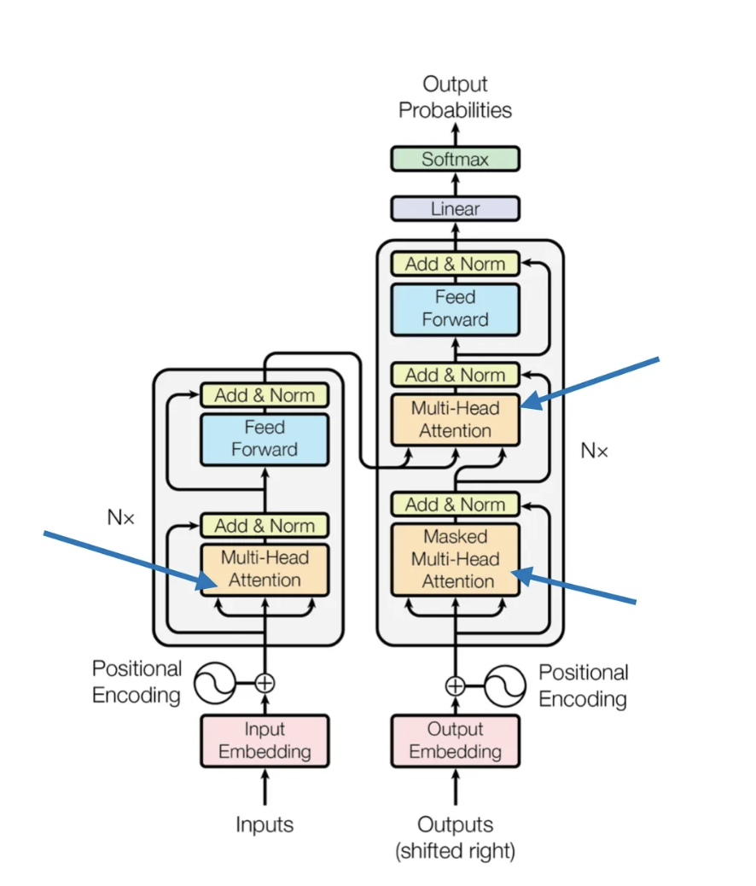

原始Transformer架构中的多头注意力模块，来https://arxiv.org/abs/1706.03762。这个“多头”注意力模块与我们上面介绍的自注意力机制（缩放点积注意力）有何关联呢？

在缩放点积注意力中，输入序列通过表示查询（query）、键（key）和值（value）的三个矩阵进行转换。在多头注意力的上下文中，这三个矩阵可以被看作单个注意力头。下图总结了我们之前讨论并实现的这个单一注意力头：

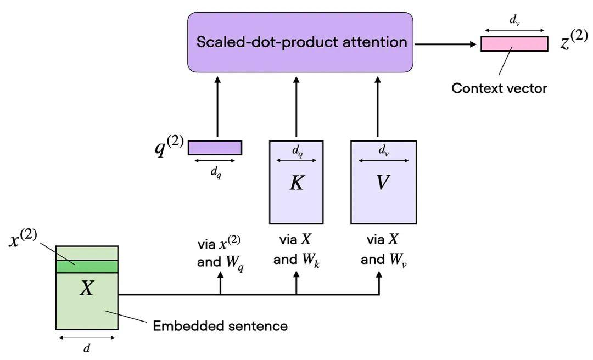

之前实现的自注意机制总结

顾名思义，多头注意力包括多个这样的头，每个头由查询、键和值矩阵组成。这个概念类似于卷积神经网络中使用多个卷积核，产生具有多个输出通道的特征图（map）。

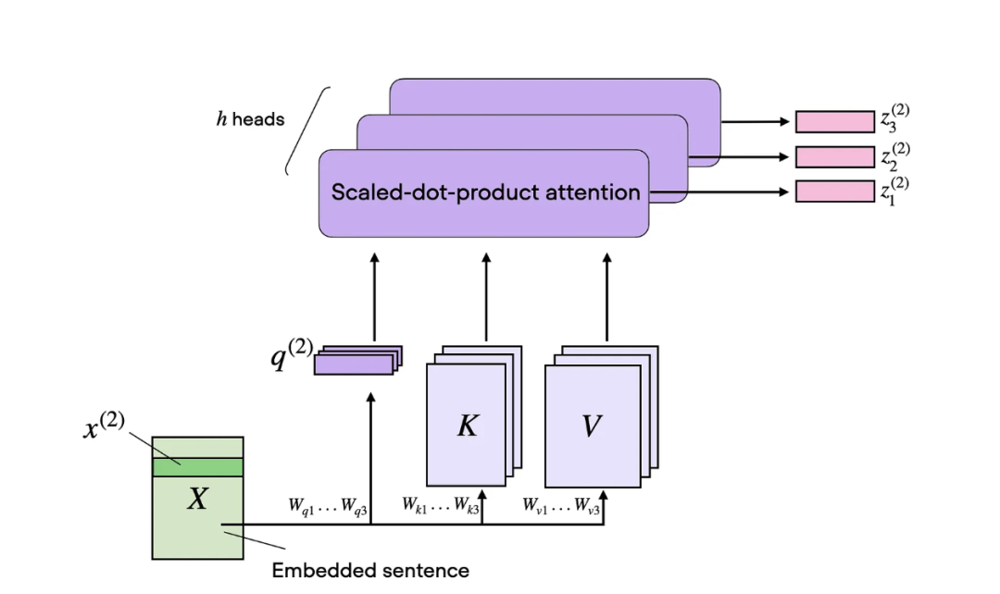

多头注意力：有多个头的自注意力机制

为了在代码中说明这一点，我们可以为之前的SelfAttention类编写一个MultiHeadAttentionWrapper类：

`class MultiHeadAttentionWrapper(nn.Module):
​
​    def __init__(self, d_in, d_out_kq, d_out_v, num_heads):
        super().__init__()
        self.heads = nn.ModuleList(
            [SelfAttention(d_in, d_out_kq, d_out_v) 
             for _ in range(num_heads)]
        )
​
    def forward(self, x):
        return torch.cat([head(x) for head in self.heads], dim=-1)`

在SelfAttention类中，d_*参数与之前相同，唯一的新输入参数是注意力头的数量：

- d_in：输入特征向量维度
- d_out_kq：查询和键输出维度
- d_out_v：值输出维度
- num_heads：注意力头数量

我们使用这些输入参数初始化SelfAttention类num_heads次，并使用PyTorch中的nn.ModuleList来存储多个自注意力实例。

前向传播需要将每个自注意力头（存储在self.heads中）独立地应用于输入x，然后将每个头的结果沿着最后一个维度（dim=-1）进行连接。让我们通过以下示例看看实际效果：

首先，假设我们有一个单独的自注意力头，为简化说明，将输出维度设置为1：

输入：

`torch.manual_seed(123)
​
​d_in, d_out_kq, d_out_v = 3, 2, 1
​
sa = SelfAttention(d_in, d_out_kq, d_out_v)
print(sa(embedded_sentence))`

输出：

`tensor([[-0.0185],
        [ 0.4003],
        [-0.1103],
        [ 0.0668],
        [ 0.1180],
        [-0.1827]], grad_fn=)`

现在，将其扩展到4个注意力头：

输入：

`torch.manual_seed(123)
​
block_size = embedded_sentence.shape[1]
mha = MultiHeadAttentionWrapper(
    d_in, d_out_kq, d_out_v, num_heads=4
)
​
context_vecs = mha(embedded_sentence)
​
print(context_vecs)
print("context_vecs.shape:", context_vecs.shape)`

输出：

`tensor([[-0.0185,  0.0170,  0.1999, -0.0860],
        [ 0.4003,  1.7137,  1.3981,  1.0497],
        [-0.1103, -0.1609,  0.0079, -0.2416],
        [ 0.0668,  0.3534,  0.2322,  0.1008],
        [ 0.1180,  0.6949,  0.3157,  0.2807],
        [-0.1827, -0.2060, -0.2393, -0.3167]], grad_fn=)
context_vecs.shape: torch.Size([6, 4])`

根据以上输出可以发现，之前创建的单个自注意力头现在代表上面输出张量的第一列。

需要注意的是，多头注意力的结果是一个6×4维的张量：我们有6个输入词元和4个自注意力头，其中每个自注意力头都返回一个1维输出。在前文的“自注意力机制”一节中，我们也产生了一个6×4维张量，因为我们将输出维度设置成了4，而不是1。在实践中，如果我们可以调节SelfAttention类中的输出嵌入大小，为什么还需要多个注意力头呢？增加单个自注意力头的输出维度和使用多个注意力头的区别在于模型处理数据以及从数据中学习的方式。虽然这两种方法都增加了模型表示数据的不同特征或方面的能力，但它们之间有着本质上的区别。

例如，多头注意力中的每个注意力头都可以学习关注输入序列的不同部分，捕捉数据内部的各方面或关系。这种表示的多样性对于多头注意力的成功至关重要。

多头注意力可以更加高效，尤其是在并行计算方面。每个头都可以独立处理，这使其非常适合如今的硬件加速器，如擅长并行处理的GPU或TPU。

简而言之，使用多个注意头不仅能增加模型容量，还能增强其学习数据内部多样特征和关系的能力。例如，7B LLaMA 2模型使用了32个注意头。

### 8 交叉注意力机制**

**

在上述代码演示中，我们设置d_q = d_k = 2和d_v = 4。换句话说，我们对查询和键序列使用了相同的维度。虽然值矩阵W_v通常选择与查询和键矩阵具有相同的维度（例如在PyTorch的MultiHeadAttention类中），但我们可以选择任意大小的值维度。

因为维度有时会难以跟踪，下图总结了我们目前为止涵盖的所有内容，该图描述了单个注意力头的各种张量大小。

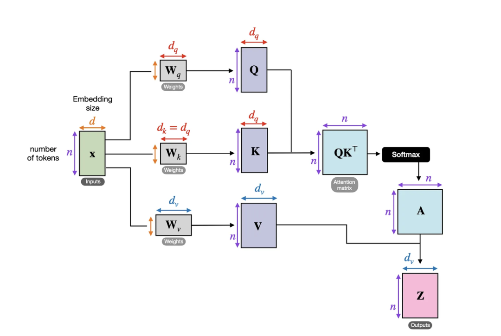

先前实现的自注意力机制的另一张图侧重于矩阵维度

以上插图对应于Transformer中使用的自注意力机制。我们尚未讨论交叉注意力（cross-attention），这是注意力机制的一种特殊变体。

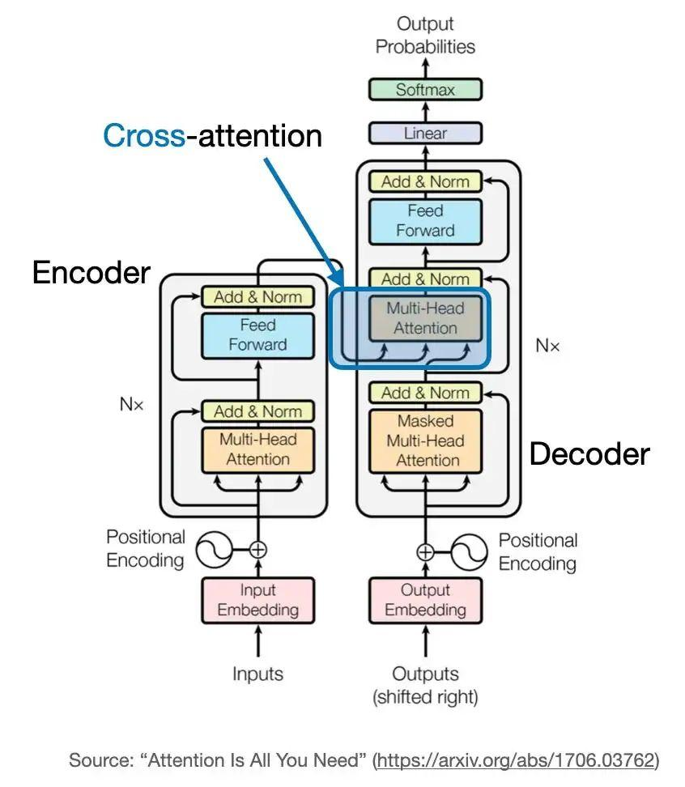

*什么是交叉注意力，它与自注意力有何区别？*

在自注意力机制中，我们处理相同的输入序列，而在交叉注意力中，我们混合或组合两个不同的输入序列。在上图的原始Transformer架构中，一个是左侧编码器模块返回的序列，另一个是右侧解码器部分正在处理的输入序列。

需要注意的是，在交叉注意力中，两个输入序列x_1和x_2可能具有不同数量的元素，但它们的嵌入维度必须匹配。

下图阐释了什么是交叉注意力。如果我们设置x_1 = x_2，就相当于自注意力。

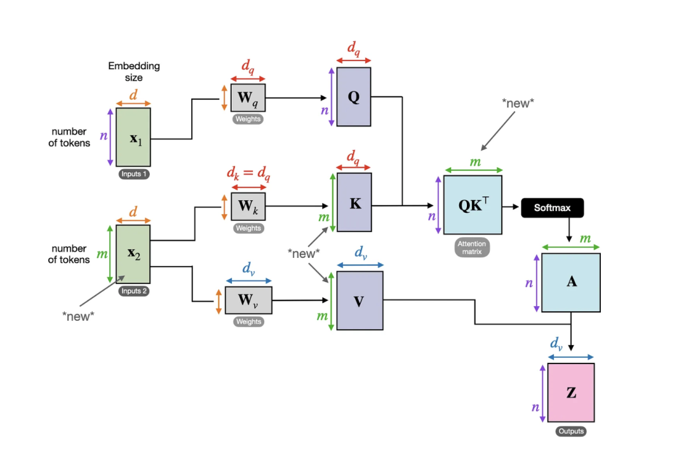

（注意：查询通常来自解码器，而键和值通常来自编码器。）

在代码中如何实现呢？我们将采用并修改先前在“自注意力机制”部分实现的SelfAttention类，只进行一些小修改：

输入：

`class CrossAttention(nn.Module):
​
    def __init__(self, d_in, d_out_kq, d_out_v):
        super().__init__()
        self.d_out_kq = d_out_kq
        self.W_query = nn.Parameter(torch.rand(d_in, d_out_kq))
        self.W_key   = nn.Parameter(torch.rand(d_in, d_out_kq))
        self.W_value = nn.Parameter(torch.rand(d_in, d_out_v))
​
    def forward(self, x_1, x_2):           # x_2 is new
        queries_1 = x_1 @ self.W_query
        
        keys_2 = x_2 @ self.W_key          # new
        values_2 = x_2 @ self.W_value      # new
        
        attn_scores = queries_1 @ keys_2.T # new 
        attn_weights = torch.softmax(
            attn_scores / self.d_out_kq**0.5, dim=-1)
        
        context_vec = attn_weights @ values_2
        return context_vec`

CrossAttention类与之前的SelfAttention类的区别如下：

- 前向传播接受两个不同的输入x_1和x_2。查询来自x_1，键和值来自x_2。这意味着注意力机制正在评估两个不同输入之间的交互。
- 注意力分数通过计算查询（来自 x_1）和键（来自 x_2）的点积得到。
- 与SelfAttention类似，每个上下文向量是值的加权和。然而，在CrossAttention中，这些值来自第二个输入（x_2），权重基于x_1和x_2之间的交互。

具体示例如下：

输入：

`torch.manual_seed(123)
​
d_in, d_out_kq, d_out_v = 3, 2, 4
​
crossattn = CrossAttention(d_in, d_out_kq, d_out_v)
​
first_input = embedded_sentence
second_input = torch.rand(8, d_in)
​
print("First input shape:", first_input.shape)
print("Second input shape:", second_input.shape)`

输出：

`First input shape: torch.Size([6, 3])
Second input shape: torch.Size([8, 3])`

注意：计算交叉注意力时，第一个和第二个输入词元（行）的数量不必相同：

输入：

`context_vectors = crossattn(first_input, second_input)
​
print(context_vectors)
print("Output shape:", context_vectors.shape)`

输出：

`tensor([[0.4231, 0.8665, 0.6503, 1.0042],
        [0.4874, 0.9718, 0.7359, 1.1353],
        [0.4054, 0.8359, 0.6258, 0.9667],
        [0.4357, 0.8886, 0.6678, 1.0311],
        [0.4429, 0.9006, 0.6775, 1.0460],
        [0.3860, 0.8021, 0.5985, 0.9250]], grad_fn=)
Output shape: torch.Size([6, 4])`

以上讨论了很多关于语言Transformer的内容。在原始Transformer架构中，当我们从输入句子转换为输出句子时，交叉注意力在语言翻译的上下文中非常有用。输入句子代表一个输入序列，翻译代表第二个输入序列（两个句子的单词数量可以不同）。

另一个使用交叉注意力的热门模型是Stable Diffusion。Stable Diffusion在U-Net模型中使用交叉注意力，在这个模型中，生成的图像和用于条件控制的文本提示之间存在交互，其原始论文（“High-Resolution Image Synthesis with Latent Diffusion Models”）详细介绍了Stable Diffusion模型，后来被Stability AI采用，实现了如今热门的Stable Diffusion模型。

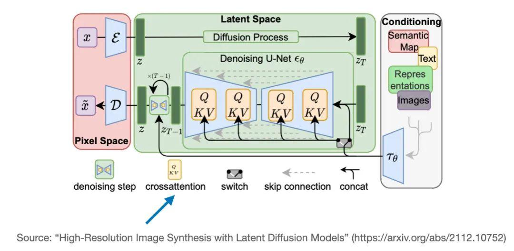

### 9 因果自注意力机制**

**

本节，我们将先前讨论过的自注意力机制调整为了因果自注意力机制，特别是用于生成文本的类似GPT（解码器风格）的LLM。这种因果自注意力机制通常也被称为“掩码自注意力（masked self-attention）”。在原始Transformer架构中，它对应“掩码多头注意力”模块。为简单起见，本节只讨论单个注意力头，但相同的概念也适用于多个注意力头。

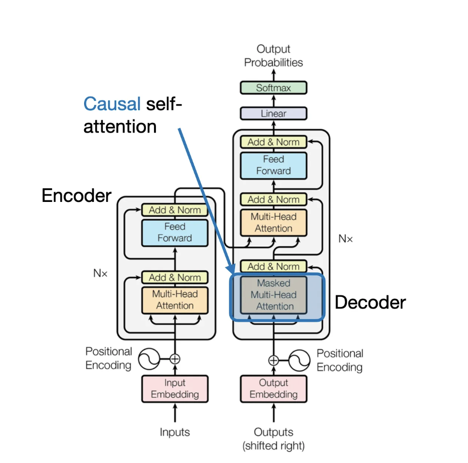

原始Transformer架构中的因果自注意力模块（来自“Attention Is All You Need”论文，https://arxiv.org/abs/1706.03762）

因果自注意力机制确保序列中某个位置的输出仅基于先前位置的已知输出，而不基于未来位置。简而言之，它确保了每个下一词的预测仅取决于前面的词。为了在类似GPT的LLM中实现这一点，对于每个处理的词元，我们会掩码处理后续的词元，这些词元在输入文本中出现在当前词元之后。

下图展示了对注意力权重应用因果掩码以隐藏输入文本中的未来词元。

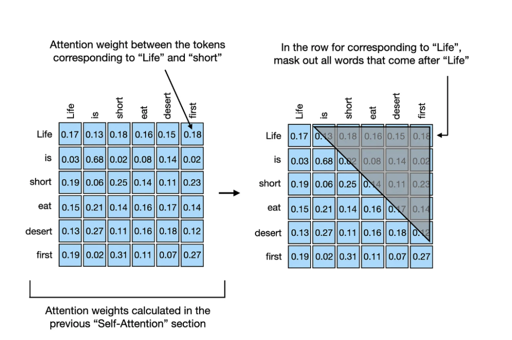

我们将使用前一节中的未加权注意力分数和注意力权重，说明和实现因果自注意力。首先，我们快速回顾一下前一节中自注意力机制部分的注意力分数的计算：

输入：

`torch.manual_seed(123)
​
d_in, d_out_kq, d_out_v = 3, 2, 4
​
W_query = nn.Parameter(torch.rand(d_in, d_out_kq))
W_key   = nn.Parameter(torch.rand(d_in, d_out_kq))
W_value = nn.Parameter(torch.rand(d_in, d_out_v))
​
x = embedded_sentence
​
keys = x @ W_key
queries = x @ W_query
values = x @ W_value
​
# attn_scores are the "omegas", 
# the unnormalized attention weights
attn_scores = queries @ keys.T 
​
print(attn_scores)
print(attn_scores.shape)`

输出：

`tensor([[ 0.0613, -0.3491,  0.1443, -0.0437, -0.1303,  0.1076],
        [-0.6004,  3.4707, -1.5023,  0.4991,  1.2903, -1.3374],
        [ 0.2432, -1.3934,  0.5869, -0.1851, -0.5191,  0.4730],
        [-0.0794,  0.4487, -0.1807,  0.0518,  0.1677, -0.1197],
        [-0.1510,  0.8626, -0.3597,  0.1112,  0.3216, -0.2787],
        [ 0.4344, -2.5037,  1.0740, -0.3509, -0.9315,  0.9265]],
       grad_fn=)
torch.Size([6, 6])`

与之前的自注意力部分类似，上面输出的是一个6×6的张量，其中包含了这些相对应的未归一化注意力权重（也称为注意力分数），用于6个输入词元。

之前，我们通过softmax函数计算了缩放点积注意力，如下所示：

输入：

`attn_weights = torch.softmax(attn_scores / d_out_kq**0.5, dim=1)
print(attn_weights)`

输出：

`tensor([[0.1772, 0.1326, 0.1879, 0.1645, 0.1547, 0.1831],
        [0.0386, 0.6870, 0.0204, 0.0840, 0.1470, 0.0229],
        [0.1965, 0.0618, 0.2506, 0.1452, 0.1146, 0.2312],
        [0.1505, 0.2187, 0.1401, 0.1651, 0.1793, 0.1463],
        [0.1347, 0.2758, 0.1162, 0.1621, 0.1881, 0.1231],
        [0.1973, 0.0247, 0.3102, 0.1132, 0.0751, 0.2794]],
       grad_fn=)`

上面的6×6输出表示注意力权重，我们之前在自注意力部分也计算过。

现在，在类似GPT的LLM中，我们训练模型从左到右读取和生成逐个词元（或单词）。如果我们有一个训练文本样本，如 "Life is short eat dessert first"，就有以下设置，箭头右侧单词的上下文向量应该只包括它自身和前面的单词：

- "Life" → "is"
- "Life is" → "short"
- "Life is short" → "eat"
- "Life is short eat" → "desert"
- "Life is short eat desert" → "first"

如下图所示，对对角线以上的注意力权重矩阵应用掩码，以掩码处理所有未来词元，是实现上述设置最简单的方法。这样，“未来（future）”单词在创建上下文向量时将不被包括在内，这些向量是根据输入的加权和创建的。

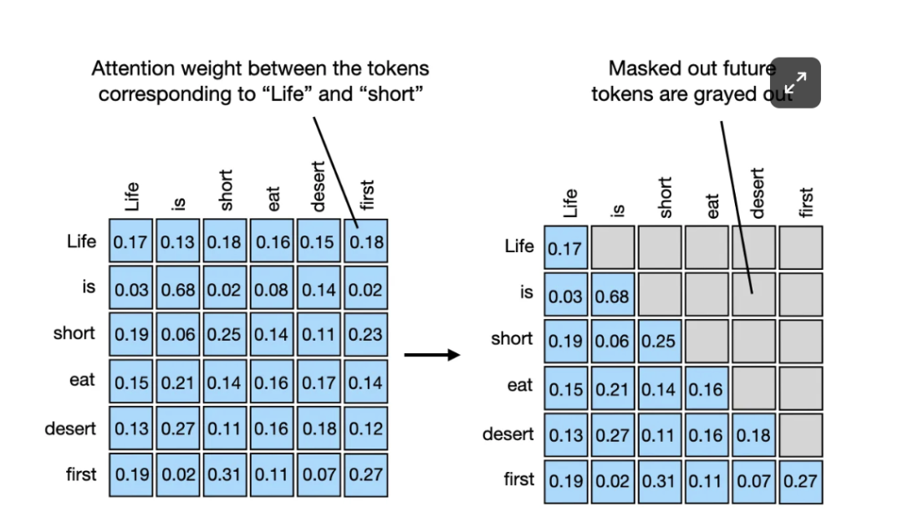

上图表示应该被掩码处理的对角线上方的注意力权重

在代码中，我们可以通过PyTorch的-tril-函数来实现这一点，首先使用它创建一个由1和0组成的掩码：

输入：

`block_size = attn_scores.shape[0]
mask_simple = torch.tril(torch.ones(block_size, block_size))
print(mask_simple)`

输出：

`tensor([[1., 0., 0., 0., 0., 0.],
        [1., 1., 0., 0., 0., 0.],
        [1., 1., 1., 0., 0., 0.],
        [1., 1., 1., 1., 0., 0.],
        [1., 1., 1., 1., 1., 0.],
        [1., 1., 1., 1., 1., 1.]])`

接下来，我们将注意力权重与这个掩码相乘，将所有对角线以上的注意力权重归零：

输入：

`masked_simple = attn_weights*mask_simple
print(masked_simple)`

输出：

`tensor([[0.1772, 0.0000, 0.0000, 0.0000, 0.0000, 0.0000],
        [0.0386, 0.6870, 0.0000, 0.0000, 0.0000, 0.0000],
        [0.1965, 0.0618, 0.2506, 0.0000, 0.0000, 0.0000],
        [0.1505, 0.2187, 0.1401, 0.1651, 0.0000, 0.0000],
        [0.1347, 0.2758, 0.1162, 0.1621, 0.1881, 0.0000],
        [0.1973, 0.0247, 0.3102, 0.1132, 0.0751, 0.2794]],
       grad_fn=)`

尽管上述方法是掩码处理未来词元的一种方式，但请注意，每行中的注意力权重的总和不再为1。为解决这一问题，我们可以归一化这些行，使它们的总和再次为1，这是注意力权重的标准惯例：

输入：

`row_sums = masked_simple.sum(dim=1, keepdim=True)
​masked_simple_norm = masked_simple / row_sums
print(masked_simple_norm)`

输出：

`tensor([[1.0000, 0.0000, 0.0000, 0.0000, 0.0000, 0.0000],
        [0.0532, 0.9468, 0.0000, 0.0000, 0.0000, 0.0000],
        [0.3862, 0.1214, 0.4924, 0.0000, 0.0000, 0.0000],
        [0.2232, 0.3242, 0.2078, 0.2449, 0.0000, 0.0000],
        [0.1536, 0.3145, 0.1325, 0.1849, 0.2145, 0.0000],
        [0.1973, 0.0247, 0.3102, 0.1132, 0.0751, 0.2794]],
       grad_fn=)`

可以看到，现在每行注意力权重相加为1。

在神经网络中，像Transformer模型一样对注意力权重进行归一化，有两个主要优点：首先，总和为1的归一化注意力权重类似于概率分布，有助于按比例解释模型对输入的不同部分的注意力；其次，将注意力权重总和限制为1，有助于控制权重和梯度的规模，改善训练的动态性。

无需重新归一化的更高效掩码处理**

**

在上述编写的因果自注意力过程中，我们首先计算注意力得分，然后计算注意力权重，掩码处理对角线以上的注意力权重，最后重新归一化注意力权重。步骤总结如下：

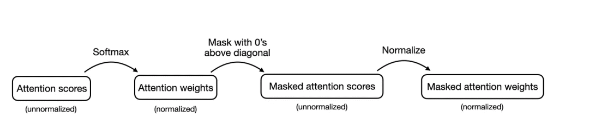

先前实现的因果自注意力过程或者，有一种更有效的方法可以达到相同结果。在这种方法中，我们得到注意力得分，并在将值输入softmax函数以计算注意力权重前，将对角线以上的值替换为负无穷。这一过程总结如下：

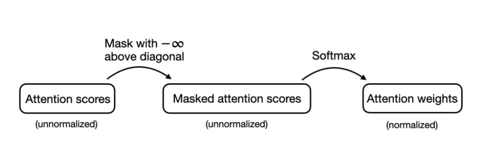

实现因果自注意力是另一种更高效的替代方法

我们可以在PyTorch中按以下方式编写这一过程，首先对上方的注意力得分进行掩码处理：

输入：

`mask = torch.triu(torch.ones(block_size, block_size), diagonal=1)
masked = attn_scores.masked_fill(mask.bool(), -torch.inf)
print(masked)`

上述代码首先创建一个掩码，在对角线以下为0，在对角线以上为1。这里，torch.triu（上三角）保留矩阵主对角线及其以上的元素，将其下方的元素置零，因此保留了上三角部分。相反，torch.tril（下三角）保留了主对角线及其下方的元素。

然后，使用masked_fill通过正掩码值（1）将对角线以上的所有元素替换为-torch.inf（负无穷），结果如下所示。

输出：

`tensor([[ 0.0613,    -inf,    -inf,    -inf,    -inf,    -inf],
        [-0.6004,  3.4707,    -inf,    -inf,    -inf,    -inf],
        [ 0.2432, -1.3934,  0.5869,    -inf,    -inf,    -inf],
        [-0.0794,  0.4487, -0.1807,  0.0518,    -inf,    -inf],
        [-0.1510,  0.8626, -0.3597,  0.1112,  0.3216,    -inf],
        [ 0.4344, -2.5037,  1.0740, -0.3509, -0.9315,  0.9265]],
       grad_fn=)`

接下来，我们只需像往常一样应用softmax函数，即可获得归一化和掩码注意力权重。

输入：

`attn_weights = torch.softmax(masked / d_out_kq**0.5, dim=1)
print(attn_weights)`

输出：

`tensor([[1.0000, 0.0000, 0.0000, 0.0000, 0.0000, 0.0000],
        [0.0532, 0.9468, 0.0000, 0.0000, 0.0000, 0.0000],
        [0.3862, 0.1214, 0.4924, 0.0000, 0.0000, 0.0000],
        [0.2232, 0.3242, 0.2078, 0.2449, 0.0000, 0.0000],
        [0.1536, 0.3145, 0.1325, 0.1849, 0.2145, 0.0000],
        [0.1973, 0.0247, 0.3102, 0.1132, 0.0751, 0.2794]],
       grad_fn=)`

为什么这会生效呢？在最后一步应用softmax函数时，它将输入值转换为概率分布。当输入中存在-inf时，softmax会有效地将其视为零概率。因为 e^(-inf) 趋近于0，所以这些位置对输出概率没有任何影响。

### 10 结论**

**

本文通过逐步编码探讨了自注意力机制的内部工作原理。基于此，我们深入探究了多头注意力机制，这是语言大模型Transformer的基本组件。

接下来，我们还编码了交叉注意力，这是自注意力机制的一种变体，特别适用于两个不同的序列。最后，我们编码了因果自注意力，这是解码器风格的语言大模型（如GPT和LLaMA）中生成连贯和上下文适当序列的关键概念。

通过从头开始编写这些复杂的机制，希望能帮助读者更好地理解Transformer和语言模型中使用的自注意力机制及其内部工作原理。

（请注意，本文提供的代码仅用于说明。如果你计划为训练语言大模型实现自注意力，建议考虑Flash Attention等优化实现，以减少内存占用和计算负载。）

【语言大模型推理最高加速11倍】**SiliconLLM是由硅基流动开发的高效、易用、可扩展的LLM推理加速引擎，旨在为用户提供开箱即用的推理加速能力，显著降低大模型部署成本，加速生成式AI产品落地。（技术合作、交流请添加微信：SiliconFlow01）

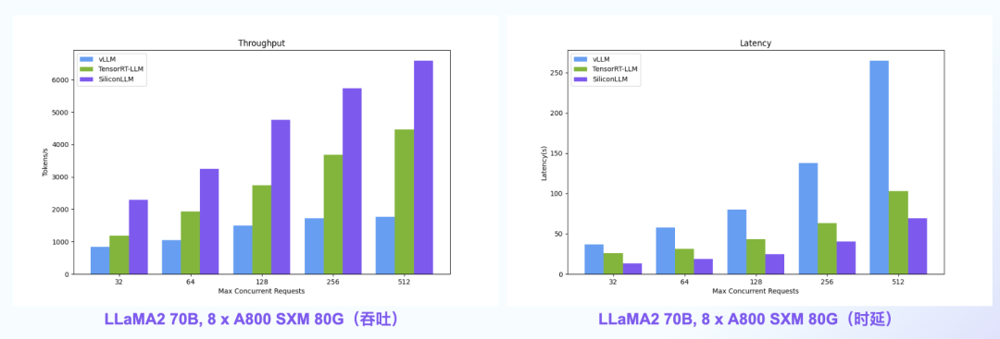

SiliconLLM的吞吐最高提升近4倍，时延最高降低近4倍**

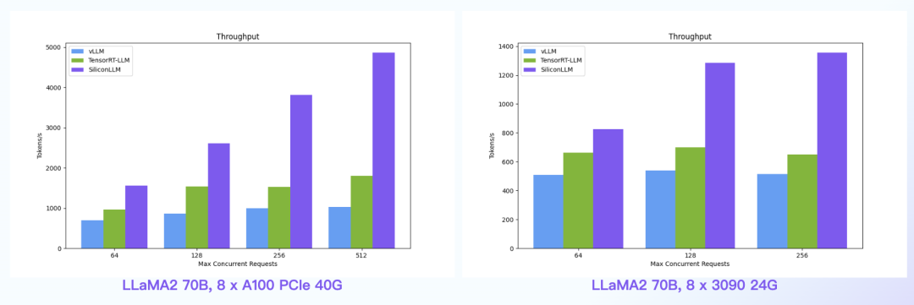

数据中心+PCIe：SiliconLLM的吞吐最高提升近5倍；消费卡场景：SiliconLLM的吞吐最高提升近3倍

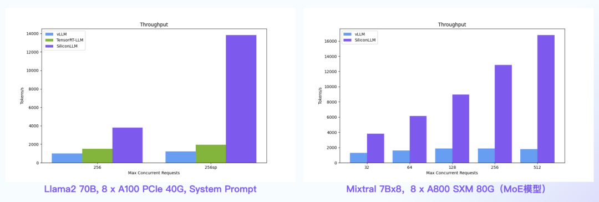

System Prompt场景：SiliconLLM的吞吐最高提升11倍；MoE模型：推理 SiliconLLM的吞吐最高提升近10倍

其他人都在看

- 800+页免费“大模型”电子书
- 语言大模型的推理技巧
- 语言大模型的推理演算
- 语言大模型推理加速指南
- 语言大模型推理性能工程：最佳实践
- 迈向100倍加速：全栈Transformer推理优化
- Mistral AI:LLM推理的吞吐、时延及成本空间
试用OneDiff: **

