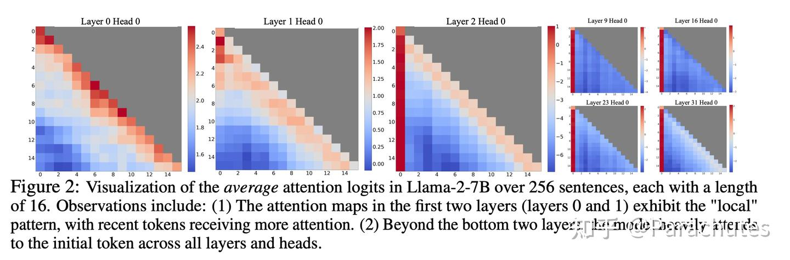
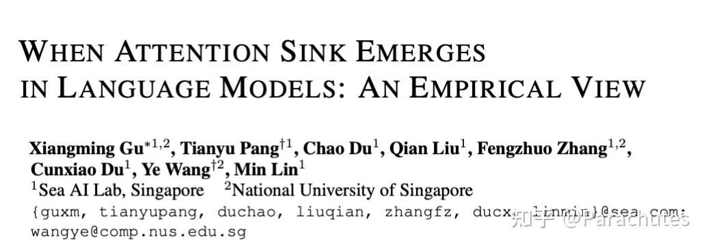
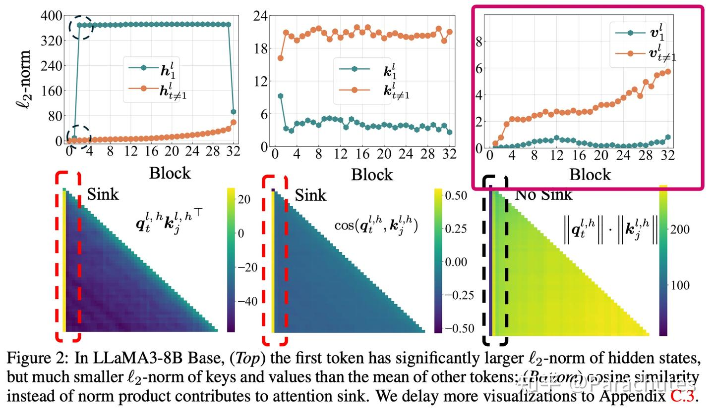
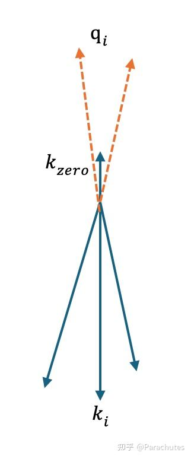
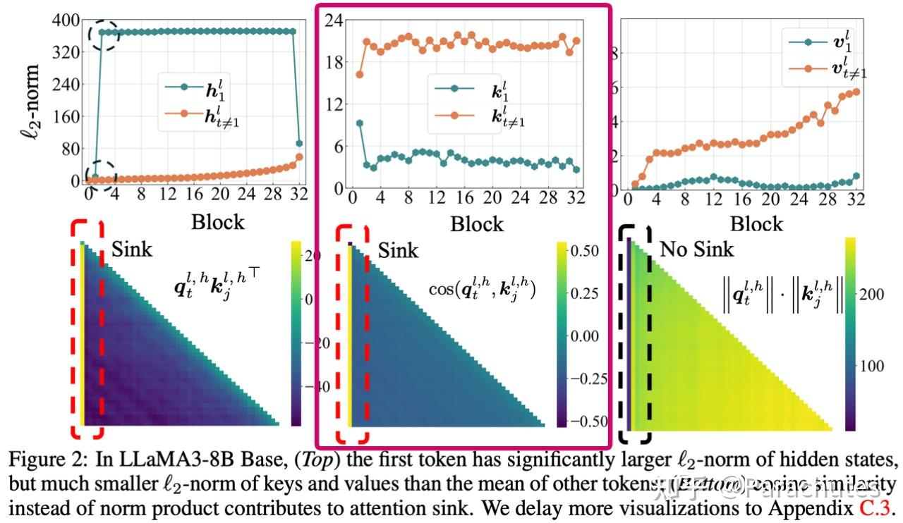
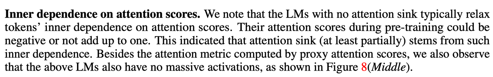
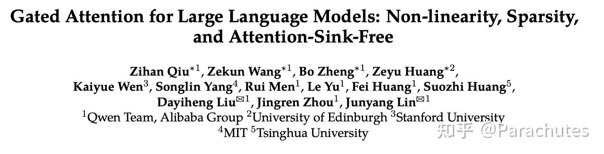
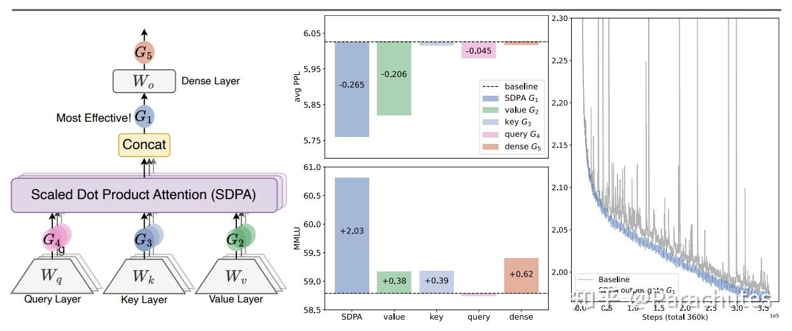
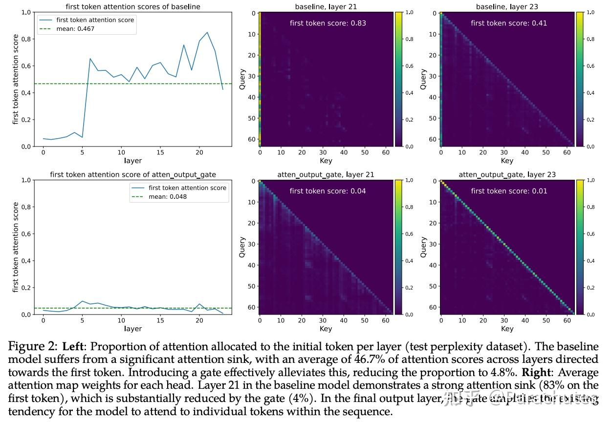

### TLDR

**Attention Sink来源于Transformer需要Context Aware的Identity Layer，即需要Attention Block根据Context不输出任何变化的能力。**
### 背景：

最早是Streaming LLM发现了这一个现象，越深的层越会关注第一个token，成为Attention Sink，但是没有解释原因。

https://arxiv.org/abs/2309.17453**But Why？
在我的认知里面，似乎至今没有论文给出一个令人信服的解释，关于为什么模型会有如此的表现，去年有一个[工作](https://link.zhihu.com/?target=https%3A//arxiv.org/pdf/2410.10781)专门做了empirical study来研究一些规律：

https://arxiv.org/pdf/2410.10781
### Understanding Attention Sink

我们尝试来提出一个假设，来解释所有的Attention Sink相关的实验：

> Attention Sink来源于Transformer需要Context Aware的Identity Layer，即需要Attention Block根据Context不输出任何变化的能力。**

#### 证据一：首个token的value几乎为0**

https://arxiv.org/pdf/2410.10781empirical study的图中第一行第三列的图可以发现，第一个token的value的norm非常小，意味着即使被attend到，对最终结果的贡献也不会太大，那模型为什么要attend一个0呢？

- 对于前面两、三个token而言，模型学到的就是bigram和trigram，这些都是比较简单的任务，有理由认为不需要很深的层就可以完成。
- 假设这个时候浅层已经输出了答案，深层要做的事情就是保持恒等变换。
但是Attention Block如何做恒等变化呢？**

- 考虑残差，也就是Attention如何输出0，这样实现整个block完成恒等变换。
- 由于每个token每一层是否要恒等的情况不一样（data dependent），所以不能靠 W_o =0 这样的静态参数来实现。
- 那么必须靠Softmax Attention来实现，也就是key空间里面必须存在一个特殊的key： k_\text{zero} ，这个key的value是0，且需要模型在想要输出0的时候可以精确的attend到。
- 这也意味着模型必须给这个 k_\text{zero}分配一个单独的子空间，这个k_\text{zero}和所有的其他key都是正交或者负相关的，这样可以保证 q,\,  k_\text{zero} 夹角很小的时候 q^\top  k_\text{zero} 的分数最高，实现attend到sink token并输出0。
- 同时这个key的模长也必须比较小，这样在不需要输出恒等的时候，对正常的Attention结果尽量产生小的影响。如下图所示。**

sink token和其余token的key会有什么区别

https://arxiv.org/pdf/2410.10781empirical study的图中实验图的第二行第二列也可以看出，sink发生的时候，其他key的相似度几乎都是0或者负的，同时第一行第二列可以看出第一个token的key的模长显著小，这佐证了我们的猜想。

#### 证据二：模型存在early decoding，且越深的层sink越明显

我们如果用lm head去probe中间层feat预测的token，我们可以发现模型确实存在浅层就完成编码的情况。即从中间某层开始，输出的Top-1和最后一层输出的Top-1相同。

而如果我们probe不同层的Attention map，Attention Sink也确实在深层更加明显，这进一步佐证了我们的猜想。

（部分实验图片可能涉密，无法公开，这里仅分享结论）

#### 证据三：非归一化或者非正定kernel会消除sink

假设手动设置一个和所有key的相似度都为1，value为0的虚拟token（等价于相当于给Softmax的分母加上了一个e），这个时候理论上会缓解sink。 [@小明同学](//www.zhihu.com/people/989c111b1fcd2a02482616583338b6e9)

 进行了实验，验证了这个猜想。GPT-oss也使用了一样的技术，只是变成了可学习的。**

https://arxiv.org/pdf/2410.10781同时empirical study的论文（上图）发现了非归一化的Attention没有sink问题，也佐证了我们的猜想。 如果模型score不一定非负，那么也可以组合出0的Attention，也不会有sink。

#### 证据四：Attention Sink浪费了dim，Gate可以解决

Attention Sink导致必须给k_\text{zero}分配一个子空间，我们合理怀疑这个会产生dim的浪费（给分母加e也无法解决）。一个想法是使用gating操作，使得模型可以data-dep的输出0.
正好Qwen最近做了这个实验：

https://arxiv.org/pdf/2505.06708先不谈效果提升幅度，他们发现Attention在输出阶段（G1）加入gate最有效，且消除了Attention Sink。这和我们的猜想一致（在G2、G3、G4都不能使得Attention输出0，但是G1可以）。

### 总结

Transformer模型中的Attention Sink现象很可能源于模型对context-aware的identity layer的内在需求。多项经验性证据支持这一假设：

- Sink token的value接近于0，且key有专用子空间；
- Transformer存在early decoding，且更深的层恰好sink更严重；
- 通过非归一化或非正的注意力核会移除Attention Sink；
- 门控机制能够消除Attention Sink，且可能因为解决子空间浪费从而提升性能。
这一假设为Attention Sink提供了一个连贯的解释，并得到了来自多项实验的经验性证据支持。欢迎讨论。
