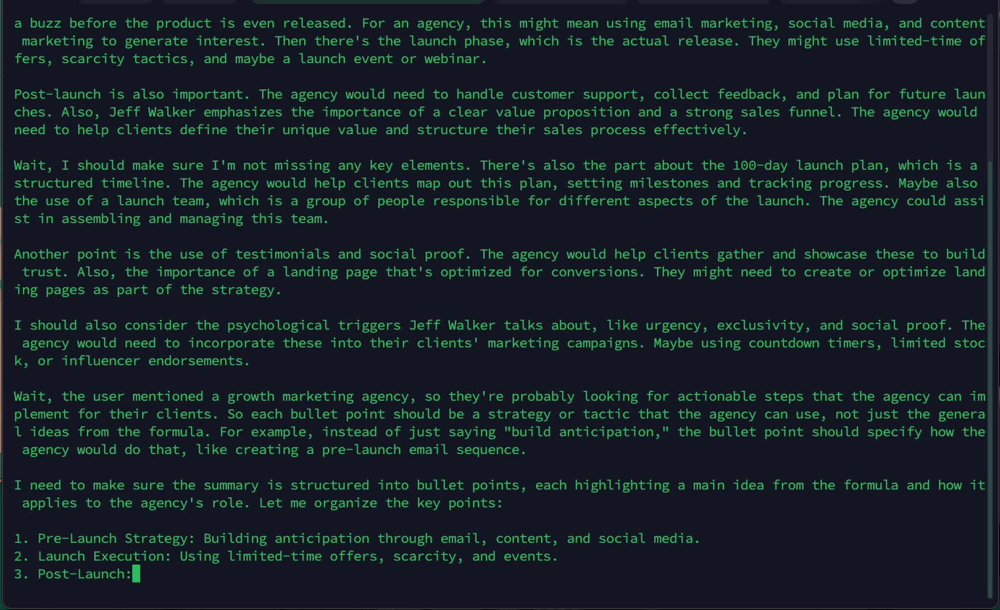
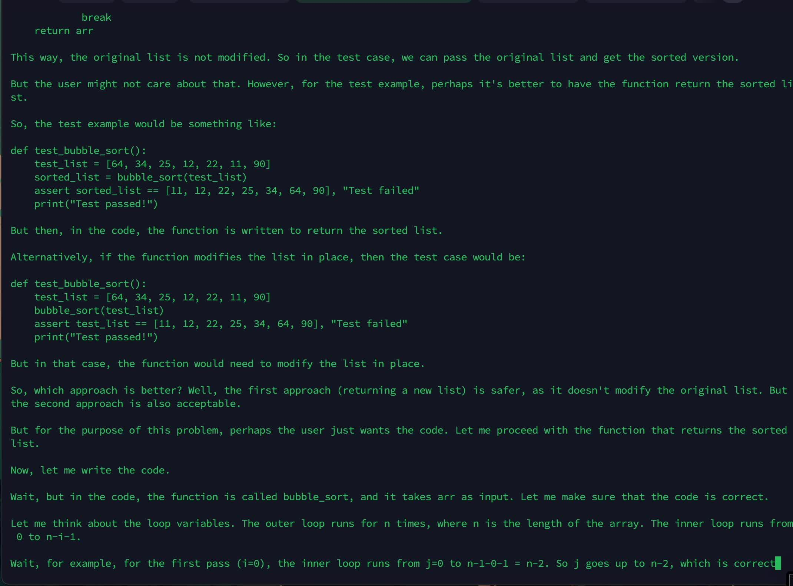
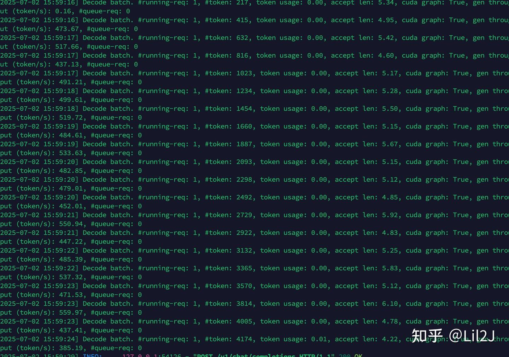
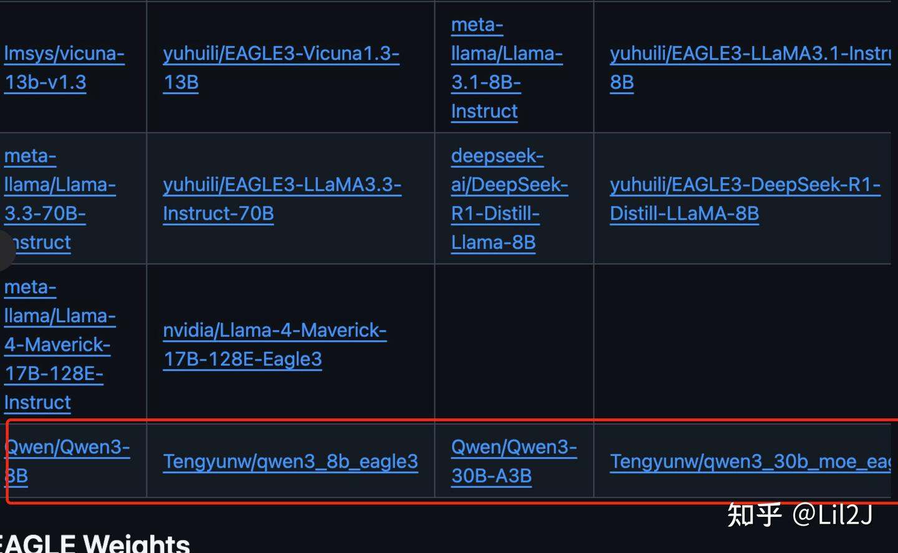
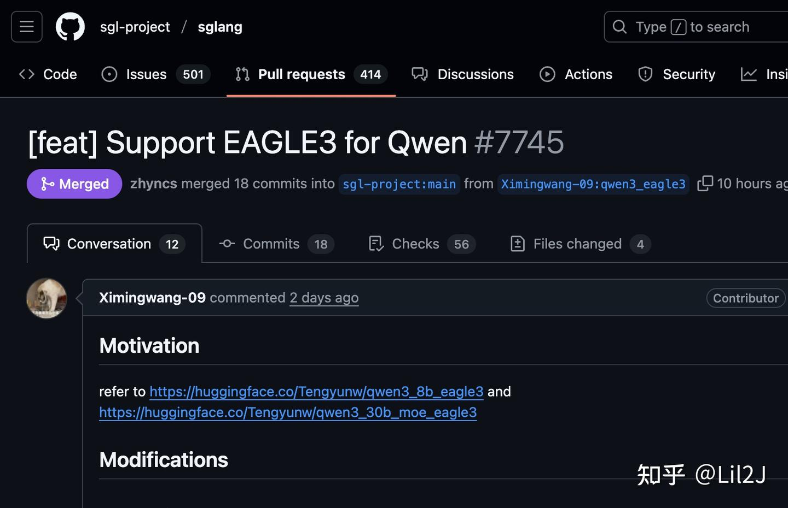
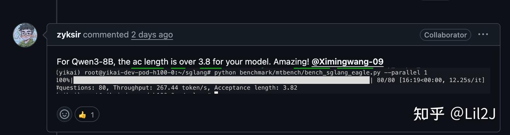
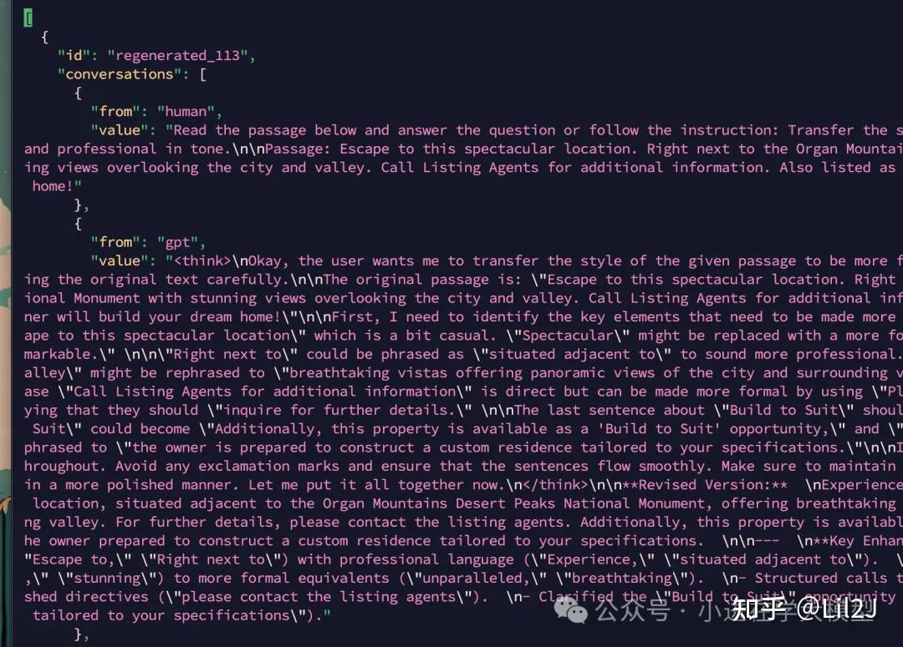
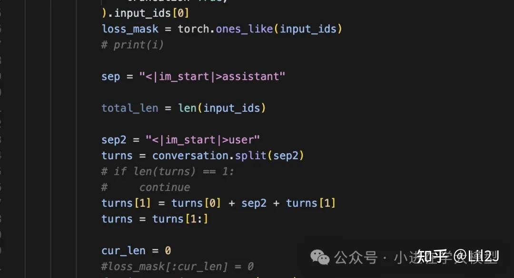
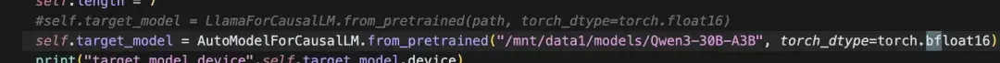
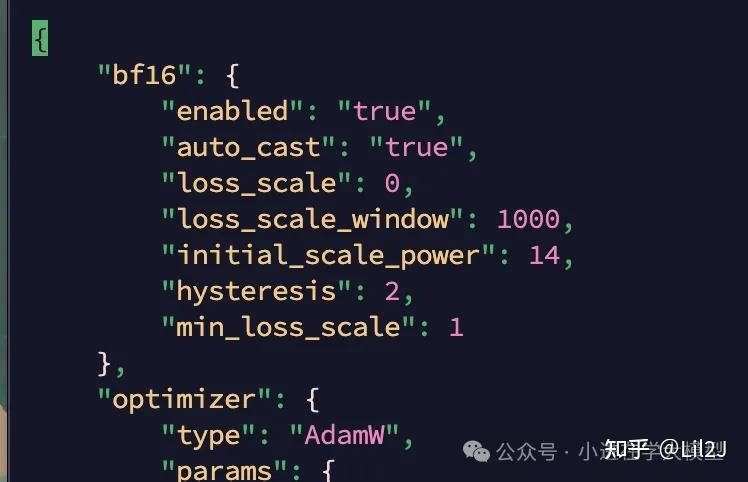

### 背景

最近eagle3终于把他的训练源代码开源，我也第一时间开始进行复现及开源，分别训练qwen3-8b和qwen3-30b-moe，但是复现的路上踩了不少的坑，所以在这里特意记录一下，旨在记录这些问题的解决方案，为后续研究者提供参考。

复现的效果为：

在单卡h200 上 qwen-8b的tps，使用了eagle3后从187 token/s 提升到 365 token/s

在单卡h200 上 qwen-30b-moe的tps，使用了eagle3后从147 token/s 提升到 231 token/s

注意：我是在全英文语料上进行训练的，所以这个提升效果是在英文语料上的

00:10

在使用sglang框架上qwen3在eagle3的推理效果

### qwen3_eagle3在代码生成的加速效果特别卓越

00:15

代码加速生成能力演示

sglang使用egale的后台接受长度平均是5到6，tps可以到接近500

### 已经被官方合并进去Readme中

### 模型代码已经被sglang官方合并

### qwen3的eagle3下载地址：

我目前已经把训练好的eagle3权重已经开源出来了

qwen3-8b-eagle3:

[https://huggingface.co/Tengyunw/qwen3_8b_eagle3](https://link.zhihu.com/?target=https%3A//huggingface.co/Tengyunw/qwen3_8b_eagle3)

qwen3-30b-moe-eagle3:

[https://huggingface.co/Tengyunw/qwen3_30b_moe_eagle3](https://link.zhihu.com/?target=https%3A//huggingface.co/Tengyunw/qwen3_30b_moe_eagle3)

在上面的huggfacing链接里上有详细介绍怎么在sglang上eagle3运行qwen3以及如何测试

### 环境安装

首先肯定是先把项目拉下来

git clone [https://github.com/SafeAILab/EAGLE.git](https://link.zhihu.com/?target=https%3A//github.com/SafeAILab/EAGLE.git)

然后cd到目录进行依赖包安装

pip install -r requirements.txt

但是值得留意的是 deepspeed的版本一定要是0.16.9,超过这个版本号以上的跑训练代码会有各种奇奇怪怪的报错

#### 训练数据生成

因为eagle是训练一个decoder层来拟合大模型来进行推理生成的，所以说训练数据要贴近模型本身训练出来的decoder层肯定效果越好。

因此，我们要先对网上已有的数据重新再生成一遍，即拿开源数据中的question来生成qwen3自己对这些question的回答

我选择的训练数据是官方论文中使用的ultrachat_200k

训练的数据格式上面的图是我生成出来的数据，总计生成了大概60万条对话数据

`# -*- coding: utf-8 -*-
import json
import requests
import time
import random
import argparse
import os
import threading
import queue
import concurrent.futures
from typing import List, Dict, Any, Optional, Tuple
from tqdm import tqdm
import pyarrow.parquet as pq
import os
import glob
class ShareGPTReGenerator:
    """用于重新生成ShareGPT数据集回答的类"""

    def __init__(self, vllm_url: str, output_dir: str, 
                 temperature: float = 0.7, max_tokens: int = 2048,
                 num_threads: int = 4, request_timeout: int = 60):
        """
        初始化ShareGPT数据重新生成器

        Args:
            vllm_url: vLLM服务的API地址
            output_dir: 输出数据集的目录
            temperature: 生成文本的温度参数
            max_tokens: 每次生成的最大token数
            num_threads: 并行处理的线程数
            request_timeout: API请求超时时间(秒)
        """
        self.vllm_url = vllm_url
        self.output_dir = output_dir
        self.temperature = temperature
        self.max_tokens = max_tokens
        self.num_threads = num_threads
        self.request_timeout = request_timeout

        # 用于线程安全的操作
        self.result_lock = threading.Lock()
        self.progress_lock = threading.Lock()
        self.api_rate_limit_lock = threading.Lock()
        self.last_api_call = 0
        self.min_api_interval = 0.1  # 最小API调用间隔(秒)

        # 确保输出目录存在
        os.makedirs(output_dir, exist_ok=True)
    def load_ultra_dataset(self, directory_path:str) -> List[Dict]:
        # 获取指定目录下所有parquet文件路径
        parquet_files = glob.glob(os.path.join(directory_path, "*.parquet"))

        result_list = []

        # 读取每个parquet文件并添加到列表中
        for file_path in parquet_files:
            table = pq.read_table(file_path)
            # 将Table转换为字典列表
            records = table.to_pydict()

            # 转换为记录列表
            num_rows = len(next(iter(records.values())))
            row_list = [
                {key: records[key][i] for key in records} 
                for i in range(num_rows)
            ]

            result_list.extend(row_list)

        return result_list

    def load_sharegpt_dataset(self, dataset_path: str) -> List[Dict]:
        """
        加载ShareGPT数据集

        Args:
            dataset_path: ShareGPT数据集文件路径，格式为jsonl或json

        Returns:
            加载的数据集
        """
        data = []
        if dataset_path.endswith('.jsonl'):
            with open(dataset_path, 'r', encoding='utf-8') as f:
                for line in f:
                    if line.strip():
                        data.append(json.loads(line))
        elif dataset_path.endswith('.json'):
            with open(dataset_path, 'r', encoding='utf-8') as f:
                data = json.load(f)
        else:
            raise ValueError(f"不支持的文件格式: {dataset_path}")

        return data

    def call_vllm_api(self, prompt: str) -> str:
        """
        调用vLLM API生成回答

        Args:
            prompt: 输入提示

        Returns:
            生成的回答
        """
        try:
            # 实现简单的速率限制
            with self.api_rate_limit_lock:
                current_time = time.time()
                time_since_last_call = current_time - self.last_api_call
                if time_since_last_call  0:
            #     return result["choices"][0]["text"]
            # else:
            #     print(f"未知的API响应格式: {result}")
            #     return ""

        except Exception as e:
            print(f"调用vLLM API时出错: {e}")
            return ""
    def process_conversation(self, conversation: Dict, idx: int) -> Dict:
        """
        处理单个对话，重新生成助手回答

        Args:
            conversation: 原始对话数据
            idx: 对话索引

        Returns:
            更新后的对话数据
        """
        conversations_list = conversation.get("conversations", [])

        if not conversations_list:
            # 如果使用的是另一种格式
            if "items" in conversation:
                conversations_list = conversation["items"]
            else:
                conversations_list = conversation.get("messages", [])

        # 重新生成的对话
        new_conversations = []
        context = ""

        for i, msg in enumerate(conversations_list):
            role = msg.get("from") or msg.get("role")
            content = msg.get("value") or msg.get("content")

            # 如果是人类消息，保持不变并添加到上下文
            if role in ["human", "user"]:
                new_conversations.append({
                    "from": "human",
                    "value": content
                })
                context += f"Human: {content}\n\n"

            # 如果是助手消息，使用vLLM重新生成
            elif role in ["gpt", "assistant"]:
                # 准备提示，包含之前的上下文
                prompt = f"{context}Assistant:"

                # 调用vLLM生成新回答
                new_response = self.call_vllm_api(prompt)

                new_conversations.append({
                    "from": "gpt",
                    "value": new_response
                })

                # 更新上下文，添加新的回答
                context += f"Assistant: {new_response}\n\n"

        # 保存重新生成的对话
        new_data = {
            "id": conversation.get("id", f"regenerated_{idx}"),
            "conversations": new_conversations
        }

        return new_data

    def worker_task(self, task_queue: queue.Queue, results: List[Dict], 
                   progress_bar: tqdm, processed_count: List[int]):
        """
        工作线程任务函数

        Args:
            task_queue: 任务队列
            results: 结果列表
            progress_bar: 进度条
            processed_count: 已处理的计数
        """
        while True:
            try:
                task = task_queue.get(block=False)
                if task is None:
                    break

                idx, conversation = task
                result = self.process_conversation(conversation, idx)

                # 添加结果到结果列表（线程安全）
                with self.result_lock:
                    results.append(result)

                # 更新进度（线程安全）
                with self.progress_lock:
                    processed_count[0] += 1
                    progress_bar.update(1)

                task_queue.task_done()

            except queue.Empty:
                break
            except Exception as e:
                print(f"处理对话时出错: {e}")
                task_queue.task_done()

    def regenerate_responses_parallel(self, conversations: List[Dict], start_index: int = 0, 
                                    end_index: Optional[int] = None, batch_save: int = 10) -> List[Dict]:
        """
        使用多线程并行重新生成对话中的助手回答

        Args:
            conversations: 原始对话数据列表
            start_index: 起始处理索引
            end_index: 结束处理索引（不含）
            batch_save: 每处理多少条对话保存一次

        Returns:
            更新后的对话数据列表
        """
        if end_index is None:
            end_index = len(conversations)

        total_conversations = end_index - start_index
        print(f"开始并行处理数据，总共 {total_conversations} 条对话，使用 {self.num_threads} 个线程")

        # 初始化结果列表和进度条
        results = []
        progress_bar = tqdm(total=total_conversations)
        processed_count = [0]  # 使用列表以便在函数间传递引用

        # 创建任务队列
        task_queue = queue.Queue()
        for idx in range(start_index, end_index):
            task_queue.put((idx, conversations[idx]))

        # 启动工作线程
        threads = []
        for _ in range(min(self.num_threads, total_conversations)):
            thread = threading.Thread(
                target=self.worker_task,
                args=(task_queue, results, progress_bar, processed_count)
            )
            thread.start()
            threads.append(thread)

        # 定期检查是否需要保存批次
        last_save_count = 0
        while processed_count[0] = last_save_count + batch_save:
                self.save_batch(
                    current_results[last_save_count:],
                    start_index + last_save_count,
                    start_index + len(current_results) - 1
                )
                last_save_count = len(current_results)

        # 等待所有线程完成
        for thread in threads:
            thread.join()

        progress_bar.close()
        print(f"并行处理完成，共处理 {len(results)} 条对话")

        # 确保结果按索引排序
        results.sort(key=lambda x: int(x["id"].split("_")[-1]) if "_" in x["id"] else 0)

        # 保存剩余结果
        if last_save_count  List[Dict]:
            """
            使用线程池重新生成对话中的助手回答

            Args:
                conversations: 原始对话数据列表
                start_index: 起始处理索引
                end_index: 结束处理索引（不含）
                batch_save: 每处理多少条对话保存一次

            Returns:
                更新后的对话数据列表
            """
            if end_index is None:
                end_index = len(conversations)

            total_conversations = end_index - start_index
            print(f"开始使用线程池处理数据，总共 {total_conversations} 条对话，使用 {self.num_threads} 个线程")

            # 准备任务
            tasks = [(idx, conversations[idx]) for idx in range(start_index, end_index)]
            results = []

            # 使用线程池执行任务
            with concurrent.futures.ThreadPoolExecutor(max_workers=self.num_threads) as executor:
                # 提交所有任务
                future_to_idx = {executor.submit(self.process_conversation, conv, idx): (idx, i) 
                                for i, (idx, conv) in enumerate(tasks)}

                # 处理完成的任务结果
                for future in tqdm(concurrent.futures.as_completed(future_to_idx), total=len(tasks)):
                    idx, task_idx = future_to_idx[future]
                    try:
                        result = future.result()
                        results.append(result)

                        # 每完成batch_save个任务保存一次
                        if len(results) % batch_save == 0:
                            # 获取当前批次的索引范围
                            completed_indices = sorted([future_to_idx[f][0] for f in future_to_idx if f.done()])
                            if completed_indices:
                                batch_start = min(completed_indices)
                                batch_end = max(completed_indices)
                                # 保存当前批次
                                current_batch = [r for r in results if int(r["id"].split("_")[-1]) = batch_start]
                                if current_batch:
                                    self.save_batch(current_batch, batch_start, batch_end)

                    except Exception as e:
                        print(f"处理任务 {idx} 时出错: {e}")

            # 确保结果按索引排序
            results.sort(key=lambda x: int(x["id"].split("_")[-1]) if "_" in x["id"] else 0)

            # 保存剩余结果
            if results:
                remaining_start = start_index + (len(results) // batch_save) * batch_save
                remaining_end = start_index + len(results) - 1
                remaining_batch = results[remaining_start - start_index:]
                if remaining_batch:
                    self.save_batch(remaining_batch, remaining_start, remaining_end)

            return results    
    def regenerate_responses(self, conversations: List[Dict], start_index: int = 0, 
                             end_index: Optional[int] = None, batch_save: int = 10) -> List[Dict]:
        """
        单线程重新生成对话中的助手回答（保留此方法作为备选）

        Args:
            conversations: 原始对话数据列表
            start_index: 起始处理索引
            end_index: 结束处理索引（不含）
            batch_save: 每处理多少条对话保存一次

        Returns:
            更新后的对话数据列表
        """
        if end_index is None:
            end_index = len(conversations)

        print(f"开始处理数据，总共 {end_index - start_index} 条对话")
        regenerated_data = []

        for idx in tqdm(range(start_index, end_index)):
            conversation = conversations[idx]
            new_data = self.process_conversation(conversation, idx)
            regenerated_data.append(new_data)

            # 每处理一定量的数据保存一次
            if (idx - start_index + 1) % batch_save == 0:
                self.save_batch(regenerated_data, start_index, idx)

        # 保存剩余数据
        if regenerated_data and (end_index - start_index) % batch_save != 0:
            self.save_batch(regenerated_data, start_index, end_index - 1)

        return regenerated_data
    def merge_batches(self):
        """合并所有的批次文件到一个完整的数据集文件"""
        all_data = []
        batch_files = [f for f in os.listdir(self.output_dir) if f.startswith("regenerated_") and f.endswith(".json")]

        for batch_file in sorted(batch_files, key=lambda x: int(x.split('_')[1])):
            with open(os.path.join(self.output_dir, batch_file), 'r', encoding='utf-8') as f:
                batch_data = json.load(f)
                all_data.extend(batch_data)

        # 保存完整数据集
        complete_file = os.path.join(self.output_dir, "regenerated_complete.json")
        with open(complete_file, 'w', encoding='utf-8') as f:
            json.dump(all_data, f, ensure_ascii=False, indent=2)

        # 保存jsonl格式
        complete_jsonl = os.path.join(self.output_dir, "regenerated_complete.jsonl")
        with open(complete_jsonl, 'w', encoding='utf-8') as f:
            for item in all_data:
                f.write(json.dumps(item, ensure_ascii=False) + '\n')

        print(f"合并完成，总共 {len(all_data)} 条对话")
def main():
    parser = argparse.ArgumentParser(description='使用vLLM重新生成ShareGPT数据集的回答')
    parser.add_argument('--dataset', type=str, required=True, help='ShareGPT数据集文件路径')
    parser.add_argument('--vllm_url', type=str, required=True, help='vLLM服务的API地址')
    parser.add_argument('--output_dir', type=str, default='./regenerated_data', help='输出目录')
    parser.add_argument('--temperature', type=float, default=0.7, help='生成文本的温度参数')
    parser.add_argument('--max_tokens', type=int, default=2048, help='每次生成的最大token数')
    parser.add_argument('--start_index', type=int, default=0, help='起始处理索引')
    parser.add_argument('--end_index', type=int, default=None, help='结束处理索引（不含）')
    parser.add_argument('--batch_save', type=int, default=10, help='每处理多少条对话保存一次')
    parser.add_argument('--threads', type=int, default=4, help='并行处理的线程数')
    parser.add_argument('--timeout', type=int, default=60, help='API请求超时时间(秒)')
    parser.add_argument('--mode', type=str, default='threadpool', 
                        choices=['single', 'parallel', 'threadpool'],
                        help='处理模式：单线程(single)、自定义多线程(parallel)、线程池(threadpool)')

    args = parser.parse_args()

    regenerator = ShareGPTReGenerator(
        vllm_url=args.vllm_url,
        output_dir=args.output_dir,
        temperature=args.temperature,
        max_tokens=args.max_tokens,
        num_threads=args.threads,
        request_timeout=args.timeout
    )
    if 'ultra' in args.dataset:
        dataset = regenerator.load_ultra_dataset(args.dataset)
        print(f"加载Ultra数据集: {args.dataset}")
    else:
    # 加载数据集
        print(f"加载ShareGPT数据集: {args.dataset}")
        dataset = regenerator.load_sharegpt_dataset(args.dataset)
    print(f"数据集加载完成，共 {len(dataset)} 条对话")

    # 根据所选模式处理数据
    if args.mode == 'single':
        # 单线程处理
        regenerator.regenerate_responses(
            conversations=dataset,
            start_index=args.start_index,
            end_index=args.end_index,  
            batch_save=args.batch_save
        )
    elif args.mode == 'parallel':
        # 自定义多线程处理
        regenerator.regenerate_responses_parallel(
            conversations=dataset,
            start_index=args.start_index,
            end_index=args.end_index,  
            batch_save=args.batch_save
        )
    else:  # threadpool
        # 线程池处理（默认）
        regenerator.regenerate_responses_with_threadpool(
            conversations=dataset,
            start_index=args.start_index,
            end_index=args.end_index,  
            batch_save=args.batch_save
        )

    # 合并批次文件
    regenerator.merge_batches()
if __name__ == "__main__":
    main()`

上面数据生成的代码，推理框架使用的sglang部署

运行命令

`python3 gen_sharegpt.py  --dataset /mnt/data1/ultrachat_200k/sft/   --vllm_url http://0.0.0.0:30000/v1/chat/completions --output_dir ./data --threads 256 --batch_save 20000`

### 训练数据已开源

链接如下：[https://huggingface.co/datasets/Tengyunw/qwen3_8b_eagle3](https://link.zhihu.com/?target=https%3A//huggingface.co/datasets/Tengyunw/qwen3_8b_eagle3)

使用了qwen3-8b对ultrachat_200k数据集的对话重新生成，总结约60w个对话，1b的token量

### 训练代码修改

主要修改的地方就两个代码：

EAGLE/eagle/traineagle3/main.py

EAGLE/eagle/traineagle3/cnets.py

改的地方如下：

1. 两个py文件的preprocess_function要改成适配qwen的tokenizer的

修改如下

2.cnets.py的加载target模型方式修改

修改ds_config.json 把fp16改为bfl16

### 开启训练

然后在EAGLE/eagle/traineagle3目录下

运行

`deepspeed main.py --deepspeed_config ds_config.json`

即可开启训练啦

我使用的机器是8*h200，训练qwen3-8b大概一轮为5个小时，训练qwen3-32b-moe为9小时一轮
