**撰文 | 郭冉、姚迟、郑泽康、柳俊丞**

2020 年末，OneFlow 发布了《**[OneFlow性能优化分享：如何实现一个高效的 Softmax CUDA kernel？](https://zhuanlan.zhihu.com/p/341059988)**》，其中介绍了 OneFlow 深度优化后的 Softmax，尤其对很多框架没有考虑的 half 类型做了充分优化，使得性能大幅超过了 cuDNN 的实现。

今天，奉上另一个重要算子 LayerNorm 的性能优化实践技术分享。

此外，OneFlow 还带上了可以独立使用的 OneFlow Softmax（具体见文末说明），欢迎大家试用、提建议。

### OneFlow 性能优化后的测试结果

OneFlow 优化后的 LayerNorm 分别与 NVIDIA Apex、PyTorch 做了性能对比，测试结果显示，OneFlow LayerNorm 有明显的性能优势。

#### 与 NVIDIA Apex 的对比结果

NVIDIA Apex 中实现了高效的 fused LayerNorm Kernel 来扩展 PyTorch 算子，我们对 OneFlow 优化后的 LayerNorm Kernel 和 NVIDIA Apex 进行了对比测试，测试结果如下：

横轴为 `num_cols` 大小，纵轴为 Kernel 执行需要的时间(越低越好)：

**

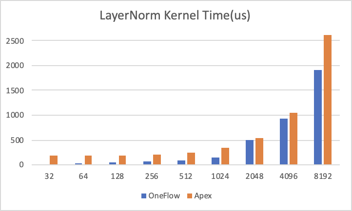

我们将时间换算成访存带宽，结果如下，纵轴为 Kernel 达到的有效带宽(越高越好)：

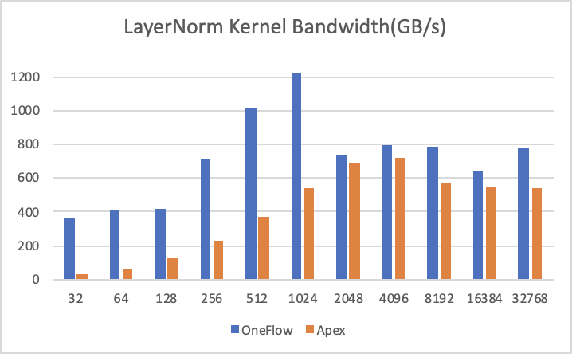

其中测试环境为 NVIDIA A100-PCIE-40GB GPU，数据类型为 `half`， `Shape =(49152， num_cols)`，我们将最后一维动态变化，测试了从32到32768不同大小的 LayerNorm Kernel，可以看到在所有情况下，OneFlow 的 Kernel 执行时间和有效访存带宽都优于 Apex 的实现。

#### 与 PyTorch 的对比结果

PyTorch 的 LayerNorm 暂时不支持 half 类型，因此我们用 float类型做了一组对照，需要注意的是PyTorch中LayerNorm是分两个CUDA Kernel(RowwiseMomentsCUDAKernel和LayerNormForwardCUDAKernel)做的，所以看起来性能比较差。

横轴为 `num_cols` 大小，纵轴为 Kernel 执行需要的时间(越低越好)：

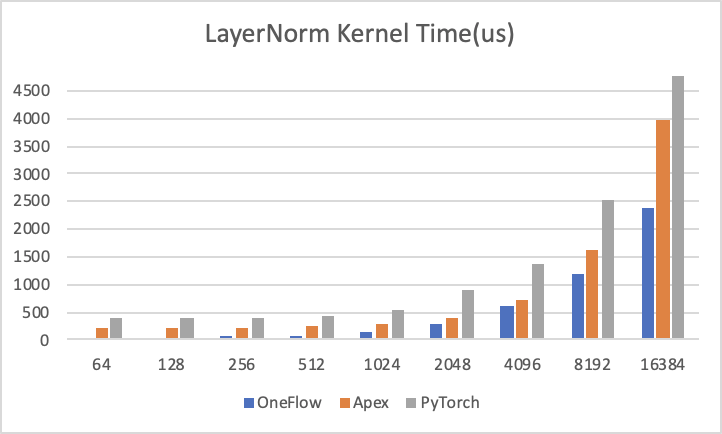

可以看到，在各组对比实验中，OneFlow 的性能也是最优的。

### LayerNorm 性能优化

LayerNorm 是语言模型中常用的操作之一，其 CUDA Kernel 实现的高效性会影响很多网络最终的训练速度，Softmax 的优化方法也适用于 LayerNorm，LayerNorm 的数据也可以表示为 `(num_rows, num_cols)`，计算过程中对每一行的元素做 Reduce 操作求均值方差。因此我们使用了和 Softmax 同样的优化方法来优化 LayerNorm 操作，本文以 LayerNorm 前向计算为例进行介绍。

#### LayerNorm 计算方法

以 PyTorch 为例，LayerNorm 的接口为:

`torch.nn.LayerNorm(normalized_shape, eps=1e-05, elementwise_affine=True, device=None, dtype=None)`

其中 `input` 形状为：`[∗, normalized_shape[0], normalized_shape[1], …,normalized_shape[−1]]`

第一个参数 `normalized_shape` 只能是输入 `x_shape` 的后几维，例如 `x_shape` 为 `(N, C, H, W)`, `normalized_shape` 可以是 `(W)`， `(H, W)` ，`(C, H, W)` 或 `(N, C, H, W)`。输入 `x` 在 `normalized_shape` 这几维上求均值和方差。

第三个参数 `elementwise_affine` 代表是否要对 normalize 的结果做变换，即 normalize 的结果乘 `gamma`，加 `beta`。若 `elementwise_affine=True`，就多了两个模型参数 `gamma` 和`beta`，形状为 `normalized_shape`。

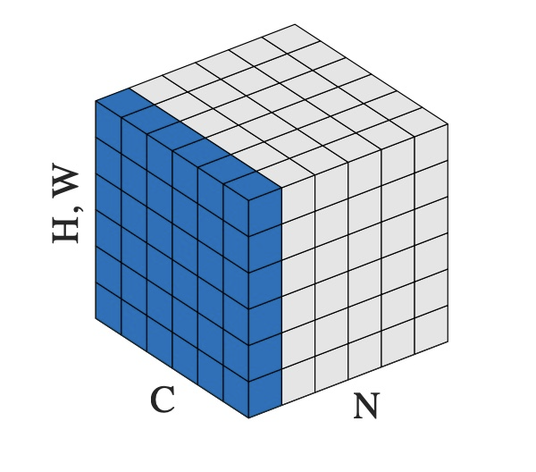

例如对于输入 `x` 形状为 `(N, C, H, W)`， `normalized_shape` 为 `(H, W)` 的情况，可以理解为输入 `x` 为 `(N*C, H*W)`，在 `N*C` 个行上，每行有 `H*W` 个元素，对每行的元素求均值和方差，得到 `N*C` 个 `mean` 和 `inv_variance`，再对输入按如下 LayerNorm 的计算公式计算得到 `y`。若 `elementwise_affine=True` ，则有 `H*W` 个 `gamma` 和 `beta`，对每行 `H*W` 个的元素做变换。

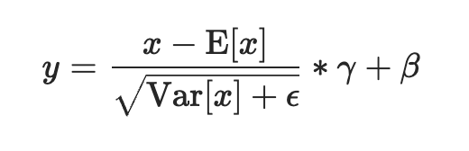

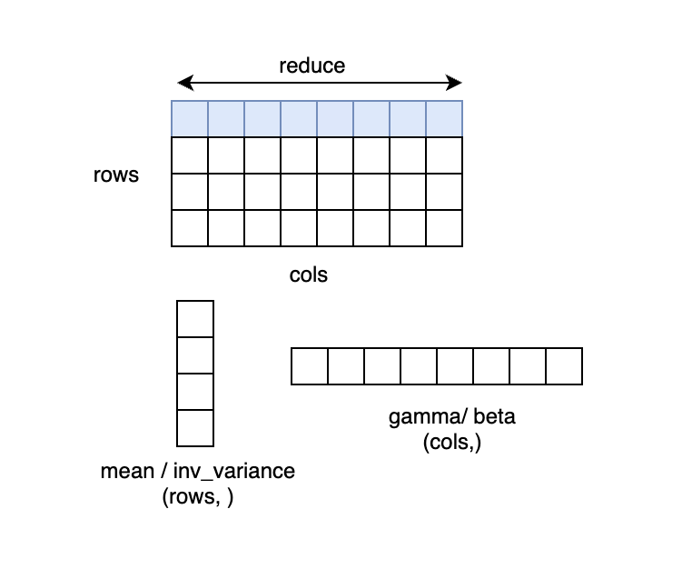

#### LayerNorm 中求方差的方法

常见的求方差的方法有 two pass 方法、naive 方法、和 Welford 算法，本文摘录一些关键的公式和结论，详细的介绍和推导可参考：Wiki: Algorithms for calculating variance ，和 [GiantPandaCV: 用Welford算法实现LN的方差更新](https://link.zhihu.com/?target=https%3A//mp.weixin.qq.com/s/t0x782mDkMo-ZBVEbK8gPg)

- two-pass方法
使用的公式是：

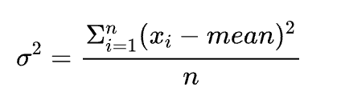

two-pass 是指这种方法需要遍历两遍数据，第一遍累加 `x` 得到均值，第二遍用上面公式计算得到方差。这种方法在 `n` 比较小时仍然是数值稳定的。

- naive方法
使用的公式是：

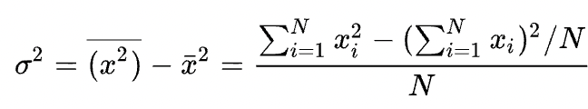

这种方法是一种 single pass 方法，在计算方差时只需要遍历一遍数据累加 `x` 的平方及累加 `x`，最后按上述公式计算得到方差。这种方法只需要遍历一遍数据，相比 two-pass 的算法，更容易达到好的性能，但是上面的 Wiki 参考链接中介绍由于 SumSquare 和 (Sum×Sum)/n 可能非常接近，可能会导致计算结果损失精度较大，因此这种方法不建议在实践中使用。

- Welford 算法
使用的公式是：

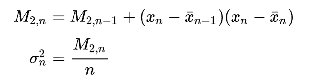

Welford 算法也是一种 single pass 方法，且数值稳定性很好，因此现在很多框架都采用这种方法。本文的代码中采用的也是 Welford 方法。

#### OneFlow 深度优化 LayerNorm CUDA Kernel 的技巧

和 Softmax 一样，LayerNorm 也采用分段函数优化，对于不同的 `num_cols` 范围，采用不同的实现，以在各种情况下都能达到较高的有效带宽。

在每种实现中都采用了一个公共的优化：向量化访存，NVIDIA 性能优化的博客 Increase Performance with Vectorized Memory Access 中提到可以通过向量化内存操作来提高 CUDA Kernel 性能，很多 CUDA Kernel 都是带宽受限的，使用向量化内存操作可以减少总的指令数，减少延迟，提高带宽利用率。

理论上来说，在计算 LayerNorm 的过程中，输入 `x` 需要被读两次，第一次用于计算均值和方差。第二次用于得到均值和方差后的计算过程。而对 Global Memory 的访问操作是昂贵的，如果能将输入 `x` 先存起来，不重复读，就可以提升性能。在 GPU 中将输入 `x` 存起来可以使用寄存器或 Shared memory，但是寄存器资源和 Shared memory 资源都是有限的，如果 `num_cols` 过大，就会超出资源的使用限制，因此我们针对不同 `num_cols` 采用不同的实现，下面分别进行介绍：

#### *1.`num_cols Warp 为单位处理一行或两行，将输入 `x` 存储到寄存器中。

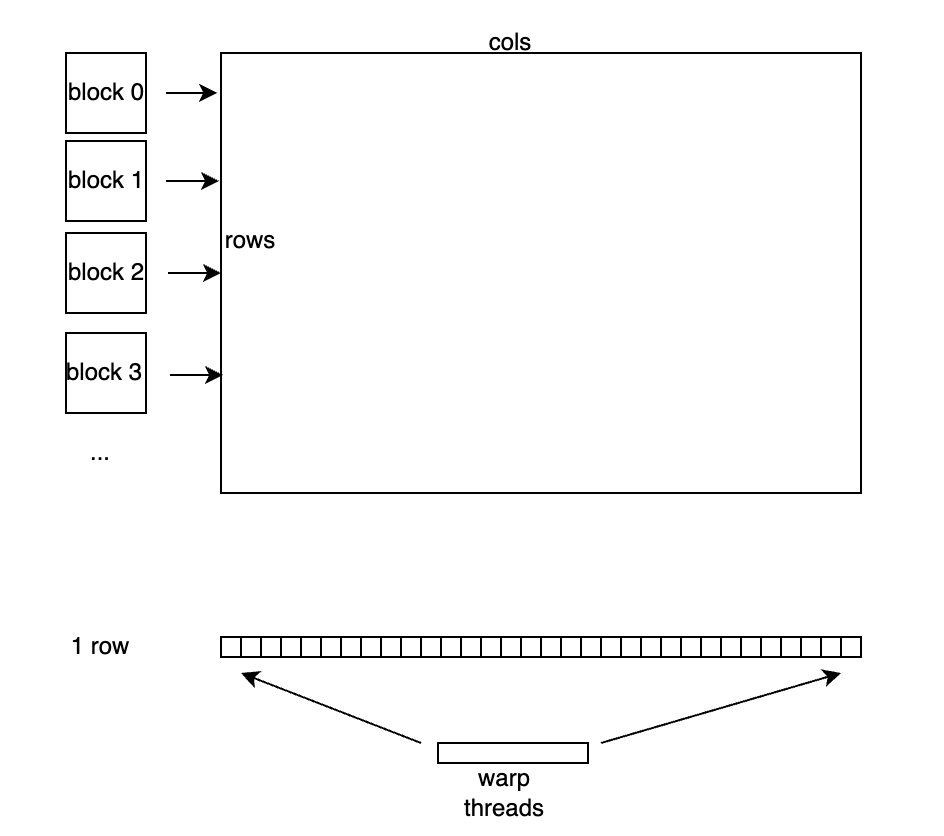

硬件上并行执行的32个线程称之为一个 Warp，同一个 Warp 的32个 thread 执行同一条指令， Warp是 GPU 调度执行的基本单元。线程块和元素的对应关系如上图所示，每个 Warp 的 threads 处理一行元素，每个 block 有 `block_size / warp_size` 个 Warp，每个 block 处理 `block_size / warp_size` 行元素。

具体的处理流程是，如下图所示，每行有 `num_cols` 个元素，每个 warp 处理一行，因此每个线程需要处理 `num_cols / warp_size` 个元素，每个线程读取自己需要处理的元素存储到寄存器中，并用 Welford 算法计算好均值和方差后，Warp 中的所有线程执行一次 WelfordWarpAllReduce，这样每个线程上就得到了正确的均值和方差参与后续计算。

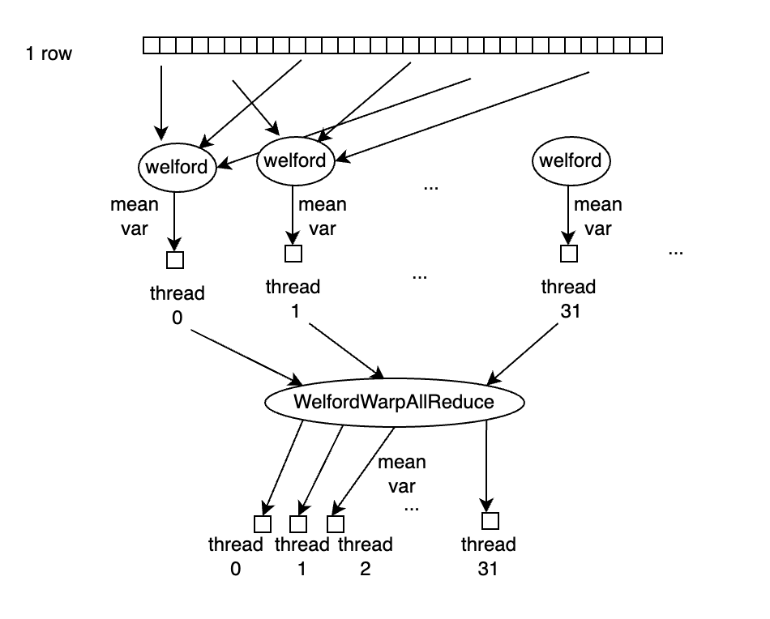

WelfordWarpAllReduce 由 WelfordWarpReduce 和 Broadcast 操作完成，WelfordWarpReduce 借助 Warp 级别同步原语 `__shfl_down_sync` 实现，Broadcast操作借助 `__shfl_sync` 实现，代码如下：

`template
__inline__ __device__ void WelfordWarpReduce(T thread_mean, T thread_m2, T thread_count, T* mean,
                                             T* m2, T* count) {
  *mean = thread_mean;
  *m2 = thread_m2;
  *count = thread_count;
  for (int mask = thread_group_width / 2; mask > 0; mask /= 2) {
    T b_mean = __shfl_down_sync(0xffffffff, *mean, mask);
    T b_m2 = __shfl_down_sync(0xffffffff, *m2, mask);
    T b_count = __shfl_down_sync(0xffffffff, *count, mask);
    WelfordCombine(b_mean, b_m2, b_count, mean, m2, count);
  }
}

template
__inline__ __device__ void WelfordWarpAllReduce(T thread_mean, T thread_m2, T thread_count, T* mean,
                                                T* m2, T* count) {
  WelfordWarpReduce(thread_mean, thread_m2, thread_count, mean, m2, count);
  *mean = __shfl_sync(0xffffffff, *mean, 0, thread_group_width);
  *m2 = __shfl_sync(0xffffffff, *m2, 0, thread_group_width);
  *count = __shfl_sync(0xffffffff, *count, 0, thread_group_width);
}`

在这里有个模板参数 `thread_group_width`，当 `num_cols > pack_size * WarpSize` 时，`thread_group_width` 为 `WarpSize`。当 `num_cols` 太小，即 `num_cols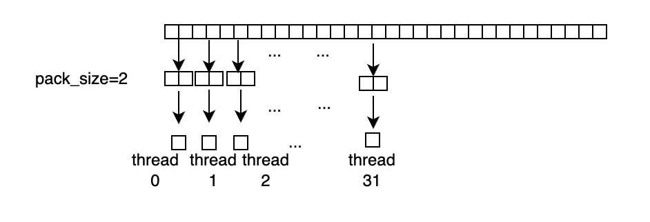

将 `pack_size` 个元素 pack 成更大的数据类型读入，但是 `x` 还要参与计算。因此我们定义一个`union` 结构的 Pack 类型，storage 用于从 Global Memory中读写，做计算时用 `elem[i]` 取每个元素参与计算，Pack 类型定义如下:

`template
union Pack {
  PackType storage;
  T elem[N];
};`

LayerNormWarpImpl Kernel 代码如下：

`template
__global__ void LayerNormWarpImpl(LOAD load, STORE store, const int64_t rows, const int64_t cols,
                                  const double epsilon, ComputeType* mean,
                                  ComputeType* inv_variance) {
  static_assert(cols_per_thread % pack_size == 0, "");
  static_assert(thread_group_width (row_buf + pack_offset, row + row_id, col);
#pragma unroll
          for (int i = 0; i (
          thread_mean[row_id], thread_m2[row_id], thread_count[row_id], warp_mean + row_id,
          warp_m2 + row_id, warp_count + row_id);
      ComputeType row_mean = warp_mean[row_id];
      ComputeType row_variance =
          max(Div(warp_m2[row_id], warp_count[row_id]), static_cast(0.0));
      ComputeType row_inv_var = Rsqrt(row_variance + static_cast(epsilon));
      if (lane_id == 0) {
        mean[global_row_id] = row_mean;
        inv_variance[global_row_id] = row_inv_var;
      }
#pragma unroll
      for (int i = 0; i (row_buf + i * pack_size, global_row_id, col);
        }
      }
    }
  }
}`

LayerNormWarpImpl 的实现的模板参数的意义分别如下：

- `LOAD`、`STORE` 分别代表输入输出，使用`load.template load(ptr, row_id, col_id);` 和 `store.template store(ptr, row_id, col_id);` 进行读取和写入。使用 `LOAD` 和 `STORE` 有两个好处：a) 可以在 CUDA Kernel中只关心计算类型 `ComputeType`，而不用关心具体的数据类型 `T`。b) 只需要加几行代码就可以快速支持 LayerNorm 和其他 Kernel Fuse，减少带宽需求，提升整体性能。
- `ComputeType` 代表计算类型。`pack_size` 代表向量化访存操作的 pack 元素的个数，我们将几个元素 pack 起来读写，提升带宽利用率。
- `cols_per_thread` 代表每个线程处理的元素个数。
- `thread_group_width` 代表处理元素的线程组的宽度，当 `cols > pack_size * warp_size` 时，`thread_group_width` 就是warp_size，即32。当 `cols  1024` 的情况*

针对 `num_cols > 1024` ，以 block 为单位处理一行，利用 Shared Memory 存储输入数据

对于 `num_cols > 1024` 的情况，每个 block 处理一行元素，将输入 `x` 存储到 Shared Memory中。

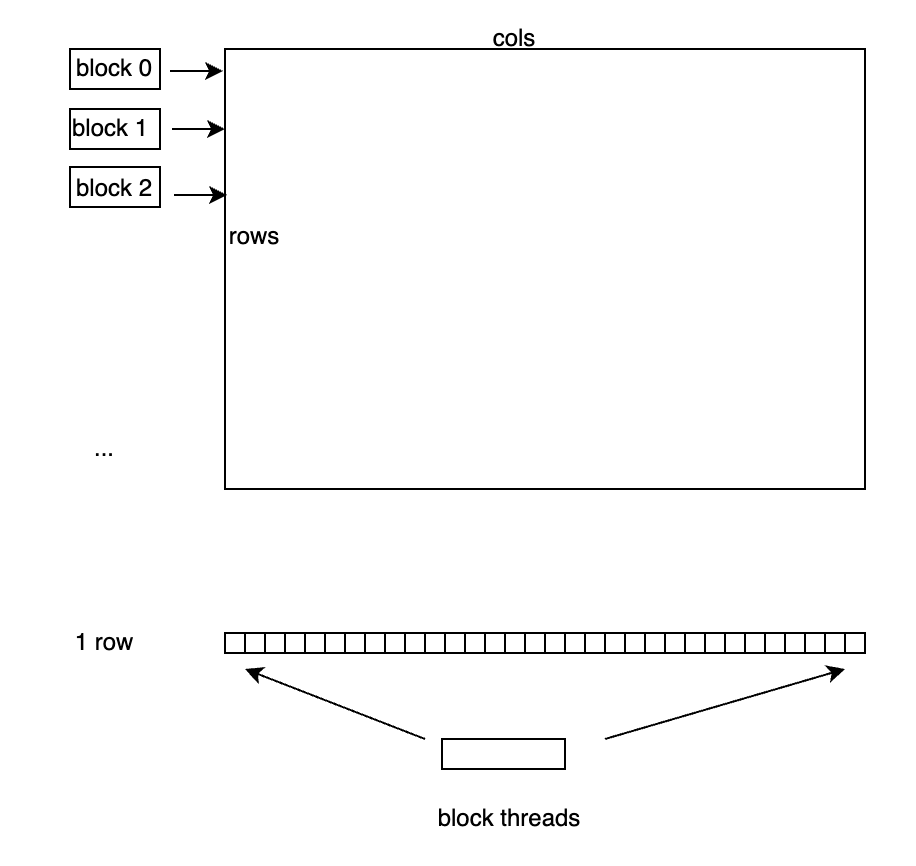

具体的处理流程是，如下图所示，每行有 `num_cols` 个元素，每个 block 处理一行，因此每个线程需要处理 `num_cols / block_size` 个元素，每个线程读取自己需要处理的元素存储到 Shared Memory 中，并用 Welford 算法计算好均值和方差后，block 中的所有线程执行一次WelfordBlockAllReduce，这样每个线程上就得到了正确的均值和方差参与后续计算。

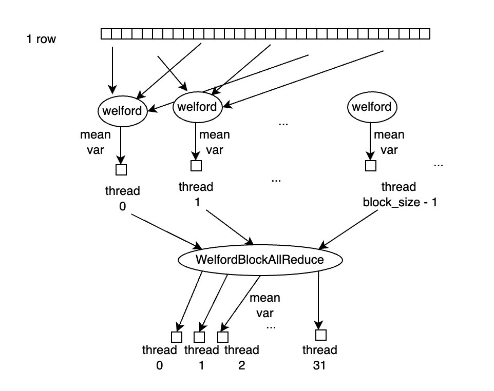

WelfordBlockAllReduce 是借助 WelfordWarpReduce 操作完成的，具体逻辑是，一个 Block 中最多有32个 Warp，对所有的 Warp 先执行一次 WelfordWarpReduce，执行完后，每个 warp 中的第一个线程，即 `lane_id=0` 的线程上得到当前 WelfordWarpReduce 的结果，再将每个 Warp 的第一个线程的结果拷贝到一块 Shared Memory buffer 中，再用第一个 Warp 的32个线程执行一次 WelfordWarpReduce，此时第一个 Warp 中的 `lane_id=0` 的线程上得到的就是 block 中所有线程reduce 的结果。再借助 Shared Memory，将该结果 broadcast 到 block 中的所有线程上，即完成了 WelfordBlockAllReduce 的操作。

值得注意的是 GPU 上 Shared Memory 资源同样有限，当 `num_cols` 超过一定范围时需要占用的Shared Memory 可能就超出了最大限制，Kernel 就无法启动起来。

因此，我们采用 `cudaOccupancyMaxActiveBlocksPerMultiprocessor` 函数判断当前硬件资源条件下 Kernel 是否能成功启动，仅在返回值大于0时采用这种方案。

此外，由于 Block 内线程要做同步，当 SM 中正在调度执行的一个 Block 到达同步点时，SM 内可执行 Warp 逐渐减少，若同时执行的 Block 只有一个，则 SM 中可同时执行的 Warp 会在此时逐渐降成0，会导致计算资源空闲，造成浪费，若此时同时有其他 Block 在执行，则在一个 Block 到达同步点时仍然有其他 Block 可以执行。

当 `block_size` 越小时，SM 可同时调度的 Block 越多，因此在这种情况下 `block_size` 越小越好。但是当在调大 `block_size`，SM 能同时调度的 Block 数不变的情况下，`block_size` 应该是越大越好，越大就有越好的并行度。因此代码中在选择 `block_size` 时，对不同 `block_size` 都计算了 `cudaOccupancyMaxActiveBlocksPerMultiprocessor`，若结果相同，使用较大的 `block_size`。

LayerNormBlockSMemImpl Kernel的代码如下：

`template
__global__ void LayerNormBlockSMemImpl(LOAD load, STORE store, const int64_t rows,
                                       const int64_t cols, const double epsilon, ComputeType* mean,
                                       ComputeType* inv_variance) {
  extern __shared__ __align__(sizeof(double)) unsigned char shared_buf[];
  auto* buf = reinterpret_cast(shared_buf);
  const int tid = threadIdx.x;
  assert(cols % pack_size == 0);
  const int num_packs = cols / pack_size;
  for (int64_t row = blockIdx.x; row (pack, row, pack_id * pack_size);
#pragma unroll
      for (int i = 0; i (thread_mean, thread_m2, thread_count, &row_mean, &row_m2,
                                       &row_count);
    ComputeType row_variance = max(Div(row_m2, row_count), static_cast(0.0));
    ComputeType row_inv_var = Rsqrt(row_variance + static_cast(epsilon));
    if (threadIdx.x == 0) {
      mean[row] = row_mean;
      inv_variance[row] = row_inv_var;
    }
    for (int pack_id = tid; pack_id (pack, row, pack_id * pack_size);
    }
  }
}`

#### *3.num_cols 较大时，不使用 Shared Memory 的情况*

当 `num_cols` 较大，当前硬件资源条件下使用Shared Memory的方法无法成功Launch Kernel时，使用这种实现：一个 Block 处理一行的元素，不使用 Shared Memory，重复读输入 `x`。

这种方法和前面第二种情况线程和元素对应关系一致，唯一的区别在于，第二种方法将输入 `x` 存储到Shared Memory 中，本方法不存储 `x`，在每次计算时需要再从 Global Memory 中读入 `x`。这种方法虽然需要多读一份 `x`，但是在实际执行时，部分输入可以被 Cache 缓存起来，不会实际增加很多时间。值得注意的是，在这种实现中，`block_size` 越大，SM 中能同时并行执行的 block 数就越少，对 Cache 的需求就越少，就有更多机会命中 Cache，因此我们使用较大的 `block_size`。

LayerNormBlockUncachedImpl 代码如下：

`template
__global__ void LayerNormBlockUncachedImpl(LOAD load, STORE store, const int64_t rows,
                                           const int64_t cols, const double epsilon,
                                           ComputeType* mean, ComputeType* inv_variance) {
  const int tid = threadIdx.x;
  assert(cols % pack_size == 0);
  const int num_packs = cols / pack_size;
  for (int64_t row = blockIdx.x; row (pack, row, pack_id * pack_size);
#pragma unroll
      for (int i = 0; i (thread_mean, thread_m2, thread_count, &row_mean, &row_m2,
                                       &row_count);
    ComputeType row_variance = max(Div(row_m2, row_count), static_cast(0.0));
    ComputeType row_inv_var = Rsqrt(row_variance + static_cast(epsilon));
    if (threadIdx.x == 0) {
      mean[row] = row_mean;
      inv_variance[row] = row_inv_var;
    }
    for (int pack_id = tid; pack_id (pack, row, pack_offset);
#pragma unroll
      for (int i = 0; i (pack, row, pack_offset);
    }
  }
}`

### OneFlow Softmax 库

经过反复迭代，OneFlow 的 Softmax 的接口和实现已经成熟，趋于稳定，所以 OneFlow 团队把它解耦后，作为独立的接口提供，优化代码放在 [https://github.com/Oneflow-Inc/oneflow/blob/master/oneflow/core/cuda/softmax.cuh](https://link.zhihu.com/?target=https%3A//github.com/Oneflow-Inc/oneflow/blob/master/oneflow/core/cuda/softmax.cuh) ，它可以脱离 OneFlow 代码独立编译。

在你的项目中 `include` 这个头文件后，就可以直接使用。比如，使用以下几行代码就可以实现一个 Softmax GPU Kernel。

`oneflow::cuda::softmax::DirectLoad load(in, cols);
    oneflow::cuda::softmax::DirectStore store(out, cols);
    oneflow::cuda::softmax::DispatchSoftmax(
        cuda_stream, load, store, rows, cols);`

如果要实现一个 LogSoftmax Kernel 也很简单：只需要将以上代码中的的 `DispatchSoftmax` 换成`DispatchLogSoftmax` 就可以了。

与其它地方提供的 Softmax 相比，OneFlow Softmax 的主要优势有：

- 性能优势，可见[之前的文章分享](https://zhuanlan.zhihu.com/p/341059988)。此外，最近一年进一步优化了小的 `num_cols` 下的性能。
- 同时支持了 Softmax 和 LogSoftmax，适用场景更广。
- 输入输出通过 Load/Store 结构传递，解耦数据IO和计算，只需要加几行代码就可以快速支持 Softmax 和其他 Kernel Fuse，减少带宽需求，带来很高的性能收益。
其他人都在看

- [OneFlow v0.5.0正式上线](https://link.zhihu.com/?target=http%3A//mp.weixin.qq.com/s%3F__biz%3DMzU5ODY2MTk3Nw%3D%3D%26mid%3D2247485741%26idx%3D2%26sn%3D8a4cf38e57f480b66d518c3ee1bc16f8%26chksm%3Dfe41871bc9360e0dbed294e3c3601475dfe26b236cabf7a211eae527447c0eabbacf299c75bd%26scene%3D21%23wechat_redirect)
- [OneFlow四大训练赛题等你来战](https://link.zhihu.com/?target=http%3A//mp.weixin.qq.com/s%3F__biz%3DMzU5ODY2MTk3Nw%3D%3D%26mid%3D2247486190%26idx%3D1%26sn%3D06cbfb7f58680320a29343db7e3d3e30%26chksm%3Dfe4184d8c9360dced20e6a2e091a057ac158f16548491de57dfb945de4f951b4d2f25dae558b%26scene%3D21%23wechat_redirect)
- [Credit-based Flow Control的前世今生](https://link.zhihu.com/?target=http%3A//mp.weixin.qq.com/s%3F__biz%3DMzU5ODY2MTk3Nw%3D%3D%26mid%3D2247486160%26idx%3D1%26sn%3D6506ffbbf008c59a86000cd8cbcbc84c%26chksm%3Dfe4184e6c9360df036eb568bc2f5f1b8e53c940ae3e1afd92504e429d822781d4494543433ed%26scene%3D21%23wechat_redirect)
- [在OneFlow做技术文档工程师是怎样的体验](https://link.zhihu.com/?target=http%3A//mp.weixin.qq.com/s%3F__biz%3DMzU5ODY2MTk3Nw%3D%3D%26mid%3D2247486177%26idx%3D2%26sn%3D808b75c76ee95c6159eae254a0e24937%26chksm%3Dfe4184d7c9360dc13b2458636a24d0390534a9de3ff3ab556a2354036272f6aebdf69751aa5a%26scene%3D21%23wechat_redirect)
- [如何设置CUDA Kernel中的grid_size和block_size](https://link.zhihu.com/?target=http%3A//mp.weixin.qq.com/s%3F__biz%3DMzU5ODY2MTk3Nw%3D%3D%26mid%3D2247486265%26idx%3D2%26sn%3D2a1c0f6f1fec62fc25c48e74ba61edfe%26chksm%3Dfe41850fc9360c19105cb3a444c4877553dd7501de911e94b449b5f0ac607a15894aa53507f7%26scene%3D21%23wechat_redirect)
- [计算机史最疯狂一幕：豪赌50亿美元，“蓝色巨人”奋身一跃](https://link.zhihu.com/?target=http%3A//mp.weixin.qq.com/s%3F__biz%3DMzU5ODY2MTk3Nw%3D%3D%26mid%3D2247486231%26idx%3D1%26sn%3Dc4dba65e159c9f18d71ef87311e6ed2a%26chksm%3Dfe418521c9360c37b3f2b3a6bb617ba4f36a9ffd34c84d6894faa5b78db4b29b605459ba5897%26scene%3D21%23wechat_redirect)
欢迎下载体验OneFlow新一代开源深度学习框架：**

