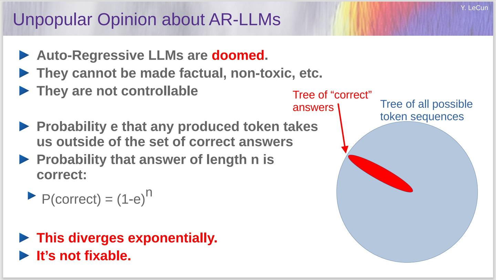
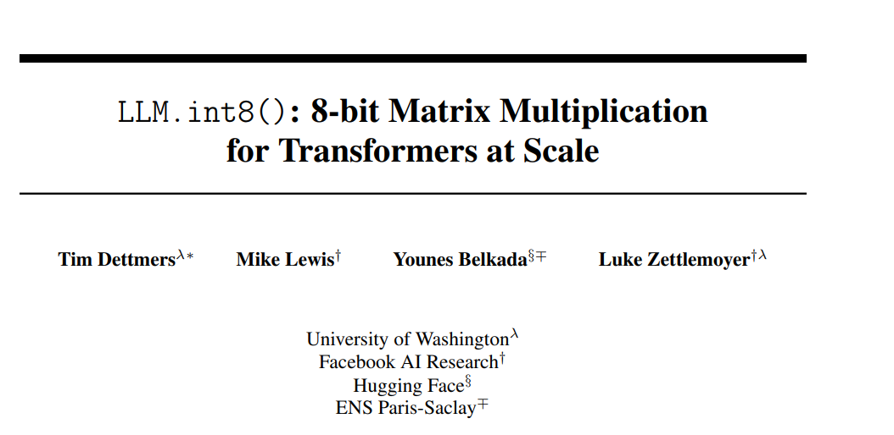
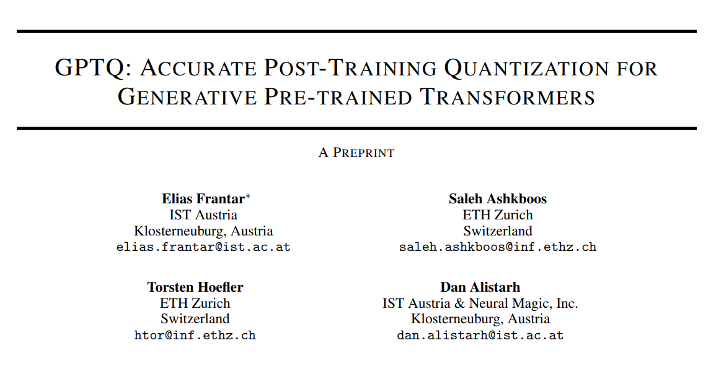
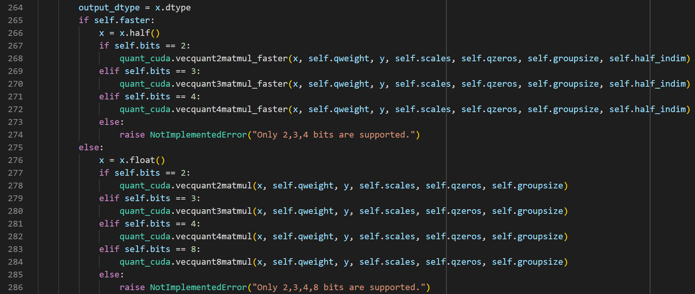
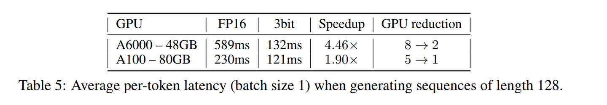
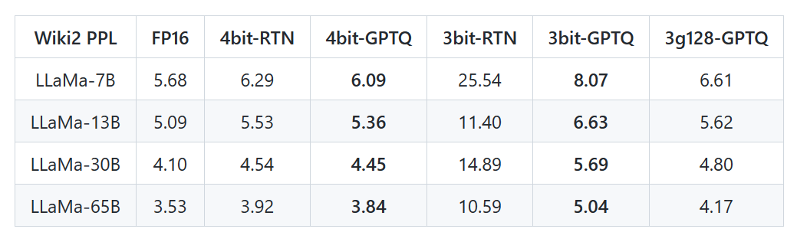
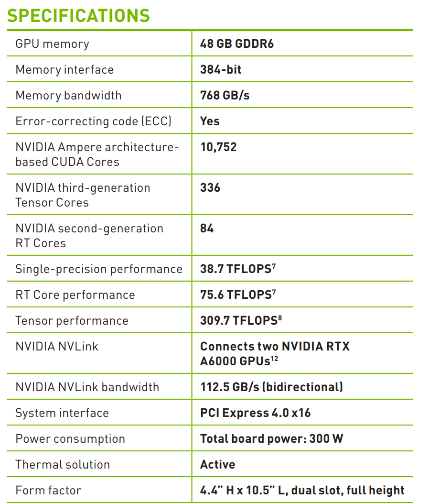
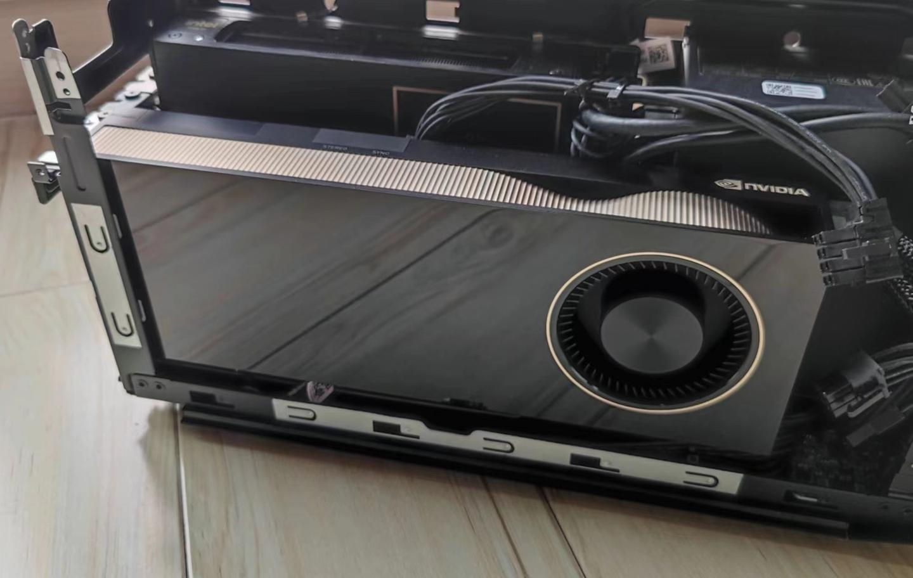

#### TL;DR;

对于同样结构同样训练集的大语言模型，模型参数越大、训练越费电、推理越费显存，效果就越好。在显存有限的环境下[[1]](#ref_1)，量化后参数量最大的那个模型效果最好——这个模型必然是能加载到 GPU 的模型里面能效最低的。

对于 RTX 3090，能充分利用显存的 LLaMA 模型有三个选项——

- LLaMA-6b baseline (fp16)
- LLaMA-13b gptq-w8-g128
- LLaMA-30b gptq-w4-g128
而 LLaMA-30b 的性能毫无悬念地吊打前面两个模型，我可以非常自信地做出以下论断[[2]](#ref_2)：

> 在 RTX A6000 上，LLaMA-65b gptq-w4-g128 效果远超 LLaMA-30b gptq-w8-g128

#### Quantized LLM

大语言模型（LLM）证明了工业界的主流仍然是大力出奇迹，对此我通常持保留态度。之前折腾时间序列的时候，还没有 LLaMA 这类模型，能找到的最大的模型是 gpt-neox-20b[[3]](#ref_3)，而 RTX 3090 能用 fp16 加载的模型也不过是 pythia-6b[[4]](#ref_4)。由于这些参数量 10b 以内的模型跟 LLaMA-6B 都有比较大的差距，我简单地尝试以后就放弃了，毕竟不可能为了一个完全不熟悉的领域去买更大显存的专业卡。

没想到才过了一个月，就发现网上已经能找到用 GPTQ-4 bit 量化的 LLaMA 模型，而且还有些爱好者宣称它甚至比 8 bit 量化精度还要高[[5]](#ref_5)。跑通 LLaMA-30B 的模型之后，我才意识到大预言模型的涌现能力并非都市传奇，而是在消费级显卡上就能重现的常识。

Yann LeCun 被 GPT4 的酸葡萄伤害之后，最近放出来的 PPT 有点极端[[6]](#ref_6)。抛开措辞不谈，大佬看问题还是很深刻的。典型的自回归语言模型的采样是个离散的随机过程，在极端情况下误差可能会以指数放大。虽然更大的模型也不能解决这个问题，但是更小的误差可以极大地降低发散的速度，而且可以在跑歪之后若无其事地一本道。

反动学阀吐槽（我是温和的 Bayesian 修正主义者）今天花了点时间研究语言模型的量化方案，才发现自己比较孤陋寡闻。其实 LLM.int8() 早就实现了误差很小的 8 位量化方案，而且通过 bitsandbytes 库集成到了 huggingface transformers，只需要几行代码就能节省 50% 的显存。

2208.07339技术细节详见官方 Blog ——

而 GPTQ 也并不是新技术，只是在 LLaMA 放出之前并未得到重视，想要用起来也比较麻烦。

2210.17323技术细节请参考知乎大佬的专栏文章 ——

项目链接如下 ——

#### Appendix

我关注量化精度的起因是发现 LLaMA-13b-gptq-w4 的长程注意力有问题，使用多个 Parallel Context Windows[[7]](#ref_7) 的时候经常采样到无趣的短内容。作为对比，LLaMA-7b-fp16 虽然采样质量差很多，但是可以有效地整合 Parallel Context Windows 中的信息，采样出天马行空的故事大纲。后来又试了 LLaMA-13b-int8，虽然有所改善但还是很糟糕。今天自己量化了一个 LLaMA-13b-gptq-8，几乎是药到病除，效果立刻超越了 LLaMA-7b-fp16。而且很奇怪的是，我本地测试的 wikitext-2 的 PPL 跟官方提供的 fp16 精度完全一样。检讨了一下，我魔改过 Transformers 库中的 modeling_llama.py[[8]](#ref_8)，把自注意力机制强行改成了 fp32。此外，默认的 GPTQ 加速库里面的累加使用的也是 fp32，而不是 fp16，而 pytorch 在默认的配置下使用 fp16 对矩阵乘法求和[[9]](#ref_9)。

可以通过以下代码减小误差：

`torch.backends.cuda.matmul.allow_fp16_reduced_precision_reduction = False`

GPTQ 默认使用单精度进行矩阵计算由于 GPTQ-for-LLaMA 实现了原生的高性能 cuda kernel，使用 GPTQ 量化模型推理时性能和单精度版本几乎没有区别。因为对内存带宽的需求降低了，单 batch 推理时量化后的模型反而会更快。模型越大，GPTQ 量化模型的精度损失越小，对性能的提升越高，感觉就跟免费的午餐一样[[10]](#ref_10)。

OPT-175B 的加速效果对于没有专业显卡的普通人，GPTQ-for-LLaMA[[11]](#ref_11) 几乎是本地部署 LLaMA-30B 和 LLaMA-65B 的唯一选择。为了调戏 LLaMA-65B，我最近在严肃地评估是不是要整一块 RTX A6000（或者更大胆一些，RTX 6000 ADA？）[[12]](#ref_12)。

#### UPDATE 2023-04-09

GPTQ-for-LLaMA 官方给出的 Wiki2 PPL 如下表。

请注意 4bit-RTN 的 PPL在 RTX 3090/RTX A6000 级别的显卡上，LLaMA-30B 和 LLaMA-65B 的推理性能几乎完全由模型尺寸和内存带宽决定。换句话说 LLaMA-30B gptq-w8 的性能和 LLaMA-65B gptq-w4 几乎没有区别[[13]](#ref_13)，所以前者几乎没有存在的意义。我实测了本地模型的 Wiki2 PPL，从这个指标上看 W8G128 和 FP16 几乎没有区别[[14]](#ref_14)。

13B-W8G12830B-W4G12830B-W8G12865B-W4G128Wiki2 PPL5.094.23034.10163.6933LLM.int8() 的性能非常差，在 RTX A6000 上实测 LLaMA-30B 推理性能不到 gptq-w8 的一半。它最大的优点是无需预先量化模型，而且没有引入额外的 cuda kernel，因此可以保证计算的可重复性[[15]](#ref_15)。

注意，如果使用 Windows 原生的环境，需要使用 GPTQ CUDA 分支。GPTQ 主分支为了追求性能使用 Triton 实现 cuda kernel，不再支持 Windows。

考虑到大多数人都没有 RTX A6000 的使用经验，特意给大家种个草[[16]](#ref_16)。

RTX A6000 datasheet只考虑 RTX 3090、RTX 4090 和 RTX A6000、RTX 6000 ADA。

- RTX A6000 性价比很低，工包价格是 RTX 3090 的三倍，RTX 4090 的两倍左右

- 双卡 RTX 3090 是性价比最高的解决方案[[17]](#ref_17)
- 理论上双卡 RTX 4090 性能高于 RTX A6000
- 单卡 RTX 6000 ADA 能买双卡 RTX A6000[[18]](#ref_18)，而且 NVLINK 被阉割掉了

- RTX A6000 能效比较高，对电源没有太高要求

- 能效比最高的是 RTX 6000 ADA
- 双卡 RTX 3090 也需要 1000W 的电源
- 双卡 RTX 4090 峰值功率高达 900W

- RTX A6000 风扇噪声很低，消除了 RTX 3090 涡轮卡对我留下的心理阴影

- 做工和用料秒杀 ASUS 的 RTX 3090 涡轮卡，反正利润够高
- 不要轻易买 RTX  的涡轮卡，除非你有机房
- 涡轮卡可以在多卡系统中有效散热[[19]](#ref_19)

为了推理 LLaMA-65B，单卡 RTX A6000 是扩展性最好的解决方案[[20]](#ref_20)，必要的时候可以组双卡系统[[21]](#ref_21)。如果电源和插槽不是问题，带 NVLINK 的 RTX 3090 双卡方案性价比最高。双卡 RTX 4090 的峰值功耗实在是太高还没有 NVLINK[[22]](#ref_22)，RTX 6000 ADA 纯属炫富。

由于我只有 NUC 12 不想买个大机箱放在客厅，所以只能在 RTX A6000 和 RTX 6000 ADA 里面选。

NUC 12 实在装不下别的卡

### 参考

- [^](#ref_1_0)典型的消费卡通常是 24G、16G 和 8G 四个档次。
- [^](#ref_2_0)至少 LLaMA-65B gptq-w4-g128 能吊打 LLaMA-30B gptq-w4-g128。 [https://zhuanlan.zhihu.com/p/619346041](https://zhuanlan.zhihu.com/p/619346041)
- [^](#ref_3_0)当然实际上还有 OPT/BLOOM 这类超过 100B 的模型，但是我没怎么折腾，而且也不可能推理。
- [^](#ref_4_0)这也是 PygmalionAI 选择的基线模型，它的角色扮演能力比 OPT-6.7b 强很多。
- [^](#ref_5_0)其实并不是，LLM.int8() 的误差非常小，但是性能比较差。
- [^](#ref_6_0)毕竟是个 Bayesian 异端。
- [^](#ref_7_0)[https://zhuanlan.zhihu.com/p/616620170](https://zhuanlan.zhihu.com/p/616620170)
- [^](#ref_8_0)site-packages/transformers/models/llama/modeling_llama.py
- [^](#ref_9_0)https://pytorch.org/docs/stable/backends.html
- [^](#ref_10_0)其实是有代价的 —— GPTQ 量化有额外的计算成本的，而且需要在给定的数据集上校准（理论上可能存在 edge case）。
- [^](#ref_11_0)非 WSL2 的 Windows 用户需要用 cuda 分支，新版本使用的 Triton 并不支持 Windows。
- [^](#ref_12_0)更新：最终还是咬牙买了 RTX A6000，毕竟 RTX 6000 ADA 可以买俩 A6000 + 丐版 NVLINK 了。
- [^](#ref_13_0)在非极端情况下，后者慢 10% 左右。
- [^](#ref_14_0)对于模型涌现出来的能力，以及长程注意力，特定数据集上的 PPL 几乎没有任何指导意义。
- [^](#ref_15_0)对于回归测试和特定的消融实验，这个特性非常重要。 [https://zhuanlan.zhihu.com/p/616951560](https://zhuanlan.zhihu.com/p/616951560)
- [^](#ref_16_0)已经毒倒一个微软的兄弟，包裹在途。
- [^](#ref_17_0)不考虑 Tesla 垃圾卡和矿卡，其实最廉价的可能是 RTX 3060 12G * 4。
- [^](#ref_18_0)这价钱已经可以买到 A100 40G 了。
- [^](#ref_19_0)水冷也行，但是机箱要够大。
- [^](#ref_20_0)但也是显存带宽最小，因此大概率是推理速度最慢的。
- [^](#ref_21_0)以便于推理 130B 级别的模型？
- [^](#ref_22_0)其实用不到，但是影响心情
