**作者：Smarter
转载自：Smarter
原文链接：[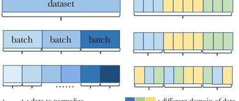Rethinking “Batch” in BatchNormmp.weixin.qq.com/s?__biz=Mzg4MjQ1NzI0NA==&mid=2247495027&idx=1&sn=c0bcb02c1b0a02f33a737a1dc1e90a12&chksm=cf54c280f8234b96f9fe5be408e15e0758da75e6f19bd0aad03017db2b16c54a2f4538715836&mpshare=1&scene=1&srcid=0519ekrsZ6hbubXV5klfMXWa&sharer_sharetime=1621432329798&sharer_shareid=3055fa2ca7e035740437beb9a3cbb17b&exportkey=AVy9E73HhPD20bLXiSIzcmw%3D&pass_ticket=XqPjiVA0Lca7%2F2sZvWzrzbqpD4oVk90Aw7z5NncmrxKbbv1%2B7lSaMgFJsULMRPVa&wx_header=0#rd](https://link.zhihu.com/?target=https%3A//mp.weixin.qq.com/s%3F__biz%3DMzg4MjQ1NzI0NA%3D%3D%26mid%3D2247495027%26idx%3D1%26sn%3Dc0bcb02c1b0a02f33a737a1dc1e90a12%26chksm%3Dcf54c280f8234b96f9fe5be408e15e0758da75e6f19bd0aad03017db2b16c54a2f4538715836%26mpshare%3D1%26scene%3D1%26srcid%3D0519ekrsZ6hbubXV5klfMXWa%26sharer_sharetime%3D1621432329798%26sharer_shareid%3D3055fa2ca7e035740437beb9a3cbb17b%26exportkey%3DAVy9E73HhPD20bLXiSIzcmw%253D%26pass_ticket%3DXqPjiVA0Lca7%252F2sZvWzrzbqpD4oVk90Aw7z5NncmrxKbbv1%252B7lSaMgFJsULMRPVa%26wx_header%3D0%23rd)

这篇很有趣且很有用，激动的赶紧把文章看了一遍，不愧是FAIR，实验看的太爽了。

之前对于Norm的研究主要在于改变Norm的维度，然后衍生出了BatchNorm、GroupNorm、InstanceNorm和LayerNorm等方法，但是除了BN外的其他Norm含义是确定，而BN的batch却可以有多种采样方式，本文就是为了探讨BN的batch使用不同的采样方式会有什么影响**，**堪称BatchNorm圣经，建议全文背诵**(ps：GN也是吴育昕的作品)。

**

本文总共4大核心实验，每个核心实验有多个子结论。

### 01 Motivation**

BatchNorm现在已经广泛的应用于CNN中。但是BN针对不同的场景使用时有许多细微的差异，如果选择不当会降低模型的性能。BatchNorm相对于其他算子来说，主要的不同在于BN是对batch数据进行操作的。BN在batch数据中进行统计量计算，而其他算子一般都是独立处理单个样本的。因此**影响BN的输出不仅仅取决于单个样本的性质，还取决于batch的采样方式**。

**

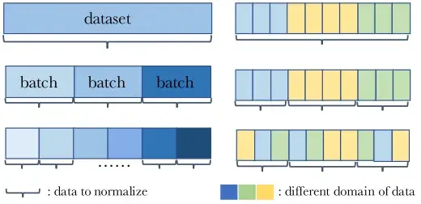

如图所示，左右各举例了三种batch采样方式。其中左图三种batch采样方式分别为entire dataset、mini-batches和subset of mini-batches，右图三种batch采样方式分别为entire domain、each domain和mixture of each domain。

本文实验证明了使用BN时不考虑batch的采样方式会在许多方面产生负面影响，合理使用batch采样方式会改善模型性能。

### 02 A Review of BatchNorm**

**

简单回顾一下BN的计算形式，这里以CNN中的BN为例。假设BN的输入feature维度为 (C,H,W) ，逐通道统计量mean和std为 \mu, \sigma^2 ，那么BN的输出y为：

$$y=\frac{x-\mu}{\sqrt{\sigma^{2}+\epsilon}} $$

$假设batch的大小为N，mini-batch X的维度为 (N, C,H,W) ，那么mini-batch 统计量为 \mu_{\mathcal{B}}, \sigma_{\mathcal{B}}^{2}  ，定义为：$

$\mu_{\mathcal{B}}=\operatorname{mean}(X, axis =[N, H, W])  $

$\sigma_{\mathcal{B}}^{2}=\operatorname{var}(X, axis =[N, H, W]) $

$推理的时候，  \mu, \sigma^2用训练集计算得到的统计量，定义为 \mu_{pop}, \sigma^2_{pop} 。$

不同于默认的BN设置，因为batch采样方式主要影响的是统计量mean和std，本文将mean和std看成是一个逐通道分开计算的仿射变换(可以等价为一个1x1的depth-wise layer)。

### 03 Whole Population as aBatch**

**

BN中统计量的计算默认使用EMA方法，但是作者实验发现EMA会导致模型性能次优，然后提出了PreciseBN方法，近似将整个训练集统计量作为一个batch。

Inaccuracy of EMA**

$EMA是指数滑动平均的缩写，为了统计 \mu_{pop}, \sigma^2_{pop}  ，EMA在训练过程中对统计量进行更新：$

$\mu_{E M A} \leftarrow \lambda \mu_{E M A}+(1-\lambda) \mu_{\mathcal{B}} $

$\sigma_{E M A}^{2} \leftarrow \lambda \sigma_{E M A}^{2}+(1-\lambda) \sigma_{\mathcal{B}}^{2} $

EMA方法导致次优解的原因有两点：

1.当 \lambda 太大时，统计量收敛速度变慢。

2.当 \lambda 太小时，最近几个mini-batches影响更大，统计量无法表示整个训练集的统计量。

**Towards Precise Population Statistics**

为了得到整个训练集更加精确的统计量，PreciseBN采用了两点小技巧：

1.将相同模型用于多个mini-batches来收集batch统计量

2.将多个batch收集的统计量聚合成一个population统计量

比如有N个样本需要通过数量为的Bmini-batch进行PreciseBN统计量计算，那么需要计算 k=\frac{N}{B}  次，统计量聚合公式为：

$\mu_{\text {pop }}=\mathrm{E}\left[\mu_{\mathcal{B}}\right] $

$$\sigma_{\text {pop }}^{2}=\mathrm{E}\left[\mu_{\mathcal{B}}^{2}+\sigma_{B}^{2}\right]-\mathrm{E}\left[\mu_{\mathcal{B}}\right]^{2} $$

相比于EMA，PreciseBN有两点重要的属性：

1.PreciseBN的统计量是通过相同模型计算得到的，而EMA是通过多个历史模型计算得到的。

2.PreciseBN的所有样本的权重是相同的，而EMA不同样本的权重是不同的。

**

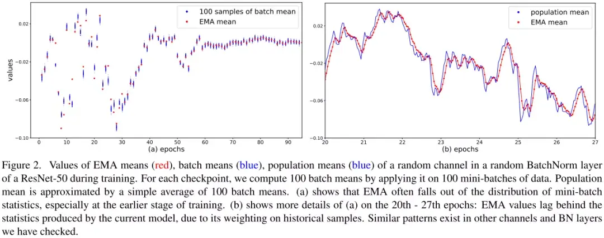

100 samples of batch mean意思是相同epoch下模型对100个随机batch统计量的结果。如图所示，在训练早期EMA的统计量不精确，会导致最终模型性能次优。由于滑动平均的计算方式导致EMA的统计量滞后于PrciseBN。

4个主要结论：**

**

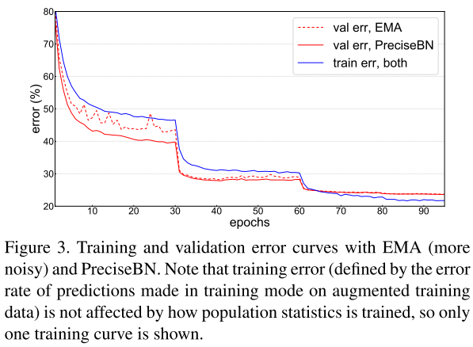

1.推理时使用PreciseBN会更加稳定。

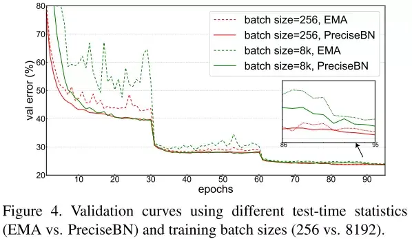

2.大batch训练对EMA影响更大。

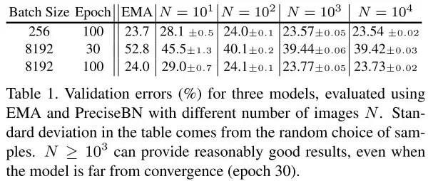

3.PreciseBN只需要10^3~10^4个样本可以得到近似最优。

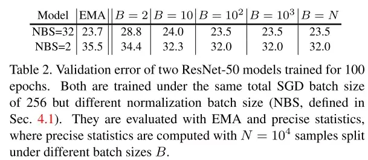

4.小batch会产生统计量积累错误。

### 04 Batch in Training and Testing**

**

BN在训练和测试中行为不一致：训练时，BN的统计量来自mini-batch；测试时，BN的统计量来自population。这部分主要探讨了BN行为不一致对模型性能的影响，并且提出消除不一致的方法提升模型性能。

Effect of Normalization Batch Size**

为了避免混淆，将SGD batch size或者total batch size定义为所有GPU上总的batch size大小，将normalization batch   size定义为单个GPU上的batch size大小。

normalization batch size对training noise和train-test inconsistency有着直接影响：使用更大的batch，mini-batch统计量越接近population统计量，从而降低training noise和train-test inconsistency。

**

以下实验的SGD batch size固定使用1024大小。

为了便于分析，作者观察了3种不同评估方法的错误率：

1.在训练集上对mini-batch统计量进行评估

2.在验证集上对mini-batch统计量进行评估

3.在验证集上对population统计量进行评估

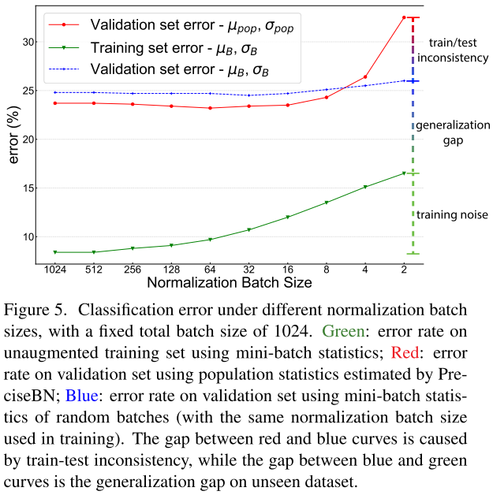

Training noise：当normalization batch size非常小时，单个样本会受到同一个min-batch样本的严重影响，导致训练精度较差，优化困难。

Generalization gap：随着normalization batch size的增加，mini-batch的验证集和训练集的之间的泛化误差会增大，这可能是由于training noise和train-test inconsistency没有正则化。

Train-test inconsistency：在小batch下，mini-batch统计量和population统计量的不一致是影响性能的主要因素。当normalization batch size增大时，细微的不一致可以提供正则化效果减少验证误差。在mini-batch为32~128之间时，正则化达到平衡，模型性能最优。

为了保持train和test的BN统计量一致，作者提出了两种方法来解决不一致问题，一种是推理的时候使用mini-batch统计量，另一种是训练的时候使用population batch统计量。

Use Mini-batch in Inference**

**

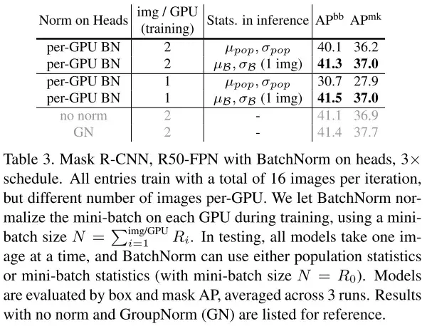

作者在Mask R-CNN上进行实验，mini-batch的结果超过了population的结果，证明了在推理中使用mini-batch可以有效的缓解训练测试不一致。(ps：不使用norm效果略差，使用GN效果更好)****

Use Population Batch in Training**

为了在训练阶段使用population统计量，作者采用FrozenBN的方法，FrozenBN使用population统计量。具体地，作者先选择第80个epoch模型，然后将所有BN替换成FrozenBN，然后训练20个epoch。

**

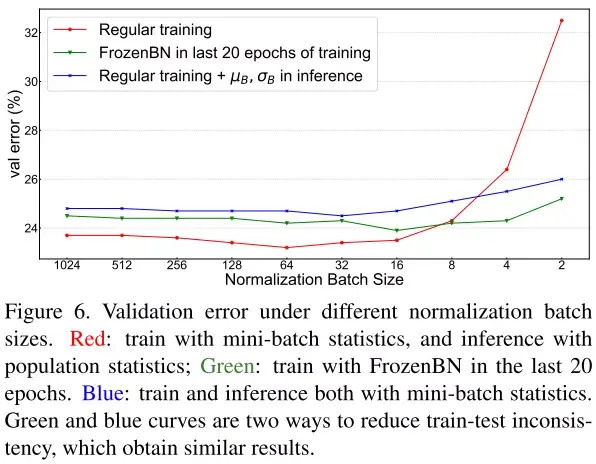

FrozenBN可以有效缓解训练测试不一致，即使在小normalization batch size，也能达到比较好的性能。但是随着normalization batch size增大，作者提出的两种缓解不一致的方法都不如常规BN的结果。

### 05 Batch from Different Domains**

**

BN的训练过程可以看成是两个独立的阶段：第一个阶段是通过SGD学习features，第二个阶段是由这些features得到population统计量。两个阶段分别称为SGD training和population statistics training。

由于BN多了一个population统计阶段，导致训练和测试之间的domain shift。当数据来自多个doman时，SGD training、population statistics training和testing三个步骤的domain gap都会对泛化性造成影响。

实验主要探究了两种使用场景：第一种，模型在一个domain上进行训练，然后在其他domain上进行测试；第二种，模型在多个domain上进行训练。

Domain to Compute Population Statistics**

**

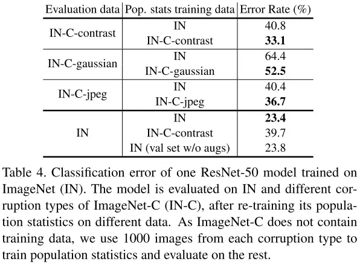

作者实验发现，当存在显著的domain shift时，模型使用评估domain的population统计量会得到更好的结果，可以缓解训练测试的不一致。

BatchNorm in Multi-Domain Training**

**

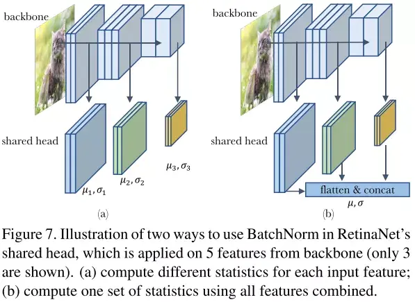

为了对多个domain的情况进行实验，作者将RetinaNet head中的BN统计量进行实验设计。RetinaNet的head是5个feature层共享的，这意味着会接收来自5个不同分布或者domain的输入进行训练。

左图的训练形式非常简单，head独立作用于不同的feature层，都有自己独立的统计量。右图将所有输入特征flatten然后concat在一起，统一进行统计量计算。两种不同计算统计量的方式称为domain-specific statistics和shared statistics。

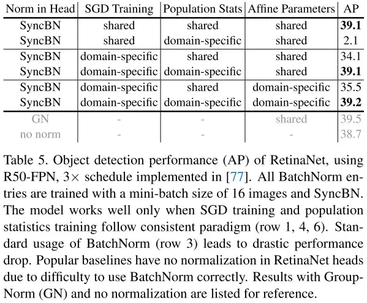

最终实验表明，SGD training、population statistics training和testing保持一致是非常重要的，并且全部使用domain-specific能取得最好的效果。(ps：不使用norm效果略差，使用GN效果更好)****

### 06 Information Leakage within a Batch**

**

BN在使用中还存在一种information leakage现象，因为BN是对mini-batch的样本计算统计量的，导致在样本进行独立预测时，会利用mini-batch内其他样本的统计信息。

Exploit Patterns in Mini-batches**

**

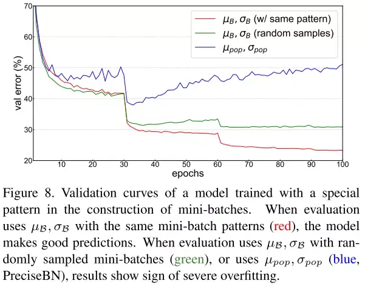

作者实验发现，当使用random采样的mini-batch统计量时，验证误差会增加，当使用population统计量时，验证误差会随着epoch的增加逐渐增大，验证了BN信息泄露问题的存在。

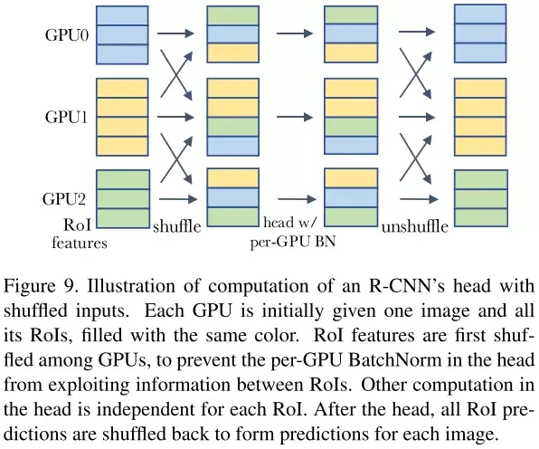

为了处理信息泄露问题，之前常见的作法是使用SyncBN，来弱化mini-batch内样本之间的相关性。另一种解决方法是在进入head之前在GPU之间随机打乱RoI features，这给每个GPU分配了一个随机的样本子集来进行归一化，同时也削弱了min-batch样本之间的相关性，如上图所示。

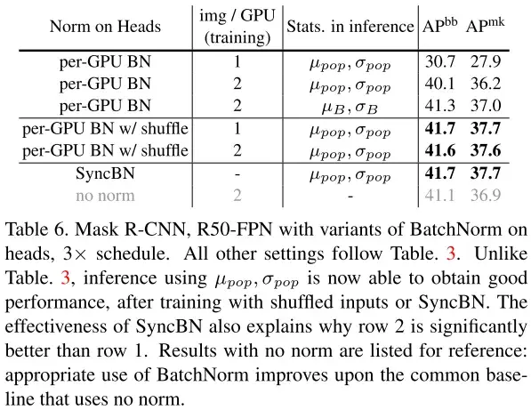

实验结果表明，shuffling和SyncBN都能有效地处理信息泄漏，使得head在测试时能够很好地泛化。在速度方面，我们注意到shuffling需要更少的跨gpu同步，但是shuffling每次传输的数据比SyncBN多。因此，shuffling和SyncBN的相对效率跟具体模型架构相关。

Cheating in Contrastive Learning**

在对比学习和度量学习时，训练目标通常是在mini-batch下进行比较的，这种情况下BN也会造成信息泄露，导致模型在训练期间作弊，之前的研究提出了很多不同方法来针对性解决对比学习和度量学习的信息泄露问题。**

### 07 总结**

本文从多个角度探讨了BN的batch使用不同的采样方式会有什么影响，并且做了非常详尽的对比试验，堪称BatchNorm圣经，建议全文背诵。

**另外，看完后最大的感触是，BN不会用就别用，GN yyds。**

**

Reference**

[1] Rethinking “Batch” in BatchNorm

**

### 机器学习/深度学习算法/自然语言处理交流群**

已建立机器学习算-自然语言处理微信交流群！想要进交流群进行学习的同学，可以直接加我的微信号：**HIT_NLP**。加的时候备注一下：**知乎+学校+昵称 （不加备注不会接受同意，望谅解）**，想进**pytorch群，备注知乎+学校+昵称+Pytorch**即可。然后我们就可以拉你进群了。群里已经有非得多国内外高校同学，交流氛围非常好。

**强烈推荐大家关注**机器学习算法与自然语言处理**账号和**[机器学习算法与自然语言处理](https://link.zhihu.com/?target=https%3A//mp.weixin.qq.com/s/VhZW2qS_UC3kUdXhvAVKxA)**微信公众号，可以快速了解到最新优质的干货资源。**

### **推荐阅读**

[EMNLP 2021（征稿通知）+交流群](https://zhuanlan.zhihu.com/p/349345306)

[ACL-2021交流群](https://zhuanlan.zhihu.com/p/346492793)

[NAACL2021-交流群](https://zhuanlan.zhihu.com/p/345866686)

[知识蒸馏：让LSTM重返巅峰！](https://zhuanlan.zhihu.com/p/356917011)

[最强的Attention函数诞生啦，带给你意想不到的巨大提升！](https://zhuanlan.zhihu.com/p/355924803)

[新分类！全总结！最新Awesome-SLU-Survey资源库开源！](https://zhuanlan.zhihu.com/p/353558940)

[NaturalConv: 一个主题驱动的中文多轮对话数据集](https://zhuanlan.zhihu.com/p/354525596)

[NUS&A* STAR: 一种简单有效的数据增广方法for n-shot任务型对话系统](https://zhuanlan.zhihu.com/p/354273484)

[AAAI 2021 | 机器翻译最新进展解读](https://zhuanlan.zhihu.com/p/353826789)

[全领域涨点 | Transformer携Evolving Attention在CV与NLP领域全面涨点](https://zhuanlan.zhihu.com/p/354206376)

[Facebook AI大一统！使用统一Transfomer的多模态多任务学习](https://zhuanlan.zhihu.com/p/354199290)

[谷歌：提高长文本对话状态跟踪能力](https://zhuanlan.zhihu.com/p/354194872)

[推荐！李宏毅《机器学习》国语课程(2021)上线！](https://zhuanlan.zhihu.com/p/353776276)

[CVPR 2021接收结果出炉！录用1663篇，录取率27%](https://zhuanlan.zhihu.com/p/353715817)

[深度学习中的知识蒸馏技术（上）](https://zhuanlan.zhihu.com/p/353472061)

[大佬云集 AAAI 2021 图深度学习研讨会](https://zhuanlan.zhihu.com/p/349988092)

[【招人】腾讯广告业务线](https://zhuanlan.zhihu.com/p/345737988)

[赛尔笔记 | 篇章级机器翻译简介](https://zhuanlan.zhihu.com/p/345712788)

[GPT“高仿”系列开源了！最大可达GPT-3大小，还能自主训练](https://zhuanlan.zhihu.com/p/345507645)

[ACL 2021投稿避坑指南](https://zhuanlan.zhihu.com/p/345171797)

[我，大学没毕业，在OpenAI搞AI，想教教你如何提升“研究品味”](https://zhuanlan.zhihu.com/p/344970898)

[推荐几本经典AI书籍！](https://zhuanlan.zhihu.com/p/341857945)

[赛尔原创@AAAI 2021 | 纠结于联合学习中的建模方法？快来看看图网络显式建模!](https://zhuanlan.zhihu.com/p/344700394)

[如何提高PyTorch“炼丹”速度？这位小哥总结了17种方法，可直接上手更改的那种](https://zhuanlan.zhihu.com/p/344467390)

[斯坦福CS224W《图机器学习》2021开课！Jure Leskovec大牛主讲，附课程PPT下载](https://zhuanlan.zhihu.com/p/344349633)

[ICLR2021放榜！录取860篇，接受率为28.7%！](https://zhuanlan.zhihu.com/p/344044979)

[计算机视觉中的Transformer](https://zhuanlan.zhihu.com/p/344170484)

[第二十届中国计算语言学大会（CCL 2021）技术评测任务征集](https://zhuanlan.zhihu.com/p/344341057)

[完全图解GPT-2：看完这篇就够了（二）](https://zhuanlan.zhihu.com/p/343925685)

[完全图解GPT-2：看完这篇就够了（一）](https://zhuanlan.zhihu.com/p/343922021)

[IJCAI 2020今日开幕，杰出论文奖、卓越研究奖、约翰·麦卡锡奖等8项大奖公布！](https://zhuanlan.zhihu.com/p/343639796)

[研究品味锻炼！](https://zhuanlan.zhihu.com/p/343522332)

[一份Python线性代数讲义](https://zhuanlan.zhihu.com/p/343199778)

[全面回顾2020年图机器学习进展，12位大神论道、寄望2021年大爆发！](https://zhuanlan.zhihu.com/p/343248216)

[第二十届中国计算语言学大会（CCL 2021） 征稿启事](https://zhuanlan.zhihu.com/p/343396752)

[NTU-Xavier Bresson 图神经网络入门视频](https://zhuanlan.zhihu.com/p/342765131)

[2020年arXiv十大热门论文来了！不止GPT-3、SimCLR、YOLOv4...](https://zhuanlan.zhihu.com/p/342632492)

[每日论文速递：自然语言处理相关（1月7日更新版）](https://zhuanlan.zhihu.com/p/342568417)

[权值衰减和L2正则化傻傻分不清楚？](https://zhuanlan.zhihu.com/p/342526154)

[斯坦福大学——人工智能本科4年课程清单](https://zhuanlan.zhihu.com/p/342522102)

[超过500个附代码的AI/机器学习/深度学习/计算机视觉/NLP项目](https://zhuanlan.zhihu.com/p/342247527)

[Awesome Transformer for Vision Resources List库](https://zhuanlan.zhihu.com/p/342188618)

[2020 Top10计算机视觉论文总结：论文，代码，解读，还有demo视频！](https://zhuanlan.zhihu.com/p/342178401)

[摘要数据整理仓库，6个数据集！](https://zhuanlan.zhihu.com/p/341987450)

[156个参考文献！Visual Transformer 调研survey](https://zhuanlan.zhihu.com/p/341660943)

[NLP生成任务痛点！58页generation评价综述](https://zhuanlan.zhihu.com/p/341588674)

[机器学习画图模板ML Visuals更新](https://zhuanlan.zhihu.com/p/341558474)

[谷歌最新28页高效 Transformer 模型综述](https://zhuanlan.zhihu.com/p/341476148)

[Papers with Code 2020 全年回顾](https://zhuanlan.zhihu.com/p/341394324)

[最新14页《图神经网络可解释性》综述论文](https://zhuanlan.zhihu.com/p/341350164)

[陶大程等人编写！最新41页深度学习理论综述](https://zhuanlan.zhihu.com/p/341232760)

[使用PyTorch时，最常见的4个错误](https://zhuanlan.zhihu.com/p/302409233)

[加拿大蒙特利尔大学助理教授刘邦招收年博士生](https://zhuanlan.zhihu.com/p/330213537)

[【EMNLP2020】基于动态图交互网络的多意图口语语言理解框架](https://zhuanlan.zhihu.com/p/335717109)

[一文搞懂 PyTorch 内部机制](https://zhuanlan.zhihu.com/p/338256656)

[忆臻：AAAI 2021论文接收列表放出!!!](https://zhuanlan.zhihu.com/p/341212550)

[机器学习自然语言处理：从头来看关系抽取](https://zhuanlan.zhihu.com/p/357613451)

[机器学习自然语言处理：Transformer的一家！](https://zhuanlan.zhihu.com/p/357886762)

[机器学习自然语言处理：通俗易懂！BiLSTM上的CRF，用命名实体识别任务来解释CRF（一）](https://zhuanlan.zhihu.com/p/357885976)

[机器学习自然语言处理：通俗易懂！BiLSTM上的CRF，用命名实体识别任务来解释CRF（二）](https://zhuanlan.zhihu.com/p/357886551)

[机器学习自然语言处理：赛尔笔记 | 自然语言处理领域的数据增广方法](https://zhuanlan.zhihu.com/p/358193050)

[机器学习自然语言处理：基于小样本学习的图像分类技术综述(中文版)，19页pdf](https://zhuanlan.zhihu.com/p/358192153)

[机器学习自然语言处理：【斯坦福NLP-CS224N硬核课】自然语言处理未来与深度学习，81页ppt](https://zhuanlan.zhihu.com/p/358190735)

[机器学习自然语言处理：大道至简：算法工程师炼丹Trick手册](https://zhuanlan.zhihu.com/p/358463000)

[机器学习自然语言处理：Transformer！「预训练变换器文本排序」首篇综述书，155页pdf概述BERT类模型文本检索进展](https://zhuanlan.zhihu.com/p/358462299)

[机器学习自然语言处理：周志华老师《机器学习》手推笔记，214页](https://zhuanlan.zhihu.com/p/358461595)

[机器学习自然语言处理：原来有这个算法，让点评体验如此好！](https://zhuanlan.zhihu.com/p/358664369)

[机器学习自然语言处理：AAAI2020-图神经网络（GNN）过去、现在、应用和未来最新研究进展分享](https://zhuanlan.zhihu.com/p/358663532)

[机器学习自然语言处理：图神经网络(GNN)必读论文及最新进展跟踪](https://zhuanlan.zhihu.com/p/358661904)

[机器学习自然语言处理：5种神经网络常见的求导！](https://zhuanlan.zhihu.com/p/358831303)

[机器学习自然语言处理：一文概览 CVPR2021 最新18篇 Oral 论文](https://zhuanlan.zhihu.com/p/358830938)

[机器学习自然语言处理：CVPR2021最新接收论文合集！22个方向100+篇论文汇总｜持续更新](https://zhuanlan.zhihu.com/p/358827230)

[机器学习自然语言处理：Transformer是巧合还是必然？搜索推荐领域的新潮流](https://zhuanlan.zhihu.com/p/359115240)

[机器学习自然语言处理：AAAI 2021最佳论文《Informer》作者：Transformer 最新进展](https://zhuanlan.zhihu.com/p/359111210)

[机器学习自然语言处理：[万字长文] 图神经网络的解释性综述](https://zhuanlan.zhihu.com/p/359112233)

[机器学习自然语言处理：图解Transformer（完整版）！](https://zhuanlan.zhihu.com/p/359394722)

[机器学习自然语言处理：【Transformer】图解OpenAI的秘密武器GPT-2：可视化Transformer语言模型](https://zhuanlan.zhihu.com/p/359396459)

[机器学习自然语言处理：搞懂Transformer结构，看这篇PyTorch实现就够了](https://zhuanlan.zhihu.com/p/359398449)

[机器学习自然语言处理：深度学习中的知识蒸馏技术（上）](https://zhuanlan.zhihu.com/p/359962027)

[机器学习自然语言处理：深度学习中的知识蒸馏技术(下)-知识蒸馏与推荐系统](https://zhuanlan.zhihu.com/p/359965473)

[机器学习自然语言处理：2021年，我终于决定入门GCN](https://zhuanlan.zhihu.com/p/359951209)

[机器学习自然语言处理：排序(rank)后重排(re-rank)?](https://zhuanlan.zhihu.com/p/361154625)

[机器学习自然语言处理：从理论到实践解决文本分类中的样本不均衡问题](https://zhuanlan.zhihu.com/p/361152151)

[机器学习自然语言处理：如何基于多模态识别广告文章](https://zhuanlan.zhihu.com/p/361150047)

[机器学习自然语言处理：总结+paper分享|对话系统中的自然语言生成技术（NLG）](https://zhuanlan.zhihu.com/p/361445591)

[机器学习自然语言处理：百家争鸣|国内外NLP领域学术界和工业界的牛人和团队](https://zhuanlan.zhihu.com/p/361445123)

[机器学习自然语言处理：任务型对话系统公式建模&&实例说明](https://zhuanlan.zhihu.com/p/361444462)

[机器学习自然语言处理：一文"看透"多任务学习](https://zhuanlan.zhihu.com/p/361727869)

[机器学习自然语言处理：总结+paper分享|对话系统中的自然语言生成技术（NLG）](https://zhuanlan.zhihu.com/p/361445591)

[机器学习自然语言处理：百家争鸣|国内外NLP领域学术界和工业界的牛人和团队](https://zhuanlan.zhihu.com/p/361445123)

[机器学习自然语言处理：收藏｜2021年浅谈多任务学习](https://zhuanlan.zhihu.com/p/361987436)

[机器学习自然语言处理：CTR模型越来越"深"，如何让它变"轻"?](https://zhuanlan.zhihu.com/p/362486426)

[机器学习自然语言处理：排序(rank)后重排(re-rank)?](https://zhuanlan.zhihu.com/p/362487658)

[赛尔笔记 | 对比学习简述 - 知乎 (zhihu.com)](https://zhuanlan.zhihu.com/p/372140931)

[20篇「ICML2021」最新论文抢先看！看机器学习2021在研究什么？ - 知乎 (zhihu.com)](https://zhuanlan.zhihu.com/p/372142446)

[“意念打字”速度接近常人手机聊天，专家：这比马斯克的“猴子玩游戏”难多了 | Nature封面 - 知乎 (zhihu.com)](https://zhuanlan.zhihu.com/p/372143047)

[MLP三大工作超详细解读：why do we need? - 知乎 (zhihu.com)](https://zhuanlan.zhihu.com/p/372642234)

[近期必读的5篇顶会CVPR 2021【对比学习（CL）】相关论文和代码 - 知乎 (zhihu.com)](https://zhuanlan.zhihu.com/p/372642106)

[赛尔原创@IJCAI 2021 | 会议摘要有难度？快来引入对话篇章结构信息 - 知乎 (zhihu.com)](https://zhuanlan.zhihu.com/p/373401420)

[ViLT：最简单的多模态Transformer - 知乎 (zhihu.com)](https://zhuanlan.zhihu.com/p/373401073)

[台大最新《深度学习优化问题》硬核课，林智仁教授讲解，附课件下载 - 知乎 (zhihu.com)](https://zhuanlan.zhihu.com/p/373398596)
