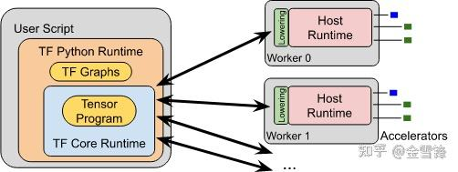

以前和小伙伴们一起总结的TFRT的开源代码学习笔记，分享一下

### 概述

TFRT是一个新的TensorFlow运行时。它的目标是提供一个统一的、可扩展的基础设施层，在各种领域特定的硬件上具有一流的性能。提供多线程接口，支持完全异步编程模型，专注low-level的效率。TFRT的关键点：

- 全异步，kernel不阻塞
- 良好的错误传播机制
- 性能是第一位（graph and eager）

整体流程：


[https://github.com/tensorflow/runtime/blob/master/documents/img/TFRT_overview.svg](https://link.zhihu.com/?target=https%3A//github.com/tensorflow/runtime/blob/master/documents/img/TFRT_overview.svg)

- 用户传入用high-level TensorFlow APIs创建的TF Graph。
- MLIR-based graph compiler优化TF Graph并下降（lower）为BEF（Binary Executable Format）。
- Eager模式直接调用Kernel，不需要转换为BEF。
<strong>BEF转换流程：</strong>


[https://github.com/tensorflow/runtime/blob/master/documents/img/BEF_conversion.svg](https://link.zhihu.com/?target=https%3A//github.com/tensorflow/runtime/blob/master/documents/img/BEF_conversion.svg)

- Compiler优化TF Graph并产生low-level TFRT Host Program，TFRT host program用MLIR表达。
- tfrt_translate和bef_executor是tools目录下的2个可执行文件。

```text
     -tfrt_translate根据host program产生BEF 文件。

     -bef_executor读入BEF文件并执行。  
```


-  为高效执行，runtime不直接处理MLIR。mlir_to_bef将host程序转换为内存的Binary Executable Format(BEF)格式，BEF是mmap-able且cache友好的表示形式。  
- high level的表示便于编译分析并优化，是平台无关的。
- low level的表示目的是高效执行，是平台相关的。

TFRT的整体架构：


TFRT包含Distributed Runtime、Host Runtime和Device Runtime。

- Host Runtime：提供Kernel相关数据结构和注册机制，提供Kernel Graph的执行机制，另外提供Threading Model、Memory Allocation等基本组件。
- Distributed Runtime：提供分布式相关Kernel和分布式相关API。
- Device Runtime：GPU Runtime将Cuda操作封装为Kernel，并在内部实现了Buffer/Tensor/Allocator等组件。无流分配等复杂操作（由编译器负责）。

### Host Runtime

### 设计目标

- 高效eager执行
- 统一的CPU线程模型
- 异步在Runtime中是一等公民：包括支持non-strict kernel and function execution
- 编译器友好的跨Kernel优化：shape计算和内存分配在Kernel外部；可以在Kernel间复用buffer
- 模块化和插件设计方便扩展新加速设备
- 统一mobile和server的基础设施：mobile和server使用相同的Kernel，尽量最小化模型转换

### AsyncValue

- 与std::future类似，保存Kernel的参数、返回值或error
- 无锁
- 辅助类AsyncValueRef是类型安全的
- 异步执行

```text
     -Asynchronous functions return unavailable AsyncValues

     -Caller can schedule dependent computations with AsyncValue::AndThen()

     -Caller need not block until AsyncValue becomes available
```


### Kernels

典型的Kernel示例

```cpp
// Kernel that adds two integers.
// AsyncKernelFrame holds the kernel’s arguments and results.
static void TFRTAdd(AsyncKernelFrame* frame) {
  // Fetch the kernel’s 0th argument.
  AsyncValue* arg1 = frame->GetArgAt(0);
  // Fetch the kernel’s 1st argument.
  AsyncValue* arg2 = frame->GetArgAt(1);

  int v1 = arg1->getint>();
  int v2 = arg2->getint>();

  // Set the kernel’s 0th result.
  frame->EmplaceResultAtint>(0, v1 + v2);
}
```


- 使用相同的Kernel机制管理设备，比如内存管理、数据传输、启动计算。（设备管理操作也都封装为Kernel）
- Kernel可以将task调度到线程池。线程池有多种实现。（Kernel通过将task分发到线程池实现异步执行）
-  内存分配也有多种实现。 
-  TFRT kernel是输入输出皆为AsyncValue的C++函数。 
-  异步是一等公民。 
-  输入输出都是AsyncValue，输出的AsyncValue可能是unavailable的。 
- Runtime不关心Kernel的语义。

### Host Runtime特点

- 异步执行

```text
   -Kernel不会阻塞

   -AsyncValue无锁
```


- 线程池
   -中心调度

   -每个核基本使用一个线程

- 不同Target有定制

- 一般的Server使用std::threads的线程池
- 资源受限的场景使用单线程 

- 内存管理
    -大部分场景统一分配内存

    -不同Target有定制：Server使用TCmalloc分配内存；嵌入式环境使用简单的内存分配机制 

### BEFExecutor

- 默认是“Strict” execution：当所有输入都可用时，kernel才执行
- Executor特性
   -无锁：使用原子操作

   -非阻塞：通过AsyncValue::AndThen延迟依赖

   -支持“non-strict” execution：当部分输入可用时，kernel也可以执行

- 关键概念

```text
   -BEF: dataflow graph

   -Kernel: dataflow node

   -AsyncValue: dataflow edge
```


### Detailed Design

#### AsyncValue

#### 生命周期

AsyncValue的生命周期通过引用计数管理，方便在多个消费者中共享。引用计数在Kernel使用AsyncValue时加一，Kernel执行完后减一。计数减到0则销毁AsyncValue。Kernel间通过引用传递AsyncValue，无数据拷贝。

#### Class Hierarchy


[https://github.com/tensorflow/runtime/raw/master/documents/img/async-values.svg](https://link.zhihu.com/?target=https%3A//github.com/tensorflow/runtime/raw/master/documents/img/async-values.svg)                              

AsyncValue（基类）

AsyncValue（基类）保存引用计数、可用状态和waiter list等，并提供AndThen接口。AsyncValue不提供虚函数接口，从而不生成虚表。

```cpp
// A subset of interface functions in AsyncValue.
class AsyncValue {
 public:
  bool IsAvailable() const;

  // Get the payload data as type T.
  // Assumes the data is already available, so get() never blocks.
  template typename T> const T& get() const;

  // Store the payload data in-place.
  template typename T, typename... Args>
  void emplace(Args&&... args);

  // Add a waiter callback that will run when the value becomes available.
  void AndThen(std::functionvoid()>&& waiter);
  // ...
};
```


AsyncValue本身不感知真实数据的数据类型，用户调用AsyncValue::IsAvailable()或AsyncValue::AndThen()时也无需感知真实数据的数据类型。仅当通过`AsyncValue::get()` or `AsyncValue::emplace()`访问数据时才感知类型信息。

type-erased可以简化代码，比如`BEFExecutor`在Kernel间传递AsyncValue也不需要关心数据类型。

如果确实需要类型信息，可以使用`AsyncValueRef` ：

```text
// Prefer AsyncValueRef for TensorHandle's constructor because the AsyncValues 
// must contain specific types. 
TensorHandle(AsyncValueRef async_metadata,              
```

AsyncValueRef tensor);

##### ConcreteAsyncValue

ConcreteAsyncValue：保存类型明确的数据。

```c++
// ConcreteAsyncValue stores the payload T in-place.
template
Class ConcreteAsyncValue : public AsyncValue {
   //...
 private:
  T value_;
};`

#### ErrorAsyncValue

用于传播错误和取消执行。一旦检测到错误，则跳过待执行的Kernel。HostContext保存用于取消执行的AsyncValue，BEFExecutor周期性检测，一旦检测到则取消未分发Kernel的执行。

#### IndirectAsyncValue

保存类型不明确的数据。比如，异步Kernel返回的AsyncValue或non-strict kernel的参数处于unavailable状态。IndirectAsyncValue内部保存了其他AsyncValue的指针。

`class IndirectAsyncValue : public AsyncValue {
 private:
  // IndirectAsyncValue contains a pointer to another AsyncValue.
  AsyncValue* value_;
};
`

#### IndirectAsyncValue与ConcreteAsyncValue的转换

-  Kernel执行前创建IndirectAsyncValue
 
-  Kernel执行完成后调用AsyncValue::emplace
 
-  AsyncValue::emplace内部将this指针强转为ConcreteAsyncValue类型，然后调用ConcreteAsyncValue::emplace 
`template     void syncValue::emplace(Args&&... args) {      
      static_cast*>(this)->emplace(
          std::forward(args)...);    
}`

- ConcreteAsyncValue::emplace内部为数据成员data_分配空间，并把Kernel结果移进来，最后将State改为kConcrete
`template       void emplace(Args&&... args) {        
      new (&data_) T(std::forward(args)...);        
      NotifyAvailable(State::kConcrete);      
}`

- 自此IndirectAsyncValue对象被强制转换为ConcreteAsyncValue对象

#### 代码实现

#### 总体说明

当AsyncValue不可用时，caller把使用此value的Kernel封装为闭包，并将闭包通过AsyncValue::AndThen加入等待列表。当value可用时会调用`AsyncValue::emplace`、`ConcreteAsyncValue::emplace`或`IndirectAsyncValue::ForwardTo`，然后队列中的所有闭包会被执行。

当`AsyncValue::emplace`或`AsyncValue::SetStateConcrete`被调用后，AsyncValue就变为可用，这时会顺序执行等待列表的Kernel。

#### 调用关系

`public:
AsyncValue::AndThen(WaiterT&& waiter)
    if (old_value.getInt() == State::kConcrete || ...)
        waiter()
    else
        EnqueueWaiter
            waiters_and_state_.compare_exchange_weak(...)
            if (old_value.getInt() == State::kConcrete ||...)
                RunWaiters(node)

AsyncValue::emplace(Args&&... args)
    ConcreteAsyncValue::emplace(Args&&... args)

// 一般用在Kernel内部，比如Chain
AsyncValue::SetStateConcrete()
    AsyncValue::NotifyAvailable(State available_state)

ConcreteAsyncValue::emplace(Args&&... args)
    AsyncValue::NotifyAvailable(State available_state)

IndirectAsyncValue::ForwardTo(RCReferenceAsyncValue> value)
    if (value->state() == State::kConcrete || ...)
        AsyncValue::NotifyAvailable(State available_state)
    else
        AsyncValue::AndThen(WaiterT&& waiter)
protected:
AsyncValue::NotifyAvailable(State available_state)
    AsyncValue::RunWaiters(NotifierListNode* list)
`

#### AsyncValue

`+：表示public
#：表示protected
-：表示private`

#### + AndThen(WaiterT&& waiter)

waiter封装了使用当前`AsyncValue`的Kernel，如果`AsyncValue`可用则直接执行waiter，否则将waiter加入到AsyncValue内部的等待列表。

`template typename WaiterT>
void AsyncValue::AndThen(WaiterT&& waiter) {
  // Clients generally want to use AndThen without them each having to check
  // to see if the value is present. Check for them, and immediately run the
  // lambda if it is already here.
  auto old_value = waiters_and_state_.load(std::memory_order_acquire);
  if (old_value.getInt() == State::kConcrete ||
      old_value.getInt() == State::kError) {
    assert(old_value.getPointer() == nullptr);
    waiter();   // ******
    return;
  }
  EnqueueWaiter(std::forwardWaiterT>(waiter), old_value);  // ******
}
`

#### + SetStateConcrete()

`inline void AsyncValue::SetStateConcrete() {
  assert(IsConstructed() && kind() == Kind::kConcrete);
  NotifyAvailable(State::kConcrete);
}`

#### + emplace(Args&&... args)

内部调用`ConcreteAsyncValue::emplace`。

`template typename T, typename... Args>
void AsyncValue::emplace(Args&&... args) {
  assert(GetTypeIdT>() == type_id_ && "Incorrect accessor");
  assert(IsUnconstructed() && kind() == Kind::kConcrete);

  static_castinternal::ConcreteAsyncValueT>*>(this)->emplace(
      std::forwardArgs>(args)...);
}
`

#### + get()

`template typename T>
const T& AsyncValue::get() const {
  auto s = state();
  switch (kind()) {
    case Kind::kConcrete:
      return GetConcreteValueT>();
    case Kind::kIndirect:
      auto* iv_value = castIndirectAsyncValue>(this)->value_;
      return iv_value->getT>();
  }
}

template typename T>
T& AsyncValue::get() {
  return const_castT&>(static_castconst AsyncValue*>(this)->getT>());
}
`

#### # NotifyAvailable(State available_state)

`void AsyncValue::NotifyAvailable(State available_state) {
  assert((kind() == Kind::kConcrete || kind() == Kind::kIndirect) &&
         "Should only be used by ConcreteAsyncValue or IndirectAsyncValue");

  assert(available_state == State::kConcrete ||
         available_state == State::kError);

  // Mark the value as available, ensuring that new queries for the state see
  // the value that got filled in.
  auto old_value = waiters_and_state_.exchange(
      WaitersAndState(nullptr, available_state), std::memory_order_acq_rel);
  assert(old_value.getInt() == State::kUnconstructed ||
         old_value.getInt() == State::kConstructed);

  RunWaiters(old_value.getPointer());   // ****** 执行所有Waiter
}
`

#### # RunWaiters(NotifierListNode* list)

`void AsyncValue::RunWaiters(NotifierListNode* list) {
  HostContext* host = GetHostContext();
  while (list) {
    auto* node = list;
    // TODO(chky): pass state into notification_ so that waiters do not need to
    // check atomic state again.
    node->notification_();      // ****** 执行Waiter
    list = node->next_;
    host->Destruct(node);
  }
}
`

#### - EnqueueWaiter(waiter, old_value)

将waiter加入等待列表，如果数据已可用则直接执行所有waiter。

`void AsyncValue::EnqueueWaiter(llvm::unique_functionvoid()>&& waiter,
                               WaitersAndState old_value) {
  auto* node = GetHostContext()->ConstructNotifierListNode>(std::move(waiter));
  auto old_state = old_value.getInt();

  node->next_ = old_value.getPointer();
  auto new_value = WaitersAndState(node, old_state);
  // ****** 尝试加入等待列表
  while (!waiters_and_state_.compare_exchange_weak(old_value, new_value,
                                                   std::memory_order_acq_rel,
                                                   std::memory_order_acquire)) {
    if (old_value.getInt() == State::kConcrete ||
        old_value.getInt() == State::kError) {
      assert(old_value.getPointer() == nullptr);
      node->next_ = nullptr;
      RunWaiters(node);     // ****** 如果数据已可用，则直接执行
      return;
    }
    // Update the waiter list in new_value.
    node->next_ = old_value.getPointer();
  }

  // compare_exchange_weak succeeds. The old_value must be in either
  // kUnconstructed or kConstructed state.
  assert(old_value.getInt() == State::kUnconstructed ||
         old_value.getInt() == State::kConstructed);
}
`

#### ConcreteAsyncValue

#### + emplace(Args&&... args)

`template typename... Args>
  void emplace(Args&&... args) {
    new (&data_) T(std::forwardArgs>(args)...);
    NotifyAvailable(State::kConcrete);
  }
`

#### + get()

`const T& get() const {
    assert(IsConcrete());
    return data_;
  }

  T& get() {
    assert(IsConcrete());
    return data_;
  }
`

#### IndirectAsyncValue

#### + ForwardTo(RCReference value)

如果参数value可用，则执行所有Waiter；否则等待。

`void IndirectAsyncValue::ForwardTo(RCReferenceAsyncValue> value) {
  assert(IsUnavailable());

  auto s = value->state();
  if (s == State::kConcrete || s == State::kError) {
    assert(!value_ && "IndirectAsyncValue::ForwardTo is called more than once");
    auto* concrete_value = value.release();
    // ...
    value_ = concrete_value;
    type_id_ = concrete_value->type_id_;
    NotifyAvailable(s);
  } else {
    // Copy value here because the evaluation order of
    // value->AndThen(std::move(value)) is not defined prior to C++17.
    AsyncValue* value2 = value.get();
    value2->AndThen(
        [this2 = FormRef(this), value2 = std::move(value)]() mutable {
          this2->ForwardTo(std::move(value2));
        });
  }
}
`

#### Kernels

#### 类型系统

虽然AsyncValue是type-erased的，但Kernel是强类型的（通过模板实现，Argument和Result是对AsyncValue的封装，Attribute和ArrayAttribute是对常量的封装）

`template typename T>
static T TFRTAdd(ArgumentT> arg0, ArgumentT> arg1) {
  return *arg0 + *arg1;
}
`

- 由MLIR编译器来保证类型安全，为了性能TFRT kernel不做动态类型检查，类型转换直接使用static_cast。

#### 依赖管理

通过Chain实现控制依赖，如下面的%chain1，Chain也是一个AsyncValue

`func @control_dep1() {
  %a = dht.create_uninit_tensor.i32.2 [2 : i32, 2 : i32]
  %chain1 = dht.fill_tensor.i32 %a, 41
  %chain2 = dht.print_tensor.i32 %a, %chain1
 }
`

#### 定义Kernel

为方便Kernel使用`AsyncValue`，提供了`Argument, Result, Attribute`等语法糖 。

可变参数和可变返回值分别用RemainingArguments和RemainingResults访问。

`void RegisterIntegerKernels(KernelRegistry* registry) {
  registry->AddKernel("tfrt.constant.i1", TFRT_KERNEL(TFRTConstantI1));
  registry->AddKernel("tfrt.constant.i32", TFRT_KERNEL(TFRTConstantI32));
  registry->AddKernel("tfrt.add.i32", TFRT_KERNEL(TFRTAddI32));
  registry->AddKernel("tfrt.lessequal.i32", TFRT_KERNEL(TFRTLessEqualI32));
}
`

MLIR内的op根据已注册的name（如上代码）调用到相应的kernel。

TFRT_KERNEL是个模板，可以处理Argument, Result, KernelErrorHandler, RemainingArguments, RemainingResults等对象

`#define TFRT_KERNEL(...) \
  ::tfrt::TfrtKernelImpl::Invoke
`

#### 线程模型

- TFRT Kernel不能阻塞，kernel可以将task分发到`ConcurrentWorkQueue`来实现异步执行。
- `ConcurrentWorkQueue`提供AddTask、AddBlockingTask、Await等抽象接口。
- 分为二类线程池：
    -`non-blocking work queue`：长时间计算的task分发到有专用线程池的`non-blocking work queue`。此线程池的线程个数固定且与硬件线程对应，避免线程竞争（绑核）。

    -`blocking work queue`：IO等阻塞task分发到另外单独的线程池。该类线程的数目可以很多。

- 为避免死锁，TFRT kernel只能在blocking threadpool执行blocking work；Kernel的实现不能阻塞，且不能将阻塞任务下发到非阻塞线程池。
- 使用线程池的场景不同，TFRT只提供了`ConcurrentWorkQueue`的抽象接口和单线程的实现`SingleThreadedWorkQueue`类，其他场景可由用户自行实现。
线程实现**

- `SingleThreadedWorkQueue`：内部不创建线程，AddTask和AddBlockingTask将task加入内部的容器，Await和Quiesce内部执行所有Task，`SingleThreadedWorkQueue`支持跨线程使用。
- `NonBlockingWorkQueue`：在third_party目录，支持工作窃取，不提供AddBlockingTask接口；构造函数创建指定个数的线程，每个线程各有一个队列。AddTask将task放入合适线程的队列，并通知相应线程执行task。
- `MultiThreadedWorkQueue`：在third_party目录，将NonBlockingWorkQueue和BlockingWorkQueue作为数据成员，`AddTask和AddBlockingTask`分别调用相应WorkQueue的接口将task加入队列。
**线程接口**

`class ConcurrentWorkQueue {
 public:
  // Enqueue a block of work.
  //
  // If the work queue implementation has a fixed-size internal queue of pending
  // work items, and it is full, it can choose to execute `work` in the caller
  // thread.
  virtual void AddTask(TaskFunction work) = 0;
  // Enqueue a blocking task.
  //
  // If `allow_queuing` is false, implementation must guarantee that work will
  // start executing within a finite amount of time, even if all other blocking
  // work currently executing will block infinitely.
  //
  // Return empty optional if the work is enqueued successfully, otherwise,
  // returns the argument wrapped in an optional.
  LLVM_NODISCARD virtual OptionalTaskFunction> AddBlockingTask(
      TaskFunction work, bool allow_queuing) = 0;
  // Block until the specified values are available (either with a value
  // or an error result).
  // This should not be called by a thread managed by the work queue.
  virtual void Await(ArrayRefRCReferenceAsyncValue>> values) = 0;
  // Block until the system is quiescent (no pending work and no inflight
  // work).
  // This should not be called by a thread managed by the work queue.
  virtual void Quiesce() = 0;
  // Returns the current size of the non-blocking threadpool. Kernels may
  // use this as a hint when splitting workloads.
  virtual int GetParallelismLevel() const = 0;
};
`

#### 内存分配

TFRT对外提供了HostAllocator的抽象接口和默认的CreateMallocAllocator接口，用户可以根据具体场景自行编写高效的实现。

`class HostAllocator {
 public:
  // Allocate memory for one or more entries of type T.
  template typename T>
  T* Allocate(size_t num_elements = 1) {
    return static_castT*>(
              AllocateBytes(sizeof(T) * num_elements, alignof(T)));
  }
  // Deallocate the memory for one or more entries of type T.
  template typename T>
  void Deallocate(T* ptr, size_t num_elements = 1) {
    DeallocateBytes(ptr, sizeof(T) * num_elements);
  }

  // Allocate the specified number of bytes with the specified alignment.
  virtual void* AllocateBytes(size_t size, size_t alignment) = 0;

  // Deallocate the specified pointer that has the specified size.
  virtual void DeallocateBytes(void* ptr, size_t size) = 0;
}

// Create an allocator that just calls malloc/free.
std::unique_ptrHostAllocator> CreateMallocAllocator();
`

#### BEFExecutor

`Binary Executable Format(BEF)`包含了kernel使用哪类device(CPU/GPU/TPU) 、需要调用哪个kernel（GPUDenseMatMul）等细节。compiler和runtime通过BEF相互解耦。

使用`BEFFunction`类描述BEF文件。

`BEFExecutor`负责`BEFFunction`的执行，主要是Kernel的分发和调度，BEFExecutor内部无锁。

BEFExecutor是非阻塞的，如果`AsyncValue`暂不可用，`BEFExecutor`会将Kernel通过AsyncValue::AndThen放入AsyncValue的等待队列。

BEFExecutor通过register维护Kernel间的数据，register其实是指向`AsyncValue`的指针，所以执行过程中不涉及AsyncValue的拷贝。

#### Synchronous and Asynchronous Kernels

Kernel内部可以执行同步或异步操作。

#### 同步Kernel

标量计算或shape推导等小计算量的kernel没必要使用多线程。同步Kernel产生available AsyncValue。

`int32_t TFRTAddI32(Argumentint32_t> arg0, Argumentint32_t> arg1) {
  // The thread that calls TFRTAddI32 performs this addition, and produces
  // an available AsyncValue.
  return *arg0 + *arg1;
}
`

#### 异步Kernel

异步Kernel会将阻塞任务通过EnqueueWork或EnqueueBlockingWork放入ConcurrentWorkQueue。异步Kernel产生unavailable AsyncValue。

`void TFRTAsyncReadFromMars(Resultint32_t> output, HostContext* host) {
  // Allocate an unavailable result.
  auto result = output.Allocate();

  // Asynchronously make ‘result’ available.
  host->EnqueueBlockingWork(
      // Add an extra ref to ‘result’ to ensure it remains alive until we
      // set it. Without this extra ref, the executor could destroy our
      // result before we set its value.
      [result_ref = FormRef(result)] {
    // Runs on ConcurrentWorkQueue
    int32_t from_mars = BlockingRead(…);
    result_ref->emplace(host, from_mars);
  });

  // Returns unavailable ‘result’, before BlockingRead completes.
}
`

#### 部分异步的Kernel

partially asynchronous产生available和unavailable的AsyncValue。

`void TFRTAddI32SyncAsync(Argumentint32_t> arg0, Argumentint32_t> arg1,
                        Resultint32_t> sync_result,
                        Resultint32_t> async_result,
                        HostContext* host) {
  sync_result.emplace(*arg0 + *arg1);       // sync_result是available的

  auto result = async_result.Allocate();    // async_result是unavailable的
  host->EnqueueWork([arg0 = *arg0, arg1 = *arg1,
                     result_ref = FormRef(result)] {
    result_ref->emplace(arg0 + arg1);
  });

  // Returns available sync_result and unavailable async_result.
}
`

#### 控制流

Kernel通过调用BEFExecutor实现控制流（call、if等）。

以下示例代码中的fn->Execute会创建BEFExecutor对象。通过这种方式将控制流逻辑从BEFExecutor移到Kernel，允许用户自己实现控制流，显著降低BEFExecutor的复杂度。

`void TFRTIf(AsyncKernelFrame* frame) {
  const auto* true_fn = &frame->GetConstantAtFunction>(0);
  const auto* false_fn = &frame->GetConstantAtFunction>(1);

  // First arg is the condition.
  ArrayRefAsyncValue*> args = frame->GetArguments();
  AsyncValue* condition = args[0];

  auto if_impl = [exec_ctx](const Function* true_fn, const Function* false_fn,
                            ArrayRefAsyncValue*> args,
                            MutableArrayRefRCReferenceAsyncValue>> results) {
    AsyncValue* condition = args[0];
    // ...
    const Function* fn = condition->getbool>() ? true_fn : false_fn;
    fn->Execute(exec_ctx, args.drop_front(), results);
  };

  if (condition->IsAvailable()) {
    if_impl(true_fn, false_fn, args.values(), results.values());
    return;
  }

  // Dispatch when the condition becomes available.
  condition->AndThen([if_impl, true_fn_ref = FormRef(true_fn),
                      false_fn_ref = FormRef(false_fn),
                      arg_refs = std::move(arg_refs),
                      result_refs = std::move(result_refs)] {
    // ...
    if_impl(true_fn_ref.get(), false_fn_ref.get(), arg_refs.values(), results);
    // ...
  });
}
`

#### Non-strict Execution

Non-strict kernels比strict kernels高效。只要有一个参数可用，Kernel就开始执行。下面的例子，ternary只依赖condition，不关心true_result和false_result，所以没必要等true_result和false_result都可用后才执行。

`result = ternary(condition, true_result, false_result)
`

如果`return_first_arg`并不访问`%y`，就没必要等待`%y`。

`func @fast_call() -> i32 {
  %x = tfrt.constant.i32 42
  %y = tfrt.async.read.from.mars
  %z = tfrt.call @return_first_arg(%x, %y) {bef.nonstrict} : (i32) -> (i32)
  tfrt.return %z : i32
}
`

#### BEFExecutor::Execute

BEFExecutor的异步处理流程：

- 1、提取BEFFunction的入口Kernel，放入`ready_kernel_ids`。（ProcessArgumentsPseudoKernel）
 
-  2、执行`ready_kernel_ids`内的Kernel。（ProcessReadyKernels）
 
     -非首个Kernel异步执行==（调用EnqueueWork，内部调用`ConcurrentWorkQueue::AddTask`）

    -首个Kernel在当前线程执行

    - 执行时：将Kernel的参数、属性和Result封装到`KernelFrameBuilder`，直接调用Kernel函数 

-  3、Kernel执行完毕后产生result，继续处理依赖每个result的kernel。（ProcessUsedBys）
      -如果result已可用（available），触发result的wait list内的Kernel执行。如果依赖result的Kernel的参数都可用，则加入到`ready_kernel_ids`。 
            Ready判断：Kernel是否ready通过`KernelInfo::arguments_not_ready`判断，==每当一个参数可用arguments_not_ready边减一，减到0时认为Kernel已ready==。Non-strict kernel的`arguments_not_ready`默认为1，所以只要有一个参数可用，Kernel即ready。 

        -如果result不可用（unavailable），将依赖result的kernel及其处理逻辑封装（包括ProcessReadyKernels）为lambda并==加入到result的等待列表==。 

-  4、按步骤2继续执行`ready_kernel_ids`内的Kernel
     -当BEFFunction所有的Kernel都分发完毕后，尚未执行的Kernel处于二种状态：在线程池的队列内或者在AsyncValue的等待列表
- 5、调用`ConcurrentWorkQueue`的`Await()`和`Quiesce()`等待所有Kernel执行完毕  
       -`Await()`：按result等待（通过计数实现，当一个result可用时计数减一）；当result可用时相应kernel才能执行

       -`Quiesce()`：等待线程池的队列变为空

       -线程池实现

            -`SingleThreadedWorkQueue`：不创建新线程，所有Kernel都在主线程执行。步骤2执行了部分Kernel，其余Kernel在`Await()`和`Quiesce()`内部执行

             -`MultiThreadedWorkQueue`：由third_party实现，支持task窃取，主线程和线程池的每个线程都会主动窃取。`Await()`看起来会空等；==`Quiesce()`主动窃取Kernel==并执行，不会空等。

#### 代码分析

#### RunBefExecutor

逐个执行BEFFunction。支持同步调用和异步调用，异步调用完后调用ConcurrentWorkQueue::Await和ConcurrentWorkQueue::Quiesce进行同步。

`RunBefExecutor(const RunBefConfig& run_config)
  for (auto* fn : function_list) {
    RunBefFunction(host, fn, ...);
      if (function->function_kind() == FunctionKind::kSyncBEFFunction) {
        RunSyncBefFunctionHelper(exec_ctx.get(), function);
      } else {
        RunAsyncBefFunctionHelper(exec_ctx.get(), function, ...);
          // ****** BEFFunction::Execute
          function->Execute(exec_ctx, /*arguments=*/{}, results);
            BEFExecutor::Execute(exec_ctx, *this, arguments, results);  // static
          exec_ctx.host()->Await(results);  // ****** 等待所有Kernel执行完毕
            // SingleThreadedWorkQueue::Await or MultiThreadedWorkQueue::Await
            work_queue_->Await(values); // ****** values是Function的执行结果，values可能为空
          // ... 打印result
          exec_ctx.host()->Quiesce();
            // *** 有些kernel与results无关，这些kernel可能未执行完，需要在此等待
            work_queue_->Quiesce();
      }
  }
`

#### BEFExecutor::Execute

这是静态成员函数，内部创建BEFExecutor对象，并调用新创建对象的重载Execute接口。重载的BEFExecutor::Execute先提取BEFFunction的入口Kernel，从入口Kernel开始边解依赖边执行。

`static BEFExecutor::Execute(ExecutionContext exec_ctx, const BEFFunction& fn,
                          ArrayRefAsyncValue*> arguments,
                          MutableArrayRefRCReferenceAsyncValue>> results)
  auto* exec = new (exec_ptr) BEFExecutor(std::move(exec_ctx), bef_file);
  exec->Execute();
      // 通过ready_kernel_ids返回BEFFunction的所有入口kernel的id。
      ProcessArgumentsPseudoKernel(&ready_kernel_ids);
      // 从入口kernel开始执行整个function
      ProcessReadyKernels(&ready_kernel_ids);

  // 将已有的AsyncValue或新创建的IndirectAsyncValue设置到results，此时异步Kernel可能未执行完
  for (size_t i = 0, e = results.size(); i != e; ++i) {
    // ...
    AsyncValue* value = GetOrCreateRegisterValue(&result_reg, host);
    results[i] = TakeRef(value);
  }
`

#### BEFExecutor::ProcessReadyKernels

`ready_kernel_ids`内的第一个kernel在当前线程处理，其他kernel异步执行。

比如`ready_kernel_ids`为[1,2,4]，先将kernel 2和4分别封装为lambda并分别通过`EnqueueWork`异步执行（`EnqueueWork`内部调用`ConcurrentWorkQueue::AddTask`，是否在新线程执行与`WorkQueue`的实现有关），然后在当前线程处理kernel 1。

`void BEFExecutor::ProcessReadyKernels(
    SmallVectorImplunsigned>* ready_kernel_ids) {
  while (!ready_kernel_ids->empty()) {
    for (unsigned kernel_id : llvm::drop_begin(*ready_kernel_ids, 1)) {
      AddRef();

      // ****** 异步执行Kernel（第一个Kernel除外）
      EnqueueWork(exec_ctx_, [this, kernel_id]() {
        SmallVectorunsigned, 4> ready_kernel_ids = {kernel_id};
        this->ProcessReadyKernels(&ready_kernel_ids);   // **** 递归调用
        this->DropRef();
      });
    }

    // ****** 在主线程处理ready_kernel_ids内的第一个Kernel
    unsigned first_kernel_id = ready_kernel_ids->front();
    ready_kernel_ids->clear();
    ProcessReadyKernel(first_kernel_id, ready_kernel_ids);
  }
}
`

#### BEFExecutor::ProcessReadyKernel

执行kernel_id对应的Kernel并产生result，并获取依赖result的所有Kernel，将其中ready的Kernel加入到`ready_kernel_ids`。

`void BEFExecutor::ProcessReadyKernel(
    unsigned kernel_id, SmallVectorImplunsigned>* ready_kernel_ids) {
  MutableArrayRefBEFFileImpl::RegisterInfo> register_array = register_infos();

  BEFKernel kernel(kernels().data() +
                   kernel_infos()[kernel_id].offset / kKernelEntryAlignment);

  KernelFrameBuilder kernel_frame(exec_ctx_);
  kernel_frame.AddArg(value);
  kernel_frame.AddAttribute(BefFile()->functions_[fn_idx].get());
  // ...

  AsyncKernelImplementation kernel_fn =
      BefFile()->GetAsyncKernel(kernel.kernel_code());

  bool is_nonstrict_kernel =
      static_castbool>(kernel.special_metadata() &
                        static_castuint32_t>(SpecialAttribute::kNonStrict));
  if (any_error_argument == nullptr || is_nonstrict_kernel) {
    kernel_fn(&kernel_frame);   // **** 执行Kernel
  } else {
    // ...
  }

  auto results = kernel.GetKernelEntries(entry_offset, kernel.num_results());
  for (int result_number = 0; result_number  results.size(); ++result_number) {
    auto& result_register = register_array[results[result_number]];

    AsyncValue* result = kernel_frame.GetResultAt(result_number);
    if (result_register.user_count == 0) {
      result->DropRef();
      continue; // **** 如果result无人使用，则直接跳过
    }

    // **** 如果有IndirectAsyncValue依赖result，
    // SetRegisterValue内部调用IndirectAsyncValue::ForwardTo让IndirectAsyncValue指向真正的value
    RCReferenceAsyncValue> register_value =
        SetRegisterValue(&result_register, TakeRef(result));

    // Process users of this result.
    ProcessUsedBys(kernel, kernel_id, result_number, register_value.get(),
                   &entry_offset, ready_kernel_ids);
  }
}
`

#### BEFExecutor::ProcessUsedBys

如果result已可用，则判断依赖result的Kernel是否所有输入都ready，将输入都ready的kernel加入到`ready_kernel_ids`。

- 如果kernel有多个输入，当最后一个输入ready（顺序随机）时才加入ready_kernel_ids。
如果result暂不可用，将依赖result的kernel封装为lambda并加入到result的等待列表。

`void BEFExecutor::ProcessUsedBys(const BEFKernel& kernel, int kernel_id,
                                 int result_number, AsyncValue* result,
                                 int* entry_offset,
                                 SmallVectorImplunsigned>* ready_kernel_ids) {
  auto num_used_bys = kernel.num_used_bys(result_number);
  if (num_used_bys == 0) {
    return;
  }

  auto used_bys = kernel.GetKernelEntries(*entry_offset, num_used_bys);

  auto state = result ? result->state()
                      : AsyncValue::State(AsyncValue::State::kConcrete);
  if (state.IsAvailable()) {
    // **** 如果used_bys内的kernel所有输入都就绪，则将kernel加入到ready_kernel_ids
    DecrementReadyCountAndEnqueue(used_bys, ready_kernel_ids);
    return;
  }

  result->AndThen([this, used_bys]() mutable {
    SmallVectorunsigned, 4> ready_kernel_ids;
    // **** 加入到ready_kernel_ids并继续处理
    this->DecrementReadyCountAndEnqueue(used_bys, &ready_kernel_ids);
    this->ProcessReadyKernels(&ready_kernel_ids);
    this->DropRef();
  });
}
// 当kernel的arguments_not_ready减到0时，认为已经ready
void BEFExecutor::DecrementReadyCountAndEnqueue(
    ArrayRefunsigned> users, SmallVectorImplunsigned>* ready_kernel_ids) {
  MutableArrayRefBEFFileImpl::KernelInfo> kernel_array = kernel_infos();
  for (unsigned user_id : users) {
    if (kernel_array[user_id].arguments_not_ready.fetch_sub(1) == 1) {
      ready_kernel_ids->push_back(user_id);
    }
  }
}
`

#### Kernel内的异步处理

Kernel调用`EnqueueWork`示例：

`static AsyncValueRefbool> TestAsyncConstantI1(
    Attributeint8_t> arg, const ExecutionContext& exec_ctx) {
  return EnqueueWork(exec_ctx, [arg = *arg] { return arg != 0; });
}
`

EnqueueWork内部在Kernel执行完后（work()），调用result.emplace()，这样等待result的kernel就可以继续执行。

`template typename F, typename R = internal::AsyncResultTypeTF>,
          std::enable_if_tstd::is_voidR>(), int> = 0>
LLVM_NODISCARD AsyncValueRefR> EnqueueWork(const ExecutionContext& exec_ctx,
                                            F&& work) {
  auto result = MakeUnconstructedAsyncValueRefR>(exec_ctx.host());
  EnqueueWork(exec_ctx, [result = result.CopyRef(),
                         work = std::forwardF>(work)]() mutable {
    result.emplace(work());
  });
  return result;
}
`

#### basic.i64示例分析

`// CHECK-LABEL: --- Running 'basic.i64'
func @basic.i64() -> !tfrt.chain {
  // kernel 1
  %x = tfrt.constant.i64 42

  // kernel 2
  %ch0 = tfrt.new.chain

  // kernel 3
  %ch1 = tfrt.print.i64 %x, %ch0

  // kernel 4
  %c1 = tfrt.constant.i64 1
  // kernel 5
  %ch2 = tfrt.print.i64 %c1, %ch1

  // kernel 6
  %y = tfrt.add.i64 %x, %c1
  // kernel 7
  %ch3 = tfrt.print.i64 %y, %ch2

  // kernel 8
  %z = "tfrt_test.copy.with_delay.i64"(%y) : (i64) -> i64
  // kernel 9
  %ch4 = tfrt.print.i64 %z, %ch3

  tfrt.return %ch4 : !tfrt.chain
}
`

- entry：1、2、4
- users of 1: 6、3
- users of 6: 8、7
- users of 8: 9
- ...

#### Non-strict Execution示例分析

`// Test tfrt.if with a deferred condition.
// CHECK-LABEL: --- Running 'if_non_strict_condition'
func @if_non_strict_condition() {
  %ch0 = tfrt.new.chain

  // %true gets resolved later.
  %true = "tfrt_test.async_constant.i1"() { value = 1 : i1 } : () -> i1

  %c1 = tfrt.constant.i32 1
  %c2 = tfrt.constant.i32 2

  // This is a *non-strict* if where the condition is resolved later.
  // This tfrt.if returns an unused value.
  tfrt.if %true, %c1, %c2 : (i32, i32) -> (i32) {
    %ch3 = tfrt.new.chain
    %ch4 = tfrt.print.i32 %c1, %ch3
    tfrt.print.i32 %c2, %ch4
    tfrt.return %c1 : i32
  } else {
    tfrt.return %c1 : i32
  }

  // CHECK-NEXT: hello host executor!
  %ch2 = "tfrt_test.print_hello"(%ch0) : (!tfrt.chain) -> !tfrt.chain

  // Because the if is non-strict, and its condition is not ready, the true
  // branch is not invoked until the condition is resolved by
  // HostContext::Quiesce().

  // CHECK-NEXT: int32 = 1
  // CHECK-NEXT: int32 = 2
  tfrt.return
}
`

- 通过2个信息表达kernel间的依赖关系：
   -users：描述数据被哪些Kernel使用。%true、%c1和%c2的users都为tfrt.if

   -KernelInfo::arguments_not_ready：描述Kernel依赖几个参数。tfrt.if有kNonStrict属性，arguments_not_ready初始为1，所以只要有一个参数ready，tfrt.if就可以执行（DecrementReadyCountAndEnqueue）。调试发现，由于%true是异步的，所以%c1最先ready，此时tfrt.if就得以执行。

   -tfrt.if的实现为TFRTIf，args的第一个元素是condition，true和false分支对应2个function。当condition可用时，选择function并执行，否则通过condition的AndThen异步执行。TFRTIf除condition外的其他参数有true和false function执行时判断是否可用。

`void TFRTIf(RemainingArguments args, RemainingResults results,       
                 Attribute true_fn_const,                     
                 Attribute false_fn_const,                      
                const ExecutionContext& exec_ctx) `

### 优化总结

#### 异步执行

- 不阻塞
     -`BEFExecutor`将`Kernel`分发到`WorkQueue`，在线程池中异步执行，不阻塞其他`Kernel`。

    -`AsyncValue`支持`Unavailable`状态，并且内部维护等待列表。参数`Unavailable`时，`Kernel`被放入`AsyncValue`的等待队列，延迟执行，不阻塞其他`Kernel`。

    -`Kernel`支持`Non-strict`执行，`tfrt.if`等`Kernel`不需要等待所有输入可用。

    -`Kernel`内部的可将耗时任务放入`WorkQueue`，`Kernel`可立即返回。

- 无锁实现：`AsyncValue`、`BEFExecutor`和`MultiThreadedWorkQueue`使用原子操作处理并发，无锁。

#### 线程池

- 耗时的计算分发到线程池（线程绑核）
- IO等阻塞操作分发到独立的线程（线程数可以很多）
- 计算量小的Kernel同步执行，避免线程切换和同步开销。
- 在third_party目录提供了高效的线程池实现，支持工作窃取，中心调度，避免线程竞争。
- 不同Target可定制：一般的Server使用`std::threads`的线程池；资源受限的场景使用单线程

#### 内存管理

- 大部分场景统一分配内存
- 不同Target可定制：服务器可以使用`TCmalloc`分配内存；嵌入式环境使用简单的内存分配机制

#### 其他设计

- Kernel间通过引用传递`AsyncValue`，无数据拷贝。
- AsyncValue不关心真实数据的数据类型，不使用类模板，避免代码膨胀。
- Kernel参数和返回值不做类型检查，使用`static_cast`强转，类型安全由MLIR保证。
- AsyncValue不使用虚函数所以不产生虚表；通过`static_cast`实现基类和子类转换（不使用`dynamic_cast`），避免运行时类型转换的开销；自行实现类型识别机制，从而避免使用RTTI编译。这些措施既提升性能又减少code size。
- AsyncValue内部成员的比特位经过精心设计，压缩AsyncValue的占用空间。
- 为降低code size，谨慎使用第三方库，不使用异常和RTTI等C++特性。

#### EnqueueWork和AsyncValue::AndThen的使用场景

EnqueueWork：

- BEFExecutor异步执行kernel
- Kernel内部异步执行耗时的任务
AsyncValue::AndThen：

- Kernel执行完毕后，如果result不可用，则将后续Kernel的处理加入到result的等待队列
- Kernel内部处理未Ready的输入（比如tfrt.if kernel）

### 2. CUDA Runtime(CRT)

### 设计原则

CRT支持多设备和多流，但不分配特定目的的流。

Eager模式只需要一条流即可（计算和数据传输共用一条流）；迭代间数据预取的场景，计算和数据传输需要各自独占流。

CRT不自动分配流，应该由编译器来负责。如果将来发现有需求，CRT也会考虑自动分配流。

以下是CRT和新内核的建议设计原则：

- 不预设特殊用途的流
- 按需分配CUDA内存并缓存
- 不要尝试隐藏原始CUDA地址
- 按分配请求到达的顺序分配内存
- `cuda.mem.allocate` 是异步Kernel
- `cuda.launch` 是同步Kernel
- `cuda.launch`的`launchable`参数可能非常复杂，并且会直接调用CUDA API
- 不跟踪已启动的Kernel或限制已启动和未完成的Kernel的数量
- 要求用户添加必要的跨流同步以确保内存安全
- 如果用户做一些奇怪的事情，则要求用户自行添加同步
- CRT自动添加必要的同步以使缓冲区重用安全。

### Kernels

`void RegisterCudaKernels(KernelRegistry* kernel_reg) {
  kernel_reg->AddKernel("tfrt_cuda.device.get", TFRT_KERNEL(CudaDeviceGet));
  kernel_reg->AddKernel("tfrt_cuda.stream.create",
                        TFRT_KERNEL(CudaStreamCreate));
  kernel_reg->AddKernel("tfrt_cuda.stream.synchronize",
                        TFRT_KERNEL(CudaStreamSynchronize));

  kernel_reg->AddKernel("tfrt_cuda.event.create", TFRT_KERNEL(CudaEventCreate));
  kernel_reg->AddKernel("tfrt_cuda.event.record", TFRT_KERNEL(CudaEventRecord));
  kernel_reg->AddKernel("tfrt_cuda.event.poll", TFRT_KERNEL(CudaEventPoll));

  kernel_reg->AddKernel("tfrt_cuda.allocator.create",
                        TFRT_KERNEL(CudaAllocatorCreate));
  kernel_reg->AddKernel("tfrt_cuda.allocator.destroy",
                        TFRT_KERNEL(CudaAllocatorDestroy));

  kernel_reg->AddKernel("tfrt_cuda.mem.allocate", TFRT_KERNEL(CudaMemAllocate));

  // ...

  kernel_reg->AddKernel("tfrt_cuda.launch", TFRT_KERNEL(CudaLaunch));
}
`

### Streams

TF对流分配有专门的设计：一条计算流、一对`host_to_device` 和`device_to_host` 流、一系列`device_to_device` 流。

CRT本身不会分配流，编译器的Pass可以决定如何分流。

不打算在CRT提供自动流分配的机制。单流上的Kernel也能把GPU利用充分，如果把把Kernel调度的多条流可能导致性能更慢。多流仅适用于计算和数据传输并行，或多个小Kernel并行的场景。

### 内存管理

TF一开始就分配大块内存。TF的内存分配是阻塞的，原因是TF可能已经launch了大量的cuda kernel并占用了大量内存，如果内存申请不到，TF会等待10s，10s后还申请不到才抛出OOM错误。

PyTorch的内存是按需分配，但频繁调用cudaMalloc会降低性能。释放的内存会被缓存，再次使用内存时可以直接从缓存中取。按需分配可以方便nvidia工具查看内存使用情况。

二种分配方式都有内存碎片的问题（内存碎片的场景不同）。

CRT准备按需分配内存，如果用户场景不适合按需分配，用户可以自己在一开始就分配大块内存。

#### 内存压缩

内存压缩是将已分配的内存移动到一起，形成更大的连续空闲内存。内存压缩可以减少内存碎片，但缺点多于优点：

- 像XLA，通常会分配一块大内存，不同的Kernel通过offset访问其中一部分。
- GPU Kernel可能需要看到Raw address。
- Buffer内部可能存放自己或其他Buffer的指针。内存压缩会导致TF的RaggedTensors等数据结构不可用。
如果不支持压缩，有以下应对碎片的想法：

- 按需分配的Cache方式可以将一些小的空闲内存合并为大内存。
- 按需分配的场景下，可以研究一下启发式算子来改善碎片问题。
- 用户或编译器可以提供内存生命周期的指示，为生命周期接近的内存分配同一块内存可以减少碎片。
- 用户或编译器也可以合并生命周期接近的内存，从而减少分配开销和碎片。
- 可以向用户暴露一些cache接口，比如ClearCache()。
- 如果用户的内存shape大部分是固定的，编译器可以给出最优的分配策略。

#### 内存分配顺序

- 有序分配：按cuda.mem.allocate调用的顺序分配。
- 乱序分配：按内存被Kernel使用的顺序分配。
乱序分配更智能，可以减少OOM。分配顺序理论上可以由编译器来完成，仅当编译器做起来很困难或开销很大时才有必要在Runtime确定分配顺序。

### Kernel执行

TFRT区别于TF的一点是，不鼓励在Kernel内部分配内存。所以，Kernel将input/output/temporary buffer作为参数。

#### 执行顺序

CRT同步启动kernel，所以不会对kernel的执行顺序进行重排。

#### CUDA Kernel Tracking

CUDA Kernel Tracking是指跟踪kernel的内存使用情况以及kernel完成时间，可以减少必要的流同步以提升GPU利用率。

PyTorch是支持的，CRT短期内不打算支持。

#### 临时内存的分配（Temporary Memory Allocation）

某些算子需要存储中间计算结果，并且临时内存的大小与算子实现相关。有3处理方式：

- 理想情况下，shape inference机制能支持temporary buffer size inference。
- 另外的方法，每个Kernel实现一个temporary buffer size inference函数，由CRT来调用。
- 最差的方法，Kernel内部自己分配内存。这类Kernel需要被launch到单独的线程（因为allocation会阻塞），这将引起额外开销或OOM。

### Buffers and Tensors

Buffer是cuda.mem.allocate产生的类型。Buffer保存raw pointer、size和allocator pointer，这些都不通过CRT往外暴露。跟踪size是为了将size传入到Allocator::Deallocate以便实现高效的分配算法。保存Allocator*是为了：

- 能销毁内存
- 不调用全局的GetCUDAAllocator()是不想维护device/context/allocator间的关系同时避免维护开销
- 更灵活
- 最小化开销
cuda.mem.allocate返回的Buffer是memory的唯一拥有者。暂不支持共享ownership，如果需要再加。

Tensor比Buffer多了dtype、shape和layout。Tensor是从Buffer创建的，Tensor创建后无法对Buffer执行任何操作。如果Buffer拥有内存，则Tensor将接管内存所有权。

### 内存安全

用户跨流读写内存时需要自己保证同步，CRT不会自动插入同步。

复用内存的流同步由CRT自动插入。

### 3. 单算子执行

​      



[https://github.com/tensorflow/runtime/blob/master/documents/img/tfrt-arch.svg](https://link.zhihu.com/?target=https%3A//github.com/tensorflow/runtime/blob/master/documents/img/tfrt-arch.svg)

- Host Runtime：提供Kernel概念和执行Kernel Graph的机制，另外提供Threading Model、Memory Allocation等基本组件。
- Core Runtime：提供Op概念和Op执行的接口。Op执行的接口相当于TF eager runtime的TFE_Execute API。

### Op Execution API

`void CoreRuntime::Execute(string_view op_name,
             OpHandler* op_handler,
             Location loc,
             MutableArrayRefTensorHandle> arguments,
             const OpAttrsRef& attrs,
             MutableArrayRefTensorHandle> results,
             AsyncValueRefChain>* chain);
`

- 通过参数op_name和op_handler指定要执行的算子。
- OpHandler的子类有GpuOpHandler、CpuOpHandler等
接口内部处理流程：

- `Expected op_handle = op_handler->MakeOp(op_name);` MakeOp内部创建CoreRuntimeOp并指定处理函数
- `op_handle.get()(exec_ctx, arguments, attrs, results, chain);` CoreRuntimeOp内部调用op_handler指定的函数
     通过AsyncValue::AndThen实现异步

### Kernels

单算子执行的流程封装为很多Kernel（lib/core_runtime/http://kernels.cc）：

`registry->AddKernel("corert.op_attrs_set.shape",
                      TFRT_KERNEL(OpAttrsSetShape));
  registry->AddKernel("corert.op_attrs_set.str", TFRT_KERNEL(OpAttrsSetString));
  registry->AddKernel("corert.executeop", TFRT_KERNEL(ExecuteOp));
  registry->AddKernel("corert.executeop.seq", TFRT_KERNEL(ExecuteOpSeq));
  registry->AddKernel("corert.execute_crt_op",
                      TFRT_KERNEL(ExecuteCoreRuntimeOp));
  registry->AddKernel("corert.make_composite_op", TFRT_KERNEL(MakeCompositeOp));
  registry->AddKernel("corert.get_op_handler", TFRT_KERNEL(GetOpHandler));
  registry->AddKernel("corert.register_op_handler",
                      TFRT_KERNEL(RegisterOpHandler));
  registry->AddKernel("corert.cond", TFRT_KERNEL(CoreRtConditional));
  registry->AddKernel("corert.transfer", TFRT_KERNEL(TransferToDevice));
  registry->AddKernel("corert.while", TFRT_KERNEL(CoreRtWhileLoop));
`

### 优化总结

- Eager模式的可以不转换为BEF格式，无转换开销。
- kernel内部调用EnqueueWork和AsyncValue::AndThen实现异步执行
- Eager模式的处理有2条路径：general path和fast path。通用路径与图模式的处理相同，适用于可以扩展为小算子的复合算子；快速路径使用手写的C++或预编译的graph片段来选择和调用op相关kernel。
- Eager模式只需要一条流即可（计算和数据传输共用一条流），避免流间切换和同步的开销。

### 4. Distributed Runtime

### 抽象接口

TFRT当前只提供抽象接口，未提供实现代码，该接口供分布式操作相关的Kernel调用。

主要的接口为：

-  RemoteClientInterface：
 
` 向远端发送数据
 virtual void SendDataAsync(const SendDataRequest* request,                              
SendDataResponse* response, CallbackFn done) = 0;
 
 向远端注册program
 virtual void RegisterFunctionAsync(const RegisterFunctionRequest* request,    
                                  RegisterFunctionResponse* response,         
                             CallbackFn done) = 0;
 
 执行远端的程序
 virtual void RemoteExecuteAsync(const RemoteExecuteRequest* request,     
                              RemoteExecuteResponse* response,         
                          CallbackFn done) = 0; `

-  RequestHandlerInterface：
 
` 处理Client发送的数据
 virtual Error HandleSendData(const SendDataRequest* request,        
                        SendDataResponse* response) = 0; 
 处理Client注册的program，如果未编译则先编译
 virtual void HandleRegisterFunction(const RegisterFunctionRequest* request,     
                                  RegisterFunctionResponse* response,    
                                   CallbackFn done) = 0;
 
 处理Client发起的执行请求
virtual void HandleRemoteExecute(const RemoteExecuteRequest* request,   
                                 RemoteExecuteResponse* response,          
                          CallbackFn done) = 0;
 `

### Kernels

将远程操作封装为Kernel，

`void RegisterDistributedKernels(KernelRegistry* registry) {
  registry->AddKernel("tfrt_dist.get_task_handle", TFRT_KERNEL(GetTaskHandle));
  registry->AddKernel("tfrt_dist.cpu.allreduce.f32",
                      TFRT_KERNEL(AllReducefloat>));
  registry->AddKernel("tfrt_dist.cpu.allreduce.i32",
                      TFRT_KERNEL(AllReduceint32_t>));
  registry->AddKernel("tfrt_dist.cpu.broadcast.f32",
                      TFRT_KERNEL(Broadcastfloat>));
  registry->AddKernel("tfrt_dist.cpu.broadcast.i32",
                      TFRT_KERNEL(Broadcastint32_t>));
  registry->AddKernel("tfrt_dist.create_remote_execute_spec",
                      TFRT_KERNEL(CreateRemoteExecuteSpec));
  registry->AddKernel("tfrt_dist.remote_execute",
                      TFRT_KERNEL(RemoteExecuteKernel));
  registry->AddKernel("tfrt_dist.remote_execute_th",
                      TFRT_KERNEL(RemoteExecuteTHKernel));
  registry->AddKernel("tfrt_dist.remote_execute_th_preallocated",
                      TFRT_KERNEL(RemoteExecuteTHPreallocatedKernel));
  registry->AddKernel("tfrt_dist.register_tfrt_function",
                      TFRT_KERNEL(RegisterTFRTFunctionKernel));
  registry->AddKernel("tfrt_dist.register_tf_function",
                      TFRT_KERNEL(RegisterTFFunctionKernel));
}
`

- CreateRemoteExecuteSpec指定使用哪些device
- RegisterTFRTFunctionKernel/RegisterTFFunctionKernel将调用`RemoteClientInterface::RegisterFunctionAsync`将program发送到各个device，并编译
- RemoteExecuteXxx调用`RemoteClientInterface::RemoteExecuteAsync`进行远程调用。
- `AllReduce`调用`RemoteClientInterface::SendDataAsync`等接口在相邻device间实现聚合。
- device间的请求和相应通过protobuf传递（`include/tfrt/distributed_runtime/proto/remote_message.proto`）
- 远程操作全是异步的（通过`EnqueueWork`实现）
