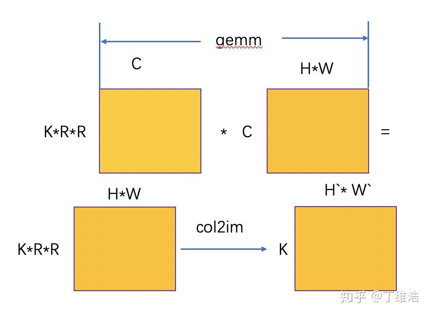
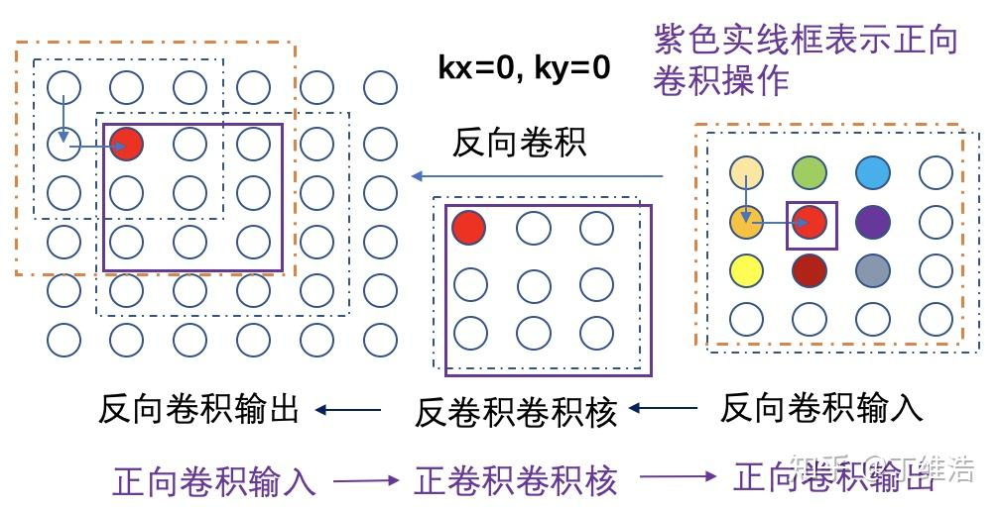
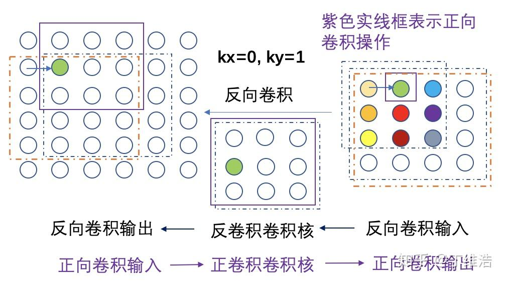
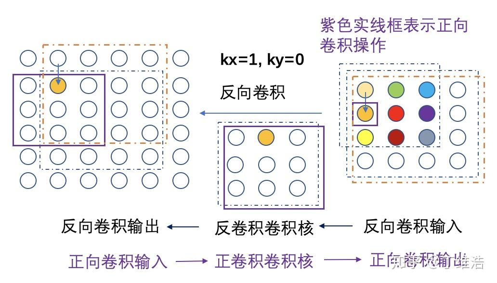
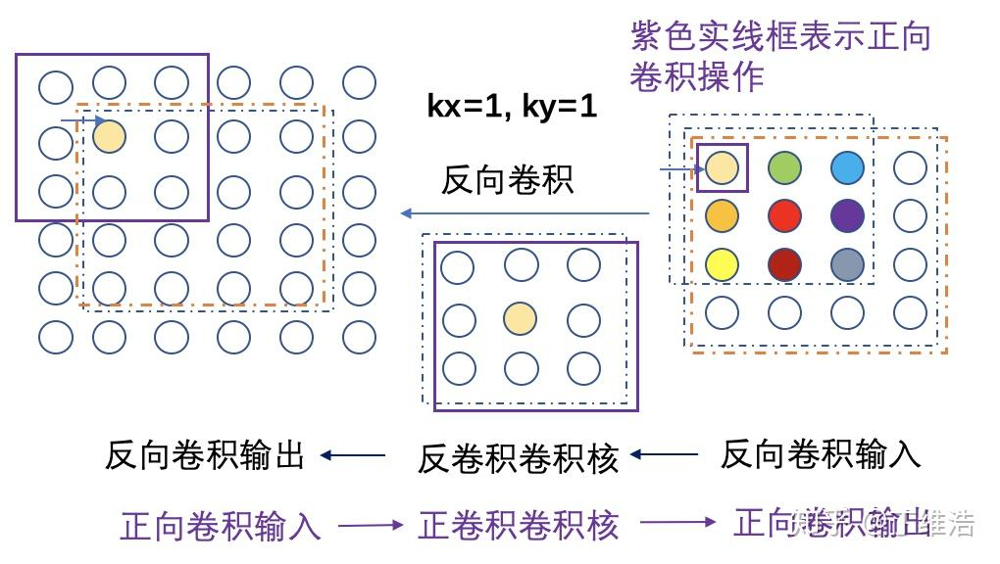

conv_transpose是啥？如果把常规convolution的计算过程理解成正卷积，那么conv_transpose就可以称做“反卷积”，一些框架索性把这个操作叫做deconvolution(caffe, MNN)，还有一些“正统框架”叫做conv_transpose(TensorFlow, PyTorch, PaddlePaddle), 笔者认为这两个名字所描述的操作是等价的。

conv_transpose有啥用？conv_transpose还是蛮有用的，至少在分割类型的网络里经常看到它的身影。

### 旋转卷积核计算conv_transpose

conv_transpose有一种最直接的计算方式：首先对卷积核做中心对称操作(矩阵旋转180°)，并对输入feature map进行插0，然后把旋转后的卷积核和插0后的feature map进行卷积操作，这里笔者不对这个过程做理论推导，只举两个case加以说明，表达最直观的计算过程。

首先给出conv_transpose的输入/输出的宽高计算公式：

***out_w = stride_w * (in_w - 1) + (dilation_w*(kernel_w - 1) + 1) - pad_w0 - pad_w1***

***out_h = stride_h * (in_h - 1) + (dilation_h*(kernel_h -1) + 1) - pad_h0 - pad_h1***

*在*dilation = 1且pad_w0 = pad_w1, pad_h0=pad_h1时，上述公式可简化为：

***out_w = stride_w * (in_w - 1) + kernel_w - 2 * pad_w***

***out_h = stride_h * (in_h - 1) + kernel_h - 2 * pad_h***

**

case 1: stride = 2, pad = 0**

令输入  X=(1234)" role="presentation">X=(1234)X = \left (  \begin{matrix} 1 & 2\\ 3 & 4 \\ \end{matrix} \right ) ,  卷积核 W=(5678)" role="presentation">W=(5678)W = \left (  \begin{matrix} 5 & 6 \\ 7 & 8 \\ \end{matrix} \right ) , 根据公式计算可得out_*w = out_*h =4：

对stride = 2的case，需要对输入feature_map进行插0，并在最外围填一圈0，

$得到 X&#x2032;=(0000001020000000304000000)" role="presentation">X′=(0000001020000000304000000)X' = \left (  \begin{matrix} 0 & 0 & 0 & 0 & 0\\ 0 & 1 & 0 & 2 & 0\\ 0 & 0 & 0 & 0 & 0 \\ 0 & 3 & 0 & 4 & 0 \\ 0 & 0 & 0 & 0 & 0 \\ \end{matrix} \right ) ,  把卷积核进行中心对称旋转得到 W&#x2032;=(8765)" role="presentation">W′=(8765)W' = \left (  \begin{matrix} 8 & 7 \\ 6 & 5 \\ \end{matrix} \right ) ,  $

把W'与X'左上角的2x2子矩阵 (0001)" role="presentation">(0001)\left (  \begin{matrix} 0 & 0\\ 0 & 1\\ \end{matrix} \right ) 做convolution计算得到5，与横向滑动一个step后的2x2子矩阵 (0010)" role="presentation">(0010)\left (  \begin{matrix} 0 & 0\\ 1 & 0\\ \end{matrix} \right ) 计算得到6，横向再滑动一个step后的2x2子矩阵 (0002)" role="presentation">(0002)\left (  \begin{matrix} 0 & 0\\ 0 & 2\\ \end{matrix} \right ) 计算得到10，横向再滑动一个step后的2x2子矩阵 \left (  \begin{matrix} 0 & 0\\ 2 & 0\\ \end{matrix} \right ) 计算得到12，回到起始子矩阵位置，与纵向下滑一个step的2x2子矩阵 \left (  \begin{matrix} 0 & 1\\ 0 & 0\\ \end{matrix} \right ) 计算得到7 ... ... , 重复这个过程得到输出计算结果 Y = \left (  \begin{matrix} 5 & 6 & 10 & 12\\ 7 & 8 & 14 & 16\\ 15 & 18 & 20 & 24\\ 21 & 24 & 28 & 32\\ \end{matrix} \right ) ， 调用Pytorch验证上述推导过程的正确性：

`>>> import torch
>>> X = torch.Tensor([[[[1, 2], [3, 4]]]])
>>> F = torch.Tensor([[[[5, 6], [7, 8]]]])
>>> Y = torch.nn.functional.conv_transpose2d(X, F, stride=2, padding=0)
>>> print(Y)
tensor([[[[ 5.,  6., 10., 12.],
          [ 7.,  8., 14., 16.],
          [15., 18., 20., 24.],
          [21., 24., 28., 32.]]]])`

**case 2: stride = 1, pad = 1**

令输入  X = \left (  \begin{matrix} 1 & 2 & 3\\ 4 & 5 & 6\\ 7 & 8 & 9\end{matrix} \right ) ,  卷积核 W = \left (  \begin{matrix} 10 & 11 & 12 \\ 13 & 14 & 15 \\ 16 & 17 & 18\end{matrix} \right ) , 根据公式计算可得out_*w = out_*h =3：

对stride = 1的case，不需要对输入feature_map进行插0操作，并在最外围填一圈0，

得到 X' = \left (  \begin{matrix} 0 & 0 & 0&0 & 0\\ 0 & 1 & 2 & 3 & 0\\ 0 & 4 & 5 & 6 & 0 \\ 0 & 7 & 8 & 9 & 0 \\ 0 & 0 & 0 & 0 & 0 \\ \end{matrix} \right ) ,  把卷积核进行中心对称旋转得到 W' = \left (  \begin{matrix} 18 & 17 & 16\\ 15 & 14 & 13\\ 12&11&10\\ \end{matrix} \right ) ,  

把W'与X'左上角的3x3子矩阵 \left (  \begin{matrix} 0 & 0 & 0\\ 0 & 1& 2\\ 0 & 4 &5\\\end{matrix} \right ) 做乘累加计算得到14+13***2+11*4**+10*5 = 134，与横向滑动一个step后的2x2子矩阵 \left (  \begin{matrix} 0 & 0 & 0\\ 1 & 2 & 3\\ 4 & 5 & 6\\\end{matrix} \right ) 计算得到15+14*2+13*3+12*4+11*5+10*6=245... ... , 重复上述过程得到输出计算结果 Y = \left (  \begin{matrix} 134 & 245 & 198 \\ 327 & 570 & 441 \\ 350 & 587 & 438 \\  \end{matrix} \right ) ， 调用Pytorch验证上述推导过程的正确性：

`>>> import torch
>>> X=torch.Tensor([[[[1, 2, 3], [4, 5, 6], [7, 8, 9]]]])
>>> F=torch.Tensor([[[[10, 11, 12], [13, 14, 15], [16, 17, 18]]]])
>>> Y = torch.nn.functional.conv_transpose2d(X,F,stride=1,padding=1)
>>> print(Y)
tensor([[[[134., 245., 198.],
          [327., 570., 441.],
          [350., 587., 438.]]]])`

### gemm+col2im 计算 conv_transpose

从上面旋转卷积核的计算方法可知，stride = 2时还需要对输入进行插0操作，所以在实际当中很少使用旋转卷积核+调用conv的方法来计算conv_transpose。

caffe中计算deconvolution的方法是gemm+col2im,  这个方法实际当中被广泛采用来计算conv_transpose，下面做一下简要分析。

gemm+col2im计算conv_transpose假设输入feature_map的layout是C*H*W(假设batch=1), filter layout是K*C*R*R,  对输入进行gemm后得到的中间结果layout是K*R*R*H*W (对gemm而言，M' = KRR, K'= C, N'=H*), 先做gemm可以把C这一维进行累加削除,  然后做col2im得到最后计算结果的layout是K*H'*W'(H'和W'是对应输出的宽高)，实际上这里的col2im通过累加的方式把KRR这一维降维到K, 对H'*W'这一维可以根据公式得到输入输出宽高的对应关系。

实际上，deconvolution使用的gemm+col2im和普通convolution使用的im2col+gemm放在一起来看，是正反两个计算过程，可以类比为数学中的反函数(已知函数f(x)，求f(x)的反函数f'(x),  这个数学概念是不是很熟悉=+?+=， 数学老师教我们把x和y互换一下，再整理得到y和x关系即可...)

下面给出caffe中col2im的cpu代码实现，比较简单，我们先来消化一下：

`inline bool is_a_ge_zero_and_a_lt_b(int a, int b) {
  return static_castunsigned>(a)  static_castunsigned>(b);
}
... ...
template <>
void col2imfloat>(const float* data_col,
                   const int channels,
                   const int height,
                   const int width,
                   const int kernel_h,
                   const int kernel_w,
                   const int pad_h0,
                   const int pad_h1,
                   const int pad_w0,
                   const int pad_w1,
                   const int stride_h,
                   const int stride_w,
                   const int dilation_h,
                   const int dilation_w,
                   float* data_im) {
  memset(data_im, 0, height * width * channels * sizeof(float));
  const int output_h =
      (height + pad_h0 + pad_h1 - (dilation_h * (kernel_h - 1) + 1)) / stride_h + 1;
  const int output_w =
      (width + pad_w0 + pad_w1 - (dilation_w * (kernel_w - 1) + 1)) / stride_w + 1;
  const int channel_size = height * width;
  for (int channel = channels; channel--; data_im += channel_size) {
    for (int kernel_row = 0; kernel_row  kernel_h; kernel_row++) {
      for (int kernel_col = 0; kernel_col  kernel_w; kernel_col++) {
        int input_row = -pad_h0 + kernel_row * dilation_h;
        for (int output_rows = output_h; output_rows; output_rows--) {
          if (!is_a_ge_zero_and_a_lt_b(input_row, height)) {
            data_col += output_w;
          } else {
            int input_col = -pad_w0 + kernel_col * dilation_w;
            for (int output_col = output_w; output_col; output_col--) {
              if (is_a_ge_zero_and_a_lt_b(input_col, width)) {
                data_im[input_row * width + input_col] += *data_col;
              }
              data_col++;
              input_col += stride_w;
            }
          }
          input_row += stride_h;
        }
      }
    }
  }
}
`

### 直接法计算conv_transpose depth-wise

由于gemm+col2im的实现conv_transpose对depth-wise场景(ic=oc=group)下并不是一个很好的选择，针对depthwise，gemm实现变成了两个行列向量的点积操作（M' = KRR, K' = 1, N' = HW, 两个输入矩阵维度分别是KRR * 1和1*HW),  col2im实现累加操作(每RR个数据累加成1个数据)，由于depth-wise channel间没有依赖， 这两步可以放在一步里面直接执行，从而减少额外中间数据读写操作带来的性能损失(depth-wise不是compute bound操作，属于memory bound操作），笔者下面采用直接计算方法来实现conv_transpose depth-wise，首先从前面的col2im代码出发，我们可以得到一个最基础的代码实现版本(版本1)：

`template <>
void conv_transpose_depthwisefloat>(const float* dst,
                                     const float* weights,
                                     const int channels,
                                     const int height,
                                     const int width,
                                     const int kernel_h,
                                     const int kernel_w,
                                     const int pad_h0,
                                     const int pad_h1,
                                     const int pad_w0,
                                     const int pad_w1,
                                     const int stride_h,
                                     const int stride_w,
                                     const int dilation_h,
                                     const int dilation_w,
                                     float* src) {
  memset(src, 0, height * width * channels * sizeof(float));
  const int output_h =
      (height + pad_h0 + pad_h1 - (dilation_h * (kernel_h - 1) + 1)) / stride_h + 1;
  const int output_w =
      (width + pad_w0 + pad_w1 - (dilation_w * (kernel_w - 1) + 1)) / stride_w + 1;
  const int ic_plane_size = height * width;
  const int oc_plane_size = output_h * output_w;
  const int rr_plane_size = kernel_h * kernel_w;
  for (int c = 0; c  channels; c++) {
    int dst_z = c * oc_plane_size;
    int weight_z = c * rr_plane_size;
    for (int ky = 0; ky  kernel_h; ky++) {
      int ih = -pad_h0 + ky * dilation_h;
      for (int kx = 0; kx  kernel_w; kx++) {
        int iw = -pad_w0 + kx * dilation_w;
        for (int oh = 0; oh  output_h; oh++) {
          if ((ih >= 0) && (ih  height)) {
            for (int ow = 0; ow  output_w; ow++) {
              if ((iw >= 0) && (iw  width)) {
                src[ih * width + iw] += dst[dst_z +
                        oh * output_w + ow] * weights[weight_z + ky*kernel_w + kx];
                iw += stride_w;
              }
            }
          }
          ih += stride_h;
        }
      }
    }
    src += ic_plane_size;
  }
}
`

把gemm+col2im的代码用做conv_transpose比较正确性的reference code或者把上面代码的计算结果放到pytorch/tensorflow等框架里面做结果比对可简单验证正确性，

需要注意两个问题：

-  conv_transpose depth-wise由5个for循环组成，无论怎么写，对channel的遍历一定是放在最外层，不考虑对kernel_h和kernel_w写专门的特化版本，实际上有两种写法，第一种写法把kernel_y和kernel_x这两层for循环放在output_h和output_w两层for循环之间：
`for (int c = 0； c  channel; ++c) 
   for (int ky = 0; ky  kernel_h; ++ky)
      for (int kx = 0; kx  kernel_w; ++kx)
         //下面两个for循环作为micro kernel来优化
         for (int oh = 0; oh  output_h; oh++)
            for (int ow = 0; ow  output_w; ow++)
`

第二种写法是把output_h和output_w两层for循环放在kernel_y和kernel_x这两层for循环之间：

`for (int c = 0； c  channel; ++c) 
   for (int oh = 0; oh  output_h; oh++)
        for (int ow = 0; ow  output_w; ow++)
        //下面两个for循环作为micro kernel来优化 
         for (int ky = 0; ky  kernel_h; ++ky)
            for (int kx = 0; kx  kernel_w; ++kx)
`

第一种写法的问题是对output_h和output_w做最内层遍历时有边界判断，做micro_kernel优化时不利于做并行化SIMD实现， 第二种写法把边界判断的操作放在了micro_kernel的外面，但问题是做SIMD并行化处理时可并行处理的数据块太小了(比如实际经常使用的3x3和1x1的kernel_size，[MNN](https://link.zhihu.com/?target=https%3A//github.com/alibaba/MNN)和[TNN](https://link.zhihu.com/?target=https%3A//github.com/tencent/TNN)使用C4的layout并采用第二种实现方式每次处理一个C4数据)，实际上第一种实现方式更好，micro kernel内的if-else边界判断是可以消除的，我们后面来讲这个问题。

第二个问题是版本一的代码中src表示输出，dst表示输入，output_w/output_h表示实际输入宽高，ih/iw表示遍历实际输出宽高的index,  oh/ow表示遍历实际输入宽高的index，这样命名的原因是conv_transpose是普通convolution的反向操作且这样可以和其他框架保持一致，相当于已知普通convolution的输出结果去求输入。下面来简单描述下conv_transpose的原理。

假设conv_transpose的参数是f3s1p1, w_in=h_in=w_out=h_out=4, 通过追溯conv_transpose计算得到的输出最左上角的数据点来说明conv_transpose的计算原理，注意4张图中橙色虚线表示在当前kx/ky下根据当前conv_transpose的输入找到需要计算得到的输出区域，每张图最左边最外面一圈数据点表示虚拟出来的pad数据点，紫色实线框表示正向卷积操作对应的部分。假设存在一个正向卷积核，conv_transpose计算输出4x4的左上角的这个点参与了正向卷积4个输出点的计算（conv_transpose计算输入左上角的4个点），所以实际上当进行conv_transpose计算把正向卷积输出作为输入时，需要使用这4个点的数据和相应conv_transpose卷积核的乘累加结果来“***还原***”出左上角那个点的数据。

理解了这4张图的含义才真正理解了conv_transpose的真正内涵，同时也说明了一个问题：用直接法计算conv_transpose时必须从输入出发来计算输出，这与常规卷积从输出出发来找输入完成计算是恰恰相反的(从输出每个点出发来找到输入的kernel_w*kernel_h个点，做乘累加得到输出点的计算结果)！而做conv_transpose如果硬要从输出出发来找输入，必须把卷积核旋转90度，才能一一对应做乘累加，这又回到了最开始陈述的那个问题，可能需要进行插0操作不可取。

kx=0,ky=0时的反卷积计算示意图

kx=0, ky=1时反卷积计算示意图

kx=1,ky=0时反卷积计算示意图

kx=1,ky=1时反卷积计算示意图第二版代码：

`template <>
void conv_transpose_depthwisefloat>(const float* dst,
                                    const float* weights,
                                    const int channels,
                                    const int height,
                                    const int width,
                                    const int kernel_h,
                                    const int kernel_w,
                                    const int pad_h0,
                                    const int pad_h1,
                                    const int pad_w0,
                                    const int pad_w1,
                                    const int stride_h,
                                    const int stride_w,
                                    const int dilation_h,
                                    const int dilation_w,
                                    float* src) {
  memset(src, 0, height * width * channels * sizeof(float));
  const int output_h =
      (height + pad_h0 + pad_h1 - (dilation_h * (kernel_h - 1) + 1)) / stride_h + 1;
  const int output_w =
      (width + pad_w0 + pad_w1 - (dilation_w * (kernel_w - 1) + 1)) / stride_w + 1;
  const int ic_plane_size = height * width;
  const int oc_plane_size = output_h * output_w;
  const int rr_plane_size = kernel_h * kernel_w;
  for (int c = 0; c  channels; c++) {
    int dst_z = c * oc_plane_size;
    int weight_z = c * rr_plane_size;
    for (int ky = 0; ky  kernel_h; ky++) {
      for (int kx = 0; kx  kernel_w; kx++) {
        int ih = -pad_h0 + ky * dilation_h;
        for (int oh = 0; oh  output_h; oh++) {
          if ((ih >= 0) && (ih  height)) {
            for (int ow = 0; ow  output_w; ow++) {
              int iw = -pad_w0 + kx * dilation_w;
              bool boundary = ((iw >= 0) && (iw  width));
              src[ih * width + iw] += (boundary) * dst[dst_z +
                      oh * output_w + ow] * weights[weight_z + ky*kernel_w + kx];
              iw += stride_w;
            }
          }
          ih += stride_h;
        }
      }
    }
    src += ic_plane_size;
  }
}
`

第二个版本相比第一个版本唯一的区别在于把if ((iw >= 0) && (iw = 0) && (iw 分支问题，把if ((ih >= 0) && (ih template <>
void conv_transpose_depthwisefloat>(const float* dst,
                                    const float* weights,
                                    const int channels,
                                    const int height,
                                    const int width,
                                    const int kernel_h,
                                    const int kernel_w,
                                    const int pad_h0,
                                    const int pad_h1,
                                    const int pad_w0,
                                    const int pad_w1,
                                    const int stride_h,
                                    const int stride_w,
                                    const int dilation_h,
                                    const int dilation_w,
                                    float* src) {
  memset(src, 0, height * width * channels * sizeof(float));
  const int output_h =
      (height + pad_h0 + pad_h1 - (dilation_h * (kernel_h - 1) + 1)) / stride_h + 1;
  const int output_w =
      (width + pad_w0 + pad_w1 - (dilation_w * (kernel_w - 1) + 1)) / stride_w + 1;
  const int ic_plane_size = height * width;
  const int oc_plane_size = output_h * output_w;
  const int rr_plane_size = kernel_h * kernel_w;
  for (int c = 0; c  channels; c++) {
    int dst_z = c * oc_plane_size;
    int weight_z = c * rr_plane_size;
    for (int ky = 0; ky  kernel_h; ky++) {
      for (int kx = 0; kx  kernel_w; kx++) {
        int ih = -pad_h0 + ky * dilation_h;
        for (int oh = 0; oh  output_h; oh++) {
          if ((ih >= 0) && (ih  height)) {
            for (int ow = 0; ow  output_w; ow++) {
              int iw = -pad_w0 + kx * dilation_w;
              int cnt = output_w >> 2;
              int remain = output_w % 4;
              for (int i = 0; i  cnt; i++) {
                bool boundary0 = (iw >= 0) && (iw  width);
                bool boundary1 = ((iw + stride_w) >= 0) && ((iw + stride_w)  width);
                bool boundary2 = ((iw + stride_w * 2) >= 0) && ((iw + stride_w * 2)  width);
                bool boundary3 = ((iw + stride_w * 3) >= 0) && ((iw + stride_w * 3)  width);
                src[ih * width + iw] += (boundary0) * dst[dst_z +
                      oh * output_w + i * 4] * weights[weight_z + ky*kernel_w + kx];
                src[ih * width + iw + stride_w] += (boundary1) * dst[dst_z +
                      oh * output_w + i * 4 + 1] * weights[weight_z + ky*kernel_w + kx];
                src[ih * width + iw + stride_w * 2] += (boundary2) * dst[dst_z +
                      oh * output_w + i * 4 + 2] * weights[weight_z + ky*kernel_w + kx];
                src[ih * width + iw + stride_w * 3] += (boundary3) * dst[dst_z +
                      oh * output_w + i * 4 + 3] * weights[weight_z + ky*kernel_w + kx];
                iw += 4 * stride_w;
              }
              for (int rem = 0; rem  remain; rem++) {
                bool boundary = ((iw >= 0) && (iw  width));
                src[ih * width + iw] += (boundary) * dst[dst_z +
                  oh * output_w + rem + cnt * 4] * weights[weight_z + ky*kernel_w + kx];
                iw += stride_w;
              }
            }
          }
          ih += stride_h;
        }
      }
    }
    src += ic_plane_size;
  }
}
`

在第三版伪SIMD代码中，笔者给出了在w方向一次计算4个float数据的形式，在这一版代码中暴露了一个问题：在把4个计算数据store到data_im相应位置时4个数据间隔为stride_w，我们知道neon SIMD中进行load/store操作间隔最多为4(ld1/ld2/ld3/ld4/st1/st2/st3/st4), 这是SIMD与SIMT(cuda)软件编程层面非常大的一个区别，由于cuda使用SIMT架构，可以通过thread_id*offset的方式来处理多thread等间隔读/写操作时的问题(不考虑合并访问带来的效率问题)， 但arm neon采用SIMD结构， ***multiple data在load/store存储时必须要绑定在一起***。为此，需要按stride=1和stride=2分别进行特化，实现特化版本，下面以stride=1来给出第四个版本的优化：

* 第四版代码：*

`template <>
void conv_transpose_depthwise_s1float>(const float* dst,
                                        const float* weights,
                                        const int channels,
                                        const int height,
                                        const int width,
                                        const int kernel_h,
                                        const int kernel_w,
                                        const int pad_h0,
                                        const int pad_h1,
                                        const int pad_w0,
                                        const int pad_w1,
                                        const int dilation_h,
                                        const int dilation_w,
                                        float* src) {
  memset(src, 0, height * width * channels * sizeof(float));
  const int output_h =
      (height + pad_h0 + pad_h1 - (dilation_h * (kernel_h - 1) + 1)) + 1;
  const int output_w =
      (width + pad_w0 + pad_w1 - (dilation_w * (kernel_w - 1) + 1)) + 1;
  const int ic_plane_size = height * width;
  const int oc_plane_size = output_h * output_w;
  const int rr_plane_size = kernel_h * kernel_w;
  for (int c = 0; c  channels; c++) {
    int dst_z = c * oc_plane_size;
    int weight_z = c * rr_plane_size;
    for (int ky = 0; ky  kernel_h; ky++) {
      int weight_y = ky * kernel_w;
      for (int kx = 0; kx  kernel_w; kx++) {
        int weight_offset = weight_z + weight_y + kx;
        int ih = -pad_h0 + ky * dilation_h;
        for (int oh = 0; oh  output_h; oh++) {
          int src_y = ih * width;
          int dst_y = oh * output_w;
          if ((ih > 0) && (ih  height)) {
            int iw = -pad_w0 + kx * dilation_w;
            int cnt = output_w >> 4;
            int remain = output_w % 16;
            for (int i = 0; i  cnt; i++) {
              int dst_offset = dst_z + dst_y + i * 16;
              int src_offset = src_y + iw;
              const float* dst_addr = dst + dst_offset;
              float* src_addr = src + src_offset;
              const float* weight_addr = weights + weight_zyx;
              const int iw_data[16] = { iw, iw + 1, iw + 2, iw + 3,
                                       iw + 4, iw + 5, iw + 6, iw + 7,
                                       iw + 8, iw + 9, iw + 10, iw + 11,
                                       iw + 12, iw + 13, iw + 14, iw + 15};
              uint32x4_t boundary0 = vandq_u32(vcgeq_s32(vld1q_s32(iw_data), vdupq_n_s32(0)),
                                     vcltq_s32(vld1q_s32(iw_data), vdupq_n_s32(width)));
              uint32x4_t boundary1 = vandq_u32(vcgeq_s32(vld1q_s32(iw_data + 4), vdupq_n_s32(0)),
                                     vcltq_s32(vld1q_s32(iw_data + 4), vdupq_n_s32(width)));
              uint32x4_t boundary2 = vandq_u32(vcgeq_s32(vld1q_s32(iw_data + 8), vdupq_n_s32(0)),
                                     vcltq_s32(vld1q_s32(iw_data + 8), vdupq_n_s32(width)));
              uint32x4_t boundary3 = vandq_u32(vcgeq_s32(vld1q_s32(iw_data + 12), vdupq_n_s32(0)),
                                     vcltq_s32(vld1q_s32(iw_data + 12), vdupq_n_s32(width)));
              float32x4_t src_v0 = vmlaq_f32(vld1q_f32(src_addr), vld1q_f32(dst_addr),
                                       vbslq_f32(boundary0, vld1q_dup_f32(weight_addr), vdupq_n_f32(0)));
              float32x4_t src_v1 = vmlaq_f32(vld1q_f32(src_addr + 4), vld1q_f32(dst_addr + 4),
                                       vbslq_f32(boundary1, vld1q_dup_f32(weight_addr), vdupq_n_f32(0)));
              float32x4_t src_v2 = vmlaq_f32(vld1q_f32(src_addr + 8), vld1q_f32(dst_addr + 8),
                                       vbslq_f32(boundary2, vld1q_dup_f32(weight_addr), vdupq_n_f32(0)));
              float32x4_t src_v3 = vmlaq_f32(vld1q_f32(src_addr + 12), vld1q_f32(dst_addr + 12),
                                       vbslq_f32(boundary3, vld1q_dup_f32(weight_addr), vdupq_n_f32(0)));
              vst1q_f32(src_addr, src_v0);
              vst1q_f32(src_addr + 4, src_v1);
              vst1q_f32(src_addr + 8, src_v2);
              vst1q_f32(src_addr + 12, src_v3);                        
              iw += 16;
            }
            for (int rem = 0; rem  remain; rem++) {
              bool boundary = ((iw >= 0) && (iw  width));
              src[src_y + iw] += (boundary) * dst[dst_z + oh * output_w + rem + cnt * 16] * weights[weight_z
                                                          + ky*kernel_w + kx];
              iw += 1;
            }
          }
          ih += 1;
        }
      }
    }
    src += ic_plane_size;
  }
}
`

第四个版本与第三个版本相比，在w方向上改为一次处理16个float数据增加并行性，把伪SIMD的代码改为调用ARM neon intrinsic 的形式来实现，先把要处理的16个w方向上的数据横向坐标放到一个连续空间的数组变量iw_data中，下面这条语句实现的是4个数据的SIMD比较：

`uint32x4_t boundray0 = vandq_u32(vcgeq_s32(vld1q_s32(iw_data), vdupq_n_s32(0)),
                            vcltq_s32(vld1q_s32(iw_data), vdupq_n_s32(width)));
`

等价于下面原始的4次比较操作：

`bool boundary0 = (iw >= 0) && (iw  width);
bool boundary1 = ((iw + 1) >= 0) && ((iw + 1)  width);
bool boundary2 = ((iw + 2) >= 0) && ((iw + 2)  width);
bool boundary3 = ((iw + 3) >= 0) && ((iw + 3)  width);
`

测试了一下这个版本的代码性能，比之前使用gemm+col2im的方式计算depth-wise提升了接近1倍左右，注意ARM CPU的L1 cache line size一般是64 byte，所以在w方向上每次最多取16个float数据，但这个版本的micro kernel只包含for(int ow=0; owtemplate <>
void conv_transpose_depthwise_s1float>(const float* dst,
                                        const float* weights,
                                        const int channels,
                                        const int height,
                                        const int width,
                                        const int kernel_h,
                                        const int kernel_w,
                                        const int pad_h0,
                                        const int pad_h1,
                                        const int pad_w0,
                                        const int pad_w1,
                                        const int dilation_h,
                                        const int dilation_w,
                                        float* src,
                                        ARMContext *ctx) {
  memset(src, 0, height * width * channels * sizeof(float));
  const int output_h =
      (height + pad_h0 + pad_h1 - (dilation_h * (kernel_h - 1) + 1)) + 1;
  const int output_w =
      (width + pad_w0 + pad_w1 - (dilation_w * (kernel_w - 1) + 1)) + 1;
  float* zero_ptr = ctx->workspace_datafloat>();
  //float* zero_ptr = (float*)malloc(width * sizeof(float));
  memset(zero_ptr, 0, width * sizeof(float));
  const int ic_plane_size = height * width;
  const int oc_plane_size = output_h * output_w;
  const int rr_plane_size = kernel_h * kernel_w;
  for (int c = 0; c  channels; c++) {
    int dst_z = c * oc_plane_size;
    int weight_z = c * rr_plane_size;
    int src_z = c * ic_plane_size;
    for (int ky = 0; ky  kernel_h; ky++) {
      int weight_y = ky * kernel_w;
      for (int kx = 0; kx  kernel_w; kx++) {
        int weight_offset = weight_z + weight_y + kx;
        for (int ih = -pad_h0 + ky * dilation_h, oh = 0; oh  output_h; ih += 2, oh += 2) {
          int src_y = ih * width;
          int dst_y = oh * output_w;
          const int ih_data[2] = {ih, ih + 1};
          uint32x2_t boundray_y = vand_u32(vcge_s32(vld1_s32(ih_data), vdup_n_s32(0)),
                                     vclt_s32(vld1_s32(ih_data), vdup_n_s32(height)));
          bool boundary_y0 = ((ih >= 0) && (ih  height)) && (oh  output_h);
          bool boundary_y1 = ((ih + 1) >= 0) && ((ih + 1)  height) && ((oh + 1)  output_h);
          float* src_addr_h0 = boundary_y0 ? (src + src_z + src_y) : zero_ptr;
          float* src_addr_h1 = boundary_y1 ? (src + src_z + width + src_y) : zero_ptr;
          int iw = -pad_w0 + kx * dilation_w;
          int cnt = output_w >> 4;
          int remain = output_w % 16;
          for (int i = 0; i  cnt; i++) {
            int dst_offset = dst_z + dst_y + i * 16;
            const float* dst_addr = dst + dst_offset;
            const float* weight_addr = weights + weight_offset;
            const int iw_data[16] = { iw, iw + 1, iw + 2, iw + 3,
                                      iw + 4, iw + 5, iw + 6, iw + 7,
                                      iw + 8, iw + 9, iw + 10, iw + 11,
                                      iw + 12, iw + 13, iw + 14, iw + 15};
            uint32x4_t boundray_x0 = vandq_u32(vcgeq_s32(vld1q_s32(iw_data), vdupq_n_s32(0)),
                                    vcltq_s32(vld1q_s32(iw_data), vdupq_n_s32(width)));
            uint32x4_t boundray_x1 = vandq_u32(vcgeq_s32(vld1q_s32(iw_data + 4), vdupq_n_s32(0)),
                                    vcltq_s32(vld1q_s32(iw_data + 4), vdupq_n_s32(width)));
            uint32x4_t boundray_x2 = vandq_u32(vcgeq_s32(vld1q_s32(iw_data + 8), vdupq_n_s32(0)),
                                    vcltq_s32(vld1q_s32(iw_data + 8), vdupq_n_s32(width)));
            uint32x4_t boundray_x3 = vandq_u32(vcgeq_s32(vld1q_s32(iw_data + 12), vdupq_n_s32(0)),
                                    vcltq_s32(vld1q_s32(iw_data + 12), vdupq_n_s32(width)));
            uint32x4_t boundray_0 = vandq_u32(boundray_x0, vdupq_lane_u32(boundray_y, 0));
            uint32x4_t boundray_1 = vandq_u32(boundray_x1, vdupq_lane_u32(boundray_y, 0));
            uint32x4_t boundray_2 = vandq_u32(boundray_x2, vdupq_lane_u32(boundray_y, 0));
            uint32x4_t boundray_3 = vandq_u32(boundray_x3, vdupq_lane_u32(boundray_y, 0));

            uint32x4_t boundray_4 = vandq_u32(boundray_x0, vdupq_lane_u32(boundray_y, 1));
            uint32x4_t boundray_5 = vandq_u32(boundray_x1, vdupq_lane_u32(boundray_y, 1));
            uint32x4_t boundray_6 = vandq_u32(boundray_x2, vdupq_lane_u32(boundray_y, 1));
            uint32x4_t boundray_7 = vandq_u32(boundray_x3, vdupq_lane_u32(boundray_y, 1));
            float32x4_t src_v0 = vmlaq_f32(vld1q_f32(src_addr_h0 + iw), vld1q_f32(dst_addr),
                                      vbslq_f32(boundray_0, vld1q_dup_f32(weight_addr), vdupq_n_f32(0)));
            float32x4_t src_v1 = vmlaq_f32(vld1q_f32(src_addr_h0 + iw + 4), vld1q_f32(dst_addr + 4),
                                      vbslq_f32(boundray_1, vld1q_dup_f32(weight_addr), vdupq_n_f32(0)));
            float32x4_t src_v2 = vmlaq_f32(vld1q_f32(src_addr_h0 + iw + 8), vld1q_f32(dst_addr + 8),
                                      vbslq_f32(boundray_2, vld1q_dup_f32(weight_addr), vdupq_n_f32(0)));
            float32x4_t src_v3 = vmlaq_f32(vld1q_f32(src_addr_h0 + iw + 12), vld1q_f32(dst_addr + 12),
                                      vbslq_f32(boundray_3, vld1q_dup_f32(weight_addr), vdupq_n_f32(0)));
            float32x4_t src_v4 = vmlaq_f32(vld1q_f32(src_addr_h1 + iw), vld1q_f32(dst_addr + output_w),
                                      vbslq_f32(boundray_4, vld1q_dup_f32(weight_addr), vdupq_n_f32(0)));
            float32x4_t src_v5 = vmlaq_f32(vld1q_f32(src_addr_h1 + iw + 4), vld1q_f32(dst_addr + output_w + 4),
                                      vbslq_f32(boundray_5, vld1q_dup_f32(weight_addr), vdupq_n_f32(0)));
            float32x4_t src_v6 = vmlaq_f32(vld1q_f32(src_addr_h1 + iw + 8), vld1q_f32(dst_addr + output_w + 8),
                                      vbslq_f32(boundray_6, vld1q_dup_f32(weight_addr), vdupq_n_f32(0)));
            float32x4_t src_v7 = vmlaq_f32(vld1q_f32(src_addr_h1 + iw + 12), vld1q_f32(dst_addr + output_w + 12),
                                      vbslq_f32(boundray_7, vld1q_dup_f32(weight_addr), vdupq_n_f32(0)));
            vst1q_f32(src_addr_h0 + iw,      src_v0);
            vst1q_f32(src_addr_h0 + iw + 4,  src_v1);
            vst1q_f32(src_addr_h0 + iw + 8,  src_v2);
            vst1q_f32(src_addr_h0 + iw + 12, src_v3);
            vst1q_f32(src_addr_h1 + iw,      src_v4);
            vst1q_f32(src_addr_h1 + iw + 4,  src_v5);
            vst1q_f32(src_addr_h1 + iw + 8,  src_v6);
            vst1q_f32(src_addr_h1 + iw + 12, src_v7);
            iw += 16;
          }
          for (int rem = 0; rem  remain; rem++) {
            bool boundary_x = ((iw >= 0) && (iw  width));
            src[src_z + src_y + iw] += (boundary_x) * (boundary_y0) * dst[dst_z +
                                            oh * output_w + rem + cnt * 16] * weights[weight_offset];
            src[src_z + src_y + width + iw] += (boundary_x) * (boundary_y1) * dst[dst_z +
                                            (oh + 1) * output_w + rem + cnt * 16] * weights[weight_offset];
            iw += 1;
          }
        }
      }
    }
  }
}
`

第5版代码与第4版代码相比做的优化处理是在output_h方向上每次计算两行，用在output_w方向上使用的消除if-else技巧来消除output_h方向上的if-else， 但仅仅这样是不够的，笔者申请了一块地址空间zero_ptr作为在output_h方向上处理数据的读写缓冲区，由于pad的影响并且不同channel之间的数据是连续存储的，所以对channel(i)的边界读写操作很容易落到channel(i-1)和channel(i+1)的区域内，为此第5版代码中的**boundary_y0**和**boundary_y1**是处理当前两行标志是否越界的mask， 如果越界则对当前行的读/写操作都挪到**zero_ptr**这个缓存buffer里，这也是做优化处理边界情况经常使用的一种处理越界访问的技巧。

`bool boundary_y0 = ((ih >= 0) && (ih  height)) && (oh  output_h);
bool boundary_y1 = ((ih + 1) >= 0) && ((ih + 1)  height) && ((oh + 1)  output_h);
float* data_im_addr_h0 = boundary_y0 ? (data_im + data_im_z + data_im_y) : zero_ptr;
float* data_im_addr_h1 = boundary_y1 ? (data_im + data_im_z + width + data_im_y) : zero_ptr;
`

第5版代码处理的tile实际上2行*16列个float数据, 很不幸，这段代码存在bug, 在处理奇数行（output_h=奇数）的case时测试结果是错的，为此笔者debug后发现在边界判断时少加了一个地方，在处理越界时不仅需要检查ih, 还要检查oh, 在处理奇数行的case时，在当前channel做最后一次处理时读取的第二行输入数据本身已经“越界”了...+_+...

//错误

bool boundary_y0 = ((ih >= 0) && (ih = 0) && ((ih + 1) = 0) && (ih = 0) && ((ih + 1) template <>
void conv_transpose_depthwise_s1float>(const float* dst,
                                        const float* weights,
                                        const int channels,
                                        const int height,
                                        const int width,
                                        const int kernel_h,
                                        const int kernel_w,
                                        const int pad_h0,
                                        const int pad_h1,
                                        const int pad_w0,
                                        const int pad_w1,
                                        const int dilation_h,
                                        const int dilation_w,
                                        float* src,
                                        ARMContext *ctx) {
  memset(src, 0, height * width * channels * sizeof(float));
  const int output_h =
      (height + pad_h0 + pad_h1 - (dilation_h * (kernel_h - 1) + 1)) + 1;
  const int output_w =
      (width + pad_w0 + pad_w1 - (dilation_w * (kernel_w - 1) + 1)) + 1;
  float* zero_ptr = ctx->workspace_datafloat>();
  memset(zero_ptr, 0, width * sizeof(float));
  const int ic_plane_size = height * width;
  const int oc_plane_size = output_h * output_w;
  const int rr_plane_size = kernel_h * kernel_w;
  for (int c = 0; c  channels; c++) {
    int dst_z = c * oc_plane_size;
    int weight_z = c * rr_plane_size;
    int src_z = c * ic_plane_size;
    for (int ky = 0; ky  kernel_h; ky++) {
      int weight_y = ky * kernel_w;
      for (int kx = 0; kx  kernel_w; kx++) {
        int weight_offset = weight_z + weight_y + kx;
        const float* weight_addr = weights + weight_offset;
        for (int ih = -pad_h0 + ky * dilation_h, oh = 0; oh  output_h; ih += 2, oh += 2) {
          int src_y = ih * width;
          int dst_y = oh * output_w;
          //const int ih_data[4] = {ih, ih + 1, ih + 2, ih + 3};
          const int ih_data[2] = {ih, ih + 1};
          uint32x2_t boundray_y = vand_u32(vcge_s32(vld1_s32(ih_data), vdup_n_s32(0)),
                                     vclt_s32(vld1_s32(ih_data), vdup_n_s32(height)));
          bool boundary_y0 = ((ih >= 0) && (ih  height)) && (oh  output_h);
          bool boundary_y1 = ((ih + 1) >= 0) && ((ih + 1)  height) && ((oh + 1)  output_h);
          float* src_addr_h0 = boundary_y0 ? (src + src_z + src_y) : zero_ptr;
          float* src_addr_h1 = boundary_y1 ? (src + src_z + width + src_y) : zero_ptr;
          int iw = -pad_w0 + kx * dilation_w;
          int i = 0;
          for (; i + 15  output_w; i += 16, iw += 16) {
            int dst_offset = dst_z + dst_y + i;
            const float* dst_addr = dst + dst_offset;
            const int iw_data[16] = { iw, iw + 1, iw + 2, iw + 3,
                                      iw + 4, iw + 5, iw + 6, iw + 7,
                                      iw + 8, iw + 9, iw + 10, iw + 11,
                                      iw + 12, iw + 13, iw + 14, iw + 15};
            uint32x4_t boundray_x0 = vandq_u32(vcgeq_s32(vld1q_s32(iw_data), vdupq_n_s32(0)),
                                    vcltq_s32(vld1q_s32(iw_data), vdupq_n_s32(width)));
            uint32x4_t boundray_x1 = vandq_u32(vcgeq_s32(vld1q_s32(iw_data + 4), vdupq_n_s32(0)),
                                    vcltq_s32(vld1q_s32(iw_data + 4), vdupq_n_s32(width)));
            uint32x4_t boundray_x2 = vandq_u32(vcgeq_s32(vld1q_s32(iw_data + 8), vdupq_n_s32(0)),
                                    vcltq_s32(vld1q_s32(iw_data + 8), vdupq_n_s32(width)));
            uint32x4_t boundray_x3 = vandq_u32(vcgeq_s32(vld1q_s32(iw_data + 12), vdupq_n_s32(0)),
                                    vcltq_s32(vld1q_s32(iw_data + 12), vdupq_n_s32(width)));
            float32x4_t src_v0 = vmlaq_f32(vld1q_f32(src_addr_h0 + iw), vld1q_f32(dst_addr),
                                      vbslq_f32(boundray_x0, vld1q_dup_f32(weight_addr), vdupq_n_f32(0)));
            float32x4_t src_v1 = vmlaq_f32(vld1q_f32(src_addr_h0 + iw + 4), vld1q_f32(dst_addr + 4),
                                      vbslq_f32(boundray_x1, vld1q_dup_f32(weight_addr), vdupq_n_f32(0)));
            float32x4_t src_v2 = vmlaq_f32(vld1q_f32(src_addr_h0 + iw + 8), vld1q_f32(dst_addr + 8),
                                      vbslq_f32(boundray_x2, vld1q_dup_f32(weight_addr), vdupq_n_f32(0)));
            float32x4_t src_v3 = vmlaq_f32(vld1q_f32(src_addr_h0 + iw + 12), vld1q_f32(dst_addr + 12),
                                      vbslq_f32(boundray_x3, vld1q_dup_f32(weight_addr), vdupq_n_f32(0)));
            float32x4_t src_v4 = vmlaq_f32(vld1q_f32(src_addr_h1 + iw), vld1q_f32(dst_addr + output_w),
                                      vbslq_f32(boundray_x0, vld1q_dup_f32(weight_addr), vdupq_n_f32(0)));
            float32x4_t src_v5 = vmlaq_f32(vld1q_f32(src_addr_h1 + iw + 4), vld1q_f32(dst_addr + output_w + 4),
                                      vbslq_f32(boundray_x1, vld1q_dup_f32(weight_addr), vdupq_n_f32(0)));
            float32x4_t src_v6 = vmlaq_f32(vld1q_f32(src_addr_h1 + iw + 8), vld1q_f32(dst_addr + output_w + 8),
                                      vbslq_f32(boundray_x2, vld1q_dup_f32(weight_addr), vdupq_n_f32(0)));
            float32x4_t src_v7 = vmlaq_f32(vld1q_f32(src_addr_h1 + iw + 12), vld1q_f32(dst_addr + output_w + 12),
                                      vbslq_f32(boundray_x3, vld1q_dup_f32(weight_addr), vdupq_n_f32(0)));
            vst1q_f32(src_addr_h0 + iw,      src_v0);
            vst1q_f32(src_addr_h0 + iw + 4,  src_v1);
            vst1q_f32(src_addr_h0 + iw + 8,  src_v2);
            vst1q_f32(src_addr_h0 + iw + 12, src_v3);
            vst1q_f32(src_addr_h1 + iw,      src_v4);
            vst1q_f32(src_addr_h1 + iw + 4,  src_v5);
            vst1q_f32(src_addr_h1 + iw + 8,  src_v6);
            vst1q_f32(src_addr_h1 + iw + 12, src_v7);
          }
          for (; i + 7  output_w; i += 8, iw += 8) {
            int dst_offset = dst_z + dst_y + i;
            const float* dst_addr = dst + dst_offset;
            const int iw_data[8] = { iw, iw + 1, iw + 2, iw + 3,
                                      iw + 4, iw + 5, iw + 6, iw + 7};
            uint32x4_t boundray_x0 = vandq_u32(vcgeq_s32(vld1q_s32(iw_data), vdupq_n_s32(0)),
                                    vcltq_s32(vld1q_s32(iw_data), vdupq_n_s32(width)));
            uint32x4_t boundray_x1 = vandq_u32(vcgeq_s32(vld1q_s32(iw_data + 4), vdupq_n_s32(0)),
                                    vcltq_s32(vld1q_s32(iw_data + 4), vdupq_n_s32(width)));
            uint32x4_t boundray_0 = vandq_u32(boundray_x0, vdupq_lane_u32(boundray_y, 0));
            uint32x4_t boundray_1 = vandq_u32(boundray_x1, vdupq_lane_u32(boundray_y, 0));
            uint32x4_t boundray_4 = vandq_u32(boundray_x0, vdupq_lane_u32(boundray_y, 1));
            uint32x4_t boundray_5 = vandq_u32(boundray_x1, vdupq_lane_u32(boundray_y, 1));
            float32x4_t src_v0 = vmlaq_f32(vld1q_f32(src_addr_h0 + iw), vld1q_f32(dst_addr),
                                      vbslq_f32(boundray_0, vld1q_dup_f32(weight_addr), vdupq_n_f32(0)));
            float32x4_t src_v1 = vmlaq_f32(vld1q_f32(src_addr_h0 + iw + 4), vld1q_f32(dst_addr + 4),
                                      vbslq_f32(boundray_1, vld1q_dup_f32(weight_addr), vdupq_n_f32(0)));
            float32x4_t src_v4 = vmlaq_f32(vld1q_f32(src_addr_h1 + iw), vld1q_f32(dst_addr + output_w),
                                      vbslq_f32(boundray_4, vld1q_dup_f32(weight_addr), vdupq_n_f32(0)));
            float32x4_t src_v5 = vmlaq_f32(vld1q_f32(src_addr_h1 + iw + 4), vld1q_f32(dst_addr + output_w + 4),
                                      vbslq_f32(boundray_5, vld1q_dup_f32(weight_addr), vdupq_n_f32(0)));
            vst1q_f32(src_addr_h0 + iw,      src_v0);
            vst1q_f32(src_addr_h0 + iw + 4,  src_v1);
            vst1q_f32(src_addr_h1 + iw,      src_v4);
            vst1q_f32(src_addr_h1 + iw + 4,  src_v5);
          }
          for (; i + 3  output_w; i += 4, iw += 4) {
            int dst_offset = dst_z + dst_y + i;
            const float* dst_addr = dst + dst_offset;
            const int iw_data[8] = { iw, iw + 1, iw + 2, iw + 3,
                                      iw + 4, iw + 5, iw + 6, iw + 7};
            uint32x4_t boundray_x0 = vandq_u32(vcgeq_s32(vld1q_s32(iw_data), vdupq_n_s32(0)),
                                    vcltq_s32(vld1q_s32(iw_data), vdupq_n_s32(width)));
            uint32x4_t boundray_0 = vandq_u32(boundray_x0, vdupq_lane_u32(boundray_y, 0));
            uint32x4_t boundray_4 = vandq_u32(boundray_x0, vdupq_lane_u32(boundray_y, 1));
            float32x4_t src_v0 = vmlaq_f32(vld1q_f32(src_addr_h0 + iw), vld1q_f32(dst_addr),
                                      vbslq_f32(boundray_0, vld1q_dup_f32(weight_addr), vdupq_n_f32(0)));
            float32x4_t src_v4 = vmlaq_f32(vld1q_f32(src_addr_h1 + iw), vld1q_f32(dst_addr + output_w),
                                      vbslq_f32(boundray_4, vld1q_dup_f32(weight_addr), vdupq_n_f32(0)));
            vst1q_f32(src_addr_h0 + iw, src_v0);
            vst1q_f32(src_addr_h1 + iw, src_v4);
          }
          for (; i  output_w; i++, iw++) {
            bool boundary_x = ((iw >= 0) && (iw  width));
            int src_offset = src_z + src_y + iw;
            int dst_offset = dst_z + dst_y + i;
            src[src_offset] += (boundary_x) * (boundary_y0) * dst[dst_offset]
                                    * weights[weight_offset];
            src[src_offset + width] += (boundary_x) * (boundary_y1)
                                    * dst[dst_offset + output_w] * weights[weight_offset];
          }
        }
      }
    }
  }
}
`

此外， 第6版代码在第5版代码基础上对变量名做了一些改动，并减少了一些不必要的boundary_x和boundary_y的“与操作”，优化了性能(这一块也有不小的提升)，这一优化的出发点在于笔者合理的使用了**zero_ptr**这个处理边界case的读写缓冲区.

下面给出一个简单的性能对比：

ARM v8ARM v8ARM v7ARM v7input tensoroutput tensorweight tensorARM A76ARM A55ARM A76ARM A55(1,16,64,64)(1,16,64,64)(16,1,3,3)0..971..870..482..00(1,64,16,16)(1,64,16,16)(64,1,3,3)0..420..630..510..85(1,64,56,56)(1,64,56,56)(64,1,3,3)1..025.28/
18.311..757.48/
18.97写到这里先告一段落，其实后面还有很多工作需要做，比如可以修改计算tile的大小，把这里实现的处理2行16列个float数据改为4行8个float数据，边界处理依然采用笔者这里采用的方式，然后找到一个合适的tile后再把intrinsic形式的neon code改成纯汇编形式的指令重排进行细节调优（再加入一些高级一点的汇编指令优化技巧，比如使用prefetch预取指令加强cache访问友好性，重排读写/计算指令进行双发射......）,  这也是做arm neon手工优化的大佬们经常要做的主要工作内容，高级枯燥且乏味..$¥=@#?+

其实笔者认为，与intrinsic neon相比, 纯汇编neon主要可以多做两件事情：

1 . 可以手动进行neon寄存器的分配和控制（ARM v7/v8的neon寄存器是什么情况笔者这里不展开介绍了）；

2 . 可以控制访存对齐操作。

这里只给出conv_transpose depth-wise arm neon的一个简单优化版本实现，如有错误欢迎指正。

未完待续。

=============================  2020.11.13  =================================

测试了下4*8的tile性能比2*16的tile更好，给出修改的代码和测试数据：

`template <>
void conv_transpose_depthwise_s1float>(const float* dst,
                                        const float* weights,
                                        const int channels,
                                        const int height,
                                        const int width,
                                        const int kernel_h,
                                        const int kernel_w,
                                        const int pad_h0,
                                        const int pad_h1,
                                        const int pad_w0,
                                        const int pad_w1,
                                        const int dilation_h,
                                        const int dilation_w,
                                        float* src,
                                        ARMContext* ctx) {
  memset(src, 0, height * width * channels * sizeof(float));
  const int output_h =
      (height + pad_h0 + pad_h1 - (dilation_h * (kernel_h - 1) + 1)) + 1;
  const int output_w =
      (width + pad_w0 + pad_w1 - (dilation_w * (kernel_w - 1) + 1)) + 1;
  float* zero_ptr = ctx->workspace_datafloat>();
  memset(zero_ptr, 0, width * sizeof(float));
  const int ic_plane_size = height * width;
  const int oc_plane_size = output_h * output_w;
  const int rr_plane_size = kernel_h * kernel_w;
  for (int c = 0; c  channels; c++) {
    int dst_z = c * oc_plane_size;
    int weight_z = c * rr_plane_size;
    int src_z = c * ic_plane_size;
    for (int ky = 0; ky  kernel_h; ky++) {
      int weight_y = ky * kernel_w;
      for (int kx = 0; kx  kernel_w; kx++) {
        int weight_offset = weight_z + weight_y + kx;
        const float* weight_addr = weights + weight_offset;
        for (int ih = -pad_h0 + ky * dilation_h, oh = 0; oh  output_h;
             ih += 4, oh += 4) {
          int src_y = ih * width;
          int dst_y = oh * output_w;
          bool boundary_y0 = ((ih >= 0) && (ih  height)) && (oh  output_h);
          bool boundary_y1 =
              ((ih + 1) >= 0) && ((ih + 1)  height) && ((oh + 1)  output_h);
          bool boundary_y2 =
              ((ih + 2) >= 0) && ((ih + 2)  height) && ((oh + 2)  output_h);
          bool boundary_y3 =
              ((ih + 3) >= 0) && ((ih + 3)  height) && ((oh + 3)  output_h);
          float* src_addr_h0 = boundary_y0 ? (src + src_z + src_y) : zero_ptr;
          float* src_addr_h1 =
              boundary_y1 ? (src + src_z + width + src_y) : zero_ptr;
          float* src_addr_h2 =
              boundary_y2 ? (src + src_z + width * 2 + src_y) : zero_ptr;
          float* src_addr_h3 =
              boundary_y3 ? (src + src_z + width * 3 + src_y) : zero_ptr;
          int iw = -pad_w0 + kx * dilation_w;
          int i = 0;
          for (; i + 7  output_w; i += 8, iw += 8) {
            int dst_offset = dst_z + dst_y + i;
            const float* dst_addr = dst + dst_offset;
            const int iw_data[8] = {
                iw, iw + 1, iw + 2, iw + 3, iw + 4, iw + 5, iw + 6, iw + 7};
            uint32x4_t boundray_x0 =
                vandq_u32(vcgeq_s32(vld1q_s32(iw_data), vdupq_n_s32(0)),
                          vcltq_s32(vld1q_s32(iw_data), vdupq_n_s32(width)));
            uint32x4_t boundray_x1 = vandq_u32(
                vcgeq_s32(vld1q_s32(iw_data + 4), vdupq_n_s32(0)),
                vcltq_s32(vld1q_s32(iw_data + 4), vdupq_n_s32(width)));
            float32x4_t src_v0 = vmlaq_f32(
                vld1q_f32(src_addr_h0 + iw),
                vld1q_f32(dst_addr),
                vbslq_f32(
                    boundray_x0, vld1q_dup_f32(weight_addr), vdupq_n_f32(0)));
            float32x4_t src_v1 = vmlaq_f32(
                vld1q_f32(src_addr_h0 + iw + 4),
                vld1q_f32(dst_addr + 4),
                vbslq_f32(
                    boundray_x1, vld1q_dup_f32(weight_addr), vdupq_n_f32(0)));
            float32x4_t src_v2 = vmlaq_f32(
                vld1q_f32(src_addr_h1 + iw),
                vld1q_f32(dst_addr + output_w),
                vbslq_f32(
                    boundray_x0, vld1q_dup_f32(weight_addr), vdupq_n_f32(0)));
            float32x4_t src_v3 = vmlaq_f32(
                vld1q_f32(src_addr_h1 + iw + 4),
                vld1q_f32(dst_addr + output_w + 4),
                vbslq_f32(
                    boundray_x1, vld1q_dup_f32(weight_addr), vdupq_n_f32(0)));
            float32x4_t src_v4 = vmlaq_f32(
                vld1q_f32(src_addr_h2 + iw),
                vld1q_f32(dst_addr + output_w * 2),
                vbslq_f32(
                    boundray_x0, vld1q_dup_f32(weight_addr), vdupq_n_f32(0)));
            float32x4_t src_v5 = vmlaq_f32(
                vld1q_f32(src_addr_h2 + iw + 4),
                vld1q_f32(dst_addr + output_w * 2 + 4),
                vbslq_f32(
                    boundray_x1, vld1q_dup_f32(weight_addr), vdupq_n_f32(0)));
            float32x4_t src_v6 = vmlaq_f32(
                vld1q_f32(src_addr_h3 + iw),
                vld1q_f32(dst_addr + output_w * 3),
                vbslq_f32(
                    boundray_x0, vld1q_dup_f32(weight_addr), vdupq_n_f32(0)));
            float32x4_t src_v7 = vmlaq_f32(
                vld1q_f32(src_addr_h3 + iw + 4),
                vld1q_f32(dst_addr + output_w * 3 + 4),
                vbslq_f32(
                    boundray_x1, vld1q_dup_f32(weight_addr), vdupq_n_f32(0)));
            vst1q_f32(src_addr_h0 + iw, src_v0);
            vst1q_f32(src_addr_h0 + iw + 4, src_v1);
            vst1q_f32(src_addr_h1 + iw, src_v2);
            vst1q_f32(src_addr_h1 + iw + 4, src_v3);
            vst1q_f32(src_addr_h2 + iw, src_v4);
            vst1q_f32(src_addr_h2 + iw + 4, src_v5);
            vst1q_f32(src_addr_h3 + iw, src_v6);
            vst1q_f32(src_addr_h3 + iw + 4, src_v7);
          }
          for (; i + 3  output_w; i += 4, iw += 4) {
            int dst_offset = dst_z + dst_y + i;
            const float* dst_addr = dst + dst_offset;
            const int iw_data[4] = {
                iw, iw + 1, iw + 2, iw + 3};
            uint32x4_t boundray_x0 =
                vandq_u32(vcgeq_s32(vld1q_s32(iw_data), vdupq_n_s32(0)),
                          vcltq_s32(vld1q_s32(iw_data), vdupq_n_s32(width)));
            float32x4_t src_v0 = vmlaq_f32(
                vld1q_f32(src_addr_h0 + iw),
                vld1q_f32(dst_addr),
                vbslq_f32(
                    boundray_x0, vld1q_dup_f32(weight_addr), vdupq_n_f32(0)));
            float32x4_t src_v1 = vmlaq_f32(
                vld1q_f32(src_addr_h1 + iw),
                vld1q_f32(dst_addr + output_w),
                vbslq_f32(
                    boundray_x0, vld1q_dup_f32(weight_addr), vdupq_n_f32(0)));
            float32x4_t src_v2 = vmlaq_f32(
                vld1q_f32(src_addr_h2 + iw),
                vld1q_f32(dst_addr + output_w * 2),
                vbslq_f32(
                    boundray_x0, vld1q_dup_f32(weight_addr), vdupq_n_f32(0)));
            float32x4_t src_v3 = vmlaq_f32(
                vld1q_f32(src_addr_h3 + iw),
                vld1q_f32(dst_addr + output_w * 3),
                vbslq_f32(
                    boundray_x0, vld1q_dup_f32(weight_addr), vdupq_n_f32(0)));
            vst1q_f32(src_addr_h0 + iw, src_v0);
            vst1q_f32(src_addr_h1 + iw, src_v1);
            vst1q_f32(src_addr_h2 + iw, src_v2);
            vst1q_f32(src_addr_h3 + iw, src_v3);
          }
          for (; i  output_w; i++, iw++) {
            bool boundary_x = ((iw >= 0) && (iw  width));
            int src_offset = src_z + src_y + iw;
            int dst_offset = dst_z + dst_y + i;
            src[src_offset] += (boundary_x) * (boundary_y0)*dst[dst_offset] *
                               weights[weight_offset];
            src[src_offset + width] +=
                (boundary_x) * (boundary_y1)*dst[dst_offset + output_w] *
                weights[weight_offset];
            src[src_offset + width * 2] +=
                (boundary_x) * (boundary_y2) * dst[dst_offset + output_w * 2] *
                               weights[weight_offset];
            src[src_offset + width * 3] +=
                (boundary_x) * (boundary_y3) * dst[dst_offset + output_w * 3] *
                               weights[weight_offset];
          }
        }
      }
    }
  }
}
`

ARM v8ARM v8ARM v7ARM v7input tensoroutput tensorweight tensorARM A76ARM A55ARM A76ARM A55(1,16,64,64)(1,16,64,64)(16,1,3,3)0..331..660..461..33(1,64,16,16)(1,64,16,16)(64,1,3,3)0..120..580..160..78(1,64,56,56)(1,64,56,56)(64,1,3,3)0..014..281..405..48找到合适的tile size后可以接着使用编译工具链的反汇编工具(objdump...)打印出编译器给我们生成的汇编指令代码，在这个基础上做进一步的细节调优。
