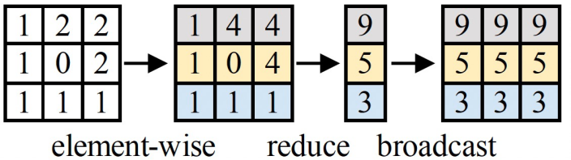
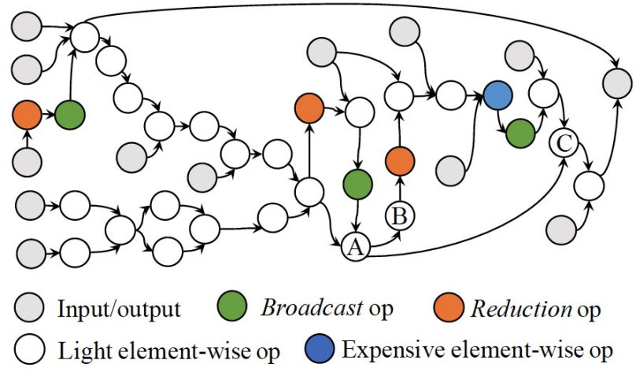
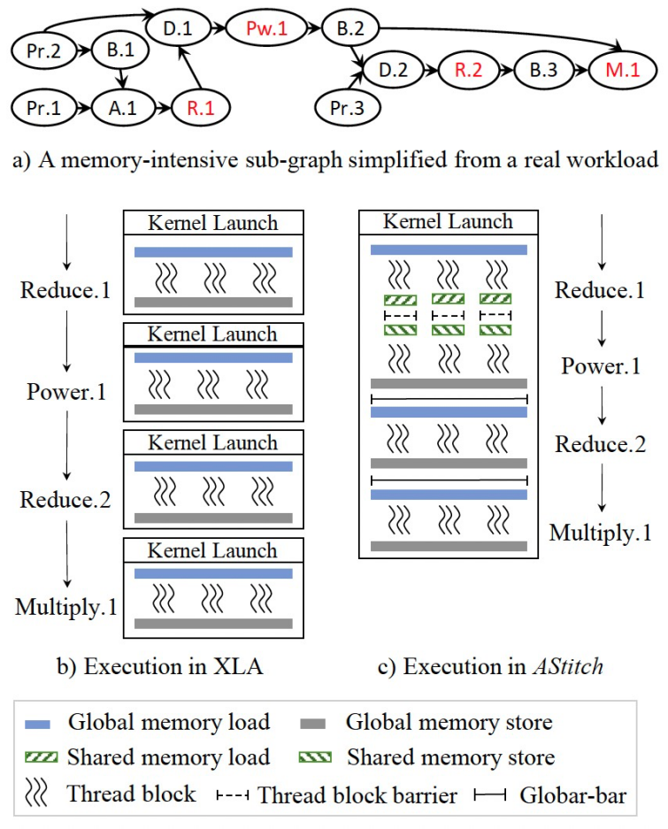
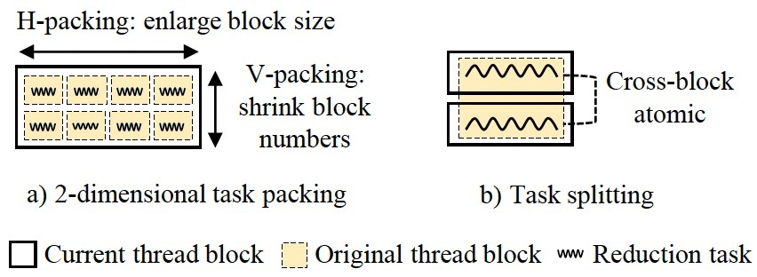
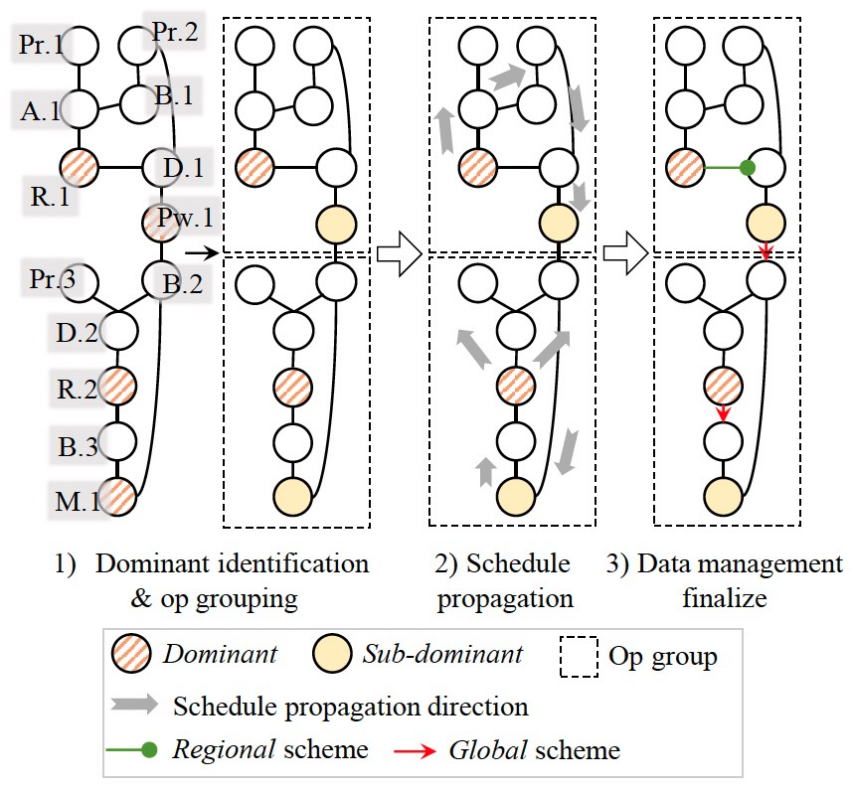

**作者：郑祯** 

近日，关于机器学习访存密集计算编译优化框架的论文《AStitch: Enabling A New Multi-Dimensional Optimization Space for Memory-Intensive ML Training and Inference on Modern SIMT Architectures》被系统领域顶会ASPLOS 2022接收。

AStitch通过编译优化的手段来自动化地提高机器学习任务的执行效率, 提出了一种大粒度计算融合的编译优化手段，通过计算图的依赖关系特性、GPU多层次存储架构上的数据局部性、以及不同数据尺寸之下的线程并发性等三个方面的联合考虑，自动化地为大粒度的复杂访存密集算子子图生成高效的GPU代码，从而大幅减少GPU kernel调用及框架层算子调度的额外开销，避免了不必要的重复计算。大幅减少片外访存的同时，可适配各种数据尺寸以得到最佳并行效率。对比XLA[1]，AStitch最高可以取得2.73倍的性能加速。

### **背景**

近年来，深度学习编译优化已经成为深度学习系统领域最活跃的方向之一。“编译“方法将机器学习DSL（TensorFlow、PyTorch等）自动化地翻译为底层硬件支持的程序，“优化”方法则在翻译（编译）过程中执行一系列的性能优化方案，使得最终生成的程序能够跑得更快更好。

深度学习编译器在生成最终可执行程序之前，往往需要将上层的DSL先翻译为中间层的IR，以方便编译器进行处理。比如，上层的一个LayerNorm算子，会被翻译为中间层的一个子图，该子图包含十多个算子，包括Add、Sub、Mul、Div、Reduce、Broadcast等类型。在一个好的IR定义中，这些“原子”性质的算子可以组合表达任意用户定义的上层计算。

随着算法、硬件以及深度学习系统生态的发展，深度学习系统的瓶颈在不断变化。我们发现新出现的模型的性能瓶颈更多地表现在访存密集型算子上（Element-wise、Reduce等计算）。

一方面，新模型中访存密集型算子的比重越来越多。较早的MLP和CNN以计算密集型算子为主（卷积和矩阵乘），而随着模型结构的发展（比如Transformer开始进入各个领域），LayerNorm、Softmax、GELU以及各种算法工程师自定义的部件使得访存密集型算子在算子数量和执行时间上都开始超过计算密集型算子。另一方面，新硬件的算力提升速度高于访存带宽提升速度，尤其是TensorCore这种“加速器上的加速器”的出现，让算力有了急剧的提升。算力的提升让计算密集型算子的计算时间进一步缩短，使得访存密集型计算的性能问题更加突出。

XLA是最早对访存密集型计算有所关注的SOTA之一（TVM[2]对访存密集型计算的优化方法与其类似），也是工业上最成熟的机器学习编译器之一。在GPU上对XLA进行性能评测时，我们发现其优化后的很多模型（Transformer、ASR等）仍然卡在访存密集型计算的性能上。一方面，访存密集型计算的总耗时与计算密集型算子相当；另一方面，也是更为重要的，巨大量的访存密集型算子带来了非常严重的算子调度和GPU kernel调用开销，这些开销在很多模型上已经超过了计算耗时本身。

XLA所使用的优化方法是kernel fusion，进一步分析XLA的fusion优化方法，我们惊讶地发现，XLA竟然没有利用shared memory来支持算子之间的数据传输，这使得可支持的fusion粒度大大降低。比如对于reduce和它的消费者算子，一个HPC工作者会自然地将reduce的结果放在shared memory上，然后消费者算子从shared memory中读数据并做后续计算；XLA却选择不将reduce和它的消费者fuse在一起，而是分成两个kernel。对于常见的LayerNorm算子，XLA会用3个kernel来实现，而高效的手写算子则只需要一个kernel。

基于上述发现，如果我们将shared memory引入机器学习编译优化的fusion中，增大fusion粒度，可以减少框架调度和kernel调用开销，并减少片外存储的访问，进一步优化访存密集型计算的性能。但是，XLA（包括TVM）为什么没这么做呢？进一步分析后，我们发现最大的挑战在于，编译器需要自动化地执行优化，手工优化的想法，到了编译器这里，难度往往会被放大。

### **挑战**

到了编译器IR层面，机器学习模型的计算图会变得非常复杂，涉及两层的数据依赖关系：Element层面和Operator层面。

Element层面是指消费者处理的每个element和生产者生产的每个element之间的依赖关系，比如Broadcast算子会生成一对多的数据依赖关系。

Operator层面是指图层面的算子依赖关系，下图展示了一个访存密集型计算子图的拓扑关系（来自一个Transformer模型），可以看到复杂的多对一、一对多依赖关系。

如今的模型类型极为丰富，变种繁多，计算拓扑图无法枚举，不同于HPC领域的手工kernel fusion，让编译器自动化地对任意可能的计算子图做fusion优化是非常具有挑战性。这也是XLA和TVM目前只做保守fusion优化的一个重要原因。

除了复杂的计算图之外，输入数据形状的多样性和未知性，也给自动代码生成带来了很大的挑战。不同的tensor形状需要不同的代码生成schedule，以得到较好的并行性。XLA针对常规的tensor形状提供了代码生成的schedule，但tensor形状的可能性是无穷无尽的，我们在真实生产中发现，一些特殊的形状会导致XLA产生极大的性能问题。（注：这里讨论的是静态shape的多样性，而非动态shape问题。）

### **破局**

困难和挑战总是让对技术有极致追求的人兴奋。

Fusion问题，核心是代码生成能力问题，能力越大，fusion越好。从两个层面的依赖关系出发，代码生成需要同时考虑硬件存储层次和并行度：算子之间传递数据需要选择合适的存储媒介，每个算子需要选择合适的并行策略，这两者是相互交杂的，需要协同考虑。我们将我们提出的Fusion技术称为stitch，这样可以更直观地表达算子通过层次化的存储媒介“缝合”在一起这一动作。

从存储媒介出发，结合并行度的考虑，我们将stitch策略抽象为四种：无依赖（Independent）、本地的（Local）、区域的（Regional）和全局的（Global）。

XLA所支持的是Local的策略，只支持通过寄存器传递数据，算子的并行策略被分开来考虑。一些Fusion工作可以支持Independent依赖，主要包括Kernel Packing等。AStitch拓展了fusion的优化空间，Regional策略将数据存储在shared memory中，支持GPU thread block locality，Global策略将数据存储在global memory中，支持全局的locality。其中，并行度的考虑在于，上述每种stitch策略都需要特定locality的支持，locality越是局部，对并行策略的可能限制越大。从Local，到Regional，再到Global，locality的限制逐渐降低，对并行策略的限制也随之逐渐取消。需要说明的是，Global的策略需要GPU kernel所有线程的全局同步，其相当于将kernel之间的隐式的同步inline到kernel内部来进行，减少一次CPU（包括框架和驱动）和GPU之间的切换。

对于并行度，为访存密集型计算做shape-aware的并行代码生成（Adaptive Thread Mapping）是AStitch的一个重要贡献。其基本思想是，基于SIMT的架构，合并小的（Task Packing），拆分大的（Task Splitting），以得到合适的CUDA thread block大小和数量。

值得说明的是，对于Global的策略，为了实现全局同步，需要保证总的CUDA thread block数量不大于一个wave可以调度的最大数量，AStitch通过做纵向的Task Packing来达到这一要求，这相当于将原本由硬件调度器调度的任务转变为软件上预先调度好的任务，实际上还有机会节省调度开销。

对于自动代码生成，穷举每个算子的stitching策略和并行策略是不现实的，我们提出了一种先分组解决局部代码生成，再聚合生成全局代码的方法。一个重要的insight是，轻量级的element-wise的计算只需要跟随其consumer的代码生成schedule即可，最终通过Local策略进行数据传输；而reduce等复杂计算则需要优先考虑并行度的优化，再去考虑与其consumer的stitch策略。

基于此，我们依据算子类型进行分组，reduce及跟有broadcast的expensive element-wise（Power, Sqrt等）作为每一个组的dominant，每个dominant的直接的或间接的producer被分到其对应的组中。组内的数据传播都是通过Local策略进行，dominant生成自己的并行策略schedule后，传播给组内的其他算子；最后检查组间的数据局部性，为两个组边缘的算子选择可达到的locality最优的stitch策略。这种方法简洁有效地解决了搜索空间爆炸的问题，在此过程中，我们还有一些locality和parallelism之间的权衡，其中更多的细节请阅读我们ASPLOS 2022的论文。

### **结语**

AStitch的雏形是我们早期的工作FusionStitching[4]，FusionStitching最早将shared memory引入了访存密集算子的编译优化自动fusion，并采用cost model来做fusion和代码生成的一系列决策。随着深入优化，我们发现可以将kernel之间的隐式同步给inline到kernel内部，并通过global memory做stitch，避免CPU和GPU之间的无谓的切换，进一步的，结合Adaptive Thread Mapping方法解决并行策略问题，可以形成强大的代码生成能力。至此，我们已经不需要cost model来指导fusion决策和代码生成，我们可以stitch一切，我们的代码生成也具有自适应能力。

最近，我们惊喜地发现新版本的TensorRT[3]开始支持使用shared memory做数据媒介来生成fusion了。我们期待越来越多的工作开始在访存密集型计算的性能优化方面发力，我们也希望AStitch以及早期的FusionStitching的工作可以影响到广泛的深度学习系统和编译优化参与者！

论文地址：https://dl.acm.org/doi/10..3507723

**

### 参考文献：**

[1] TensorFlow XLA. https://www.tensorflow.org/xla

[2] Tianqi Chen, Thierry Moreau, Ziheng Jiang, Lianmin Zheng, Eddie Yan, Haichen Shen, Meghan Cowan, Leyuan Wang, Yuwei Hu, Luis Ceze, et al. TVM: An automated end-to-end optimizing compiler for deep learning. OSDI'18.

[3] TensorRT. https://developer.nvidia.com/tensorrt

[4] Zhen Zheng, Pengzhan Zhao, Guoping Long, Feiwen Zhu, Kai Zhu, Wenyi Zhao, Lansong Diao, Jun Yang, and Wei Lin. FusionStitching: boosting memory intensive computations for deep learning workloads. arXiv preprint.
