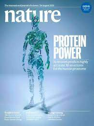

Nature 2020 8月封面文章去年(2021)夏天，AlphaFold先后在Nature(封面)和Science上发文，阐述其在两年一届的CASP14 (Critical Assessment of Techniques for Protein Structure Prediction) 蛋白质结构预测的竞赛中，首次将位置预测的平均误差降低到(碳)原子以下，即约1A( 10&#x2212;10" role="presentation">10−1010^{-10} 米，碳-12原子直径约为1.7A)。AlphaFold采用的两个关键机制是图网络和基于注意力机制的EvoFormer(类Transformer)。蛋白质折叠的准确预测被认为是困扰计算生物学界五十年的难题，对于治疗阿兹海默症、糖尿病等多种疾病具有重要意义。结构生物学家，诺贝尔化学奖得主Venkatraman Ramakrishnan (1949-)称 Alphafold 在该领域取得令人震惊(stunning)的进展，比很多人的预测提前的数十年，将对生物学研究的许多方面产生根本性改变。此前，英国科学家确认了Alphafold准确的预测了COVID-19的蛋白质SARS-CoV-2结构。

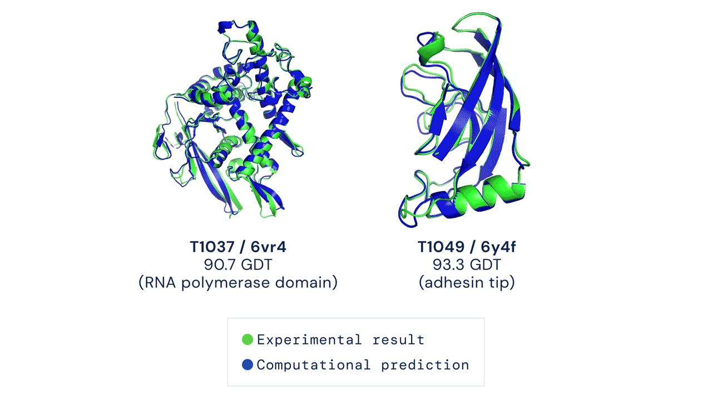

蓝色和绿色分别表示蛋白质折叠的预测与实际形状 来源：DeepMind
### 1. 缘起：图神经网络解决什么问题？

近十年来(从2012年AlexNet开始计算)，深度学习在**计算机视觉**(CV)和**自然语言处理**(NLP)等领域得到的长足的发展，**深度神经网络**对于图像和文字等**欧几里得数据**(Euclidean data)可以进行较好的处理，之所以被称为欧几里得数据**，**是由于这类数据位于 n 维**欧几里得空间** \mathbb R^{n} 中(如AlexNet将所有图像的尺寸都预处理成224X224X3)，常见的表格2维的欧几里得数据，RGB图像数据是三维欧几里得数据，长宽两个维度加一个颜色/通道维度；如果再加上batch，就是四维。

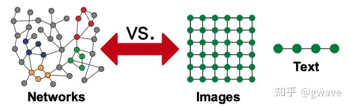

来源：CS224W然而，现实世界是复杂的，如社交网络，一个人的朋友数量是不固定的，也很难排个顺序，这类复杂的非欧几里得数据(**non-Euclidean**)，没有上下左右，没有顺序，没有坐标参考点，难以用方方正正的(grid-like)矩阵/张量表示，为了把不规则的脚(非欧数据)穿进标准的鞋(神经网络)里，之前干了不少削足适履的事，效果不太好，于是，问题变成了：能否设计一种新的鞋，使它能适合不规则的脚呢？

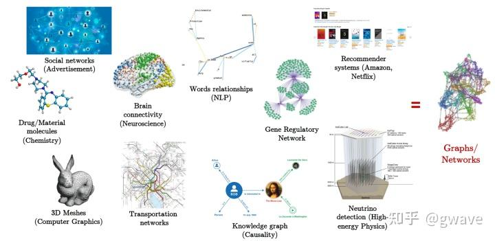

Spatial Graph ConvNets | NTU Graph Deep Learning Lab非欧数据的场景很多，除了上面提到的社交网络，其他例子如：计算机网络，病毒传播路径，交通运输网络(地铁网络)，食物链，粒子网络(物理学家描述基本粒子生存的关系，有点类似家谱)，说到家谱，家谱也是，(生物)神经网络(神经网络本来就是生物学术语，现在人工神经网络ANN太多，鸠占鹊巢了)，基因控制网络，分子结构，知识图谱，推荐系统，论文引用网络等等。这些场景的非欧数据用**图**(Graph)来表达是最合适的，但是，经典的深度学习网络(ANN,CNN,RNN)却难以处理这些非欧数据，于是，**图神经网络**(GNN)应运而生，GNN以图作为输入，输出各种下游任务的预测结果。

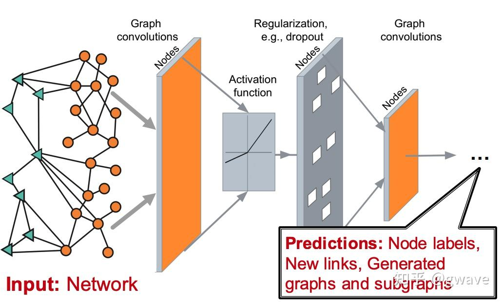

图神经网络 来源：CS224W下游任务包括但不限于：

- 节点分类：预测某一节点的类型
- 边预测：预测两个节点之间是否存在边
- 社区预测：识别密集连接的节点所形成的簇
- 网络相似性: 两个(子)网络是否相似

### 2. 什么是图？

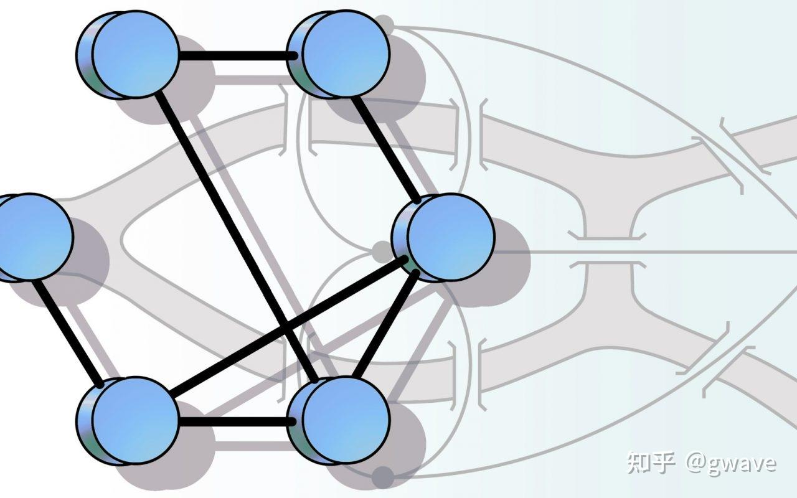

https://iversity.org/blog/introduction-graph-theory/先对图论的相关概念进行简单介绍。图(Graph)是图论的研究对象，图论是欧拉在研究**哥尼斯堡七桥问题**过程中，创造出来的新数学分支。

可将**图**/网络(Graph / Network)视为一个系统，以G(N,E)表示，由两种元素组成：**顶点**/节点(Vertex/Node)，以 N 表示，和**边**/链接(Edge/Link)，以 E 表示。顶点和边具有属性(Attribute)，边可能有方向(有向图 Directed Graph)。社交网络中，人是顶点，人和人之间的关系是边，人/顶点的属性比如年龄、性别、职业、爱好等构成了一个向量，类似的，边也可用向量来表示。

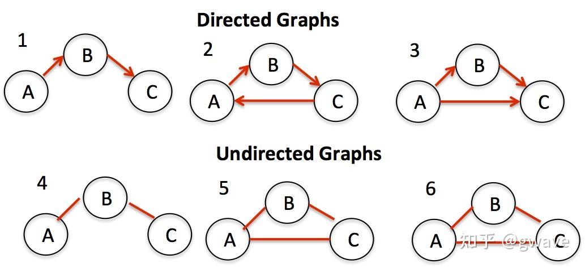

有向图 vs 无向图 https://sites.google.com/a/cs.christuniversity.in/discrete-mathematics-lectures/graphs/directed-and-undirected-graph微信好友是双向的，你我互为好友(不考虑拉黑/屏蔽)，对应于**无向图**(Undirected Graph)；微博的关注是单向的，我粉你，你未必粉我，对应**有向图**，也可以将无向图视为双向的有向图。

图本身也可具有表达其自身的全局属性，来描述整个图。

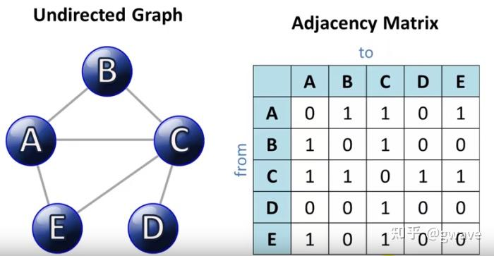

邻接矩阵 https://pythonandr.com/tag/example/如何数学的表示图中顶点的关系呢？最常见的方法是**邻接矩阵**(Adjacency Matrix)，上图中A和B，C，E相连，故第一行和第一列对应的位置为1，其余位置为0。

$如果将图片的像素表达为图，下左图表示图片的像素值，深色表示1，浅色表示0，右图为该图片对应的图，中间为对应的邻接矩阵，蓝色表示1，白色表示0。随着图的顶点数( n  )增多，邻接矩阵矩阵的规模( n^{2} )迅速增大，一张百万( 10^{6} )像素的照片，对应的邻接矩阵的大小就是( 10^{6}\times10^{6}=10^{12} )，计算时容易内存溢出，而且其中大多数值为0，很稀疏。$

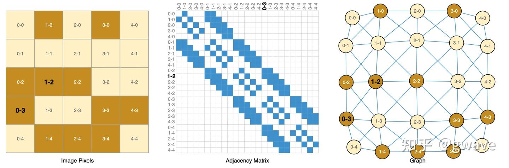

https://distill.pub/2021/gnn-intro/#graph-to-tensor文本也可以邻接矩阵表示，但是问题也是类似的，很大很稀疏。

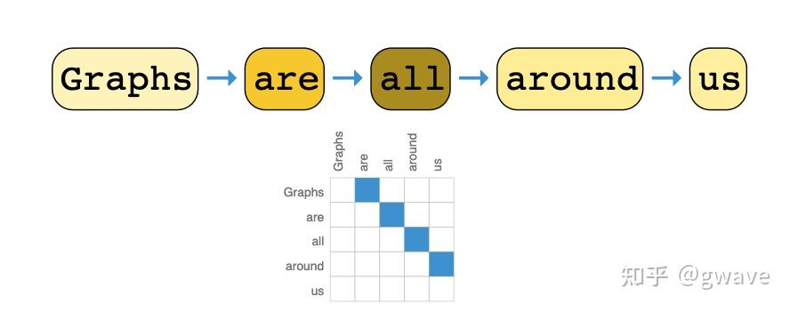

https://distill.pub/2021/gnn-intro/#graph-to-tensor我们也可以选用边来表示图，即**邻接列表**(Adjacency List)，这可以大幅减少对空间的消耗，因为实际的边比所有可能的边(邻接矩阵)数量往往小很多，类似的例子有很多：

- CNN(局部连接)和全连接神经网络的关系；
- 大脑860亿个神经元，每个神经元大约与1000个神经元相连(而不是860亿个)
- 你真正保持联系的人并不太多，**邓巴数**告诉我们：一个人经常联系的人数大约150个，这是人类脑容量所决定的，不可能也没必要和70亿人都产生直接联系，小世界理论(6度理论)又说，只要不超过6个人，你就可以连接上世界上的任何人。2016年，Facebook，不对，应该叫Meta了，研究发现社交网络使这个间隔降低到4.57[[1]](#ref_1)，这也可以理解，社交网络上可能有些你不太熟悉的人，你的微信好友大概率不止150，但其中很多人联系并不多，联系的频率符合**幂律分布**，这是复杂系统的特点。随着COVID-19的载毒量下降，死亡率接近千分之一，疫苗接种普遍，蜕变为大号流感，国外的一个段子说，如果你的朋友圈没有人感染COVID-19，那说明你没有朋友。社交网络和病毒传播路径均可以图来表示。
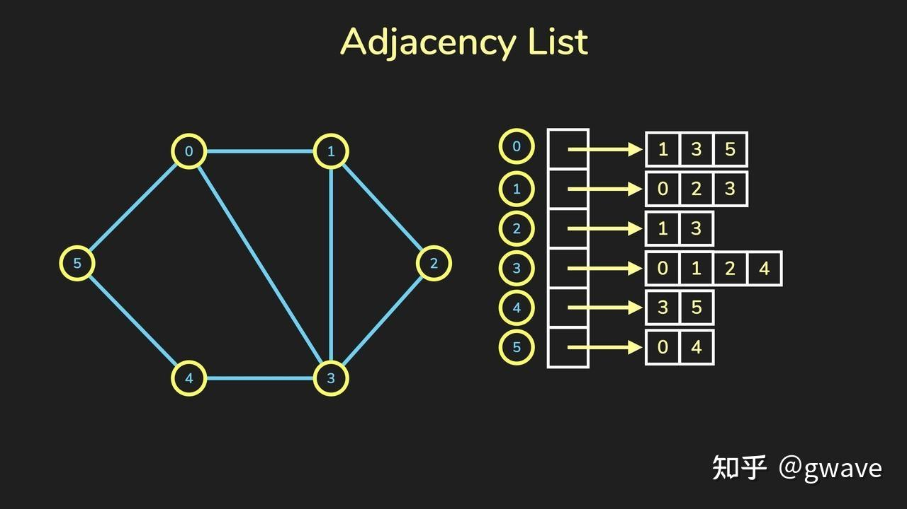

https://www.jomaclass.com/blog/graph-representation-edge-list-adjacency-matrix-and-adjacency-lists下图是咖啡因分子结构，对应的图的表示和邻接矩阵：

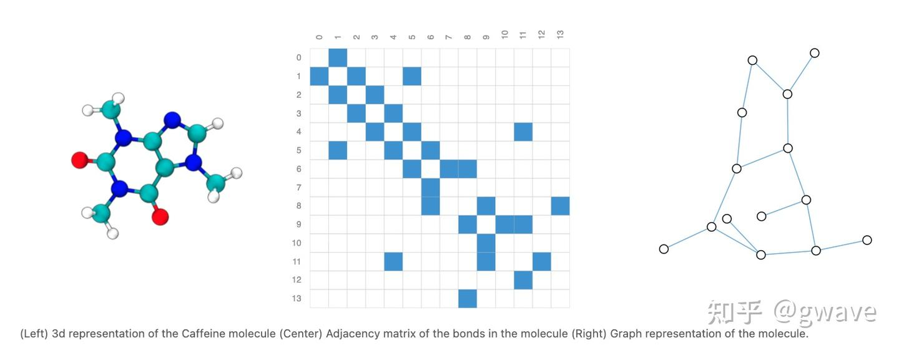

https://distill.pub/2021/gnn-intro/《奥赛罗》中互动的人物的图表示和对应的邻接矩阵：

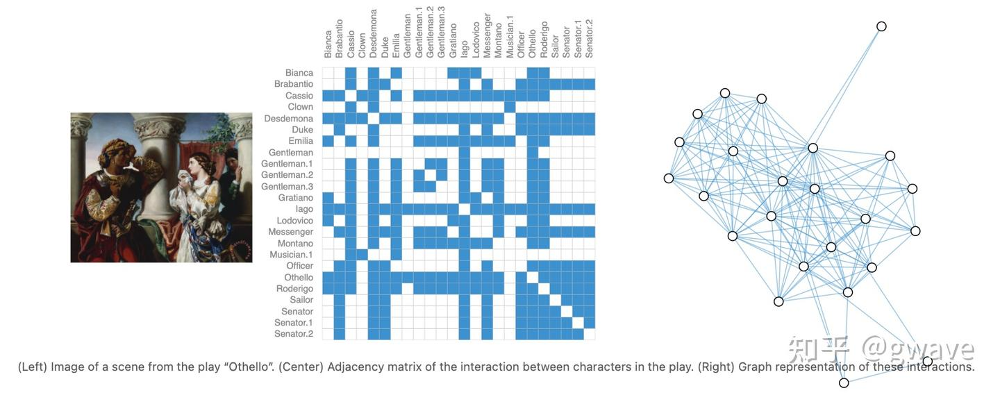

https://distill.pub/2021/gnn-intro/
### 3.  神经网络的关键特点

本节快速回顾深度学习中的关键特点/要素，在后面的文章中，将看到这些思想如何被延续到GNN中。

#### 3.1 特征自动提取

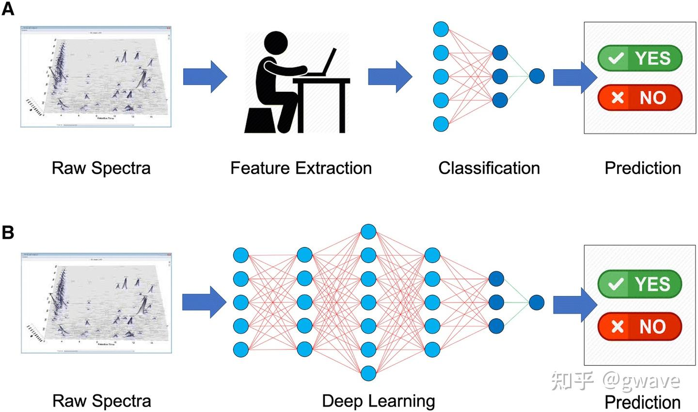

端到端模型自动抽取特征 来源：https://link.springer.com/article/10.1007/s11306-019-1608-0/figures/3与传统的机器学习相比，深度学习最大的优点恐怕是“**端到端**”(End-to-End)。所谓端到端，是指将数据从模型的输入端灌进去，预测结果从模型的输出端输出来，中间无需任何人工介入进行**特征工程**。在深度学习之前，将原始数据加工成模型所能接受的数据，往往需要领域专家的介入，进行特征选择和特征工程的数据预处理，不同领域的预处理过程迥异，深度学习最大的功劳就在于此——自动进行特征提取，无需人类先验知识，也能有上佳表现。从数据中自动学习到的特征通常是个向量，如果两个对象的特征向量之间的距离比较近，意味着两者可能属于同一类对象，下图是AlexNet论文中的例子，每行中图片的特征向量都很接近，意味图片中的对象很可能是同一类。

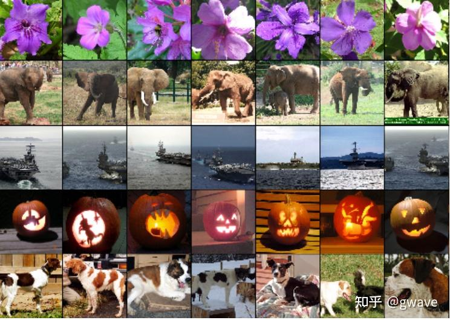

      来源：ImageNet Classification with Deep Convolutional Neural Networks
#### 3.2 从Word2Vec到Anything2Vec

`Man :          [1,0,0,0,0,0,0,0]
Woman :        [0,1,0,0,0,0,0,0]
King:          [0,0,1,0,0,0,0,0]
Queen:         [0,0,0,1,0,0,0,0]
        ... ...`

                                                                     one-hot vector

与CV类似，NLP的引爆点之一是Word2Vec，将一个词转化为一个向量，将一个容量为数万的词库中的词“压缩”为数百维的“稠密”向量（Dense Vector，稠密对应数万维one-hot向量中只有一个1，其他位置都是0的稀疏 sparse），也称为“嵌入”(embedding)。

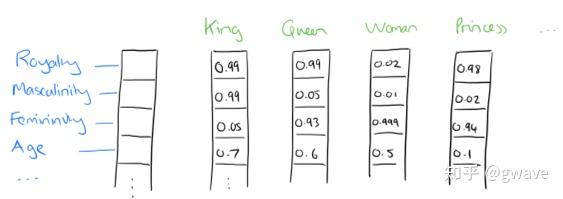

词向量下图为投影到2维空间的词向量。

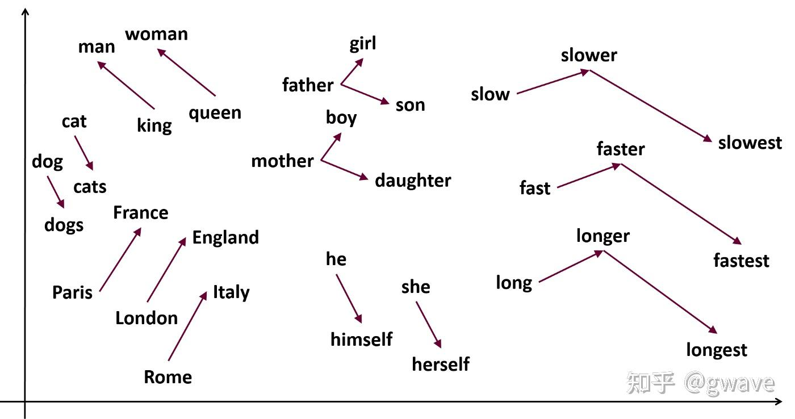

https://www.usna.edu/Users/cs/nchamber/courses/nlp/f20/labs/lab5/index.htmlWord2Vec的优势是可以对词进行向量计算：Man - Woman + Queen = King， Biggest - Big + Small = Smallest ； 也可以计算近义词之间的距离到底有多近，比如 cat - kitten 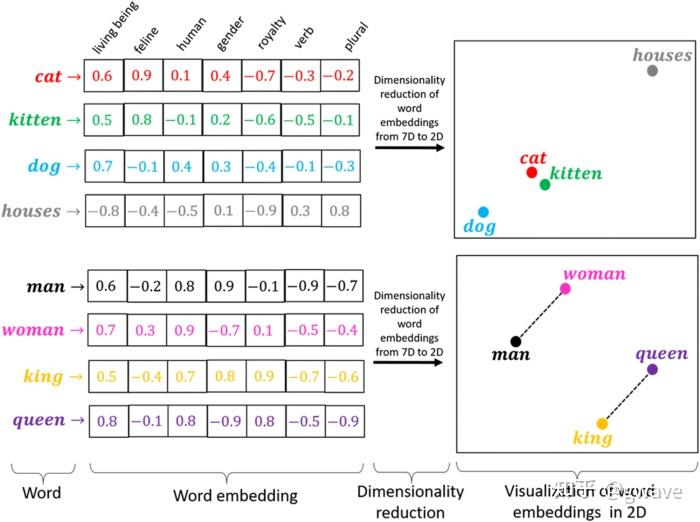

https://swatimeena989.medium.com/training-word2vec-using-gensim-14433890e8e4Word2Vec效果这么明显，以至于之后类似的思想被扩展到句向量，段向量，文章向量，甚至很多和NLP无关的领域，之前我的两个工业界项目中分别将病人和学生分别以向量来表示，创造了patient2vec 和 student2vec ，你也可以把你熟悉的对象以向量表示，比如一本书可以表达为书向量。

#### 3.3 局部性，汇聚与组合

本节主要以CNN为例，解析三个图神经网络的核心思想——局部性(Locality)，汇聚(Aggregation)与组合(composition)，后面将会说明这三个特征如何延伸/泛化(generalize)到更一般非欧数据/图中。

CNN 的本质是将一个像素和其周围的像素值通过(**局部的**)**卷积核**进行**汇聚**(Aggregation)，经过**组合**(composition)多层(**深度**)卷积(不考虑**空洞卷积**Dilated Conv和Pooling**池化**)，生成一个(高层的)特征向量，该向量包含了图像的多个特征，是各项下游任务(分类，聚类，排名等)的基础。

- 局部性：卷积核对一个像素周围环境所有像素进行处理，在整个图像的范围上实现了权值共享，卷积的参数数量比全连接网络少很多；
- 汇聚：卷积的过程，一个像素周围环境所有像素与卷积核的对应参数进行点积；
- 组合：多个卷积层的组合叠加构建深度的网络结构，类似于函数组合 Function composition f\circ g 。
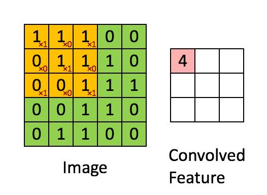

卷积的过程经多次卷积 / 汇聚，最终产生特征向量(下图中粉色的向量)中的一个神经元表示一个(局部)特征，该神经元融合了输入层多个像素，是最终的分类算法的输入。可以说，CNN架构的大部分都在做提取特征的任务，而最后一步的(Softmax)分类算法其实是很简单，和之前的机器学习并无二致，两者（特征提取+分类算法）一起构成了完整的端到端模型。

下图显示从原始手写图片数据经过两次卷积到最终被识别为4的整个过程，这个过程的三个要素：局部性，汇聚，通过组合实现的**深度**(即多个卷积层的叠加组合，每个卷积相当于一个函数 f )协同工作，最终达成了目标。

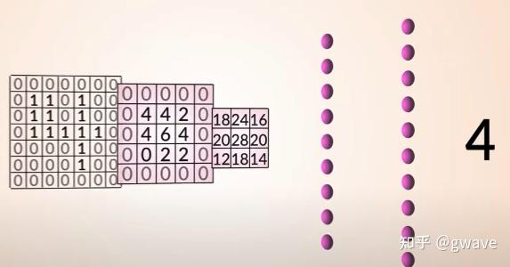

 source：Alex Foo在RNN中，也存在类似的情况，每经过一个时间步(time step)，一个新词进入状态 H_t ，经过若干时间步后，状态 H_{t+3} 包含了整个句子"This movie is not good"的含义。最后的状态包含之前的很多信息。

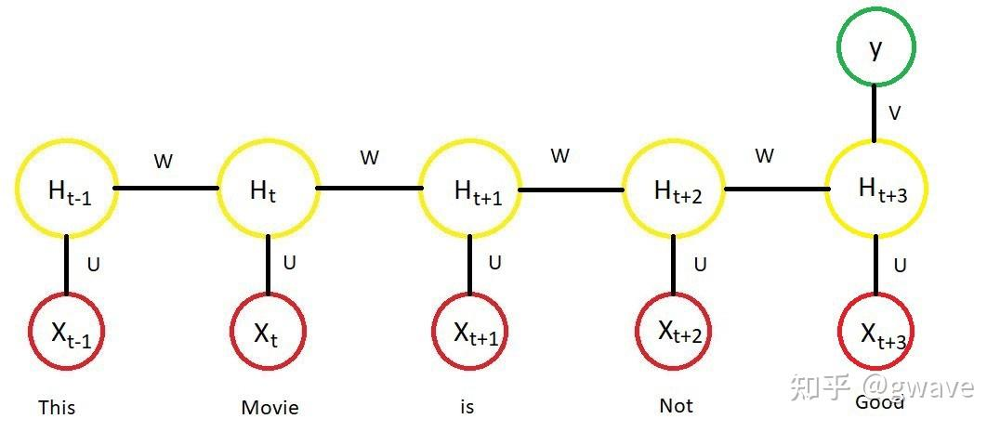

https://medium.com/analytics-vidhya/natural-language-processing-from-basics-to-using-rnn-and-lstm-ef6779e4ae66不论是像素，还是词，它们的值都不是完全独立的，而是和周围环境相关的，周围的像素值决定了当前的像素值，周围的词决定了当前位置的词。所谓物以群分，人以类聚，如果你的朋友圈是这样的，虽然你没有参加饭局，也能猜到你是谁。人在江湖，身不由己。好了，这是图神经网络中一个重要思想，也是上面提到的局部性Locality。

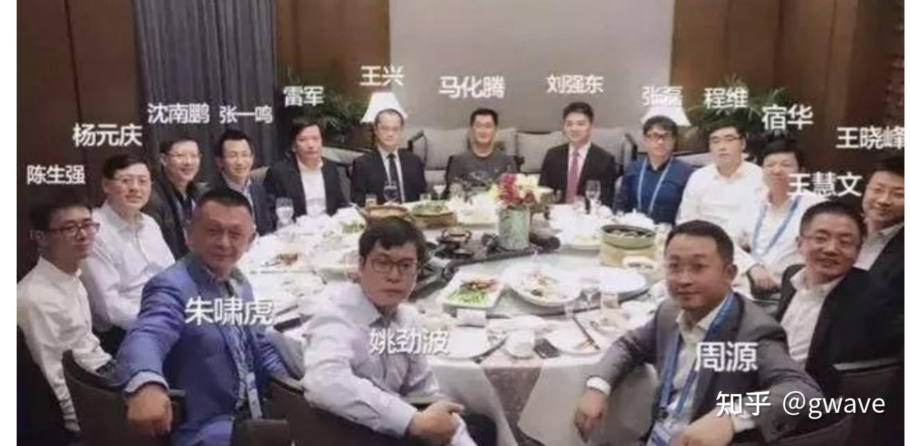

来源：网络
### 4. 节点特征的表达学习

与CNN和RNN类似，图节点的特征表达仍是非欧数据机器学习的关键任务之一，虽然有些传统的利用领域知识定义手工特征的方法，但从数据中自动学习特征，实现端到端的预测仍是大家希望的共同目标。

#### **4.1 对节点嵌入映射的要求**

受Word2Vec的思想启发，我们希望训练一个函数 f ，输入一个图，输出该图所有节点的嵌入向量。同时要求：在图中比较临近的节点，所对应的向量之间的距离也比较近。

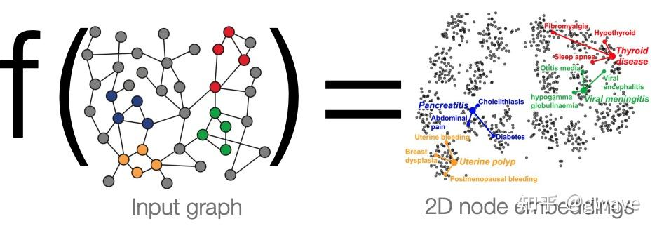

**

具体到某一个图的节点 u  ，训练一个神经网络，对应于下图中的函数 f ，该神经网络以图的节点 u 作为输入，输出 u 的 d 维特征表达，这种将节点转变为向量的方法被称为Node2Vec。这并不意外，上面提过Anything都可以2Vec。

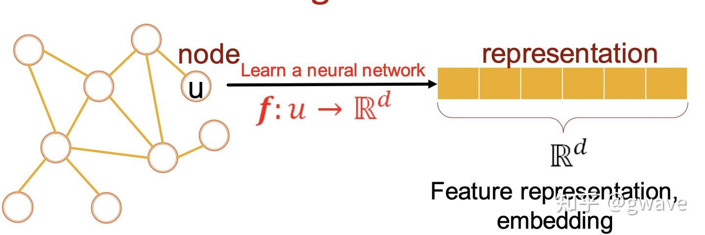

学习一个神经网络，对节点进行向量表达 来源：CS229W对于从图的节点映射到向量表达的映射，有一定要求：在图中比较相似的两个节点 u,v ，函数ENC将节点 u 和 v 映射到(低维的)d 维嵌入空间的向量 z_u,z_v : z_u=ENC(u), z_v=ENC(v) ，这两者也应比较接近。两个向量之间的相似性可用余弦(cosine)相似度 z_{v}^{T}z_u 来表示(已归一化为单位向量)，问题在于：如何定义节点间的相似度呢？边提供了一种度量相似性的思路：存在边连接的两个节点比较相似，如专业社交网络(LinkedIn)中，你和你的同事相似度较高。

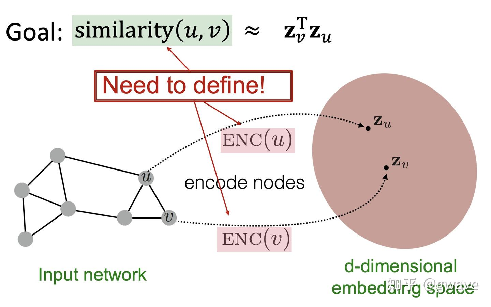

来源：CS229W
#### 4.2 图与图像的不同

非欧数据比欧几里得数据的结构复杂，由于节点的位置可以移动，但图还是原来的图，试图使用一个卷积核在图上“卷”是行不通的。同时，节点数量也可能发生变化，比如新增或删除一个节点，导致与深度学习模型的输入维度上不匹配。

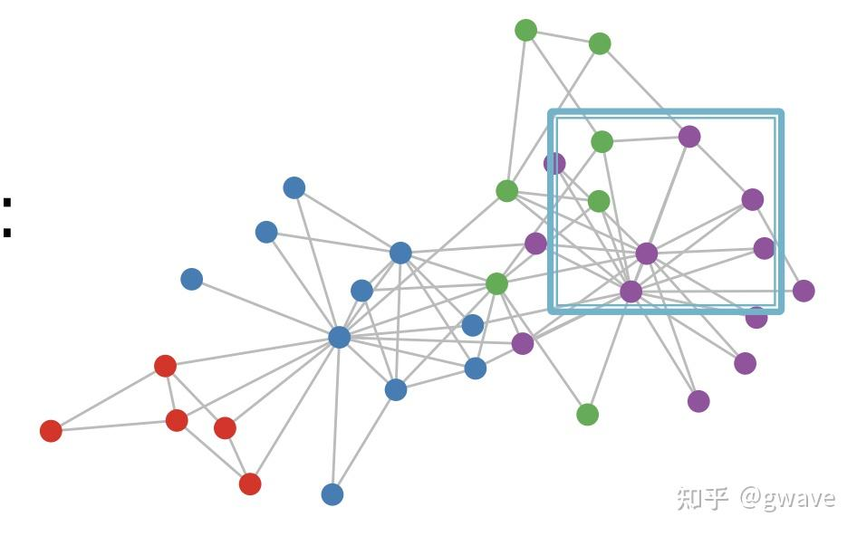

同一个图的节点位置可以变化，无法卷积 来源：CS229W下面两个图是同构的，图要求的保持同构的变换(isomorphism-Perserving Translation).

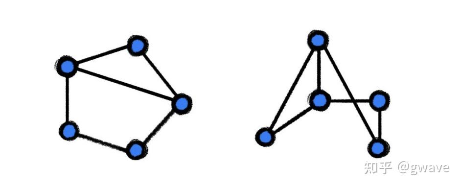

图的节点是没有顺序的，同一个图可以有多个顺序计划(Order plan)，要求置换不变性**(Permutation Invariance，图的节点进行置换)，而**不是**CNN的**平移不变性**(Translational Invariance)和**旋转不变性**。下图显示了同一个图的两个不同的顺序计划，导致了不同邻接矩阵，直接卷积的话，将导致不同的结果，显然是行不通的。

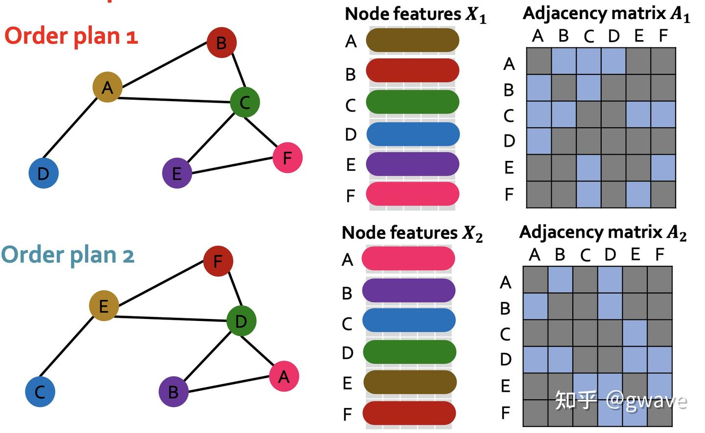

同一个图不同的Order Plan导致不同的邻接矩阵 来源：CS229W**定义：** 置换**不变，**考虑我们要学习一个函数 f ，将图 G(A,X) 映射到 \mathbb R^{d} ，使得 f(A_1, X_1)=f(A_2, X_2) ，其中 A,X 分别表示邻接矩阵和节点特征矩阵，1和2分别对应上面的Order Plan 1和2。如果对于任意的 i,j ， f(A_i, X_i)=f(A_j, X_j) 都成立，就说 f 是个**置换不变**的函数。

**

#### 4.3 从图像到图

在3.3，我们提到CNN的三个特点，局部性，汇聚和组合。下图左侧的CNN中，深绿色方格对应下面蓝色矩阵的第2行第2列的方格，同时将周围8个方格(局部性)的值也一起与卷积核点积后求和(汇聚)，生成一个新的数据；在图中，也可以参考类似的想法，一个节点从周围节点收集消息(包含它自己，棕色箭头)，对消息进行汇聚，创造出一个新的消息。

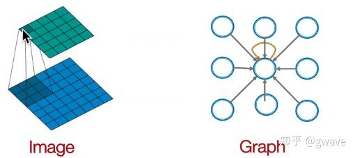

从图像到图，共性：局部性+汇聚图神经网络中的节点特征可以通过多轮的邻居消息扩散，即消息传递**(Message Passing)，来进行计算和更新，相当于通过你和你周边朋友的之间多轮消息传递(并更新)来更好的了解你是个什么人，经过一定轮次的消息传递/更新，节点的特征值会趋于收敛，再进行更新，特征值也保持不变，进入稳态，类似的特点在很多**马尔可夫矩阵**所表达的很多系统上都能看到，20年前**PageRank**就是基于这个思想，才有了今天的Google，不对，应该叫Alphabet，AlphaFolder是其旗下Deepmind的工作。

### 5. 消息传递

多轮消息传递的本质是多层汇聚(参考题图)，是更新节点嵌入的重要手段，类似于CNN的多层卷积，网络末端层的一个元素可由输入层多个元素汇聚而成，下面解释这个概念。

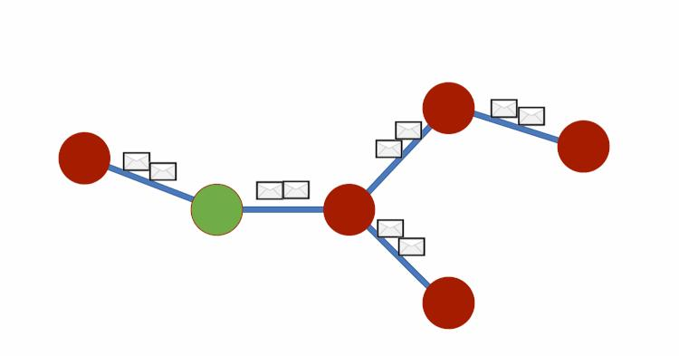

https://www.outsystems.com/blog/posts/graph-neural-networks/消息传递可分为两个阶段：

- 阶段1: 某节点向周围所有相连的节点发出消息
- 阶段2: 该节点从周围节点接收消息，并更新自身，也从而了解周边环境
第1轮消息传递完成时，该节点发出的信息传递到了与之直接连接的节点；类似的，第2轮消息传递结束时，消息到达了与第一轮节点相连接的节点，类似于朋友的朋友；第3轮，这样一直下去... ， 经过若干轮，最初的消息在图中扩散到越来越大的范围，换言之，多轮消息传递后，任意节点所收到的消息都可能融合了很多其他节点的消息；是否与CNN的逐层卷积汇聚神似(第n卷积层上某个神经元的值是输出层很多神经元的值的融合)？上面提到的RNN，其实也类似，甚至更接近。

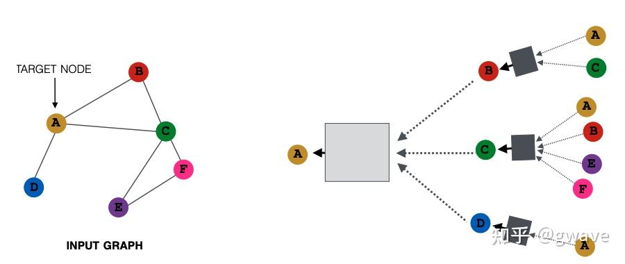

消息传递以节点A为例，A与B、C和D直接相邻，A从B、C和D接收消息，这只是一轮消息交换，也是一层计算/网络；再展开一层，B，C和D的消息从哪里来呢？D只与A相邻，故D仅从A接受消息；同样的，C从A、B、E、F接受消息；B从A和C接受消息，这构成了下图所示的两层消息传递网络。四个灰色的正方形表示实现汇聚神经网络，下面会讲到其参数的学习。图的节点之间是没有顺序的，要求具有**置换不变性**。

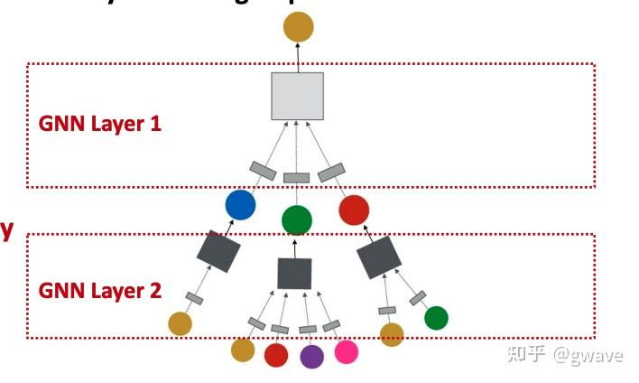

可见，对于一个网络，每传播一次消息，消息就传播到离初始节点更远一步范围，GNN就增加一层，源于不同节点的消息经过汇聚(相当于CNN的卷积)，再进行多层的组合(相当于CNN多个卷积层的叠加)，对节点进行更新，本质上与CNN的思想是一致的。但是CNN不具有置换不变性，像素交换可能导致不同的输出结果。

**CNN可被视为一类特殊的GNN，相邻节点大小和顺序固定的GNN。**

下面看一个利用消息传递进行节点分类的例子。

**

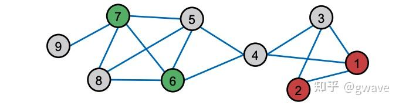

给定上面的图，和少量已经分类的节点(红绿)，对剩余其他节点进行分类，这是一个半监督机器学习问题，使用关系分类**(Relational Classification)的方法对其进行分类。

第1步：初始化，红色和绿色节点的概率分别标为0和1，其他未知节点的概率初始值为0.5；

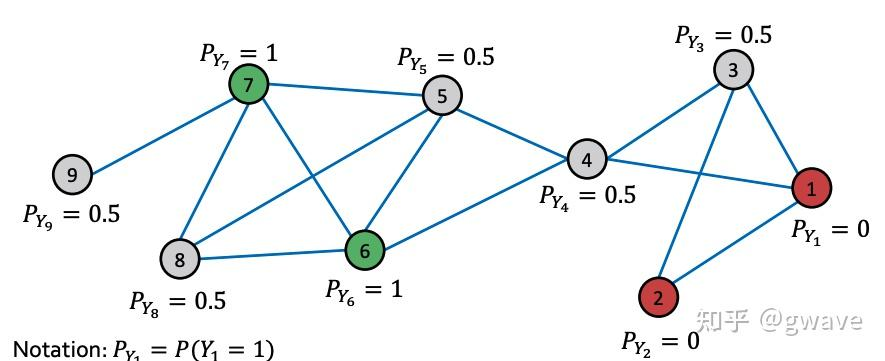

第2步：第1次迭代：节点3的邻居1，2，4的均值为 (0.5+0+0)/3 = 0.17

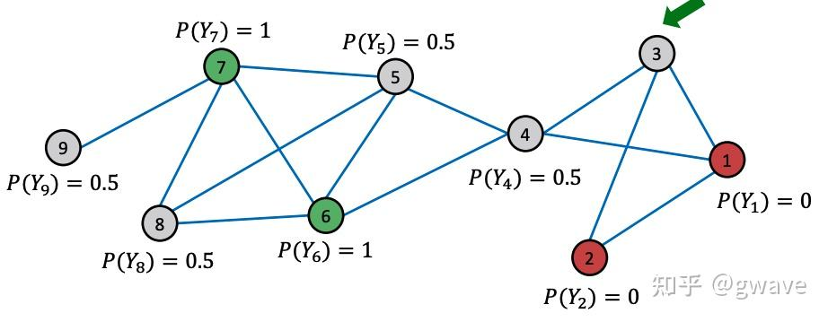

第3步：第1次迭代：节点3的邻居1，2，4的均值为 (0.5+0+0)/3 = 0.17，将该值从0.5更新为0.17。

第4步：第1次迭代：节点4的邻居1，3，5，6的均值为 (0+0.17+0.5+1)/4 = 0.42，将该值从0.5更新为0.42。

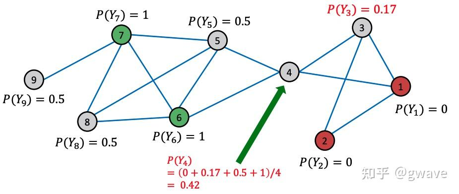

第5步：第1次迭代：节点5的邻居4,6,7,8的均值为 (0.42+1+1+0.5)/4= 0.73，将该值从0.5更新为0.73。

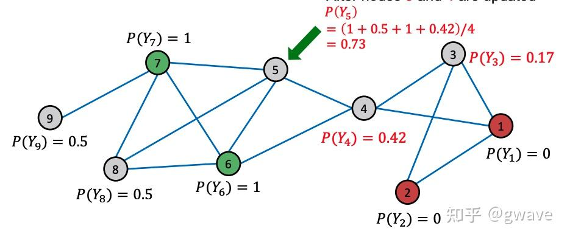

第6步：第1次迭代完成，分别计算出节点8和9的概率为0.91和1。

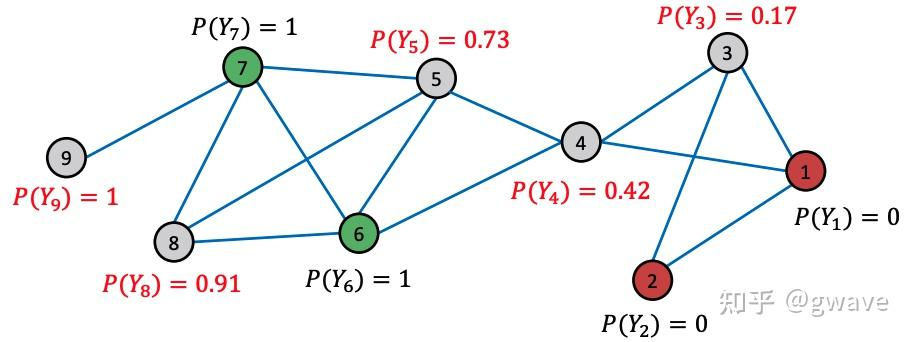

第7步：第2次迭代完成，节点9收敛。

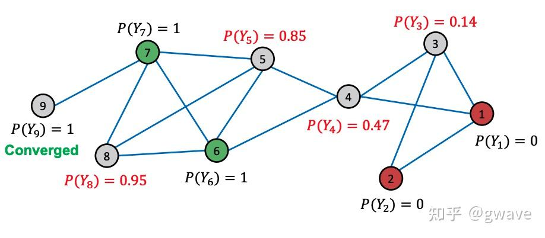

第8步：第3次迭代完成，节点8收敛。

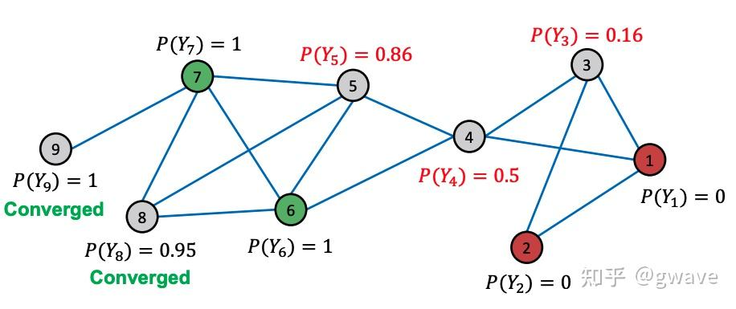

第9步：第4次迭代完成，节点3，4和5收敛。

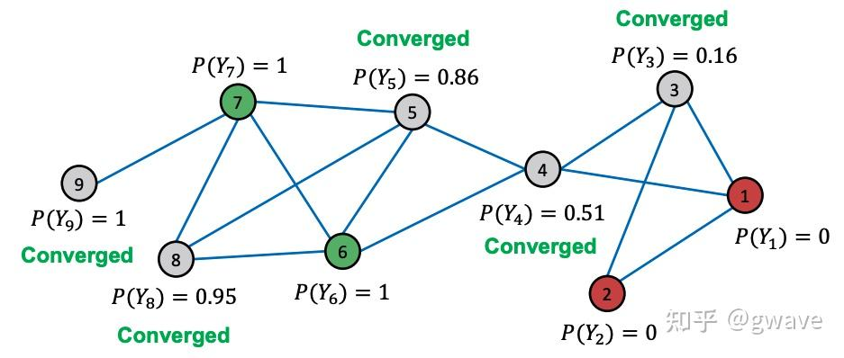

第10步：概率＞0.5的节点，分类为绿，反之，分类为红。显然，节点4以及其左侧的节点都是绿色，节点1—3为红色节点。

消息传递的实现非常简单，只要右乘临界矩阵即可。

关系分类法比较简单，没有利用到节点特征，也不能保证收敛，但可以比较形象的说明消息传递的过程。

### 6. 节点嵌入的计算

在理解了消息传递之后，再回到第4节尚未讨论节点嵌入的计算，在此用到了节点特征 X 。

节点嵌入(Node Embedding)非常关键，是许多下游任务的基础。与词嵌入(World Embedding)等各种Embeding类似，节点嵌入的目的是使用一个向量来表示节点。

GNN的深度可以是任意的，每层的节点都可有表示自身的节点嵌入(向量)： 下图中第0层(Layer-0)节点的嵌入向量是特征向量自身( X_A,X_B,X_C )；第1层节点(Layer-1)的嵌入向量来源于其直接邻居的融合(Layer-0节点的节点嵌入)，也就是距离为1跳(1-hop)的节点嵌入向量融合的结果，比如：节点B的嵌入向量是节点A和C嵌入向量融合的结果；以此类推，第 k 层节点的嵌入向量源于k跳(k-hop)之外的节点。

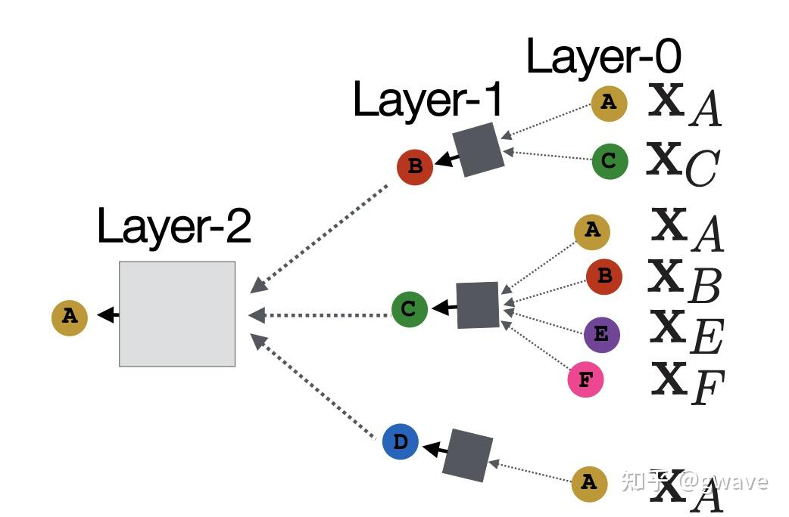

下图中，(绿色部分的)第1个式子 h_{v}^{0}=x_v ：第0层节点 v  的(隐 hidden)嵌入向量 h_{v}^{0} 即节点的特征向量 x_v 。

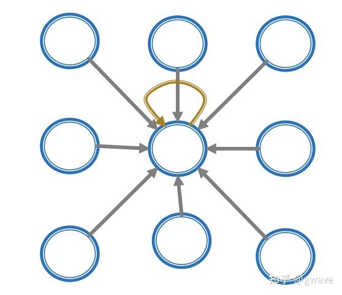

2个部分的线性组合：1)邻居的均值 2）自指(棕色箭头)第2个很复杂的式子表示：第 k+1 层网络的节点 v  的(隐)嵌入向量 h_{v}^{(k+1)} 是两个部分的线性组合后再进行非线性变换 \sigma (如Relu)的结果: 第1个部分是第 k 层节点 v 所有相邻节点 u 嵌入向量的均值( |N(v)| 指 v 的相邻节点的数量)乘以汇聚权重 W_k ，第2个部分是第 k 层节点 v自己的嵌入 h_{v}^{(k)} 乘以系数 B_k 。即: h_{v}^{(k+1)} 可理解为其相邻节点均值的汇聚(上图中灰色箭头)和自身的变形(Transformation，上图中棕色的指向自身的箭头)的线性组合再进行非线性变换 \sigma 的结果。

汇聚权重 W_k 和 B_k 可通过训练得到——将这些嵌入输入损失函数，通过SGD得到。

第3个式子表示，经过 K 层汇聚，最终得到我们所要求的节点 v 的嵌入 z_v 。

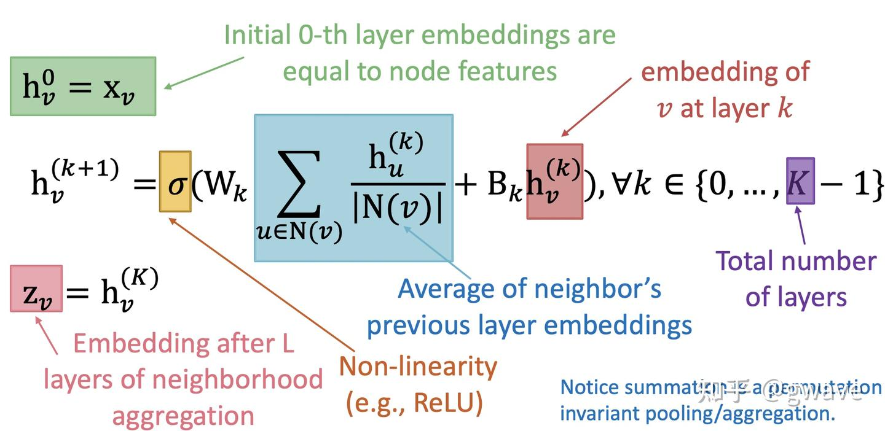

下篇文章将通过一个例子来说明：通过GNN根据化合物的分子结构预测其可溶解性。

**相关阅读：**

### 参考

- [^](#ref_1_0)https://research.facebook.com/blog//three-and-a-half-degrees-of-separation/
