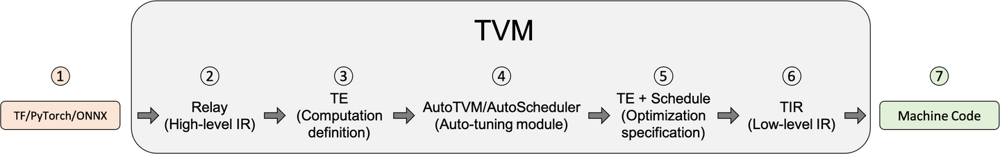

### 前言

作为一个深度学习编译器，TVM 中存在着机器学习模型的许多不同形态的中间表示，从 high-level 的图层级表示（Relay，Relax）到 lower-level 的表示（TIR）。不同形态的中间表示（图，算子）因为粒度、关注点等上的不同，自然有不同侧重点的优化。在偏向前端的方面（即面向用户，大多数是 Python API），目前大概有两种主流的解决方案：

- 提供基本的 operator API。这种 primitive operator 的集合往往是研究人员在实践中归纳总结出来的，并且经过前人整理逐渐也被归为几类：element-wise，reduce，transform 等等（当然还有很多不同的规范，比如我最近接触到的对 Python 数组的标准 DataAPI）。
- 设计一个 DSL / Script。这比单纯提供基本 operator 拥有更高的客制化空间。不过其实从本质上讲，这种方法也需要提供一个基本 op 的集合。但是它们“更为基本”，往往只需要提供算术上的上算子。
不过其实这种分类不算太严格，因为 DSL 也有许多不同形态的样子，有的更接近于第一种；并且主流的框架基本上支持多种前端的形态。

说回 TVM 的 TE，与描述 Module 本身的 DSL 不同，它更准确的定位是对张量计算（computation）的过程进行抽象，本质其实是一个 index lambda。在 TVM 架构上，TE 仍然位于偏前端的位置，用于定义计算。

### Einsum 求和约定

index lambda 这种想法我感觉是对 einsum 的进一步推广。einsum 的特点在于：

- 基于 index
- 简写掉了中间的加法和乘法运算
这种写法当然也是通过实践总结出来的，实际过程中加法/乘法 + index mapping 就能强大到表示很多运算了。例如 matmul:

`np.einsum('ij,jk->ik', A, B)`

将 einsum 写成通用的形式就是这样：

`source_1_indices, source_2_indices, ..., source_m_indices -> dest_indices`

等价于运算

$D[\text{dest_indices}] += \prod_{k=1}^m S_k[\text{source_k_indices}] $

这边写的不是很规范，意思就是这些 source 之间是乘法，然后遍历 indices 过程中是加法。以 matmul 为例，就是这样

$C[i, j] = \sum_{k} A[i, k] B[k, j] $

### Tensor Expression

显然，只有加法和乘法并不足以表达深度学习中的所有算子——从基础运算的角度来讲，有的算子也超出了这种表达范畴。因此我们需要扩展我们的 primitive operator 集合。此外，为了提供高的 customize 的能力，我们可以将这种加法和乘法的行为改成一个传入的计算函数 fcompute。

其实我刚开始被科普 TE 的时候，那个人对我说的是“可以像平时写数学计算公式那样”去写出算子的计算，所以名字叫 "Tensor Expression"。其实是一个意思，专业点讲就叫 "对计算的抽象"。

#### te.compute

TE 中最重要的部分就是 te.compute 这个接口

`def compute(shape, fcompute, name="compute", tag="", attrs=None, varargs_names=None):
    """Construct a new tensor by computing over the shape domain.

    The compute rule is result[axis] = fcompute(axis)
    """`

忽略掉不重要的参数，我们只需要关注 shape 和 fcompute。其中 shape 指的就是我们通过 compute 构造出来的这个 Tensor 的 shape，fcompute 就是计算用的函数。

TE 本身是针对 index 的，所以 fcompute 本身应该是一个 "compute over shape domain" 的形式，也就是说假设

`shape = (n, m)`

那么 fcompute 就需要是一个接受两个参数 i, j 的函数，并且返回计算结果。仍然以 matmul 为例，fcompute 就可以写成这样

`fcompute = lambda i, j: te.sum(A[i, k] * B[k, j], axis=k)`

#### spatial/reduce axis

我们发现这里有个奇怪的地方：k 这个 axis 是什么？对 fcompute 这个函数本身，k 并不在它的 scope 中。其实一般的 element-wise 的算符定义我们并不会出现这种情况，这里的 k 叫做 reduce axis，而 i，j 叫做 spatial axis，它们的性质有所不同。

- spatial axis，在 output 中出现的轴，也即 fcompute 本身 compute over domain 时用的那些 iterator。
- reduce axis，在中间计算中出现但在最后的结果中不出现的轴。例如 matmul 中的那个 k。
- 其它类型，例如 mixed（混合 S 和 R）等。
我们来看几种情况从简单到复杂的算符：

- element wise operator
这种算符的特点就是 source indices 和 dest indices 完全一样，前置要求当然是 source 和 dest 的 shape 本身一样。当然，有时候这样的算符具有 broadcasting 的性质，不过本质都是 element-wise 的。在这种算符中所有 axis 都是 spatial axis。

`fcompute = lambda i, j: te.sin(A[i, j])`

- einsum
einsum 包含了 matmul。我们可以直接考虑 general 的 einsum。这种算符既有 spatial axis 又有 reduce axis，取决于 source indices 和 dest indices 中的关系。

- conv
conv 相比于上面的算符，它复杂在 source 的 indices 之间本身还有一些空间上的交错。也就是说不能完全地将每个位置 bind 到一个 thread 然后简单地并行计算。在反向求导的时候这种性质会带来比较大的麻烦。

在 te 中，spatial axis 不需要我们特地创建，因为它们都是 fcompute 的参数。而 reduce axis 需要我们在事先创建，因此 matmul 完整的程序应该写为

`A = te.placeholder((n, m), name="A")
B = te.placeholder((m, l), name="B")
k = te.reduce_axis((0, m), name="k") # te.reduce_axis 第一个参数表示 range
C = te.compute((n, l), lambda i, j: te.sum(A[i, k] * B[k, j], axis=k), name="C")`

te.placeholder 就是 TE 这个层面上对 Tensor / NDArray 这种东西的表示。可以看出我们的实现依赖于 te.sum 这个更加基本的算子。

### TE 基本算子

fcompute 只是描述了 indices 之间的关系以及怎样把基本的运算组合起来。对于运算的能力范畴，一些基本的算符当然是不可取代的——只有加法和乘法无论如何也不能弄出 sin。因此我们需要 element 层面上的一些算符。

理论上我们只需要这些，但是 TE 中也提供了一些 Tensor 层面上的算符，例如 sum/max/min 等。就实现能力上，完全可以用自己的实现替代之，但将常用的封装起来也比较方便。

为了方便，TVM 直接把 TE 算符这边的 namespace 指到了 TIR 那边，因此用的直接就是 TIR 的 Op。详情参考官方文档：https://tvm.apache.org/docs/reference/api/python/te.html。

### te.compute 的实现

源码位置（Github1s 支持的预览）：https://github1s.com/apache/tvm/blob/HEAD/python/tvm/te/operation.py

首先，对于传入的 shape，我们创建 len(shape) 个 tvm.tir.IterVar，range 为各自的维度大小。IterVar 本身代表对一个 int 范围内的 iteration。然后将这些 vars 和 fcompute(*vars) 传到 C++ 端（TVM 本身搞了一套很强大的 FFI）。

`TVM_REGISTER_GLOBAL("te.ComputeOp")
    .set_body_typed( { return ComputeOp(name, tag, attrs, axis, body); });`

Array axis 就是那些 vars。然后 body 是一个 Array，即 fcompute 的计算结果，统一为 Array 是考虑到多返回值情况（应该吧）。这在代码中以一个 ComputeOp 的整体存在。

> PrimExpr
PrimExpr 在 TVM 中的定位比较 low-level，它拥有基本的四则运算、比较等 operator，以及支持 Call，Call 的 op 可以是一个 Relay 的 op。

然后 computation 的实现部分，实际上就是 ComputeOp -> TIR Stmt 的过程。这个过程比较复杂，就不详说了。核心部分在这个函数

`Stmt MakeComputeStmt(const ComputeOpNode* self, const Stage& stage,
                     const std::unordered_map& dom_map,
                     bool debug_keep_trivial_loop) {`

### TOPI

TOPI 全称是 TVM Operator Inventory，也就是 TVM 算子的一个 collection，主要就是基于 TE compute 的这一套来实现的（当然比较简单的算符直接靠 PrimExpr 就可以做到）。它不仅包含基本的 Tensor 算符，还包含很多 NN 的算符。它实现大多在 C++ 端，利用 FFI 暴露给 Python。

我们还可以把更高层的 IR（Relay，Relax）给 lower（或者叫 legalize）到 TOPI/TE 中，然后进一步变成 TIR，最后就能进行 codegen 或者在 vm 上执行。

TOPI 部分的代码在这里（以 broadcast 算符为例）：https://github1s.com/apache/tvm/blob/HEAD/src/topi/broadcast.cc

### 结尾

te.compute 作为一个基于 index 的计算抽象，它有强大抽象能力。一整套的 TOPI 的实现证明了它可以基本涵盖所有的深度学习中需要的计算。当然，深度学习目前的发展还比较随性，可能以后会有新的 operator 会超出这套范式，给整个深度学习总结一套泛用并且自洽的体系也正是 MLSys 需要做的工作吧。

TVM 中的 Tensor Expression (TE)
