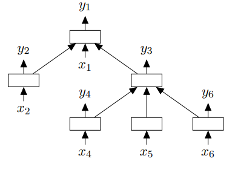
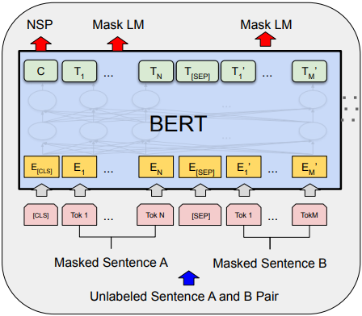
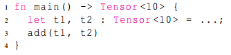
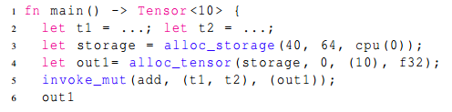
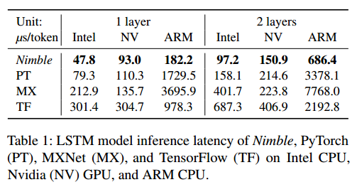
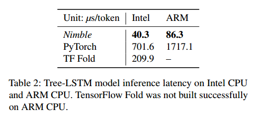
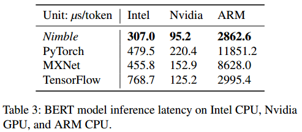

动态深度学习网络越来越常见，尤其是在NLP领域，业界各大框架也都将动态网络支持作为一大技术热点。本文主要分析了AWS、华盛顿大学和OctoML共同推出的Nimble论文，供大家参考。

### 概述

目前主流的深度学习网络主要存在3种动态特性：

- 控制流。如RNN、LSTM网络；
- 动态数据的网络结构。如Tree-Structured LSTM补齐了LSTM对树形结构处理的不足，支持每个输入单元依赖多个其他单元的隐层输出

- 动态shape算子。如BERT网络相比于LSTM在时序上处理，将数据进行了空间上的扩展处理，从而引入了维度不确定的Tensor。还有Wide&amp;Deep、AutoML等也会引入动态shape的算子。

支持动态图的框架天生自带对动态网络的支持，奈何性能太差。而支持静态图的框架大多通过将动态模型转换成静态模型来实现优化复用，提升性能的同时不可避免的带来了复杂度提高和灵活性降低的问题。Nimble在TVM基础上提出了一套高性能、可移植的编译优化系统，支持动态网络在不同平台下的执行，其核心技术点如下：

- 支持动态shape的编译优化框架，包括类型系统、内存优化、算子生成等；
- 基于Virtual Matchine的轻量级跨平台runtime。

### 编译优化框架

- 类型系统
引入Any类型解决动态shape下维度信息的表达：

Tensor[(1, 10, Any), float32]    #支持：固定rank，1维动态

Tensor[(1, Any, Any), float32]   #支持：固定rank，多维动态

Tensor[(*), float32]           #不支持：动态rank

由于编译时的不确定性，在整网的shape推导过程中，一些合法性检查（如broadcast语义判断）无法进行，论文通过gradual typing将这些检查放到了运行时。另外，还用了sub-shaping技术来提高shape推导的准确性，降低Any的污染传播。

- Shape Function
在运行时，shape function根据算子输入计算得到输出tensor的shape。根据算子的不同特性，将shape function分成3类：

- 数据无依赖型，输出shape只与输入Tensor的shape相关；
- 数据依赖型，输出shape需要输入Tensor的value计算得到；
- 上边界型。
数据无依赖型的动态shape算子在编译阶段可以很容易的融合。在实现中shape function是作为一个算子注册到框架中，所以shape function本身也是可融合的。以下是我们在TVM代码里面找到的shape function：

typeIs Data Dependentelemwise_shape_funcNono_data_full_shape_funcYesfull_shape_funcYesbroadcast_shape_funcNoconv_shape_funcNopool2d_shape_funcNoglobal_pool2d_shape_funcNoreduce_shape_funcNo

- 内存编排
扩展新增4条Relay IR表达内存相关操作

- invoke_mut(op, inputs, outputs)
- alloc_storage(size, alignment, device)
- alloc_tensor(storage, offset, shape, dtype, attrs)
- kill(tensor)
将静态shape下的IR表示转换为动态shape的表示，如下：

转换前：

转换后：

基于显式的内存操作IR实现内存聚合等复用优化。

- 异构算子编排
引入DeviceDomain的概念，通过合理分配算子的执行domain，最大程度降低数据在多设备间的传输、以及充分利用多设备的流水并行。分配规则如下：

shape_ofCPU domainshape_functionsCPU domaindevice_copy按照传输方向进行跨domain传播Memory operations在alloc_stroage中指定，调用alloc_tensor进行对应传播invoke_mut所有参数的device domain必须一致other common IR nodes根据以上节点进行传播确定

- 符号式算子生成
论文提出了在动态shape下算子生成的两个挑战：

- 挑战一：动态shape算子如何能达到静态算子性能水平？
- 挑战二：如果扩展现有Tuning算法来支持动态shape？
针对第一个挑战，提出了一种按照tiling因子进行kernel拆分的方式，如

tiling factor = 8

输入Tensor：Tensor[(x), float32]

拆分前kernel：kernel(x) {……}

拆分后kernel：kernel(k, r) {……} 

然后通过dispatch function对拆分后的kernel进行调度执行，拆分粒度可配置（Full dispatch表示完全按照tiling因子拆分，No dispatch表示不拆分）。同时还对Simplification Pass做了增强，尽可能消除动态边界检查。

针对第二个挑战，提出了一套基于自定义模板的搜索算法：

- 使用足够大定值替换变量维度值，覆盖处理场景内大多数值范围，然后用替换后的静态shape进行tuning；
- 选取top k配置进行多shape的性能泛化评估。多shape选取策略：2的幂次，最大值256；
- 在泛化评估中，选取平均性能最好的配置作为tuning结果。

### VM-based Runtime

设计了一套CISC-style的指令集，采用变长指令格式，优化时可用无限寄存器。

经过编译优化后的模型可执行件包含两部分：

- 平台无关的字节码，包含模型的控制执行逻辑；
- 平台相关的高性能kernel。
可执行件由专门设计的解析器负责加载和执行。得益于粗粒度的指令集设计，VM带来的运行时开销极小，其轻量级特性也保证了平台间的可移植性。

### 性能评估

论文给出了LSTM、Tree-LSTM、BERT三个网络分别在Intel Skylake CPU，Nvidia Tesla T4 GPU，ARM Cortex A72 CPU平台上与PyTroch、TensorFlow、MXNet的推理性能对比测试结果。结果显示Nimble相比其他框架在不同平台上都有显著的性能提升，最大实现了20x的性能优化。

论文同时也分析了支持动态模型带来的额外开销：

- 相比TVM静态模型性能降低5%~25%，性能降低主要来自于动态shape算子index的计算和VM引入的指令开销；
- 相比TVM额外占用8%内存
- Dense算子Full Dispatch性能基本持平静态shape，No Dispatch性能最差

### 总结

Nimble是在动态模型上一次较系统的优化，其提出了一套从图层到算子层、从编译层到执行层、从离线处理到部署端到端的优化解决方案。但是也看到Nimble当前也存在一定局限性：

1、动态rank、全动态维度的支持不是很好；

2、图层的解决方案比较清晰，算子层的方案还有些看不清楚，不知道tilling参数按照最大值来搜索是否合适？

3、TVM的方案一直就是在推理场景验证，实际在训练场景的效果不大清楚。

参考

[1]论文地址：[https://arxiv.org/abs/2006.03031](https://link.zhihu.com/?target=https%3A//arxiv.org/abs/2006.03031)

[2]BERT：[https://arxiv.org/pdf/1810.04805.pdf](https://link.zhihu.com/?target=https%3A//arxiv.org/pdf/1810.04805.pdf)

[3]Tree-Structured LSTM：[https://arxiv.org/abs/1503.00075](https://link.zhihu.com/?target=https%3A//arxiv.org/abs/1503.00075)

[4]Dynamic Shape Compiler：https://www.zhihu.com/search?type=content&q=dynamic%20shape

[5]Fateman, Richard J.  Can you save time in multiplying polynomials by encoding them as integers?/2010 revised. 2010. http://www.cs.berkeley.edu/~fateman/papers/polysbyGMP.pdf
