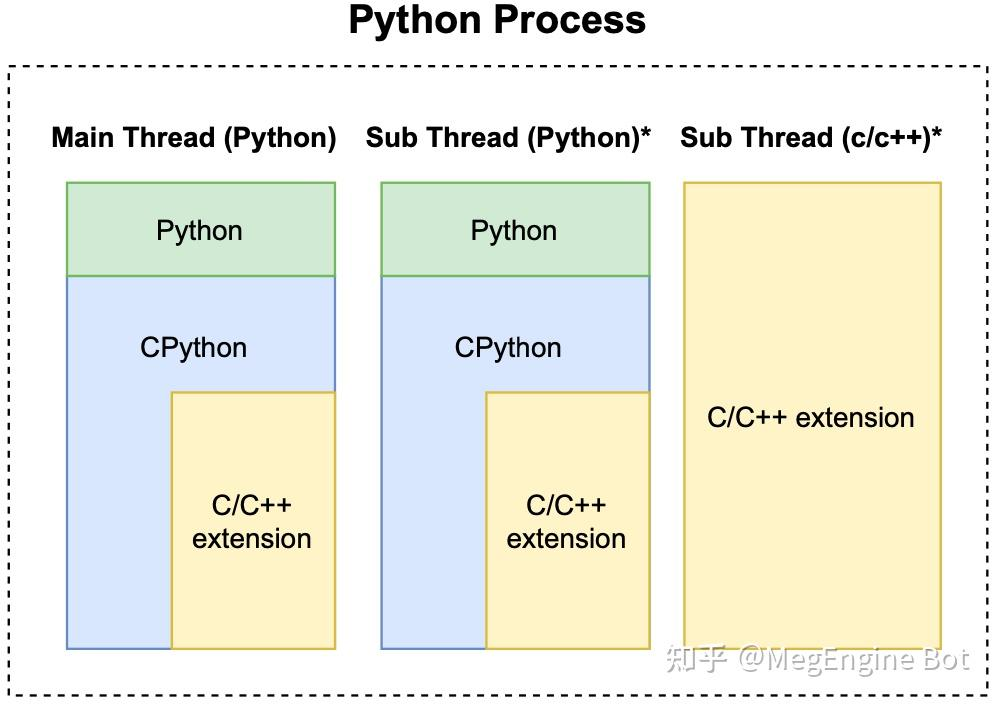
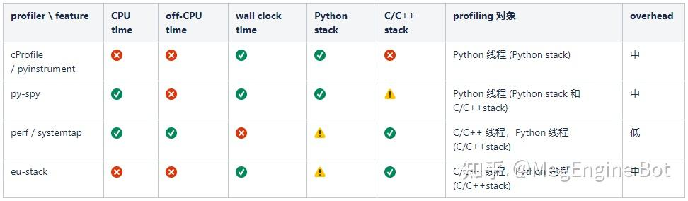
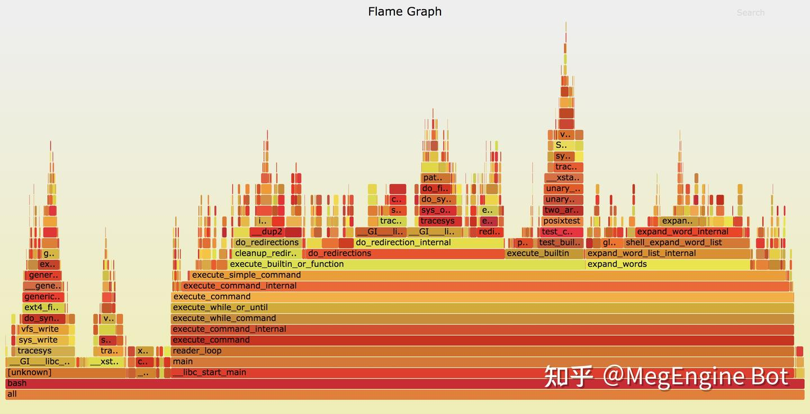
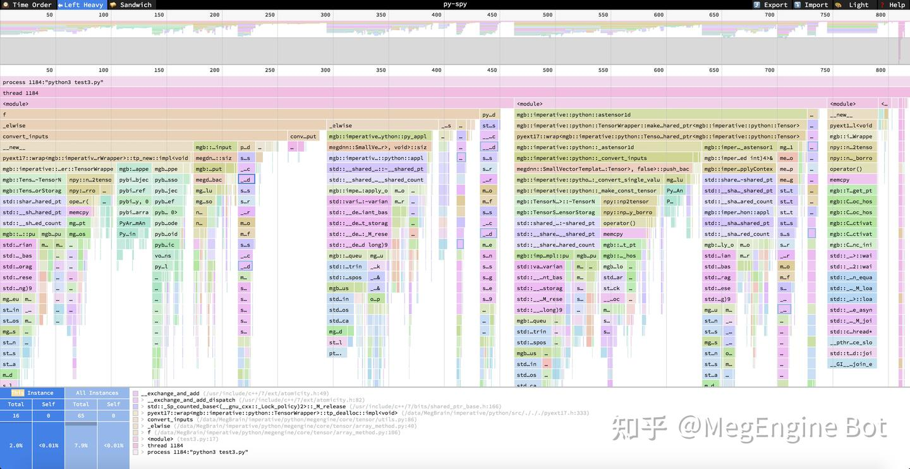
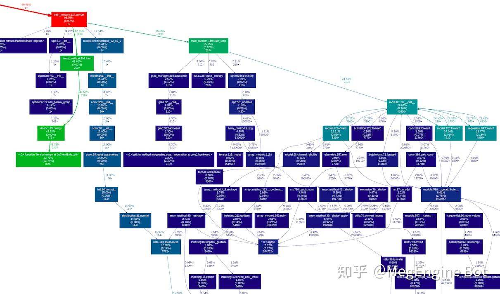
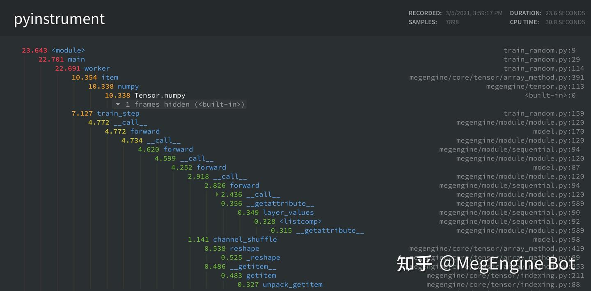
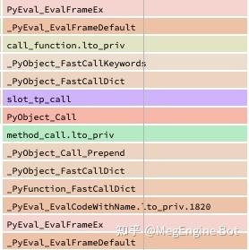
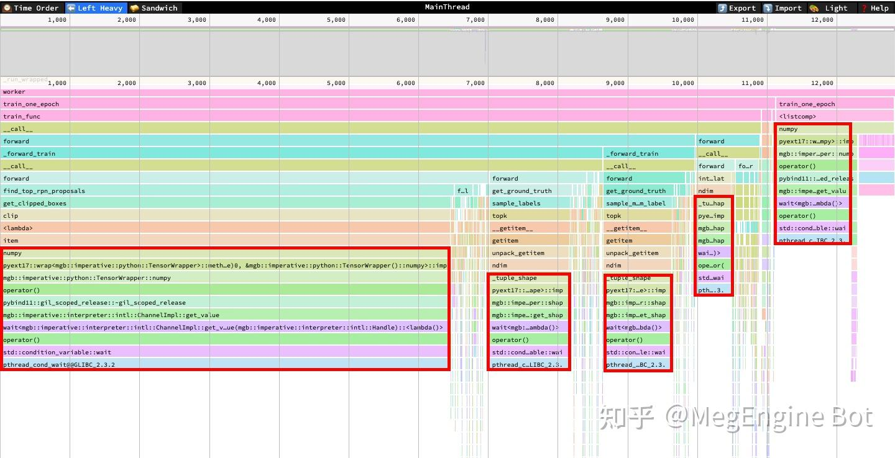
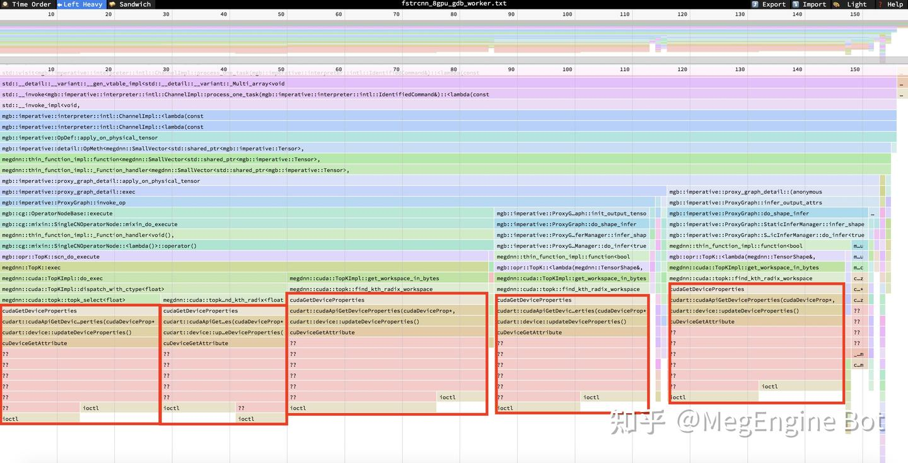

**作者：王璐璐 | 旷视 MegEngine 架构师
### 一、背景

在 MegEngine imperative runtime 的早期开发中，我们面临着一些的性能优化问题。除了一些已知需要重构的地方（早期设计时为了开发效率而牺牲性能的妥协），还存在一些未知的性能问题需要用 profiler 进行观测和分析才能发现。MegEngine的imperative runtime 是一个由 Python 和 C/C++ 编写的模块，对于这类程序，各种profiler多到令人眼花缭乱。在调研各种profiler的过程中，我们也踩了不少的坑，比如发现两个 profiler 对同一个程序的profiling结果差异巨大，我们起初怀疑其中一个 profiler 的准确性有问题，最后发现是两者的观测对象不同，其中一个只 profiling 程序的 CPU time，而另一个 profiling wall clock time。虽然一些这样的信息在文档的某些角落里能够找到，但很多使用者可能在踩了坑之后才会注意到。如果一开始能找到一篇介绍各种 profiler 的特点、优势、不足和使用场景的文章，我们可能会节省不少时间。

因此本文尝试对这些经验进行总结，希望能够给初次使用这些工具的读者一些参考。性能优化是一个十分广泛的话题，它涉及 CPU、内存、磁盘、网络等方面，本文主要关注 Python 及 C/C++ 拓展程序在 CPU 上的性能优化，文章主要围绕着下面三个问题展开：

- Python 及 C/C++ 拓展程序的常见的优化目标有哪些
- 常见工具的能力范围和局限是什么，给定一个优化目标我们应该如何选择工具
- 各种工具的使用方法和结果的可视化方法
除此之外，本文还会介绍一些性能优化中需要了解的基本概念，并在文章末尾以 MegEngine 开发过程中的一个性能优化的实际案例来展示一个优化的流程。

### 二、基本概念**

本节介绍性能优化中的一些基础概念：

### **2.1 wall clock time, CPU time 和 off-CPU time**

衡量程序性能最直接的标准就是程序的运行时间，但仅仅知道程序的运行时间很难指导我们如何把程序优化地更快，我们想要更进一步地了解这段时间之内到底发生了什么。

Linux 系统上的 time 命令能够告诉我们一些粗糙的信息，我们在命令行里输出下面的命令来测量检查某个文件的 CRC 校验码的运行时间:

`time cksum `

以我的电脑（MacBook Pro 2018）为例，得到了以下输出:

`8.22s user 1.06s system 96% cpu 9.618 total`

**这段文字告诉了我们时间都花在了哪里:

- 总时间 9.618s
- user 时间 8.22s
- system 时间 1.06s
其中 user 和 system 的含义是 user CPU time 和 system CPU time，之所以会把 CPU 的执行时间分为两个部分，是因为程序在运行时除了执行程序本身代码和一些库的代码，还会调用操作系统提供的函数（即系统调用，程序运行系统调用时有更高的权限)，因此程序运行时通常会处于两种状态：用户态和内核态，内核态指的是CPU在运行系统调用时的状态，而用户态就是 CPU 运行非系统调用（即用户自己的代码或一些库）时的状态。

因此上面提到的 user CPU time 指的是用户态所花费的时间，而 system CPU time 指的是内核态花费的时间。

我们发现 `user CPU time + system CPU time = 8.22s + 1.06s = 9.28s`并不等于总时间 9.618s，这是因为这条命令执行的时间内，程序并不是总是在 CPU 上执行，还有可能处于睡眠、等待等状态，比如等待文件从磁盘加载到内存等。这段时间既不算在 user CPU time 也不算在 system CPU time 内。我们把程序在 CPU 上执行的时间（即 `user CPU time + system CPU time`）称为 CPU time（或 on-CPU time），程序处于睡眠等状态的时间称为 off-CPU time（or blocked time），程序实际运行的时间称为 wall clock time（字面意思是墙上时钟的时间，也就是真实世界中流逝的时间），对于一个给定的线程：`wall clock time = CPU time + off-CPU time`。

通常在计算密集型（CPU intensive）的任务中 CPU time 会占据较大的比重，而在 I/O 密集型（I/O intensive）任务中 off-CPU time 会占据较大的比重。搞清楚 CPU time 和 off-CPU time 的区别对性能优化十分重要，比如某个程序的性能瓶颈在 off-CPU time 上，而我们选择了一个只观测 CPU time 的工具，那么很难找到真正的性能瓶颈，反之亦然。

### 2.2 性能观测工具**

我们知道了一个线程执行过程中的 CPU time 和 off-CPU time，如果要对程序的性能进行优化，这些还远远不够，我们需要进一步知道 CPU time 的时间段内，CPU 上到底发生了哪些事情、这些事情分别消耗了多少时间、在哪里导致了线程被 block 住了、分别 block 了多久等。我们需要性能观测工具来获得这些详细的信息。通常情况下我们也将称这种观测工具称为 profiler。

不同的观测对象对应着不同的 profiler，仅就 CPU 而言，profiler 也数不胜数。

按照观测范围来分类，CPU 上的 profiler 大致可以分为两大类：进程级（per-process，某些地方也叫做应用级）和系统级（system wide），其中：

- 进程级只观测一个进程或线程上发生的事情
- 系统级不局限在某一个进程上，观测对象为整个系统上运行的所有程序
需要注意的是，某些工具既能观测整个系统也支持观测单个进程，比如 perf，因此这样的工具同时属于两个类别。**
按照观测方法来分类，大致可以分为 event based 和 sampling based 两大类。其中：

- event based：在一个指定的 event 集合上进行，比如进入或离开某个/某些特定的函数、分配内存、异常的抛出等事件。event based profiler 在一些文章中也被称为 tracing profiler 或 tracer
- sampling based：以某一个指定的频率对运行的程序的某些信息进行采样，通常情况下采样的对象是程序的调用栈
即使确定了我们优化的对象属于上述的某一个类别，仍然有更细粒度的分类。在选择工具之前要搞清楚具体的优化对象是什么，单个 profiler 一般无法满足我们所有的需求，针对不同的优化对象 （比如 Python 线程、C/C++线程等） 我们需要使用不同的 profiler。并且，对于同一个优化对象，如果我们关注的信息不同，也可能需要使用不同的 profiler。

### 2.3 Python 进程模型

本文主要关注 Python（包括 C/C++ 拓展） 程序的优化，一个典型的 Python 和 C/C++ 拓展程序的进程如下图所示：

一个 Python 进程必须包含一个 Python 主线程，可能包含若干个 Python 子线程和若干个 C/C++ 子线程。因此我们进一步把优化对象细分为三类：

- Python 线程中的 Python 代码
- Python 线程中的 C/C++ 拓展代码
- C/C++ 线程
这里的 Python 线程具体指 CPython 解释器线程，而 C/C++ 线程指不包含 Python 调用栈的 C/C++ 线程。

### 三、profiler 的分类和选择**

我们从以下两个角度对 profiler 进行刻画:

- 是否支持 profiling  time、off-CPU time 和 wall clock time（CPU time + off-CPU time）
- 是否支持 profiling C/C++ stack
- 是否能够从 CPython 解释器的调用栈中解析出 Python 调用栈
我们介绍将介绍 6 个 profiler，分别为 py-spy、cProfile、pyinstrument、perf、systemtap 和 eu-stack。为了方便大家进行选择，我们按照上面介绍的特征，把这些 profiler 分成了 4 类并总结在了下面的表格中 （其中✅、⚠、❌分别表示支持、不完全支持和不支持）：

表格中第一种是纯 Python profiler，只能观测 Python 线程中 Python 函数的调用栈，适合优化纯 Python 代码时使用，本文将介绍 CProfile（Python 的 built-in profiler）和 pyinstrument（第三方 Python profiler），这类 profiler 还有很多，比如 scalene、line-profiler、pprofile 等，由于这些 profiler 在能力上差异不大，因此这里就不一一介绍了。**
第二类是 Python 线程 profiler，与第一类的主要区别是除了能够观测 Python 线程里的 Python 调用栈，还能观测 c/c++ 拓展的调用栈，这一类只介绍 py-spy。

第三类是系统级 profiler，我们主要用来观测 Python 线程中的 C/C++ 拓展的调用栈和纯 C/C++ 线程，这类 profiler 虽然能够观测 CPython 解释器的调用栈，但由于不是专为 Python 设计的 profiler，不会去解析 Python 函数的调用栈，因此不太适合观测 Python stack。这一类工具我们将介绍 perf 和 systemtap。

最后一类是对第三类的补充，由于第三类介绍的两个工具都无法在 wall clock time (CPU time + off-CPU time) 上观测程序，eu-stack 可以在 wall clock time 上采样程序的 C/C++ 调用栈，因此可以作为这种场景下的 profiler。

表格中的 overhead 指 profiler 运行时对被 profiling 程序的影响，overhead 越大 profiling 的结果准确度越低。需要注意的是，任何 profiler 都无法做到绝对的准确，profiler 本身对程序带来的影响、采样的随机性等都会对结果造成影响，我们不应该将 profiling 结果作为程序运行时的实际情况，而应该将其视为一种对实际情况的估计（这种估计甚至是有偏的）。

除了 profiler，我们还需要一些工具来对 profiling 的结果进行可视化来分析性能瓶颈。与 profiler 不同的是，可视化工具一般具有较强通用性，一种广泛使用的工具是火焰图 (flamegraph)，本文将介绍 flamegraph 的使用方法，除此之外还会介绍一个火焰图的改进版工具：speedscope。

由于 profiler 的介绍里需要引用可视化工具，因此接下来我们先介绍可视化工具，再介绍 profiler。

### 四、可视化工具**

### 4.1 flamegraph

火焰图（flamegraph）是一个功能强大的可视化 profiling 结果的工具。它即可以对多种 profiler 的输出进行处理，也可以对处理后的结果进行可视化。它能够处理不同平台上的十多种 profiler 的原始输出，除了能够可视化 cpu 上的 profiling 结果，它也可以对一些内存 profiler 的输出结果进行可视化。**
flamegraph 的使用流程一般是对 profiler 的原始输出结果进行处理，之后再生成一个 SVG 文件，可以在浏览器里打开，效果如下：

flamegraph 的主要功能就是显示 profiler 采样的调用栈的频率分布，图中纵向堆起来的代表调用栈，调用栈中的矩形块的宽度代表该函数运行时被采到的频率（某个执行路径的时间占比与它被采样到的概率成正比，因此采样频率近似等于该执行路径的时间占比）。通过观察火焰图，我们可以看到程序都有哪些执行路径，以及每个执行路径的时间占比，然后对时间占比较大的性能瓶颈（或"热点"）进行优化，来达到优化性能的目的。

如果想深入了解 flamegraph，可以参考作者的主页或 github repo：

- homepage: http://www.brendangregg.com/flamegraphs.html
- github repo: [https://github.com/brendangregg/FlameGraph](https://link.zhihu.com/?target=https%3A//github.com/brendangregg/FlameGraph)

### 4.2 speedscope

另外一个值得介绍的工具是 speedscope。speedscope 的使用方法和 flamegraph 类似，且兼容 flamegraph 的输出格式。与 flamegraph 相比，speedscope 在两个方面具有优势：

1) speedscope 在可视化效果、交互性等方面表现十分优秀；

2) speedscope 运行时的开销比 SVG 低很多，同时开很多窗口也不会造成明显卡顿。

因此，我们推荐把 speedscope 与 flamegraph 结合在一起使用：用 flamegraph 来处理不同工具的输出数据，用 speedscope 进行可视化。speedscope 是一个 web app，作者提供了一个可以直接使用的地址：https://www.speedscope.app/，我们也可以在本地部署，但更前者更方便。本文主要以 speedscope 来可视化 profiling 结果，下面简单介绍一下它的使用方法：

进入 https://www.speedscope.app/ 中，打开 json 格式的 profiling 结果（我们会在下面各种 profiler 的使用方法中介绍如何将结果转为这种 json）。可以看到以下界面（与 flamegraph 的一个不同之处是 speedscope 的调用栈是倒过来的）:

左上角可以选择三种模式:

- Time Order：即时间轴模式，从左到右代表时间的方向，中间每一列代表改时刻采样的调用栈
- Left Heavy：按照调用栈函数的时间占比（采样次数占比来估计时间占比）进行展示，即调用栈的每一层都按照左侧时间多右侧时间短的顺序来排序。点击任何一个调用栈中的函数：

- 可以在图中左下角看到该函数在当前调用栈 (This Instance) 的总开销 (Total) 和自身开销 (Self)，以及该函数在所有出现过的调用栈 (All Instances) 中的总开销 (Total) 和自身开销 (Self)， 图中的整数代表被采样的次数，百分比为被采样的占比（近似等于时间占比）。
- 图下方的白色框内是该函数的调用栈。

- Sandwich:用函数的总开销和自身开销来排序，点击函数可以看到该函数的调用者和被调用者
更详细的介绍可以参考 speedscope 的官方 repo：[https://github.com/jlfwong/speedscope](https://link.zhihu.com/?target=https%3A//github.com/jlfwong/speedscope)

### 五、性能观测工具

接下来我们介绍几个在 Python 和 C/C++ 拓展程序的优化过程中常用的 profiler。我们将介绍每种 profiler 的优点和局限，大家应该根据自己的实际需求来选择合适的工具。

### 5.1 py-spy

py-spy 是一个 sampling based profiler, 它的 profiling 的对象是 Python 及 C/C++ 拓展的调用栈。py-spy 的 overhead 中等，对运行的程序速度影响不算太大。且本身支持直接输出 speedscope 和 flamegraph 格式的结果。

repo: [https://github.com/benfred/py-spy](https://link.zhihu.com/?target=https%3A//github.com/benfred/py-spy)

可以直接使用 pip 进行安装:

`pip install py-spy`

使用方法:

`# 基本使用方法：
py-spy record --format speedscope -o output.json --native -- python3 xxx.py
  
# =====
# 主要参数：
# --format: 输出格式，默认是 flamegraph，推荐使用 speedscope 格式
# --output: 输出文件名
# --native: 是否采样 C/C++调用栈，不加--native 只会对 Python 调用栈进行采样
  
# =====
# 其他参数
# --rate:          采样频率，默认值为 100，打开--native 会增大 overhead，建议打开--native 时调低--rate
# --subprocesses:  是否对子进程进行采样，默认为否
# --gil:           是否只对拿到 Python GIL 的线程进行采样
# --threads:       在输出中显示 thread id
# --idle:          是否对 idle（即 off-CPU time) 的 thread 进行采样，默认为否，根据具体场景选择是否打开
  
# =====
# 例子：
py-spy record -sti --rate 10 --format speedscope --native -o output.json -- python3 xxx.py
 
# 除了在启动时运行 py-spy，还可以对一个已经运行的 python 进程进行采样，如：
py-spy record --format speedscope -o output.json --native --pid 12345`

其他功能：

除了 record 子命令外，py-spy 还提供了 top 子命令：可以在命令行中动态显示时间开销最大函数排序；以及 dump 子命令：可以打印一个正在运行的 python 进程的调用栈。具体使用方法可以参考文档：[https://github.com/benfred/py-spy](https://link.zhihu.com/?target=https%3A//github.com/benfred/py-spy) 

py-spy 支持在 CPU time 或 wall clock time (CPU time + off-CPU time) 上对程序的调用栈进行采样，采样的对象是 Python 线程的 python 调用栈或 c/c++ 拓展的调用栈。

py-spy 虽然也能对 C/C++ 线程的调用栈进行采样，但目前（v0.3.4）会把 Python 调用栈与 C/C++ 调用栈拼在一起 （详见 GitHub 相关 issue：[https://github.com/benfred/py-spy/issues/332](https://link.zhihu.com/?target=https%3A//github.com/benfred/py-spy/issues/332) )，无论两者是否真正存在调用关系，这样会使 C/C++ 线程的 profiling 结果在可视化时按照 Python 调用栈进行聚合，导致很难进行分析，因此 py-spy 目前只适合对纯 Python 代码以及 Python 线程上的 C/C++拓展（存在 Python 到 C/C++ 的调用关系）进行观测，不适合观测独立的 C/C++ 线程，这是 py-spy 的一个不足之处。

### 5.2 cProfile

cProfile 是一个 event based profiler，它的工作原理是追踪 Python 解释器上的每一个 Python 函数调用和时间开销。cProfile 是 Python 的 built-in profiler，理论上对 Python 的支持度相对较高。cProfile 的局限有很多：

- 只能观测纯 Python 的函数调用，无法看到 C/C++ 拓展的调用栈
- 只支持 wall clock time
- overhead 相对较大
使用方法：

`python3 -m cProfile xxx.py`

cProfile 的输出格式是一个 table，如下：

`    2173 function calls (2145 primitive calls) in 10.230 seconds
 
Ordered by: standard name
 
ncalls  tottime  percall  cumtime  percall filename:lineno(function)
    1    0.000    0.000    0.000    0.000 :103(release)
    1    0.000    0.000    0.000    0.000 :143(__init__)
    1    0.000    0.000    0.000    0.000 :147(__enter__)
    1    0.000    0.000    0.000    0.000 :151(__exit__)
    1    0.000    0.000    0.000    0.000 :157(_get_module_lock)
    1    0.000    0.000    0.000    0.000 :176(cb)
    1    0.000    0.000    0.000    0.000 :211(_call_with_frames_removed)
   32    0.000    0.000    0.000    0.000 :222(_verbose_message)
    1    0.000    0.000    0.000    0.000 :307(__init__)
    1    0.000    0.000    0.000    0.000 :311(__enter__)
 
....`

也可以指定输出文件：

`python3 -m cProfile -o xxx.cprof xxx.py`

原始输出不方便分析，我们需要一些第三方工具来处理输出数据和可视化，下面介绍两种方法：

- 转成一个 call graph 的图片
`# dependency: gprof2dot, graphviz
# sudo apt install graphviz
# pip3 install gprof2dot
  
gprof2dot -f pstats xxx.cprof | dot -Tpng -o xxx.png && feh`

转成 flamegraph

- 转成flamegraph
`# dependency: flameprof
# pip3 install flameprof
 
flameprof xxx.cprof > flamegraph.svg`

更多信息请参考 cProfile 文档: https://docs.python.org/3/library/profile.html

5.3 pyinstrument**

pyinstrument 是一个 sampling based profiler，功能上与 cProfile 类似，只支持 Sampling 纯 Python 调用栈，类似地只支持 wall clock time，但 overhead 相对 cProfile 低一些，且自带多种可视化方法。**
官方 repo 地址：[https://github.com/joerick/pyinstrument](https://link.zhihu.com/?target=https%3A//github.com/joerick/pyinstrument)

安装:

`pip3 install pyinstrument`

使用方法:

`python3 -m pyinstrument xxx.py`

默认输出结果在命令行中，如下:

`  _     ._   __/__   _ _  _  _ _/_   Recorded: 15:50:07  Samples:  8794
 /_//_/// /_\ / //_// / //_'/ //     Duration: 23.332    CPU time: 31.381
/   _/                      v3.4.1
 
Program: train.py
 
23.331   train.py:9
├─ 22.641 main  train.py:29
│  └─ 22.631 worker  train.py:114
│     ├─ 10.077 item  megengine/core/tensor/array_method.py:391
│     │  └─ 10.067 numpy  megengine/tensor.py:113
│     │     └─ 10.067 Tensor.numpy  :0
│     ├─ 8.056 train_step  train_random.py:159
│     │  ├─ 5.396 __call__  megengine/module/module.py:120
│     │  │  └─ 5.392 forward  model.py:170
│     │  │     └─ 5.348 __call__  megengine/module/module.py:120
│     │  │        └─ 5.239 forward  megengine/module/sequential.py:94
│     │  │           └─ 5.198 __call__  megengine/module/module.py:120
│     │  │              └─ 4.838 forward  model.py:87
...`

也可以输出 html 文件在浏览器里查看上面的结果：

`python3 -m pyinstrument --html xxx.py`

效果如下：

### 5.4 perf

perf 是 Linux 官方的 profiler，可以在 [Linux kernel](https://link.zhihu.com/?target=https%3A//github.com/torvalds/linux/tree/master/tools/perf) 中找到它的源代码。perf 的功能十分强大，它同时支持对整个操作系统进行观测，也支持对单个给定的进程进行观测，除此之外 perf 即可以 trace 指定的 event 也支持对进程的调用栈进行 sampling。perf 运行在内核态，其自身的 overhead 非常低。

安装 perf：

`sudo apt-get install linux-tools-common linux-tools-generic linux-tools-`uname -r``

perf 的版本需要与 Linux kernel 的版本保持一致，安装命令中的 `uname -r` 确保了这一点

使用方法：

`# 直接运行程序并进行采样，如 python3 xxx.py
perf record -F 99 --call-graph dwarf python3 xxx.py
 
# 或对给定线程 id(TID) 进行采样
perf record -F 99 --call-graph dwarf --tid 
 
# 其中-F 99 是采样频率，这里指每秒采样 99 次；也可以用--pid 指定采样的进程 id，此时 perf 会对该进程的所有线程进行采样`

运行结束后会在当前的目录下产生一个名为 `perf.data`的文件

对结果进行可视化：

可以使用perf自带的子命令分析 profiling 结果：

`perf report --stdio -i perf.data`

我们更推荐将其转为火焰图:

`# 将 perf.data 转成调用栈
perf script -i perf.data > perf.unfold
 
# clone FlameGraph
git clone https://github.com/brendangregg/FlameGraph
cd FlameGraph
  
# 假设 perf.unfold 放在了里
stackcollapse-perf.pl /perf.unfold > perf.fold
 
# 可以直接在 speedscope 里打开 perf.fold，或者将其转化为 svg:
# 将 perf.fold 转为 svg 文件
flamegraph.pl perf.fold > perf.svg`

对 Linux kernel 版本大于等于 5.8 的用户，perf 支持直接将结果转为火焰图：

`perf script report flamegraph -i perf.data`

对于 Python 程序的优化，perf 也有一些局限性，因为 perf 不是为 python 定制的 profiler，对 python 的函数调用，perf 采样的是 CPython 解释器的调用栈，所以无法直接看到具体的 Python 函数，如下图所示：

因此 perf 不太适合优化纯 Python 代码，更适合观测 C/C++ 线程。此外，上面使用的 perf record 命令只会对程序 CPU time 的调用栈进行采样，如果要对 off-CPU time 进行观测，需要使用 perf 的 trace 命令，这里就不详细展开了，具体做法可以参考这篇文章：http://www.brendangregg.com/blog/2015-02-26/linux-perf-off-cpu-flame-graph.html 。目前为止 perf 还不支持同时对 CPU time 和 off-CPU time 进行观测，对这两种情况只能独立进行分析。

### 5.5 systemtap

systemtap 是一个操作系统的动态追踪 (dynamic tracing) 工具。它的功能更为强大，我们可以简单地将 systemtap 视为一个可编程的系统级 tracer。systemtap 提供了一个脚本语言，用户可以编写脚本来追踪和监控各种系统调用、用户态的函数调用等各种自定义事件。因此用户可以根据自己的需求，编写脚本来获得程序运行中的各种需要观测的信息，systemtap 将会用户编写的脚本编译成 c 代码，再编译成内核模块，然后加载到正在运行的操作系统内核中。

本文不打算对 systemtap 进行详细介绍，我们只关注它在 profiling 方面的应用（对 systemtap 感兴趣的读者可以参考 SystemTap Beginners Guide）此外，本文也不会展示如何编写脚本来实现一个 profiler，openresty 团队提供了一个 systemtap 的工具集（[openresty-systemtap-toolkit](https://link.zhihu.com/?target=https%3A//github.com/openresty/openresty-systemtap-toolkit)）可以直接拿来使用。

接下来我们介绍 systemtap 的安装和上述工具集的使用方法：

安装 systemtap：

`sudo apt install systemtap systemtap-runtime`

除此之外，我们还需要安装 systemtap 运行时的各种 kernel 依赖：我们可以直接运行 `sudo stap-prep` 来安装依赖，如果这个命令执行失败，则需要手动安装：

`sudo apt install kernel-debuginfo-`uname -r`
sudo apt install kernel-debuginfo-common-`uname -r`
sudo apt install kernel-devel-`uname -r``

systemtap 的运行需要 sudo 权限，我们可以运行下面的命令来检测安装是否成功:

`sudo stap -e 'probe begin { printf("Hello, World!\n"); exit() }'`

如果能正常输出 Hello World 表示安装成功。

使用 systemtap：

我们需要用到 openresty-systemtap-toolkit 提供的两个工具：sample_gt 和 sample_bt_off_cpu，这两个工具分别对程序 cpu time 和 off-cpu time 的调用栈进行采样：

`git clone https://github.com/openresty/openresty-systemtap-toolkit.git
cd openresty-systemtap-toolkit
 
# 对程序 cpu time 的调用栈进行采样，采样时间为 10s, 采样对象为 user space 调用栈，并将结果保存为 cpu.bt
sudo ./sample_bt -u -t 10 -p PID > cpu.bt
 
# 对程序 off cpu time 的调用栈进行采样，采样时间为 10s, 采样对象为 user space 调用栈，并将结果保存为 off_cpu.bt
sudo ./sample_bt_off_cpu -u -t 10 -p PID > off_cpu.bt
 
# 命令中的-u 选项指采样 user space 调用栈，还可以选择-k 来采样 kernel space 的调用栈；-t 指采样时间，这里都设置为 10s；-p 是待采样程序的 pid`

与 perf 类似，systemtap 运行在内核态，overhead 非常低。且对于 python 线程，systemtap 采样的也是 CPython 解释器的调用栈，因此更适合观测 C/C++ 线程。

对结果进行可视化：

可视化方法与 perf 类似，flamegraph 支持处理 systemtap 的输出结果：

`# 处理 cpu.bt 或 off_cpu.bt
stackcollapse-stap.pl /cpu.bt > cpu.fold
 
# 可以直接在 speedscope 里打开 cpu.fold，或者将其转化为 svg:
# 将 perf.fold 转为 svg 文件
flamegraph.pl cpu.fold > cpu.svg`

5.6 eu-stack**

eu-stack 是 elfutils（https://sourceware.org/elfutils）工具集中的一员，它的基础功能是对一个程序的调用栈进行采样：

`eu-stack -p 
 
#===== 可以得到类似下面的输出:
#0  0x00007f5f96bbadd7 __select
#1  0x00007f5f95868278 call_readline
#2  0x0000000000425182 PyOS_Readline
#3  0x00000000004a84aa tok_nextc.cold.140
#4  0x00000000005a7774 tok_get
#5  0x00000000005a8892 parsetok
#6  0x00000000006351bd PyParser_ASTFromFileObject
#7  0x00000000004ad729 PyRun_InteractiveOneObjectEx
#8  0x00000000004afbfe PyRun_InteractiveLoopFlags
#9  0x0000000000638cb3 PyRun_AnyFileExFlags
#10 0x0000000000639671 Py_Main
#11 0x00000000004b0e40 main
#12 0x00007f5f96ac5bf7 __libc_start_main
#13 0x00000000005b2f0a _start`

与 perf 和 systemtap 不同的地方是，即使程序处于 off-CPU 的状态，eu-stack 依然可以获得它的 C/C++ 调用栈。因此我们可以写一个简单的脚本对一个线程的调用栈不断采样来实现一个 wall clock time 上的 sampling based profiler。**
一个简单的 profiler 实现：

`#!/bin/bash -xe
pid=$1
for x in $(seq 0 1000)
do
eu-stack -p $pid > d_$x.txt || true
sleep 0.2
done`

eu-stack 执行时不需要 root 权限，运行一次的时间大约几十毫秒，对程序的影响不算太大。

使用方法：

`# 1. 安装 elfutils
sudo apt install elfutils
 
# 2. 运行上面的脚本
./profiler.sh `

可视化方法：

flamegraph 里也自带了一个处理 eu-stack 输出结果的工具，可以把采集的样本转为 flamegraph，同样也可以在 speedscope 中进行查看：

`# 假设采样结果放在了里
stackcollapse-elfutils.pl /d*txt > eu_perf.txt
 
# 可视化：
# 方法 1: use speedscope.app
# 直接在 speedscope.app 里打开 eu_perf.txt 即可
 
# 方法 2: use flamegraph
flamegraph.pl eu_perf.txt output.svg
# 在浏览器里打开 output.svg`

### 六、例子**

Python 主线程: 执行python训练脚本，并且向队列里发送任务展示一个从 profiling 到寻找 bottleneck 再到性能优化的流程。

在 MegEngine 的早期开发中我们发现某个检测模型在单机 8 卡数据并行上的训练速度非常慢，一个 step 的运行时间是单卡的 2 倍多。我们首先怀疑的是多卡间同步梯度时 All Reduce 的开销带来的影响，为了对此进行确认，我们将卡间的梯度同步关闭，使每张卡的训练相互独立，发现速度只提升了一点，8 卡速度仍是单卡的 2 倍左右。

由于 8 卡训练会启动 8 个进程，为了彻底排除 8 个进程之间可能存在的联系带来的干扰，我们将 8 卡训练改成启 8 个独立的单卡训练，发现速度几乎没有变化。此外我们还观察到一个 step 的运行时间与启动的单卡训练的数量成正相关，启 2 个单卡训练时速度只慢了一点，4 个单卡训练慢了 50%左右。

于是我们怀疑可能是 8 个进程之间竞争 CPU 资源导致了速度变慢，为了进行确认，我们对每个进程绑定相同数量的 cpu 核，即单进程训练和 8 进程训练中每个进程使用的 CPU 数量保持一致，再一次发现速度几乎没有变化，因此 8 卡速度慢与 CPU 资源竞争应该没有关系。

简单的猜测没有定位到问题，我们打算使用 profiler 来查找。MegEngine 的进程可以简化为两个线程：python 主线程和 worker 线程，其中： 

- Python主线程：行 python 训练脚本，并且向队列里发送任务
- worker 线程：是一个纯 C++ 线程，负责从队列里取任务并且执行
我们首先对 Python 主线程进行了 profiling，由于希望能同时观测到 C/C++ extension，纯 Python profiler 无法满足我们的需求，因此我们使用了 py-spy，我们打开了–idle 选项来使结果包含 off cpu time 上的样本，最终得到了下面的结果：

我们发现，主线程大约有 80% 的时间花在了等待上，如上图中的红色框所示。有两个地方是获取一个 tensor 的 numpy ndarray，单个地方是获取一个 tensor 的 shape，这两种情况的等待全部都是 sync worker 线程引发的。MegEngine 中主线程发命令和 worker 执行命令之间是异步进行的，当我们需要获得一个 tensor 的 numpy ndarray 时，则需要等 worker 在 CUDA 上完成计算并将结果 copy 到 memory 中，因此会触发 sync。另一种情况是获得一个 tensor 的 shape，如果某个算子的输出的 shape 无法提前推测出来，也需要等 worker 完称计算才能知道，因此也会触发 sync。

由此可见主线程的时间几乎都花在了等待 worker 上，说明 worker 的执行比较慢，真正的问题应该在 worker 线程上。

于是我们打算对 worker 线程进行 profiling，由于 worker 线程是纯 C/C++ 线程，因此我们可选的工具有 perf、systemtap 和 eu-stack，我们不确定问题出在 CPU time 上还是 off-CPU time 上，为了能够将两种状态下的结果放在一起观测，我们选择使用 eu-stack，于是获得了以下结果：

我们发现 worker 线程居然有 85% 以上的时间花在了 topk 算子调用 `cudaGetDeviceProperties` 的地方（图中的红色框），查阅文档后发现这个 api 的 overhead 比较大，且多进程同时调用时会发生 io traffic 竞争，因此 ioctl 在 8 进程的时间消耗过大。我们随后修改了 topk 的实现（[commit](https://link.zhihu.com/?target=https%3A//github.com/MegEngine/MegEngine/commit/54e79dd1d936dcba427933772d8a2537903d2e7c)），避免调用 `cudaGetDeviceProperties`，之后再次测试，发现该模型的速度回复正常：单进程速度提升了约 13%，8 进程速度提升了 1 倍以上。

### 七、参考资料

- 《Systems Performance: Enterprise and the Cloud》
- http://www.brendangregg.com/offcpuanalysis.html
- http://www.brendangregg.com/flamegraphs.html
- https://iobservable.net/blog//profiler-types-and-their-overhead/
- https://blog.openresty.com.cn/cn/dynamic-tracing/
- http://qqibrow.github.io/performance-profiling-with-systemtap/
- https://www.percona.com/blog//evaluation-of-profiling-tools-for-pmp/
