**本文由微信客户端团队rhythm分享，原题“视频号直播：如何进一步降低功耗占用？”，本文有修订和改动。
### 1、引言**

**功耗优化一直是 app 性能优化中让人头疼的问题，尤其是在直播这种用户观看时长特别久的场景。怎样能在不影响主体验的前提下，进一步优化微信iOS端视频号直播的功耗占用，本文给出了一个不太一样的答案。**

### **2、问题背景**

问题的起因是我们测试统计发现带有点赞的直播会比无点赞动画的直播 GPU 占用要高将近一倍，同时 FPS 差异也很大。

高刷屏下，PerfDog 测试显示，有点赞情况下的大部分视频号直播居然是以60fps在跑，这导致了极高的GPU占用。

但我们根本没有60fps 这么高的直播流，且绝大部分直播流都只有30fps 而已，少部分也就最高60fps，怎么到了设备上就达到了60fps？

而且这还是我们开启了强制低帧率UIViewAnimationOptionPreferredFramesPerSecond30后的效果，没开之前直接奔120fps 去了。

**如下图所示 PerfDog 数据显示在 13 pro max上直播点赞期间 FPS 直奔120：**

**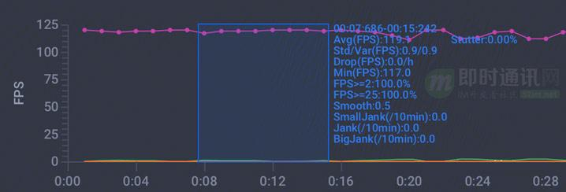

**正常情况下，视频号直播里大部分主播开播流基本都是30fps 以内，也就是正常情况下我们只需要维持30fps 渲染，就能保持好流程的用户体验。

**那为什么这里降帧后依旧会出现60fps 呢？**

经过一系列排查我们发现这是由于直播的点赞动画导致的高帧率，如果去掉动画后 FPS 就会回到正常情况下了，且 GPU 占用也有了明显下降。

**这到底是怎么回事？我们是否可以降动画的帧率降低到某个值来去优化我们整体的 GPU 占用呢？**

### **3、知识储备1：iOS中的动画分类**

在iOS中，大部分动画的本质就是根据输入的时间戳，返回对应属性的动画参数，从而移动图像，达到运动的效果。根据动画 api 实现方式的特点我们可以把动画 api 划分为如下几类。

#### **3.1UIView block animation**

基于 「+[UIView animateWithDuration:delay : options:animations:completion:]」 动画api驱动的动画，特点是所有动画都在 animations block 里同步触发，可以方便的设置任何属性动画。

**[UIView animateWithDuration:duration
                             delay:0
                           options:option
                        animations:^{
                            view.top -= offsetY;
                            view.left -= offsetX;
                        }
                        completion:completion];
#### 3.2CAAnimation**

**基于 「CAAnimation api」 直接触发提交的动画，例如：**

**CABasicAnimation *ani_position = [CABasicAnimation animationWithKeyPath:@"position"];
ani_position.fromValue = @(val.position.from);
ani_position.toValue = @(val.position.to);
[view.layer addAnimation:group forKey:key];
#### 3.3Timer**

基于 「NSTimer/GCD」 触发的动画，例如定时去修改某个 imageView.image，使得它能定期变换的效果。基于 「CADisplayLink」 触发的动画，和基于 NSTimer 触发类似，只不过这个 timer 源是和渲染保持一致的，能够做到更流畅更贴合。

比如我们要实现自定义的 UIScrollView 动画，就可以基于 CADisplayLink 来做。

#### **3.4UIViewPropertyAnimator**

「UIViewPropertyAnimator」是iOS10开始苹果推动的新的动画api，相比 UIView block animation 可以更灵活的控制动画的过程。

**[UIViewPropertyAnimator runningPropertyAnimatorWithDuration:duration
                                     delay:0
                                   options:option
                                animations:^{
                                    view.top -= offsetY;
                                    view.left -= offsetX;
                                }
                                completion:completion];
### 4、知识储备2：iOS中的动画渲染**

iOS中的动画或者 UIView 的修改到底是怎么被渲染到屏幕上去的？

#### **4.1Core Animation Pipeline**

iOS 的 UI 更新和动画操作都离不开 Core Animation 和 UIKit，他们的底层都是 QuartzCore，所有的 UI 刷新和动画提交都会打包成对应的 CA::Transaction 和 CAAnimation 对象并提交给 Render Server 去处理。

App 本身并不负责渲染，渲染是由独立的进程 Render Server 来负责的，Render Server 最终调用 -[AGXG14FamilyRenderContext drawIndexedPrimitives:indexCount:indexType:indexBuffer:indexBufferOffset:] 等 GPU 接口来完成 GPU 任务的提交，最终触发屏幕更新操作。

**整体过程大概如下：**

- ***1）***App 处理事件，例如 touch 事件或者 displaylink timer 事件；
- ***2）***App 完成视图的 layout、图像 decode 等操作，并触发 CA::Transaction 提交；
- ***3）***Render Server 接收 App 提交的 Transction 和图片数据，Render Server 可直接跨进程访问 App 进程的位图内存资源，并最终触发 GPU 调用；
- ***4）***GPU 最终完成了图像的渲染并显示到屏幕 Display。
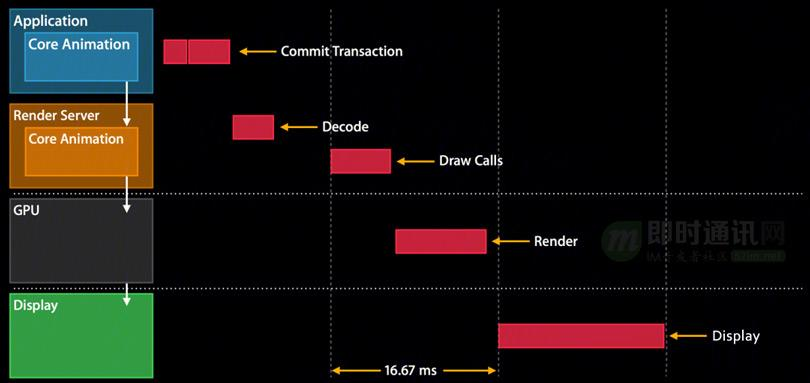

#### **4.2Render Server**

如下图所示，最终的上屏任务提交操作是由 Render Server 也即 backboardd 进程来最终触发的。

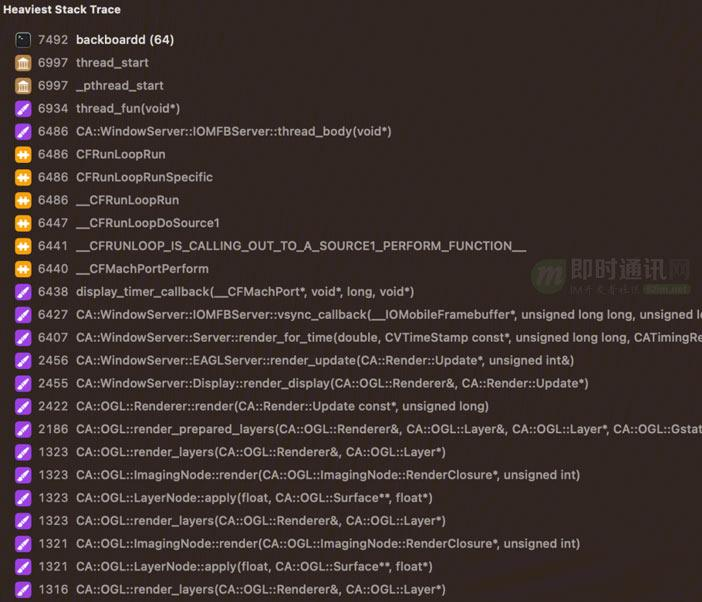

在 iOS 中 Render Server 通常指的是 backboardd 进程，backboardd 进程是一个与 SpringBoard 守护进程一起运行的守护进程。

它在 iOS 6 中引入，旨在减轻 Springboard 的一些职责，主要是事件处理的职责。它主要负责把 touch 事件分发到 app 进程以及处理 app 进程触发的动画和UI更新操作。

如上图所示，time profiler 里我们能清晰看到 backboardd 进程在处理来自 app 进程的图像提交操作。

微信直播之前就遇到过好几次 Render Server 命中了 gpu io fence 导致系统全局卡死的问题。

**如下图 ips 文件日志所示：**

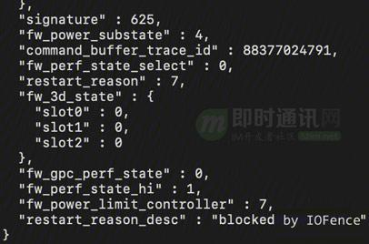

#### **4.3Render Loop**

Render Loop 是包括了从 app 到 Render Server 再最终到屏幕的一系列任务触发，刷新，更新与提交，直到上屏的一系列过程，是对渲染管道的进一步封装，类似于一套 runloop 循环机制，能随时的处理输入和输出。

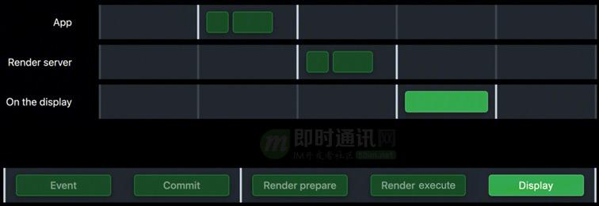

#### **4.4动画渲染**

当我们调用-[UIView animateWithDuration:animations:] api触发动画后，整体动画渲染过程如下图3步所示。

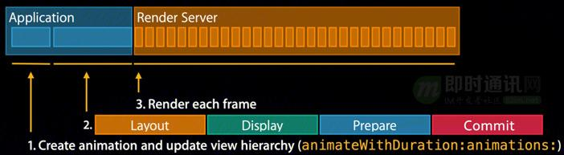

#### **4.5帧率**

帧率即 FPS（frames per second），每秒渲染了多少帧，正常情况下只要我们定期提交一次 opengl 上屏 [curContext presentRenderbuffer:GL_RENDERBUFFER] 就会触发一帧的上屏操作，这就回导致 FPS 发生变化，也最终影响了 app 的性能占用。

FPS 越高对于游戏等高清视频效果就更细腻更好，但是并不是所有情况都需要高 FPS，部分情况下高 FPS 反而导致了无用的功耗但并没有带来更好的体验。

#### **4.6屏幕刷新率**

对于 iOS15/iPhone 13以前的设备，屏幕是固定的刷新率，在这之后 iPhone 13和 iPad Pro 后引入了高刷屏，并且支持了动态刷新率。

**对于直播场景 FPS 有3个：**

- ***1）***视频流 FPS；
- ***2）***Render Server FPS；
- ***3）***屏幕 FPS。
对于非可变刷新率的屏幕，我们可以尽可能减少 GPU 的帧率（即 Render Server 提交的 FPS）来达到降低 GPU 功耗的目的，对于可变刷新率的屏幕，那只要减少了 GPU 帧率就自然而然也减少了屏幕的刷新率，使得屏幕和 GPU 功耗都下降了。

在我们遇到的问题中，我们的视频流 FPS 是25，那么我们预期的最终 GPU FPS 和屏幕 FPS 理应同理也是接近25才是，而这里却达到了60fps，说明了有重复的内容帧一直被 Render Server 重复的复制并提交给 GPU，导致了画质细节没有增加，但频繁的拷贝渲染造成了更高的 GPU 占用。这就是我们的问题所在。

### **5、知识储备3：iOS中的动画降帧**

#### **5.1概述**

结合上文，我们要解决直播帧率异常升高的问题，就需要解决点赞动画的高帧率问题。

很幸运，苹果在 iOS15提供了一个 CAAnimation 的 api，即-[CAAnimation preferredFrameRateRange]，它接受3个参数分别指定minimum 帧率，maximum 帧率，以及 preferred 帧率，基于这个api我们可以对于 CAAnimation 动画设置帧率。

**苹果的建议是把动画分为了如下几档：**

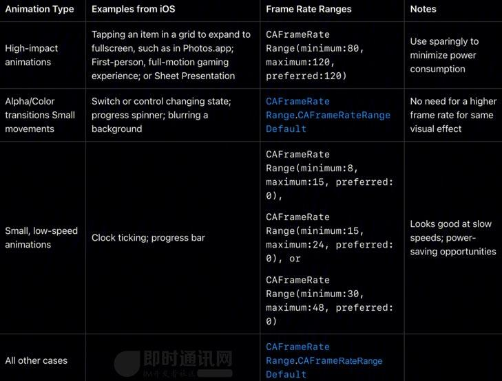

#### **5.2CAAnimation 降帧原理**

iOS15开始苹果引入了 CAFrameRateRange 相关 api 来供 app 去设置 CADisplayLink 和 CAAnimation 的 preferredFrameRateRange，以方便调节帧率，达到在高刷机上能进一步降低功耗的目的。

**那它又是如何工作的呢？**

首先需要明确 iOS15后 CAAnimation 和 CADisplayLink 的帧率控制底层都是一致的，也就是都是 CA:: Display: : DisplayLinkItem 来驱动触发的。而动画的本质就是根据时间的输入来得到对应的动画 fraction 并触发对应进度的动画修改，再提交上屏完成修改。

具体而言，我们以 UIScrollView的 setContentOffset:animated 动画为例。

#### **5.3setContentOffset:animated 动画机制**

当我们触发[scrollView setContentOffset:CGPointMake(120,0) animated:YES]后，会触发创建一个 UIScrollViewAnimation 的实例对象（UIAnimation的子类），接下来会调用 UIUpdateSequenceInsertItem 将这个动画实例注册到当前的 UIUpdateCycle 循环中。

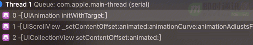

UIUpdateCycle 负责根据设备的 CADisplay 屏幕刷新率和设置动态效果里设置的是否限制帧速率来抉择出到底是以120hz还是60hz来驱动 UIUpdateCycle 循环的触发，当以120hz触发动画循环时，接着会在每8ms间触发一次_UIUpdateSequenceRun，来执行 UIScrollViewAnimation 的动画 progress 计算操作。

**如图：**

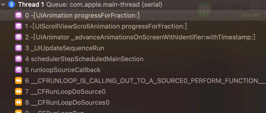

每次触发触发 _UIUpdateSequenceRun 时，会向 UIScrollViewAnimation 请求[UIAnimation fractionForTime:]来返回对应时间戳的 contentOffset 和 progress，然后触发修改 contentOffset，最终接近目标 contentOffset 后就完成了完整的动画。

#### **5.4CAFrameRateRange**

当我们设置 CAAnimation 的 preferredFrameRateRange 后，QuartzCore 会将 CAFrameRateRange 转为CAFrameIntervalRange 结构，并最终尝试触发 Render Server 在指定帧间隔内渲染每一帧动画。

**如下图：**

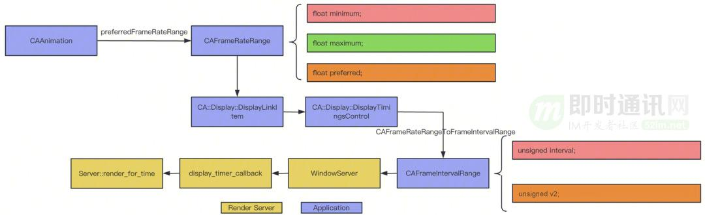

#### **5.5帧率变化探索**

所有的帧提交操作最终都是在 Render Server 触发的，也就是只有从 Render Server 统计FPS才是最终的实际 FPS，那我们要怎么统计呢？

QuartzCore 提供了一个系统级的面板工具，它可以很方便的显示当前的 QuartzCore 渲染信息，包括fps，frame duration等一应俱全。

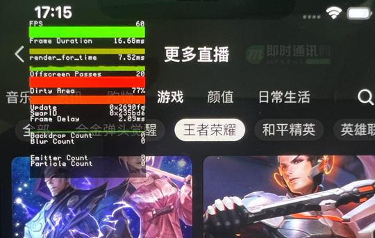

我们可以在越狱后给 app 自签名 com.apple.QuartzCore.debug 这个 entitlement 后，再调用如下代码所示的私有 api 即可全局打开这个面板，可以方便的在手机端查看 Render Server 上的实际 FPS。

**extern"C"{
intCARenderServerGetDebugOption(mach_port_t port, intkey);
intCARenderServerGetDebugValue(mach_port_t port, intkey);
voidCARenderServerSetDebugOption(mach_port_t port, intkey, intvalue);
voidCARenderServerSetDebugValue(mach_port_t port, intkey, intvalue);
}由于以上能力无法在非越狱设备上开启，所以实际上我们无法检测 app 在任意时刻的 FPS 变化情况。

不过经过分析，我们发现只要触发了以下行为就可能代表要帧率要变化了。如下。

*1）***在设置->动态效果里开启或关闭“限制帧速率”：修改限制帧速率会触发系统抛出 com.apple.CoreAnimation.CAWindowServer.DisplayChanged 的通知，QuartCore 会在启动时注册这个通知，并收到通知后通过 mach port 通信获取当前注册的帧速率值，以动态修改 displaylink 的回调频次。

***2）***直接通过 opengl/metal api 提交一帧画面给 Render Server。

***3）***触发 CA::Transaction 对象的提交：除了触发动画提交，触发 view property 提交变更外，甚至创建 view 也会导致 source0触发一次，如下图所示。

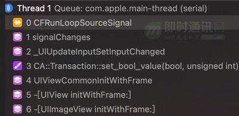

通过调试分析，我们大概清楚了 iOS15引入的 CAAnimation 的 preferredFrameRateRange 工作机制，如下图所示。

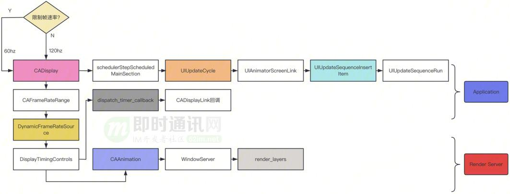

我们只要修改 UIUpdateSequenceRun 的回调频率，也就是 -[UIAnimator _advanceAnimationsOnScreenWithIdentifier:withTimestamp:] 的回调频次我们就能控制部分系统动画的帧率，强制调节他的执行频次，或者我们通过模拟系统设置->动态效果->限制帧速率的实现方式，主动调用 -[CADisplay overrideMinimumFrameDuration:] 传入4便可将 UIAnimator 的刷新率调节为 =60hz，或者传入8即可将系统动画刷新率调节为 =30hz。

基于以上研究，理论上我们可以尝试调用私有 api 来全局控制 CADisplay 的刷新率，来进一步降低性能占用，但是由于 Render Server 是在其他进程，我们还是无法控制 Render Server 的刷新率，并且私有 api 会导致 app 被拒审，所以我们最终依旧只能改造部分系统动画实现以继续基于 CAAnimation api 去优化帧率。

### **6、我们的优化方案**

#### **6.1概述**

从 iOS15开始苹果新增加了 preferredFrameRateRange api 可用于设置相应动画或timer的刷新频率，我们就可以基于该方案去改造相应动画即可。

**@propertyCAFrameRateRange preferredFrameRateRange
    API_AVAILABLE(macos(12.0), ios(15.0), watchos(8.0), tvos(15.0));但新的问题又来了，系统仅给 CAAnimation 和 CADisplayLink 的 api 提供了动态修改帧率的操作。

但是在我们直播场景中，一共有如下几种场景的动画提交：**

- ***1）***UIView block 动画；
- ***2）***UIScrollView scroll 动画；
- ***3）***NSTimer 动画；
- ***4）***CAAnimation。
除了4我们可以直接修改为 iOS15支持的 preferredFrameRateRange api 外，其它几个我们要怎么解决呢？

针对以上1~3点我们分别做如下处理。

#### **6.2UIView block 动画**

通过分析 +[UIView animateWithDuration:delay : options:animations:completion:] 调用，我们发现 animations block 里的 property animation 会被同步的创建为 CAAnimation 对象。

**如图所示：**

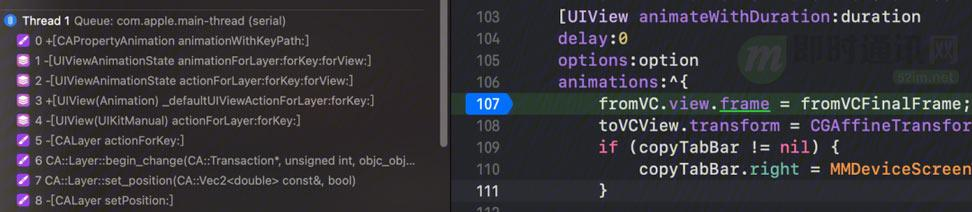

我们是否可以 hook CAAnimation 然后寻找时机设置它的 preferredFrameRateRange 以达到降帧的目的？

很遗憾，不行，因为这个 api 触发的动画不会去触发对应的 setter 与 getter 去读取新修改的值，而是被覆盖为一个默认值，导致无法降帧。

再进一步调试发现与UIViewPropertyAnimator 里是有主动 setPreferredFrameRateRange:的操作，那是否可以从这里入手？

经过验证，果然可行，于是我们可以将所有的 UIView block animation 动画都无缝替换为新方案后，即可实现自动降帧随意灵活控制的目的了。

**部分代码如下：**

**    if(@available(iOS 15.0, *)) {
        setFrameRateLevel(level);
        [UIViewPropertyAnimator runningPropertyAnimatorWithDuration:duration
                                                              delay:delay
                                                            options:options
                                                         animations:animations
completion:^(UIViewAnimatingPosition finalPosition) {
                                                             if(completion) {
                                                                 completion(YES);
                                                             }
                                                         }];
        clearFrameRateLevel();
    } else{
        if(level != MMAnimationFrameRateLevelNone) {
            if(level 新的接口可以无缝替换原有的+[UIView animateWithDuration:delay : options:animations:completion:] 调用，可对所有系统实现降帧调节优化，极大的方便了业务开发同学在不同场景中选择合适的动画帧率，以达到效果和耗电的平衡。

#### 6.3UIScrollView 动画**

经过上文的分析我们发现 UIScrollView setContentOffset 的动画是基于系统_UIUpdateTarget 机制来驱动的，由于对应的回调是私有 api 触发的，所以我们无法直接调节它的帧率，于是我们干脆自己实现一个基于 CADisplayLink 驱动的 setContentOffset 滑动动画即可解决问题。

**即：**创建一个CADisplayLink对象，指定我们需要的 preferredFrameRateRange 帧率，然后在每一帧回调时，根据当前的时间戳计算出当前需要设置的 contentOffset 值，直到最终达到了指定的动画 duration 时间后，我们再把 contentOffset 调整为目标值，即可。

**主体代码大致如下：**

**- (void)tt_contentOffset:(CGPoint)contentOffset duration:(CFTimeInterval)duration {
    self.duration = duration;
    self.deltaContentOffset = CGPointMinus(contentOffset, self.scrollView.contentOffset);
    if(!self.displayLink) {
        self.displayLink = [CADisplayLink displayLinkWithTarget:selfselector:@selector(updateContentOffset:)];
        if(@available(iOS 15.0, *)) {
            self.displayLink.preferredFrameRateRange = CAFrameRateRangeMake(15, 24, 0);
        } else{
            self.displayLink.preferredFramesPerSecond = 30;
        }
        [self.displayLink addToRunLoop:[NSRunLoopcurrentRunLoop] forMode:NSDefaultRunLoopMode];
    } else{
        self.displayLink.paused = NO;
    }
}
- (void)tt_onDisplayLink:(CADisplayLink *)displayLink {
    if(self.beginTime == 0.0) {
        self.beginTime = self.displayLink.timestamp;
        self.beginContentOffset = self.scrollView.contentOffset;
    } else{
        CFTimeInterval duration = displayLink.timestamp - self.beginTime;
        CGFloat percent = (CGFloat)(duration / self.duration);
        if(percent 
#### 6.4NSTimer 动画**

根据苹果Explore UI animation hitches and the render loop 的说法，为了避免 vsync 信号和 timer  可能不同步的情形，我们直接用 CADisplayLink 来替换原先的 NSTimer，并在 CADisplayLink 回调里再触发对应的 UI 提交操作和动画即可。

**这是因为：**如下图所示，对于13 pro max 高刷屏设备而言，其 UI 动画的系统回调频次是240hz，渲染帧率是可变的可为0~120fps 之间，而常规的 NSTimer 是基于 RunLoop 触发回调的，RunLoop 的回调间隔可能只有几十 us，那么 Timer 的灵敏度远高于 DisplayLink，所以完全是有可能在2帧渲染之间，回调了一次 Timer，而最终导致可能会多触发了一帧的提交或一次渲染事件。所以我们采取 CADisplayLink 来替换 NSTimer，尽可能避免和 Display 不同步的渲染触发操作。

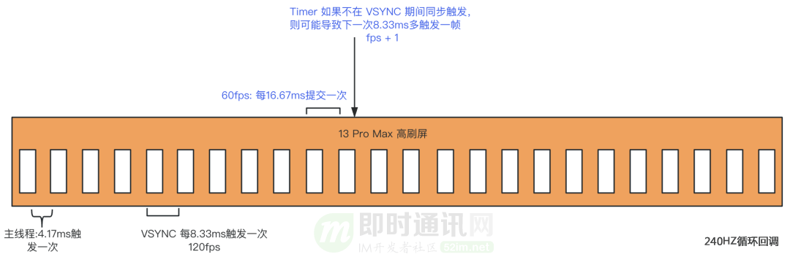

### **7、优化后的效果**

按照苹果的建议 ，app 内容在没有频繁更新时，应该尽量降低 FPS 以平衡功耗占用，因为高刷必然带来更频繁的 GPU 任务提交，使得 GPU 占用提升。

并且 app 的刷新率是由所有内容的最高刷新率决定的，也就是高 FPS 的界面元素会导致整个屏幕全局 FPS 提升，只有适当平衡全局界面元素的 FPS 后，才能进一步降低不必要的性能消耗。

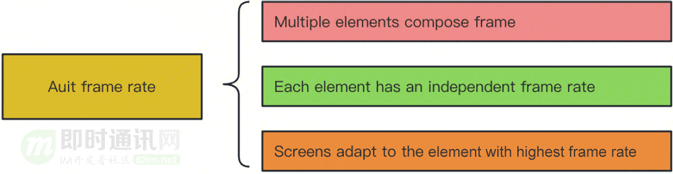

基于上述指导思想和优化方案，我们最终在视频号直播上验证测试如下：

先基于 「UIViewAnimationOptionPreferredFramesPerSecond30」 将直播点赞场景下的fps从高刷屏的120fps 降低到60fps，再基于 「UIViewPropertyAnimator」 将任意UIView block animation的帧率降低到30~48fps（最终全局稳定在40~50fps），帧率同比下降16%而 GPU 同比下降了26%~38%（在主场景和其他场景）。并且由于我们的视频画面依旧是25fps的低帧率，所以此处降帧只是降低了 QuartzCore 的重复帧，而没有减少任何画面细节，最终本质上是无损的画面降帧。

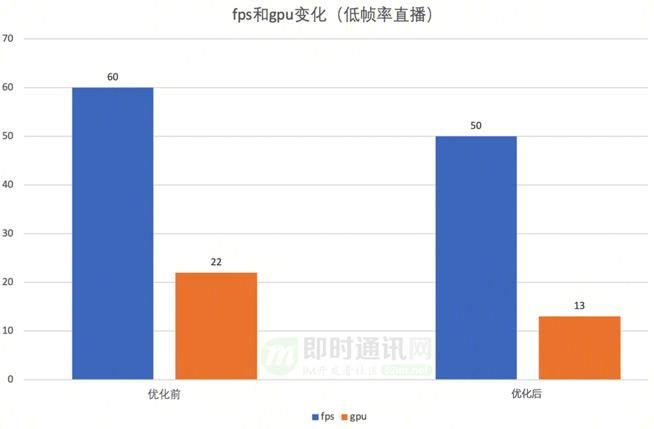

另外，「在实验过程中调试」，进一步发现了一些很有用的环境变量，可以帮助我们更好的调试UI问题。

**如下：**

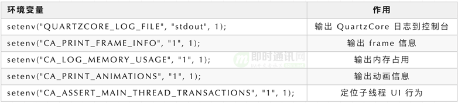

### **8、问题扩展**

我们通过一些奇怪的绕过方式间接的实现了对所有基于 UIView block animation api 调用的动画以及 CAAnimation api 调用的动画都实现了动态降帧，这极大的改善了低帧率直播间的业务动画导致的 GPU 功耗占用问题。

那对于高帧率直播间我们还能怎么解决呢？

基于苹果的文档帧率档位设置建议和我们的综合实践效果，我们对高帧率直播间采取了部分用户无明显感知的有损降级策略。即当检测到设备过热后，我们会将60fps 的直播流，以渲染端均匀丢帧的方式降帧到48fps。

方案如下：

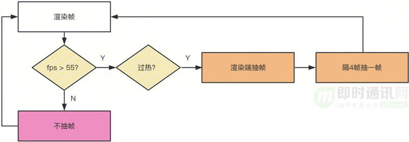

最终也一样取得了GPU 同比下降28%甚至更高的效果，有效减轻了过热时的系统负载和功耗，并且从肉眼上基本无法分辨出差异。

### **9、本文小结**

本文在不影响现有用户体验和业务逻辑的情况下，通过扩展系统接口的能力与实验调试分析，最终实现了一套 UI 动画的帧率调节方案。

**该方案得到的效果是：**

- ***1）***快速改造既有业务的所有动画，动态的控制各自的帧率；
- ***2）***最终达到不影响效果的前提下，尽可能的降低了功耗；
- ***3）***同时极大的减轻了业务开发同学适配多系统和改造动画的工作量。
该方案最终在微信视频号直播上得到广泛应用，取得了较大的性能提升。

至此，关于iOS视频号直播的功耗优化方案讲解完毕。

### **10、相关文章**

[1] 淘宝直播技术干货：高清、低延时的实时视频直播技术解密

[2] 技术干货：实时视频直播首屏耗时400ms内的优化实践

[3] 七牛云技术分享：使用QUIC协议实现实时视频直播0卡顿！

[4] 首次披露：快手是如何做到百万观众同场看直播仍能秒开且不卡顿的？

[5] 浅谈实时音视频直播中直接影响用户体验的几项关键技术指标

[6] 移动端实时视频直播技术实践：如何做到实时秒开、流畅不卡

[7] 实现延迟低于500毫秒的1080P实时音视频直播的实践分享

[8] 直播系统聊天技术(五)：微信小游戏直播在Android端的跨进程渲染推流实践

### **附录：微信团队分享的其它文章**

《微信团队分享：极致优化，iOS版微信编译速度3倍提升的实践总结》

《IM“扫一扫”功能很好做？看看微信“扫一扫识物”的完整技术实现》

《微信团队分享：微信支付代码重构带来的移动端软件架构上的思考》

《IM开发宝典：史上最全，微信各种功能参数和逻辑规则资料汇总》

《微信团队分享：微信直播聊天室单房间1500万在线的消息架构演进之路》

《企业微信的IM架构设计揭秘：消息模型、万人群、已读回执、消息撤回等》

《IM全文检索技术专题(四)：微信iOS端的最新全文检索技术优化实践》

《微信团队分享：微信后台在海量并发请求下是如何做到不崩溃的》

《微信Windows端IM消息数据库的优化实践：查询慢、体积大、文件损坏等》

《微信技术分享：揭秘微信后台安全特征数据仓库的架构设计》

《企业微信针对百万级组织架构的客户端性能优化实践》

《揭秘企业微信是如何支持超大规模IM组织架构的——技术解读四维关系链》

《微信团队分享：详解iOS版微信视频号直播中因帧率异常导致的功耗问题》

技术交流： 

- 移动端IM开发入门文章：《新手入门一篇就够：从零开发移动端IM》 

- 开源IM框架源码：[https://github.com/JackJiang2011/MobileIMSDK](https://link.zhihu.com/?target=https%3A//github.com/JackJiang2011/MobileIMSDK)（备用地址点此） 

（本文已同步发布于：http://www.52im.net/thread-4507-1-1.html）
