### 0. 前言

现代基于 HBM（高带宽内存）的系统在历经多代演进的同时，始终保留着**缓存行粒度（Cache-line Granularity，通常为 32B 或 64B）** 的访问模式。为了在如此细粒度下提升带宽，业界不得不引入 Bank 组（Bank Groups）和伪通道（Pseudo Channels, PC）等复杂结构。然而，在以大语言模型（LLM）为主导的 AI 时代，内存访问模式已经变成了连续的、高达数兆字节的批量传输。

本文深入解析 HPCA 2026 最新研究成果 RoMe: Row Granularity Access Memory System for Large Language Models**>>。该架构大胆摒弃了传统的列级访问，提出了一种**行粒度（Row Granularity，如 4KB）** 的内存接口，彻底移除了 **Bank 组和伪通道**，**极大地简化了内存控制器（MC）的调度复杂度**，并通过节省引脚实现了 12.5% 的物理带宽提升。

**1. 这篇文章逻辑清晰，对一些基础的背景知识讲的也挺清楚的**（阅读这篇论文让我对HBM的层次结构和Memory Cotroller有了全面且基本的认知）。**2. 论文的思路说白了就是尽量完全复用HBM的物理总线、Bank等不做改动，只是改变其使用的逻辑**，大大提高访存的颗粒度，极大了简化了Memory Controller的调度逻辑。
### 1.  传统 HBM 架构的“历史包袱”

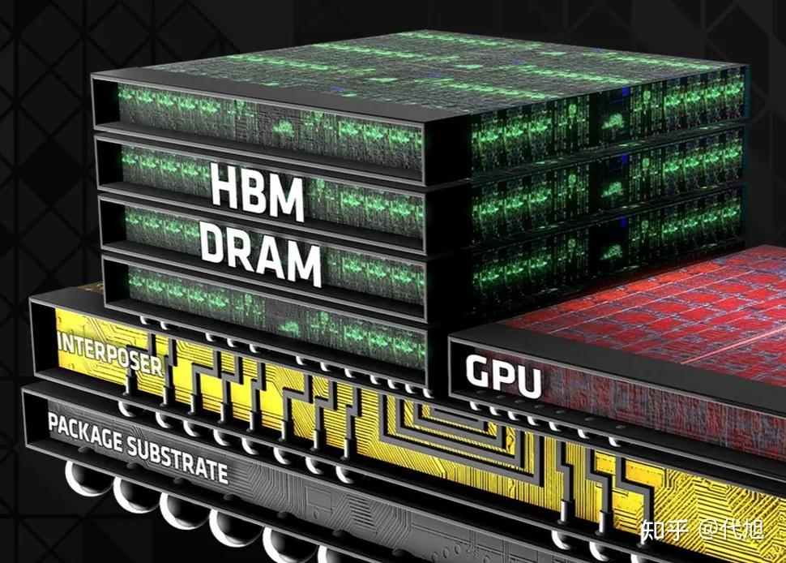

在深入 **RoMe** 之前，我们必须理解为什么现有的 HBM4 架构会变得如此复杂。

### 1.1.  `Cache Line`粒度与带宽扩展的矛盾

主流内存技术（如 DDR5 和 HBM4）的访问粒度与处理器的缓存行（`Cache Line`）大小严格对齐（**GPU 通常为 32B，CPU 为 64B**）。这种设计的初衷是为了防止**过度获取（Overfetch）**，即避免读取程序不需要的数据从而浪费带宽和能耗。

然而，DRAM 核心频率的增长极其缓慢。为了在不提高核心频率、且保持 32B 访问粒度的前提下提升外部数据速率，HBM 引入了复杂的层级结构：

- **Bank 组（Bank Group）**：允许在不同 Bank 组之间交替提取数据（Bank Group Interleaving），从而隐藏内部时序延迟。
- **伪通道（Pseudo Channel, PC）**：将一个物理通道拆分为两个独立的伪通道，共享命令/地址（C/A）引脚，但平分数据引脚。这两个 PC 能够独立运行，从而支持并发数据传输并最大化吞吐量。 
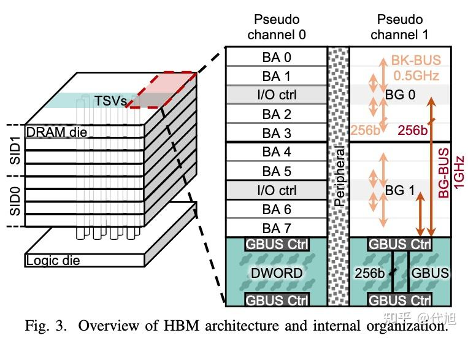

如上图 HBM4 的物理架构示意图所示，HBM 采用 3D 堆叠技术，通过硅通孔（TSV）将多个 DRAM 裸片（Die）连接至底部的逻辑裸片。每个 HBM 设备由多个独立通道组成（在 HBM4 标准中最高可达 32 个通道）。每四个 DRAM 裸片构成一个堆叠 ID（Stack ID, SID，等效于传统 DRAM 标准中的 `Rank`），通道通过 SID 来识别其当前访问的特定裸片组。

在这种复杂的层级下，**内部数据传输路径与频率的不匹配进一步加剧了调度的复杂性**：**当提取数据时，每个 Bank 提取 256 位数据，并通过 Bank 数据总线（BK-BUS）将其传输至 I/O 控制缓冲区。由于同一个 Bank 组内的所有 Bank 共享同一个 I/O 控制缓冲区，同一时刻只能有一个 Bank 占用 BK-BUS。随后，数据通过 Bank 组数据总线（BG-BUS）汇入全局数据总线（G-BUS）控制器，最终经由 TSV 传递至逻辑裸片。

这里的核心矛盾在于频率差**：BK-BUS 的运行频率为 1/t_{CCDL}（例如 0.5 GHz），而 BG-BUS 的运行频率更快，为 1/t_{CCDS}​（例如 1 GHz）。因此，单一的 Bank 组最多只能提供 50% 的可用带宽。为了充分榨取 HBM 的峰值带宽，内存控制器必须精确控制数据在不同 Bank 组之间以**时分复用（Time-multiplexed）** 的方式进行交错传输。

### 1.2.  调度灾难与引脚危机

随着 HBM 演进到 HBM4，通道越来越窄，通道数量成倍增加（单颗 HBM4 芯片高达 32 个通道 / 64 个伪通道）。这导致了两个严重问题：

#### 1.2.1.  传统内存控制器 (Conventional MC) 的架构与调度负担

**以缓存行（cache line）粒度访问内存，极大地增加了内存系统设计的复杂性**。为了实现高性能，内存控制器（MC）必须实现复杂的`调度算法`，以兼顾繁多的`时序参数`和`动态的 Bank 状态`。先前的研究对这一设计空间中的关键组件进行了探索——包括地址映射 、页面策略 以及调度策略——而这些机制进一步加剧了 MC 架构的复杂性。

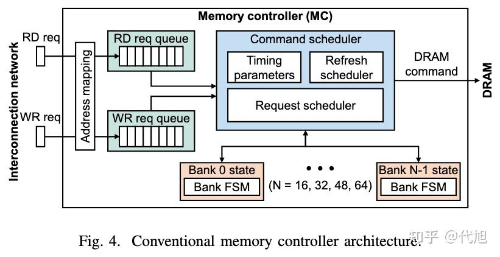

尽管具体实现各异，但传统的内存控制器（MC）通常包含四大核心组件（如上图所示):

**1. 四大核心组件**：

- **地址映射单元 (Address Mapping)** ：将主机的物理地址转换为复杂的 DRAM 地址（如伪通道、Bank 组、Bank 等）。
- **读/写请求队列 (Request Queue)** 与 **单 Bank 状态逻辑 (Per-bank State Logic)** ：为了支持大量并发请求并实现单周期快速查找，这两个组件通常依赖面积和功耗开销极大的 **CAM（内容可寻址存储器）**。
- **命令调度器 (Command Scheduler)** ：负责在严格遵守 DRAM 时序约束的前提下，下发内存读写和刷新命令

**2. 繁重的状态与时序管理**：**由于各个 Bank 独立运行，MC 必须实时追踪所有 Bank 的 7 种状态**（空闲 Idle、激活中 Activating、激活 Active、预充电 Precharging、读 Reading、写 Writing、刷新 Refreshing），并处理十几种复杂的时序参数（如表 2 所示）。 

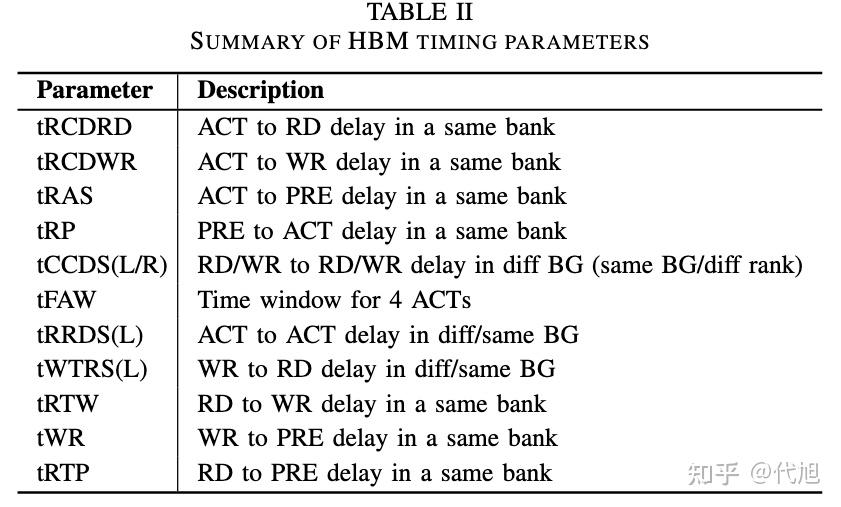

**3. 极度复杂的调度策略**：**为了最大化带宽利用率并兼顾公平，命令调度器（尤其是请求调度器）必须同时在四个维度上进行“走钢丝”般的平衡：

- 多级交错 (Interleaving)** ：在 Bank、Bank 组和伪通道之间交错提取数据，以掩盖 `ACT`（激活）和 `PRE`（预充电）带来的长延迟。
- **行缓冲区局部性 (Row Buffer Locality)** ：尽可能向已打开的行连续发出读写请求，摊销激活开销。
- **动态页面策略 (Page Policy)** ：根据访存模式，在 Open、Close 或 Adaptive（自适应）页面策略之间动态切换，决定最优的预充电时机。
- **QoS 与公平性 (Fairness)** ：引入服务质量机制，防止激进的局部性调度导致长等待请求被“饿死”（Starvation）。

**🤷‍♂️总结****在传统的缓存行/`Cache Line`粒度下，MC 必须像一个极其精密的微观管理者，时刻紧盯每一个 Bank 的细微状态** 。这种设计在面对 LLM 动辄数兆字节的连续大块数据吞吐时，显得既臃肿又低效。内存控制器（MC）必须跟踪所有 Bank 的 7 种状态，处理至少 15 种复杂的时序参数（如 `tCCDS`, `tRRDS`, `tFAW`），并执行复杂的页面策略（Open/Close Page）。
#### 1.2.2.  C/A 引脚开销激增

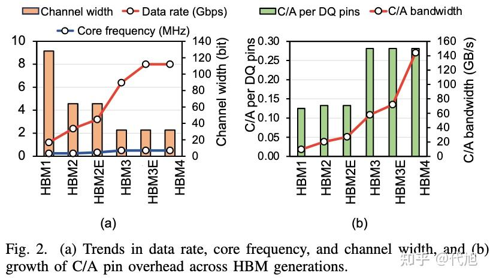

由于每一代 HBM 的数据通道（DQ）宽度都在减半（例如 HBM4 每个通道仅 64-bit），但独立的`命令/地址`引脚（C/A Pins）数量却无法同比例减少。这导致 **C/A 引脚与数据引脚的比例（C/A-to-DQ ratio）飙升**（HBM4 相比早期几乎翻倍）。这种引脚开销和 C/A 带宽需求的增长，使得未来的物理接口设计变得不可持续。

为了维持细粒度访问而不断增加通道数量的做法，不仅让内存控制器的调度不堪重负，还导致了严重的引脚资源浪费（**C/A 引脚占比过高**），这条技术路线在未来难以为继。

### 2.  LLM 时代的内存访问特征：连续与海量

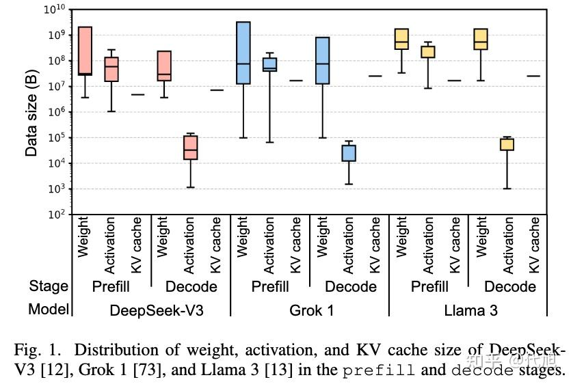

RoMe 的设计灵感直接来源于 Transformer 架构大语言模型（如 DeepSeek-V3, Grok 1, Llama 3）的内存访问特征。

LLM 推理分为 `prefill`（预填充）和 `decode`（解码）两个阶段。其核心计算主要是通用矩阵乘法（GEMM/GEMV）。

- **权重（Weights）与 KV-Cache**：在生成每个 Token 时，模型需要一次性顺序读取数十兆字节的数据。
- **激活值（Activations）**：在 `prefill` 阶段，激活值大小也达到数兆字节。
**结论**：对于 LLM 而言，内存访问表现出**极高的空间局部性**和**海量的顺序读取**。传统的 32B 细粒度调度不仅毫无必要，反而成为了系统的拖累。

### 3.  RoMe 架构核心创新

RoMe（**Ro**w-granularity-access **Me**mory system）通过软硬件协同设计，对 DRAM 接口和内存控制器进行了大刀阔斧的改革。 

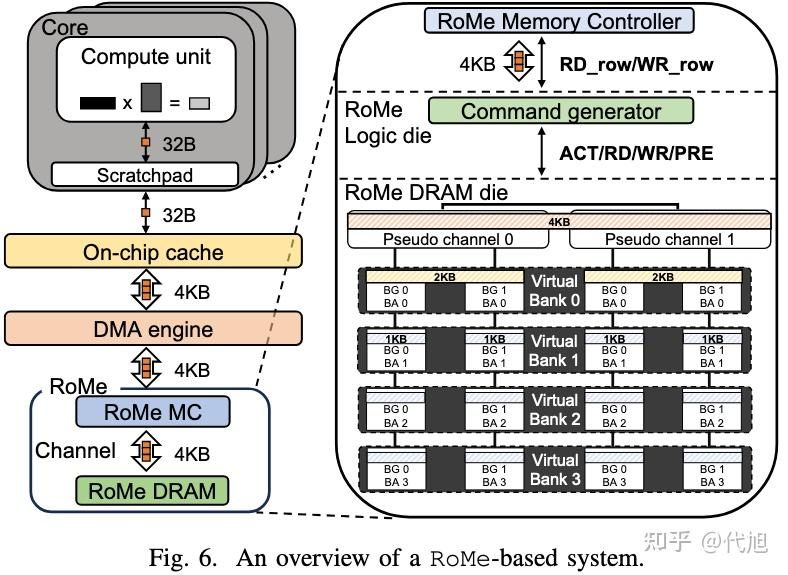

### 3.1.  虚拟 Bank (Virtual Bank, VBA) 的诞生

既然访问粒度从 32B 扩大到了整行（如 4KB），传统的 Bank 组和伪通道就失去了存在的意义。RoMe 引入了 **虚拟 Bank (VBA)** 的概念。

为了在不修改 DRAM 内部核心数据路径的前提下实现单 VBA 的最大带宽，RoMe 采用了以下设计：

#### 3.1.1.  消除 Bank Group

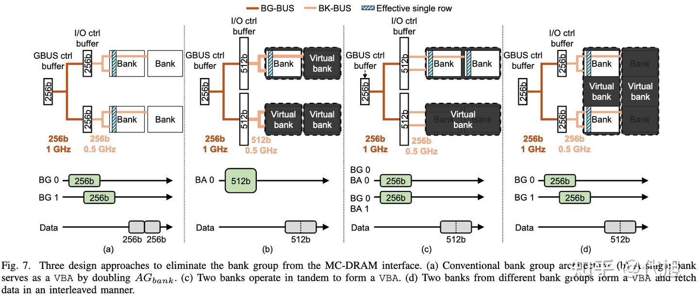

如上图(d)的设计，将来自**不同 Bank 组的两个物理 Bank** 组合成一个 VBA。这两个 Bank 以时间复用（Time-multiplexed）的方式交替提取数据。

#### 3.1.2.  消除 Pseudo Channel (PC)

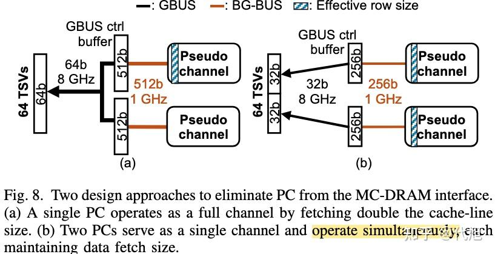

如上图(b)的设计，让两个伪通道**同时运行**（类似于 HBM 的 Legacy Channel 模式），作为一个统一的宽通道。

**总结**：通过这种组合，有效行大小（Effective Row Size）达到了 4KB，且单个 VBA 就能跑满整个通道的带宽。
### 3.2.  逻辑裸片上的命令生成器 (Command Generator)

在 RoMe 中，内存控制器不再发送繁琐的 `ACT`（激活）、`RD`（读）、`PRE`（预充电）指令。相反，MC 只发送宏观的行级命令：`RD_row` 和 `WR_row`。

为了兼容底层的 DRAM 介质，RoMe 在 HBM 的**逻辑裸片（Logic Die）** 上集成了一个硬件**命令生成器**。它负责将 `RD_row` 自动展开为底层的标准 DRAM 命令序列。

#### 3.2.1.  💻 伪代码：命令生成器的硬件逻辑抽象

为了直观理解命令生成器的工作原理，我们可以将其逻辑抽象为如下的硬件描述语言：

`// 概念性伪代码：RoMe 命令生成器 (Command Generator) 状态机抽象
module CommandGenerator (
    input wire clk,
    input wire [3:0] opcode,      // RD_row, WR_row, REF 等
    input wire [15:0] row_addr,
    input wire vba_id,            // 虚拟 Bank ID
    output reg dram_cmd_out       // 输出给底层 DRAM Die 的标准命令
);

    // 内部时序常量
    parameter tRCDRD = 16; 
    parameter tCCDS  = 1;
    parameter tRRDS  = 2;

    always @(posedge clk) begin
        if (opcode == `CMD_RD_ROW) begin
            // 步骤 1: 激活 VBA 中的第一个物理 Bank
            Issue_DRAM_CMD(`CMD_ACT, Bank_A, row_addr);
            
            // 步骤 2: 满足 tRRDS - tCCDS 延迟，以保证后续 Read 的完美交错
            Wait(tRRDS - tCCDS);
            
            // 步骤 3: 激活 VBA 中的第二个物理 Bank
            Issue_DRAM_CMD(`CMD_ACT, Bank_B, row_addr);
            
            // 步骤 4: 等待 tRCDRD 延迟后，开始交错发送列读命令
            Wait(tRCDRD);
            for (int i = 0; i  32; i++) begin
                Issue_DRAM_CMD(`CMD_RD, Bank_A, col_addr_A + i);
                Wait(tCCDS);
                Issue_DRAM_CMD(`CMD_RD, Bank_B, col_addr_B + i);
                Wait(tCCDS);
            end
            
            // 步骤 5: 自动发送预充电命令 (Auto-Precharge)
            Issue_DRAM_CMD(`CMD_PRE, Bank_A);
            Issue_DRAM_CMD(`CMD_PRE, Bank_B);
        end
    end
endmodule
`

**代码解析：**如下图所示命令生成器巧妙地插入了 `tRRDS - tCCDS` 的延迟，确保了向两个物理 Bank 发送的读命令能够以 `tCCDS`（如 1ns）的理想间隔完美交错，从而打满数据总线。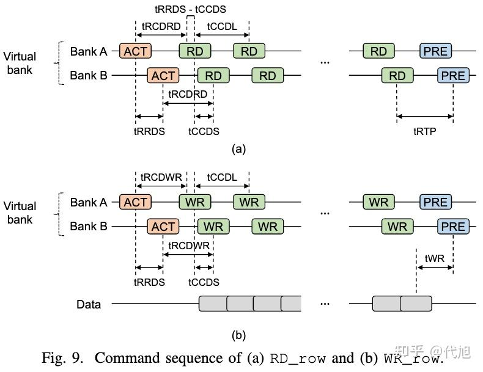

### 3.3.  引脚释放与带宽白嫖 (Bandwidth Expansion)

由于取消了列级访问，RoMe 不再需要独立的列命令/地址引脚。

- 传统的 18 个 C/A 引脚被**缩减至 5 个**（节省了 72% 的引脚）。
- 在一个 32 通道的 HBM4 配置中，共计节省了 416 个引脚。
- 利用这些节省下来的引脚，RoMe 在每个 HBM 堆叠中**额外增加了 4 个物理通道**（从 32 增至 36 通道），在几乎零硬件开销的情况下，实现了 **12.5% 的纯物理带宽提升**。

### 4.  极简的内存控制器 (Simplified MC)

由于复杂的时序和状态管理被下放到了逻辑裸片上的命令生成器，主机端的内存控制器（MC）迎来了史无前例的“瘦身”。

### 4.1.  架构对比一览表

**

组件特性传统 HBM4 内存控制器RoMe 内存控制器核心优势访问粒度(AG_{MC})32 Bytes (缓存行)4 K Bytes (行粒度)完美契合 LLM 连续大块访存需要维护的 Bank 状态7 种 (Idle, Activating, Active, Precharging, Reading, Writing, Refreshing)4 种 (Idle, Reading, Writing, Refreshing)读写完成后自动返回 Idle，无需管理 Active 状态追踪的时序参数数量15+ (包括复杂的内外行列时序)10 (仅需管理宏观的读写转换延迟)调度逻辑面积缩减 90.9%并发调度的 FSM 数量至少 5 个 (每伪通道)2 个 (仅需追踪当前和下一个 VBA)极大降低状态机开销请求队列深度 (Queue Size)45 ~ 64 项2 ~ 4 项仅需极小队列即可打满带宽页面策略 (Page Policy)动态自适应 (Open/Close Page)无 (强制每次读写后自动 Precharge)消除策略预测逻辑调度(Scheduling)Row-buffer locality，
Bank Group 交错  
PC(伪通道) 交错VBA 交错大大简化
### 5.  性能评估与系统开销

研究团队在 Ramulator 2.0 周期级模拟器中，基于 8 个算力为 560 TFLOPS (BF16)、总带宽 16 TB/s 的加速器系统对 RoMe 进行了全面评估。测试负载包括 DeepSeek-V3、Grok 1 和 Llama 3。

### 5.1.  性能提升 (TPOT)

在 `decode`（解码）阶段，序列长度固定为 8K 时：

- DeepSeek-V3**：TPOT（每个输出 Token 的时间）降低了 **10.4%** 。
- **Grok 1**：TPOT 降低了 **10.2%** 。
- **Llama 3**：TPOT 降低了 **9.0%** 。
性能的提升主要归功于新增通道带来的 12.5% 带宽红利。

### 5.2.  负载均衡 (Load Balancing) 的挑战与化解

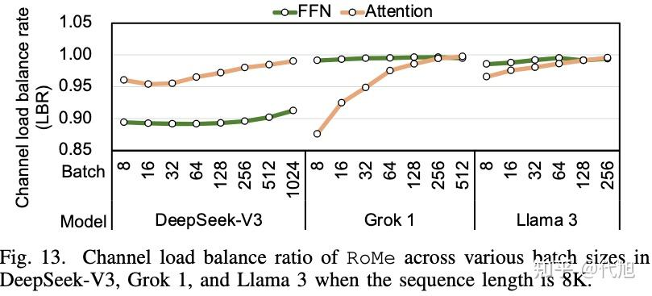

将访问粒度从 32B 提升到 4KB，最大的隐患是**通道负载不均衡 (LBR)**。如果数据分布不均，某些通道可能会闲置。

- **DeepSeek-V3 表现优异**：由于其采用了 MLA（多头潜在注意力）和数据并行（Data Parallelism）策略，即使在小 Batch Size 下，其注意力层的负载均衡率（LBR_{Attn}）依然很高。
- **Grok 1 / Llama 3**：采用了张量并行（Tensor Parallelism）和 GQA，在小 Batch 下存在一定的负载不均，但随着 Batch Size 增大（KV-Cache 变大），负载均衡率迅速恢复到与传统 HBM4 相当的水平。

### 5.3.  面积与能耗开销 (Area & Energy)

- **面积**：新增 4 个通道需要额外的 TSV（硅通孔）和微凸块（µbump）。保守估计，DRAM 裸片面积增加约 12%，但整体逻辑裸片面积开销仅为 **0.10%** 。而 MC 调度逻辑的面积仅为传统 MC 的 **9.1%** 。
- **能耗**：得益于 `ACT` 命令数量的锐减（降幅达 55%~86%）以及中介层（Interposer）数据传输效率的提高，RoMe 在提供更高性能的同时，整体能耗反而**下降了 0.7% ~ 1.9%** 。

### 6.  讨论与未来展望

### 6.1.  更强大的 ECC 纠错

由于 RoMe 的最小访问粒度变为 4KB，HBM4 可以在此基础上采用**更长码字的 ECC（纠错码）**。这不仅能降低奇偶校验位的空间开销，还能提供比传统方案更强大的多比特错误检测与纠正能力。

### 6.2.  应对稀疏注意力的混合架构 (Hybrid Architecture)

RoMe 专为粗粒度连续访问设计。然而，对于采用**细粒度稀疏访问**的模型（如 DeepSeek-V3.2 的 DSA 稀疏注意力，会不可预测地抽取历史 Token），**4KB 的粒度可能会导致严重的过度获取（Overfetch）** 。**解决方案**：未来的 AI 加速器可以采用**异构内存系统**，将 RoMe（处理连续权重/KV）与传统 HBM4（处理细粒度稀疏请求）结合，或者在 RoMe 命令生成器中引入掩码位（Mask bits）来实现选择性列访问。

### 7.  结语

《RoMe: Row Granularity Access Memory System for Large Language Models》为后摩尔时代的 AI 内存墙问题提供了一个极具启发性的破局思路。

它告诉我们：**不要盲目继承通用计算时代的遗产**。针对大语言模型高度规律、海量吞吐的访存特征，打破 32B 缓存行的枷锁，采用 4KB 行粒度访问，不仅能大幅削减硬件控制器的“无用功”，还能在物理引脚受限的今天，以极低的成本榨取出 12.5% 的宝贵带宽。RoMe 无疑为下一代 AI 加速器（如未来的 TPU、GPU）的内存子系统设计指明了一条务实且高效的演进道路。
