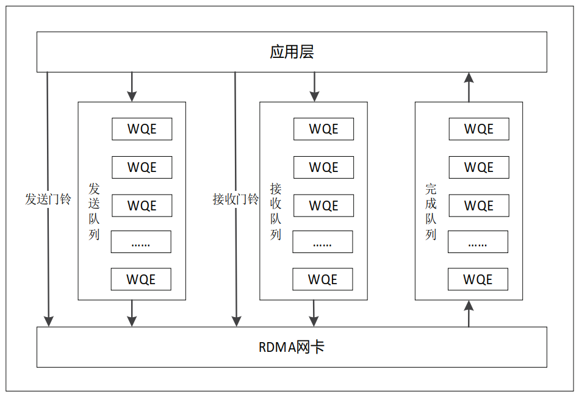
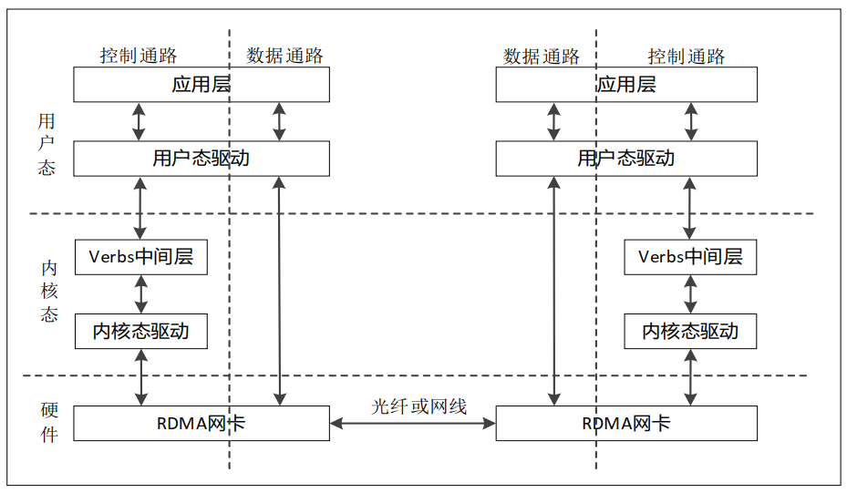
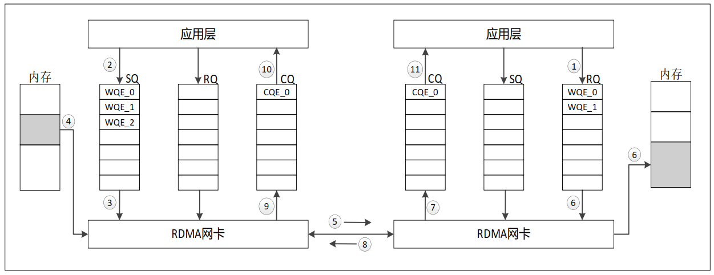
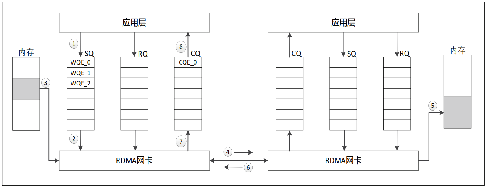
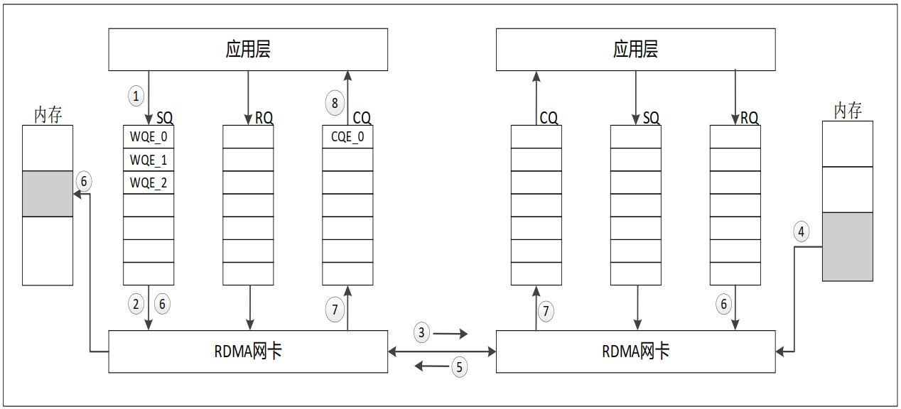
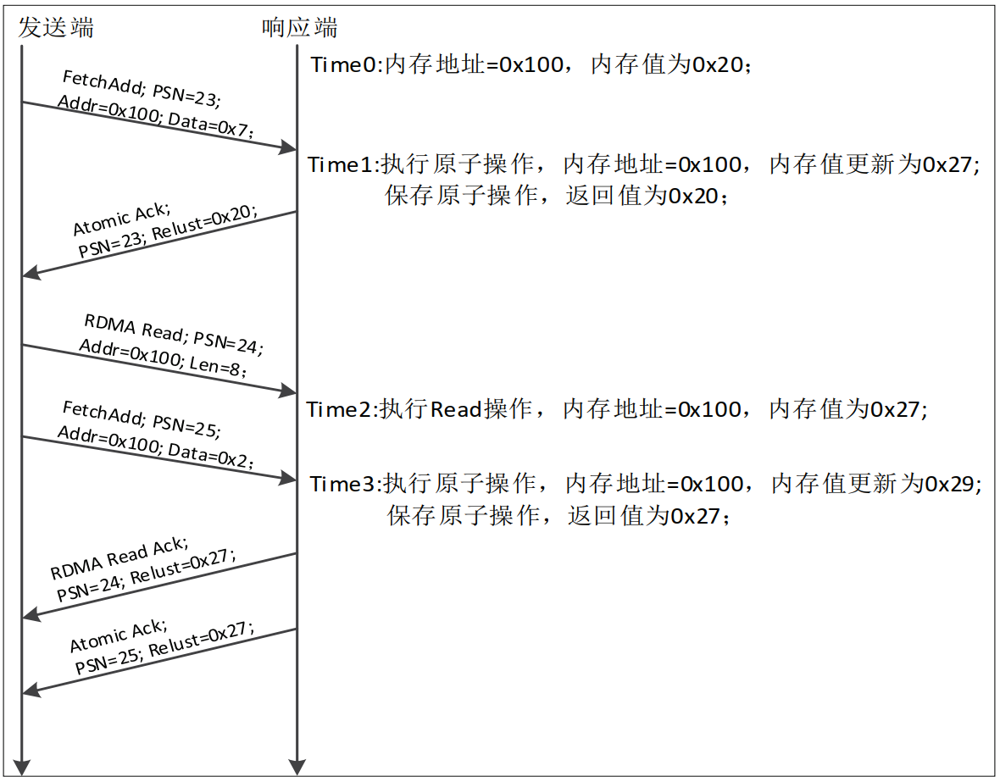
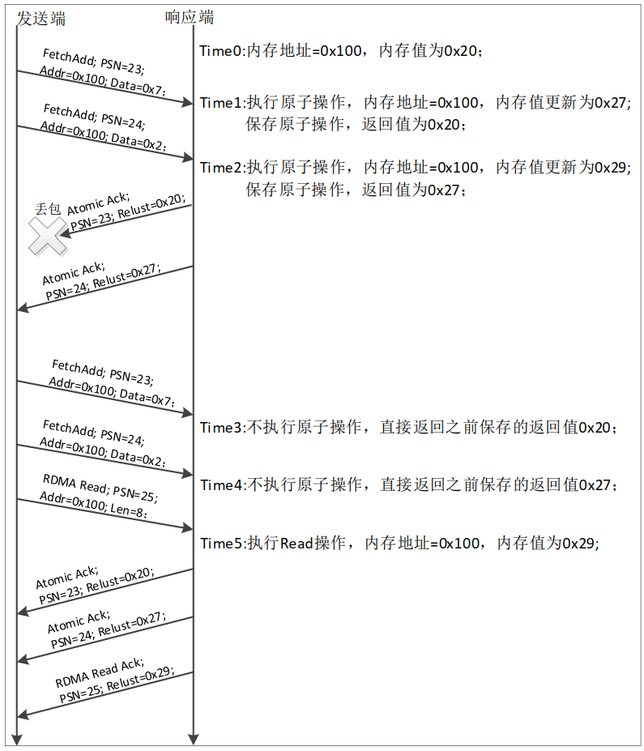
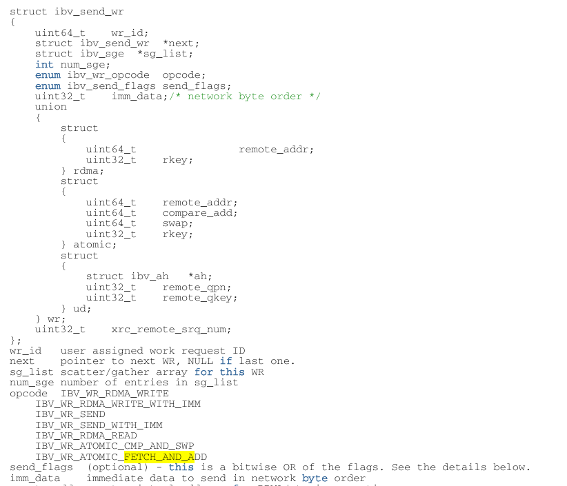

### 1. RDMA工作队列

RDMA 技术中， QP（ queue pair）作为 RDMA 通信的基本单元，可以在两个节点之间进行直接内存访问，实现零拷贝的数据传输和低延迟的交互。如图 1 所示， QP 通常包含三种工作队列：发送队列（ send queue， SQ）、接收队 列（ receive queue， RQ）、完成队列（ complete queue， CQ）。 SQ 用于存储发送方的数据和命令信息， RQ 用于存储接收方的数据和命令信息， CQ 用于存储数据传输完成的相关信息，可以多个 SQ 或多个 RQ 共用一个 CQ。

图 1 RDMA 的工作队列工作队列分别由内存中的多个非连续的区域组成，每个区域按顺序存储着应用层给硬件下发的工作任务（ work queue entry， WQE）， WQE 中包含两端数据交互的一些信息，具体如图 2 所示。应用层通过门铃机制通知 RDMA 网卡有新的 WQE 存放在工作队列中。

### 2. RDMA基本操作

RDMA 技术的通信模型如图 3 所示。纵向上划分为控制通路、数据通路。控制通路需要进入内核态，准备通信所需的各种资源，需要 CPU 的参与，一般在链路建立时使用。控制通路通过发送 RDMA Send-Recv 命令，创建和配置RDMA 通信的基本元素，如 QP、 CQ 等。数据通路专门负责数据的收发，因为已通过控制通路获取到了通信所需要的基本元素，如虚拟地址 VA、远端的 Rkey 等，此时进行数据通信不需要 CPU 介入，可以直接对远端内存进行操作。

图 3 RDMA 技术的通信模型
#### 2.1 RDMA Send-Recv操作流程

RDMA 通信模型中，控制通路进行 RDMA Send-Recv 操作的流程如图 4 所示，描述如下。

（ 1）远端应用层往 RQ 中下发 WQE，并通过接收门铃通知硬件有新的 WQE 产生。

（ 2）本地应用层往 SQ 中下发 WQE，该 WQE 中的任务为 RDMA Send-Recv 类型。

（ 3）本地 RDMA 网卡收到软件下发的发送门铃，从SQ 中获取 WQE，进行解析。

（ 4）本地 RDMA 网卡根据 WQE 信息，从本地内存中读取数据，组装成数据包发送。

（ 5）本地 RDMA 网卡将数据包，通过物理链路发送给远端的 RDMA 网卡

（ 6）远端 RDMA 网卡接收并解析数据包，并读取 RQ中的 WQE，将解析后的数据放到 WQE 指定的位置。

（ 7）远端 RDMA 网卡生成 CQE，放在 RQ 所对应的CQ 中。

（ 8）远端 RDMA 网卡，将接收数据的处理结果，回复ACK/NAK 报文给发送端。

（ 9） 本 地 RDMA 网 卡 收 到 ACK/NAK 报 文 后， 生 成CQE，放到 CQ 中。

（ 10）本地应用层收到命令处理完成的指示。

（ 11）远端应用层收到接收到新数据的指示。

图 4 RDMA Send-Recv 操作流程
#### 2.2 RDMA Write操作流程

RDMA 通信模型中，数据通路进行 RDMA Write 操作的流程如图 5 所示，描述如下。

（ 1）本地应用层往 SQ 中下发 WQE，该 WQE 中的任务为 RDMA Write 类型。

（ 2）本地 RDMA 网卡收到软件下发的发送门铃，从SQ 中获取 WQE。

（ 3）本地 RDMA 网卡解析 WQE，将 WQE 中包含的src_va，进行地址转换成物理地址，并从该物理地址对应的内存中读取数据，组装成数据包发送。

（ 4）本地 RDMA 网卡将数据包，通过物理链路发送给远端的 RDMA 网卡。

（ 5）远端 RDMA 网卡接收数据包，将数据包中的 dst_ va，进行地址转换成物理地址，并将数据放到该物理地址对应的内存。

（ 6）远端 RDMA 网卡，将接收数据的处理结果，回复ACK/NAK 报文给发送端。

（ 7） 本 地 RDMA 网 卡 收 到 ACK/NAK 报 文 后， 生 成CQE，放到 CQ 中。

（ 8）本地应用层收到命令处理完成的指示。

图 5 RDMA Write 操作流程**

#### 2.3 RDMA Read 操作流程

RDMA 通信模型中，数据通路进行 RDMA Read 操作的流程如图 6 所示，描述如下。

（ 1）本地应用层往 SQ 中下发 WQE，该 WQE 中的任务为 RDMA Read 类型。

（ 2）本地 RDMA 网卡收到软件下发的发送门铃，从SQ 中获取 WQE。

（ 3）本地 RDMA 网卡解析 WQE，将 WQE 中包含的dst_va，封装到读请求数据包，并通过物理链路发送给远端的 RDMA 网卡。

（ 4）远端 RDMA 网卡接收数据包，将数据包中的 dst_ va，进行地址转换成物理地址，并从该物理地址对应的内存中读取数据，封装成读响应数据包。

（ 5）远端 RDMA 网卡，将读响应数据包，通过物理链路发送给本地 RDMA 网卡。

（ 6）本地 RDMA 网卡收到读响应数据包后，再次读取本次操作对应的 WQE，将 WQE 中包含的 src_va，进行地址转换成物理地址，并将读响应数据包中的数据放到该物理地址对应的内存。

（ 7）本地 RDMA 网卡，生成 CQE，放到 CQ 中。

（ 8）本地应用层收到命令处理完成的指示。

图 6 RDMA Read 操作流程
### 3. RDMA Atomic操作

在 RDMA 数据通路，以 RDMA Write 和 RDMA Read 为基础， RDMA 网卡还支持 RDMA atomic 操作。 RDMA atomic是对远端内存中的 64 bit 数据，执行 Read+Modify+Write 的组合操作，且读写操作之间不能被打断。在 IB 协议中，当前支持两种原子操作： Compare and Swap（简称 CAS）、 Fetch and Add（简称 FAA）。两种原子操作的说明如表 1 所示。 IB协议规定，一次 RDMA atomic 操作，在响应端最多执行一次，并将执行结果保存在响应端。后续即使网络丢包或响应端异常导致发送端重传，响应端不需要再执行 RDMA atomic 操作，直接返回之前保存的执行结果即可。该规定不仅可以提高响应端处理 RDMA 命令的效率，从整体上降低 RDMA 的延迟，对于 Fetch and Add 的 atomic 操作，还能保证应用层命令正确执行。

原子操作类型WQE中的操作数操作说明Compare and Swap操作数 1：虚拟地址 VA；
操作数 2：被比较数；
操作数 3：内存更新值。1. 读取远端 VA 地址的 64 bit 数据；
2. 将读取的 64 bit 数据，返回请求端；
3. 将 读 取 的 64 bit 数 据， 与 操 作 数 2比较；
4. 若 2 中的比较结果一致，将操作数
3 写入远端 VA 地址对应的内存；否则不写入。Fetch and Add操作数 1：虚拟地址 VA；
操作数 2：递增数1. 读取远端 VA 地址的 64 bit 数据；
2. 将读取的 64 bit 数据，返回请求端；
3. 将读取的 64 bit 数据，加上操作数 2，重新写入远端 VA 地址对应的内存。以 Fetch and Add 的 atomic 操作为例， 一 次正常的RDMA atomic操作的交互，如图7所示。

图 7 正常的 RDMA atomic（FAA）操作以 Fetch and Add 的 atomic 操作为例，一次带有重传的RDMA atomic 操作的交互，如图 8 所示

图 8 重传的 RDMA atomic（FAA）操作
#### 3.1 RDMA原子操作 

在RDMA（远程直接内存访问）中，原子性主要面向内存操作。RDMA原子操作的原子性主要用于以下：

- 远程内存的数据一致性：RDMA的原子操作（如`Fetch-and-Add`和`Compare-and-Swap`）确保在多个节点同时访问和更新同一片内存时，操作是原子的，即操作在执行时不会被其他操作中断。原子性保证了在多节点环境中内存数据的一致性，避免了竞争条件的出现。
- 分布式系统的并发控制：原子操作可以在不锁定资源的情况下，确保共享数据在并发访问下的正确性。对于需要高性能并发访问的分布式系统尤其重要，例如分布式锁、计数器和信号量等场景。
- 事务性更新：原子操作保证了一次操作是不可分割的，要么全部完成，要么不完成。因此，RDMA原子操作适用于小型事务的更新，确保多个节点对某些共享数据的访问和修改不会相互干扰。对于关键数据结构（如状态标志或计数器）是至关重要的。
综上，RDMA的原子性主要面向在分布式系统环境下共享内存或共享数据的操作，目的是确保多节点高并发访问下的数据一致性和正确性。

#### 3.2 FETCH_AND_ADD & CMP_AND_SWAP

参考：RDMA Aware Networks Programming User Manual

RDMA（Remote Direct Memory Access）中，`FETCH_AND_ADD`和`CMP_AND_SWAP`是两种原子操作，它们通常用于分布式系统中的并发控制，能够直接在远程节点的内存上执行原子性操作。它们是RDMA协议（如InfiniBand、RoCE）支持的操作码（opcode）的一部分，专门设计用于跨节点的数据一致性和并发控制。

#### 3.3 `FETCH_AND_ADD`

`FETCH_AND_ADD`是一种原子递增操作，它的执行方式如下：

- 操作流程**：从远程内存位置读取一个值，将其增加指定的增量，然后将结果写回同一个位置。
- **返回值**：在RDMA操作完成后，返回操作前的原始值。
- **典型用途**：该操作常用于实现计数器（如共享计数器、信号量等），保证在多节点环境下的同步递增。例如，一个分布式应用中，各节点可以用`FETCH_AND_ADD`操作来安全地更新全局计数器，避免数据竞争。
**示例**：假设远程内存位置的值为10，并执行`FETCH_AND_ADD`操作，增量为2。

- 操作结果：远程内存值变为12。
- 返回结果：返回操作前的原始值10。

#### 3.4 `CMP_AND_SWAP`（Compare and Swap）

`CMP_AND_SWAP`（比较并交换）是一种更复杂的原子操作，执行过程如下：

- **操作流程**：从远程内存位置读取一个值，将其与给定的“比较值”进行比较。如果远程内存中的值等于“比较值”，则将该值替换为新值；否则不做任何修改。
- **返回值**：在RDMA操作完成后，返回操作前的原始值。
- **典型用途**：该操作常用于实现分布式锁和并发控制。例如，可以用`CMP_AND_SWAP`来实现一个简单的锁，确保在多节点下某个操作只有一个节点能够成功修改共享变量。
**示例**：假设远程内存位置的值为10，并执行`CMP_AND_SWAP`操作，比较值为10，新值为20。

- 操作结果：因为远程值等于10，因此成功将值替换为20。
- 返回结果：返回操作前的原始值10。
如果此时远程内存中的值不是10，而是其他值（比如15），则`CMP_AND_SWAP`操作不会修改远程值，并返回该值15。

#### 3.4 小结

- `FETCH_AND_ADD`：用于递增远程值，适合实现分布式计数器等。
- `CMP_AND_SWAP`：用于条件性替换远程值，适合实现分布式锁、同步等。
这两种操作通过硬件实现了远程内存的原子性，避免了数据竞争，是RDMA协议提供的基本并发控制原语。

### 4. RDMA Atomic使用场景

- **共享内存区域**：通常，`FETCH_AND_ADD` 和 `CMP_AND_SWAP` 用于操作共享的、已注册的内存区域，这些内存区域可能用于实现全局计数器、分布式锁、状态机等。通过 RDMA，远程节点可以直接对这些共享内存区域进行并发操作。
- **跨节点数据一致性**：通过这些原子操作，可以确保多个节点对共享内存区域的并发修改是安全的。例如，多个节点可能同时尝试更新一个全局计数器或尝试获取同一个锁，`FETCH_AND_ADD` 和 `CMP_AND_SWAP` 可以保证操作的原子性，避免数据竞争。
***举例***

假设有一个共享内存区域用于存储一个计数器，`ib_reg_mr` 注册了这块内存区域，允许远程节点进行操作：

- `FETCH_AND_ADD`：多个远程节点可以通过 RDMA 执行 `FETCH_AND_ADD` 来原子地增加该计数器的值。每次递增操作都会返回当前值（操作前的值），并且确保其他节点的操作不会干扰。
- `CMP_AND_SWAP`：如果你有一个分布式锁的实现，多个节点会尝试使用 `CMP_AND_SWAP` 来检查锁变量的当前值并尝试获得锁。如果锁变量的当前值是预期的值（如 0 表示锁空闲），则交换它为 1，表示当前节点成功获得锁。
在这些操作中，所有的远程节点都需要访问同一个内存区域，且该内存区域必须是通过 `ib_reg_mr` 注册的，以便 RDMA 可以直接访问和修改它。

`FETCH_AND_ADD` 和 `CMP_AND_SWAP` 操作通常是在同一个地址上进行的，这个地址是通过 `ib_reg_mr` 注册的。这确保了远程节点能够访问并操作该内存区域，实现分布式系统中的高效并发控制。

**

#### 4.1 `FETCH_AND_ADD`（获取并增加）**

**用途：**

- **分布式计数器和指标收集**：

- 通过 `FETCH_AND_ADD`，多个节点可以安全地对一个全局计数器进行递增或累加，而不会发生数据竞争。它广泛应用于分布式系统中的统计和计数。
- 例如，分布式日志系统中，每个节点可能都会记录请求的处理次数，`FETCH_AND_ADD`可以用于将每个节点的计数值原子性地累加到全局计数器中。

- **并发请求处理**：

- 在一些高并发系统中，例如负载均衡器或请求计数系统中，`FETCH_AND_ADD` 可以用于追踪并发请求的数量，并确保计数的正确性，而不需要使用全局锁。
- 例如，某个节点可以对访问次数进行递增，而其他节点可以同时执行相同的操作，确保不会因多线程竞争而出现错误。

- **分布式信号量**：

- `FETCH_AND_ADD` 可用于实现分布式信号量控制机制，通过对一个共享计数器递增和递减，多个进程或节点可以协调访问共享资源的权利。

**示例：**

假设多个节点访问一个共享资源，并且每次访问后都需要递增计数器（例如：对API请求次数的统计）。每个节点可以通过 `FETCH_AND_ADD` 操作递增计数器，从而实现高效的并发计数。

#### 4.2 `CMP_AND_SWAP`**（比较并交换）**

**用途：**

- **分布式锁和同步**：

- `CMP_AND_SWAP` 是实现分布式锁的重要工具。多个节点可以尝试通过 `CMP_AND_SWAP` 来争夺一个共享的锁变量。如果当前锁变量的值与预期值匹配（即锁没有被占用），则成功地修改该变量，从而获得锁。
- 这种方式比传统的锁机制（如互斥量）更高效，因为它不需要中心化的协调，可以在硬件层面进行处理，减少了延迟。

- **乐观并发控制**：

- 在一些分布式数据库和事务系统中，`CMP_AND_SWAP` 可以用于乐观并发控制（OCC）。在提交事务时，`CMP_AND_SWAP` 可用于检查数据是否在此期间被修改。如果没有被修改，则执行更新操作，否则重新尝试。
- 这种方式避免了传统锁机制带来的锁竞争，提高了系统的并发能力和性能。

- **状态机管理**：

- 在分布式系统中，`CMP_AND_SWAP` 可以用来实现分布式状态机的同步。例如，一个节点可以通过 `CMP_AND_SWAP` 来确保它在某个共享状态变量上修改状态是原子的。只有当状态变量未被其他节点修改时，当前节点才会成功更新状态。

- **事务性操作**：

- `CMP_AND_SWAP` 用于实现原子性操作，确保某些操作在满足特定条件时成功执行，从而保证数据的一致性和正确性。例如，`CMP_AND_SWAP` 在分布式缓存中可能用于确保某个值的原子更新，避免多个节点并发修改相同数据导致冲突。

**示例：**假设有多个节点在进行分布式锁操作。每个节点检查锁变量，如果锁是空闲的，则通过 `CMP_AND_SWAP` 原子地设置锁变量的值，这样就获得了锁的所有权。

#### 4.3 **这两种操作的组合应用**

`FETCH_AND_ADD` 和 `CMP_AND_SWAP` 结合使用，可以实现复杂的分布式同步协议：

- **一致性协议**：通过 `CMP_AND_SWAP` 和 `FETCH_AND_ADD` 的组合，可以实现一致性协议（如 Paxos 或 Raft）的优化。例如，节点可以利用 `FETCH_AND_ADD` 来累加日志条目的编号，使用 `CMP_AND_SWAP` 来原子地交换日志条目或状态。
- **协同计算和资源调度**：在一些计算集群或分布式计算环境中，节点之间可以通过这两种操作来调度计算资源，确保任务分配的原子性和一致性。
