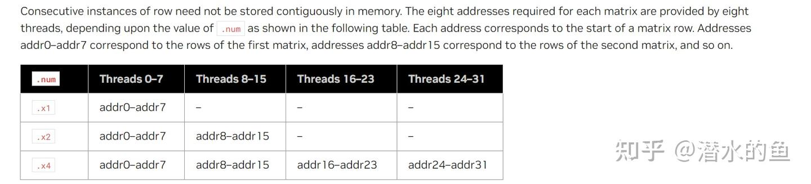
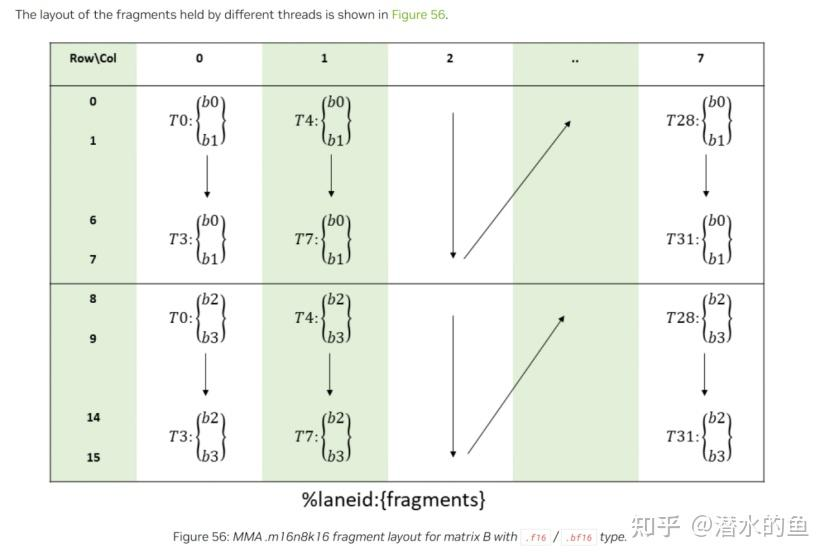
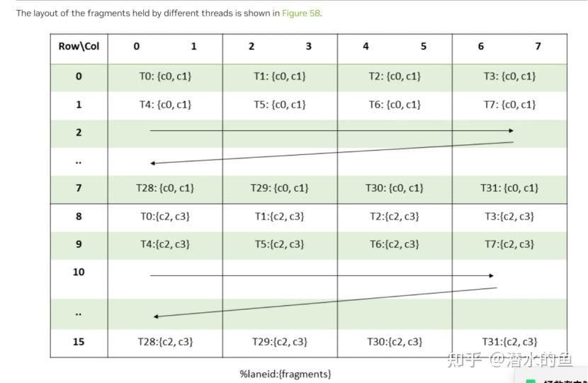

### 前言

前段时间看了一下AUTOAWQ的实现，有朋友提到了推理运算加速还是MARLIN这个库的实现目前是最快的。

因此后续花了不少时间来走读MARLIN具体的代码实现。

GITHUB地址：[https://github.com/IST-DASLab/marlin](https://link.zhihu.com/?target=https%3A//github.com/IST-DASLab/marlin)

### 一、整体介绍

MARLIN是一个fp16*int4的计算加速库，用于优化矩阵乘法。该计算库内部是基于PTX的实现。

在实现过程中，使用TILE，SUBTILE的概念在SM层做调度优化。具体实现过程中，通过各种IO、调度优化，达到性能优化的目标。

官方总结了11条优化策略，可见其中间的复杂度。

需要注意的是：

- 本文涉及PTX指令，需要简单理解PTX指令的一些基本概念。
- 本优化需要对调用方的B矩阵进行内存重排，因此需要理解AUTOAWQ或其他调用方（GPTQ）的实现。

### 二、TILE层调度

#### 2.1 和其他矩阵乘法优化的不同

简单的可以参考CUDA官网的最佳实践。

诸如CUTLASS的实现，在知乎也有很多大佬进行过分享。

相比于CNN的卷积，LLM的矩阵乘有这样的特性：IO比乘法运算更重要，因此需要更加精致的优化。

同时现有框架都是GRID层面的调度都是交由NVIDIA的软件进行，为了极致的性能，充分利用SM资源，需要人工对调度进行优化。

#### 2.2 TILE层调度实现

这里说明一下，设定A矩阵的尺度为m*k，B矩阵的尺度为k*n。

首先：

PTX指令有诸如16*8*16的乘法指令用于矩阵乘法。

因此为了方便起见，实际可以用16*16*16作为最小的计算块，全文用SUBTILE来表示。即：

A(16,16) * B(16,16)组成

在SUBTILE的之上，实际调度中使用的是TILE的概念，他是由thread_m_blocks * thread_n_blocks* thread_k_blocks个SUBTILE组成。即：

A(thread_m_blocks*16,thread_k_blocks*16)*B(thread_k_blocks*16,thread_n_blocks*16)组成。

其中运算最多的是thread_m_blocks=4,thread_k_blocks=4,thread_k_blocks=16的情况。

**为什么这么要有TILE的概念？**

**个人理解：核心是在IO读取和计算之间的一种平衡，这种调度目前IO处理非常有优势。**

#### 2.2.1 m方向的切片

**

在实际的实现过程中，对m方向首先做了切片。

保证进入计算的m

#### 2.2.2 调度策略

具体的调度实现在：

`__global__ void Marlin(
  const int4* __restrict__ A, // fp16 input matrix of shape mxk 
  const int4* __restrict__ B, // 4bit quantized weight matrix of shape kxn 
        int4* __restrict__ C, // fp16 output buffer of shape mxn
  const int4* __restrict__ s, // fp16 quantization scales of shape (k/groupsize)xn 
  int  prob_m, // batch dimension m
  int  prob_n, // output dimension n
  int  prob_k, // reduction dimension k
  int* locks // extra global storage for barrier synchronization `

本文的重点就是该函数的具体实现。

CUDA可以通过

`cudaDeviceGetAttribute(&sms, cudaDevAttrMultiProcessorCount, dev);`

获取可用计算资源。

同时m*n*k的计算就可以转化成k_tiles * n_tiles * parallel的计算：

` int k_tiles = prob_k / 16 / thread_k_blocks;
 int n_tiles = prob_n / 16 / thread_n_blocks;
 int iters = ceildiv(k_tiles * n_tiles * parallel, gridDim.x);
  // Ensure that the number of tiles in each stripe is a multiple of the groupsize; this avoids an annoying special case
  // where a stripe starts in the middle of group.`

如代码所示每个CUDA的计算资源需要进行iters次TILE的运算。

下面来看看一下实际计算排布顺序。

实际的排布顺序是(m,n,k)

这样排布的好处在于，对于多个k，可以使用相同的m和n，相同的m,n目标C矩阵是相同的，减少GLOBAL C的同步次数。

但是实际上处理起来并不简单。由于C矩阵需要在TILE乘法计算完成后做归约操作，这就涉及到多个计算资源规约的问题。同时存在个别计算跨n的操作，需要规约到新的目标地址。后续在归约的细节中再来介绍。

在实际处理中，这里会算好每个TILE块的A,C的起始地址偏移，用于后续的内存读取：

`int slice_row = (iters * blockIdx.x) % k_tiles;
int slice_col_par = (iters * blockIdx.x) / k_tiles;
 
if (slice_col_par >= n_tiles) {
    A += (slice_col_par / n_tiles) * 16 * thread_m_blocks * prob_k / 8;
    C += (slice_col_par / n_tiles) * 16 * thread_m_blocks * prob_n / 8;
    locks += (slice_col_par / n_tiles) * n_tiles;
    slice_col = slice_col_par % n_tiles;
  }`

### 三、IO处理

这里主要介绍TILE内部的IO相关实现。

具体实现主要有两步：

- GLOBAL->SHARE
- SHARE->REG
中间会涉及到多STAGES预取，异步读取的逻辑，相对比较容易理解，这里就不做说明了。

#### 3.1 GLOBAL->SHARE

实现在：

`  // Asynchronously fetch the next A, B and s tile from global to the next shared memory pipeline location.
 auto fetch_to_shared = [&] (int pipe, int a_off, bool pred = true) {`

实际上复杂的是内存偏移的计算。

#### 3.1.1 A矩阵

先看GLOBAL内存。

`int a_gl_stride = prob_k / 8; // stride of the A matrix in global memory
constexpr int a_gl_rd_delta_o = 16 * thread_k_blocks / 8;`

这里用INT4表示4*int的数据结构，后面大写的INT4都表示这种数据结构。

为什么用这个数据结构？

因为

`cp.async.cg.shared.global`

指令的最大处理长度是16bytes,也就是INT4.

回到A矩阵，fp16的位宽是INT4的，所以每行的stride就是prob_k/8

同理，那么一行的数据需要多少个线程去读取呢？

那就是16 * thread_k_blocks / 8

这里还需要注意a_sh_wr_iters这个变量。

` constexpr int a_sh_stage = a_sh_stride * (16 * thread_m_blocks); // overall size of a tile
 constexpr int a_sh_wr_iters = ceildiv(a_sh_stage, a_sh_wr_delta); // number of shared write iterations for a tile`

256个线程调用cp.async.cg.shared.global是无法获取到TILE的A矩阵的。需要a_sh_wr_iters次才能处理完成。

因此实际调用时的代码，会重复a_sh_wr_iters次进行调用。

`for (int i = 0; i  a_sh_wr_iters; i++) {
        cp_async4_pred(
          &sh_a_stage[a_sh_wr_trans[i]],
          &A[a_gl_rd_delta_i * i + a_gl_rd + a_gl_rd_delta_o * a_off],
          a_sh_wr_pred[i]
        );
      }`

其他变量可以结合上述变量再做理解。

谈完GLOBAL内存，下面来谈SHARED内存

代码中用如下结构记录共享内存：

`  extern __shared__ int4 sh[];
  // Shared memory storage for global fetch pipelines. 
  int4* sh_a = sh;
  int4* sh_b = sh_a + (stages * a_sh_stage);
  int4* sh_s = sh_b + (stages * b_sh_stage);`

这里需要说明的是：

`constexpr int a_sh_stride = 16 * thread_k_blocks / 8; 
constexpr int a_sh_stage = a_sh_stride * (16 * thread_m_blocks); // overall size of a tile
constexpr int b_sh_stride = 32 * thread_n_blocks / 4;
constexpr int b_sh_stage = b_sh_stride * thread_k_blocks;`

这里会计算A,B矩阵TILE的空间，用于缓存。

A矩阵的BANK CONFLICT：

`for (int i = 0; i  a_sh_wr_iters; i++)
    a_sh_wr_trans[i] = transform_a(a_sh_wr_delta * i + a_sh_wr);

auto transform_a = [&] (int i) {
 int row = i / a_gl_rd_delta_o;
 return a_gl_rd_delta_o * row + (i % a_gl_rd_delta_o) ^ row;
};`

#### 3.1.2 B矩阵

B矩阵的存储是int4(小写)，只是INT4的。

这里的内存排布，才是最复杂的。**

**复杂的有两点：**

- **B矩阵是按照SUB_TILE即16*16的顺序排布的。而不是按行排布的。**
- **B矩阵内部为了方便一次读取，在WEIGHT记录过程中，要适配mma的指令，内部还有重排。**
**对应官方说明：**

· We carefully order dequantization and tensor core instructions to ensure that both GPU pipelines are well saturated and do not bottleneck each other.

· In general, both quantized weights and group scales are reshuffled offline, into a layout that gives ideal access patterns during execution, allowing for instance directly dequantizing weights into tensor core organization.

**这部分先看SUB_TILE的排布**

这里需要简单阅读一下AUTOAWQ中MARLIN的实现：

SUBTILE重排对应的是：

` w = w.reshape(
            (
 awq_linear.in_features // tile,
 tile,
 awq_linear.out_features // tile,
 tile,
            )
        )
 w = w.permute((0, 2, 1, 3))`

这里共享内存读写B矩阵，也就是直接存写，也就不需要考虑bank conflict了。

**

#### 3.2 shared->reg

这里说是内存从shared到reg的操作，但是实际上，所有的流程都是为了更好的为后面mma操作服务的。

中间会用到如下的寄存器：

` FragA frag_a[2][thread_m_blocks];
 I4 frag_b_quant[2];
 FragC frag_c[thread_m_blocks][4][2];
 FragS frag_s[2][4];`

接着看调用链：

`      for (int k = 0; k  b_sh_wr_iters; k++) {
        fetch_to_registers(k + 1, pipe % stages);
        if (k == b_sh_wr_iters - 2) {
          fetch_to_shared((pipe + stages - 1) % stages, pipe, slice_iters >= stages);
          pipe++;
          wait_for_stage();
        }
        matmul(k);
      }`

为什么用b_sh_wr_iters做迭代？

因为thread_m_blocks的取值可以是0，1，2，3因此a_sh_wr_iters的次数是不固定的。

因此实际mma的计算时，会拆分成：thread_m_blocks的16行分别计算，这也是frag_a中第二维的由来。

而对于b_sh_wr_iters的迭代来说，可以通过ping/pong buffer的方式，将其转化成2个buffer来处理。

这样可以节省reg的空间。

实际处理过程中，B矩阵相对简单，这里不做描述。

主要是A矩阵的实现比较复杂。

说A矩阵之前，首先要理解的逻辑是:

使用mma->A矩阵需要使用ldmatrix进行读取

mma要求的A矩阵资源，可以参考：

https://docs.nvidia.com/cuda/parallel-thread-execution/index.html#matrix-fragments-for-mma-m16n8k16-with-floating-point-type

为了将A矩阵转化成mma所需的矩阵，可以通过

ldmatrix.sync.aligned.m8n8.x4.shared.b16 指令来实现。

该指令也需要传入32个行首地址。

至于这4个8*8的顺序是这样的：

0，2

1，3

所以ldmatrix的就是给32个线程，各自的首地址。

也就是从shared mem去拿这三个地址。

说到这里，虽然有点绕，但还属于好理解的。具体到代码层面，核心需要理解的是下面这两行的寻址逻辑。

`  // Shared read index.
int a_sh_rd = a_sh_stride * ((threadIdx.x % 32) % 16) + (threadIdx.x % 32) / 16;
a_sh_rd += 2 * ((threadIdx.x / 32) / (thread_n_blocks / 4));`

第一行结合上述关于ldmatrix的说明，在thread 0-32分别获取对应ldmatrix需要的地址。

第一行相对来说还容易懂一些。

最难懂的莫过于第二行的** (thread_n_blocks / 4)的逻辑

个人理解，这里其实有一个默认逻辑就是：

256个线程，至少需要b_sh_wr_iters次后处理完一行吧，那就需要一次读取thread_k_blocks/b_sh_wr_iters个SUB_TILE。

thread_k_blocks/b_sh_wr_iters = threads/8/thread_n_blocks

为了能够利用资源，如果不重复读取，就会处理threads/32个SUB_TILE。

但是我们可以重复读取A矩阵来进行乘法后再归约，那么就有threads/32/x = threads/8/thread_n_blocks

因此x = thread_n_blocks/4

**这就是thread_n_blocks/4的由来。**

因此A矩阵，在LDMATRIX后，有重复矩阵。

如果仔细分析的话，可以这么理解：

- 实际上的GLOBAL IO没有变化，还是GLOBAL->SHARED的大小
- 运算并没有变多，B矩阵一直在变化，所以不会有重复计算。
**简单来说就是为了配平IO,和MMA操作，做的妖操作。**

**

外围代码实现：**

` for (int i = 0; i  thread_m_blocks; i++)
 ldsm4(frag_a[k % 2][i], &sh_a_stage[a_sh_rd_trans[k % b_sh_wr_iters][i]]);
 int4* sh_b_stage = sh_b + b_sh_stage * pipe;
 frag_b_quant[k % 2] = *reinterpret_castI4*>(&sh_b_stage[b_sh_rd_delta * (k % b_sh_wr_iters) + b_sh_rd]);`

在SHARED->REG的过程中还会有一次transform_a的调用，我个人理解，在ROW不变的前提下，transform_a是一个可逆变换。这样就可以轻松从SHARED内存位置回到原始位置。

整个IO的功能逻辑不复杂，我个人会觉得内存尤其是想做高效的计算，IO偏移都会相当的麻烦。

B矩阵的逻辑需要结合MMA的实现来进行说明放到下一部分做说明。

B矩阵的读取指令在vllm库中为了支持H100，稍有修改，建议参考vllm的代码实现。

### 四、乘法计算

代码实现：

`   for (int j = 0; j  4; j++) {
      int b_quant = frag_b_quant[k % 2][j];
      int b_quant_shift = b_quant >> 8;
      FragB frag_b0 = dequant(b_quant);
      // If there are no groups, we can just scale the final output once and can avoid doing so for each weight.
      if (group_blocks != -1)
        scale(frag_b0, frag_s[k % 2][j], 0);
      FragB frag_b1 = dequant(b_quant_shift);
      if (group_blocks != -1)
        scale(frag_b1, frag_s[k % 2][j], 1);
      #pragma unroll
      for (int i = 0; i  thread_m_blocks; i++) {
        mma(frag_a[k % 2][i], frag_b0, frag_c[i][j][0]);
        mma(frag_a[k % 2][i], frag_b1, frag_c[i][j][1]);
      }`

乘法计算主要分为两步：

- DEQUANT
- MMA

#### 4.1 DEQUANT

实现等同于：

[https://github.com/NVIDIA/FasterTransformer/blob/main/src/fastertransformer/cutlass_extensions/include/cutlass_extensions/interleaved_numeric_conversion.h](https://link.zhihu.com/?target=https%3A//github.com/NVIDIA/FasterTransformer/blob/main/src/fastertransformer/cutlass_extensions/include/cutlass_extensions/interleaved_numeric_conversion.h)

中的FastInterleavedAndBiasedNumericArrayConverter函数

**

可以参考：

[https://zhuanlan.zhihu.com/p/657073857](https://zhuanlan.zhihu.com/p/657073857)

需要注意的是：为了实现快速转化，需要B的数据进行高低位的混插。

具体来说，一个int32中包含的8个int4对应索引顺序需要是：

`interleave = np.array([0, 2, 4, 6, 1, 3, 5, 7])`

#### 4.2 mma

前面提到了A矩阵，thread 0-32,下面来看B矩阵

B矩阵的偏移如上图所示。

前面说过B矩阵是按照16*16进行的排布。分布到32个线程中。

如T0对应的地址就应该是：

[0, 16, 128, 144, 8, 24, 136, 152]

那这里是如何实现这种排布的呢？--答案是：AUTOAWQ干的。所以用MARLIN的代价就是B矩阵得你自己重排。

在AUTOAWQ得代码中是通过下面代码实现的。

`def _get_perms():
    perm = []
    for i in range(32):
        perm1 = []
        col = i // 4
        for block in [0, 1]:
            for row in [
                2 * (i % 4),
                2 * (i % 4) + 1,
                2 * (i % 4 + 4),
                2 * (i % 4 + 4) + 1,
            ]:
                perm1.append(16 * row + col + 8 * block)

        for j in range(4):
            perm.extend([p + 256 * j for p in perm1])

    perm = np.array(perm)
    interleave = np.array([0, 2, 4, 6, 1, 3, 5, 7])
    perm = perm.reshape((-1, 8))[:, interleave].ravel()
    perm = torch.from_numpy(perm)`

在AUTOAWQ中，B矩阵实际经过了如下5个步骤：

第一步：

在16*16的维度上，生成：

PERM1.

如T0对应的地址是：

[0, 16, 128, 144, 8, 24, 136, 152]

这就是前面看到的两个相邻T0对应的B0-B3位置。

需要存储4个16*16块，因此生成1024个位置偏移。

第二步：

因为FASTER DEQUANT的操作是需要按4BIT进行混插。

因此通过：

`interleave = np.array([0, 2, 4, 6, 1, 3, 5, 7])
 perm = perm.reshape((-1, 8))[:, interleave].ravel()`

将8BIT的数据进行混插。

会变成：

0 , 128 , 8 , 136 , 16 , 144 , 24 , 152 ,

第三步：

将WEIGHT转化成：(IN/16)*(OUT/16)*16*16的矩阵。

第四步：

经过PERM进行重新索引：

` res = res.reshape((-1, _perm.numel()))[:, _perm].reshape(res.shape)
 `

第五步：

每8个数据融合成一个INT32:

`for i in range(8):
    q |= res[:, i::8] 

经过上述5步操作，将B矩阵封装成可以使用MMA计算的矩阵。

最后看一下C矩阵的排布：

在计算块内部，会在DIM_K进行迭代，会将结果放在frag_c的寄存器中。

前面提供A和B都会在K方向切成：b_sh_wr_iters块。

用切成2块来距离：

设：

A = A00|A01 ,B=B00|B10

C = A*B

C = A00*B00+A01*B10

因此frag_c首先会在b_sh_wr_iters层面做归约。

其次，一个16*16的矩阵，可以拆解成两个：16*8的矩阵。

这就对应了frag_c的最后一维。

SM内部在TILE迭代时，对应块得乘加和都是放在frag_c中的（m,n相等）。

因此在mma的计算过程中SM就已经做了tile层面的归约操作。**

### **五、归约**

这里的归约特指计算块迭代完成或者是换(m,n)的情况。部分迭代和tile的归约，在mma中就已经完成。

**

具体来说可以分为两个层次的归约：

1.计算块的block归约

2.计算块间的全局归约

#### 5.1 block归约

为什么还会有block归约？

因为我们在tile层面只做了b_sh_wr_iters的归约。

在实际处理中，TILE层面需要做的是DIM_K的归约。需要做thread_k_blocks次。

这里需要在K维度做thread_k_blocks/b_sh_wr_iters的归约。

由于线程间的reg是无法访问的，所以这里需要将数据放入共享内存进行处理。

这里的代码详见：

`  auto thread_block_reduce = [&] () {`

这里做reduce的优势是：

只需要进行REG->SHARED->REG的转化，不涉及全局内存读取。

如果这步操作放到GLOBAL MEM的层次去做，会增加GLOBAL MEM的读取量。

#### 5.2 global归约

global归约实际上可以理解成是同步顺序处理。

`      if (slice_count > 1) { // only globally reduce if there is more than one block in a slice
        barrier_acquire(&locks[slice_col], slice_idx);
        global_reduce(slice_idx == 0, last);
        barrier_release(&locks[slice_col], last);
      }`

具体来说就是靠：barrier_acquire传入的slice_idx参数。**

该函数实现：

`__device__ inline void barrier_acquire(int* lock, int count) {
  if (threadIdx.x == 0) {
    int state = -1;
    do
      // Guarantee that subsequent writes by this threadblock will be visible globally.
      asm volatile ("ld.global.acquire.gpu.b32 %0, [%1];\n" : "=r"(state) : "l"(lock));
    while (state != count);
  }
  __syncthreads();
}`

当count=0，不会锁。

结合barrier_release中lock +1的操作。

处理一次加个1.这就成了按照slice_idx顺序执行global_reduce的操作。

这个步骤没其他办法了，只能依靠全局内存了，目前是靠结果矩阵C来存放结果。

实际处理，就是每个计算单元把自己要计算的C和前一块的C加起来，放回全局内存。

个人觉得这里的数据类型，多少可能还是有点小问题。

由于C矩阵是FP16的，需要FLOAT->FP16的操作，还得累加。

等待BF16的实现。

### 六、写回操作

只在(m,n)得最后一块做这个操作。

简单来说两个功能：

- s的乘法操作在这层实现。
- 结果写回C。

### 七、结语

整体来说，通过走读该库，个人把一些简单得PTX指令大概摸了一下。

内存索引这么用，尤其是B矩阵的索引这么用第一次见。就是代价要改B矩阵存储格式。

按照IO读取的目标作为最核心指标，全局贯穿b_sh_wr_iters这个变量，各种切片和归约。

归约，实际意义上的4层的归约操作（write_iter,iter,block,global），尽可能的减少内存处理。

基于SM层的手工调度也很有想法。

整篇下来，由衷感慨太优秀了（太卷了）。

参考资料：

[GitHub - IST-DASLab/marlin: FP16xINT4 LLM inference kernel that can achieve near-ideal ~4x speedups up to medium batchsizes of 16-32 tokens.](https://link.zhihu.com/?target=https%3A//github.com/IST-DASLab/marlin)

https://docs.nvidia.com/cuda/parallel-thread-execution/
