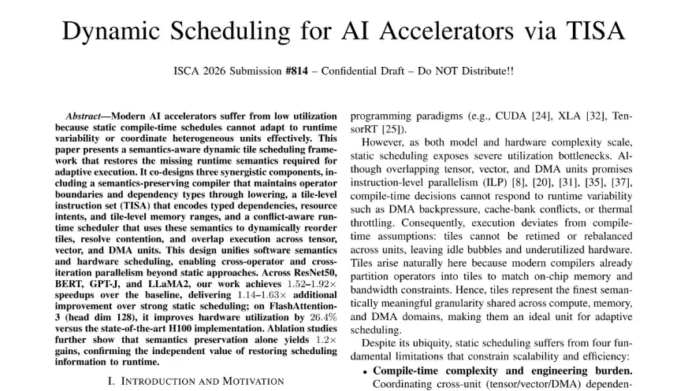
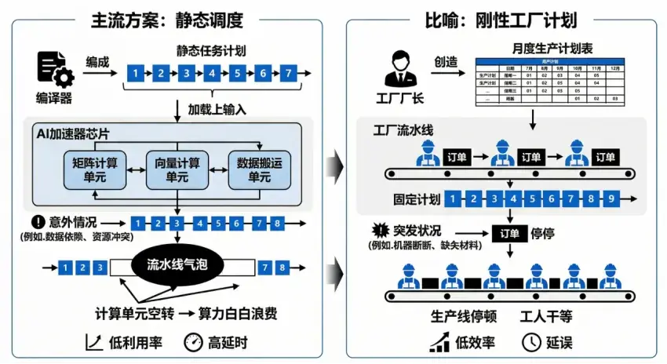
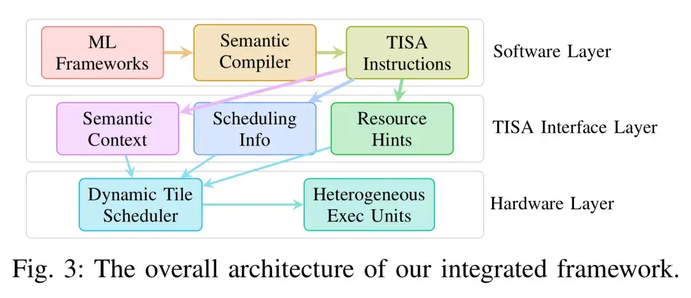
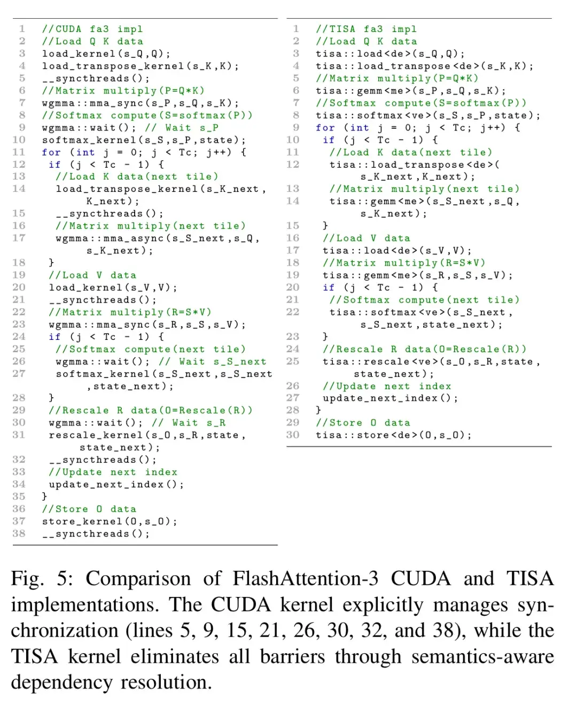
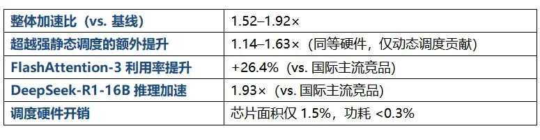

**

****奕行智能动态调度架构论文入选计算机架构国际顶会ISCA 2026。**

**一、为那个被忽略的问题**

每一轮AI 算力军备竞赛，大家盯着的都是算力——**更多的显卡、更大的芯片、更高的峰值算力（TFLOPS）**。但鲜少有人追问：这些算力，真的被用上了吗？

当前，AI加速器的实际算力利用率，长期远低于其理论峰值。瓶颈往往不在于芯片本身不够强大，而在于主流的软件调度范式，在运行时无法灵活、高效地“喂饱”硬件。算力买了，却用不满——这正成为AI计算系统中最为隐蔽的性能天花板。

这一核心问题，如今迎来了一份来自学术顶会的参考答案。**国产AI芯片公司奕行智能提出的TISA**（Tile-level Instruction Set Architecture）**Tile级动态调度架构**，相关论文已被计算机体系结构领域全球顶级会议ISCA 2026录用。

**ISCA**（International Symposium on Computer Architecture）**是该领域历史最悠久、影响力最强的国际顶会，平均录取率仅约17%**，AMD、NVIDIA、Google的标志性架构研究均常发表于此。该论文标志着AI芯片体系结构前沿研究上的又一重要突破。

**

二、静态调度为什么不够用？**

要理解这个突破，先要理解一个藏在芯片设计里的“经典难题”：**静态调度（Static Scheduling）**。

现代AI 加速器内部由矩阵计算单元（负责密集型矩阵运算）、向量计算单元（负责激活、归一化等操作）和数据搬运单元（DMA）组成。理想情况下，三者应如精密配合的流水线，持续、重叠地满负荷工作。

但现实中，业界主流采用的编译时静态调度方案，在程序运行前就将所有任务的执行顺序一次性、固定地排定，硬件在运行时只能严格按此“剧本”执行，无法应对任何突发状况。这好比工厂厂长提前排定了未来一个月的详尽生产计划，却无法处理设备突发故障、原料临时短缺或工人请假。一旦现实与计划出现偏差，部分流水线就不得不“空转”（产生 “流水线气泡”pipeline bubble ），宝贵的算力被白白浪费。

（由AI生成）有人或许会问：现代GPU不是具备动态调度能力吗？确实，GPU在线程束（Warp）调度等底层机制上引入了动态性——但这些机制仅能解决**CUDA Core内部的指令调度问题**，无法协调数据搬运单元TMA、Tensor Core与CUDA Core三者的并发执行。

事实上，为应对“静态调度”的瓶颈，计算架构史上早有成功先例。三十年前，超标量（Superscalar）CPU 通过动态指令调度，在运行时重排指令、填充流水线空闲，最终在性能上击败了全静态调度的VLIW架构。如今，随着大模型兴起与芯片异构程度急剧增加，AI芯片静态调度固有的僵化性，已成为制约算力利用率提升的障碍。奕行智能的论文，正是将动态调度思想引入AI芯片，试图打破这一困局。

**三、TISA 动态调度架构：让芯片在运行时自己做决策****

TISA**（Tile-level Instruction Set Architecture）**是奕行智能提出的一套完整的动态调度架构**，核心思想是：在编译器和硬件之间建立一种新的"共同语言"，让芯片在运行时能基于实时状态进行智能决策，而非僵化执行预设脚本。

这套动态调度架构由三个相互配合的组件构成——

**1.语义保留编译器：不丢失"背景信息"的翻译官**

传统编译器在将AI模型“翻译”成芯片指令时，往往会丢弃算子类型、依赖关系等关键语义信息，就像一份菜谱在多次转述后只剩操作步骤，却丢失了"哪道菜、用哪口锅、先后顺序为何"等背景。奕行智能的编译器主动保留并传递这些语义上下文，确保每个计算任务交付给硬件时，都携带完整的“背景说明”，为后续的智能调度提供信息基础。

**2.Tile 级指令集 TISA：标准化的"任务说明卡"**

TISA 中，每一个计算任务（Tile，即把一个大算子切分成若干可独立调度执行的小块）都附带一张标准化"任务说明卡"，注明：这是什么类型的计算、需要用到哪块硬件、依赖哪些数据结果、是否可以和其他任务同时进行。有了这张说明卡，芯片在运行时无需猜测，就能精准判断哪些任务可以并行、哪些必须等待。

**3.冲突感知运行时调度器：芯片的"实时决策核心"**

这是整套系统的核心。调度器持续监控所有计算单元（矩阵、向量、DMA）的实时状态，一旦某个单元空闲，立刻从待执行任务中找出满足条件的下一个任务推送过去——而不是等待编译器预设的同步点。

整个决策过程极为迅速，从判断到下发仅需几纳秒，不会给芯片带来额外负担，却能大幅减少各单元"空等"的时间，动态地消除空闲气泡，实现跨单元、跨算子的执行重叠。

TISA动态调度架构**四、用FlashAttention-3 说话**

说一千道一万，不如拿出一个真实案例。奕行智能选择的标准很有分量：**FlashAttention-3**。这是目前大模型推理中性能最优的注意力机制实现，由学术界为NVIDIA H100芯片深度手工优化，代表了静态调度方案所能达到的巅峰。

即便如此，静态调度的局限性在此依然凸显。FlashAttention-3的计算由矩阵乘与Softmax交替进行，分属不同计算单元。静态方案虽尽力实现了流水化，但为保障正确性，必须在每一轮迭代间插入同步屏障，强制等待前一迭代全部完成，即使后一迭代的部分任务所需数据早已就绪。

TISA 动态调度架构的调度器实时观察每个任务的数据是否就绪：当第 i 轮的 Softmax 还在跑时，若第 i+1 轮的矩阵乘法所需数据已经备好，调度器立刻将其推送到矩阵单元，实现真正的跨迭代重叠。同步屏障被彻底消除，“空等”时间大幅压缩。

如下图所示，CUDA 版 FlashAttention-3 代码中充斥着 bar.sync()、wgmma.wait() 等手动同步指令——这是程序员告诉硬件“请在这里等一下”。TISA 版本完全没有这些屏障，依赖关系全部由指令集语义隐式表达，硬件自行决策。

**结果：**TISA 版本代码量减少 30%，同步调用减少 50%，性能达到手调基线的 95% 以上——完全由编译器自动生成，无需任何手工优化。

**五、实测性能数据：效率反超****

论文在ResNet-50、BERT、GPT-J、LLaMA2 等主流模型上进行了全面评测，核心数据如下：

其中最值得关注的一组数字是：在峰值算力低于国际主流竞品的情况下，奕行智能自研芯片EPOCH凭借TISA架构，实现了平均1.46倍的推理延迟优势。这强有力地证明，通过动态调度提升的“实际可用算力”，足以弥补甚至反超纯硬件算力上的差距。在算力竞赛的下半场，效率才是真正的护城河。

六、不止于性能：一次设计范式的迁徙**

TISA的价值不止于性能数字的提升。它标志着AI芯片系统设计思路的一次范式转变：从 “编译器排定一切，硬件被动执行” 的静态确定性模式，转向“编译器描述意图，硬件实时决策” 的动态智能模式。

三十年前，超标量CPU以动态调度赢得了对VLIW静态架构的历史性胜利。今天，奕行智能的TISA动态调度架构，为AI加速器选择了同样的道路，并以顶会论文的学术背书与扎实的实测数据，为行业揭示出一条通往更高算力效率的路径。

**“AI算力的下一波红利，在于购买更高利用率的芯片，把每一分算力，真正用满、用好。”**
