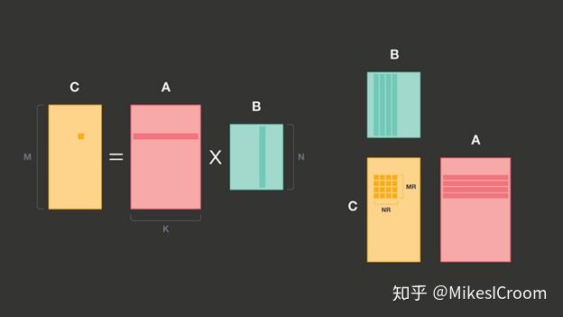
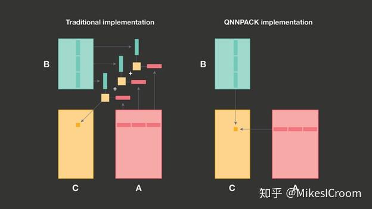
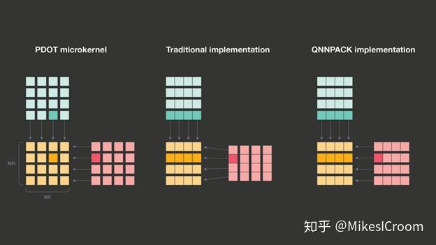
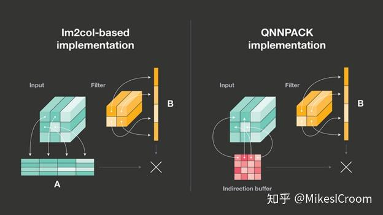
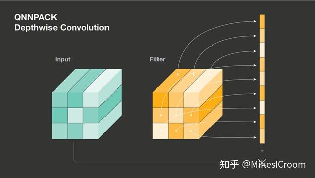
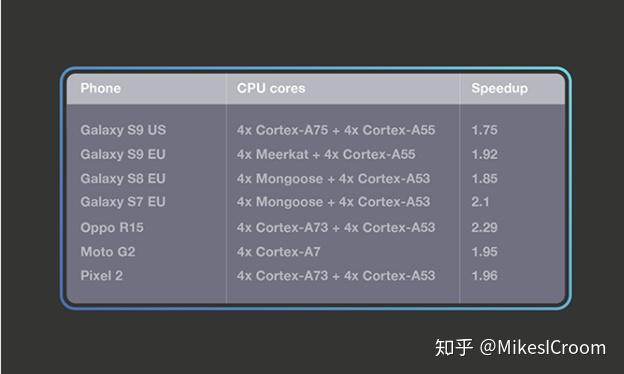

QNNPACK是facebook在2018年底推出的面向mobile AI的高性能开源加速库，可以在手机端提供2倍以上的性能提升。QNNPACK不但对传统的卷积有较好的加速，对于新兴的group convolution、depthwise convolution也有不错的效果。尽管这是纯软件的工作，其中很多优化方式和思想很值得借鉴。

传统深度学习的算法，特别是面向图像和视频领域的模型，主要都是卷积操作，这个运算量是很大的。通常的优化手段是在算法层面减少卷积对MAC的使用量，比如熟知的Winograd transform和Fast Fourier transform。经winograd优化后的3x3卷积可以实现仅比1x1卷积多1倍的MAC运算，相比之下，直接滑窗的计算方法则需要9倍。winograd算法在CPU和GPU的深度学习库中应用广泛，值得注意的是Google的TPU其实是采用滑窗法来计算卷积的，为什么TPU的性能会高呢？这是因为TPU利用了滑窗法运算规则，对带宽要求较小的特点，通过单位面积上堆积更大的计算密度来实现的。可以看出，算法需要和匹配的硬件一起才能发挥出最大的性能，这也是AI芯片更紧密的软硬件结合设计。

随着算法的发展，很多新的模型致力于减少运算量和带宽需求，一些改进的卷积算法被提了出来，如1×1 convolutions, grouped convolutions, strided convolutions, dilated convolutions, and depthwise convolutions。传统卷积的改进办法并不能很好的提高上述算法的性能，包括TPU在内的众多深度学习加速器也没有很好的解决方案。Facebook从软件的角度，将上述算法提取为2个基本算子：Fully connected operators和1×1 convolutions，后者经过宽度和高度上的循环计算，可以实现Kernel size为MxN的卷积。这两者的基础都是矩阵乘累加，因此核心问题就是矩阵乘累加的高效计算问题，即linear algebra 的GEMM。

传统矩阵MAC的计算是矩阵A的一行和矩阵B的一列对应位置相乘后缩位和。由于每进行一次行列乘累加就需要读取两行数据，性能的瓶颈主要在memory的带宽上。根据上述分析，提出了PDOT (panel dot product) microkernel，同时计算A矩阵的MR行和B矩阵的NR列，生成MRxNR的新矩阵。MR和NR的大小由硬件可以调配的寄存器数量所决定，根本思想就是循环展开，通过将更多的数据打平存储在寄存器中进行运算，更好的利用了矩阵MAC的数据复用性，并且避免了反复进行memory访问的代价，这也是包括ARM在内的很多厂商都采用的优化方法。第二点改进是针对面向mobile AI领域数据量较小的特点，限制PDOT中的MR和NR不超过8，channel不大于1024，因此执行1x1convolution所需要的数据量不超过16KB，对于主流的处理器都可以全部放在L1 cache中。这是一个非常重要并且合理的假设，由于数据全部在cache中，之后的优化完全不用考虑内存替换，可以有针对性的设计很多提升算法。

上图给出了通用算法和QNNPACK限制后算法的区别。由于数据完全在cache中，可以直接一次循环计算A矩阵行和B矩阵列的乘累加，而不需要考虑如果矩阵超出cache size后，怎么进行拆分和替换，很大程度降低了算法设计的复杂度。虽然失去了通用加速性，但在mobile AI应用下可以获得更高的性能，这是QNNPACK很大的亮点。通用AI算法虽然理想很美满，但现实是各个应用场景下常常不能兼顾。针对特定领域设计专用性的软硬件，可以有选择的舍弃价值不高的部分，而集中对关键点进行提升。这其实就是DSA（Domain Specific Architecture）的思想，也会是AI未来发展的趋势。

有了上述假设，QNNPACK的优势自然而然的体现出来。传统GEMM算法为了将当前计算部分尽可能放在cache中，常常需要对输入数据矩阵进行repack，获得更好的cache局部相关性和microkernel计算效率。这个repack的过程会占用CPU资源和总线带宽。而QNNPACK由于数据全部在cache中，上述的优化就完全不必要了。而是直接访问L1 cache， 调用CPU的SIMD或Vector的计算资源进行并行运算，省掉计算中反复的cache refill和总线占用。

QNNPACK可以支持卷积直接转MAC的运算方式（im2col），这也是很多硬件加速器常常采用的方法。主要思想是把input data根据kernel 1维展开的方向也复制打平成kernel数为宽度的二维矩阵，每行与kernel进行向量乘累加获得。这里QNNPACK设计了一个虚拟buffer用来避免input data 2维展开的真实内存访问。记得之前的假设么，数据完全在L1 cache中，因此访问每一个数据的时间是一样的，并不需要进行真实的数据展开来获取局部性，而是用一个虚拟buffer记录了展开后每个数据原始的索引。通过索引就可以取得所需数据。这样在功耗和速度上都有提升。

对于depthwise卷积，QNNPACK仅支持较小kernel size（3x3）的优化。不同于通用算法每次读取一个data和weight相乘，QNNACK将kernel的循环展开，9个weight全部放到寄存器中不动，数据每次读进来后和对应weight寄存器相乘，这样省略了每次读取weight的内存访问。可以看出这不是一个可扩展的算法，由于硬件寄存器资源有限，同样的加速对于更大的kernel size并不适用。这里还是体现了QNNPACK的Domain Specific概念，仅针对mobile AI场景下kernel size通常较小的特点进行优化。

最后facebook给出了QNNPACK在手机端部署后的效果，可以看出平均有2倍左右的提升，这是很不错的结果。

总结一下QNNPACK的设计思路，针对mobile AI这一特定领域的计算量和数据规模的特点，合理假设其数据可以完全被L1 cache所包括。在这个重要前提上，提出了无重排的GEMM算法，无内存搬移in2col算法，以及针对depthwise的寄存器展开算法。上述方法很大程度上减少了算法的复杂度，降低了对存储的访问和数据搬移的时间，在mobile这个计算和数据较小的领域能够获得较好的性能提升。针对特定领域的特定优化往往能获得较通用场景更高的效果，比如众多的推理芯片都会假定weights能够完全存储在片上来进行算法和硬件优化。这种思路会在很长一段时间内影响着现代AI加速器的设计，更广泛而言，在设计新的系统和算法时，最先应该想明白的问题是，这个系统主要面对的是什么样的特定领域，有哪些特点，然后再根据上述回答针对性的进行架构设计和算法优化。这样的设计能够最大限度的发挥软硬件协同的性能，而不是陷入漫无目标的迭代中。

[1]文中图片来源  https://engineering.fb.com/ml-applications/qnnpack/

**更多干货，欢迎关注公众号：MikesICroom**

**回复“课程”获取斯坦福大学AI加速器课程资料**

**相关阅读**

