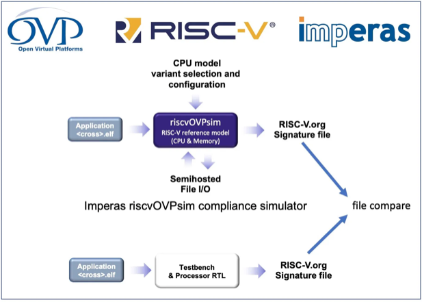
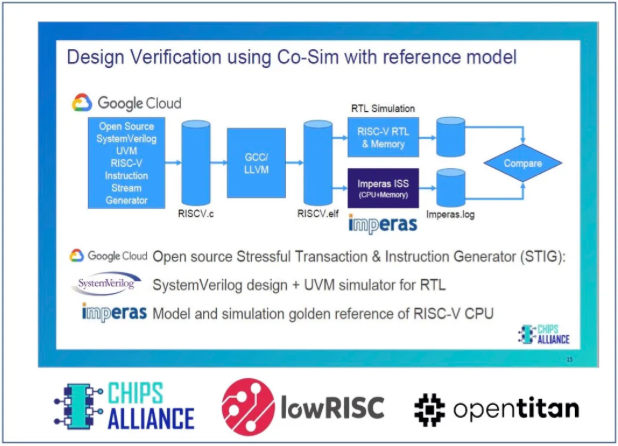
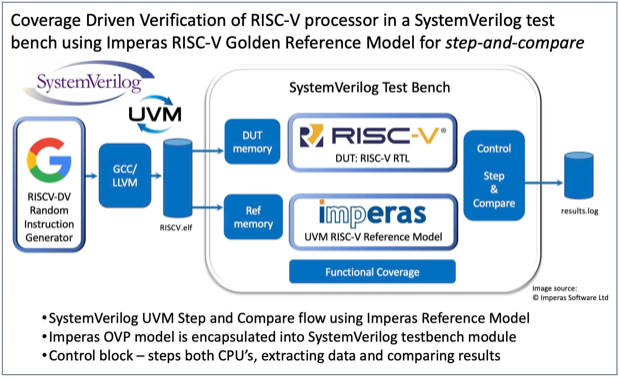
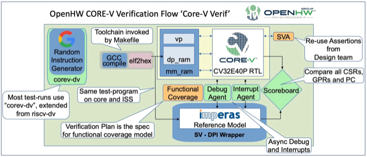

RISC-V的出现，一定程度上降低了体系结构研究的门槛。从最简单的五级流水线处理器，到更为复杂的乱序超标量处理器，网上关于RISC-V处理器核设计的资料也越来越多。然而，一个学术研究所用的处理器核与工业级别的处理器核，其设计目的有着本质的区别。前者往往希望探索体系结构上的创新，而后者则更加注重设计的无误性。因此，对于一个工业级别的处理器核来说，设计工作只占很小一部分，而验证工作及其方法论则往往占了更大的比重。

本篇文章转载自下述文献（如有侵权，立即删除），意在综述RISC-V验证方法论的5个层级，并分享每个层级所涉及的开源资源。

**

RISC-V 开放标准 ISA（指令集架构）为开发人员提供了配置定制处理器的特性和功能的机会，以独特地满足其目标终端应用程序的需求和要求。RISC-V 具有模块化结构，具有许多标准指令扩展，可用于附加专用硬件功能，例如浮点、位操作、DSP、加密、向量以及许多其他目前正在开发中的功能。此外，可以添加自定义指令以进一步优化设计。由于 RISC-V 是一个开放标准规范，许多实现已作为商业项目开发，而其他实现则作为开源硬件 IP 提供。因此，SoC 开发人员在选择处理器内核时有多种选择，从开发新设计到从可用内核中进行选择，

现有的 SoC 设计验证流程已针对通过集成主流供应商的处理器 IP 内核构建的设计建立。基于 SystemVerilog 测试台和块级设计验证的 UVM 已经很好地建立了行业 SoC 设计验证 (DV) 方法。当前的 SoC DV 方法共享一个共同的假设作为起点，即“已知良好”的处理器 IP。这些用于处理器的先进验证技术是一个严密保密的内部商业机密，交付的质量是供应商值得信赖的品牌价值。

RISC-V 不仅扩大了系统架构师开发新优化设计的设计自由度，还扩大了验证团队的工作范围。

使用 UVM 和 SystemVerilog 的 SoC 验证建立在基于仿真的流程之上，随着越来越多的 SoC 设计团队采用 RISC-V，SoC DV 团队自然会因此调整已建立的方法来解决处理器验证的复杂性。本文介绍了 RISC-V 验证和仿真的一些选项和最新趋势。

### RISC-V验证的5个级别介绍

RISC-V 的开放标准 ISA 定义了处理器硬件和将在其上运行的软件之间的边界。ISA 规范是处理器设计和操作的基础。由于处理器设计用于运行软件程序，很明显任何设计验证计划的一部分都是用软件测试操作。事实上，让任何软件运行在设计和开发过程中都是一项有用的测试。在某些情况下，例如研究项目或概念验证设计，基本处理器可能不是主要关注点。在某些情况下，处理器只是为更复杂的加速器提供前端接口，例如用于 AI 或 ML 项目的矢量处理器。在这种情况下，RISC-V 处理器不需要或期望运行所有可能的指令或用例的全部范围。在其他情况下，处理器功能需要在广泛的应用场景中进行广泛测试。虽然对于多项目晶圆上的简单测试芯片可能可以接受一些基本级别的测试，但针对大批量或高可靠性用例应用的设计需要额外的验证。

最终，对所需设计质量的决定是设计过程的一部分，验证成本只是在特性和功能权衡中要考虑的另一个选项——处理器硬件规格或特性列表可以根据对项目的影响进行评估回顾这些关键因素：

- P**：性能（使用新功能实现的改进）
- **P** : 功率（新功能对功耗的影响）
- **A**：面积（实现新功能的逻辑门数量对资源的影响）
- **V**：验证（将新功能验证到所需质量水平的努力）
RISC-V 正在改变传统的处理器 IP 设计权衡决策，从讨论“ **P** – **P** – **A** ”指标转变为“ **P** – **P** – **A** – **V** ”。仅需要少量门的次要设计特征可能看起来是一个有吸引力的选择，只需基于“ **PPA** ”的评估，因为该特征提供了一些有用的功能，而设计和实施成本似乎只有边际。然而，在考虑 ' **PPAV**, '验证可选功能的成本可能会极大地影响总验证成本、工作量和复杂性。作为一个基本假设，每个可选功能都可以使验证工作范围加倍，以涵盖启用和不启用该选项的所有用例。

### 入门级：阶段 #0

让任何软件在新的处理器实现上运行证明某些东西是有效的，但“hello world”只是一个开始，而不是一个详尽的功能测试。在 RISC-V 处理器的设计和开发过程中，很自然地会使用一些简单的代码片段来测试新的实现。让任何软件运行都标志着设计阶段取得了一些进展。处理器开发中的一些经典里程碑是让一些软件运行，以便它产生通过输出设备或文件可见的响应。这通常是一个简单的“hello world”消息，表明处理器上的某些内部操作活动产生了预期的输出响应。随着设计的进展，另一个早期里程碑是 OS 或 RTOS 的第一个引导提示。这些成就，虽然在设计进展上意义重大，但对功能验证计划来说，仅提供很少的覆盖范围。不过，它们至少表明该设计已准备好进行更强大的测试计划，其中软件作为输入激励，现在可以更完整地激励设计了。

### 简单关卡：阶段 #1

Fig. 1: Simple log or signature file comparison method with free riscvOVPsim from GitHub.验证处理器的第一步是运行一些测试用例，并将输出与质量参考模型或自测签名进行比较，如图 1 所示。相同的软件输入激励可以在新的 RTL 仿真中运行RISC-V 处理器实现。被测处理器 (DUT) 的 RTL 使用 Verilog 进行仿真，或者使用 SystemVerilog 在验证测试台中进行仿真，并将结果输出保存到日志文件中以供分析。相同的输入也适用于参考模型，输出也保存到文件中。两个文件之间的比较可能会显示一些差异。但是，由于处理器是一个复杂的状态机，因此两个单独的模拟可能无法准确对齐以达到充分的验证目的。

测试程序的另一种方法是构建自测或签名结果以指示令人满意的结论。虽然简单的结果可能看起来很有用，但 DV 计划的现实需要一种方法来分析和调试问题，从观察到的故障点回溯到设计，以发现功能错误的根源。

RISC-V 国际架构合规性测试套件配置为具有集成签名的测试，以指示通过。测试套件旨在说明符合 RISC-V 规范的基本级别，而无需进行任何详细的功能验证。

为了支持这种简单的基于比较的方法，参考模拟器 riscvOVPsim 是免费提供的，并已被许多学术和工业团队采用。它可通过 GitHub [1] 获得。由于 riscvOVPsim 支持所有标准批准的 RISC-V 扩展，它可以用于基本架构验证测试的简单测试。但是，由于以下方法解决的缺陷，这种签名文件比较方法不是一个强大的 DV 解决方案。

[1]: 

### 跟踪比较：阶段 #2

Fig. 2: The post-simulation trace-compare method with the free riscvOVPsimPlus.一种更复杂的输出比较方法是将比较扩展到完整的指令跟踪级别分析。图 2 所示的流程包括一个测试生成器，用于刺激被测 RTL 和参考模型，并比较输出跟踪日志文件。在此示例中，指令流生成器 (ISG) 是最初由 Google 开发并在 GitHub [2] 上提供的开源 RISCV‑DV。由于纯粹随机的指令序列将包括大量非法和无效的组合，因此 ISG 生成随机指令，但受限于提供合法和有效的指令序列。使用意外序列运行处理器有助于针对极端情况场景，以广泛测试处理器的完整运行范围。

根据定义，RISC-V 开放标准 ISA 不仅在规范当前修订版支持的选项和特性方面具有灵活性，而且在规范本身随时间演变的版本中也具有灵活性。可以预期，RISC-V 处理器的未来实现可能基于基本功能、调试和各种可选扩展的任意组合的规范的不同发布版本。

riscvOVPsimPlus 支持所有规范的配置选项和版本参考，以涵盖作为验证参考模型的全部要求。

跟踪比较方法可以应用于从程序流、基本 PC（程序计数器）监控、程序数据以及监控所有处理器寄存器和内存更改开始的分析级别的提高。

但是，基于跟踪的比较方法有一些缺点，跟踪文件会变得非常大，难以管理和分析。此外，在测试的早期可能会出现差异或测试失败，这可能会导致资源使用效率低下，并且在故障点之外进行不必要的模拟。虽然支持一些关键的 DV 目标，但跟踪比较具有效率限制，并且仅被认为适用于简单的处理器。此外，当存在跟踪比较差异时，可能很难确定原因，因为可见的只是跟踪文件，无法执行任何更详细的向下钻取询问。

[2]: 

[3]: 

[4]: 

### 数据路径锁步比较：阶段 #3

Fig. 3: The data-path lockstep method for step-and-compare verification.为了提供基于比较的流程而没有跟踪比较后处理的缺点和低效，可以在同一 SystemVerilog 测试台中与 RTL DUT 同步模拟参考模型。该流程如图 3 所示。参考模型封装在 SystemVerilog 测试平台中，不仅在发现差异时提供即时指示，还提供用于调查差异的交互式调试环境。处理器验证计划通常侧重于覆盖率的关键指标，但识别和调查差异的效率是选择验证方法的重要因素。

数据路径锁步比较方法克服了跟踪文件大小问题和早期选项的一些低效率问题。它提供了重要的 DV 支持和可用性，但仍未涵盖处理器需要管理的所有操作事件，例如异步事件和中断。这种数据路径锁步方法是针对某些基本级别的处理器内核功能的稳健验证计划。

### 异步锁步比较：阶段 #4

RISC-V 正在被一些最复杂的设计项目采用，这些项目具有最先进的处理器架构特性，例如硬件多线程、无序（超标量）、多处理器和异构阵列，以及用于 AI 和 DL 计算引擎的 RISC-V 矢量规范。图 4 所示的异步锁步比较方法充分发挥了复杂处理器的多状态行为，还支持中断和调试模式等异步事件。

异步锁步比较方法建立在早期方法的基础上，以在 DUT 和参考模型之间提供质量和同步的 DV 环境。测试台适用于内省处理器操作上的运行活动，并提供跨事件、寄存器、中断和调试的同步，以在指令边界与参考模型对齐。

目前，在 RISC-V 验证中，异步锁步比较是动态（基于模拟）验证的黄金标准，代表了目前可用于 RISC-V 的最佳 DV 环境。通过逐条指令分析，可以检查和分析包括内部状态在内的完整处理器执行流程。比较和调试阶段之间的交互允许有效的跟踪和分析，以识别根本原因故障分析。然而，除了最初的测试台设置之外，处理器的整体验证工作仍然是一项艰巨的任务。复杂的处理器验证计划可能涉及到 PB 指令范围内的测试能力（10^15) 全面覆盖所有用例和操作场景。这种异步锁步比较方法确实是最复杂的处理器功能的强大验证计划。

### OpenHW 参考验证流程

OpenHW 小组 [5] 的成立是为了开发开源 RISC-V 核心 IP，并利用最佳可用工具和流程进行工业强度验证。第一个要发布的内核是 CV32E40P，测试策略和计划都可以作为 GitHub [6] 上的开源可交付成果的一部分获得。验证工作背后的 OpenHW 贡献成员（称为“CORE-V Verif”项目）认识到验证项目的价值不仅在于全面测试处理器 IP，还在于记录和提供所有测试、框架和脚本作为开源。任何开源内核的采用者都应设置测试平台和环境，以在项目开始时完全限定任何 IP 贡献。在项目开发过程中，

虽然测试平台和框架最初针对的是 RCV32E40P 内核开发，但它将扩展到涵盖内核的未来路线图，包括 CV32E40X、CV32E40S、CVA6 32 位和 64 位应用程序内核以及更多未来。

[5]

[6]

### 结论

并非所有项目都具有相同的目标和目标，因为在所有工程领域中，资源在设计时间和工作中的正确应用与总体设计目标和目标相平衡。因此，在 SoC 验证的一般情况下也是如此。然而，在过去，主流供应商的处理器 IP 质量不是一种选择，并且必须提供最高质量的 IP，但使用 RISC-V，开发人员可以像所有厂商一样灵活地处理设计验证任务RISC-V 现在启用的其他方面。在某些情况下，基于比较的简单跟踪分析足以确认处理器的某种程度的基本操作，而针对批量生产和/或高可靠性应用的设计将证明需要进行大量额外的验证工作。

Imperas [7] RISC-V 参考模型正被一些最复杂的设计项目使用，这些项目具有最先进的处理器架构特性，例如硬件多线程、无序（超标量）、多处理器和异构阵列，以及越来越多地采用 RISC-V 向量用于 AI 和 DL 计算引擎。活跃用户包括 NVIDIA Networking、Seagate、NSITEXE/Denso、Google Cloud、Chips Alliance、lowRISC、OpenHW Group、Andes、Valtrix、Nagra/Kudelski、Silicon Labs、多个 RISC-V 国际工作组以及许多其他尚未加入的公开。

RISC-V 为广大 SoC 开发人员社区提供了处理器设计自由，但这也代表了处理器设计验证任务从少数主流 IP 提供商的团队向所有 RISC-V 采用者的迁移。接受 RISC-V 设计自由的开发人员还必须承担适当级别的验证责任。

[7]
