Tomasulo是在IBM 中最先使用的一种超标量流水线动态调度算法。他通过在处理器中引入了保留站，以及设计了一套工作机制，从而能够很高的解决了寄存器重命名、流水线动态调度等问题。

现代处理器都基于这一算法进行指令的动态调度。

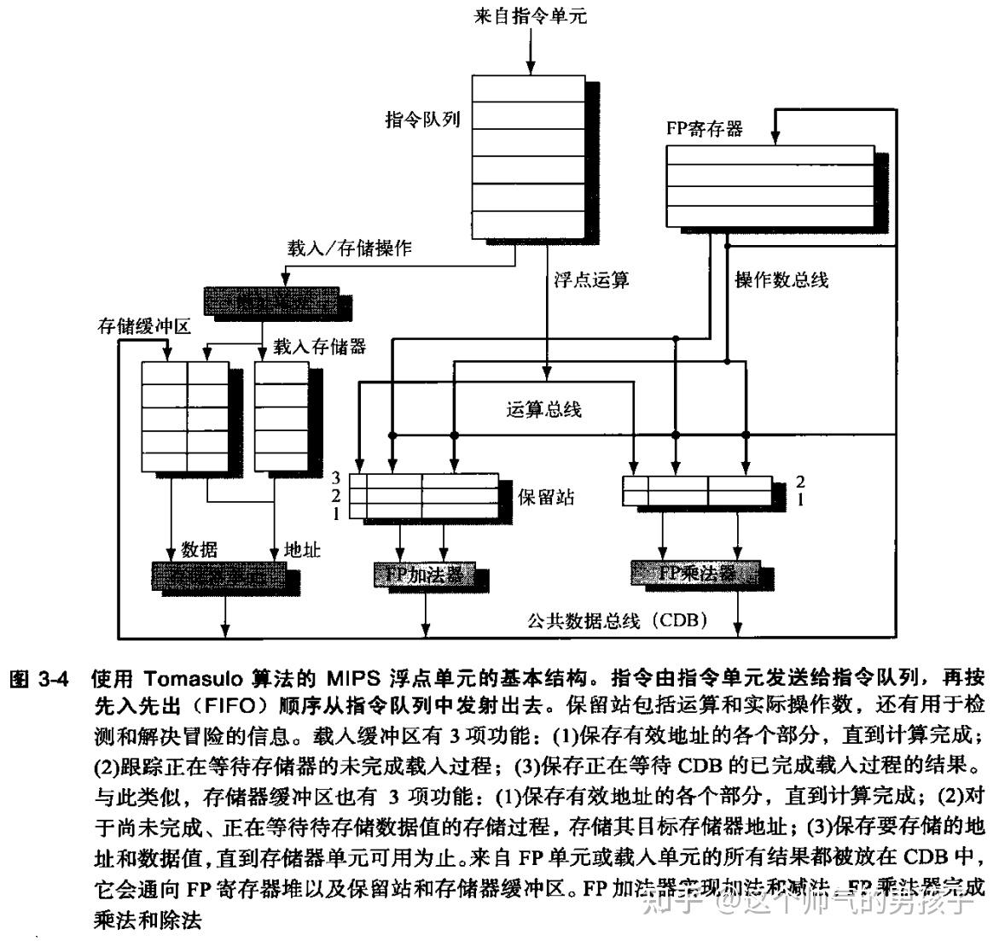

#### **1. Tomasulo算法的执行步骤**

Tomasulo算法在指令各个执行步骤中所进行的操作下表所示：

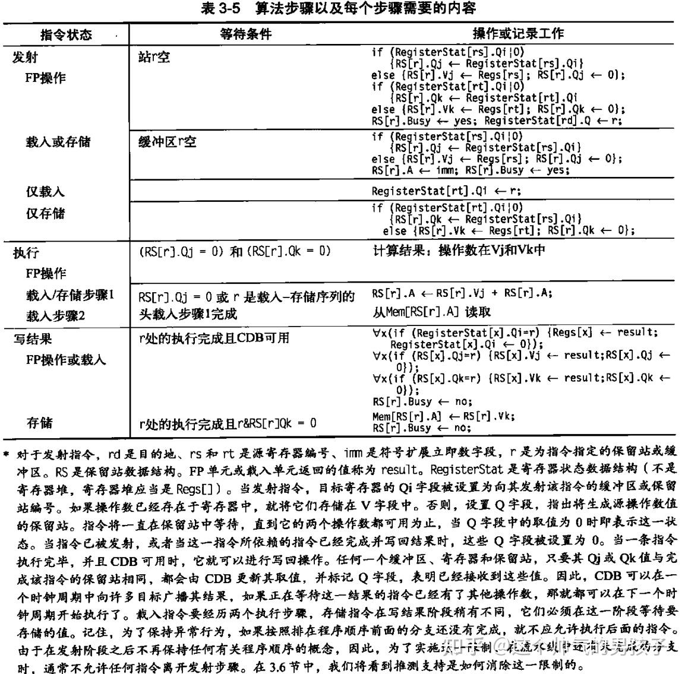

#### **2. Tomasulo算法和硬件推测**

程序中的分支指令会限制流水线的并行水平，因此需要进行分支的预测，并基于预测结果进行动态调度。在这样的情形下处理器就需要具备处理在预测出错情况下撤销后续控制相关指令的能力。

为了实现这一目标，需要对Tomasulo算法进行扩展，即在一条指令具有不确定性的情况下，允许这个指令的执行结果旁路给后续指令进行使用，但是不允许任何指令执行任何不能撤销的更新操作。因此，需要限制指令执行完成之后按序提交；即只有当之前的指令都执行完成后才能消除当前指令的不确定性，同时在当前指令确定要执行的情况下结果才能提交。

为此需要在处理器中增加一个重排序缓冲区(ROB)，用于保存已经执行完成，待提交的指令。

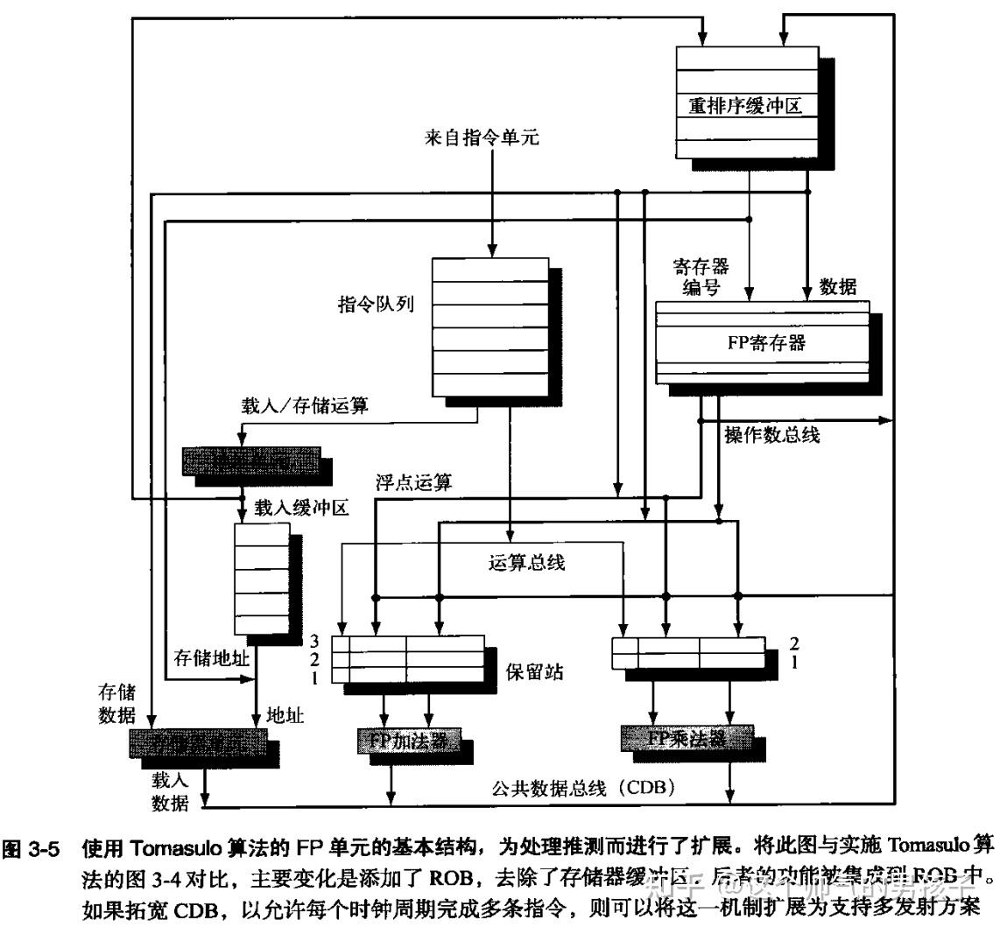

基于该设计，指令执行时涉及以下4个步骤：

步骤操作条件**

【注】基于该硬件结构的处理器，除了能够支持硬件推测外，还能够提供精确异常**

**

#### 3. Tomasulo算法动态流水线示例**

考虑如下一个例子：

i: DIV   **F0**, F1, F2

i+1: MUL  F3, **F0**, F2

i+2: ADD  **F0**, F1, F2

i+3: MUL  F3, **F0**, F2

如上的指令片段，指令i+1依赖指令i的结果；指令i+3依赖指令i+2的结果。但是指令i+2和指令i之间没有依赖关系，两者存在WAW的冒险。

同时需要注意上述DIV指令、MUL指令和ADD指令的执行时长是不一样的，DIV指令的执行时间最长，MUL次之，ADD指令执行时间最短。

**

考虑动态流水线采用的是乱序提交、按序完成**的策略。

如下是动态流水线的初始状态，所有的指令一次进入指令队列进行排队，同时浮点寄存器的值初始化为初始值。此时ROB是空的。

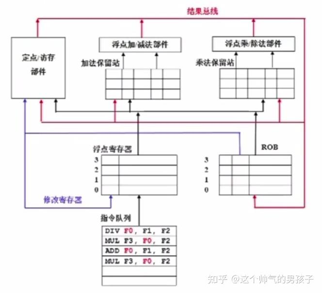

p1：指令i发射，DIV指令被写入乘法保留站(在该位置可以乱序发射执行)；同时在ROB(reorder buffer)中标记指令i的处理结果保存在f0中，此时div计算未完成，所以结果是空的。另外在浮点寄存器中置标记，f0的寄存器最新值在ROB的位置1中(后续的指令如果依赖f0的值都可以从ROB位置1中去取)

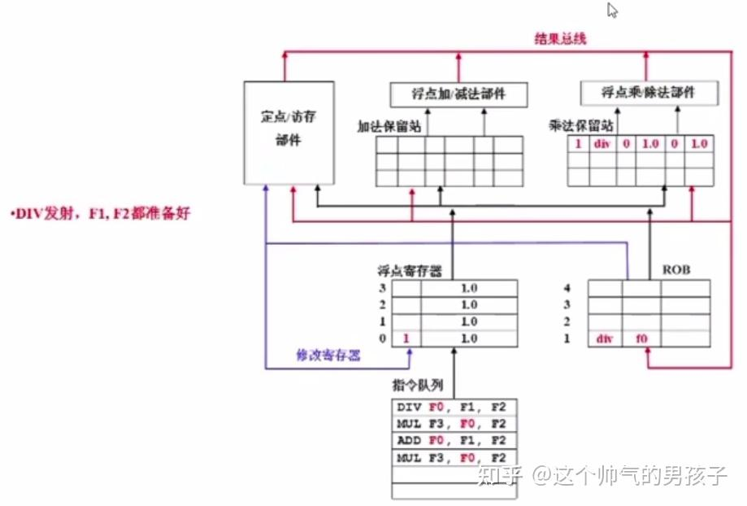

p2：指令i+1发射，该指令还是加入到乘法保留站，需要注意该指令依赖F0的值，所以去查浮点寄存器看到当前f0的最新值在ROB位置1，但是ROB位置1中f0的值还未出结果，所以乘法保留站中指令i+1对应f0的操作数位置置空，并置标记该操作数从ROB位置1获取，指令被挂起，不能执行。指令i+1中ROB和浮点寄存器相关的操作同上。

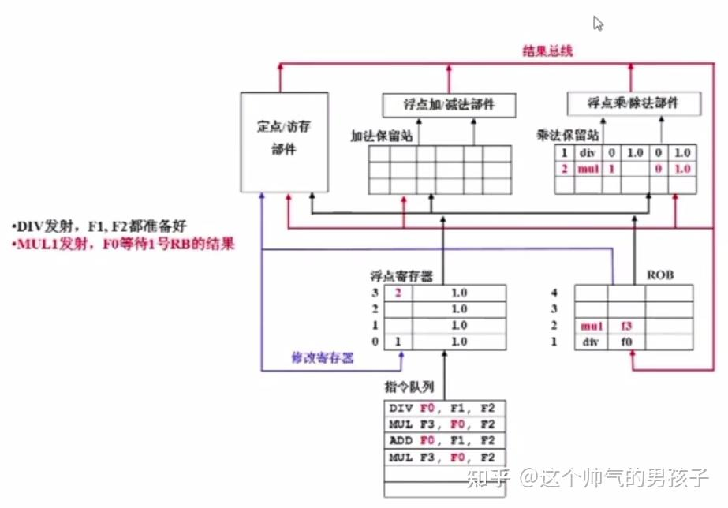

p3：指令i+2发射，add指令被加到加法保留站，同时该指令的操作数都已经具备，可以立即执行；指令的操作结果记入到ROB的位置3；同时结果会对浮点寄存器F0进行刷新，所以浮点寄存器F0位置更新标记3，表示最新结果需要从ROB位置3获取。

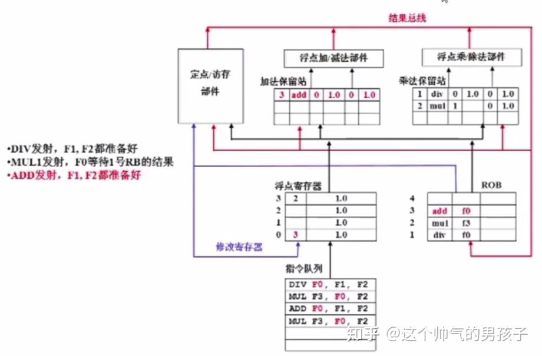

p4：指令i+3发射，添加到乘法保留站中，同时该指令操作数F0未就绪，结果需要从ROB位置3获取，指令置相应的标记，并进行等待。

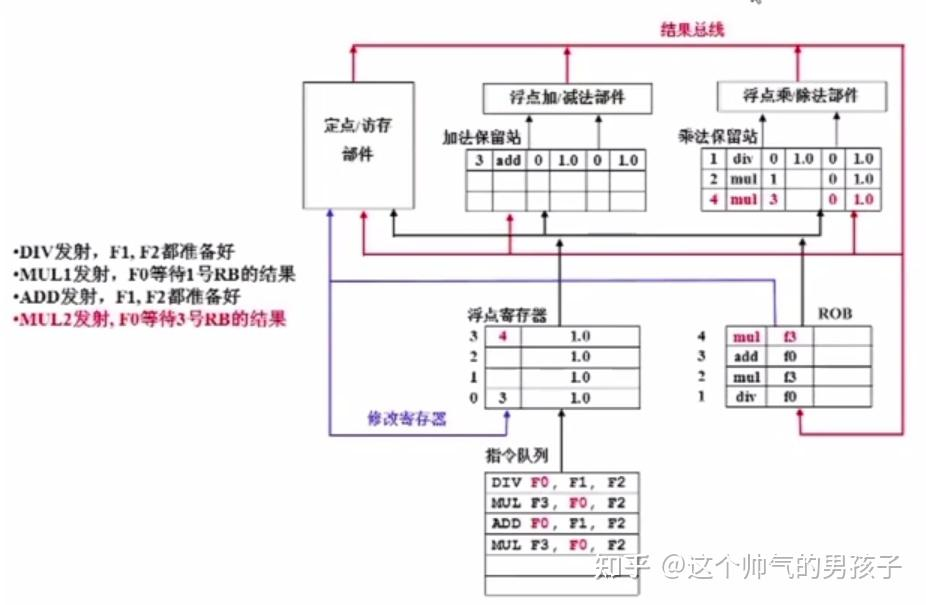

P5：ADD指令的执行速度较快，提前于DIV指令完成，结果写回到ROB中。需要注意此时要保证按序提交，由于指令i还没有完成，所以ADD指令虽然已经执行完，但还是不能提交。对于指令i+3依赖ADD的结果F0，此时就可以直接从ROB中读取F0的结果开始处理。

**注意**：可以看到指令i+3先于指令i+1开始执行，这体现了乱序执行；指令i+2已经完成，但等待指令i，不立即提交，这体现了按序完成。

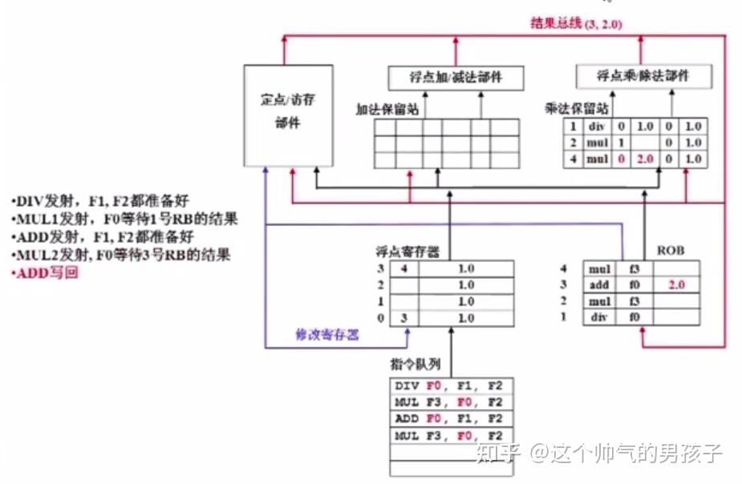

P6：DIV指令终于执行完成了，结果写回到ROB的位置1，此时指令i+1的操作依赖DIV处理的结果F0，此时就可以开始执行了。

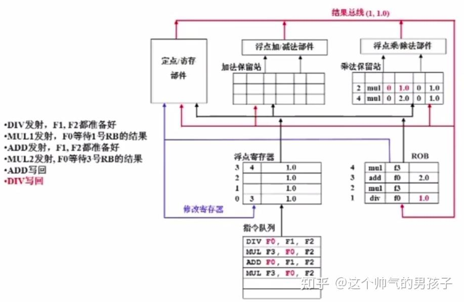

P7：指令i是当前第一条指令，完成了之后就可以立即提交了。但是指令i+2还是不能提交，因为指令i+1还没有完成。指令i+3的MUL操作完成，结果更新到ROB中。

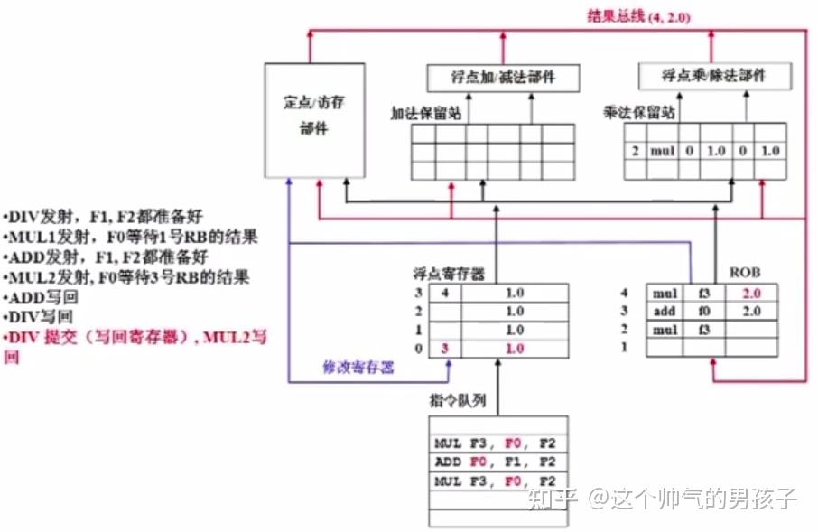

P8：指令i+1的MUL操作也完成了，结果写回到ROB中。

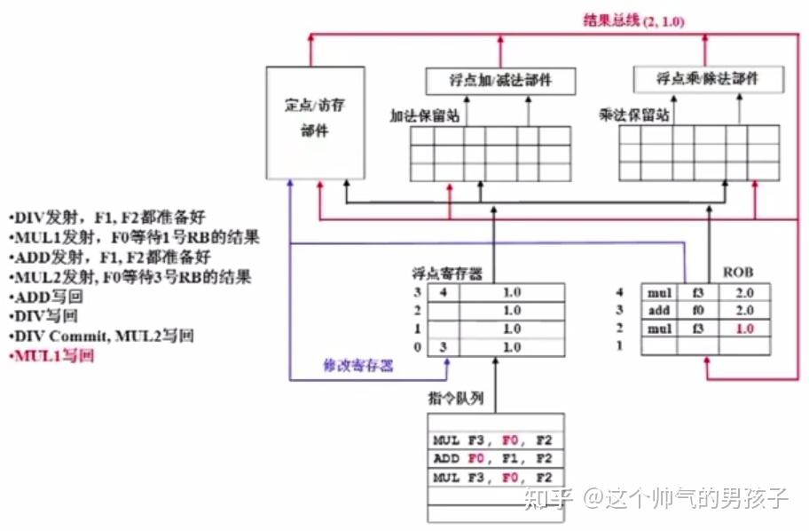

P9：此时指令i+1已结完成，前面没有等的指令了，所以指令i+1的结果提交，同时指令i+2和指令i+3也已经完成，都可以提交了。

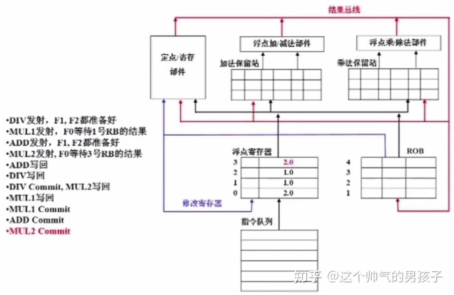
