**大家好，我们是香山开源处理器开发团队。我们将开启一个系列，解读国内外处理器领域的会议及论文，与大家分享处理器领域先进的设计技术和发展方向，共同学习，一起进步。**

**

Hot Chips: **A Symposium on High Performance Chips，开始于 1989 年，是半导体行业领先的高性能微处理器和集成电路领域的顶级会议，也是中国计算机学会推荐国际学术会议中的 B 类会议。最新一届 Hot Chips 会议在 8 月底召开，我们的会议解读系列，也将从此次 Hot Chips 33 启程。

**今天带来 Hot Chip 33 第六个 Session: Machine Learning and Computation Platforms。**在 Session 6 中，Graphcore 的报告介绍了它们新一代的 IPU Colossus Mk2，采用了 TSMC 7nm 的制程；第 2 个报告中，Cerebras Systems 推出了世界上最大的芯片 Cerebras Wafer Scale Engine 用于 AI 加速，它拥有 2.6 万亿个晶体管、40GB 片上内存、20PB/s 的内存带宽，令人印象深刻；第 3 个报告中，SambaNova 的第一代 RDU，能够实现分等级的并行数据流处理，结合 SambaFlow 环境实现灵活的数据流加速；最后一个报告中，D.E. Shaw Research 相隔八年推出了 Anton 3，在 ASIC 加速分子动力学模拟的方向上更进一步，速度达到 GPU 的 20 倍。

### **GraphCore Colossus Mk2 IPU**

**作者：Simon Knowles，CTO of Graphcore**

**分享人：周意可，南京大学计算机软件研究所博士一年级学生**

Graphcore 是英国的一家半导体公司，致力于为AI和机器学习开发加速器。Colossus 是为 AI computing 设计的一款处理器核，它借鉴了 GPU 和 TPU 中的一些设计思路。标题中 IPU 表示 Intelligent Processor。

**IPU Foundations**

设计 IPU 的原因可以总结为以下几点：

- 加速 AI 领域对新算法的探索
- "super-human" 级别的 AI 需要 Tera 规模的模型
- 稀疏计算（sparse evaluation）需求
- 处理复杂的数据
- 缩短存储和运算逻辑的距离
- 在多个芯片上并行计算

#### **IPU Software Abstractions**

下图中包含 tensor 和 compute 两类节点，其中 tensor 节点用来存储数据，compute 用于计算。这是一个二分图，并且可以存在环路。图中省略了输入输出的 IO pipe。

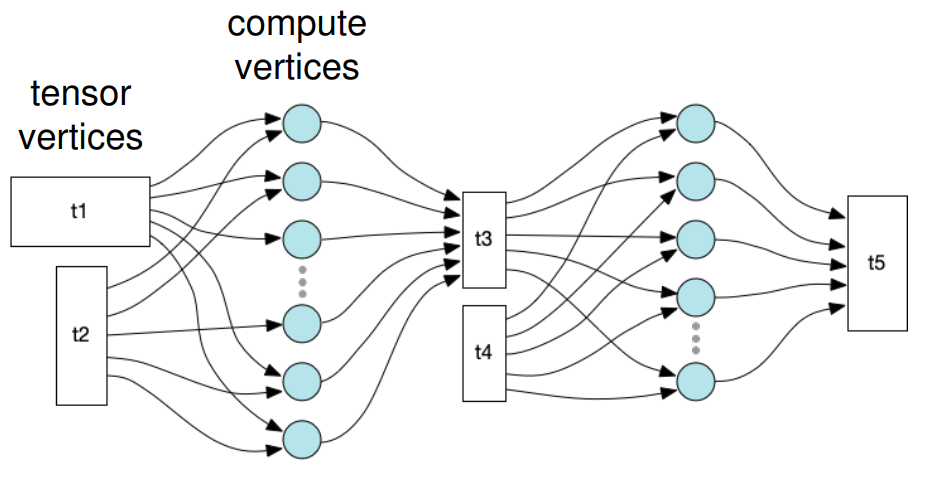

可以在称为 atomic codelets 的库上定义每个节点进行的运算，存在一个 control program 控制节点上计算的执行，如果图中存在环路，则一个节点上的计算可能需要执行多次，直到结果收敛。另外，和 GPU 类似，也存在一个 host program 可以控制 IO pipe。

#### IPU Hardware Abstractions

图中有若干个 Tile，每个里面都包括 memory 和一个 multi-threaded processor。这些 tile 通过一个多对多（all-to-all），并且无状态的 exchange 进行交流。上文中的 codelet 可以原子地被一个 tile 上的 thread 执行，一个 tile 可以并行执行多个 codelet。tensor 节点可能分布于多个 tile 上的 private memory 中，也可能在 off-chip memory 里。

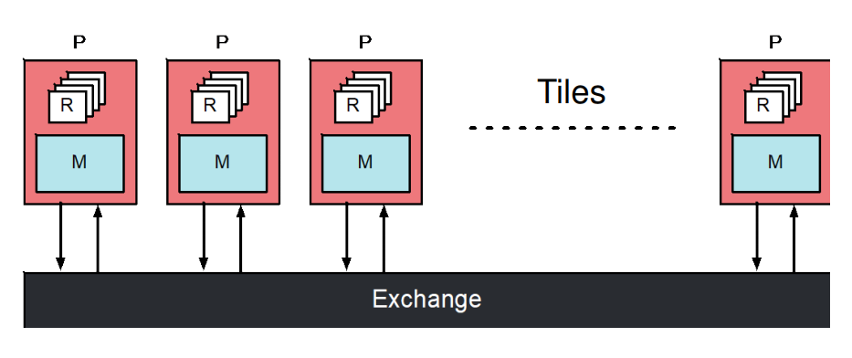

这些 tile 独立地执行（local compute），使用 exchange 进行同步（global communication），比如等待其它 tile 执行，交换数据等。

#### **Lessons from Colossus Mk1**

相比 Mk1，Mk2 采用了 TSMC 7nm 制程，processor tiles 的数目、SRAM 的大小都有所提升。计算能力（flop/s）大大增强。7nm 工艺允许使用更多的 process logic 和 memory。

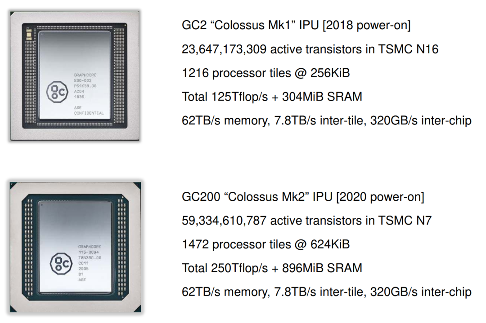

Colossus Mk1 项目中获得的经验：

- 最初计划实现一个小核，但最后放了更多的 features，例如 sparse tensor arithmetic
- 提高并行度需要根据硬件的特性，针对不同的 AI 算法进行调整
- 对于不同的客户，因为 CPU 的不同，它们对 IPU 加速比的要求是不同的

#### **Structural Headlines**

下图为 IPU/GPU/TPU 的对比。

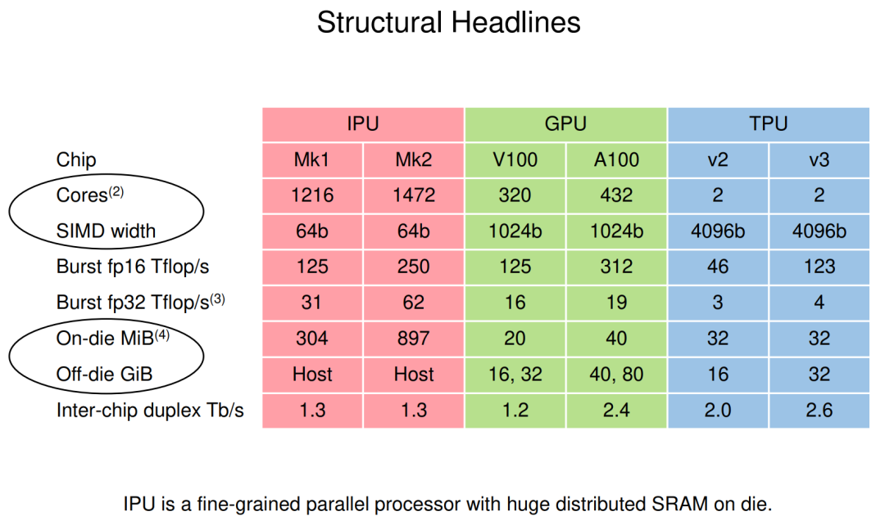

IPU 主要有两个特点：

- parallel cores 很多，粒度更细，适用于 sparse evaluation;
- IPU 的 memory system 使用的是 large on-chip SRAM，避免和 off-die DRAM 进行数据交换，IPU 在大的模型上也会用到 DRAM，下文会提到。
下图分析了 tile、exchange 等结构在 die 上的位置和面积。Tile 的面积大约占 die 的四分之三，exchange 则占 11%。其中一半的 die 上是 memory。芯片运行频率为 1.325 GHz，die 上的所有 tile 中，每 23 个 tile 对应一个冗余的 tile，以提供高可修复性，从而提高良品率。

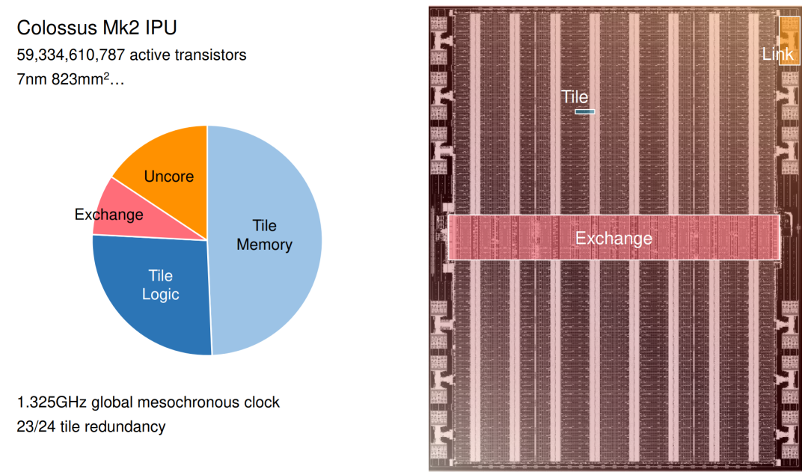

**

#### Tile Processor , N+1 barrel threading**

下面分析一个 tile 里的 processor 设计。

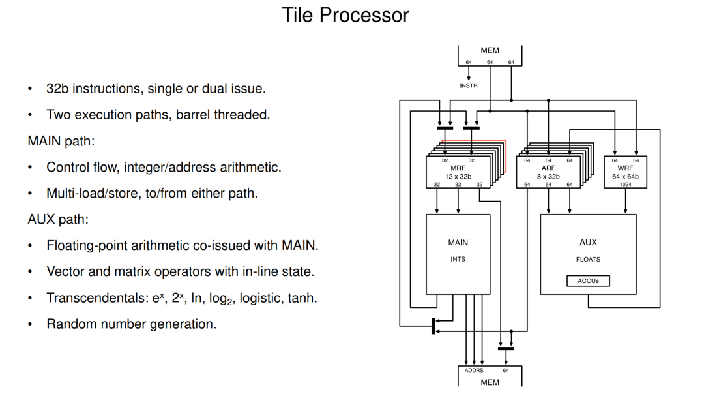

- 处理器支持 32-bit 指令，单发射或双发射。有两条不同的指令执行路径，图中左边的一条处理控制流、地址和整数指令；右边则处理浮点指令
- 两条执行路径均为 barrel threaded，即 cpu 每周期切换执行不同的线程（参考 wiki: Barrel processor），Colossus Mk2 中的 barrel 包含 6 个 slots
- 两条 path 各有一个 register file (MRF/ARF)，此外还有一个共享数据的 register file (WRF)
**

下面一张 slide 中介绍了 Supervisor 和 Worker program，其中 Supervisor program 负责向 worker 分发任务

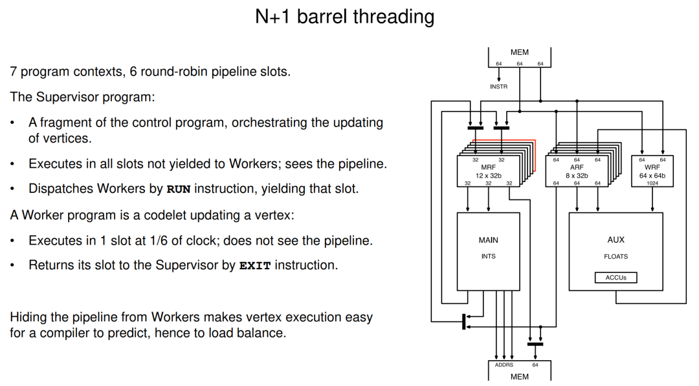

- 在并发执行的 7 个程序上下文中，一个是 Supervisor，其它是 workload，每个 thread 运行一个 codelet
- memory access / branch / big float point 操作都需要一个周期来执行
- 使用 codelet 抽象可以并行执行的最小单元，并使用 barrel thread 在 core 中并行执行线程，都提高了处理器并行执行任务的能力，同时编译器也可以更好地识别可并行执行的代码并进行优化。
在报告后半部分中，作者对 Colossus Mk2 的访存、矩阵计算、随机数生成和并行执行程序的特点进行了分析，并评估了 Mk2 的能耗，比较了 IPU/GPU/TPU 三种 processor 的能效比。

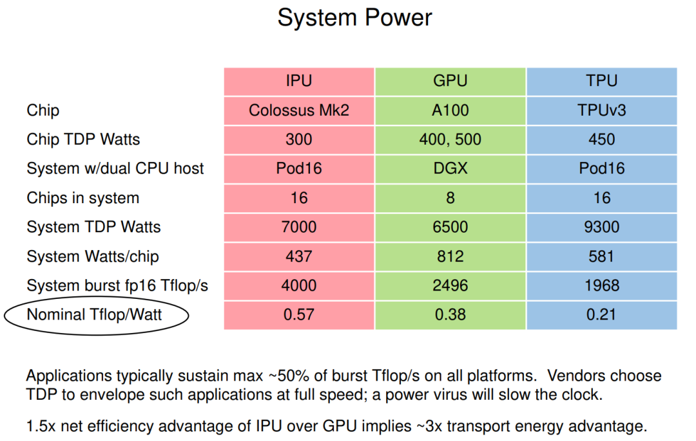

#### Why no HBM?**

最后一部分对 IPU 的存储设计进行了分析。HBM 是 High Bandwidth DRAM 的缩写，在 Colossus Mk2 中，使用了大容量的 SRAM，和小部分的 low bandwidth remote DRAM。实际上，memory capacity 决定了能放下多大的模型，bandwidth 只是影响了速度。

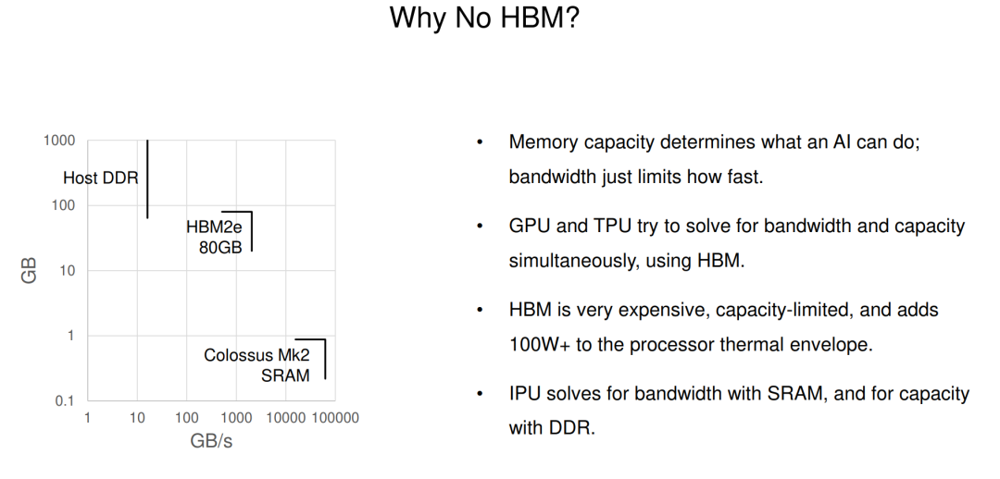

第二张 slide 对面积进行了分析，为达到相同的容量，HBM 需要的面积也高于 DDR4 SRAM，右下角的表格比较了二者的面积。

**

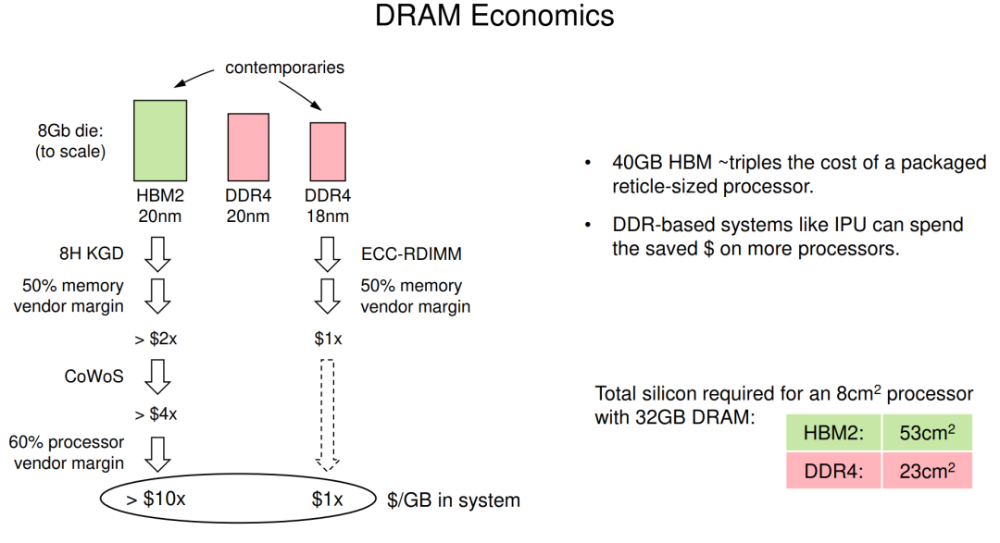

三种模型中，只有大的模型需要在 off-chip ram 上存储数据。

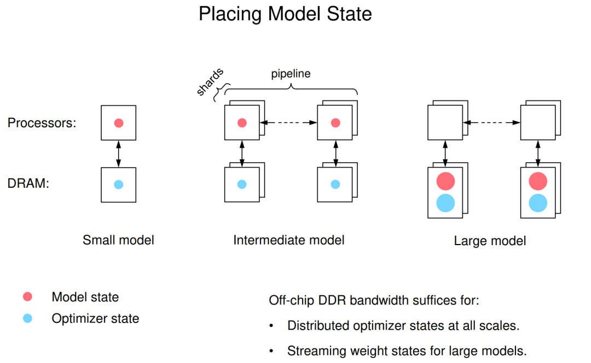

片上 SRAM 的扩大降低了对 DRAM 带宽的需求。右图可以看出 GPU 的情况是 SRAM 较小而 DRAM 带宽大于 IPU。

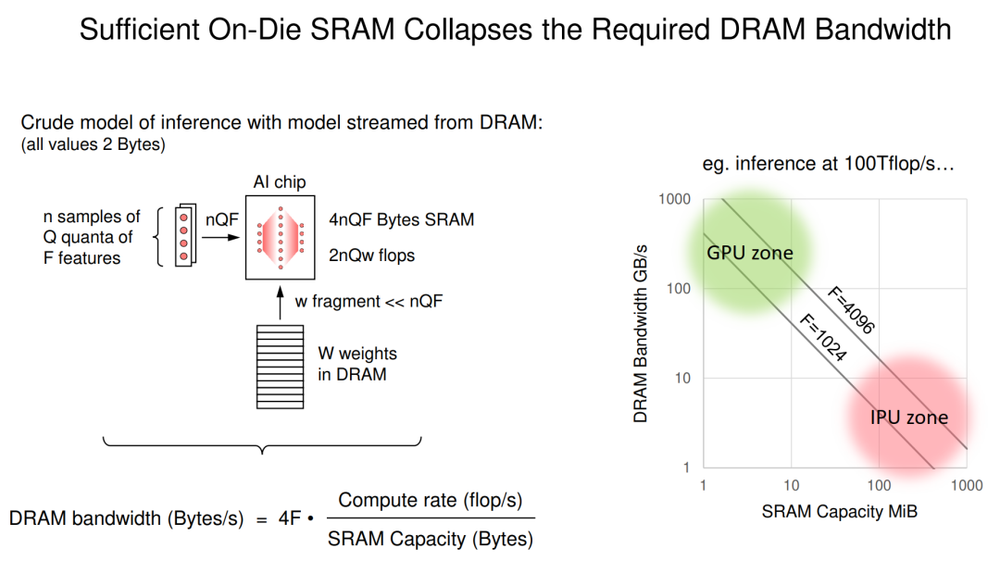

#### Key Take-Aways**

- Colossus 实现了一种新的 AI 处理器架构 —— IPU
- IPU 缩小了数据传输需要的能耗，在功率一定的情况下，可以在 die 上放置更多的 processor
- IPU 缩小了 AI 模型需要的存储空间
- IPU 具有高度的并行性
**

### The Multi-Million Core, Multi-Wafer AI Cluster**

**作者：Sean Lie, Cerebras Systems**

**分享人：张紫飞，中科院计算所博士二年级学生**

Cerebras Systems 是一家成立于2016年的专注于AI加速的美国公司，Cerebras Systems 提供的 AI 加速解决方案 "the Cerebras Wafer Scale Engine"，是世界上最大的芯片。

#### **背景**

在过去几年，深度学习推动了跨行业的人工智能突破，从消费技术到医疗保健，再到制造业。深度学习拥有着庞大的，不断增长的计算需求，但是传统的图形处理单元无法很好的适用于深度学习。因此，如今的人工智能不再受到应用程序和想法的限制，神经网络模型大小不断增加，参数的增加需要更多的内存，更多的算力和更多的 IO 带宽，但是模型的训练会受到计算能力的限制。测试一个新假设，训练一个新模型，可能需要数天、数周甚至数月的时间，这成为创新的主要障碍。

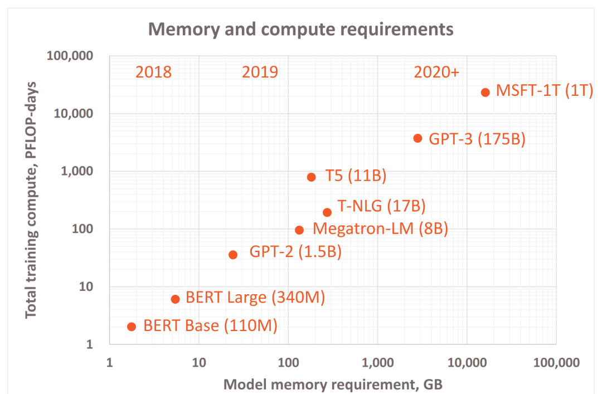

#### **WSE-2**

特殊的应用需要专用的加速器。Cerebras Systems 推出了专用于深度学习计算的处理器 Cerebras Wafer Scale Engine，并已经推出第二代。WSE-2是目前为止最大的芯片，具有46,222平方毫米，包含超过2.6万亿的晶体管，拥有850,000个 AI 核心，拥有 40GB 的片上内存，拥有20PB每秒的内存带宽，和220Pb每秒的总线带宽，并采用台积电 7nm 工艺。直观感受一下 46,222 平方毫米的芯片的大小：

神经网络模型参数数量呈指数趋势增加，因此需要更多的内存，计算和通信带宽，所以需要将模型分到多个设备上，但是内存，计算和通信的又会相互影响，因此划分的复杂度会随着设备数量的增加而急剧增加。WSE-2 采用 Weight Streaming 模型，可以大幅提高模型的可扩展性，MemoryX 系统可以容纳120万亿的参数模型，利用 SwarmX 互联技术，即使是192台机器，仍然拥有近乎线性的性能增长。

#### **执行模型**

针对大规模神经网络的权重流执行模型 (weight streaming execution model)，将权重流存储在片外，并流水地送到片上的计算层 (compute layer)，一次可以计算一层。同时可以将权重优化的部分进行解耦合，导数从片上流出片外，将权重更新的部分放到 Memory X。

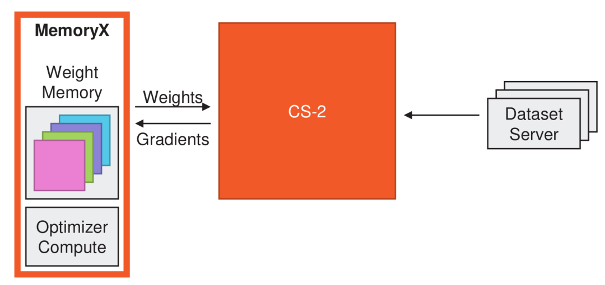

将一部分放到片外，会带来延迟问题，为了解决这个问题，一方面在扩展模型时，就需要将延迟敏感的交流消除掉。另一方面，需要小心设计粗粒度层面和细粒度层面的流水线作业，消除依赖。

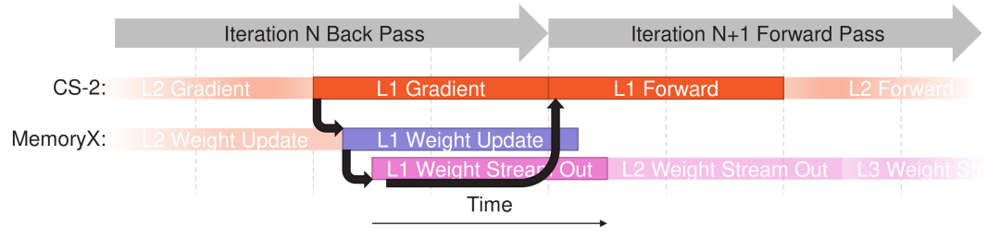

#### **容量扩展性**

为了实现模型的高可扩展性，需要解决两个关键问题，如何存储巨大的模型，以及如果将模型放到芯片上进行运算。

在片外，采用了 Memory X 技术，能够做到高可扩展性，从4TB到2.4PB，可以存储200B到120T的权重数量，实现 DRAM 和 Flush 混合存储，并且可以进行内部计算，实现权重更新和优化，以及采用优化后的流水线作业来隐藏延迟。MemoryX 技术可以做到高可扩展性，并且将存储和计算分离。

在片上，WSE 被设计呈矩阵乘阵列的形式，具有巨大容量的本地内存可以存储所有的激活信息；以及拥有巨大的计算阵列，可以接收权重流并进行计算，并且不需要临时存储激活信息和权重数据；拥有很高的访存带宽来满足计算需求；同时拥有很高的互联带宽，满足多个 wafer 之间的累加等操作的需求；矩阵乘可以做到 100K*100K，并且将矩阵乘切分到多个设备上计算也没有任何开销。

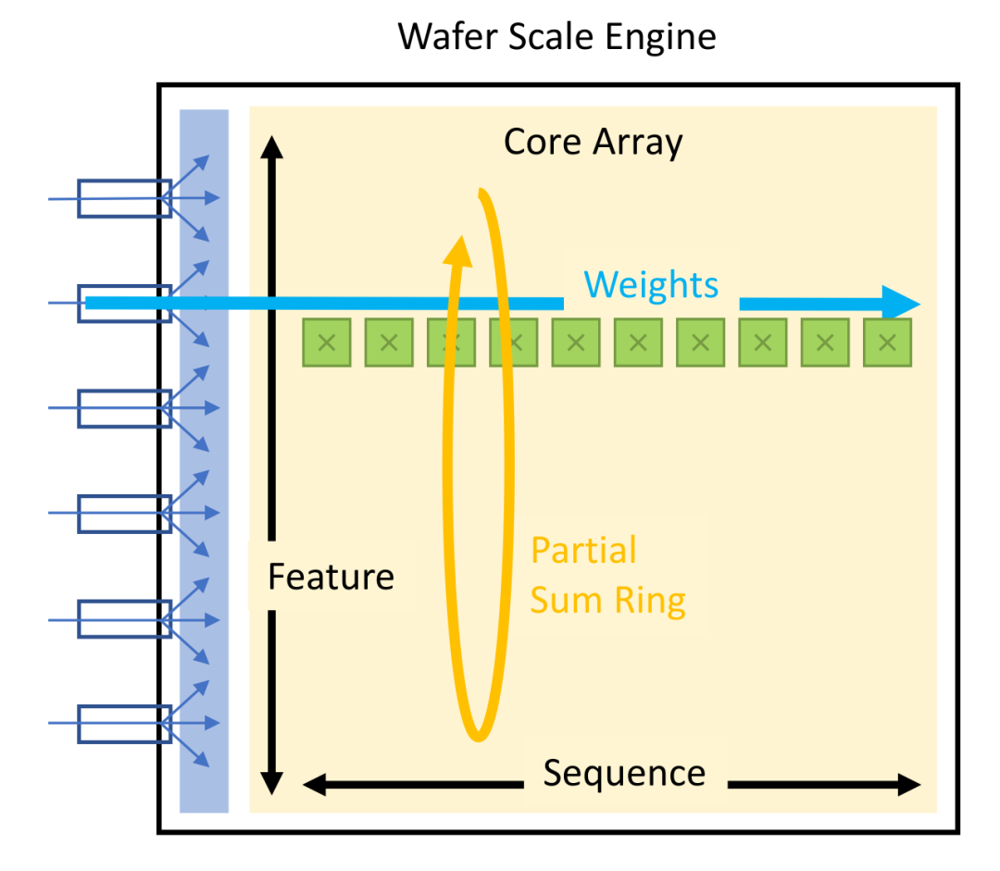

#### **计算扩展性**

采用 SwarmX Fabric 技术互联多个 WSE-2 设备，权重可以从 MemoryX 系统广播给 WSE-2，WSE-2 的梯度结果可以集中到 MemoryX 系统。这种互联方式可以扩展到极大的模型，并且使计算的扩展性和容量分离，使计算性能随计算单元数量增加呈近似线性增长。

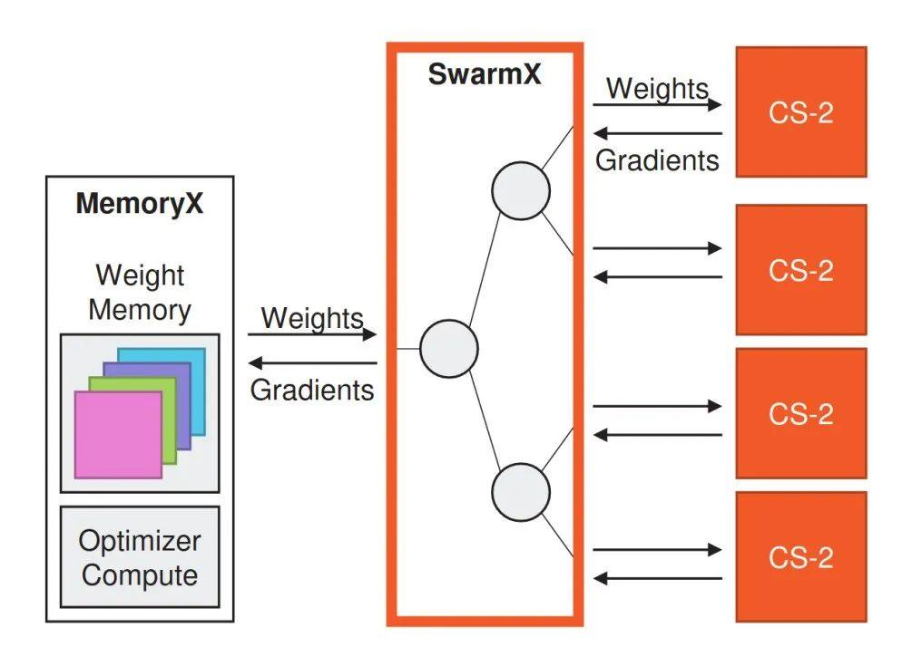

#### **稀疏计算**

暴力的增加扩展性仍然是不够的，需要通过减少计算量的方式加快计算。Cerebras 结构为稀疏计算做了专门优化，因此细粒度计算，如只计算非零值等，稀疏计算可以更好的利用访存带宽和互联带宽等等。稀疏计算不影响原有的结构，可以复用原有的流程。

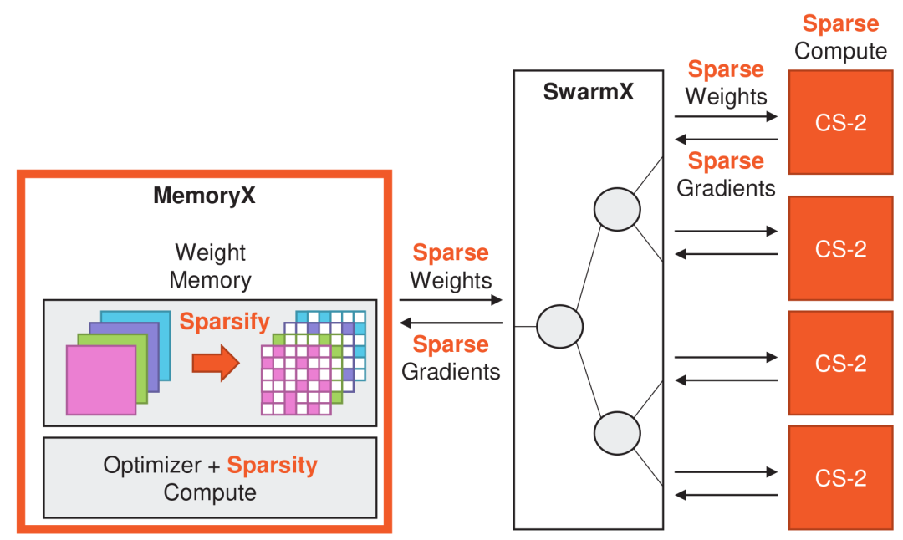

#### **总结**

深度学习加速器相对于传统的图形计算单元，具有更加专用，也更加激进的设计。Cerebras Systems 的 WSE-2 产品，在关键的计算，存储和扩展性方面都有激进十足的优化，尤其是超大面积的芯片，令人印象深刻。

### **SambaNova SN10 RDU: Accelerating Software 2.0 with Dataflow**

**作者：Raghu Prabhakar and Sumti Jairath, SambaNova Systems, Inc**

**分享人：张林隽，中科院计算所硕士二年级学生**

该报告介绍了 SambaNova 的第一代可重组数据流单元（RDU）SN10。该RDU采用了 7nm TSMC 工艺，40B晶体管；640个模式计算单元，>300 BF16 TFLOPS，且支持FP32、Int32、Int16、Int8数据类型；640个模式访存单元，大于300MB的片上存储，150TB/s的片上访存带宽。

#### **SambaFlow Software**

SambaFlow 一套用于数据流加速的软件环境，它通过 PyTorch、TensorFlow 等的数据流图，得到 Communication Pattern，再通过 SambaFlow 空间编译，得到一个高度优化的数据流图。

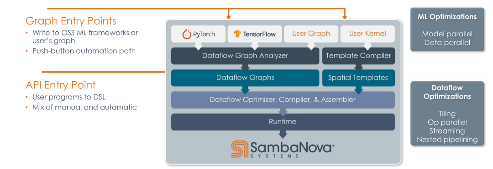

如今机器学习进入了软件2.0的时代，在对准确率有了越来越高的要求以外，训练数据集的大小和模型复杂度也都大大提高：程序输入从代码变成了训练数据，过去的机器学习的解体现在算法上，而软件2.0的时代 ML 的解体现在训练的权重参数上，同时计算模型从确定性向概率模型发展，解从唯一解演变成从大数据的角度上所有正确的解。在软件2.0时代，数据流会充分利用数据的局部性，开发其并行性，在空间和时间上灵活地调度以更好地利用数据，而且需要灵活的访存系统和接口来维持高速的计算吞吐量。

#### **Cardinal SN10**

SN10中包含4个 TILE，每个 TILE 是一系列可编程计算和存储部件，通过可编程互联的方式连接起来。通过虚存管理，这些 TILE 可以和彼此毗邻的TILE 相结合形成一个逻辑上更大的 TILE 来运行某一个应用，也可以每个 TILE 彼此之间独立，分别运行不用的程序。存储系统包括几TB的DDR4片外存储，对主存的内存映射访问，以及 scale-out 支持。

- SN10中的每个 TILE 是软件驱动架构，包括可重组的 SIMD 流水线，分布式的便笺式存储器，以及可编程开关。
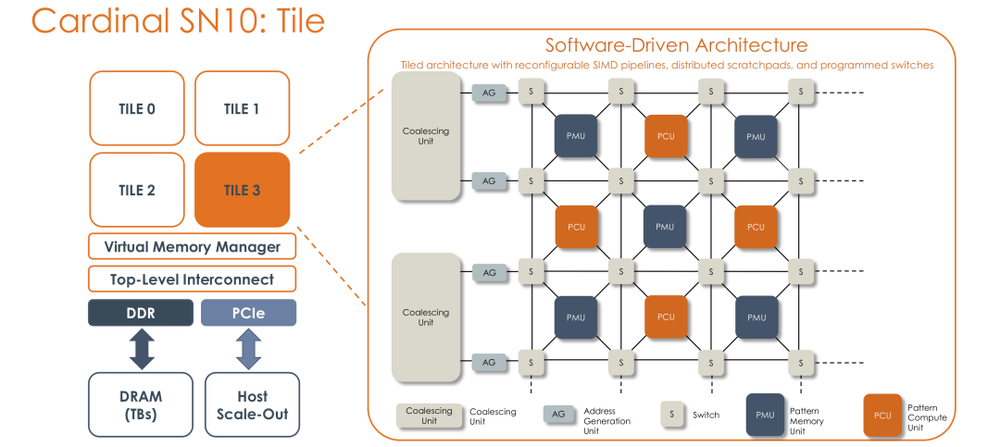

- 上图中的模式计算单元（PCU）是SN10的计算引擎。PMU 提供了可重组的 SIMD 数据通路和可编程计数器来有效地变成循环迭代器，最后有一层 Tail Unit 加速 exp 或 sigmoid 等常用函数。**
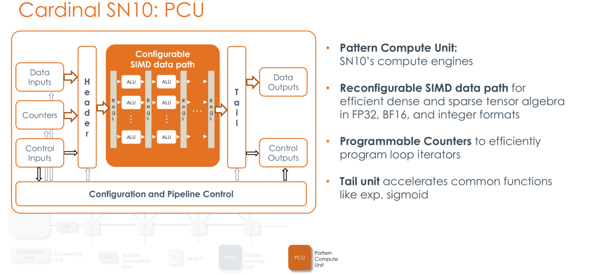

- 模式访存单元（PMU）是SN10的片上存储系统，分体的 SRAM 阵列提供了多个高带宽 SIMD 数据流并发地进行读写，地址 ALU 单元为任意复杂的访存模式提供高吞吐量的地址计算能力，数据对齐单元提供了高吞吐的向量排列转换（如矩阵转置等）。

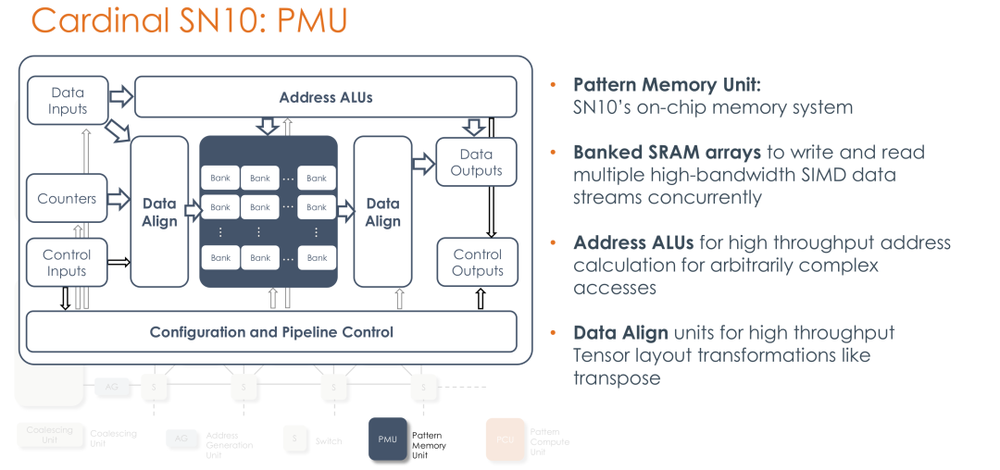

这里介绍了 Softmax 函数和 LayNorm 函数在SN10上的结构，以 Softmax 为例（如下图所示），该电路将向量 x 通过 exp 函数映射得到向量 m，再通过一层加法归约得到 r，m 的每一项除以 r（即 m 和 r zip 并作除法操作）输出结构向量。

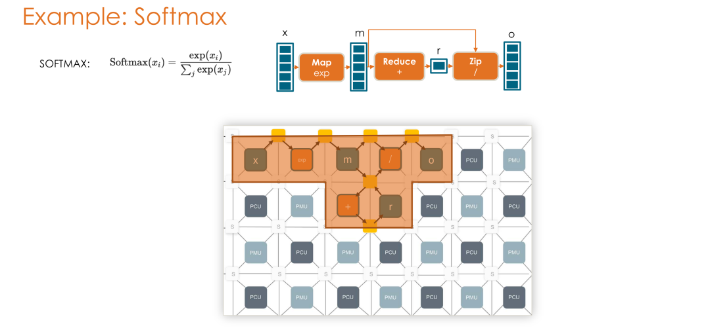

这种从空间上实现数据流模型的架构能够实现分等级的并行数据流处理，TB 量级的计算模型，灵活的批处理，灵活的数据并行的映射，机器学习训练内部循环中的 SQL 数据处理等等。SambaNova 系统支持很多场景，包括高性能混合型工作负载，并发应用程序，安全的多个虚拟机环境，编译器驱动应用程序成倍增加等等。例如，该系统可以在不做代码修改的情况下训练大型语言训练模型、训练4K到50K的卷积网络，适用于病理学分析中的高分辨率完整图像的处理，且在高分辨率卷积训练中实现准确率90.23%的世界纪录。SambaNova 系统能够AI加速各种科学计算，如 DFT、有限差分法、分子能量模型等。

### The Anton 3 ASIC: a Fire-Breathing Monster for Molecular Dynamics Simulations**

**作者：J. Adam Butts, D.E. Shaw Research**

**分享人：张发旺，深圳大学硕士三年级学生**

        该报告介绍了用于分子动力学模拟的第三代 Anton 计算机，其各项参数均相比上一代有着质的飞跃：采用了新的 TSMC 7nm制程，其频率由 1.3GHz 提升到 2.8GHz、核数由 66 提升到 528，模拟性能达到 GPU 的 20 倍、CPU 的 100 倍。

#### **计算背景**

现有大部分学术研究是用的生物分子结构基本都是静态的快照，而作者团队将其分子动力学建模进行模拟。建模的基础数据包括模拟过程中每个原子的位置，通过牛顿运动定律的数值积分来计算这些原子的演化位置，根据描述原子间能势的基于物理学的模型计算数千到数百万个原子之间的力。这些力在短短几飞秒的离散时间步长上积分，以确定原子的新位置和速度，这个过程重复了数十亿次，以在一定区域的时间尺度上生成轨迹。这样的模型模拟需要很大的计算量。为了使这项技术可用于高通量科学工作，他们引入 Anton 计算机。

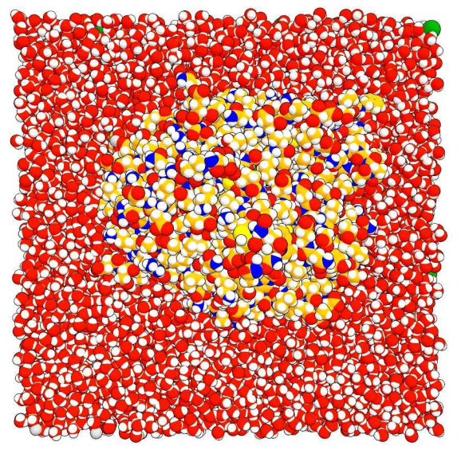

#### **Anton 3 的提升**

Anton 2 由两部分组成 Flex Tile 和 HTIS。其中 Flex Tile 类似一个典型的多核处理器，有四个内核，一个分派单元，私有 Cache 连接共享内存，网络接口连接芯片其他 Flex Tile。HTIS中成对的 PPIM 计算相互作用的原子对的数据。

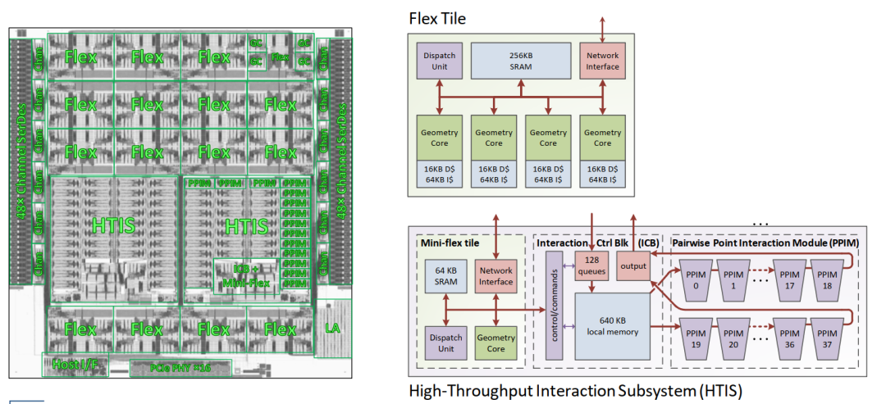

基于 Anton 2，作者提出 Anton 四个提升性能的方向：

- 提高计算吞吐量
- 解决算力瓶颈
- 支持更大规模的模拟，简化编程和增加灵活性
- 控制设计和实现的复杂性

#### **Core Tile改进**

对比 Anton2 的 tile, Anton3 的计算核心的改进如下：

- PPIM 支持更广泛的力场
- 内存容量增加一倍
- 添加新指令
- 支持 GC 和 PPIM 的双向通信
- 引入新的计算通道解决瓶颈   
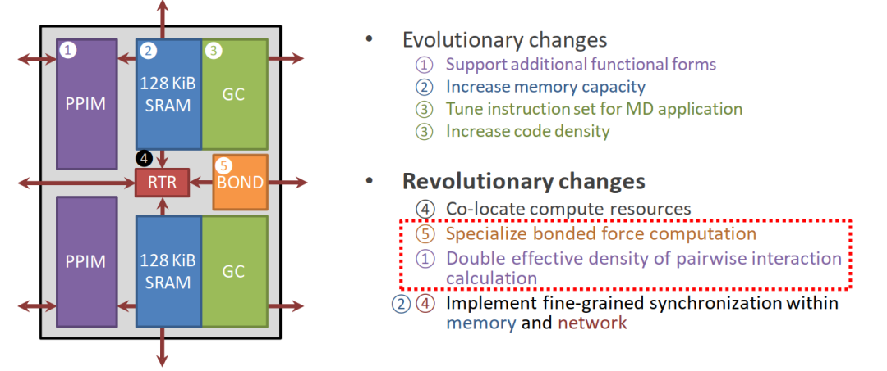

#### **性能数据**

对比 Anton 2，三代增加很多 cores 和 PPIMs，频率提升到2.8Hz，通道带宽增加一倍，晶体管数量增加了近 16 倍，得益于 7nm 工艺，功耗不足二代的两倍。

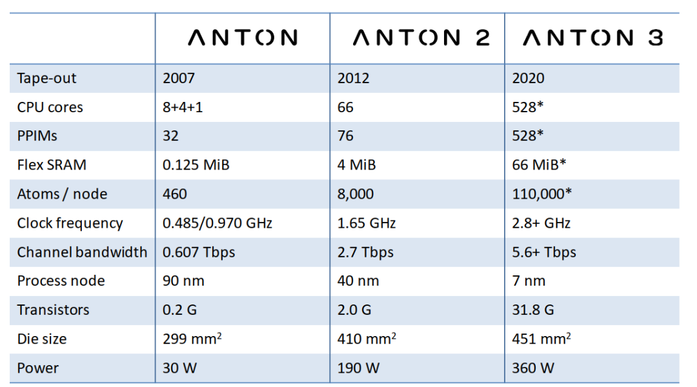

#### **实际性能对比**

作者利用 NVIDIA A-100 GPU 和超级计算机进行对比，Anton 3的速度大约是 GPU 的20倍，对比 CPU 提升超过100倍。

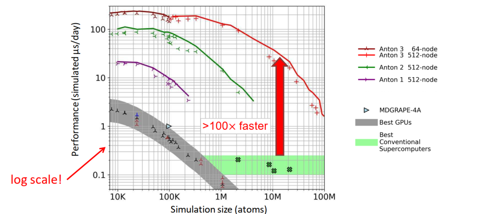

**心得：**对于专用领域计算，针对其计算特性，设计专用计算架构对比通用计算架构有非常大的速度提升效果。

编辑：勾凌睿
