之前的文章介绍了[存储](https://zhuanlan.zhihu.com/p/371356194)**与**[系统](https://zhuanlan.zhihu.com/p/371379581)方向的优秀研究团队，不少小伙伴私信说能不能介绍下体系结构领域的相关团队，因此本文对体系结构领域的团队进行整理(限于对体系结构方向了解的不多，就抛砖引玉一下，欢迎大家补充）。

众所周知，体系结构领域主要有四大顶会：**ISCA、MICRO、HPCA**和**ASPLOS**，其中ASPLOS全称为Architectural Support for** Programming Languages **and **Operating Systems**，从名字也可以看出，它与编程语言与系统也十分相关，属于交叉类的会议，所以很多系统领域研究者也在上面发表了大量的文章。本文根据研究团队在四大顶会上发表的文章为主要参考依据对相关的团队进行介绍，一些大牛虽然发表的顶会数量不多，但是影响力深远，也会做下简单介绍。另外也有一些团队已经介绍过，也不再介绍，比如国内IPADS团队里的夏虞斌老师、清华大学高性能计算研究所的武永卫、陈文光等老师也做了很多体系结构相关的工作，并在四大体系结构顶会上有多篇文章发表。

注：一些顶级实验室的大佬众多，本文只会选择一个代表人物进行介绍，文中一般给出实验室的主页，想具体了解的可以进去看一下。

#### 国外

- **David A. Patterson团队**
**来自UC Berkeley和google**，研究方向主要包括微架构、指令集设计等，他的团队开发了RISC、RAID、RISC-V等一系列重要技术。David A. Patterson大神本人是影响深远的《计算机体系结构:量化研究方法》的主要作者之一，也是图灵奖获得者。除此之外，目前广为人知的开源指令集RISC-V也是在他的指导下开发的，他近年来也是致力于RISC-V的推广。David A. Patterson在16年伯克利退休之后加入google，参与了TPU等的开发工作。其团队也在ISCA/MICRO等顶会上发表了很多文章。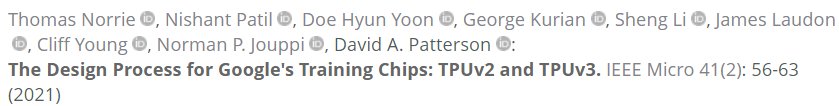

- **John Hennessy团队**
**来自Stanford University和google**，研究方向主要包括微架构等，在Stanford期间**，他**的团队在RISC的基础上开发了著名的MIPS架构。John Hennessy和**David A. Patterson**一样，也是体系结构巨著《计算机体系结构:量化研究方法》的主要作者以及图灵奖获得者，两者共同推进了RISC指令集的广泛应用。John Hennessy是Stanford University的前校长，被称为硅谷教父。16年从Stanford University离职，目前在google母公司担任董事会主席。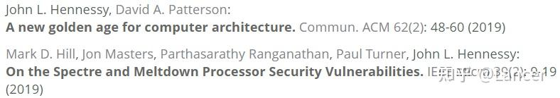

- **Yale N. Patt团队**
**来自University of Texas at Austin**，主要研究方向为高性能处理器，包括指令级并行、乱序设计等，著有经典教材《计算机系统概论》。Yale N. Patt是体系结构的大牛，HPS Research Group的负责人，它也是存储篇提到的大牛GREG GANGER的导师。本人在四大顶会上署名的文章将近100篇，老爷子目前好像还在带学生。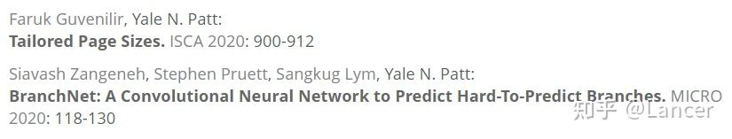

- **Onur Mutlu团队**
**来自ETH Zurich和CMU**，研究方向为内存系统等体系结构的各个领域，他是SAFARI Research Group的负责人，博士就读于University of Texas at Austin，是**Yale N. Patt**的phd。他的团队在四大顶会上发表了大量的文章，应该是在顶会上署名最多的人，超过100篇。目前极为活跃，开展了很多体系结构相关的讲座。近期发表的文章，比如下面在ASPLOS21上署名的3篇文章，另外还有ISCA20的4篇，HPCA21的2篇以及MICRO20的4篇等。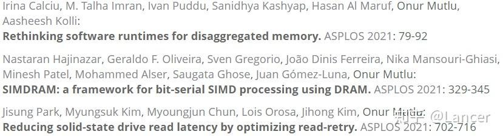

- **Wen-Mei Hwu团队**
**来自UIUC和NVDIA**，主要研究方向为微架构、编译器、异构并行计算等，是IMPACT组的负责人，博士毕业于UC Berkeley，老板是Yale Patt（Yale Patt在1979–1988年期间任职于UC Berkeley，之后去了University of Michigan，目前在University of Texas at Austin）。**Wen-Mei Hwu**团队与NVIDIA合作紧密，是NVIDIA的Senior Distinguished Research Scientist，目前应该是全职加入NVDIA了。Wen-Mei Hwu和NVIDIA首席科学家David Kirk（CUDA创始人之一）著有畅销书《大规模并行处理器编程实战》。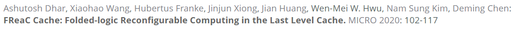

- **Scott Mahlke团队**
**来自University of Michigan**，主要研究方向为编译器、专用处理器、加速器等，是Compilers Creating Custom Processors组的负责人，博士就读于UIUC，是**Wen-Mei Hwu**的phd。其所在团队在MICRO等会议上拿到过多次Best Paper。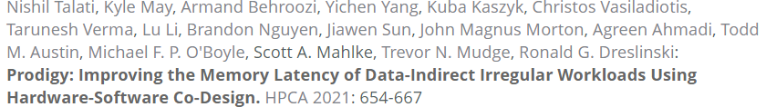

- **Trevor Mudge团队**
**来自University of Michigan**，研究方向主要为计算机体系结构设计、并行处理、计算机辅助设计等，博士毕业于UIUC。目前在四大顶会上署名的文章超过60篇，其中包括HPCA2021的Best Paper。与Scott Mahlke合作较多。另外，University of Michigan还有Todd Austin、Thomas F. Wenisch等多位体系结构大佬。

- **Josep Torrellas团队**
**来自UIUC**，主要研究方向为SMP架构以及TLS等方向，他是i-acoma组的负责人，博士毕业于Stanford University，老板是John Hennessy。其所在团队发表的文章与Onur Mutlu相比不遑多让，在四大顶会上拿到过多次Best Paper。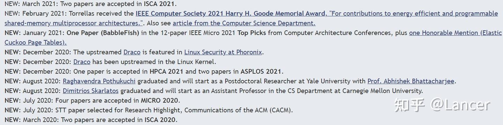

- **Nam Sung Kim团队**
**来自UIUC**，主要研究方向为高性能处理器、内存、网络架构等，是Future Architecture and System Technology for Scalable Computing的负责人。Nam Sung Kim博士毕业于University of Michigan，导师是上文提到的**Trevor Mudge**。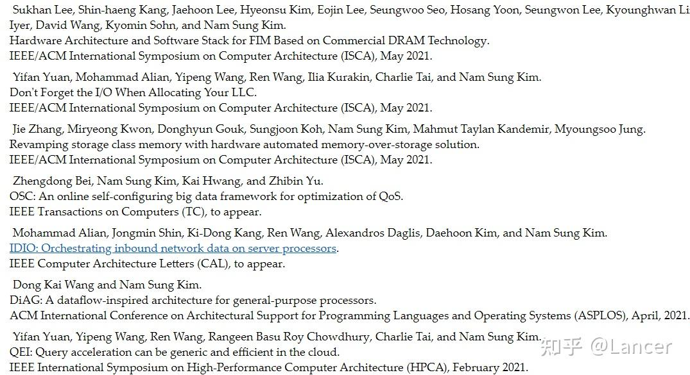

- **Mark D. Hill团队**
**来自University of Wisconsin–Madison**，主要研究方向为高性能计算机系统的设计，包括计算机体系结构、并行计算、内存系统等，是UW-Madison Computer Architecture Group组的负责人之一，该实验室还包括Gurindar Sohi、Mikko H. Lipasti等大佬。Mark D. Hill是著名的3C（Compulsory, Capacity, Conflict)理论的发明人，其提出的缓存一致性模型SC奠定了C++等内存模型的基础，其团队开发的gem5全系统仿真器在学术界被广泛的使用，他本人目前在Microsoft Azure做硬件架构师。Mark D. Hill博士毕业于UC Berkeley，导师是体结构大牛Alan Jay Smith和David A. Patterson。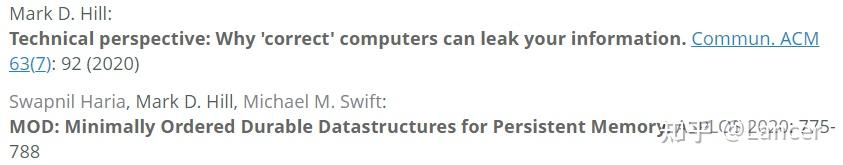

- **Mahmut Kandemir团队**
**来自Pennsylvania State University**，主要研究方向为编译器优化、嵌入式系统等，是Microsystems Design Lab的负责人之一，该实验室还包括Vijaykrishnan Narayanan等大佬。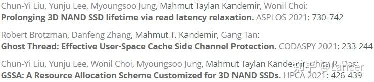

- **Anand Sivasubramaniam团队**
**来自Pennsylvania State University**，主要研究方向为体系结构、操作系统、数据中心设计与管理等，是Computer Systems Laboratory (CSL)的负责人，他本人也是ACM/IEEE Fellow。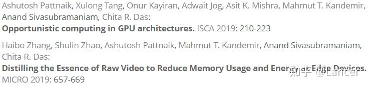

- **Chita R. Das团队**
**来自Pennsylvania State University**，主要研究方向为并行/分布式体系架构、异构计算、SOC等，是HPCL的负责人。他与Mahmut Kandemir和Anand Sivasubramaniam合作较为紧密，个人在四大上署名的文章超过40篇。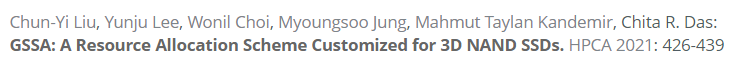

- **Yuan Xie团队**
**来自UCSB**，主要研究方向为非易失内存、近数据处理、3D集成电路、芯片设计等，他是SEAL lab的负责人，3D die-stacking技术的提出者。在去UCSB之前，在PSU任职，也是上面提到的Microsystems Design Lab的前负责人之一。其团队开发的NVmain等仿真器在非易失内存的研究上被广泛的使用。谢源老师目前也是达摩院计算技术实验室负责人，平头哥的首席科学家。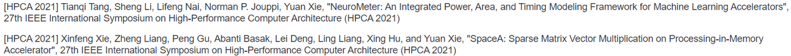

- **Margaret Martonosi团队**
**来自Princeton University**，目前的主要研究方向为异构并行计算、量子计算等，她博士毕业于Stanford University，导师是Anoop Gupta和系统大牛**Thomas E. Anderson**。其所在团队在MICRO等顶会上拿到过多次Best paper。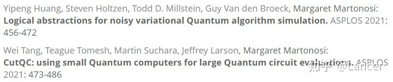

#### Babak Falsafi团队

**来自EPFL**，其研究方向为计算机系体系结构设计、健壮的系统评估方法设计等，他是PARSA组的负责人，该团队提出的很多技术被AMD、ARM等公司使用。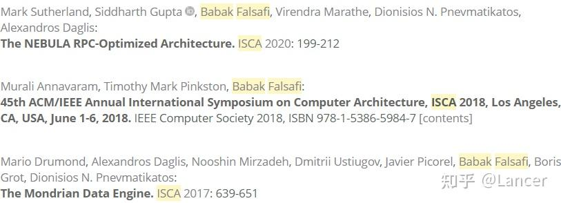

- **Christos Kozyrakis团队**
**来自Standford University**，主要研究方向为计算机系统架构、软硬协同的系统等，是MAST组的负责人，博士就读于UC Berkerly，导师是David A. Patterson。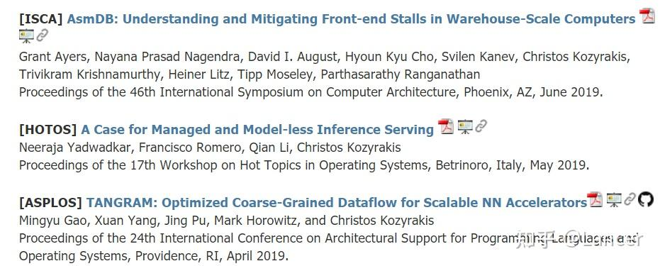

- **Moinuddin K. Qureshi团队**
**来自Georgia Institute of Technology**，研究方向包括量子计算、内存系统、系统安全等，是Memory Systems Lab的负责人，07年博士毕业于University of Texas at Austin，老板是Yale N. Patt。Moinuddin K. Qureshi拿过MICRO2018的Best Paper，而且是唯一作者。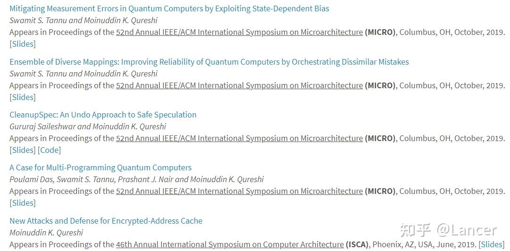

- **Mikko H. Lipasti团队**
**来自University of Wisconsin-Madison**，主要研究方向为低功耗、高性能、高可靠的处理器设计、片上网络以及non-von Neumann的计算机系统设计等，他是PHARM组的负责人，和他的老板John Paul Shen（之前在CMU，目前在Nokia，也在四大顶会上发表了很多文章）著有《现代处理器设计—超标量处理器基础》。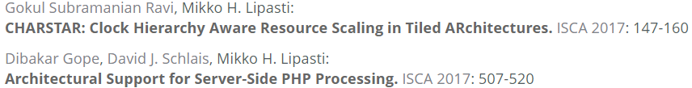

- **Joel Emer团队**
**来自MIT CSAIL和NVDIA**，主要研究方向向为深度学习加速器、处理器微体系架构等，他目前是NVDIA的资深杰出科学家，也曾经是Intel的Fellow，以及ACM/IEEE Fellow（本文提到的国外这些大佬基本上都是Fellow加身），也拿到了计算机体系结构界最高奖项Eckert-Mauchly奖（前面提到的不少人都拿到过，比如Mark D. Hill等）。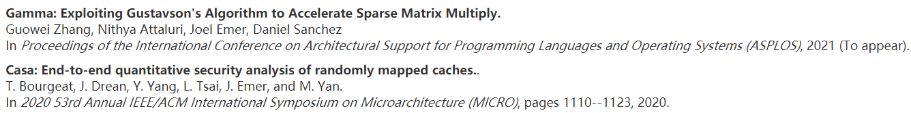

- **Frederic T. Chong团队**
**来自University of Chicago，主要研究方向为计算机体系架构、量子计算、计算机安全等。Frederic T. Chong是epiqc的负责人，该团队主要致力于量子计算的研究，由MIT、Princeton以及uchicago等多个高校的研究人员组成。Frederic T. Chong在加入uchicago之前，在UCSB工作，他目前也是阿贡国家实验室的高级科学家。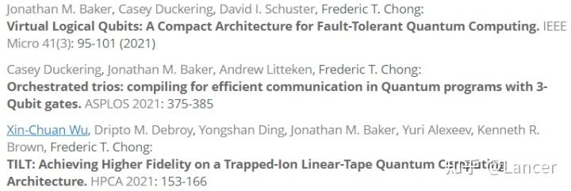

- Yiran Chen团队**
**来自Duke university，主要研究方向为内存系统、机器学习和神经形态计算、异构加速器等，是Duke Center of Computational Evolutionary Intelligence Lab的负责人。陈老师不但在学术圈极为活跃，而且也是个微博控，有兴趣的可以关注下他的微博，可以掌握部分学术圈的一手资讯，他目前也是IEEE和ACM Fellow。其团队在HPCA等顶会上发表多篇文章，他的学生宋凌皓连续四年都在HPCA上以第一作者发表文章。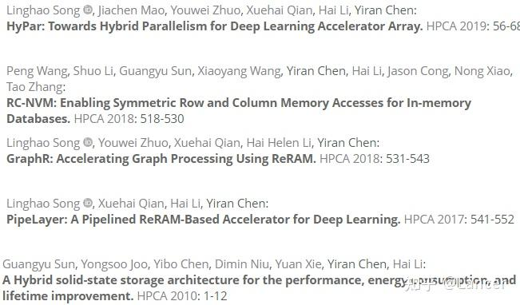

- Jishen Zhao团队**
**来自UCSD，主要研究方向为新型内存架构、系统协同设计、机器学习、边缘计算等，她是之前提到的NVSL实验室的负责人之一。Jishen Zhao本硕毕业于浙江大学，之后去PSU读博，老板是上面提到的谢源大佬（谢源在加入UCSB之前在PSU工作），14年博士毕业，算是比较年轻的PI，所在团队每年基本都有文章在MICRO发表。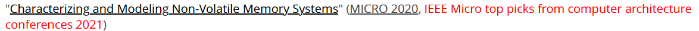

- William J. Dally团队**
**来自Standford University/NVDIA**，主要研究方向为低功耗微处理器、片上网络等，目前是Concurrent VLSI Architecture Group的负责人，在加入Standford University之前，在MIT工作。他目前是NVDIA的首席科学家和高级副总裁，但也在Standford University带学生。William J. Dally本人也是美国工程院院士，IEEE/ACM Fellow等，著有经典教材《数字设计:系统方法》。所在团队在ISCA上发表的文章数量超过20篇，也在MICRO/ASPLOS等拿到过Best Paper。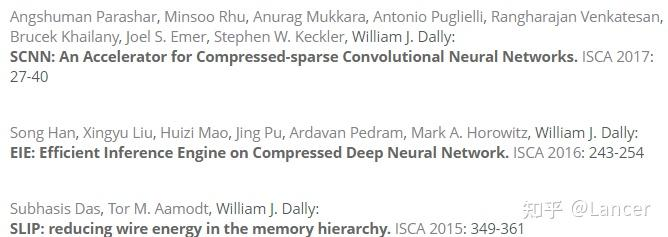

- **Christopher W. Fletcher团队**
**来自UIUC**，主要研究方向是硬件安全、专用领域硬件加速器等，16年博士毕业于MIT，在加入UIUC之前在NVDIA做了一年的postdoc。虽然很年轻，但是在四大顶会上署名的文章超过了20篇，和Josep Torrellas大佬合作较多。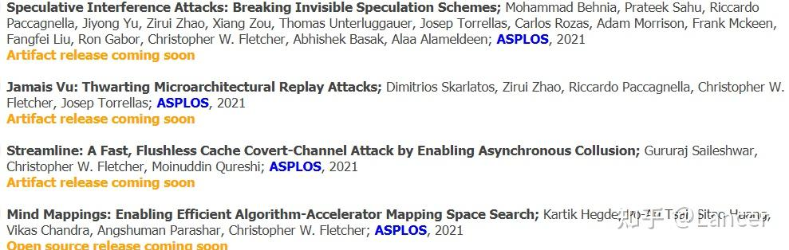

- **Xuehai Qian团队**
**来自University of Southern California**，主要研究方向为图像加速，非易失存储器、机器学习、存算融合等，是ALCHEM组的负责人。Xuehai Qian本科毕业于北航，之后在中科院计算所读的硕士，13年博士毕业于UIUC，导师是**Josep Torrellas**。近年来成果突出，在各大顶会上发表了多篇文章。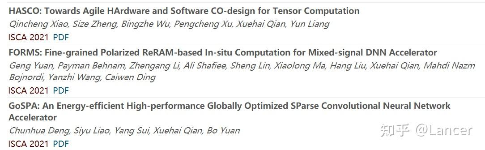

- **Mengjia Yan团队**
**来自MIT**，研究方向为体系结构与安全，主要包括设计针对边道攻击与防御的微架构。Mengjia Yan本科毕业于浙江大学，之后在UIUC跟着**Josep Torrellas**读博，她在博士期间也是以第一作者在MICRO/ISCA上发表了多篇文章，19年毕业之后加入MIT，非常年轻的AP。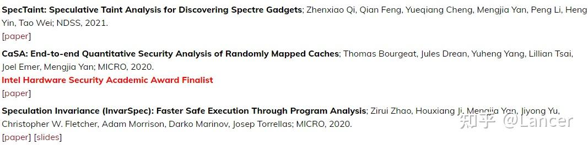

- **Myoungsoo Jung团队**
**来自韩国的KAIST**，主要研究方向为内存/存储系统、操作系统、异构计算等，是camelab的负责人，博士毕业于PSU，导师是Mahmut Kandemir。近年来在FAST/ISCA/MICRO等顶会上成果斐然，发表了很多文章。他的学生Jie zhang在ISCA/OSDI/HPCA/FAST/PACT等顶会上都有一作文章发表，十分强势，目前拿到了北大的教职。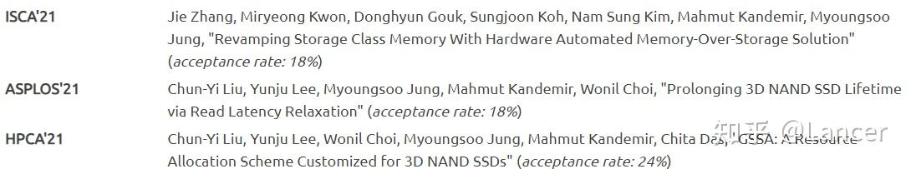

#### 国内

- **陈云霁团队**
**来自中科院计算所**，其主要研究方向包括微架构、并行计算、机器学习等，其团队开发了全球首个AI芯片，他也是寒武纪的创始人。他所在的团队所在团队在ISCA等定会上发表了一系列深度学习加速器的文章，包括09年大陆第一篇HPCA以及ASPLOS14的最佳论文。计算所有许多做体系结构的大佬，比如倪光南、孙凝晖、李国杰院士，以及我们熟知的包云岗、陈天石等，都隶属于计算机体系结构国家重点实验室。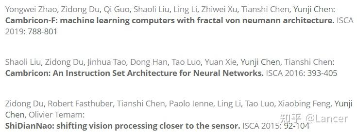

- **刘雷波和魏少军团队**
**来自清华大学微电子所**，主要研究方向为可重构芯片技术等，其团队近年来在MICRO/ISCA等发表了多篇文章，也获得过MICRO的Best paper提名，并在ISCA21和HPCA21上也都有相关文章被接收。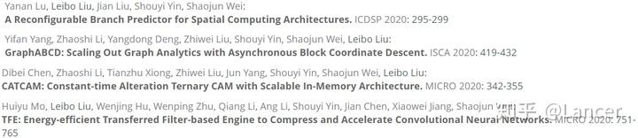

- **金海团队**
**来自华中科技大学**，研究方向为系统软件与体系结构、分布式系统等。其团队近年来在ISCA/MICRO/HPCA等顶会上都有突破，其中ISCA连续三年都有斩获，今年在HPCA上有2篇文章被接收。该团队规模较大，有许多优秀的PI，比如廖小飞、吴松、石宣化等。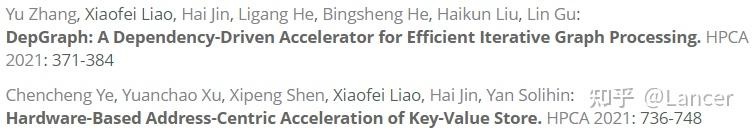

- **梁云团队**
**来自北京大学高能效计算与应用中心**，主要研究方向为EDA、计算机体系结构、编译器、嵌入式系统、设计自动化工具等，是北京大学高能效计算与应用中心的负责人之一。该团队近年来在HPCA等顶会上有文章发表，其中在ISCA2021上有两篇文章被接收。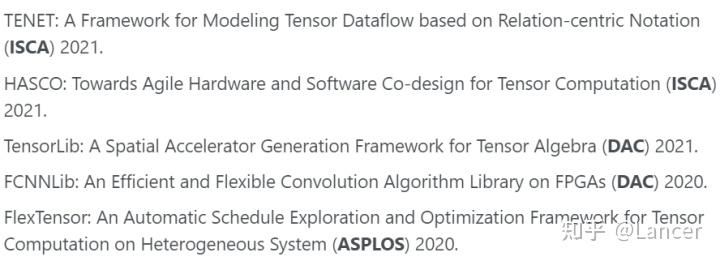

- **张悠慧团队**
**来自清华大学高性能计算研究所**，主要研究方向为高性能处理器微体系结构、类脑计算与神经形态芯片、类脑计算系统软件等，他是清华大学高性能计算研究所的负责人之一，系统领域里面提到的**武永卫、陈文光**等老师也都是这个所内的，也在做体系结构的研究。其所在团队在ASPLOS/MICRO等顶会上发表了多篇文章，20年在nature正刊上发表了关于类脑计算的文章。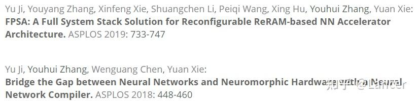

#### 未完待更.....
