本文试图总结一下最近对于多处理器编程的一些学习。虽然在总结的过程中发现对于很多细节的理解还不是很到位，但也还是希望有一个阶段性的结果，后续再加深理解。如果读者具有本文有欠妥之处，还希望不吝赐教。

### 背景

前段时间跟 @cholerae

 巨巨在讨论关于volatile的一个问题。本来是很简单的一个问题，因为我们知道volatile in C++其实是写给编译器看的东西，CPU无感知，也就是说它没有定义happens-before的关系，不能当作传统的原子变量来用。

本来是想写一个样例，来证明这个volatile的错误使用，但试了半天，并没有能够构造出来。后来去查了一些资料，发现这个例子其实蛮难构造的，因为在我的电脑，也就是intel x86架构的CPU上，只有Store-Load乱序，没有其他乱序。当然例子也可以构造出来，，但其实挺麻烦，并且复现的概率跟运行状态有关系。

后来意识到对这方面的理解还有所欠缺，才有了这篇文章。

本文的行文思路大致如下：

- CPU中的cache结构
- cache一致性
- 内存模型
- 高级语言中的内存模型
- 基于C++11的内存模型，如何实现一个读写锁

### Cache in CPU

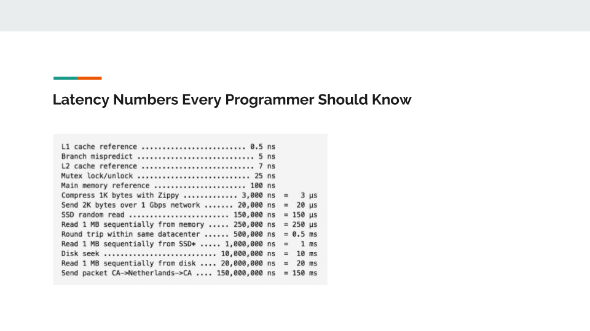

问题首先看几个数字，计算机硬件的一些延迟。主要关注两个，L1 cache，0.5ns；内存，100ns。可见，平时我们认为的很快的内存，其实在CPU面前，还是非常慢的。想想一下，执行一条加法指令只要一个周期，但是我们这个加法的执行结果写到内存，却要等100个周期。这样的速度显然无法接受。

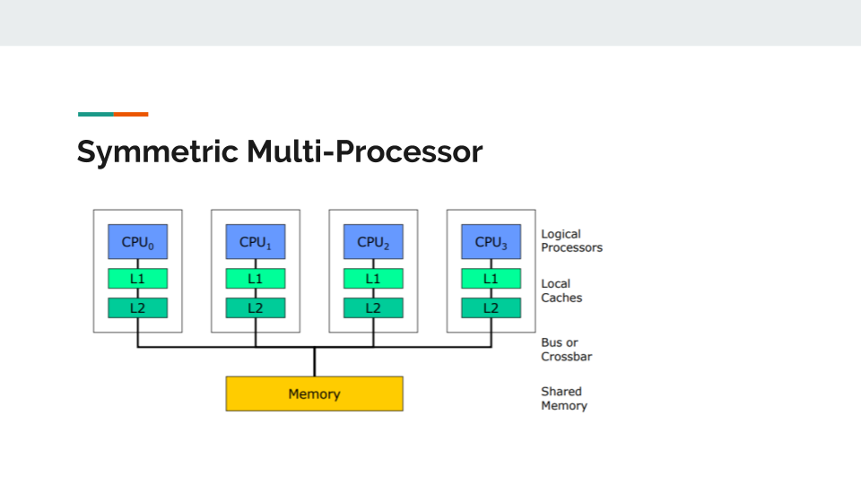

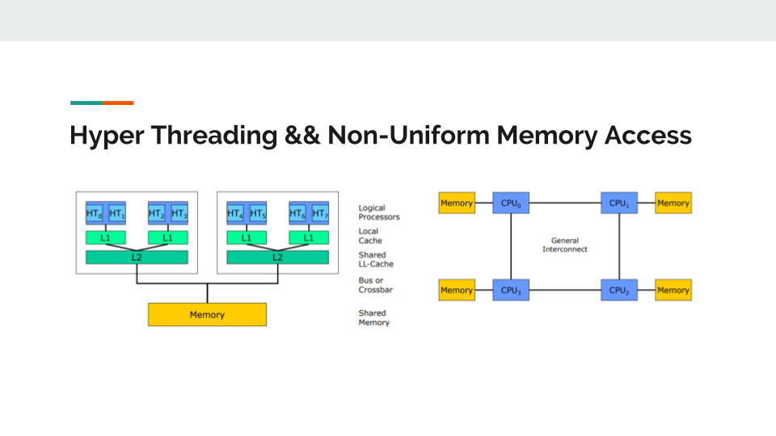

因此，我们有了Cache，并且是多级的Cache，现在的Intel CPU通常有3级cache，例如我自己的电脑上，L1 data cache 有32K，L1 instruction cache 是32K，L2和L3分别是256K和6144K。不同的架构中，Cache会有所区别，比如超线程的CPU中，L1Cache是独占的，L2是Core共享的。

anyway，cache其实缓解了内存访问的延迟问题。不过它也带来了另一个问题：一致性。

如图所示，一个变量（一个内存位置）其实可以被多个Cache所共享。那么，当我们需要修改这个变量的时候，Cache要如何保持一致呢？

理想情况下，原子地修改多个Cache，但多个CPU之间往往通过总线进行通信，不可能同时修改多个；所以其实要制造一种假象，看起来是原子地修改多个Cache，也就是让Cache看起来是强一致的。

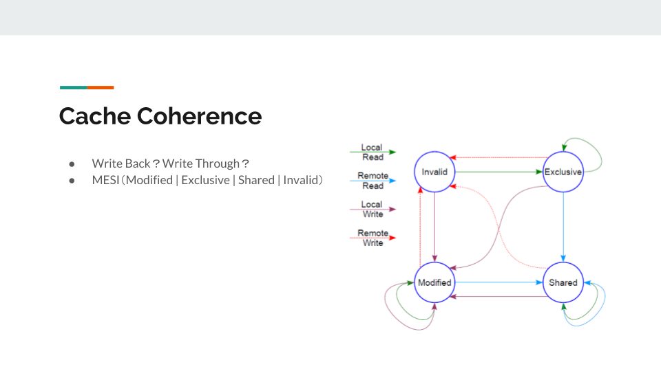

基于总线通信去实现Cache的强一致，这个问题比较明确，目前用的比较多的应该是MESI协议，或者是一些优化的协议。基本思想是这样子的：一个Cache加载一个变量的时候，是Exclusive状态，当这个变量被第二个Cache加载，更改状态为Shared；这时候一个CPU要修改变量， 就把状态改为Modified，并且Invalidate其他的Cache，其他的Cache再去读这个变量，达到一致。MESI协议大致是这样子，但是状态转换要比这个复杂的多。

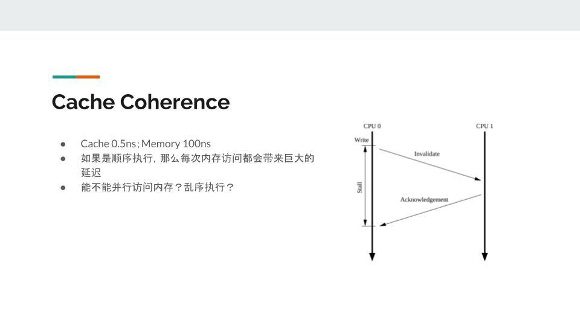

看起来很美好的MESI协议，其实有一些问题。比如说，修改变量的时候，要发送一些Invalidate给远程的CPU，等到远程CPU返回一个ACK，才能进行下一步。 这一过程中如果远程的CPU比较繁忙，甚至会带来更大的延迟。并且如果有内存访问，会带来几百个周期的延迟。

那么有没有优化手段，能够并行访问内存？或者对内存操作乱序执行？

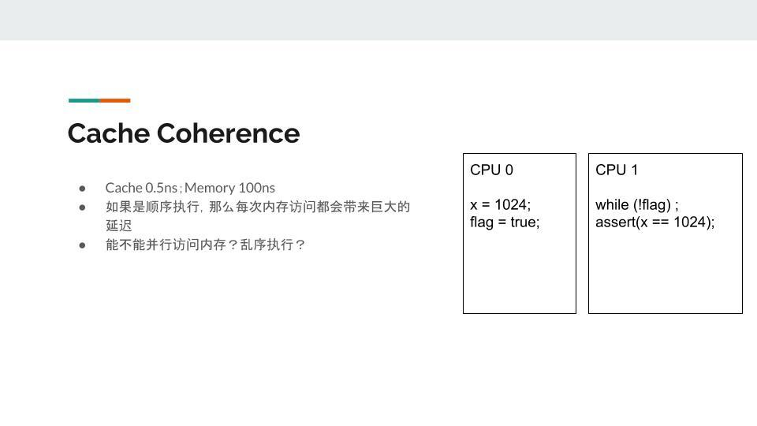

但是有一个问题我们显然不能忽视，例如这里的例子。程序的正确性依赖了一个假定，x = 1024 这个语句要先于 flag = true 执行。如果这个顺序被破坏了，那么后面的断言就会出错了。

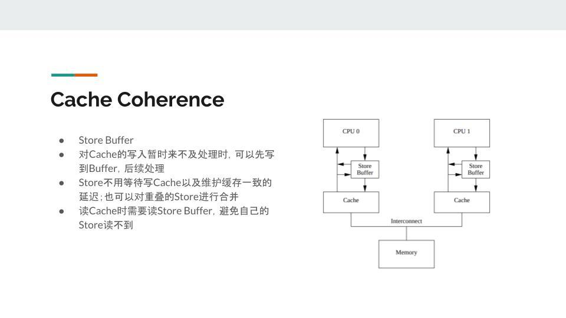

不过先不管这么多，我们先优化一下性能再说。

这里用了一个称之为store buffer的结构，来对store操作进行优化。

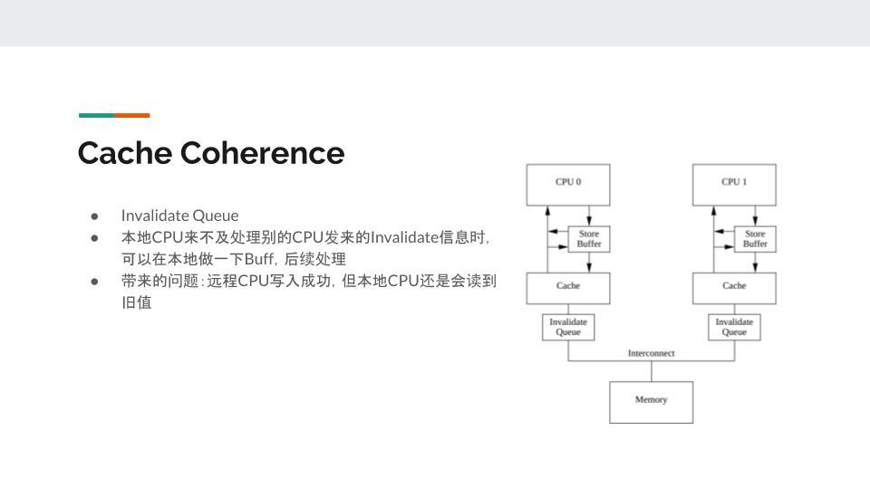

以及Invalidate Queue的结构，可以缓解大量的Invalidate Message的问题。

就Store操作来说，这两个结构所带来的效果就是，不需要等到Cache同步到所有CPU之后Store操作才返回，可能是写了本地的Store buffer就返回，或者invalidate message发到远程CPU，但是远程CPU还没有执行，本地的Store操作也可以返回。显然，这两个结果对于延迟的优化是十分明显的。

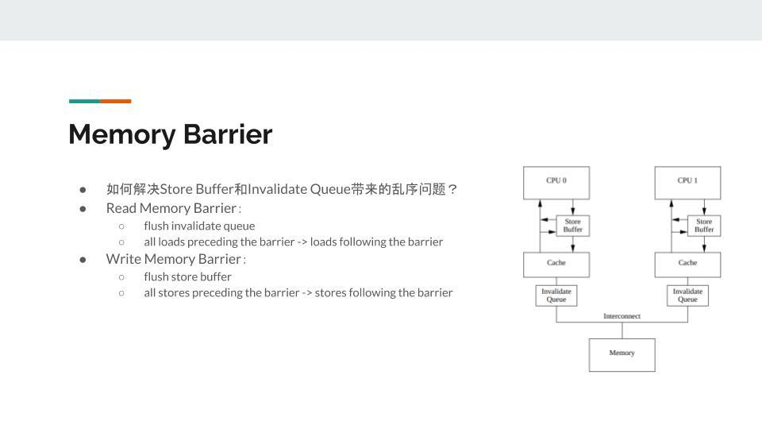

但是这两个结构肯定会带来乱序的问题，也就是说，本地的Store操作返回了，但其实远程还不能读到，还没有生效，而后面的操作先执行了。如何解决乱序的问题？

CPU通常提供了内存屏障指令，来解决这样的问题。读屏障，清空本地的invalidate queue，保证之前的所有load都已经生效；写屏障，清空本地的store buffer，使得之前的所有store操作都生效。

这里也解释了让我困惑许久的问题，为什么原子变量load和store要配对使用，仅仅store为什么还不够。

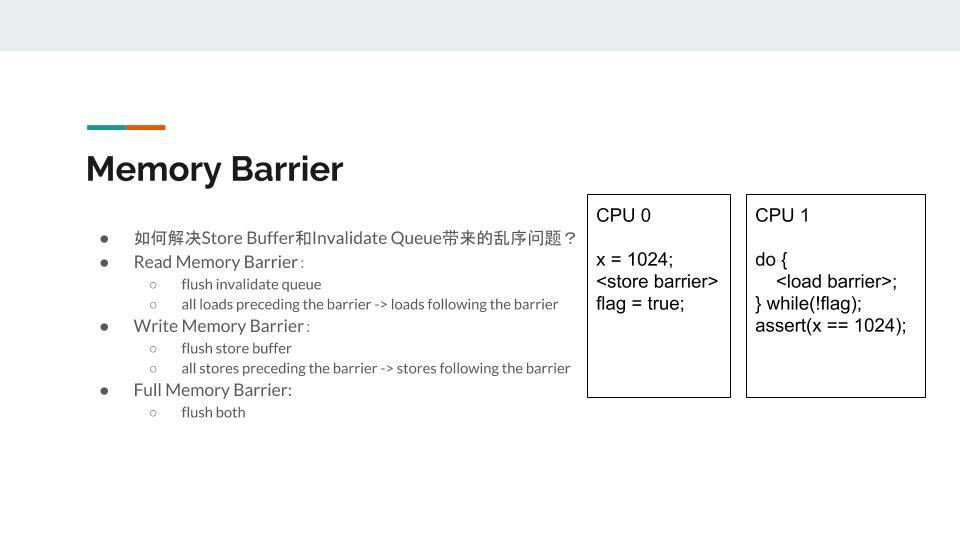

使用这两个内存屏障，我们可以对之前的代码做一些修改，来保证正确。

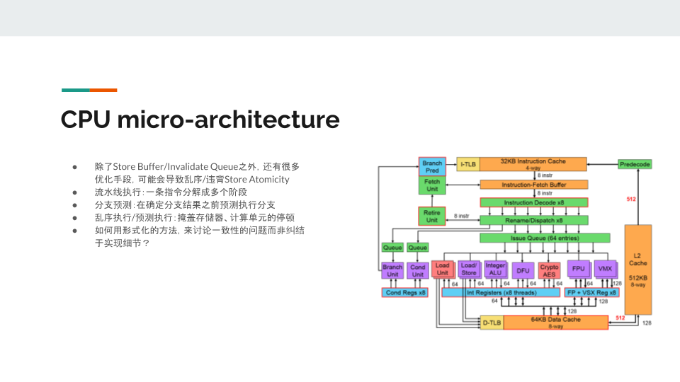

但是，处理器领域其实还有很多的优化手段，流水线执行、乱序执行、预测执行等等，各种我听过和没听过的优化，他们对顺序的影响又是怎样的？以及，我们所说的内存屏障，能否通过形式化方法证明其正确性呢？而不是拘泥于某一个处理器的实现细节，去讨论程序的正确与否，否则这样给程序员带来的心智负担就太重了。

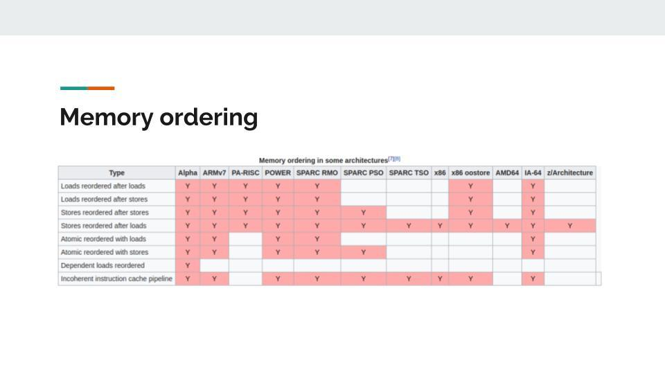

这里列举了一下主流的CPU架构对指令重排的约定。可以关注一下我们用的比较多的x86，它其实只有一种重排，Store-Load，其实这种称之为Total Store Ordering。除此之外还有很多中处理器，对于重排的定义都不太一样，最弱的Alpha，所有重排都会发生，这种情况下我们的代码要怎么写呢？

因此便有了内存模型（Memory Model），它是系统和程序员之间的规范，它规定了存储器访问的行为，并影响到了性能。并且，Memory Model有多层，处理器规定、编译器规定、高级语。对于高级语言来说， 它通常需要支持跨平台，也就是说它会基于各种不同的内存模型，但是又要提供给程序员一个统一的内存模型，可以理解为一个适配器的角色。

Memory Model由Instruction Reordering和Store Atomicity来定义。总是就是每种模型对于乱序的定义不太一样。

这里其实就有了Memory Consistency的概念，与Cache Coherence不同的是，Memory Consistency关注的是多个变量，而非单个变量；Memory Model是多处理器和编译器优化导致存储器操作被多个处理器观察到的顺序不一致的问题，而Cache Coherence对程序员来说是透明的。

从强到弱，分别是Sequential Consistency，Weak Consistency等等。

在CPU这个层面，我们往往不讨论Linearizability，但是在编程的时候通常会把它作为衡量程序正确性的标志，所谓的线程安全/并发安全，通常指的也就是Linearizability。

补充：并发安全和线性一致并不等价，也有非线性一致但并发安全的对象，比如静态一致顺序一致，在某些特殊的场景下不需要保证线性一致也能保证安全。下图引用自《多处理器编程艺术》3.5.2节。

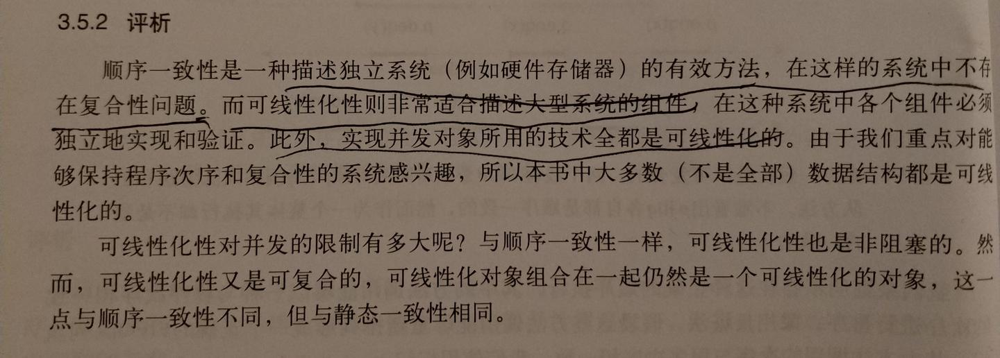

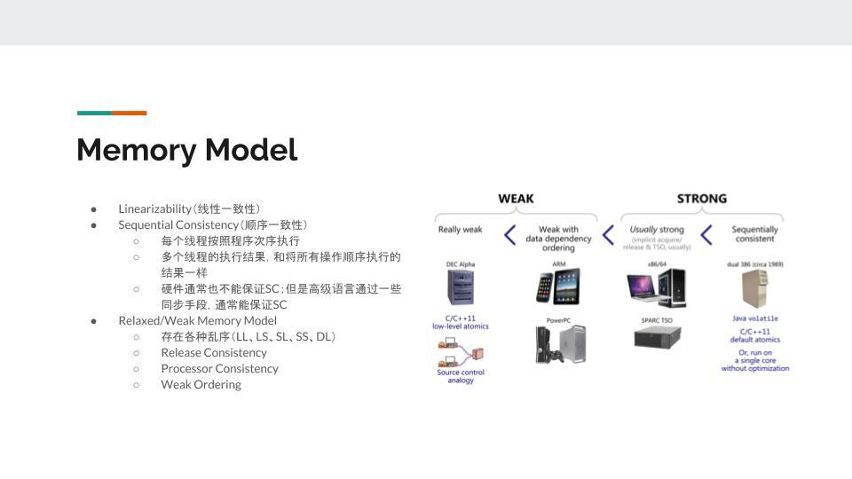

对于Memory Order来说，最重要的是Sequential Consistency。它的意思是，每个线程按照程序次序执行，多个线程的执行结果，和将所有操作顺序执行的结果一样。换句话说，将所有线程的操作按照某一个顺序依次执行，结果和原来一样，但这个顺序未必是时间顺序。

硬件通常也不能保证SC，因为这样性能太差了；但是高级语言通过一些同步手段，通常能保证SC。

现实中的处理器，往往是Relaxed Consistency的，存在着各种乱序，实现为Release consisteny/Processor consistency/Weak Ordering等各种内存模型。

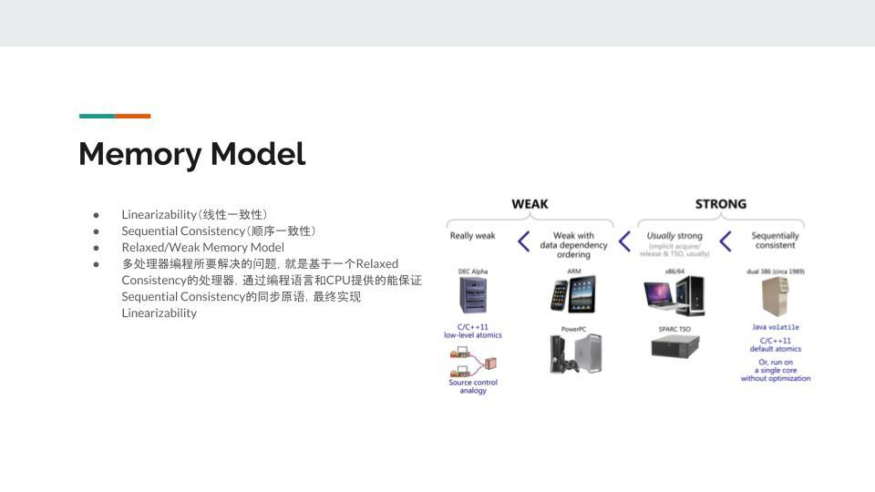

总而言之，多处理器编程所要解决的问题，就是基于一个Relaxed Consistency的处理器，通过编程语言和CPU提供的能保证Sequential Consistency的同步原语，最终实现Linearizability。

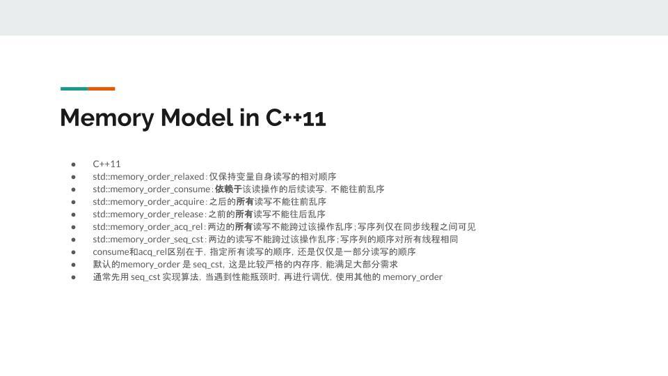

OK，讲了处理器的内存模型，还有编程语言中的内存模型。例如C++11，这个比较经典。

C++11定义了六种内存模型，对于这六种在[如何理解 C++11 的六种 memory order？](https://www.zhihu.com/question/24301047)这个问题有很好的解释，这里就不赘述了。

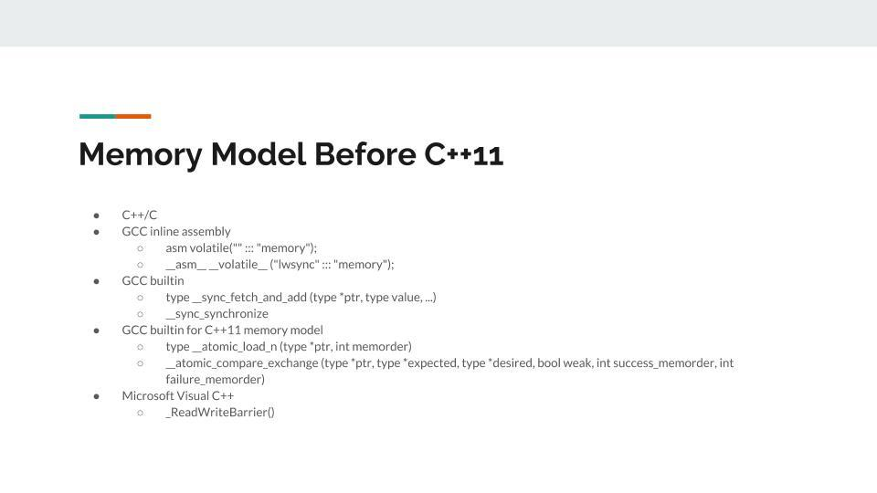

而在C++11之前，其实是没有定义内存模型的，我们所使用的都是一些处理器/编译器暴露的同步原语，比如 GCC 的内联汇编，内建函数之类的。而不同的编译器有着不同的实现，局面一度十分混乱。所以说C++11其实是一个里程碑式的革新。

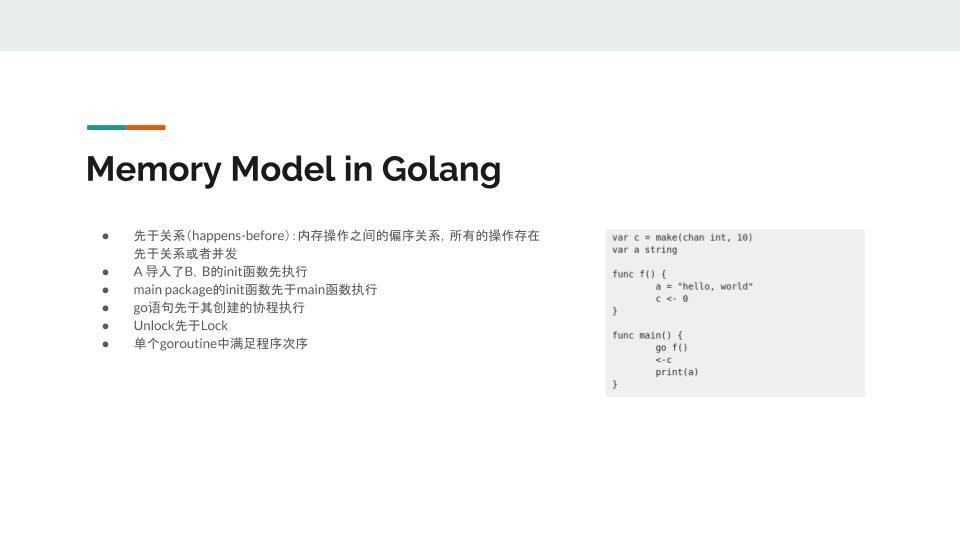

而在比较现代化的Golang中，就直接对Memory Order进行了定义，避免各种未定义行为。这里举了几个例子，说明golang的内存模型。关于Channel的会比较有意思。

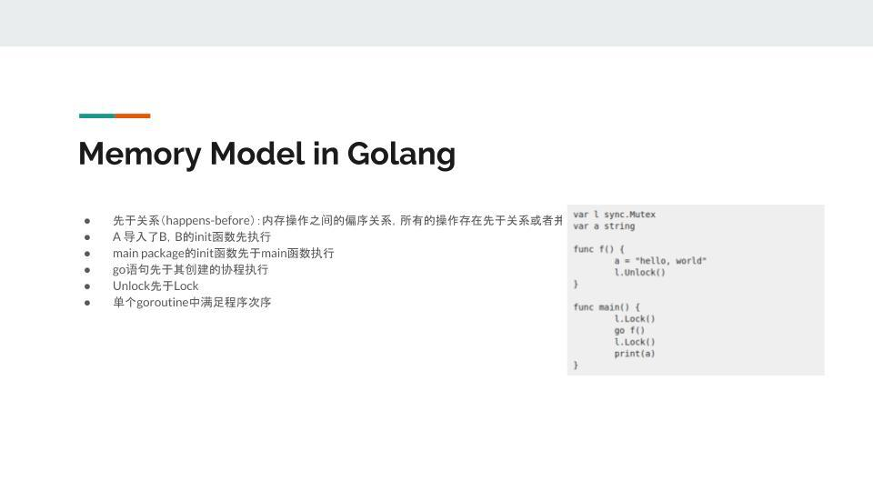

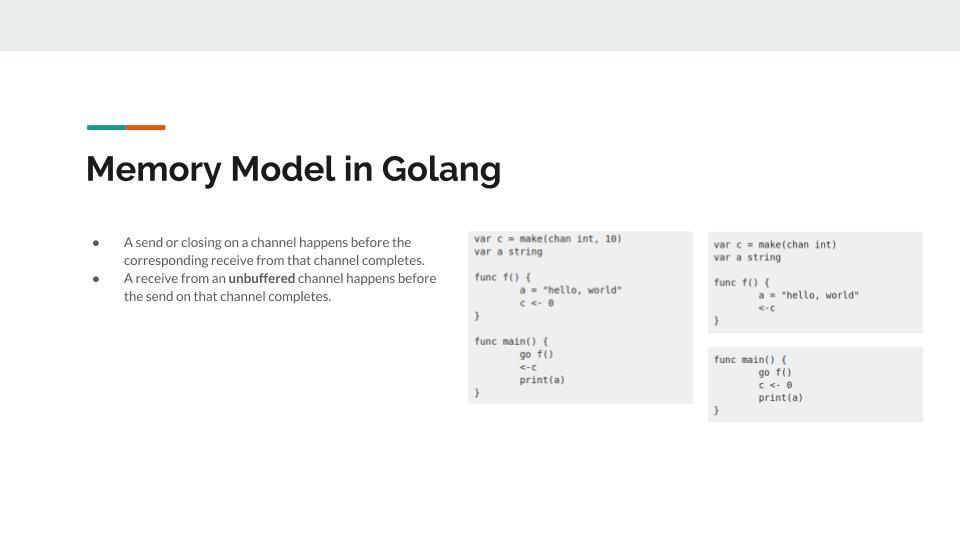

但比较遗憾的是，对于sync/atomic 的内存模型其实没有定义，有待完善。不过golang可能不推荐使用这种shared memory的方式，而是更加推崇用通信来替代共享内存。

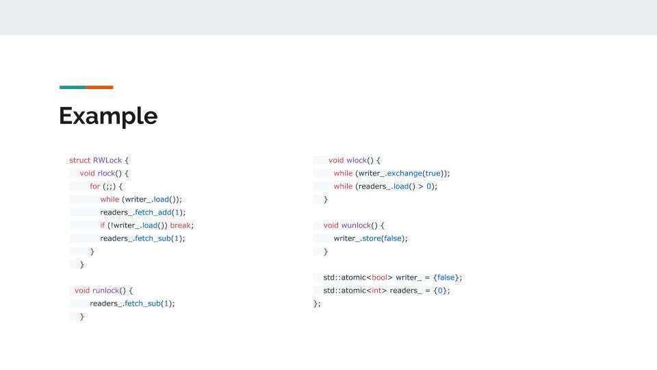

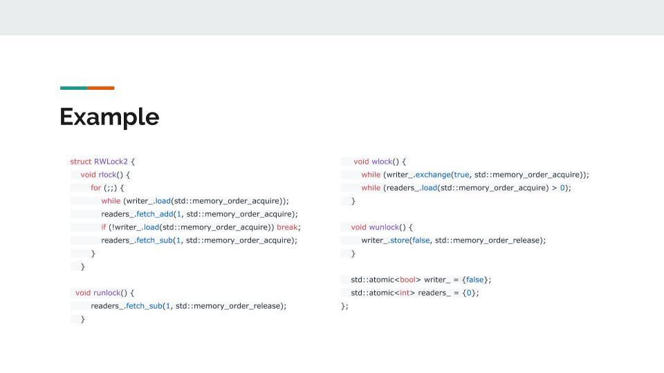

最后，举一个简单的例子，说明如何用C++11，来实现一个读写锁，并对其进行优化。代码来自 GHScan 大大的 [Memory Model: 从多处理器到高级语言](https://link.zhihu.com/?target=https%3A//github.com/GHScan/TechNotes/blob/master/2017/Memory_Model.md) 。

关于读写锁的实现，其实在[云风的skynet也有类似的实现](https://link.zhihu.com/?target=https%3A//github.com/cloudwu/skynet/blob/master/skynet-src/rwlock.h)，貌似是有一些问题的，不过以我的水平还不能评判。

### 总结

这是在公司做的一个分享，PDF链接在[Google Drive](https://link.zhihu.com/?target=https%3A//docs.google.com/presentation/d/e/2PACX-1vSev1D1-1mXJ1D2T7xlEUJ5zeLNM4_D-0m68yektnRyXMvI802T-JB8HxU3iqxJcXKbTulzg8O6zmWE/pub%3Fstart%3Dfalse%26loop%3Dfalse%26delayms%3D3000)上，如果图片比较模糊可以看一下原始的PDF。

### 参考

- [如何理解C++11中的六种内存模型](https://www.zhihu.com/question/24301047)
- [Latency Numbers Every Programmer Should Know](https://link.zhihu.com/?target=https%3A//gist.github.com/jboner/2841832)
- Go’s Memory Model
- go memory model
- Memory Barriers: a Hardware View for Software Hackers
- Intel® 64 and IA-32 Architectures Software Developer Manuals
- Maurice Herlihy：《The Art of Multiprocessor Programming》
- [Memory Model: 从多处理器到高级语言](https://link.zhihu.com/?target=https%3A//github.com/GHScan/TechNotes/blob/master/2017/Memory_Model.md%23references)
- Parallel Architectures Memory Consistency & Cache Coherency
