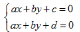
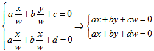
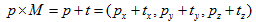
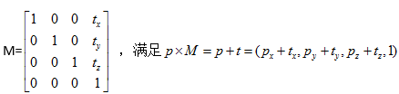
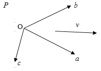
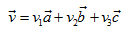
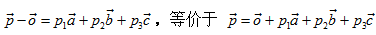
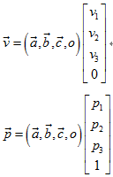

前几天大概翻了下网上的资料和《学习OpenCV》相关的部分，打算写一篇相机标定的总结（只写张正友法），其中也会结合自己的理解，所以有些地方可能会有错误，还望指正。

**

【WHY：为什么要进行相机标定？】**

先说结论：**建立相机成像几何模型并矫正透镜畸变**。

**建立相机成像几何模型**：计算机视觉的首要任务就是要通过拍摄到的图像信息获取到物体在真实三维世界里相对应的信息，于是，建立物体从三维世界映射到相机成像平面这一过程中的几何模型就显得尤为重要，而这一过程最关键的部分就是要得到相机的**内参和外参**（后文有具体解释）。

**矫正透镜畸变**：我们最开始接触到的成像方面的知识应该是有关小孔成像的，但是由于这种成像方式只有小孔部分能透过光线就会导致物体的成像亮度很低，于是聪明的人类发明了透镜。虽然亮度问题解决了，但是新的问题又来了：由于透镜的制造工艺，会使成像产生多种形式的**畸变，**于是为了去除畸变（使成像后的图像与真实世界的景象保持一致），人们计算并利用**畸变系数**来矫正这种像差。（虽然理论上可以设计出不产生畸变的透镜，但其制造工艺相对于球面透镜会复杂很多，so相对于复杂且高成本的制造工艺，人们更喜欢用脑子来解决……）

**【HOW：相机标定的原理】**

前面已经说过，相机标定的目的之一是为了建立物体从三维世界到成像平面上各坐标点的对应关系，所以首先我们需要定义这样几个坐标系来为整个过程做好铺垫：

**世界坐标系(world coordinate system)：**用户定义的三维世界的坐标系，为了描述目标物在真实世界里的位置而被引入。单位为m。

**相机坐标系(camera coordinate system)：**在相机上建立的坐标系，为了从相机的角度描述物体位置而定义，作为沟通世界坐标系和图像/像素坐标系的中间一环。单位为m。

**图像坐标系(image coordinate system)：**为了描述成像过程中物体从相机坐标系到图像坐标系的投影透射关系而引入，方便进一步得到像素坐标系下的坐标。 单位为m。

**像素坐标系(pixel coordinate system)：**为了描述物体成像后的像点在数字图像上（相片）的坐标而引入，是我们真正从相机内读取到的信息所在的坐标系。单位为个（像素数目）。

关于这四个坐标系更详细的定义我就不说了，因为下面的图可以更好地表达这四个坐标系之间的关系：

**

世界坐标系：Xw、Yw、Zw。相机坐标系： Xc、Yc、Zc。

图像坐标系：x、y。像素坐标系：u、v。

其中，相机坐标系的 轴与光轴重合，且垂直于图像坐标系平面并通过图像坐标系的原点，相机坐标系与图像坐标系之间的距离为焦距f（也即图像坐标系原点与焦点重合）。像素坐标系平面u-v和图像坐标系平面x-y重合，但像素坐标系原点位于图中左上角（之所以这么定义，目的是从存储信息的首地址开始读写）。

在这里我们先引入“棋盘”**的概念：

棋盘是一块由黑白方块间隔组成的标定板，我们用它来作为相机标定的标定物（从真实世界映射到数字图像内的对象）。之所以我们用棋盘作为标定物是因为平面棋盘模式更容易处理（相对于复杂的三维物体），但与此同时，二维物体相对于三维物体会缺少一部分信息，于是我们会多次改变棋盘的方位来捕捉图像，以求获得更丰富的坐标信息。

下面将依次对刚体进行一系列变换，使之从世界坐标系进行仿射变换、投影透射，最终得到像素坐标系下的离散图像点，过程中会逐步引入各参数矩阵。

**从世界坐标系到相机坐标系：**

刚体从世界坐标系转换到相机坐标系的过程，可以通过旋转和平移来得到，我们将其变换矩阵由一个旋转矩阵和平移向量组合成的齐次坐标矩阵（为什么要引入齐次坐标可见附录）来表示：

其中，R为旋转矩阵，t为平移向量，因为假定在世界坐标系中物点所在平面过世界坐标系原点且与Zw轴垂直（也即棋盘平面与Xw-Yw平面重合，目的在于方便后续计算），所以zw=0，可直接转换成式1的形式。其中变换矩阵

即为前文提到的外参矩阵，之所称之为外参矩阵可以理解为只与相机外部参数有关，且外参矩阵随刚体位置的变化而变化。

**从相机坐标系到理想图像坐标系（不考虑畸变）：**

这一过程进行了从三维坐标到二维坐标的转换，也即投影透视过程（用中心投影法将形体投射到投影面上，从而获得的一种较为接近视觉效果的单面投影图，也就是使我们人眼看到景物近大远小的一种成像方式）。我们还是拿针孔成像来说明（除了成像亮度低外，成像效果和透镜成像是一样的，但是光路更简单）。

成像过程如图二所示：针孔面（相机坐标系）在图像平面（图像坐标系）和物点平面（棋盘平面）之间，所成图像为倒立实像。

但是为了在数学上更方便描述，我们将相机坐标系和图像坐标系位置对调，变成图三所示的布置方式（没有实际的物理意义，只是方便计算）：

此时，假设相机坐标系中有一点M，则在理想图像坐标系下（无畸变）的成像点P的坐标为（可由相似三角形原则得出）：

将上式化为齐次坐标表示形式为：

**从理想图像坐标系到实际图像坐标系（考虑畸变）：**

透镜的畸变主要分为径向畸变和切向畸变（还有薄透镜畸变等等，但都没有径向和切向畸变影响显著，所以我们在这里只考虑径向和切向畸变）。

径向畸变是由于透镜形状的制造工艺导致。且越向透镜边缘移动径向畸变越严重。实际情况中我们常用r=0处的泰勒级数展开的前几项来近似描述径向畸变。矫正径向畸变前后的坐标关系为：

由此可知对于径向畸变，我们有3个畸变参数需要求解。

切向畸变是由于透镜和CMOS或者CCD的安装位置误差导致。切向畸变需要两个额外的畸变参数来描述，矫正前后的坐标关系为：

由此可知对于切向畸变，我们有2个畸变参数需要求解。

综上，我们一共需要5个畸变参数（k1、k2、k3、p1和p2 ）来描述透镜畸变。

**从实际图像坐标系到像素坐标系：**

由于定义的像素坐标系原点与图像坐标系原点不重合，假设像素坐标系原点在图像坐标系下的坐标为（u0，v0），每个像素点在图像坐标系x轴、y轴方向的尺寸为：dx、dy，且像点在实际图像坐标系下的坐标为（xc，yc），于是可得到像点在像素坐标系下的坐标为：

**

化为齐次坐标表示形式可得：

若暂不考虑透镜畸变，则将式2与式5的转换矩阵相乘即为内参矩阵M：

之所以称之为内参矩阵可以理解为矩阵内各值只与相机内部参数有关，且不随物体位置变化而变化。

最后用一幅图来总结从世界坐标系到像素坐标系（不考虑畸变）的转换关系：**

**【WHAT：内外参具体求解方法】**

现在我们已经知道要想对相机进行标定，就需要求解出相机的内外参矩阵以及畸变系数，那么在数学上具体应该怎样求解呢？

假设我们提供K个棋盘图像，每个棋盘有N个角点，于是我们拥有2KN个约束方程。与此同时，忽略畸变的情况下，我们就需要求解4个内参和6K个外参（内参只于相机内部参数有关，外参却随目标点位置变化而变化），也就是说，只有当2KN>=4+6K的时候，也即K(N-3)>=2时，才能求出内外参矩阵。同时，无论在一张棋盘上检测到多少角点，由于棋盘上角点的规则布置使得真正能利用上的角点只有4个（在四个方向上可延展成不同的矩形），于是有当N=4时,K(4-3)>=2，即K>=2，也就是说，我们至少需要两张棋盘在不同方位的图像才能求解出无畸变条件下的内参和外参。

实际上我们往往会在一张棋盘上布置更多的角点，因为这样就可以通过最小二乘法求得最优解了，同样地，我们会需要至少10张以上的棋盘图像，目的是考虑数值稳定性和提高信噪比，得到更高质量的结果。

与此同时，我们在这里引入**单应性**的概念。在计算机视觉中的单应性被定义为从一个平面到另一个平面的投影映射关系，前面我们已经得到了像素坐标系和世界坐标系下的坐标映射关系：

**因此，我们定义相机标定的单应性矩阵（从物体平面到成像平面）为：**

这里引入的s为任意尺度的比例系数。单应性矩阵描述了物体在世界坐标系和像素坐标系之间的相对位置关系（包含了内参和外参）。接下来我们继续推导内外参数和畸变系数的具体求解方法。

**首先不考虑透镜畸变情况下，求解内参和外参：**

我们在上面的推导已经知道了单应性矩阵

先将H化为H=[h1 h2 h3]，再分解方程可得：

**

因为旋转向量在构造中是相互正交的，即r1和r2相互正交，由此我们就可以利用“正交”的两个含义，得出每个单应性矩阵（也即每个棋盘方位图像）提供的两个约束条件：

旋转向量点积为0（两垂直平面上的旋转向量互相垂直）：

替换和并化简可得：

旋转向量长度相等（旋转不改变尺度）：

替换掉r1和r2可得：

设

则可将两个约束条件转化为：

由上式可知，两约束中的单项式均可写为

的形式，同时易知B为对称矩阵，真正有用的元素只有6个（主对角线任意一侧的6个元素）。于是可展开为如下形式：

由此，两约束条件可等价为：

前面的讨论我们已经知道，棋盘图像数目满足就可求出内外参数，此时b有解，于是由内参数B的封闭解和b的对应关系即可求解出内参数矩阵中的各个元素（具体形式这里不给出）。得到内参数后，可继续求得外参数：

其中又由旋转矩阵性质有

则可得

进一步考虑透镜畸变情况，求解畸变系数：**

根据式3和式4我们可以得到矫正畸变后的坐标和矫正前的坐标关系为：

有了上式的对应关系，又已知相应的内外参数，再利用大量给定的坐标数据即可进一步求得畸变系数（这里就可以交给计算机来解决了）。

到此为止便是关于相机标定的一系列matters以及求解所有参数的具体方法了，接下来知道了原理后就可以“义正言辞”地调用OpenCV里的函数进（si）行（ke）求（dai）解（ma）了~ 

~~~~~~~~~~~~~~~~~~~~~~~~~~~~~~~~~~~~~~~~~~~~~~~~~~~~~~~~~~~

**附录1：聊聊“齐次坐标”**

首先，为什么要定义齐次坐标？

比如现在我们面前有一条马路，这条马路延伸到无穷远处，于是我们在笛卡尔空间去描述这一变化规律会描述成：在同一平面有两条平行线，那么这两条平行线将永远都不会相交，也就是说着两条马路牙子（偷笑）将永远不会相交，然而实际生活中我们看到的景象是：马路向远处延伸，间距越来越窄，到尽头处相交！这是因为我们的眼睛对物体有“近大远小”的处理（视角），也就是我们平时所说的投影透视，那么对于这种情况我们在数学上应该怎么合理地去描述呢？于是便引入了“齐次坐标”来描述啦~~

齐次坐标说白了就是用N+1维去描述一个N维的坐标。

再来看一下齐次坐标与笛卡尔坐标的转化关系：

**笛卡尔坐标：(x/w,y/w)——齐次坐标：(x,y,w)**

有了齐次坐标的定义，接下来我们就可以了解到为什么称之为“齐次”了：

假如齐次坐标系下的坐标为(1,3,5)，那么转换到笛卡尔坐标系下的坐标即为(,)；同理假如齐次坐标系下的坐标为(2,6,10)，那么转换到笛卡尔坐标系下的坐标即为(,)，化简后其值仍为(,)……于是我们就可以知道：对于这个例子来说，齐次坐标系下任何形式为(1a,3a,5a)的坐标(a不为0)在笛卡尔坐标系下都代表着同一个坐标(,)，类似地，便有了“齐次”的说法，由此也引出了齐次坐标的**“伸缩不变性”**。

接着上面马路牙子的问题，为什么有了齐次坐标的表示方式我们就可以描述投影透视关系了呢？为什么无穷远处的马路牙子（-。-）就能相交了呢？锵锵~继续往下看：

现在我们在笛卡尔空间定义两条直线：

我们知道在这种情况下两条直线是不可能相交的，但是再来转换到齐次坐标表示看看：

此时就存在有解条件了：w=0时有解，此时交点为(x,y,0)，同时w=0表示这个点在无穷远处，于是两条平行线（马路牙子）在无穷远处可相交！

综上所述，齐次坐标在图形学和计算机视觉中是一个很重要的概念，这也是我们为什么要在这里引入齐次坐标来表示，一方面是因为它更易于进行仿射几何变换（具体解释见附录2），另一方面也能够用来明确区分向量和点（至于为什么能区分向量和点…见附录3吧…）。

**附录2：再聊“齐次变换”**

刚说到引入齐次坐标可以更好地进行仿射变换，我们知道在笛卡尔坐标系下的仿射变换是旋转矩阵和缩放矩阵的特权，对于平移变换来说，不能简单地用矩阵相乘来表达，原因如下：

假设在笛卡尔坐标系下有一点P(px,py,pz),平移向量为t(tx,ty,tz)，如果我们想找到一个矩阵M，使得：

你会发现在笛卡尔坐标系下永远都找不到这样一个满足条件的M。但是在齐次坐标系中的点P(px,py,pz,1)，我们可以找到一个向量

像这样在齐次坐标系下使用4个分量来描述三维坐标变换，可以使得平移变换在矩阵中更加方便使用，最终的变换矩阵形式更加紧凑。

**附录3：继续聊“齐次坐标”……**

莫名又挖了个坑……但是说到这里肯定还是会有人比较好奇为什么齐次坐标可以区分向量和点，所以还是再写点吧……

假设我们在齐次坐标系下找到了这样一组基：

于是我们可以找到一组系数(v1,v2,v3)，将向量v表示成：

对于齐次坐标系下的一个点P，可以表示成位置向量：**

将上面两个式子均写成齐次坐标系下的矩阵形式:

我们可以看到，(a,b,c,o)为坐标基矩阵，右侧列向量分别为向量v和点p在齐次坐标系下的坐标。于是，若想在齐次坐标系下的三维坐标中表示向量，则第四项系数为0，若想表示点，则第四项系数为1，这样就可以很方便地区分出点或者向量了。填坑完毕……

~~~~~~~~~~~~~~~~~~~~~~~~~~~~~~~~~~~~~~~~~~~~~~~~~~~~~~~~~~~~~~~~~~~~~

【全剧终】**
