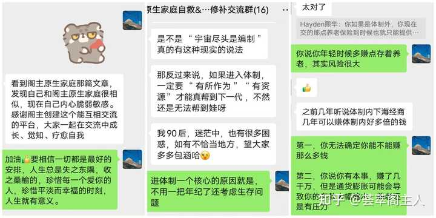

1.了

### **玩阶级剥削，玩的最不知分寸的，往往是穷人。因为他们剥削不了别人，就转而剥削自己的子女，天然的下级。**

最常见的手段，就是**用“我是为你好”这样的话术，对孩子发泄自己因为无能，过得不如意而产生的怨气。**

一方面希望孩子有出息，一方面又不停地贬低、否定孩子，剥夺孩子的自信。

一方面希望孩子懂得尊重别人，一方面自己又没有边界，甚至经常打骂孩子，从来不尊重孩子。

一方面希望孩子强势不懦弱，自己却窝里横；在外面是大好人，在家欺压孩子，辱骂孩子，不给孩子任何反抗的机会。

这种家庭环境长大的孩子，只要不抑郁或者人格分裂，我觉得都是高质量人类了。

这种家庭，实际上就是一个精神病院。正常人待久了也会变成精神病。

这种家庭的孩子，除了远离，几乎没有任何可以摆脱贫穷，获得重生的机会。

穷人家庭最缺的是钱，却不光是钱，长期的贫穷和本身所处的环境，决定**家庭里的每一个人都毫无情绪价值，简直代际相传。**

很多穷人父母种种不可思议的行为，比如**哭穷卖惨，无限贬低、打压对方**，一点小事就暴怒上纲上线，其实都是在**向伴侣或者孩子索取情绪价值。**

他们希望伴侣或者孩子能**以绝对优质的情绪价值填补自己内心的黑洞**，自己则要**源源不断的发泄索取。**

最可怕的是，**越是情绪黑洞的人越不自知，越是觉得身边所有人都对他不好，都欠了他的。**怪责起别人来，尤其是自己身边最亲近的人，总是毫不留情，有无数种理由。

这种家庭的孩子走入社会后，慢慢发现自己的确双商很低，性格极差，简直就是父母的翻版，根本不是家里迥然不同的异类。

反而是脱离家庭之后，能渐渐意识到自己的不足，待人接物也没有以前那么极端刻薄了，因为没有情绪黑洞在不断索取情绪价值，也没那么多戾气向外界散发了。

所以，人都是环境的产物，穷人想要翻身，想要变得有价值，想要获得财富与幸福，首要的，就是脱离底层圈子。

因为在底层世界里，**你永远，永远都比不上一两个廉价的物件。**穷人家庭使用物件都会格外珍惜，而穷人和穷人的孩子，只能被作践，毫无体面和尊严。

大概90%以上的中国式父母都这样教育过自己的孩子：

**“我把你生下来不是为了让你享受的。”**

**“正因为我和你爸没有希望了，才这样要求你。”**

类似的话，我想/00这波人小时候应该都听过，还不止一次。

这些话的背后，实际上就是底层父母生养孩子最深层的动机：**制造并奴役一个灵魂，让它承担着不应承受的痛苦去实现制造者的执念。**

被父母这种变态的思想和行为逼疯的人简直太多了。我之前火爆全网，被无数号主抄袭的一篇文章《[穷人的家庭，堪称精神病院](https://link.zhihu.com/?target=https%3A//mp.weixin.qq.com/s/oBOWJJmqnyg3o6oJYVP6aw)》，讲的就是底层父母对他们的小孩，进行的极端精神压迫，导致整个家庭的氛围，就如同一个小型精神病院。

在这样的家庭氛围下成长的孩子，**往往对于恋爱结婚、生育下一代的意愿极低，**低到令人发指的程度，而且他们的**个人能力、认知水平、经济状况也堪忧**，过得稍微好一点的，也都是在和原生家庭带来的伤害进行**日复一日的战斗与抗争**，并且**极其容易陷入严重的精神内耗**。

底层穷人父母对孩子最残酷的行为就是：

没钱，但是一定要生下他，让他**尝遍酸甜苦辣。**长大后，继续对他pua，让他产生**自己不配一切美好事物**的想法。但凡他花钱超过一点点，就会有**强烈的心理负担**。即使他花千倍万倍的努力得到的成果，也**依然会觉得自己配不上。**

我早就说过，**贫穷，只是穷人身上最表面的、最不起眼的缺点。**真正残忍的，是穷人小孩从生下来就要面临的，**永无止境的贬低与嘲讽。**

他是孩子，他也是一个人。鲁迅先生曾说过，**小时候不把他当人，长大后也成不了人。**

底层父母本身自己活得猪狗不如，生下小孩还要像猪狗一样去奴役他，打着为他好的旗号，把他拴在驴子磨盘上，日复一日逼着他努力学习、刷题、考试、996、结婚生子，重复他们悲哀的命运，何其哀哉！

两只老鼠能生出蛟龙桂凤，本来就是赌概率，而且概率极低的事件。老是看别人家的孩子，却从来不看别人家的家长。

**赌赢了，孩子成器了，可以救自己脱离苦海；孩子很普通，还理所当然责怪他不努力、不孝顺。**

感情只要做了父母，就永远是占据道德制高点、神圣不可侵犯的大人了？

你在社会上啥也不是，你的孩子只能比你地位更低，那他该活得有多惨？

某地某中学连续发生7个中学生跳楼的事件，震惊家长圈。可我看到一位父亲对此的评价是：**活该。这些孩子没有一点抗压能力，死了也活该，不值得可怜。**

我觉得悲哀。太悲哀了。

联想起昨天看到的一个热搜：#专家称年轻人不想生是因为太自私。

在这个所谓的高质量“人口高质量发展支撑中国式现代化”学术研讨会上，**中国人口学会副会长原新**大言不惭，说年轻人不想生成本高并非主因。高昂的经济成本固然重要，但是文化观念的改变恐怕更加重要。

以前人们认为结婚生子人生和家庭才会完整，家庭以孩子为中心。**现在年轻人的生活是以自我为中心，而不是以孩子为中心**，年轻人更加注重自我，追求自身发展和自我快乐，如果生育会阻碍自我发展和享受生活，那么就会选择不生，有些人甚至选择不婚。

在他看来，生活成本高并不是最重要的影响因素，因为过去家庭收入很少，但要生育和养育三四个孩子，生活成本同样很高。

不用想，此言一出，评论区必然是被骂个狗血淋头。

年轻人不生，还真不是因为太自私了。相反，年轻人更能和自己未来的孩子共情，**不想让孩子再经历一遍自己遭的罪**，所以才选择不生。

要是有钱，有爱，谁不愿意生呢？

既没钱又没爱，生下孩子继承上一代的贫穷、痛苦，给富人当牛做马做时代耗材，成为别人的附属品，提线木偶，浑浑噩噩活一辈子没有自由，这样的人生，如何忍心让下一代面对呢？

“人生而自由，却无往不在枷锁之中。”可枷锁也有轻重之分。

底层穷人的灵魂早已在出生时就被锁死，想要获得自由，除非完全与原生家庭决裂，在社会上摸爬滚打攀贵人，在人生几次重大选择上全部实现阶级跳跃，才能有一丝摆脱被奴役灵魂的机会。

只有当你达到一定高度时，全世界才会对你彬彬有礼。

自从接触了互联网，阁主也认识了很多跟自己家庭背景、学历经历差不多的，看上去非常优秀、有能力的年轻人。

我发现，这种人如果混得不好，基本上百分之百可以断定，**他的原生家庭太差了，家庭给他的消耗太多了。**

拥有聪慧的头脑和不凡的能力，本该在大好年华心无旁骛朝着事业上的目标奋斗，结果却一次又一次被原生家庭带来的创伤打败，**极度缺乏安全感，自我认可度低，外表自信勇敢，内里却卑微怯懦，讨厌一切社交，干什么都干不长。**

反而是有很多小时候班上的“学渣”，家庭条件也一般，默默无闻随波逐流的角色，在抓住一两个好运的机会以后，人生一下子起飞，很快拿到了大城市安居乐业的入场券。

观察这些人的经历，你会发现，他们好像也没做什么特别的事情，就是“该干什么干什么，能干什么干什么。”

简单点说，就是，在一个重要的人生节点上，**“不瞎折腾”。**

他们为什么反而能做到心无杂念，不内耗自己呢？稍微深入了解一下，你会发现，他们的父母，他们的家庭氛围大概率就是如此。

有句老话叫，“**父爱则母静，母静则子安，子安则家和，家和万事兴。**”

它相反的话叫，“**父恶则母苦，母苦则子惧，子惧则家衰，家衰败三代。**”

对于前者来说，家庭中的每一个成员都处于一种长期的良性循坏中，后者则处于长期的恶性循环。

这种差距一天两天，甚至三年五年可能都看不太明显，但是把时间拉倒二十年三十年，就相当明显了。

我是在大学毕业工作一年左右，在一个失眠不安的夜晚，忽然福至心灵，顿悟家里这么多年那些困扰自己的破事是怎么回事了。

所谓“**父恶则母苦**”，并不一定是指父亲的品行、才能、财富、社会地位低下，也不是他不勤劳不节俭，而是指一个家庭里的父亲，**根本不会考虑他的妻子的感受和利益。**

**比如，妻子的情绪出现问题，不能给予她温暖的抚慰和强有力的支持，反而沉默以待。**

**比如，要求妻子无条件为男方的家庭付出，自己却与妻子的家人形同陌路。**

**比如，假借工作名义，逃避照顾子女、教育子女的义务，长时间在外工作，对妻子和孩子很少过问，更不能提供情绪价值。**

这种家庭里的妻子和母亲，因为十多年来的忍耐和吃哑巴亏，在大大小小，日复一日的亏欠中，从失望，到愤怒，最后到绝望。**长期地亏欠一个人，对方是会生怨的，一旦这股怨气一上来，那就是要死要活，毁天灭地。**

**一个逃避责任的父亲，造成一个内心充满怨气的母亲，那么他十几年来在亏妻这件事上的报应，就会像多米诺骨牌一样，靠着惯性，朝着家庭里最弱势的孩子滚滚而来。**

这种家庭的孩子，对家庭最深刻的记忆，就是**一个无能、不管事的父亲，和一个随时都可能因为一点点小事而发疯的母亲。**

有句话叫，“这个世界上最傻的行为就是自己的孩子在受到外人嘲笑的时候，自己装瞎看不见，甚至还去附和对方。人家拍拍屁股就走了，只会留下你的孩子怨恨你。”**我爸就是这样，他好像从来都不知道，如果他不护着自己的老婆孩子，啥啥都装瞎的话，那么等以后，他就没有老婆孩子了。**

我父母的婚姻充分的说明了这一点。两口子结婚，一定一定要目标一致，两个人的心都在对方身上，都在小家上。男方要有一种“我要护着这个小家”的念头。我是家里的顶梁柱，老婆孩子遇到事了，我上。一定要有一种“给予一方安定”的想法。不然，**真的不要结婚不要生孩子，最好连狗都不要养，不然真的对人对狗都是一种折磨。**

在这种家庭环境下成长的人，他们无一例外都会养成这样的性格：**讨好型+封闭型。**

讨好型倾向是因为常年成长环境不安全，“不得不讨好”而衍生出的“听话乖巧”。所以他们上学时可能成绩很好，其中很大一部分动力，则来源于对师长的恐惧和讨好的心理。因为对于一个孩子来说，“成绩好”就等于“听话乖巧懂事”，就等于安全感。

封闭性倾向是因为“一惊一乍、要死要活”的事情太多了，完全适应不了，而衍生出一种“只有跟人保持距离才觉得自己安全”的下意识反应。

这两大病态倾向发展出了一堆的问题。比如，不跟人交流，心智停滞，怯懦自卑，疑神疑鬼，恐婚恐育，抑郁惊恐，悲观厌世等。

而一个**心智不健全，且有着严重心理问题的人，即使他智商高于常人，能力强于他人，他在各个方面想要得到良性发展，必然是一件相当困难的事情。**

这样的人离开了学校的象牙塔，会很难适应社会。**完全可以这样说，如果他不克服心智上不健全的那一部分，那等他下次再次受到外界刺激后，身上抑郁惊恐的特质就会复发。**

**这也印证了我前面写的那句老话，“父恶则母苦，母苦则子惧，子惧则家衰，家衰败三代。”**

在这样的家庭中成长起来的人，想要摆脱这样衰败的宿命，那他必须清醒地知道，他身上的坎，比其他人多的多。

如果他能渡劫成功，心智得到修正，整个人独立起来，并且，能找到了一个和他一样全心全意能去建立一个新家的合作伙伴，那么他的家庭，从他开始，就又走向兴旺发达的路线了。

尤其是女孩子，如果她本人还有一种“等靠要”，等男人来救赎自己，并且被爱情“忽悠”生下了孩子后，才发现她本人的婚姻里没有她的位置。那么二十年下来，她就会变成一个怨妇。由此而复制粘贴上一代人的命运。

那天晚上彻底想清楚这些以后，我的心情豁然开朗。仿佛这么多年心里积聚的阴暗负面的情绪都消散了许多。我开始给自己制定简单、清晰、明确的目标，做一切能让我感受到积极向上的事情。我的互联网写作生涯，就是从那时开始的。

在这个过程中，我帮助和鼓励了很多朋友，认识到自己原生家庭给自己带来的痛苦从何而来，如何最大程度上进行自我救赎和成长。

我发现，破除原生家庭诅咒最好的方式，就是跟与自己有相同经历的人，尤其是已经走过来的人交流，分享彼此的困境和成长，在一个积极向上、良性循环的朋友圈子里，洗濯愈合过去的伤。

因此，我决定建立一个原生家庭自救&性格缺陷修补交流群，为有和我有类似经历和困扰的朋友，搭建一个积极向上、温暖安全的平台。

这个交流群不会以赚钱为目的，入群者只需要付款10元即可加入，这10元是为了防止那些在群里乱发广告、白嫖的低素质垃圾，设置的门槛，收上来的金额会全部以拼手气红包的形式返还给大家，增加群内气氛。

想要进群的朋友，请关注阁主公众号【荟萃阁】，后台发送【自救】，获取入群信息。

读者，愿你的人生披荆斩棘，一路生花。

[编辑于 2024-03-04 17:57](//www.zhihu.com/question/612863260/answer/3153795590)・内蒙古

​​1.8 万​5484 ​分享

​​

收起​
