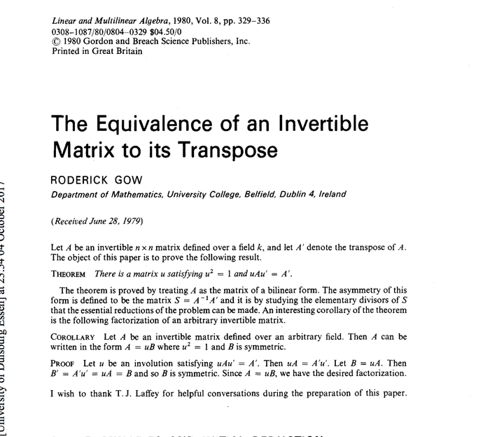
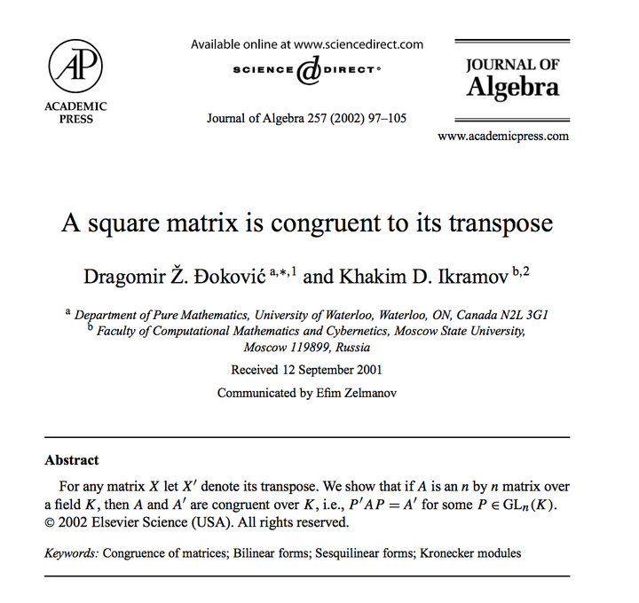
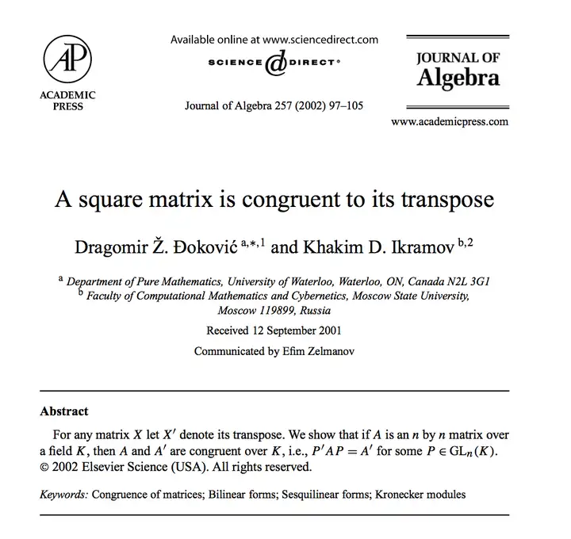
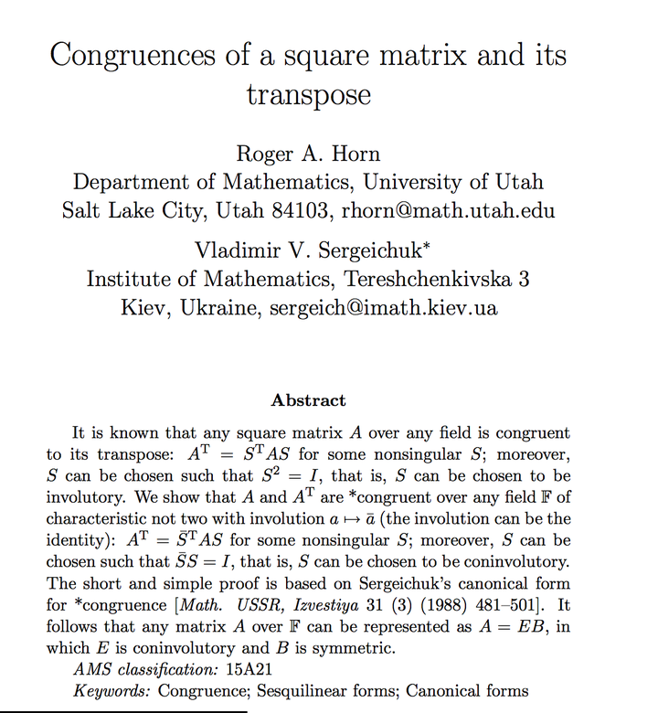

谢邀：

对于一般数域上的问题，请看下面的论文

https://www.dropbox.com/s/lc3gu1qju6u3ahd/Screenshot%202017-10-05%2008.55.32.png?dl=0

或者

https://ac.els-cdn.com/S0021869-s2.0-S0021869302001266-main.pdf?_tid=c268b8f2-a996-11e7-97da-00000aacb360&acdnat=1507185243_b217ea5697b3655df3e280042e896aba

如果你说的合同是“对偶意义下”的合同，那么你可以看下面的07年的论文:

[https://arxiv.org/pdf/0709.2489.pdf](https://link.zhihu.com/?target=https%3A//arxiv.org/pdf/0709.2489.pdf)

如果把合同换成相似，那么结果如下。

定义 B := \begin{bmatrix} 0 & 0 & \cdots & 0 & 1 \\ 0 & 0 & \cdots & 1 & 0 \\ \vdots & \ \vdots & & \vdots & \vdots \\ 0 & 1 & \cdots & 0 & 0 \\ 1 & 0 & \cdots & 0 & 0 \end{bmatrix} \qquad \mathrm{和} \qquad J := \begin{bmatrix} \lambda & 1 & & \\ & \ddots & \ddots & & \\ & & \lambda & 1 \\ & & & \lambda \end{bmatrix}  ，

那么 B^{-1}=B ,而且 B^{-1}J^tB=J ,也就是说任意一个jordan块矩阵都可以合同于其转置。然后，一个矩阵总可以合同于如下的jordan形

J = \begin{bmatrix} J_1 & & & \\ & J_2 & & \\ & & \ddots & \\ & & & J_n \end{bmatrix} .

我们每个 J_i 都找好对应的 B_i ，构造

B = \begin{bmatrix} B_1 & & & \\ & B_2 & & \\ & & \ddots & \\ & & & B_ n\end{bmatrix} .

于是 B^{-1}J^tB=J 。

ps: 这问题居然是这几天邀请我的唯一数学问题。

[编辑于 2017-10-05 15:09](//www.zhihu.com/question/66221922/answer/239632918)

​​62 ​4 ​分享

​​

收起​
