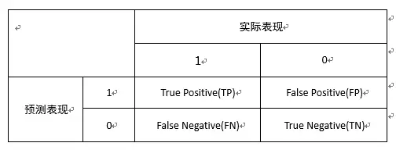
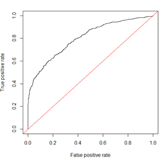
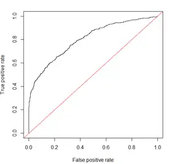
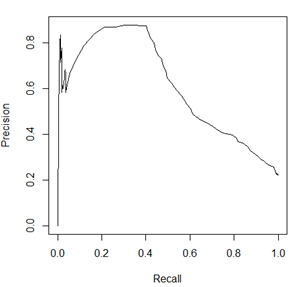

编辑推荐

精确率、召回率、F1、AUC和ROC曲线其实都是评价模型好坏的指标，而且相互之间是有关系的，只是侧重点不同，题主如果理解了各指标的定义就能找出他们的区别与联系，下面就用一个例子解释这些指标。

以白条的逾期预测模型为例，这是一个有监督的二分类模型，模型对每个样本的预测结果为一个概率值，我们需要从中选取一个阈值来区分好用户和坏用户。

如果我们已经定好了一个阈值，超过此阈值定义为坏用户（1），低于此阈值定义为好用户（0），就可以计算出混淆矩阵（Confusion matrix）。

根据混淆矩阵我们可以得到TP,FN,FP,TN四个值，TP即为预测正确的坏用户的个数，FN为预测错误（预测为好用户）的坏用户个数，根据这四个值即可计算精确率、召回率和F1。

精确率（Precision）为TP/(TP+FP)，即为在预测为坏人的人中，预测正确（实际为坏人）的人占比。

召回率（Recall）为TP/(TP+FN)，即为在实际为坏人的人中，预测正确（预测为坏人）的人占比。

F1值是精确率和召回率的调和均值，即F1=2PR/(P+R)，相当于精确率和召回率的综合评价指标。

另外还有Fα值，为F1值的变体， F&#x3B1;=&#xFF08;&#x3B1;2+1&#xFF09;PR/(&#x3B1;2P+R)" role="presentation">Fα=（α2+1）PR/(α2P+R)Fα=（α^2+1）PR/(α^2 P+R) ，利用α给P和R赋予不同的权重，若α=1则为F1值。

接着来说ROC曲线（Receiver operating characteristic curve），ROC曲线其实是多个混淆矩阵的结果组合，如果在上述模型中我们没有定好阈值，而是将模型预测结果从高到低排序，将每个概率值依次作为阈值，那么就有多个混淆矩阵。

对于每个混淆矩阵，我们计算两个指标TPR（True positive rate）和FPR（False positive rate），TPR=TP/(TP+FN)=Recall，TPR就是召回率。FPR=FP/(FP+TN)，FPR即为实际为好人的人中，预测为坏人的人占比。我们以FPR为x轴，TPR为y轴画图，就得到了ROC曲线。

在画ROC曲线的过程中，若有一个阈值，高于此阈值的均为坏人，低于此阈值的均为好人，则认为此模型已完美的区分开好坏用户。此时坏用户的预测准确率（TPR）为1，同时好用户的预测错误率（FPR）为0，ROC曲线经过（0,1）点。

AUC（Area Under Curve）的值为ROC曲线下面的面积，若如上所述模型十分准确，则AUC为1。

但现实生活中尤其是工业界不会有如此完美的模型，一般AUC均在0.5到1之间，AUC越高，模型的区分能力越好，上图AUC为0.81。

若AUC=0.5，即与上图中红线重合，表示模型的区分能力与随机猜测没有差别。若AUC真的小于0.5，请检查一下是不是好坏标签标反了，或者是模型真的很差。。。

也有人会用Gini系数来评价模型，其实Gini系数与AUC所表示的意义相同，只是计算方式不同。Gini系数指ROC曲线与中线（上图红线）围成的面积和中线（上图红线）之上的面积（0.5）的比例，两者之间换算公式为Gini=2*AUC-1。

除此之外，在评价模型时还会用到KS（Kolmogorov-Smirnov）值，KS=max(TPR-FPR)，即为TPR与FPR的差的最大值，KS值可以反映模型的最优区分效果，此时所取的阈值一般作为定义好坏用户的最优阈值。

上图ROC曲线的KS值为0.45，此时TPR=0.79，FPR=0.34。

当然，阈值的选取还要考虑应用场景及业务要求，对于FPR不敏感而对TPR敏感的场景，可以适当减少阈值以增加TPR。

如精准营销领域的商品推荐模型，模型目的是尽量将商品推荐给感兴趣的用户，若用户对推荐的商品不感兴趣，也不会有很大损失，因此此时TPR相对FPR更重要。

再比如反欺诈领域的欺诈预测模型，由于模型结果会对识别的坏人进行一定的处置措施，FPR过高会对好人有一定干扰，造成误杀，影响客户体验，因此模型需保证在低于一定FPR的基础上尽量增加TPR。

了解了这些指标定义后可以发现，对于分类模型，AUC、KS、ROC曲线是综合评价模型区分能力和排序能力的指标，而精确率、召回率和F1值是在确定最佳阈值之后计算得到的指标。

当然，PR曲线（Precision-Recall curve）和ROC曲线类似，ROC曲线是FPR和TPR的点连成的线，PR曲线是准确率和召回率的点连成的线，如下图所示。

我们又知道，Recall=TPR，因此PRC的横坐标为ROC的纵坐标。

TPR、FPR、Precision、Recall的定义来对比，TPR、Recall的分母为样本中坏客户的个数，FPR的分母为样本中好客户的个数，样本一旦确定分母即为定值，因此三个指标的变化随分子增加单调递增。

但是Precision的分母为预测为坏客户的个数，会随着阈值的变化而变化，因此Precision的变化受TP和FP的综合影响，不单调，变化情况不可预测。

而且TP和FP的值分别受样本中好坏客户个数的制约，若样本极不均衡，比如好客户过多，则随Recall的增加，FP会远大于TP的值，Precision会变化很大。

相对来讲ROC曲线会稳定很多，在正负样本量都足够的情况下，ROC曲线足够反映模型的判断能力。

因此，对于同一模型，PRC和ROC曲线都可以说明一定的问题，而且二者有一定的相关性，如果想评测模型效果，也可以把两条曲线都画出来综合评价。

对于有监督的二分类问题，在正负样本都足够的情况下，可以直接用ROC曲线、AUC、KS评价模型效果。在确定阈值过程中，可以根据Precision、Recall或者F1来评价模型的分类效果。

对于多分类问题，可以对每一类分别计算Precision、Recall和F1，综合作为模型评价指标。

当然，评价模型的指标不止以上几种，同时对于不同的应用场景及业务要求会有不同的侧重，根本上需要根据建模目的进行具体分析。

**

本文作者：ZRobot金融科技公司数据科学家 崔雅丽  **

*p.s.  想了解更多精彩文章，请关注 ZRobot金融科技公司微信公众号：ZROBOT*

[编辑于 2017-08-30 09:45](//www.zhihu.com/question/30643044/answer/222274170)

​​814 ​72 ​分享

​​

收起​
