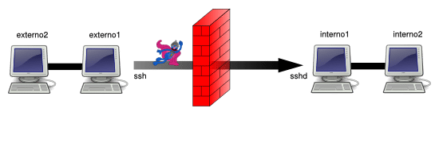
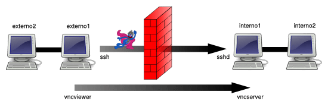
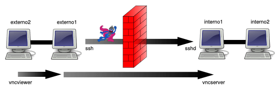
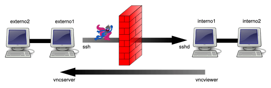
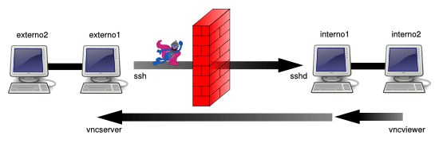
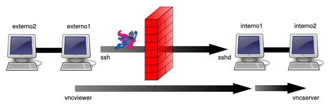
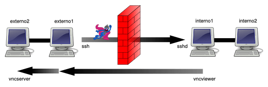
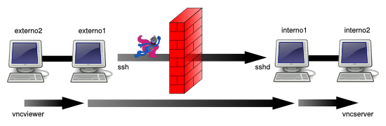
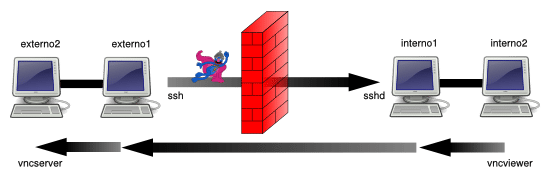

对于 Secure Shell (SSH) 这样的网络协议来说，其主要职责就是在终端模式下访问一个远程系统。因为 SSH 协议对传输数据进行了加密，所以通过它在远端系统执行命令是安全的。此外，我们还可以在这种加密后的连接上通过创建隧道（端口转发）的方式，来实现两个不同终端间的互联。凭借这种方式，只要我们能通过 SSH 创建连接，就可以绕开防火墙或者端口禁用的限制。

这个话题在网络领域有大量的应用和讨论：

- Wikipedia: SSH Tunneling
- O’Reilly: Using SSH Tunneling
- Ssh.com: Tunneling Explained
- Ssh.com: Port Forwarding
- SecurityFocus: SSH Port Forwarding
- Red Hat Magazine: SSH Port Forwarding
我们在接下来的内容中并不讨论端口转发的细节，而是准备介绍一个如何使用 OpenSSH 来完成 TCP 端口转发的速查表，其中包含了八种常见的场景。有些 SSH 客户端，比如 PuTTY，也允许通过界面配置的方式来实现端口转发。而我们着重关注的是通过 OpenSSH 来实现的的方式。

在下面的例子当中，我们假设环境中的网络划分为外部网络（network1）和内部网络（network2）两部分，并且这两个网络之间，只能在 externo1 与 interno1 之间通过 SSH 连接的方式来互相访问。外部网络的节点之间和内部网络的节点之间是完全联通的。

**

*SSH tunnels: no tunnel*

### 场景 1**

**在 externo1 节点访问由 interno1 节点提供的 TCP 服务（本地端口转发 / 绑定地址 = localhost / 主机 = localhost ）externo1 节点可以通过 OpenSSH 连接到 interno1 节点，之后我们想通过其访问运行在 5900 端口上的 VNC 服务。

*SSH Tunnels: Scenario 1*

我们可以通过下面的命令来实现：

`externo1 $ ssh -L 7900:localhost:5900 user@interno1 `

现在，我们可以在 externo1 节点上确认下 7900 端口是否处于监听状态中：

`externo1 $ netstat -ltn
Active Internet connections  (only servers)
Proto Recv-Q  Send-Q  Local Address Foreign Address State 
...
Tcp 0 0 127.0.0.1:7900 0.0.0.0:*  LISTEN  
...`

我们只需要在 externo1 节点上执行如下命令即可访问 internal 节点的 VNC 服务：

`externo1 $ vncviewer localhost::7900 `

注意：在 vncviewer 的 man 手册中并未提及这种修改端口号的方式。在 About VNCViewer configuration of the output TCP port 中可以看到。这也是 the TightVNC vncviewer 所介绍的的。

### 场景 2**

**在 externo2 节点上访问由 interno1 节点提供的 TCP 服务（本地端口转发 / 绑定地址 = 0.0.0.0 / 主机 = localhost）这次的场景跟方案 1 的场景的类似，但是我们这次想从 externo2 节点来连接到 interno1 上的 VNC 服务：

*SSH Tunnels: Scenario 2*

正确的命令如下：

`externo1 $ ssh -L 0.0.0.0:7900:localhost:5900 user@interno1 `

看起来跟方案 1 中的命令类似，但是让我们看看 netstat 命令的输出上的区别。7900 端口被绑定到了本地（127.0.0.1），所以只有本地进程可以访问。这次我们将端口关联到了 0.0.0.0，所以系统允许任何 IP 地址的机器访问 7900 这个端口。

`externo1 $ netstat -ltn
Active Internet connections  (only servers)
Proto Recv-Q  Send-Q  Local Address Foreign Address State 
...
Tcp 0 0 0.0.0.0:7900 0.0.0.0:*  LISTEN
... `

所以现在在 externo2 节点上，我们可以执行：

`externo2 $ vncviewer externo1::7900 `

来连接到 interno1 节点上的 VNC 服务。

除了将 IP 指定为 0.0.0.0 之外，我们还可以使用参数 -g（允许远程机器使用本地端口转发），完整命令如下：

`externo1 $ ssh -g -L 7900:localhost:5900 user@interno1 `

这条命令与前面的命令能实现相同效果：

`externo1 $ ssh -L 0.0.0.0:7900:localhost:5900 user@interno1 `

换句话说，如果我们想限制只能连接到系统上的某个 IP，可以像下面这样定义：

`externo1 $ ssh -L 192.168.24.80:7900:localhost:5900 user@interno1

externo1 $ netstat -ltn
Active Internet connections (only servers)
Proto Recv-Q Send-Q Local Address Foreign Address State 
... 
Tcp 0 0 192.168.24.80:7900 0.0.0.0:* LISTEN
...`

### 场景 3**

**在 interno1 上访问由 externo1 提供的 TCP 服务（远程端口转发 / 绑定地址 = localhost / 主机 = localhost）在场景 1 中 SSH 服务器与 TCP 服务（VNC）提供者在同一个节点上。现在我们想在 SSH 客户端所在的节点上，提供一个 TCP 服务（VNC）供 SSH 服务端来访问：

*SSH Tunnels: Scenario 3*

将方案 1 中的命令参数由 -L 替换为 -R。

完整命令如下：

`externo1 $ ssh -R 7900:localhost:5900 user@interno1 `

然后我们就能看到 interno1 节点上对 7900 端口正在监听：

`interno1 $ netstat -lnt
Active Internet connections (only servers)
Proto Recv-Q Send-Q Local Address Foreign Address State 
... 
Tcp 0 0 127.0.0.1:7900 0.0.0.0:* LISTEN
...`

现在在 interno1 节点上，我们可以使用如下命令来访问 externo1 上的 VNC 服务：

`interno1 $ vncviewer localhost::7900 `

### 场景 4**

**interno2 使用 externo1 上提供的 TCP 服务（远端端口转发 / 绑定地址 = 0.0.0.0 / 主机 = localhost）与场景 3 类似，但是现在我们尝试指定允许访问转发端口的 IP（就像场景 2 中做的一样）为 0.0.0.0，这样其他节点也可以访问 VNC 服务：

*SSH Tunnels: Scenario 4*

正确的命令是：

`externo1 $ ssh -R 0.0.0.0:7900:localhost:5900 user@interno1 `

但是这里有个重点需要了解，出于安全的原因，如果我们直接执行该命令的话可能不会生效，因为我们需要修改 SSH 服务端的一个参数值 GatewayPorts，它的默认值是：no。

> GatewayPorts
该参数指定了远程主机是否允许客户端访问转发端口。默认情况下，sshd(8) 只允许本机进程访问转发端口。这是为了阻止其他主机连接到该转发端口。GatewayPorts 参数可用于让 sshd 允许远程转发端口绑定到非回环地址上，从而可以让远程主机访问。当参数值设置为 “no” 的时候只有本机可以访问转发端口；“yes” 则表示允许远程转发端口绑定到通配地址上；或者设置为 “clientspecified” 则表示由客户端来选择哪些主机地址允许访问转发端口。默认值是 “no”。

如果我们没有修改服务器配置的权限，我们将不能使用该方案来进行端口转发。这是因为如果没有其他的限制，用户可以开启一个端口（> 1024）来监听来自外部的请求并转发到 localhost:7900。

参照这个案例：netcat ( Debian # 310431: sshd_config should warn about the GatewayPorts workaround. )

所以我们修改 /etc/ssh/sshd_config，添加如下内容：

`GatewayPorts clientspecified `

然后，我们使用如下命令来重载修改后的配置文件（在 Debian 和 Ubuntu 上）。

`sudo /etc/init.d/ssh reload `

我们确认一下现在 interno1 节点上存在 7900 端口的监听程序，监听来自不同 IP 的请求：

`interno1 $ netstat -ltn
Active Internet connections (only servers)
Proto Recv-Q Send-Q Local Address Foreign Address State 
... 
Tcp 0 0 0.0.0.0:7900 0.0.0.0:* LISTEN
...`

然后我们就可以在 interno2 节点上使用 VNC 服务了：

`interno2 $ internal vncviewer1::7900`

### 场景 5**

**在 externo1 上使用由 interno2 提供的 TCP 服务（本地端口转发 / 绑定地址 localhost / 主机 = interno2 ）

*SSH Tunnels: Scenario 5*

在这种场景下我们使用如下命令：

`externo1 $ ssh -L 7900:interno2:5900 user@interno1`

然后我们就能在 externo1 节点上，通过执行如下命令来使用 VNC 服务了：

`externo1 $ vncviewer localhost::7900`

### 场景 6**

**在 interno1 上使用由 externo2 提供的 TCP 服务（远程端口转发 / 绑定地址 = localhost / host = externo2）

*SSH Tunnels: Scenario 6*

在这种场景下，我们使用如下命令：

`externo1 $ ssh -R 7900:externo2:5900 user@interno1 `

然后我们可以在 interno1 上通过执行如下命令来访问 VNC 服务：

`interno1 $ vncviewer localhost::7900 `

### 场景 7**

**在 externo2 上使用由 interno2 提供的 TCP 服务（本地端口转发 / 绑定地址 = 0.0.0.0 / 主机 = interno2）

*SSH Tunnels: Scenario 7*

本场景下，我们使用如下命令：

`externo1 $ ssh -L 0.0.0.0:7900:interno2:5900 user@interno1 `

或者：

`externo1 $ ssh -g -L 7900:interno2:5900 user@interno1 `

然后我们就可以在 externo2 上执行如下命令来访问 vnc 服务：

`externo2 $ vncviewer externo1::7900 `

### 场景 8**

> 在 interno2 上使用由 externo2 提供的 TCP 服务（远程端口转发 / 绑定地址 = 0.0.0.0 / 主机 = externo2）

*SSH Tunnels: Scenario 8*

本场景下我们使用如下命令：

`externo1 $ ssh -R 0.0.0.0:7900:externo2:5900 user@interno1 `

SSH 服务器需要配置为：

`GatewayPorts clientspecified `

就像我们在场景 4 中讲过的那样。

然后我们可以在 interno2 节点上执行如下命令来访问 VNC 服务：

`interno2 $ internal vncviewer1::7900 `

如果我们需要一次性的创建多个隧道，使用配置文件的方式替代一个可能很长的命令是一个更好的选择。假设我们只能通过 SSH 的方式访问某个特定网络，同时又需要创建多个隧道来访问该网络内不同服务器上的服务，比如 VNC 或者 远程桌面。此时只需要创建一个如下的配置文件 $HOME/redirects 即可（在 SOCKS 服务器 上）。

`# SOCKS server
DynamicForward 1080

# SSH redirects
LocalForward 2221 serverlinux1: 22
LocalForward 2222 serverlinux2: 22
LocalForward 2223 172.16.23.45:22
LocalForward 2224 172.16.23.48:22

# RDP redirects for Windows systems
LocalForward 3391 serverwindows1: 3389
LocalForward 3392 serverwindows2: 3389

# VNC redirects for systems with "vncserver"
LocalForward 5902 serverlinux1: 5901
LocalForward 5903 172.16.23.45:5901`

然后我们只需要执行如下命令：

`externo1 $ ssh -F $HOME/redirects user@interno1 
`

via: https://wesharethis.com//creating-tcp-ip-port-forwarding-tunnels-ssh-8-possible-scenarios-using-openssh/

作者：Ahmad 译者：[toutoudnf](https://link.zhihu.com/?target=https%3A//github.com/toutoudnf) 校对：[wxy](https://link.zhihu.com/?target=https%3A//github.com/wxy)

本文由 [LCTT](https://link.zhihu.com/?target=https%3A//github.com/LCTT/TranslateProject) 原创编译，Linux中国 荣誉推出
