**本文旨在系统性地整合DRAM相关的全领域专业知识，自底层向上，涵盖了器件结构，工艺流程，电路设计，接口协议等各个层面。**由于涉及的专业面较广，将分为若干个专题进行详细的介绍。目前相关的专题仍在不断补充和更新，欢迎大家持续关注和讨论，常看常新。

写在前面：如果想比较全面地了解DRAM相关的主要技术内容，强烈建议观看【Branch Education】的详解DRAM和DDR5，如果无法访问还有b站版可以观看详解DDR5 DRAM，宝藏视频博主，值得反复观看，接下来正文开始。

DRAM的标准全称应该是Synchronous Dynamic Random Access Memory，即SDRAM。其中Synchronous是指DRAM的时钟信号与CPU同步。Dynamic与Static相对，即存储在DRAM中的数据不是一直保持不变的，而是会因晶体管的漏电发生变化并且需要不断刷新，因此称为动态随机存储器。Random Access是指DRAM支持随机访问，在寻址时可以访问存储阵列中的任意一个存储单元，与随机访问相对的是顺序访问，顺序访问最典型的例子就是磁带，只能快进或者快退到指定位置才能访问对应的数据，无法实现随机访问。

### DRAM的分类

#### SDR和DDR

按照数据传输速率，可以将DRAM分为SDR和DDR。第一代的DRAM采用的是SDR技术，即Single Data Rate，数据传输只在时钟的上升沿采样，因此在一个时钟周期内只能传输一位数据，如图1上方所示。DRAM从第二代开始采用DDR技术，即Double Data Rate，数据传输时会在时钟的上升沿和下降沿都进行采样，如图1下方所示。这样在一个时钟周期内可以传输2位数据，因此可以获得双倍的数据传输速率。 

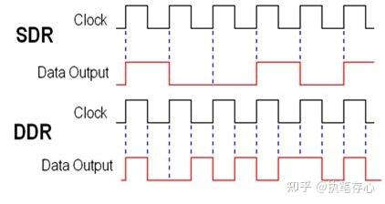

图1 SDR与DDR示意图
#### DDR、LPDDR和GDDR

按照DRAM的应用场景，可以将DRAM分为DDR、LPDDR和GDDR。其中DDR主要应用于桌面和服务器领域；LPDDR由于具有低功耗的优势，常用于便携设备和移动终端；GDDR具有大位宽和大带宽的优势，常用于显卡和大算力AI芯片中。

### DRAM基本组成与原理

目前主流的DRAM技术采用的是如图2右侧所示的存储单元，每个存储单元由1个晶体管(Transistor)和1个电容(Capacitor)组成，因此称为1T1C型存储单元。其中电容负责数据的存储，而晶体管控制电容的选通。数据以电压的形式存储在电容的SN节点(Storage Node, SN)，当对WL施加电压时，晶体管打开，可以对SN节点的电压进行读取或写入，以实现数据的读写操作。

需要注意的是由于晶体管即使在关闭状态下也存在一定的漏电流，并且电容也存在一定的漏电流，因此存储在电容上的电压信号会随时间衰减导致数据丢失，即DRAM中存储的数据在断电后无法保持，因此DRAM属于易失性存储器。为了让DRAM中的数据能够一直保存下去，需要对DRAM进行定期刷新，即每隔一段时间将数据读取出来再写回DRAM中，这也是DRAM区别于其他存储器的一个重要特征。

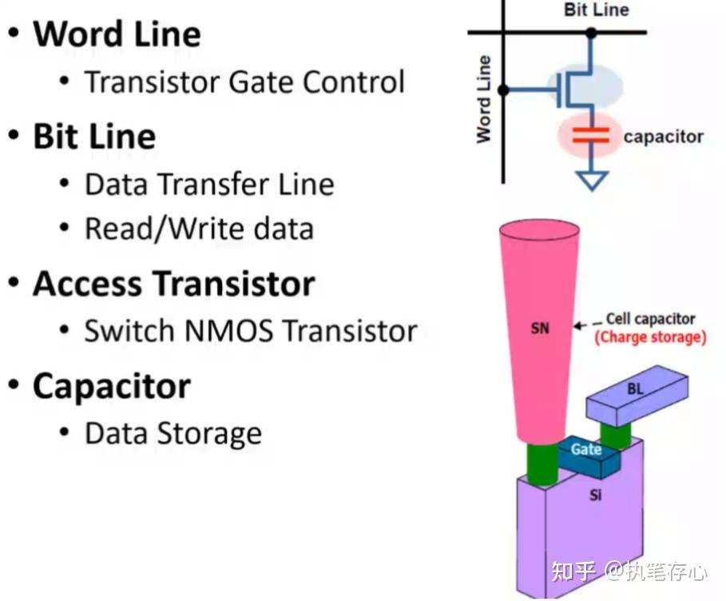

图2 1T1C型DRAM存储单元
#### DRAM存储单元操作原理

DRAM存储单元进行数据读取操作的基本原理就是存储电容Cs和位线电容Cbl之间的电荷共享。如图3所示，在读取操作开始之前，BL和BLB都会先预充至VINTA/2，因此储存在BL上的电荷量为Cbl*VINTA/2。当DRAM存储的信息为“1”时，存储电容上的电荷量为Cs*VINTA；当DRAM存储的信息为“0”时，存储电容上的电荷量为0。当WL打开后，BL和存储电容将开始电荷共享并逐渐趋于相同的电位，根据电荷守恒原理，当DRAM存储的信息为“1”时，电荷共享后BL上的电压将为 \frac{C_{s}*VINTA+C_{bl}*VINTA/2}{C_{s}+C_{bl}} ，而当DRAM存储的信息为“0”时，电荷共享后BL上的电压将为 \frac{C_{bl}*VINTA/2}{C_{s}+C_{bl}} 。同时BLB上的电压保持为VINTA/2并作为参考电压与电荷共享后的BL电压输入到SA电路进行比较，当BL电压高出VINTA/2时，SA会将DRAM存储的数据识别为“1”，反之则识别为“0”。值得注意的是，如图三右侧所示，无论是数据“1”还是数据“0”，在理想条件下，电荷共享之后BL电压与参考电压的差值均为\frac{C_{s}*VINTA/2}{C_{s}+C_{bl}} 。

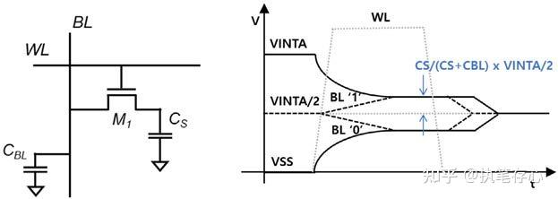

图3 DRAM数据读取原理
### DRAM制程微缩与器件结构演化

详见专题文章 

DRAM的器件结构随着工艺制程的微缩而不断发生改变，图4展示了不同技术代的DRAM的特征尺寸以及在各个技术代为了继续微缩而开始引入的新技术或器件结构。

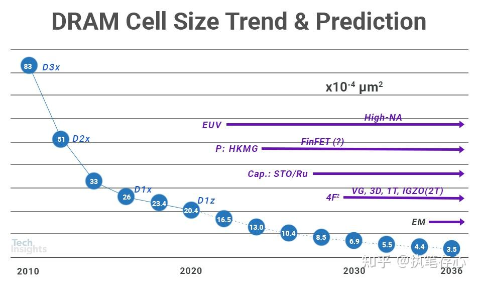

图4 DRAM的微缩趋势图5展示了典型的DRAM芯片截面图，其中虚线左侧为存储阵列区，虚线右侧为外围电路区。从图中可以观察到，由于DRAM将1T1C的电容堆叠在晶体管上方且高度较高，因此在外围电路区需要较高的MC进行金属层之间的连接。

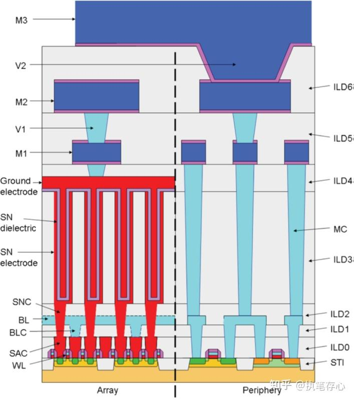

图5 DRAM芯片截面图
#### DRAM Capacitor

目前DRAM采用的是1T1C存储单元，为了减小存储单元的面积，1T1C中的电容已经从图6(a)所示最早期的平板电容演化为图6(b)所示的圆柱形电容，其中圆柱的最外层和最内层分别对应平板电容的两个极板，极板材料通常为导电的金属或TiN等材料。而位于两个极板中间的就是电介质层，为了增大电容一般采用High-K材料。

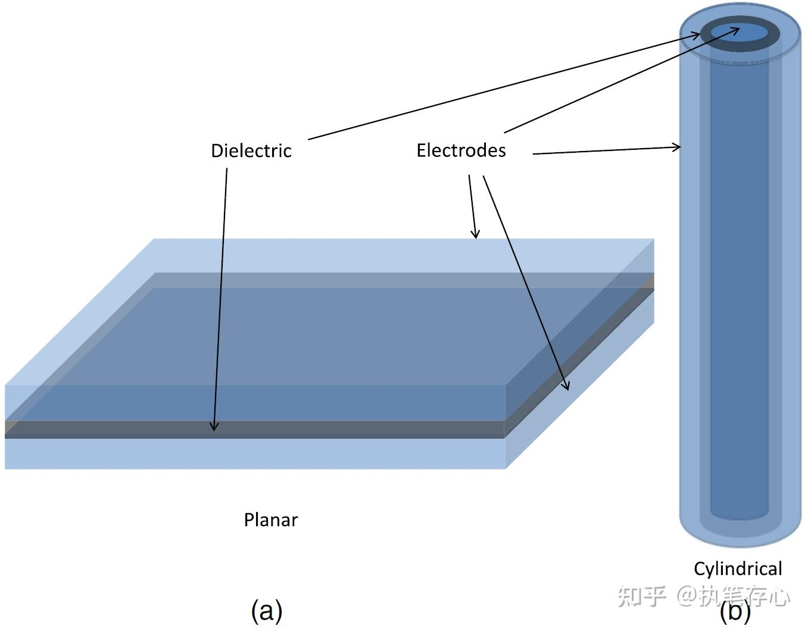

图6 (a)平板电容与(b)DRAM采用的圆柱形电容DRAM的圆柱形电容根据工艺节点又可以划分为图6所示的两种结构，其中在2x nm以上的工艺节点，采用的是图7(a)所示的Cylinder型电容结构，其特征为电容的顶电极会有一个深凹槽，这样在有限的投影面积下，可以使得电容的总面积几乎翻倍，从而可以实现双倍的存储电容Cs。但随着工艺节点的不断微缩，凹槽的直径不断减小使得深宽比不断增大，使得工艺上已经难以实现凹槽的刻蚀，因此电容结构又变为了图7(b)所示的Pillar型电容结构，该结构也一直被后续更先进的DRAM工艺延用。

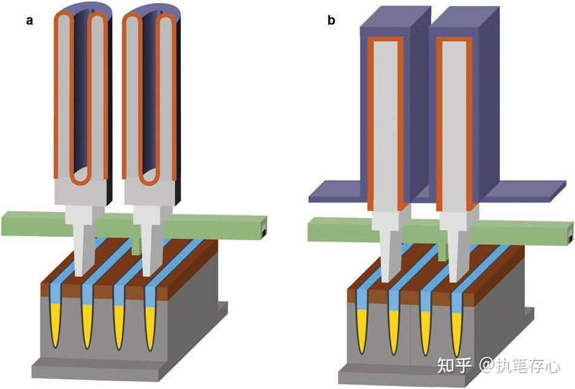

图7 (a) Cylinder型电容结构 (b) Pillar型电容结构
#### Transistor演化

随着DRAM制程的不断微缩，由于晶体管的沟道长度下降，短沟道效应越来越明显，晶体管漏电显著增加，DRAM的数据保持时间下降，这对于DRAM来说是难以接受的。因此，为了在DRAM制程微缩的过程中保持晶体管的有效沟道长度，DRAM存储单元中的晶体管的结构也在不断发生变化。

DRAM的晶体管演化可以简要地概况为以下三个阶段，即从图8(a)所示早期的平面晶体管结构，逐步演变为图8(b)所示的Recess Gate(RG)晶体管结构，再到目前先进DRAM工艺中普遍采用的Burried WL(BWL)晶体管结构，如图8(c)所示。

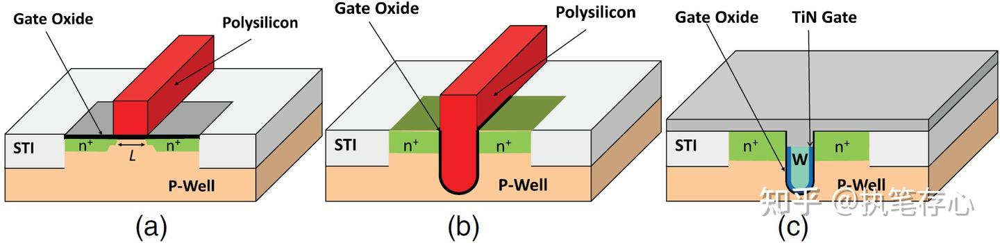

图8 DRAM晶体管的演化（a）平面晶体管（b）Recess Gate(RG)晶体管（c）Burried WL(BWL)晶体管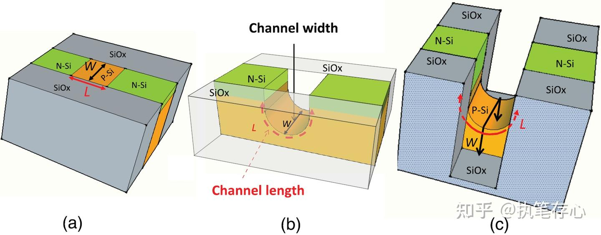

图9 DRAM晶体管三种演化阶段的沟道三维示意图：（a）平面晶体管（b）Recess Gate(RG)晶体管（c）Burried WL(BWL)晶体管如图9所示，DRAM晶体管的结构之所以发生这样的变化，是为了在器件尺寸缩减的同时，保持沟道的有效长度基本不变，抑制短沟道效应引起的漏电流增加，从而保障DRAM在刷新时间内数据不会丢失。在早期制程(>150nm)中，由于晶体管的尺寸较大，只需要图8(a)所示的平面晶体管就可以满足器件对沟道长度的要求，其沟道长度如图9(a)所示。然而随着器件尺寸的不断微缩，短沟道效应越来越显著，因此从80nm制程开始逐渐采用图8(b)中的RG结构，即将gate向下刻蚀出凹槽，使得在相同Source Drain间距下的有效沟道长度从直线变为圆弧，从而抑制短沟道效应，其有效沟道长度如图9(b)所示。

### DRAM工艺流程

关于DRAM的详细工艺流程，详见专题文章：

### DRAM阵列结构

#### DRAM阵列构成

DRAM阵列的主要构成如图10所示，其中最主要的是Array部分，即1T1C阵列。Array部分占DRAM总芯片面积的占比称为Array Efficiency，由于Array部分是数据实际存储的地方，因此也提升DRAM的存储密度，就要提升Array Efficiency。在阵列区域以外的就是外围电路区域，其中Row Decoder用于选择和驱动WL，SA负责与BL连接以实现数据的读取和写入，Column Decoder负责SA的选择，Data Buffers用于SA与IO的数据交互。

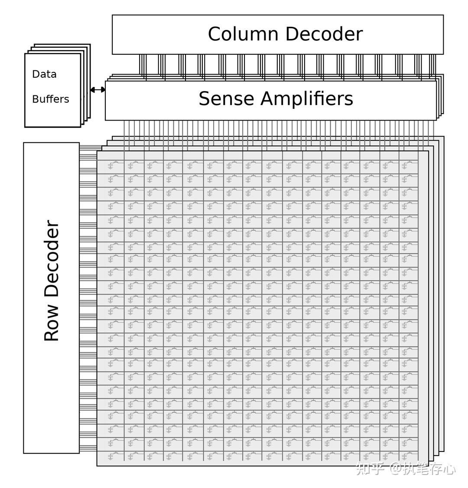

图10 DRAM阵列示意图
#### DRAM阵列连接方式

根据BL与SA的连接方式，可以将DRAM阵列分为Folded-BL和Open-BL两种结构，如图11所示。在Folded-BL结构中，连接到同一个SA的BL和/BL位于SA的同一侧，而在Open-BL结构中，连接到同一个SA的BL和/BL位于SA的两侧。DRAM从Folded-BL转向Open-BL结构是为了将存储单元的面积从 8F^{2} 降低至6F^{2}，即实现更高的存储密度。但Open-BL结构也有一些缺点，在Folded-BL结构中，对于选中的存储单元在WL打开时，由于BL和/BL位于SA的同一侧，因此WL对于BL和/BL的电容耦合效应是几乎相同的。而在Open-BL结构中，对于选中的存储单元在WL打开时，只有BL会受到电容耦合效应的影响，而BLB不会受到WL的电容耦合效应影响，即WL打开对于BL和/BL造成的影响是不对称的，因此会使SA的sensing margin降低。

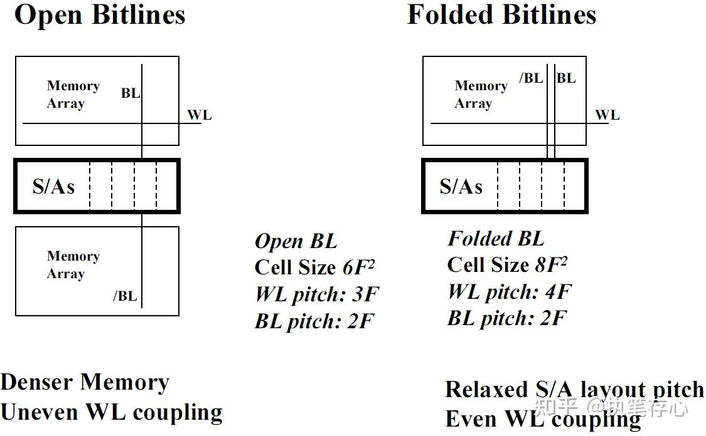

图11 Folded-BL和Open-BL型DRAM阵列
### DRAM电路设计

关于DRAM中SA电路的基本组成和原理，详见专题文章：

图12(a)展现了DRAM中典型的SA电路，它主要可以分为黄色部分的差分放大电路，绿色部分的EQ (Equalize)和PCH (Precharge)电路，和右侧的CSL (Column Select Line)电路。当对目标存储单元进行写入操作时，会将WE信号由低电平切换至高电平，于是写入的数据从Input和InputB分别传输至RBL和RBLB上，同时由于WL是打开的，因此写入的电平会存储在目标单元的SN节点上，随后WL关闭，完成数据的写入操作。

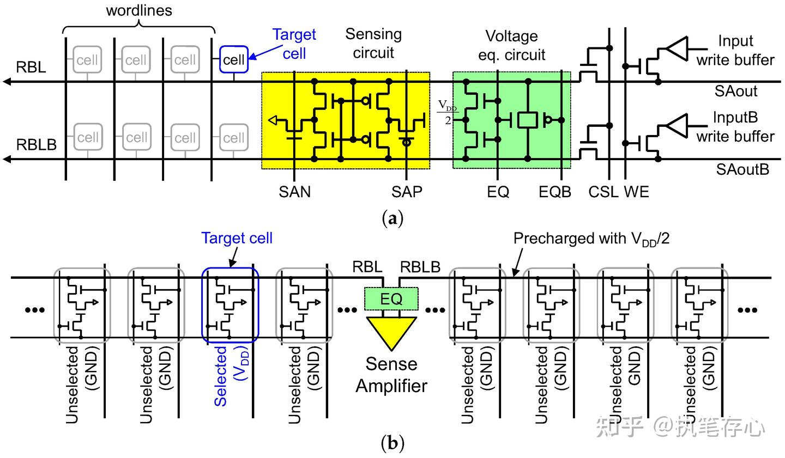

图12 (a) DRAM的SA电路组成(Folded-BL型DRAM阵列)；(b) Open-BL型DRAM阵列近年来，随着DRAM操作电压的不断下降以及尺寸微缩导致的存储电容不断下降，DRAM的存储窗口逐渐降低，这对于SA电路的设计提出了越来越高的要求。

### DRAM可靠性问题

#### Row Hammer与Passing gate效应

图13展示了Row Hammer与Passing gate效应的示意图，其中图13(b)为图13(a)黄色部分的截面示意图。

**Row Hammer**效应发生在同一个AA的不同WL之间，如图13(c)所示。其原理是当Aggressor WL反复开关时，可能会引起Victim SN的数据发生翻转。具体过程如下：当图13(c)中的Aggressor WL打开时，由于沟道反型，电子会在WL附近累积。当WL关闭时，累积的电子退散，其中部分电子会被注入到Victim SN连接的MOS管源端，如图中的箭头2所示，导致SN原本存储的高电位下降。当Aggressor WL反复开关到一定次数时，就可能导致原本存储的数据“1”翻转为“0”。

**Passing Gate**效应发生在不同AA的不同WL之间，如图13(d)所示。具体原理如下：当图13(d)中的Aggressor WL打开时，电子不断地从Victim SN连接的MOS管源端向Passing Gate (即Aggressor WL)附近吸引。在Precharge(即WL关闭时)，这些电子并不会完全回到Victim SN，而是有一部分会沿着图中箭头2所示的方向注入到AA中。当当Aggressor WL反复开关到一定次数时，就可能导致原本存储的数据“0”翻转为“1”。

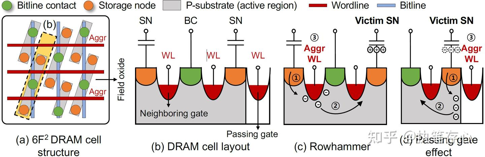

图13 Row Hammer与Passing gate效应示意图
### DRAM中的ECC

详见专题文章

### JEDEC DDR4介绍

详见专题文章

### 先进DRAM技术

#### 垂直晶体管与4F^{2} DRAM

目前DRAM已经在与6F^{2}的特征尺寸下停留了很多年，如图14所示的采用垂直晶体管的DRAM结构很早就被提出，它可以实现4F^{2}的等效尺寸。但一方面这种结构由于存在严重的浮体效应一直没有得到量产应用；另一方面由于阵列排布更为紧凑，Cbl会显著增加，为了继续保持SA的Sensing Margin，需要让Cs也成比例增大，但这意味着电容的高度或者介电材料的k值需要继续增加，但这两者在目前的DRAM工艺和材料体系下都已经很难继续提升，这也是导致4F^{2}结构迟迟难以应用的主要因素之一。

未来随着工艺技术的不断改进和器件结构的创新，4F^{2} DRAM或许会为DRAM制程的持续微缩注入新的活力。

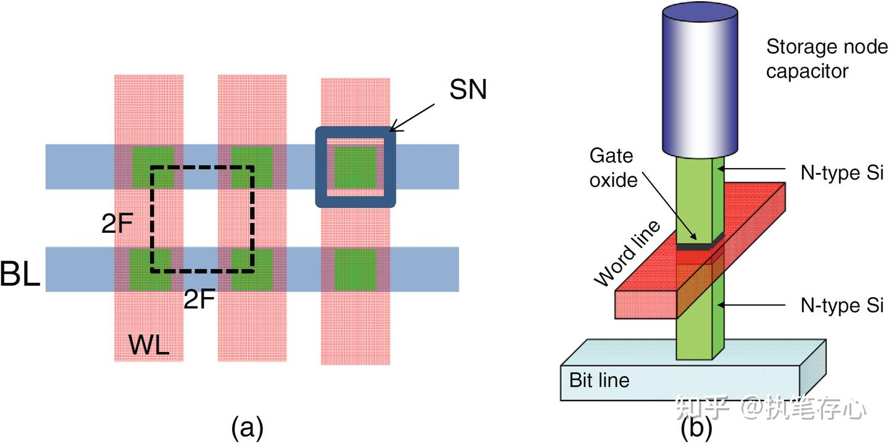

图14 (a) 4F2 DRAM的Layout (b)采用垂直晶体管实现4F2等效面积的DRAM 1T1C器件结构
### 基于IGZO的DRAM技术

目前，随着传统Si基DRAM技术的Scaling速度逐渐放缓，业界将目光投向了一种新型沟道材料——IGZO，基于IGZO沟道的TFT器件具有漏电流极低和制备温度低的特性，因而被广泛认为具备三维堆叠和异质集成的潜力。基于IGZO的DRAM技术进展详见以下专题文章：

### HBM

HBM主要是通过硅通孔（Through Silicon Via, TSV）技术进行芯片堆叠，以增加吞吐量并克服单一封装内带宽的限制，将数个DRAM裸片垂直堆叠，裸片之间用TSV技术连接。从技术角度看，HBM充分利用空间、缩小面积，正契合半导体行业小型化、集成化的发展趋势，并且突破了内存容量与带宽瓶颈，被视为新一代DRAM解决方案，目前正广泛应用于大算力AI芯片当中。

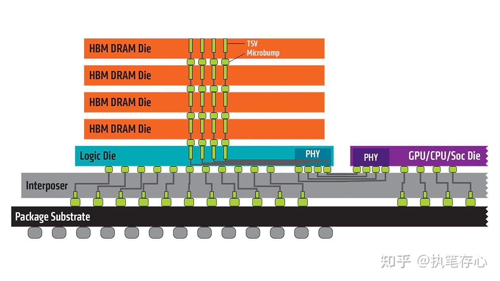

图15 HBM的结构示意图及其在AMD CPU/GPU芯片中的应用
### CXL

Compute Express Link (CXL)是由Intel发明的一种用于在处理器、内存扩展和加速器之间实现缓存一致互联的技术。CXL技术可以保持CPU内存空间与连接设备上的内存空间的内存一致性，从而允许资源共享以实现更高的性能、降低软件堆栈复杂度、降低整体系统成本。CXL同时也是一种用于高速数据传输的业界开放标准接口。CXL在PCIe 5.0的基础上加入了对缓存一致性的支持。
