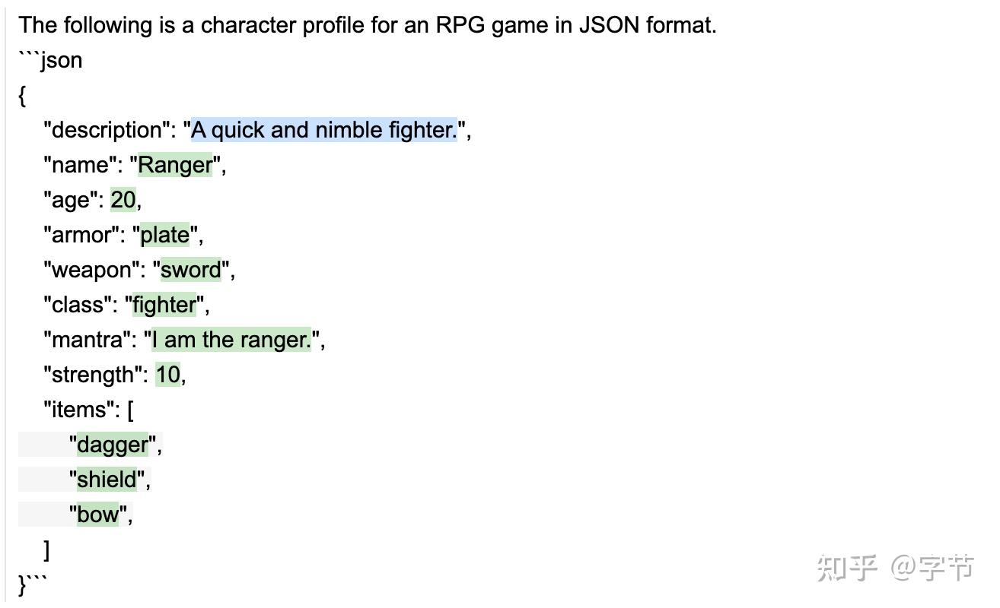

在做基于 LLM 的应用开发过程中，有几个常见的挑战，包括：如何避免“胡说八道”，提升模型输出的可靠性/稳定性，控制模型的计算开销和响应速度等等。目前主流的解决手段包括：

- 更好的 prompt 设计
- 通过 retrieval 来做增强
- 与外部工具的结合
- 流程编排与产品设计
- 考虑使用 fine tune 模型或混合模型应用


通过 prompt 来优化

之前的文章里也分享过上面的 prompt 技巧，虽然可以提升模型输出的质量，但也会导致响应速度和开销的增加，目前还没看到比较“完美”的解决方案。

最近在研究模型输出的可控性过程中，也发现了一些有意思的工作，还挺有启发。这里做一个简单的总结，与大家一起分享交流。

### guardrails

提到可控生成，最直接想到的步骤可能是：

- 首先通过 prompt 告知 LLM 我们所需要的返回格式，并进行生成。
- 通过一些规则来检查返回结果，如果不符合格式，生成相关错误信息。
- 将上一次的生成内容和检查的错误信息告知 LLM，进行下一次的修正生成。
- 重复 2-3 步骤，直到生成的内容完全符合我们的要求。
而 guardrails 这个项目，就是将上述的步骤做了进一步的抽象与封装，提供更加 high level 的配置与 API 来完成整个过程。其主要的组成部分包括：

- 定义了一套`RAIL` spec，用来描述上面第 1 点提到的返回格式限定。除了 output schema 的定义外，`RAIL`目前也支持 input schema，prompt 模板，以及 instructions 等其它配置。
- 提供了一系列的 validation 机制，对应上面的第 2 点。对于 validate 失败的部分，会保留其在 output schema 中的位置，生成相应的错误信息。
- 通过`ReAsk`类来实现上面的第 3 点，发送给 LLM 的内容会更聚焦于错误信息部分，且保留了结构，更便于 LLM 理解和处理。
- 其它像常用 prompt 模板之类的功能就不再赘述。

#### 示例

官网给的第一个案例是特定 json 格式的生成。我们可以来看下这个`RAIL` spec 的具体定义：

` version="0.1">

```text
     name="patient_info">
         name="gender" description="Patient's gender" />
         name="age" format="valid-range: 0 100" />
```

        
- 

```text
            name="symptoms"
            description="Symptoms that the patient is currently experiencing. Each symptom should be classified into a separate item in the list.">

                 name="symptom" description="Symptom that a patient is experiencing"/>

                    name="affected area"
                    description="What part of the body the symptom is affecting"
                    format="valid-choices: {['head', 'neck', 'chest']}"
                    on-fail-valid-choices="reask"
                />
```

            
        
```text
         name="current_meds" description="Medications the patient is currently taking and their response">

                 name="medication" description="Name of the medication the patient is taking" />

                    name="response"
                    description="How the patient is responding to the medication"
                />
```

            
        
    

Given the following doctor's notes about a patient, please extract a dictionary that contains the patient's information.

{{doctors_notes}}

@complete_json_suffix_v2

`

可以看到虽然比起常见的模板语言要更加“繁琐”，但可以包含的内容也可以更加完善。比如可以提供字段的描述信息，检查规范，一定程度上也能帮助 LLM 更好地理解需求，生成预期的结果。

当生成结果有问题时，例如前面的例子中，“affected area”并没有按照指定选项来生成：

`{

```text
    'patient_info': {
        'gender': 'Male',
        'age': 49,
        'symptoms': [
            {'symptom': 'macular rash', 'affected area': 'face & hair'},
            {'symptom': 'itchy, flaky, slightly scaly', 'affected area': 'beard, eyebrows & nares'}
        ],
        'current_meds': [{'medication': 'OTC steroid cream', 'response': 'Moderate response'}]
    }
```

}`

接下来 validator 会将相关的错误找出来，形成下一次 ReAsk 的请求内容。注意到这里错误的信息的位置是和原来的 json 结构保持一致的，并且正确的部分被省略了：

`I was given the following JSON response, which had problems due to incorrect values.

```text
{
  "patient_info": {
    "symptoms": [
      {
        "affected area": {
          "incorrect_value": "face & hair",
          "error_message": "Value face & hair is not in choices ['head', 'neck', 'chest']."
        }
      },
      {
        "affected area": {
          "incorrect_value": "beard, eyebrows & nares",
          "error_message": "Value beard, eyebrows & nares is not in choices ['head', 'neck', 'chest']."
        }
      }
    ]
  }
}
```


Help me correct the incorrect values based on the given error messages.`

后续 LLM 的返回可以仅针对这部分问题的修正，而不需要再重复生成整个 json。生成的新结果会由 guardrails 再自动填写回原来的位置，非常丝滑。

除了 json 格式的检查外，`RAIL` spec 中还提供了通过脚本检查的扩展支持，可以用来检查更加复杂的内容，例如 Python 代码是否合法，结果中是否有敏感信息，甚至通过 LLM 再来检查生成的内容是否有害，做结果过滤等。官网上有很多例子，比如下面这个是用来检查生成的摘要是否与原文相似：

` language='python'>
document = open("data/article1.txt", "r").read()

    
```text
        name="summary"
        description="Summarize the given document faithfully."
        format="similar-to-document: {document}, 0.60"
        on-fail-similar-to-document="filter" 
    />
```

`

原理方面相对来说也比较直观。项目代码还是蛮工程范的，清晰易读，在这里也不多做深入分析了。

### NeMo-Guardrails

来自 [Nvidia 的一个同名项目](https://link.zhihu.com/?target=https%3A//github.com/NVIDIA/NeMo-Guardrails)，其目标相比 guardrails 更有野心，想要确保 LLM 应用整体的可信度，无害性以及数据安全性等，而不仅仅只是输出的结构化检查和修复。因此其实现思路上也复杂不少，设计了一种专门的 [Colang 语言](https://link.zhihu.com/?target=https%3A//github.com/NVIDIA/NeMo-Guardrails/blob/main/docs/user_guide/colang-language-syntax-guide.md)，来支持更加通用多样的业务流，而不仅仅是生成 -> 检查 -> 修复。值得注意的是这个项目会更专注于用户与 LLM 的对话式交互应用，主要的设计都是围绕这个前提展开。

#### Flow 定义

这个项目中的`Colang`定义 flow 是一大特色，我们先来看个例子：

`define user ask capabilities
  "What can you do?"
  "What can you help me with?"
  "tell me what you can do"
  "tell me about you"
  "How can I use your help?"

define flow
  user ask capabilities
  bot inform capabilities

define bot inform capabilities
  "I am an AI assistant which helps answer questions based on a given knowledge base. For this interaction, I can answer question based on the job report published by US Bureau of Labor Statistics."`

乍一看是不是有点像 Python，但是很多地方又不像是编程语言，例如`define user ask capabilities`里后面的部分更像是自然语言，可以随意加空格。另外“函数体”的内容也比较诡异，有时候是一系列对话内容，有时候又好像是在引用一些其它流程操作。我初看的时候也是一头雾水，不知道为啥要这么设计。后面在讲到运作流程时或许就会更好理解这么设计的缘由。

上面这段代码中，`define flow`那段就是在定义一个业务流程，当用户询问 bot 的能力时，bot 应该回复其所具有的能力。在最后一个`define bot`的 block 里，还直接给出了具体回复的内容，可控性拉满。

对于应用来说，可以定义一系列的 flow 和 user/bot messages，当然也跟标准的编程语言一样，支持调用函数，条件控制，循环，嵌套 subflow 等。这在灵活性上相比以模板定义为主的 guardrails 显然是要强大了很多。

#### 运作流程

有了前面定义的 flow，其整体的运作流程如下：

根据用户输入识别用户意图。在这一步，系统会将用户的输入在 flow 定义的各种用户回复文本中做相似性查找，也就是上面文件中“What can you do?”这一连串内容。这些检索到的预设用户意图内容，结合其它信息如对话样例，最近聊天记录等，形成整体的 prompt，发给 LLM 来生成回复。最终再从回复中提取用户意图。
- 根据意图，判断下一步操作动作。这一步有两种做法，一是当前的状态能够匹配上预定义的 flow。例如用户就是提了一个 bot 能力的问题，那么就会匹配上面定义的`user ask capabilities`，下一步动作自然就是`bot inform capabilities`。如果没有匹配上，就要由 LLM 自己来决定下一步动作，这时候也会跟生成用户意图一样，对于 flow 定义做一个相似性查找，将相关信息发给 LLM 来做生成。
- 生成 bot 回复。如果上一步生成的 bot 回复意图已经有明确定义了（例如上面的 bot 能力的回复），那么就直接用预定义的回复内容来回复用户。如果没有，就跟生成用户意图一样，做意图的相似性查找，将相关信息给 LLM 来生成回复。注意到很多动态的问题例如 QA 场景，是很难预先定义好回复内容的，这里也支持对接知识库，同样是做 vector search 之后，将相关 context 信息发给 LLM 来生成具体回复。


流程示意图

从这个流程示意图中我们也可以看到，无论是用户输入，执行流程，还是 bot 回复，都大量使用到了近似搜索匹配的方法，所以前面看到的 flow 脚本这么像自然语言也好理解了。因为这部分“代码”的内容会被检索以及当作样例发给 LLM，这个设计还是挺有意思的。

#### 示例

项目中给出了很多非常实用的案例，包括事实性检查，限定对话主题，避免有害回复，调用外部工具等。其中一个用例是通过以下流程来检查回复是否有“幻觉”问题：

`define flow check hallucination
    bot ...

```text
    $result = execute check_hallucination
    if $result
        bot inform answer prone to hallucination
```


define bot inform answer prone to hallucination
    "The previous answer is prone to hallucination and may not be accurate. Please double check the answer using additional sources."
    "The above response may have been hallucinated, and should be independently verified."`

当然这样的流程自己通过 LangChain 之类的来写也并不麻烦，这样集中定义的 flow 或许能提升一些管理和复用的效率。此外接近自然语言的形式，或许业务专家也能参与到开发过程中来。目前这个项目应该也还在比较早期，如果要在生产环境深入使用，估计也很容易碰到像 LangChain 那样封装比较复杂不容易做 debug 和灵活修改适配的问题。

### guidance

[微软推出的开源项目](https://link.zhihu.com/?target=https%3A//github.com/microsoft/guidance)，几个作者看头像就很知名，分别是 [shap](https://link.zhihu.com/?target=https%3A//github.com/slundberg/shap)，[lime](https://link.zhihu.com/?target=https%3A//github.com/marcotcr/lime)，[checklist](https://link.zhihu.com/?target=https%3A//github.com/marcotcr/checklist) 的作者。之前有研究过 可解释机器学习 的同学应该不会陌生。从 explainable ai 到 controlable llm，倒也是很说得通的发展路径 :)

#### 示例

我们同样通过生成特定格式的 json 作为示例来看下 guidance 的能力。之前在 guardrails 中的做法是在 prompt 中给出说明和示范，希望 LLM 能够遵循指令来输出。但现实中往往会出现各种问题，例如额外带了一些其它的文字说明，或者生成的 json 格式不正确等，所以需要后续的 ReAsk 来进行修正。LangChain 里也提供了各种 output parser 来帮忙提取回复中的结构化信息部分，但也经常容易运行失败。

在 guidance 中，我们同样是通过“模板语言”来定义 LLM 的输出结构，以确保输出格式的正确性。这个结构比起 xml 来说会更易写易理解些：

`# load a model locally (we use LLaMA here)
guidance.llm = guidance.llms.Transformers("your_local_path/llama-7b", device=0)

# we can pre-define valid option sets
valid_weapons = ["sword", "axe", "mace", "spear", "bow", "crossbow"]

# define the prompt
program = guidance("""The following is a character profile for an RPG game in JSON format.
```json
{
    "description": "{{description}}",
    "name": "{{gen 'name'}}",
    "age": {{gen 'age' pattern='[0-9]+' stop=','}},
    "armor": "{{#select 'armor'}}leather{{or}}chainmail{{or}}plate{{/select}}",
    "weapon": "{{select 'weapon' options=valid_weapons}}",
    "class": "{{gen 'class'}}",
    "mantra": "{{gen 'mantra'}}",
    "strength": {{gen 'strength' pattern='[0-9]+' stop=','}},
    "items": [{{#geneach 'items' num_iterations=3}}
        "{{gen 'this'}}",{{/geneach}}
    ]
}```""")

# execute the prompt
program(description="A quick and nimble fighter.", valid_weapons=valid_weapons)`

其生成效果如下：



生成合法的 json 结构

在之前传统的做法中，这一整个 json 都需要由 LLM 来生成。但是 json 的结构是我们预先定义的，例如有哪些字段，开闭的花括号等，其实都不需要 LLM 来生成。所以在上图中，黑色部分的文字都是直接通过程序填入的，蓝色部分是我们传入的变量，只有绿色部分才是真正调用了 LLM 来生成的。这种做法与 guardrails 有明显的区别，带来两个好处：

- 生成的 json 结构是保证合法且可控的，不会出现语法错误或者缺失/错误字段等。
- 通过 LLM 生成的 token 数量减少了，理论上可以提升生成速度。
此外官网上还有很多其它示例，包括对话生成，与外部工具的结合等等，大家可以自取所需。

#### 特性

从上面的示例可以看出，guidance 将更加复杂的 Handlebars 模板 融入到了 prompt 中，使得原先需要复杂设计的 LLM 生成与程序处理交互过程可以很方便地在 prompt 中直接完成。在上面的例子中，只有当调用到`{{gen}}`命令时，才会触发 LLM 的生成操作。另外也有像`{{select}}`，`{{#geneach}}`，函数调用，逻辑判断，控制流等命令，有种结合了自然语言与编程语言两者长处的感觉。

除了 prompt 模板编程能力外，guidance 还有一系列高级特性，包括：

- 支持 hidden block，例如 LLM 的一些推理过程可能并不需要暴露给最终用户，就可以灵活利用这个特性来生成一些中间结果。
- Generation caching，自动把已经生成过的结果缓存起来，提升速度。
- 支持 HuggingFace 模型的 [guidance acceleration](https://link.zhihu.com/?target=https%3A//github.com/microsoft/guidance/blob/main/notebooks/guidance_acceleration.ipynb)，进一步提升生成速度。
- [Token healing](https://link.zhihu.com/?target=https%3A//github.com/microsoft/guidance/blob/main/notebooks/token_healing.ipynb)，不看这个我还不知道 LLM 有这种问题……
- [Regex pattern guide](https://link.zhihu.com/?target=https%3A//github.com/microsoft/guidance/blob/main/notebooks/pattern_guides.ipynb)，在模板的基础上进一步通过正则表达来限定生成的内容规范。
接下来我们挑几个有意思的来看看他们的实现如何。

#### 实现原理

模板化生成 json 背后的实现方式也比较直接，主要思想就是不断地处理整个模板的语法树，对于一些固定内容直接填入，到需要调用 LLM 生成的时候，再把前面部分的内容作为 prompt 去进行调用。例如前面的示例代码中，第一次调用 LLM 时的 prompt 就是：

`The following is a character profile for an RPG game in JSON format.
```json

```text
{
    "description": "A quick and nimble fighter.",
    "name": "`
```


将 LLM 的生成填入后，再继续执行整个模板的解析处理，以此类推。当然不同的操作指令会有各自的处理方式，例如碰到`{{select}}`命令时，会指定生成一个 token，并返回相应的 logprobs，然后通过 trie 树去匹配候选项，确定各自的概率，最后选择概率最高的那个。这就导致一些私有模型例如 GPT-3.5，GPT-4 等 API 中不支持返回 logprobs 的，就无法支持这类指令。包括像上面的 regex pattern guide 的实现，也需要动态获取与修改 inference 过程中的 logits，开源模型的优势在这里就体现出来了。


Regex pattern guide 实现

另外还有一个非常类似的 POC 项目 [JsonFormer](https://link.zhihu.com/?target=https%3A//github.com/1rgs/jsonformer)，也是针对 HuggingFace 的模型做了类似的 wrapper，功能和代码都要更加简单易懂。


JsonFormer

此外像 guidance acceleration 也是一个针对开源模型的功能，通过两个装饰器动替换了 transformers 模型中的`prepare_inputs_for_generation`和`_update_model_kwargs_for_generation`两个方法，实现了模型 inference 过程中的 kv 信息缓存，提升了生成速度。至于像 OpenAI 的模型嘛，只能做个简单的整体生成结果的缓存了……


guidance acceleration

从项目代码来看，还是有比较浓的“research 味道”的，可读性并不好。我也实际拿 OpenAI 的 text-davinci-003 测试了下上面的 json 生成示例，结果有点翻车：


实测效果

可以看到在生成`name`时，模型自动把整个 json 都生成完了，后面的`armor`，`items`等多少也有些问题。按我理解把模板后续内容作为`stop`信息加进去，效果应该会好一些，不知道是代码有 bug 还是本身就对 OpenAI 的支持不够好。不过这个项目总体来说的想法还是很有创新性的，尤其对开源模型白盒能力的利用方面很有启发，值得持续关注。

### lmql

在 guidance 的基础上，lmql 这个项目进一步把“prompt 模板”这个概念推进到了一种新的编程语言，倒是有点像前面 guardrails 跟 NeMo-Guardrails 的关系。项目本身提供了很漂亮的 playground 方便试用，注意如果要在本地玩这个项目，需要升级到 Python 3.10 的版本。

#### 示例

从官网能看到给出的一系列示例，也可以直接在 playground 里尝试。语法结构看起来有点像 SQL，但函数与缩进都是 Python 的风格。例如我们之前的很多案例中都有从 LLM 从指定元素集合中来选择生成：


从指定集合中生成

从支持的功能来看，相比 guidance 毫不逊色。例如各种限制条件，代码调用，各种 caching 加速，工具集成等基本都具备。个人感觉这个项目倒并不是主打“可控性”，而是其设计的语言的灵活性，可以有各种高级的玩法，例如：


通过程序维护了一个 working memory

可以在 reasoning 的过程中灵活调用代码来获取当前的状态。又比如：


通过 LLM 来进行排序

将排序过程中的`compare`方法交给 LLM 来生成，于是可以做到这种神奇的“情感排序”的效果。

#### 实现原理

因为主要关注可控性，所以我们主要来看下`where`条件中的那些限制是如何生效的。以上面从指定集合中生成为例，生成`[THING]`的逻辑与其它项目一样，都是使用前面的文本来生成当前位置的 token：


使用 LLM 生成“空缺”词

但是如何保证生成的词是在可选范围内的呢？这就涉及到了其 decode 算法，简单来说就是针对所有的候选词生成一个 mask 偏移量，使得 LLM 在生成时会偏向这些词。


通过 mask 来保证生成限定 token

仔细看了下，OpenAI 也支持通过传入 logit_bias 来修改生成 token 的概率，所以 lmql 也能够比较好的利用这类闭源模型。注意 GPT-3.5，GPT-4 这类 chat 模型并不支持这个参数，所以跟 guidance 一样，碰到这两个模型时，我们能做的“控制”会少很多。

另外值得一提的是，lmql 也支持一些高级的 decode 方法，例如 beam search 等，针对复杂的 prompt 模板可以达到比 greedy 生成更好的总体效果。

在 [lmql 的论文](https://link.zhihu.com/?target=https%3A//arxiv.org/pdf/2212.06094.pdf) 中，对于上述的流程有着更加详细的描述。粗看下来有很多在性能开销方面的优化，例如生成过程中的 partial evaluation 和 mask 的构建，各种 cache 的设计等。感兴趣的同学可以深入阅读。

#### 开发体验

前面几个项目在跑 demo 时或多或少都碰到了些问题，但 lmql 感觉是碰到问题最多，也最难 debug 的一个。可能是功力不够，对于各种 async 调用，streaming API 的 debug 没有很好的经验，一些简单流程的追踪都很困难。虽然 lmql 很贴心地提供了 playground IDE/cli，但个人体验下来也不是很好用，经常莫名卡住没有输出。所以如果有比较高的灵活性和定制化诉求的话，可能要谨慎使用这个项目。

不过如果 lmql 的标准模板已经能解决大部分问题了，或许可以一试。从项目库的工具集成与支持来看，有 LangChain，LlamaIndex 的对接支持，这点还是非常好评的。

### 总结

LLM 的可控性、稳定性、事实性、安全性等问题是推进企业级应用中非常关键的问题，上面分享的这些项目都是在这方面做了很多探索，也有很多值得借鉴的地方。总体思路上来说，主要是：

- 提供一套 prompt 模板定义，允许用户指定 LLM 生成的格式或内容主题。
- 在模板基础上，也有不少项目进一步设计了相应的编程语言，让 LLM 与确定性程序的交互更加直观。
- 提供各类 validator，保证生成内容符合预期，并且提供了自动处理/修正机制。
- 更进一步，也可以在生成前进行干预，例如在 prompt 中给近似案例，修改模型 decode 时的概率分布等。
- 其它在可控性基础上做的各种性能与开销的优化，例如缓存，减少 token 消耗量，对开源模型能力的挖掘等。
即使我们不直接使用上述的项目做开发，也可以从中学习到很多有用的思路。当然也非常期待这个领域出现更多有意思的想法与研究，以及 prompt 与编程语言结合能否碰撞出更多的火花。

今天的分享就到这里啦，Happy Hacking！
