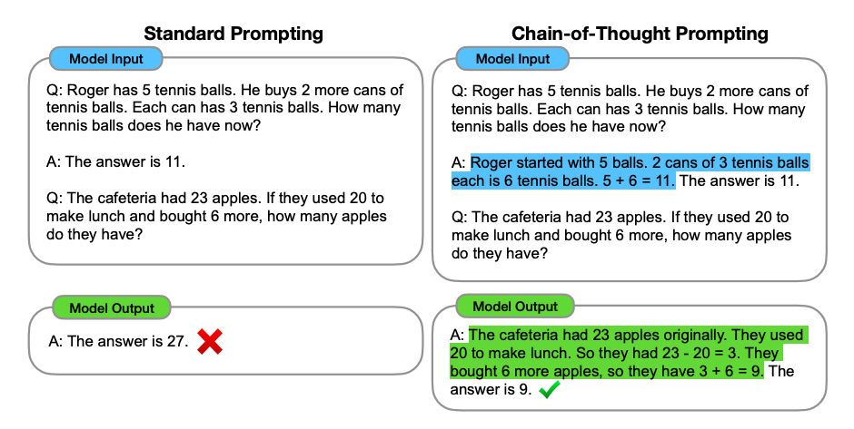
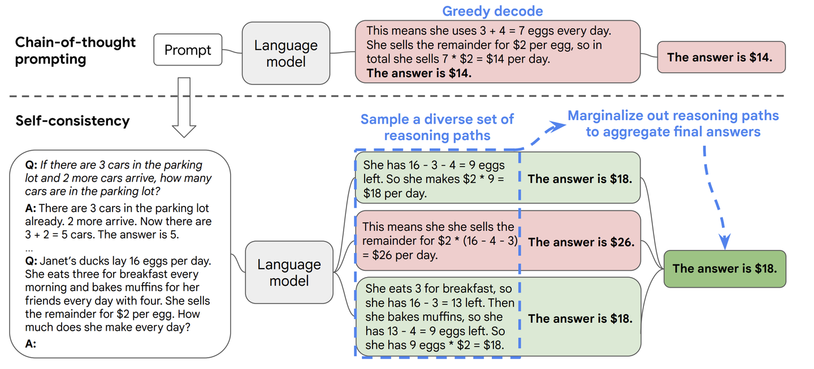
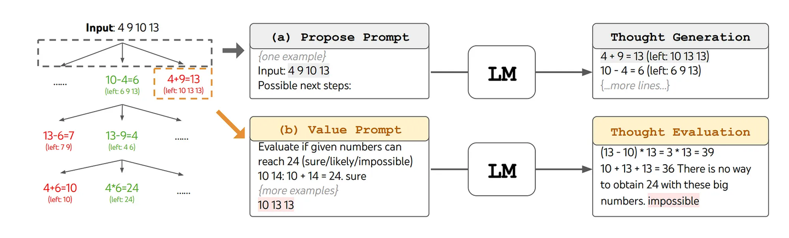
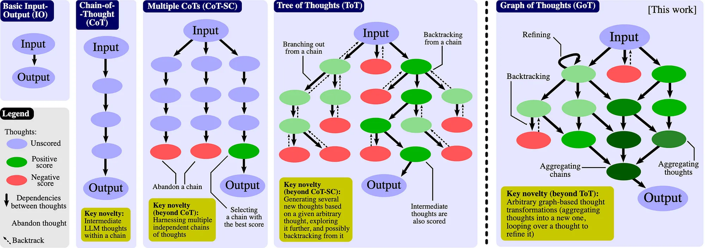
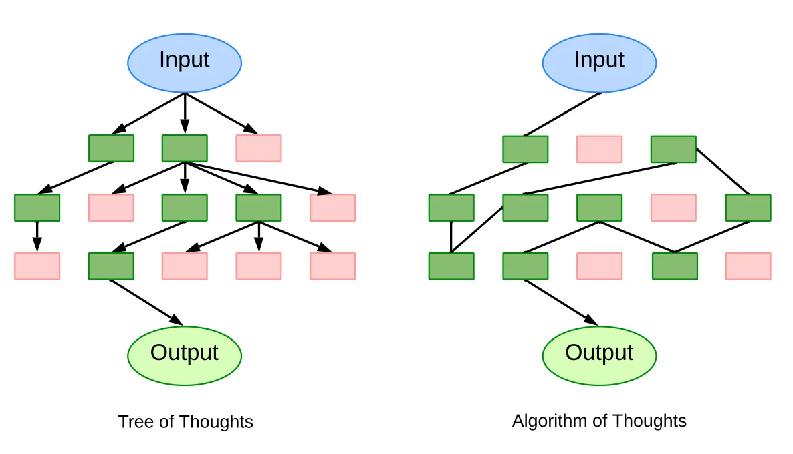
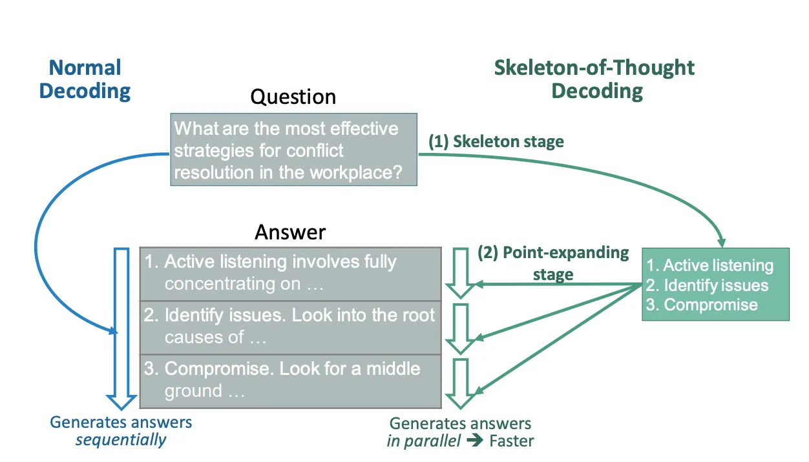
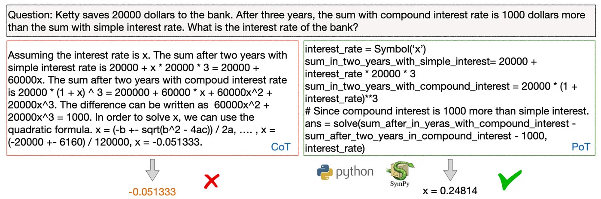

大语言模型的爆火也推动了大量prompt工程的研究，我想用过ChatGPT之类大模型的同学应该都听过思维链这一方法，简单好用！继思维链之后，延伸出了许多新的方法，本文主要梳理下目前常见的一些方法。

### **思维链(Chain-of-Thought，CoT)**

论文链接：[https://arxiv.org/pdf/2201.11903.pdf](https://link.zhihu.com/?target=https%3A//arxiv.org/pdf/2201.11903.pdf)

原理：将复杂问题分解成多步推理，在prompt中逐步提供示例引导

步骤：a) 分解问题；b) 设计示例；c) 组织示例为prompt；d) LLM逐步推理

### **CoT-Self-consistency**

论文链接：[https://arxiv.org/pdf/2203.11171.pdf](https://link.zhihu.com/?target=https%3A//arxiv.org/pdf/2203.11171.pdf)

原理：构建并行链，评估选择最佳链

步骤：a) 构建多个链；b) 评分；c) 选择最高分链

### **Tree-of-Thoughts (ToT)**

论文链接：[https://arxiv.org/pdf/2305.10601.pdf](https://link.zhihu.com/?target=https%3A//arxiv.org/pdf/2305.10601.pdf)

原理：树结构展开链，允许回溯迭代求优

步骤：a) 分解问题；b) 生成候选思维；c) 搜索遍历树；d) 评价思维求最优路径

### **Graph-of-Thoughts (GoT)**

论文链接：[https://arxiv.org/pdf/2308.09687.pdf](https://link.zhihu.com/?target=https%3A//arxiv.org/pdf/2308.09687.pdf)

原理：基于有向无环图，进行融合、提炼、迭代

步骤：a) 建图；b) 应用转换更新图；c) 评分思维；d) 排序思维；e) 返回最高分思维

### **Algorithm-of-Thoughts (AoT)**

论文链接：[https://arxiv.org/pdf/2308.10379.pdf](https://link.zhihu.com/?target=https%3A//arxiv.org/pdf/2308.10379.pdf)

原理：单一上下文，模拟搜索算法行为

步骤：a) 分解问题；b) 持续生成解；c) 评价解的可行性；d) 决定下一步搜索方向

### **Skeleton-of-Thought (SoT)**

论文链接：[https://arxiv.org/pdf/2307.15337.pdf](https://link.zhihu.com/?target=https%3A//arxiv.org/pdf/2307.15337.pdf)

原理：分阶段生成，先框架后扩展

步骤：a) 生成框架；b) 并行扩展框架细节

### **Program-of-Thoughts (PoT)**

论文链接：[https://arxiv.org/pdf/2211.12588.pdf](https://link.zhihu.com/?target=https%3A//arxiv.org/pdf/2211.12588.pdf)

原理：转化为可执行程序，结合程序运行结果

步骤：a) 转化为程序任务；b) 生成程序；c) 运行程序；d) 将程序结果融入答案

