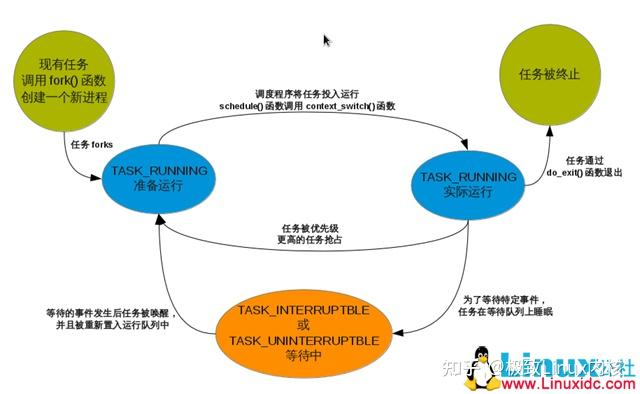

#### 【好文推荐】

[Linux文件系统详解](https://zhuanlan.zhihu.com/p/581250390)

[一文透彻了解缺页异常](https://zhuanlan.zhihu.com/p/583396235)

[ARM架构处理器解析【最全的一篇！】](https://zhuanlan.zhihu.com/p/587529714)

[Linux内核操作系统： 内存映射（图文详解）！](https://zhuanlan.zhihu.com/p/582798188)

[代码大佬的【Linux内核开发笔记】分享，前人栽树后人乘凉！](https://zhuanlan.zhihu.com/p/581640011)

### 进程管理

#### 进程描述符及任务结构

进程存放在叫做任务队列（tasklist）的双向循环链表中。链表中的每一项包含一个具体进程的所有信息，类型为task_struct，称为进程描述符（process descriptor），该结构定义在
- 文件中。

Linux通过slab分配器分配task_struct结构，这样能达到对象复用和缓存着色（cache coloring）的目的。另一方面，为了避免使用额外的寄存器存储专门记录，让像x86这样寄存器较少的硬件体系结构只要通过栈指针就能计算出task_struct的位置，该结构为thread_info，在文件中定义。

Linux中可以用ps命令查看所有进程的信息。

#### 进程状态

task_struct中的state描述进程的当前状态。进程的状态一共有5种，而进程必然处于其中一种状态：

1）TASK_RUNNING（运行）——进程是可执行的，它或者正在执行，或者在运行队列中等待执行。这是进程在用户空间中执行唯一可能的状态；也可以应用到内核空间中正在执行的进程。

2）TASK_INTERRUPTIBLE（可中断）——进程正在睡眠（也就是说它被阻塞）等待某些条件的达成。一旦这些条件达成，内核就会把进程状态设置为运行，处于此状态的进程也会因为接收到信号而提前被唤醒并投入运行。

3）TASK_UNINTERRUPTIBLE（不可中断）——除了不会因为接收到信号而被唤醒从而投入运行外，这个状态与可打断状态相同。这个状态通常在进程必须在等待时不受干扰或等待事件很快就会发生时出现。由于处于此状态的任务对信号不作响应，所以较之可中断状态，使用得较少。

4）TASK_ZOMBIE（僵死）——该进程已经结束了，但是其父进程还没有调用wait4()系统调用。为了父进程能够获知它的消息，子进程的进程描述符仍然被保留着。一旦父进程调用了wait4()，进程描述符就会被释放。

5）TASK_STOPPED（停止）——进程停止执行，进程没有投入运行也不能投入运行。通常这种状态发生在接收到SIGSTOP，SIGTSTP，SIGTTIN，SIGTTOU等信号的时候。此外，在调试期间接收到任何信号，都会使进程进入这种状态。

需要调整进程的状态，最好使用set_task_state(task, state)函数，在必要的时候，它会设置内存屏障来强制其他处理器作重新排序（SMP）。

进程的各个状态之间的转化构成了进程的整个生命周期，

#### 进程的创建

在Linux系统中，所有的进程都是PID为1的init进程的后代。内核在系统启动的最后阶段启动init进程。该进程读取系统的初始化脚本（initscript）并执行其他的相关程序，最终完成系统启动的整个进程。

Linux提供两个函数去处理进程的创建和执行：fork()和exec()。首先，fork()通过拷贝当前进程创建一个子进程。子进程与父进程的区别仅仅在于PID（每个进程唯一），PPID（父进程的PID）和某些资源和统计量（例如挂起的信号）。exec()函数负责读取可执行文件并将其载入地址空间开始运行。

fork()使用写时拷贝（copy-on-write）页实现。内核在fork进程时不复制整个进程地址空间，让父进程和子进程共享同一个拷贝，当需要写入时，数据才会被复制，使各进程拥有自己的拷贝。在页根本不会被写入的情况下（fork()后立即exec()），fork的实际开销只有复制父进程的页表以及给子进程创建唯一的task_struct。

创建进程的fork()函数实际上最终是调用clone()函数。创建线程和进程的步骤一样，只是最终传给clone()函数的参数不同。比如，通过一个普通的fork来创建进程，相当于：clone(SIGCHLD, 0)；创建一个和父进程共享地址空间，文件系统资源，文件描述符和信号处理程序的进程，即一个线程：clone(CLONE_VM | CLONE_FS | CLONE_FILES |CLONE_SIGHAND, 0)。

在内核中创建的内核线程与普通的进程之间还有个主要区别在于：内核线程没有独立的地址空间，它们只能在内核空间运行。

#### fork和vfork的区别

fork（）与vfock（）都是创建一个进程，那他们有什么区别呢？总结有以下三点区别：

fork （）：子进程拷贝父进程的数据段，代码段
vfork （ ）：子进程与父进程共享数据段
- fork （）父子进程的执行次序不确定
vfork 保证子进程先运行，在调用exec 或exit 之前与父进程数据是共享的,在它调用exec
或exit 之后父进程才可能被调度运行。
- vfork （）保证子进程先运行，在她调用exec 或exit 之后父进程才可能被调度运行。如果在
调用这两个函数之前子进程依赖于父进程的进一步动作，则会导致死锁。

#### 进程终止

进程在运行结束，或接受到它既不能处理也不能忽略的信号，或异常时，都会被终结。此时，依靠do_exit()（在kernel/exit.c文件中）把与进程相关联的所有资源都被释放掉（假设进程是这些资源的唯一使用者）。至此，与进程相关的所有资源都被释放掉了。进程不可运行（实际上也没有地址空间让它运行）并处于TASK_ZOMBIE状态。它占用的所有资源就是内核栈、thread_info和task_struct。此时进程存在的唯一目的就是想它的父进程提供信息。在父进程获得已终结的子进程的信息后，或者通知内核它并不关注那些信息后，子进程持有的task_struct等剩余内存才被释放。

#### 孤儿进程问题

如果父进程在子进程之前退出，必须有机制保证子进程能找到一个新的父类，否则的话这些成为孤儿的进程就会在退出时永远处于僵死状态，白白的耗费内存。解决方法是给子进程在当前线程组内找一个线程作为父亲，如果不行，就让init做它们的父进程。

### 进程调度

#### 什么是调度

现在的操作系统都是多任务的，为了能让更多的任务能同时在系统上更好的运行，需要一个管理程序来管理计算机上同时运行的各个任务（也就是进程）。

这个管理程序就是调度程序，它的功能说起来很简单：

1.决定哪些进程运行，哪些进程等待

2.决定每个进程运行多长时间

此外，为了获得更好的用户体验，运行中的进程还可以立即被其他更紧急的进程打断。总之，调度是一个平衡的过程。一方面，它要保证各个运行的进程能够最大限度的使用CPU(即尽量少的切换进程，进程切换过多，CPU的时间会浪费在切换上)；另一方面，保证各个进程能公平的使用CPU(即防止一个进程长时间独占CPU的情况)。

#### 策略

#### I/O消耗型和处理器消耗型的进程

I/O消耗型进程：大部分时间用来提交I/O请求或是等待I/O请求，经常处于可运行状态，但运行时间短，等待请求过程时处于阻塞状态。如交互式程序。

处理器消耗型进程：时间大都用在执行代码上，除非被抢占否则一直不停的运行。

调度策略要在：进程响应迅速（响应时间短）和最大系统利用率（高吞吐量）之间寻找平衡。

Linux为了保证交互式应用，所以对进程的相应做了优化，更倾向于优先调度I/O消耗型进程。

#### 进程优先级

调度算法中最基本的一类就是基于优先级的调度。这是一种根据进程的价值和其对处理器时间的需求来对进程分级的想法。优先级高的进程先运行，低的后运行，相同优先级的进程按轮转方式进行调度。

Linux根据以上思想实现了一种基于动态优先级的调度方法。一开始，该方法先设置基本的优先级，然而它允许调度程度根据需要来加、减优先级。例如，如果一个进程在I/O等待上耗费的时间多于其运行时间，那么该进程明显属于I/O消耗型，它的优先级会被动态提高。相反，处理器消耗型进程的优先级会被动态降低。

Linux内核提供两组独立的优先级范围。第一种是nice值，范围从-20到+19，默认值是0。nice值越大优先级越低。第二种是实时优先级，其值可配置，范围从0到99，任何实时进程的优先级都高于普通的进程。

#### 时间片

时间片是一个数值，它表明进程在被抢占前所能持续运行的时间，I/O消耗型不需要长的时间片，而处理器消耗型的进程则希望越长越好。时间片的大小设置并不简单，设大了，系统响应变慢(调度周期长)；设小了，进程频繁切换带来的处理器消耗。

Linux调度程序提高交互程序的优先级，让它们运行得更频繁。于是，调度程序提供了比较长的默认时间片给交互程序。此外，Linux调度程序还能根据进程的优先级动态调整分配给它的时间片。从而保证优先级高的进程，假定也是重要性高的进程，执行的频率高，执行时间长。通过实现这样一种动态调整优先级和时间片长度的机制，Linux调度性性能不但非常稳定而且也很强健。

注意，进程并不是一定非要一次就用完它所有的时间片，例如一个拥有100毫秒时间片的进程，可以通过重复调度，分5次每次20毫秒用完这些时间片。

当一个进程的时间耗尽时，就认为到期了。没有时间片的进程不会再投入运行，除非等到其他所有的进程都耗尽了他们的时间片。那个时候，所有进程的时间片会被重新计算。

#### 进程抢占

Linux是抢占式的。当一个进程进入TASK_RUNNING状态，内核会检查它的优先级是否高于当前正在执行的进程。如果是这样，调度程序会被唤醒，抢占当前正在运行的进程并运行新的可运行进程。此外，当一个进程的时间片变为0时，它会被抢占，调度程序被唤醒以选择一个新的进程。

#### 调度算法

#### 可执行队列

调度程序中最基本的数据结构式运行队列(runqueue)。可执行队列是给定处理器上的可执行进程的链表，每个处理器一个。每个可投入运行的进程都唯一的归属于一个可执行队列。此外，可执行队列中还包含每个处理器的调度信息。所以，可执行队列也是每个处理器最重要的数据结构。

为了避免死锁，要锁住多个运行队列的代码必须总是按照同样的顺序获取这些锁:按照可执行队列地址从低向高的顺序。

#### 优先级数组

每个运行队列都有两个优先级数组，一个活跃的和一个过期的。优先级数组是一种能够提供O（1）级算法复杂度的数据结构。优先级数组使可运行处理器的每一种优先级都包含一个相应的队列，而这些队列包含对应优先级上的可执行进程链表。优先级数组还拥有一个优先级位图，当需要查找当前系统内拥有最高优先级的可执行进程时，它可以帮助提高效率。

#### 重新计算时间片

许多操作系统在所有进程的时间片都用完时，都采用一种显示的方法来计算时间片。典型的实现是循环访问每个进程，这样可能会耗费相当长的时间，最坏情况为O(N)；重算时必须考锁的形式来保护任务队列和每个进程描述符，这样做会加剧对锁的争用；重新计算时间的实际不确定。

活跃数组内的可执行队列上的进程都还有时间片剩余，而过期数组内的都耗尽了时间片。当一个进程的时间片耗尽时，它会被移至过期数组，但在此之前，时间片已经给它重新计算好。重新计算时间片变得非常简单，只要在活跃和过期数组之间来回切换，这是O（1）级调度程序的核心。

#### schedule()

选定下一个进程并切换到它去执行是通过schedule()函数实现的。当内核代码想要休眠时，会直接调用该函数，另外，如果有哪个进程将被抢占，那么该函数也会被唤起执行。schedule()函数独立于每个处理器运行。

首先要在活动优先级数组中找到第一个被设置的位，该位对于这优先级最高的可执行进程。然后，调度程序选择这个级别链表里的有一个进程。这就是系统中优先级最高的可执行程序。如果被选中的进程不是当前进程，就进行上下文切换。

#### 计算优先级和时间片

nice值之所以起名为静态优先级，是因为它从一开始由用户指定后，就不能改变。动态优先级通过一个关于静态优先级和进程交互性的函数关系计算而来。effective_prio()函数可以返回一个进程的动态优先级。这个函数以nice值为基数，再加上-5到+5之间的进程交互性的奖励或罚分。

怎么通过一些推断来获取准确反映进程到底是I/O消耗型的还是处理器消耗型的。最明显的标准莫过于进程休眠的时间长短了。如果一个进程的大部分时间都在休眠，那么它就是I/O消耗型的。如果一个进程执行的时间比休眠的时间长，那它就是处理器消耗型的。

另一方面，重新计算时间片相对简单了。它只要以静态优先级为基础就可以了。在一个进程创建的时候，新建的子进程和父进程均分父进程剩余的进程时间片。这样的分配很公平并且防止用户通过不断创建新进程来不停地获取时间片。task_timeslice()函数为给定任务返回一个新的时间片。时间片的计算只需要把优先级按比例缩放，使其符合时间片的数值范围要求就可以了。进程的静态优先级越高，它每次执行得到的时间片就越长。

调度程序还提供了另外一种机制以支持交互进程:如果一个进程的交互性非常强，那么当它时间片用完后，它会被放置到活动数组而不是过期数组中。

#### 睡眠与唤醒

休眠(被阻塞)的进程处于一个特殊的不可执行状态。进程把它自己标记成休眠状态，把自己从可执行队列移出，放入等待队列，然后调用schedule()选择和执行一个其他进程。唤醒的过程刚好相反:进程被设置为可执行状态，然后再从等待队列中移到可执行队列。

休眠有两种相关的进程状态:TASK_INTERRUPTIBLE和TASK_UNINTERRUPTIBLE。休眠通过等待队列进行处理。等待队列是由等待某些事件发生的进程组成的简单链表。内核用wake_queue_head_t来代表等待队列。等待队列可以通过DECLARE_WAITQUEUE()静态创建，也可以由init_waitqueue_head()动态创建。唤醒操作通过函数wake_up()进行，它会唤醒指定的等待队列上的所有进程。

#### 负载平衡

Linux的调度程序为堆成多处理系统的每个处理器准备了单独的可执行队列和锁。为了使各个可执行队列上的负载平衡，提供了负载平衡程序。如果它发现了不平衡，就会把相抵繁忙的队列中的进程抽到当前的可自行队列中来。

负载平衡程序有kernel/sched.c中的函数load_balance()来实现。它有两种调用方法。在schedule()执行的时候，只要当前的可执行队列为空，它就会被调用。此外，它还会被定时器调用:系统空闲时每隔1毫秒调用一次或者在其他情况下每隔200毫秒调用一次。负载平衡程序调用时需要锁住当前处理器的可执行队列并且屏蔽中断，以避免可执行队列被并发地访问。

#### 抢占和上下文切换

上下文切换，也就是从一个可执行进程切换到另一个可执行进程。进程切换schedule函数调用context_switch()函数完成以下工作：

1.调用定义在中的switch_mm()，该函数负责把虚拟内存从上一个进程映射切换到新进程中。

2.调用定义在中的switch_to()，该函数负责从上一个进程的处理器状态切换到新进程的处理器状态。这包括保存、恢复栈信息和寄存器信息。

前面看到schedule函数调用有很多种情况，完全依靠用户来调用不能达到很好的效果。内核需要判断什么时候调用schedule，内核提供了一个need_resched标志来表明是否需要重新执行一次调度：

1当某个进程耗尽它的时间片时，scheduler_tick()就会设置这个标志；

2当一个优先级高的进程进入可执行状态的时候，try_to_wake_up()也会设置这个标志。

每个进程都包含一个need_resched标志，这是因为访问进程描述符内的数值要比访问一个全局变量快

#### 用户抢占

内核即将返回用户空间时候，如果need_resched标志被设置，会导致schedule函数被调用，此时发生用户抢占。

用户抢占在以下情况时产生：

1.从系统调返回用户空间。

2．从中断处理程序返回用户空间。

#### 内核抢占

只要重新调度是安全的，那么内核就可以在任何时间抢占正在执行的任务。

什么时候重新调度才是安全的呢？只要没有持有锁，内核就可以进行抢占。

锁是非抢占区域的标志。由于内核是支持SMP的，所以，如果没有持有锁，那么正在执行的代码就是可重新导入的，也就是可以抢占的。

内核抢占会发生在：

1．当从中断处理程序正在执行，且返回内核空间之前。

2．当内核代码再一次具有可抢占性的时候。

3．如果内核中的任务显式的调用schedule()。

4.如果内核中的任务阻塞（这同样也会导致调用schedule()）。

原文作者：首页 - 内核技术中文网 - 构建全国最权威的内核技术交流分享论坛

原文地址：进程的管理与调度 - 圈点 - 内核技术中文网 - 构建全国最权威的内核技术交流分享论坛（版权归原文作者所有，侵权联系删除）

